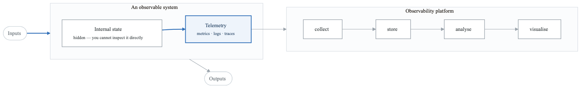
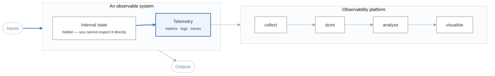
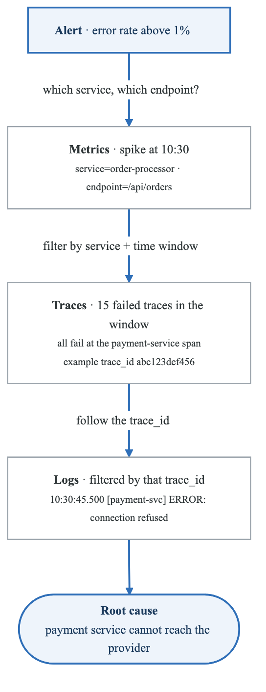
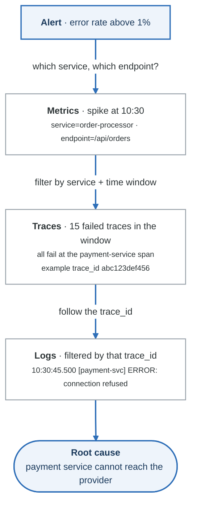
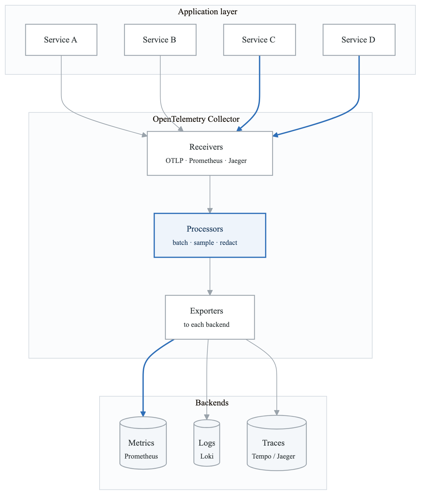
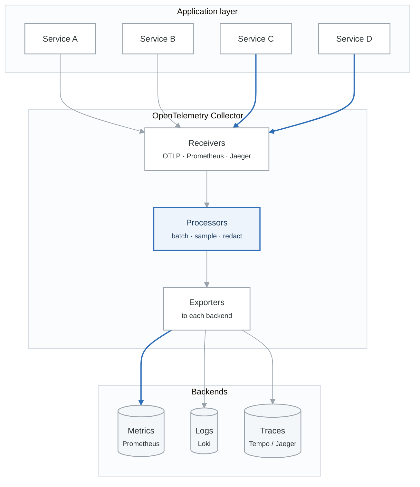
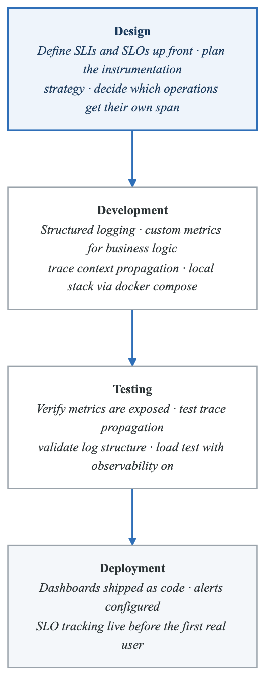
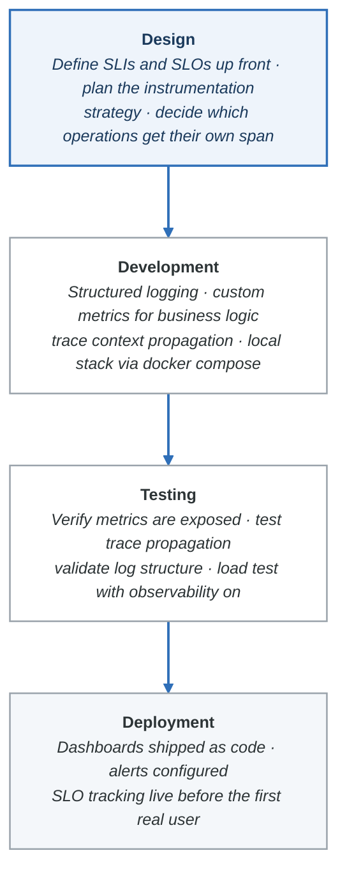

# Module 1: Observability Fundamentals

## Learning Objectives

By the end of this module, you will be able to:
- Distinguish between monitoring and observability
- Explain the three pillars of observability: metrics, logs, and traces
- Design observability strategies for complex distributed systems
- Evaluate observability maturity and identify improvement areas
- Implement observability-driven development practices

## Introduction

In modern distributed systems, understanding system behavior has evolved from simple monitoring to comprehensive observability. While monitoring tells you when something is wrong, observability tells you why—enabling you to ask arbitrary questions about your systems without deploying new instrumentation.

## 1. From Monitoring to Observability

### The Evolution of System Visibility

| Traditional monitoring | Modern observability |
|---|---|
| Known-unknowns | **Unknown-unknowns** |
| Predefined dashboards | Ad-hoc exploration |
| Threshold-based alerts | Burn-rate and anomaly detection |
| Siloed data | Correlated telemetry |
| Reactive troubleshooting | Proactive investigation |

The distinction that matters: monitoring answers questions you thought to ask in advance.
Observability lets you ask a question you had not thought of, about an incident already in progress.

### Defining Observability

**Observability** is the ability to understand the internal state of a system by examining its external outputs. A system is observable when you can determine what's happening inside without modifying the code.

<!-- figure: generated from the Mermaid below by _shared/diagrams/embed-figures.py — do not edit the image -->


<details>
<summary>Diagram source (Mermaid)</summary>



</details>

### Monitoring vs. Observability

| Aspect | Monitoring | Observability |
|--------|-----------|---------------|
| **Focus** | Known failure modes | Unknown failure modes |
| **Approach** | Dashboard-centric | Exploration-centric |
| **Questions** | Predefined | Ad-hoc |
| **Data** | Aggregated metrics | High-cardinality data |
| **Response** | Alerting on thresholds | Understanding behavior |
| **Debugging** | Symptom-based | Root cause analysis |

## 2. The Three Pillars of Observability

### Pillar 1: Metrics

Metrics are numerical measurements collected at regular intervals. They provide a quantitative view of system health.

```yaml
# Types of Metrics

Counter:
  description: "Monotonically increasing value"
  example: "http_requests_total"
  use_case: "Request counts, error counts"

Gauge:
  description: "Value that can go up or down"
  example: "memory_usage_bytes"
  use_case: "Current connections, queue size"

Histogram:
  description: "Distribution of values in buckets"
  example: "http_request_duration_seconds"
  use_case: "Latency percentiles, request sizes"

Summary:
  description: "Similar to histogram with pre-calculated quantiles"
  example: "request_latency_summary"
  use_case: "When client-side percentiles are needed"
```

**Metric Naming Conventions**:
```
# Format: <namespace>_<subsystem>_<name>_<unit>

# Good Examples
http_server_requests_total
http_server_request_duration_seconds
database_connection_pool_size
cache_hit_ratio

# Anti-patterns
requests          # Too vague
httpRequestTime   # Wrong format (camelCase)
latency_ms        # Unit should be base unit (seconds)
```

**Cardinality Considerations**:
```
# Low Cardinality (Good)
http_requests_total{method="GET", status="200"}
# ~50 unique combinations

# High Cardinality (Problematic)
http_requests_total{method="GET", user_id="12345", request_id="abc123"}
# Millions of unique combinations = storage explosion
```

### Pillar 2: Logs

Logs are timestamped records of discrete events that happened in a system.

```json
// Unstructured Log (Hard to parse)
"2024-01-15 10:30:45 ERROR Failed to process order #12345 for user john@example.com"

// Structured Log (Easy to analyze)
{
  "timestamp": "2024-01-15T10:30:45.123Z",
  "level": "error",
  "service": "order-processor",
  "event": "order_processing_failed",
  "order_id": "12345",
  "user_email": "john@example.com",
  "error_code": "PAYMENT_DECLINED",
  "error_message": "Insufficient funds",
  "trace_id": "abc123def456",
  "span_id": "789xyz",
  "duration_ms": 234
}
```

**Log Levels and Usage**:
```python
# Python logging example with structured context

import structlog

logger = structlog.get_logger()

# TRACE: Extremely detailed, usually only in development
logger.debug("Entering function", function="process_order", args={"order_id": "123"})

# DEBUG: Detailed information for debugging
logger.debug("Cache lookup", key="user:123", cache_hit=True)

# INFO: Normal operational events
logger.info("Order processed", order_id="123", amount=99.99, currency="USD")

# WARNING: Unexpected but handled situations
logger.warning("Retry attempt", service="payment", attempt=2, max_attempts=3)

# ERROR: Failures that need attention
logger.error("Payment failed", order_id="123", error_code="TIMEOUT")

# CRITICAL/FATAL: System-wide failures
logger.critical("Database connection lost", host="db-primary", retry_in=30)
```

### Pillar 3: Traces

Traces track the journey of a request through a distributed system, showing causality and timing.

**Trace: A complete request journey**

- Span A: Frontend (50ms total)
  - Start: t=0ms
  - Tags: {service: "web-frontend", http.method: "POST"}
  - Child Span B: API Gateway (45ms)
    - Start: t=2ms
    - Tags: {service: "api-gateway", route: "/api/orders"}
    - Child Span C: Order Service (30ms)
      - Start: t=5ms
      - Tags: {service: "order-svc", operation: "create"}
      - Child Span D: Database (10ms)
        - Start: t=8ms
        - Tags: {db.type: "postgresql", db.statement: "INSERT..."}
      - Child Span E: Payment Service (15ms)
        - Start: t=20ms
        - Tags: {service: "payment-svc", provider: "stripe"}
    - End: t=47ms
- End: t=50ms


**Trace Context Propagation**:
```python
# W3C Trace Context Headers
# Request: Frontend → Backend

# HTTP Headers
traceparent: 00-4bf92f3577b34da6a3ce929d0e0e4736-00f067aa0ba902b7-01
#            │  │                                │                  │
#            │  │                                │                  └── Flags (sampled)
#            │  │                                └── Parent Span ID
#            │  └── Trace ID (128-bit)
#            └── Version

tracestate: vendor1=value1,vendor2=value2
```

## 3. Telemetry Data Correlation

### The Power of Correlation

When metrics, logs, and traces are connected, debugging becomes significantly easier:

<!-- figure: generated from the Mermaid below by _shared/diagrams/embed-figures.py — do not edit the image -->


<details>
<summary>Diagram source (Mermaid)</summary>



</details>

### Implementing Correlation

```python
# Example: Correlating all three pillars

import uuid
from opentelemetry import trace
from prometheus_client import Counter, Histogram
import structlog

# Initialize tracer
tracer = trace.get_tracer(__name__)

# Metrics
REQUEST_COUNT = Counter(
    'http_requests_total',
    'Total HTTP requests',
    ['method', 'endpoint', 'status']
)
REQUEST_LATENCY = Histogram(
    'http_request_duration_seconds',
    'HTTP request latency',
    ['method', 'endpoint']
)

# Structured logging with trace context
def get_logger():
    """Get a logger that includes trace context."""
    span = trace.get_current_span()
    context = span.get_span_context()

    return structlog.get_logger().bind(
        trace_id=format(context.trace_id, '032x'),
        span_id=format(context.span_id, '016x')
    )

# Usage in request handler
@app.route('/api/orders', methods=['POST'])
def create_order():
    with tracer.start_as_current_span("create_order") as span:
        logger = get_logger()
        start_time = time.time()

        try:
            # Add span attributes
            span.set_attribute("order.customer_id", request.json['customer_id'])

            logger.info("Processing order", customer_id=request.json['customer_id'])

            # Process order...
            result = process_order(request.json)

            # Record success metrics
            REQUEST_COUNT.labels(
                method='POST',
                endpoint='/api/orders',
                status='200'
            ).inc()

            logger.info("Order created", order_id=result['order_id'])
            return jsonify(result), 200

        except Exception as e:
            # Record error
            span.record_exception(e)
            span.set_status(trace.Status(trace.StatusCode.ERROR, str(e)))

            REQUEST_COUNT.labels(
                method='POST',
                endpoint='/api/orders',
                status='500'
            ).inc()

            logger.error("Order creation failed", error=str(e))
            raise

        finally:
            # Record latency
            duration = time.time() - start_time
            REQUEST_LATENCY.labels(
                method='POST',
                endpoint='/api/orders'
            ).observe(duration)
```

## 4. Observability Maturity Model

### The Five Levels

**Level 5: Predictive**

- ML-based anomaly detection
- Automated remediation
- Chaos engineering integration
- Business outcome correlation

**Level 4: Proactive**

- SLO-based alerting
- Distributed tracing everywhere
- Cross-team observability
- Self-service dashboards

**Level 3: Reactive**

- Centralized logging
- Application metrics
- Basic distributed tracing
- Incident response playbooks

**Level 2: Basic Monitoring**

- Infrastructure metrics
- Log aggregation
- Simple alerting
- Manual troubleshooting

**Level 1: Ad-hoc**

- SSH into servers
- Manual log checking
- No centralized view
- Firefighting mode


### Maturity Assessment

```yaml
# Observability Maturity Scorecard

instrumentation:
  level_1: "No instrumentation"
  level_2: "Basic infrastructure metrics"
  level_3: "Application metrics and structured logs"
  level_4: "Distributed tracing + custom business metrics"
  level_5: "Automatic instrumentation + continuous profiling"

correlation:
  level_1: "No correlation"
  level_2: "Manual correlation using timestamps"
  level_3: "Request IDs across services"
  level_4: "Full trace context propagation"
  level_5: "Automatic correlation with ML insights"

alerting:
  level_1: "No alerts"
  level_2: "Threshold-based infrastructure alerts"
  level_3: "Multi-condition alerts with runbooks"
  level_4: "SLO-based alerting with error budgets"
  level_5: "Predictive alerting + auto-remediation"

debugging:
  level_1: "SSH and grep"
  level_2: "Centralized search"
  level_3: "Service-specific dashboards"
  level_4: "Cross-service investigation"
  level_5: "Automated root cause analysis"
```

## 5. Observability Architecture Patterns

### Collection Architecture

<!-- figure: generated from the Mermaid below by _shared/diagrams/embed-figures.py — do not edit the image -->


<details>
<summary>Diagram source (Mermaid)</summary>



</details>

### Push vs. Pull Models

```yaml
# Pull-based (Prometheus model)
advantages:
  - Targets control their own metrics
  - Easier to detect if target is down
  - No need for service discovery in apps
disadvantages:
  - Requires service discovery
  - Doesn't work well for short-lived jobs
  - Network policies must allow scraping

# Push-based (OTLP/StatsD model)
advantages:
  - Works for short-lived processes
  - Simpler network configuration
  - Better for serverless/functions
disadvantages:
  - Can overload receivers
  - Harder to know if service is down
  - Requires collector infrastructure
```

## 6. Observability-Driven Development

### Shifting Observability Left

<!-- figure: generated from the Mermaid below by _shared/diagrams/embed-figures.py — do not edit the image -->


<details>
<summary>Diagram source (Mermaid)</summary>



</details>

### Observability as Code

```yaml
# Example: Grafana dashboard as code (using Grafonnet)

# grafana/dashboards/order-service.jsonnet
local grafana = import 'grafonnet/grafana.libsonnet';
local dashboard = grafana.dashboard;
local prometheus = grafana.prometheus;
local graphPanel = grafana.graphPanel;

dashboard.new(
  'Order Service Dashboard',
  tags=['service', 'order'],
  editable=false,
  time_from='now-1h',
)
.addPanel(
  graphPanel.new(
    'Request Rate',
    datasource='Prometheus',
  )
  .addTarget(
    prometheus.target(
      'sum(rate(http_requests_total{service="order-service"}[5m])) by (status)',
      legendFormat='{{status}}',
    )
  ),
  gridPos={x: 0, y: 0, w: 12, h: 8},
)
.addPanel(
  graphPanel.new(
    'Latency (p99)',
    datasource='Prometheus',
  )
  .addTarget(
    prometheus.target(
      'histogram_quantile(0.99, sum(rate(http_request_duration_seconds_bucket{service="order-service"}[5m])) by (le))',
      legendFormat='p99',
    )
  ),
  gridPos={x: 12, y: 0, w: 12, h: 8},
)
```

## 7. Key Observability Tools

### Tool Categories

**Observability Ecosystem**

**Collection & Processing**

- OpenTelemetry Collector
- Fluent Bit / Fluentd
- Vector
- Telegraf

**Metrics**

- Prometheus — (Open source)
- Thanos / Cortex     (Scalable Prometheus)
- Victoria Metrics    (High-performance)
- Datadog / New Relic (Commercial)

**Logging**

- Loki — (Prometheus-like for logs)
- Elasticsearch — (Full-text search)
- Splunk — (Enterprise)
- CloudWatch Logs    (AWS native)

**Tracing**

- Jaeger — (Open source, CNCF)
- Tempo — (Grafana Labs)
- Zipkin — (Open source)
- X-Ray / Lightstep  (Commercial)

**Visualization**

- Grafana — (Unified visualization)
- Kibana — (Elasticsearch native)
- Custom UIs         (Vendor-specific)


## 8. Best Practices

### Instrumentation Guidelines

```markdown
1. **Consistent Naming**: Use a naming convention and stick to it
   - Metrics: snake_case with unit suffix (http_request_duration_seconds)
   - Logs: Structured JSON with consistent field names
   - Traces: Descriptive span names (HTTP GET /api/orders)

2. **Context Propagation**: Always propagate trace context
   - Use W3C Trace Context headers
   - Include trace_id and span_id in logs
   - Link metrics to traces via exemplars

3. **Cardinality Management**: Avoid high-cardinality labels
   - Never use request IDs, user IDs in metric labels
   - Use trace context for per-request data
   - Aggregate where possible

4. **Semantic Conventions**: Follow OpenTelemetry conventions
   - Use standard attribute names (http.method, db.system)
   - Consistent resource attributes (service.name, service.version)

5. **Error Handling**: Capture errors comprehensively
   - Record exceptions in traces
   - Include stack traces in logs
   - Track error rates in metrics
```

## Summary

Observability transforms how we understand complex distributed systems. The three pillars—metrics, logs, and traces—provide complementary views that, when correlated, enable deep insights into system behavior.

### Key Takeaways

1. **Observability ≠ Monitoring**: Observability enables answering unknown questions; monitoring answers known questions
2. **Correlation is Key**: The real power comes from connecting metrics, logs, and traces
3. **Start with Intent**: Define what you need to observe before implementing
4. **Instrument Early**: Observability should be part of development, not an afterthought
5. **Manage Cardinality**: High-cardinality data belongs in traces and logs, not metric labels

## What's Next

In the next module, we'll dive deep into Prometheus, the de facto standard for metrics collection in cloud-native environments, exploring its architecture, query language (PromQL), and best practices for implementation.

<!-- feynman-check -->

---

## Feynman check

Close the file. Blank page, no notes. Explain each of these to a competent engineer who has never
used this tool — **under five minutes, no jargon you can't define on the spot:**

- From Monitoring to Observability
- The Three Pillars of Observability
- Telemetry Data Correlation
- Observability Maturity Model

**The gap is not what you forgot. It is where you used a word instead of a mechanism.**

| | |
|---|---|
| ✗ | *"Prometheus monitors the service."* |
| ✓ | *"Prometheus discovers targets from the Kubernetes API, applies relabelling rules, scrapes `/metrics` over HTTP on an interval, and appends samples to a local TSDB. Nothing is pushed — so a target missing from a dashboard is a service-discovery problem, not an application one."* |

**Trace it:** A latency regression → a phone ringing. Name each hop: sample, rule evaluation, alert state transition, routing, notification — and where each one can silently stop.

Stop at the first component you cannot name. Reopen this file and read **only** that.

**Go deeper — only once the gap has a name:** [SRE Workbook ch. 5, *Alerting on SLOs*](https://sre.google/workbook/alerting-on-slos/) — free, and the best thing written on why static thresholds page you for nothing.
Full list per domain: [`SOURCES.md`](../SOURCES.md#observability-sre)

→ Protocol, the three levels of knowing, and worked examples: [`MASTERY.md`](../MASTERY.md)

<!-- /feynman-check -->
