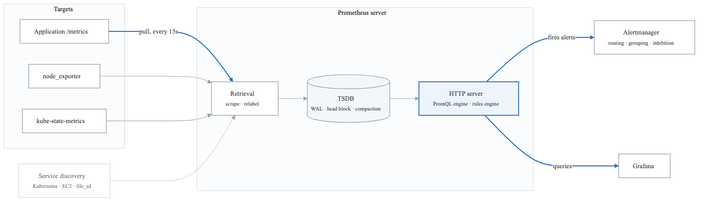
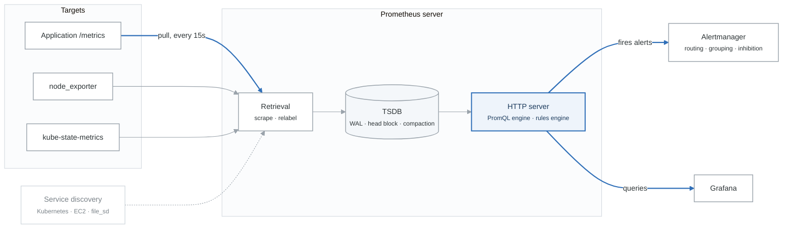
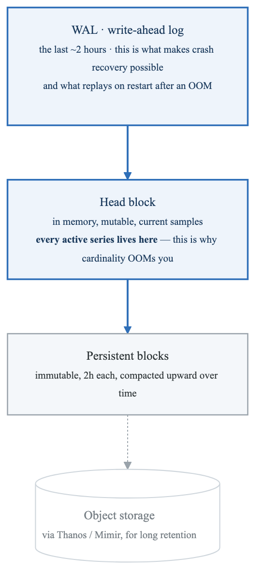
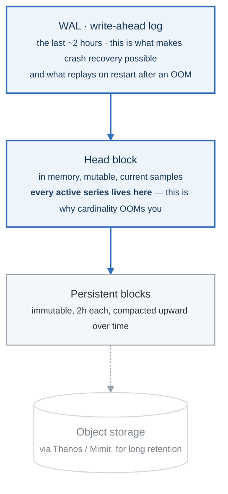
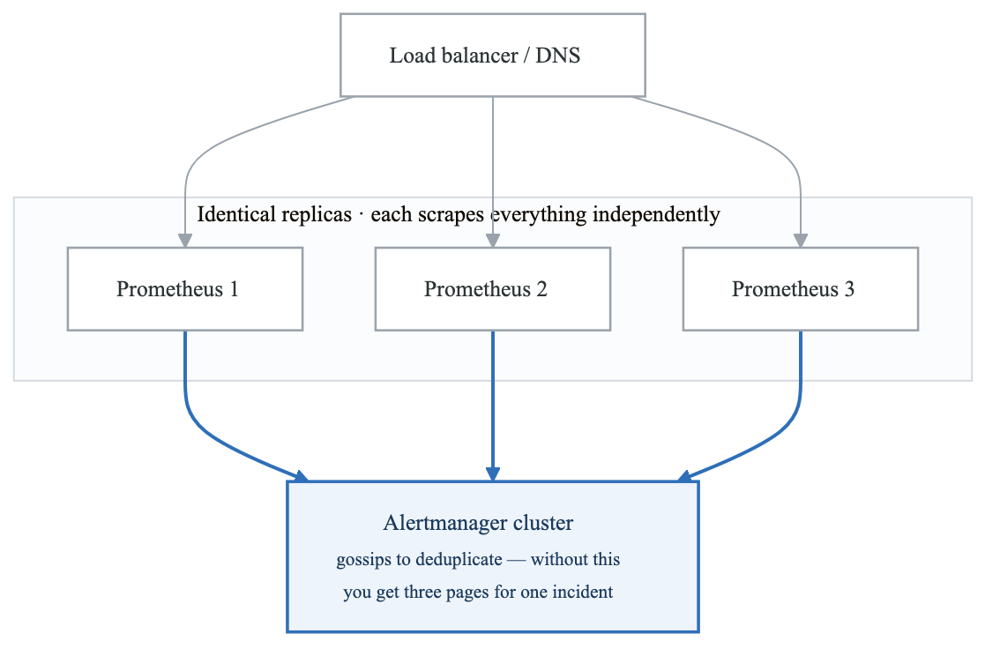
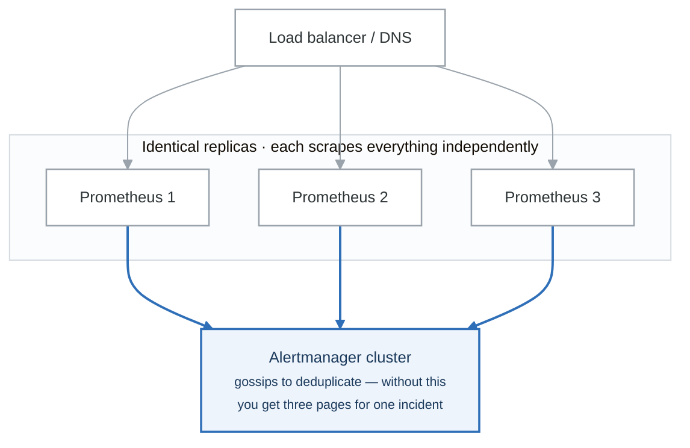
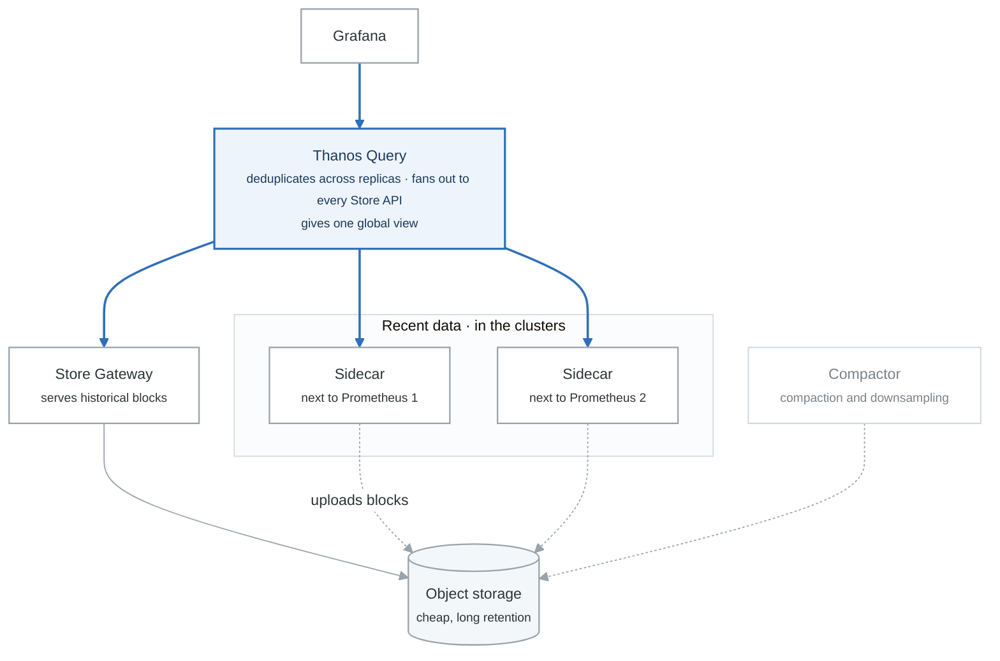

# Module 2: Prometheus Architecture and Implementation

## Learning Objectives

By the end of this module, you will be able to:
- Explain Prometheus architecture and components
- Design and implement a production-grade Prometheus deployment
- Write efficient PromQL queries for complex analysis
- Configure service discovery for dynamic environments
- Implement high-availability and long-term storage solutions

## Introduction

Prometheus is the foundational metrics system for cloud-native observability. Originally developed at SoundCloud and now a CNCF graduated project, it has become the standard for monitoring Kubernetes and microservices architectures.

## 1. Prometheus Architecture

### Core Components

<!-- figure: generated from the Mermaid below by _shared/diagrams/embed-figures.py — do not edit the image -->


<details>
<summary>Diagram source (Mermaid)</summary>



</details>

### Data Model

Prometheus uses a multi-dimensional data model with time series identified by metric name and key-value label pairs.

```
# Time Series Format
<metric_name>{<label_name>=<label_value>, ...} <value> [<timestamp>]

# Examples
http_requests_total{method="POST", handler="/api/orders", status="200"} 1027 1609459200000
http_request_duration_seconds_bucket{le="0.1"} 24054

# Time Series Identity
# The metric name + all labels = unique time series
http_requests_total{method="GET", status="200"}   # Series 1
http_requests_total{method="GET", status="500"}   # Series 2
http_requests_total{method="POST", status="200"}  # Series 3
```

### TSDB (Time Series Database)

<!-- figure: generated from the Mermaid below by _shared/diagrams/embed-figures.py — do not edit the image -->


<details>
<summary>Diagram source (Mermaid)</summary>



</details>

## 2. Prometheus Configuration

### Main Configuration File

```yaml
# /etc/prometheus/prometheus.yml

global:
  scrape_interval: 15s          # How often to scrape targets
  evaluation_interval: 15s       # How often to evaluate rules
  scrape_timeout: 10s           # Timeout for scrape requests

  # External labels for federation and remote write
  external_labels:
    cluster: production
    region: us-east-1
    environment: prod

# Alertmanager configuration
alerting:
  alertmanagers:
    - static_configs:
        - targets:
            - alertmanager:9093
      # Optional: Route alerts via path
      path_prefix: /
      timeout: 10s

# Rule files (recording and alerting rules)
rule_files:
  - /etc/prometheus/rules/*.yml
  - /etc/prometheus/alerts/*.yml

# Scrape configurations
scrape_configs:
  # Prometheus self-monitoring
  - job_name: 'prometheus'
    static_configs:
      - targets: ['localhost:9090']

  # Node Exporter
  - job_name: 'node'
    static_configs:
      - targets:
          - 'node1:9100'
          - 'node2:9100'
          - 'node3:9100'
    relabel_configs:
      - source_labels: [__address__]
        regex: '([^:]+):\d+'
        target_label: instance
        replacement: '${1}'
```

### Service Discovery

```yaml
# Kubernetes Service Discovery
scrape_configs:
  # Discover and scrape Kubernetes pods
  - job_name: 'kubernetes-pods'
    kubernetes_sd_configs:
      - role: pod
        namespaces:
          names:
            - production
            - staging

    relabel_configs:
      # Only scrape pods with prometheus.io/scrape annotation
      - source_labels: [__meta_kubernetes_pod_annotation_prometheus_io_scrape]
        action: keep
        regex: true

      # Use custom scrape path if specified
      - source_labels: [__meta_kubernetes_pod_annotation_prometheus_io_path]
        action: replace
        target_label: __metrics_path__
        regex: (.+)

      # Use custom port if specified
      - source_labels: [__address__, __meta_kubernetes_pod_annotation_prometheus_io_port]
        action: replace
        regex: ([^:]+)(?::\d+)?;(\d+)
        replacement: $1:$2
        target_label: __address__

      # Add pod labels as Prometheus labels
      - action: labelmap
        regex: __meta_kubernetes_pod_label_(.+)

      # Add namespace and pod name
      - source_labels: [__meta_kubernetes_namespace]
        action: replace
        target_label: namespace

      - source_labels: [__meta_kubernetes_pod_name]
        action: replace
        target_label: pod

  # Kubernetes Service Discovery for Endpoints
  - job_name: 'kubernetes-service-endpoints'
    kubernetes_sd_configs:
      - role: endpoints

    relabel_configs:
      # Only scrape services with annotation
      - source_labels: [__meta_kubernetes_service_annotation_prometheus_io_scrape]
        action: keep
        regex: true

      # Set scheme (http/https)
      - source_labels: [__meta_kubernetes_service_annotation_prometheus_io_scheme]
        action: replace
        target_label: __scheme__
        regex: (https?)

      - source_labels: [__meta_kubernetes_service_name]
        action: replace
        target_label: service

  # AWS EC2 Service Discovery
  - job_name: 'aws-ec2'
    ec2_sd_configs:
      - region: us-east-1
        port: 9100
        filters:
          - name: tag:Environment
            values:
              - production
          - name: tag:prometheus-scrape
            values:
              - 'true'

    relabel_configs:
      - source_labels: [__meta_ec2_tag_Name]
        target_label: instance
      - source_labels: [__meta_ec2_availability_zone]
        target_label: availability_zone
      - source_labels: [__meta_ec2_instance_type]
        target_label: instance_type

  # Consul Service Discovery
  - job_name: 'consul-services'
    consul_sd_configs:
      - server: 'consul.service.consul:8500'
        services:
          - web
          - api
          - worker

    relabel_configs:
      - source_labels: [__meta_consul_service]
        target_label: service
      - source_labels: [__meta_consul_dc]
        target_label: datacenter
```

### Relabeling

```yaml
# Relabeling Reference
relabel_configs:
  # Keep only specific targets
  - source_labels: [__meta_kubernetes_pod_label_app]
    action: keep
    regex: (web|api|worker)

  # Drop unwanted targets
  - source_labels: [__meta_kubernetes_namespace]
    action: drop
    regex: kube-.*

  # Replace label value
  - source_labels: [__address__]
    action: replace
    regex: '([^:]+):\d+'
    replacement: '${1}'
    target_label: host

  # Create label from multiple sources
  - source_labels: [namespace, pod]
    separator: /
    target_label: namespace_pod

  # Map all matching labels
  - action: labelmap
    regex: __meta_kubernetes_pod_label_(.+)

  # Hash for load balancing
  - source_labels: [__address__]
    modulus: 4
    target_label: __tmp_hash
    action: hashmod

  # Keep only matching hash (for sharding)
  - source_labels: [__tmp_hash]
    regex: 0
    action: keep

# metric_relabel_configs - Applied after scrape
metric_relabel_configs:
  # Drop expensive metrics
  - source_labels: [__name__]
    action: drop
    regex: 'container_.*_seconds_total'

  # Rename metric
  - source_labels: [__name__]
    action: replace
    regex: 'old_metric_name'
    replacement: 'new_metric_name'
    target_label: __name__

  # Drop high-cardinality labels
  - action: labeldrop
    regex: (pod_template_hash|controller_revision_hash)
```

## 3. PromQL (Prometheus Query Language)

### Basic Queries

```promql
# Instant Vector - Current value of all matching series
http_requests_total

# Filtered by labels
http_requests_total{method="GET", status="200"}

# Label matching operators
http_requests_total{method=~"GET|POST"}     # Regex match
http_requests_total{status!="200"}           # Not equal
http_requests_total{handler=~"/api/.*"}      # Regex match
http_requests_total{handler!~"/health.*"}    # Negative regex

# Range Vector - Values over time window
http_requests_total[5m]                      # Last 5 minutes
http_requests_total{method="GET"}[1h]        # Last hour
```

### Functions and Operators

```promql
# Rate and Increase (for counters)
rate(http_requests_total[5m])                # Per-second rate
irate(http_requests_total[5m])               # Instant rate (last 2 points)
increase(http_requests_total[1h])            # Total increase over period

# Aggregation
sum(rate(http_requests_total[5m]))                      # Total rate
sum(rate(http_requests_total[5m])) by (method)          # Grouped by method
sum(rate(http_requests_total[5m])) without (instance)   # Remove instance label

# Other aggregation operators
avg, min, max, count, count_values, group
topk(5, sum(rate(http_requests_total[5m])) by (handler))
bottomk(3, avg(memory_usage_bytes) by (pod))

# Histogram quantiles
histogram_quantile(0.95, sum(rate(http_request_duration_seconds_bucket[5m])) by (le))
histogram_quantile(0.99, sum(rate(http_request_duration_seconds_bucket[5m])) by (le, handler))

# Math functions
abs, ceil, floor, round, clamp_min, clamp_max
ln, log2, log10, exp, sqrt

# Time functions
time()                                       # Current Unix timestamp
timestamp(up)                                # Timestamp of samples
day_of_week(), hour(), minute()             # Time components

# Label manipulation
label_replace(up, "host", "$1", "instance", "(.*):\\d+")
label_join(up, "combined", "-", "job", "instance")
```

### Advanced PromQL Patterns

```promql
# Request Error Rate (%)
100 * (
  sum(rate(http_requests_total{status=~"5.."}[5m])) by (service)
  /
  sum(rate(http_requests_total[5m])) by (service)
)

# Latency percentiles
histogram_quantile(0.50, sum(rate(http_request_duration_seconds_bucket[5m])) by (le, service))
histogram_quantile(0.90, sum(rate(http_request_duration_seconds_bucket[5m])) by (le, service))
histogram_quantile(0.99, sum(rate(http_request_duration_seconds_bucket[5m])) by (le, service))

# Apdex Score (Application Performance Index)
# Satisfied: < 0.5s, Tolerating: < 2s, Frustrated: > 2s
(
  sum(rate(http_request_duration_seconds_bucket{le="0.5"}[5m])) by (service) +
  sum(rate(http_request_duration_seconds_bucket{le="2.0"}[5m])) by (service)
) / 2
/
sum(rate(http_request_duration_seconds_count[5m])) by (service)

# Saturation: Queue depth or utilization near limits
avg(container_memory_usage_bytes / container_spec_memory_limit_bytes) by (pod) > 0.9

# Availability: Up time ratio
avg_over_time(up{job="api"}[24h]) * 100

# Rate of change (derivative)
deriv(memory_usage_bytes[10m])

# Predict value in 4 hours
predict_linear(disk_usage_bytes[6h], 4*3600)

# Counter resets detection
resets(http_requests_total[1h])

# Absent alert (service not reporting)
absent(up{job="critical-service"})

# Changes in gauge value
changes(container_start_time_seconds[1h])

# Compare to offset (week over week)
rate(http_requests_total[5m])
  /
rate(http_requests_total[5m] offset 7d)

# SLO calculation: % time within latency budget
avg_over_time(
  (
    histogram_quantile(0.99,
      sum(rate(http_request_duration_seconds_bucket[1m])) by (le)
    ) < 0.5
  )[30d:1m]
) * 100
```

### Recording Rules

```yaml
# /etc/prometheus/rules/recording_rules.yml

groups:
  - name: http_recording_rules
    interval: 30s  # Evaluation interval (overrides global)
    rules:
      # Pre-compute common aggregations
      - record: job:http_requests_total:rate5m
        expr: sum(rate(http_requests_total[5m])) by (job)

      - record: job:http_request_errors_total:rate5m
        expr: sum(rate(http_requests_total{status=~"5.."}[5m])) by (job)

      - record: job:http_request_error_rate:percent
        expr: |
          100 * (
            job:http_request_errors_total:rate5m
            /
            job:http_requests_total:rate5m
          )

      # Latency percentiles
      - record: job:http_request_duration_seconds:p50
        expr: |
          histogram_quantile(0.50,
            sum(rate(http_request_duration_seconds_bucket[5m])) by (job, le)
          )

      - record: job:http_request_duration_seconds:p99
        expr: |
          histogram_quantile(0.99,
            sum(rate(http_request_duration_seconds_bucket[5m])) by (job, le)
          )

  - name: node_recording_rules
    rules:
      - record: instance:node_cpu_utilisation:ratio
        expr: |
          1 - avg(rate(node_cpu_seconds_total{mode="idle"}[5m])) by (instance)

      - record: instance:node_memory_utilisation:ratio
        expr: |
          1 - (
            node_memory_MemAvailable_bytes
            /
            node_memory_MemTotal_bytes
          )

      - record: instance:node_disk_io_time:rate5m
        expr: |
          rate(node_disk_io_time_seconds_total[5m])
```

## 4. Alerting Rules

### Alert Definition

```yaml
# /etc/prometheus/alerts/application_alerts.yml

groups:
  - name: application_alerts
    rules:
      # High Error Rate
      - alert: HighErrorRate
        expr: |
          (
            sum(rate(http_requests_total{status=~"5.."}[5m])) by (service)
            /
            sum(rate(http_requests_total[5m])) by (service)
          ) > 0.01
        for: 5m
        labels:
          severity: warning
        annotations:
          summary: "High error rate for {{ $labels.service }}"
          description: "Error rate is {{ $value | humanizePercentage }} for service {{ $labels.service }}"
          runbook_url: "https://runbooks.example.com/high-error-rate"

      # Critical Error Rate
      - alert: CriticalErrorRate
        expr: |
          (
            sum(rate(http_requests_total{status=~"5.."}[5m])) by (service)
            /
            sum(rate(http_requests_total[5m])) by (service)
          ) > 0.05
        for: 2m
        labels:
          severity: critical
        annotations:
          summary: "Critical error rate for {{ $labels.service }}"
          description: "Error rate is {{ $value | humanizePercentage }} for service {{ $labels.service }}"

      # High Latency (P99)
      - alert: HighLatencyP99
        expr: |
          histogram_quantile(0.99,
            sum(rate(http_request_duration_seconds_bucket[5m])) by (le, service)
          ) > 1.0
        for: 10m
        labels:
          severity: warning
        annotations:
          summary: "High P99 latency for {{ $labels.service }}"
          description: "P99 latency is {{ $value | humanizeDuration }}"

      # Service Down
      - alert: ServiceDown
        expr: up{job=~"api|web|worker"} == 0
        for: 1m
        labels:
          severity: critical
        annotations:
          summary: "Service {{ $labels.job }} is down"
          description: "Instance {{ $labels.instance }} has been down for more than 1 minute"

  - name: infrastructure_alerts
    rules:
      # High CPU Usage
      - alert: HighCPUUsage
        expr: instance:node_cpu_utilisation:ratio > 0.90
        for: 15m
        labels:
          severity: warning
        annotations:
          summary: "High CPU usage on {{ $labels.instance }}"
          description: "CPU usage is {{ $value | humanizePercentage }}"

      # High Memory Usage
      - alert: HighMemoryUsage
        expr: instance:node_memory_utilisation:ratio > 0.90
        for: 15m
        labels:
          severity: warning
        annotations:
          summary: "High memory usage on {{ $labels.instance }}"
          description: "Memory usage is {{ $value | humanizePercentage }}"

      # Disk Space Low
      - alert: DiskSpaceLow
        expr: |
          (
            node_filesystem_avail_bytes{mountpoint="/"}
            /
            node_filesystem_size_bytes{mountpoint="/"}
          ) < 0.10
        for: 5m
        labels:
          severity: warning
        annotations:
          summary: "Disk space low on {{ $labels.instance }}"
          description: "Only {{ $value | humanizePercentage }} disk space remaining"

      # Disk Will Fill Soon (Predictive)
      - alert: DiskWillFillSoon
        expr: |
          predict_linear(node_filesystem_avail_bytes[6h], 24*3600) < 0
        for: 1h
        labels:
          severity: warning
        annotations:
          summary: "Disk will fill in 24 hours on {{ $labels.instance }}"
          description: "Based on current trend, disk will be full within 24 hours"
```

## 5. High Availability and Scaling

### HA Architecture

<!-- figure: generated from the Mermaid below by _shared/diagrams/embed-figures.py — do not edit the image -->


<details>
<summary>Diagram source (Mermaid)</summary>



</details>

### Thanos Architecture for Scale

<!-- figure: generated from the Mermaid below by _shared/diagrams/embed-figures.py — do not edit the image -->


<details>
<summary>Diagram source (Mermaid)</summary>



</details>

### Thanos Configuration

```yaml
# Prometheus with Thanos Sidecar
# prometheus.yml additions
global:
  external_labels:
    cluster: us-east-1-prod
    replica: prometheus-0

# Thanos Sidecar (Kubernetes deployment)
apiVersion: apps/v1
kind: StatefulSet
metadata:
  name: prometheus
spec:
  template:
    spec:
      containers:
        - name: prometheus
          image: prom/prometheus:v2.45.0
          args:
            - --config.file=/etc/prometheus/prometheus.yml
            - --storage.tsdb.path=/prometheus
            - --storage.tsdb.min-block-duration=2h
            - --storage.tsdb.max-block-duration=2h
          volumeMounts:
            - name: prometheus-data
              mountPath: /prometheus

        - name: thanos-sidecar
          image: quay.io/thanos/thanos:v0.32.0
          args:
            - sidecar
            - --tsdb.path=/prometheus
            - --prometheus.url=http://localhost:9090
            - --objstore.config-file=/etc/thanos/objstore.yml
          volumeMounts:
            - name: prometheus-data
              mountPath: /prometheus
            - name: thanos-config
              mountPath: /etc/thanos

---
# Thanos Query
apiVersion: apps/v1
kind: Deployment
metadata:
  name: thanos-query
spec:
  template:
    spec:
      containers:
        - name: thanos-query
          image: quay.io/thanos/thanos:v0.32.0
          args:
            - query
            - --http-address=0.0.0.0:9090
            - --grpc-address=0.0.0.0:10901
            - --store=dnssrv+_grpc._tcp.thanos-sidecar.monitoring.svc
            - --store=dnssrv+_grpc._tcp.thanos-store.monitoring.svc
            - --query.replica-label=replica
            - --query.auto-downsampling

---
# Thanos Store Gateway
apiVersion: apps/v1
kind: Deployment
metadata:
  name: thanos-store
spec:
  template:
    spec:
      containers:
        - name: thanos-store
          image: quay.io/thanos/thanos:v0.32.0
          args:
            - store
            - --data-dir=/var/thanos/store
            - --objstore.config-file=/etc/thanos/objstore.yml
            - --index-cache-size=500MB
            - --chunk-pool-size=2GB
```

## 6. Remote Storage

### Remote Write Configuration

```yaml
# prometheus.yml
remote_write:
  - url: "https://cortex.example.com/api/v1/push"
    remote_timeout: 30s
    queue_config:
      capacity: 10000
      max_shards: 50
      min_shards: 1
      max_samples_per_send: 5000
      batch_send_deadline: 5s
      min_backoff: 30ms
      max_backoff: 5s
    write_relabel_configs:
      # Only send specific metrics
      - source_labels: [__name__]
        regex: 'http_.*|process_.*|go_.*'
        action: keep

    # TLS and authentication
    tls_config:
      cert_file: /etc/prometheus/certs/client.crt
      key_file: /etc/prometheus/certs/client.key
      ca_file: /etc/prometheus/certs/ca.crt

    basic_auth:
      username: prometheus
      password_file: /etc/prometheus/secrets/password

# Remote Read (for historical queries)
remote_read:
  - url: "https://cortex.example.com/api/v1/read"
    read_recent: false  # Only read remote for old data
    remote_timeout: 1m
```

## 7. Prometheus Operator (Kubernetes)

### Custom Resources

```yaml
# Prometheus instance
apiVersion: monitoring.coreos.com/v1
kind: Prometheus
metadata:
  name: prometheus
  namespace: monitoring
spec:
  replicas: 2
  version: v2.45.0

  serviceAccountName: prometheus

  # Service Monitor Selector
  serviceMonitorSelector:
    matchLabels:
      prometheus: main

  # Pod Monitor Selector
  podMonitorSelector:
    matchLabels:
      prometheus: main

  # Rule Selector
  ruleSelector:
    matchLabels:
      prometheus: main

  # Alertmanager configuration
  alerting:
    alertmanagers:
      - namespace: monitoring
        name: alertmanager-main
        port: web

  # Resources
  resources:
    requests:
      memory: 2Gi
      cpu: 500m
    limits:
      memory: 4Gi
      cpu: 2

  # Storage
  storage:
    volumeClaimTemplate:
      spec:
        storageClassName: fast-ssd
        resources:
          requests:
            storage: 100Gi

  # External labels
  externalLabels:
    cluster: production
    region: us-east-1

  # Thanos sidecar
  thanos:
    version: v0.32.0
    objectStorageConfig:
      key: thanos.yaml
      name: thanos-objstore-secret

---
# ServiceMonitor for applications
apiVersion: monitoring.coreos.com/v1
kind: ServiceMonitor
metadata:
  name: api-service
  labels:
    prometheus: main
spec:
  selector:
    matchLabels:
      app: api
  namespaceSelector:
    matchNames:
      - production
  endpoints:
    - port: metrics
      interval: 15s
      path: /metrics
      scheme: http
      relabelings:
        - sourceLabels: [__meta_kubernetes_pod_label_version]
          targetLabel: version
      metricRelabelings:
        - sourceLabels: [__name__]
          regex: 'go_gc_.*'
          action: drop

---
# PrometheusRule for alerting
apiVersion: monitoring.coreos.com/v1
kind: PrometheusRule
metadata:
  name: api-alerts
  labels:
    prometheus: main
spec:
  groups:
    - name: api.rules
      rules:
        - alert: APIHighErrorRate
          expr: |
            sum(rate(http_requests_total{job="api",status=~"5.."}[5m]))
            /
            sum(rate(http_requests_total{job="api"}[5m])) > 0.01
          for: 5m
          labels:
            severity: warning
          annotations:
            summary: "High error rate on API"
```

## Summary

Prometheus provides a robust foundation for metrics-based observability with its pull-based architecture, powerful query language, and extensive ecosystem.

### Key Takeaways

1. **Pull-based Model**: Prometheus scrapes targets, making it easy to detect when services are down
2. **PromQL Power**: Master PromQL for effective monitoring and alerting
3. **Label Cardinality**: Manage cardinality carefully to avoid performance issues
4. **Recording Rules**: Pre-compute expensive queries for better performance
5. **Scale with Thanos/Cortex**: Use external solutions for long-term storage and global view

## What's Next

In the next module, we'll explore Grafana for building effective dashboards and visualizations, creating a unified view of your observability data.

<!-- feynman-check -->

---

## Feynman check

Close the file. Blank page, no notes. Explain each of these to a competent engineer who has never
used this tool — **under five minutes, no jargon you can't define on the spot:**

- Prometheus Architecture
- Prometheus Configuration
- PromQL (Prometheus Query Language)
- Alerting Rules

**The gap is not what you forgot. It is where you used a word instead of a mechanism.**

| | |
|---|---|
| ✗ | *"Prometheus monitors the service."* |
| ✓ | *"Prometheus discovers targets from the Kubernetes API, applies relabelling rules, scrapes `/metrics` over HTTP on an interval, and appends samples to a local TSDB. Nothing is pushed — so a target missing from a dashboard is a service-discovery problem, not an application one."* |

**Trace it:** A latency regression → a phone ringing. Name each hop: sample, rule evaluation, alert state transition, routing, notification — and where each one can silently stop.

Stop at the first component you cannot name. Reopen this file and read **only** that.

**Go deeper — only once the gap has a name:** [SRE Workbook ch. 5, *Alerting on SLOs*](https://sre.google/workbook/alerting-on-slos/) — free, and the best thing written on why static thresholds page you for nothing.
Full list per domain: [`SOURCES.md`](../SOURCES.md#observability-sre)

→ Protocol, the three levels of knowing, and worked examples: [`MASTERY.md`](../MASTERY.md)

<!-- /feynman-check -->
