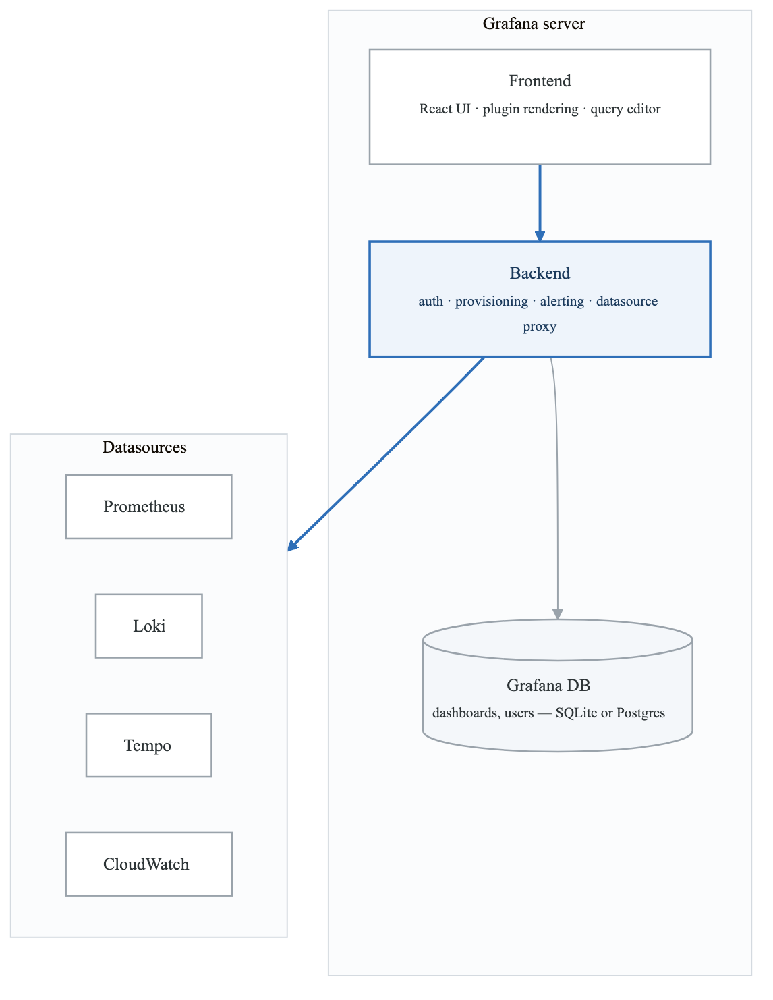
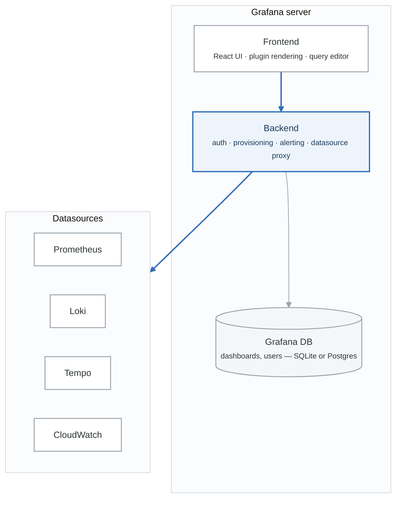
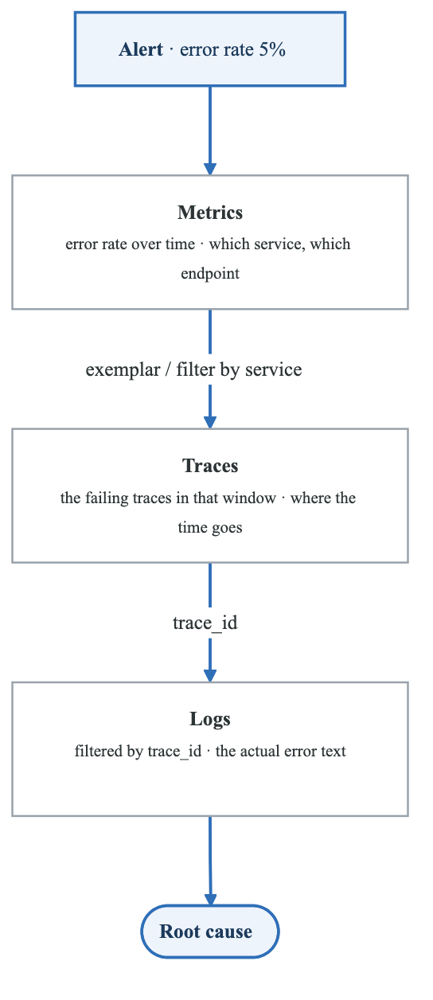
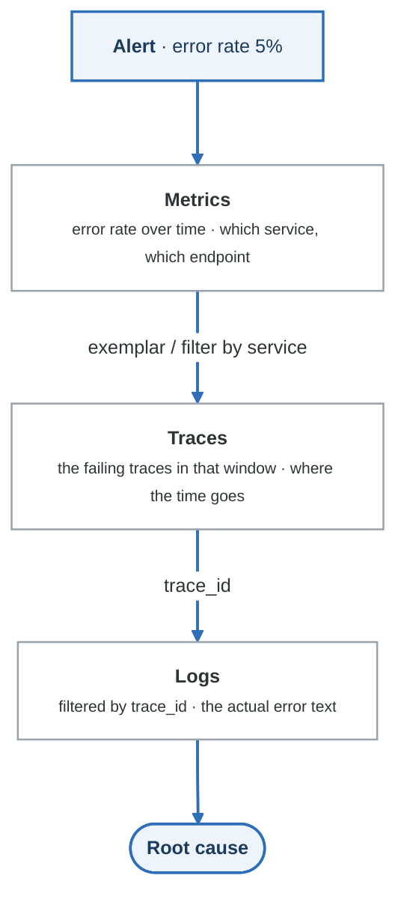

# Module 3: Grafana Visualization and Dashboarding

## Learning Objectives

By the end of this module, you will be able to:
- Design effective dashboards following visualization best practices
- Create complex dashboard panels with advanced query techniques
- Implement dashboard-as-code using Grafonnet and Terraform
- Configure Grafana for multi-tenancy and team collaboration
- Build unified observability views combining metrics, logs, and traces

## Introduction

Grafana has evolved from a simple metrics visualization tool to a comprehensive observability platform. It unifies metrics, logs, traces, and alerts into a single interface, making it the de facto standard for observability visualization.

## 1. Grafana Architecture

### Component Overview

<!-- figure: generated from the Mermaid below by _shared/diagrams/embed-figures.py — do not edit the image -->


<details>
<summary>Diagram source (Mermaid)</summary>



</details>

### Deployment Modes

```yaml
# Grafana Deployment Options

single_instance:
  description: "Single server deployment"
  use_case: "Development, small teams"
  database: "SQLite (embedded)"

high_availability:
  description: "Multiple instances behind load balancer"
  use_case: "Production workloads"
  requirements:
    - shared_database: "MySQL/PostgreSQL"
    - shared_cache: "Redis/Memcached"
    - load_balancer: "Sticky sessions for WebSocket"

grafana_enterprise:
  additional_features:
    - team_sync
    - enhanced_ldap
    - reporting
    - audit_logs
    - vault_integration
```

## 2. Data Sources Configuration

### Prometheus Data Source

```yaml
# grafana/provisioning/datasources/prometheus.yml
apiVersion: 1

datasources:
  - name: Prometheus
    type: prometheus
    access: proxy
    url: http://prometheus:9090
    isDefault: true
    editable: false
    jsonData:
      timeInterval: "15s"
      httpMethod: "POST"
      manageAlerts: true
      prometheusType: "Prometheus"
      prometheusVersion: "2.45.0"
      incrementalQuerying: true
      incrementalQueryOverlapWindow: "10m"
      exemplarTraceIdDestinations:
        - name: trace_id
          datasourceUid: tempo
          urlDisplayLabel: "View Trace"
```

### Loki Data Source

```yaml
# grafana/provisioning/datasources/loki.yml
apiVersion: 1

datasources:
  - name: Loki
    type: loki
    access: proxy
    url: http://loki:3100
    editable: false
    jsonData:
      maxLines: 1000
      derivedFields:
        - name: TraceID
          matcherRegex: '"trace_id":"([^"]+)"'
          url: "${__value.raw}"
          datasourceUid: tempo
          urlDisplayLabel: "View Trace"
```

### Tempo Data Source

```yaml
# grafana/provisioning/datasources/tempo.yml
apiVersion: 1

datasources:
  - name: Tempo
    type: tempo
    access: proxy
    url: http://tempo:3200
    editable: false
    jsonData:
      httpMethod: GET
      tracesToLogs:
        datasourceUid: loki
        spanStartTimeShift: -1h
        spanEndTimeShift: 1h
        tags: ['service.name', 'pod']
        filterByTraceID: true
        filterBySpanID: false
        lokiSearch: true
      tracesToMetrics:
        datasourceUid: prometheus
        tags:
          - key: service.name
            value: service
          - key: http.method
            value: method
        queries:
          - name: Request rate
            query: 'sum(rate(http_requests_total{$__tags}[$__rate_interval]))'
          - name: Error rate
            query: 'sum(rate(http_requests_total{$__tags, status=~"5.."}[$__rate_interval]))'
      serviceMap:
        datasourceUid: prometheus
      nodeGraph:
        enabled: true
      search:
        hide: false
      lokiSearch:
        datasourceUid: loki
```

## 3. Dashboard Design Principles

### The USE Method Dashboard

**The USE method — for every resource, track three things**

| | Question | Example metric |
|---|---|---|
| **U**tilization | what fraction of the time is it busy? | CPU 78% · memory 89% |
| **S**aturation | how much queued work is waiting? | run queue depth · swap in use |
| **E**rrors | how many operations are failing? | disk I/O errors · network drops |

**Saturation is the one people skip, and it is the one that gives you warning.** Utilization tells
you the resource is busy now; saturation tells you demand already exceeds supply, which is what
predicts the outage. It is also why saturation is one of the four golden signals.

USE is for **resources** (hosts, disks, network). Its counterpart RED — rate, errors, duration — is
for **services**, and is what your SLOs are built from.

### The RED Method Dashboard

**The RED method — for every service, track three things**

| | Question | Example |
|---|---|---|
| **R**ate | how many requests per second? | 1.2k req/s · ▲ 15% vs 1h ago |
| **E**rrors | what fraction are failing? | 0.5% · ▲ 0.1% |
| **D**uration | how long do they take? | p99 245 ms · ▼ 12 ms |

RED is for **services**; USE (utilization, saturation, errors) is for **resources**. Your SLOs are
built from RED — the availability SLI *is* the error rate, and the latency SLI *is* the duration
percentile.

**Never use the mean for duration.** 95% of requests at 100 ms and 5% at 10 s averages to 595 ms,
which looks fine while one user in twenty waits ten seconds. Show p50 and p99; the gap between them
is the story.

### Dashboard Variables

```json
{
  "templating": {
    "list": [
      {
        "name": "datasource",
        "type": "datasource",
        "query": "prometheus",
        "current": {
          "text": "Prometheus",
          "value": "Prometheus"
        }
      },
      {
        "name": "cluster",
        "type": "query",
        "datasource": "${datasource}",
        "query": "label_values(up, cluster)",
        "refresh": 2,
        "includeAll": true,
        "multi": true,
        "current": {
          "text": "All",
          "value": "$__all"
        }
      },
      {
        "name": "namespace",
        "type": "query",
        "datasource": "${datasource}",
        "query": "label_values(kube_pod_info{cluster=~\"$cluster\"}, namespace)",
        "refresh": 2,
        "includeAll": true,
        "multi": true
      },
      {
        "name": "service",
        "type": "query",
        "datasource": "${datasource}",
        "query": "label_values(http_requests_total{cluster=~\"$cluster\", namespace=~\"$namespace\"}, service)",
        "refresh": 2,
        "includeAll": false,
        "multi": false
      },
      {
        "name": "interval",
        "type": "interval",
        "query": "1m,5m,10m,30m,1h,6h,12h,1d",
        "current": {
          "text": "5m",
          "value": "5m"
        },
        "auto": true,
        "auto_count": 50,
        "auto_min": "30s"
      }
    ]
  }
}
```

## 4. Panel Types and Queries

### Time Series Panel

```json
{
  "type": "timeseries",
  "title": "Request Rate by Status",
  "targets": [
    {
      "expr": "sum(rate(http_requests_total{service=\"$service\"}[$interval])) by (status)",
      "legendFormat": "{{status}}",
      "refId": "A"
    }
  ],
  "fieldConfig": {
    "defaults": {
      "custom": {
        "drawStyle": "line",
        "lineInterpolation": "smooth",
        "lineWidth": 2,
        "fillOpacity": 10,
        "gradientMode": "opacity",
        "spanNulls": true,
        "pointSize": 5,
        "stacking": {
          "mode": "none"
        }
      },
      "color": {
        "mode": "palette-classic"
      },
      "unit": "reqps",
      "thresholds": {
        "mode": "absolute",
        "steps": [
          {"color": "green", "value": null}
        ]
      }
    },
    "overrides": [
      {
        "matcher": {"id": "byRegexp", "options": "5.."},
        "properties": [
          {"id": "color", "value": {"fixedColor": "red", "mode": "fixed"}}
        ]
      }
    ]
  }
}
```

### Stat Panel

```json
{
  "type": "stat",
  "title": "Current Error Rate",
  "targets": [
    {
      "expr": "sum(rate(http_requests_total{service=\"$service\", status=~\"5..\"}[$interval])) / sum(rate(http_requests_total{service=\"$service\"}[$interval])) * 100",
      "refId": "A"
    }
  ],
  "fieldConfig": {
    "defaults": {
      "unit": "percent",
      "decimals": 2,
      "thresholds": {
        "mode": "absolute",
        "steps": [
          {"color": "green", "value": null},
          {"color": "yellow", "value": 1},
          {"color": "red", "value": 5}
        ]
      },
      "mappings": [],
      "color": {
        "mode": "thresholds"
      }
    }
  },
  "options": {
    "reduceOptions": {
      "values": false,
      "calcs": ["lastNotNull"],
      "fields": ""
    },
    "orientation": "auto",
    "textMode": "auto",
    "colorMode": "background",
    "graphMode": "area",
    "justifyMode": "auto"
  }
}
```

### Heatmap Panel

```json
{
  "type": "heatmap",
  "title": "Request Latency Distribution",
  "targets": [
    {
      "expr": "sum(rate(http_request_duration_seconds_bucket{service=\"$service\"}[$interval])) by (le)",
      "format": "heatmap",
      "legendFormat": "{{le}}"
    }
  ],
  "options": {
    "calculate": false,
    "yAxis": {
      "axisPlacement": "left",
      "unit": "s",
      "reverse": false
    },
    "cellGap": 1,
    "color": {
      "mode": "scheme",
      "scheme": "Spectral",
      "steps": 64,
      "reverse": false
    },
    "exemplars": {
      "color": "rgba(255,0,255,0.7)"
    },
    "tooltip": {
      "show": true,
      "yHistogram": true
    },
    "legend": {
      "show": true
    }
  }
}
```

### Logs Panel

```json
{
  "type": "logs",
  "title": "Application Logs",
  "datasource": "Loki",
  "targets": [
    {
      "expr": "{service=\"$service\", namespace=\"$namespace\"} |= \"$search\" | json | level=~\"$log_level\"",
      "refId": "A"
    }
  ],
  "options": {
    "showTime": true,
    "showLabels": false,
    "showCommonLabels": false,
    "wrapLogMessage": true,
    "prettifyLogMessage": true,
    "enableLogDetails": true,
    "dedupStrategy": "none",
    "sortOrder": "Descending"
  }
}
```

### Table Panel with Transformations

```json
{
  "type": "table",
  "title": "Top 10 Endpoints by Error Rate",
  "targets": [
    {
      "expr": "topk(10, sum(rate(http_requests_total{status=~\"5..\", service=\"$service\"}[$interval])) by (handler) / sum(rate(http_requests_total{service=\"$service\"}[$interval])) by (handler) * 100)",
      "legendFormat": "{{handler}}",
      "instant": true,
      "refId": "A"
    },
    {
      "expr": "topk(10, sum(rate(http_requests_total{service=\"$service\"}[$interval])) by (handler))",
      "legendFormat": "{{handler}}",
      "instant": true,
      "refId": "B"
    }
  ],
  "transformations": [
    {
      "id": "seriesToColumns",
      "options": {
        "byField": "handler"
      }
    },
    {
      "id": "organize",
      "options": {
        "renameByName": {
          "Value #A": "Error Rate %",
          "Value #B": "Request Rate"
        }
      }
    },
    {
      "id": "sortBy",
      "options": {
        "fields": {},
        "sort": [
          {"field": "Error Rate %", "desc": true}
        ]
      }
    }
  ],
  "fieldConfig": {
    "defaults": {},
    "overrides": [
      {
        "matcher": {"id": "byName", "options": "Error Rate %"},
        "properties": [
          {"id": "unit", "value": "percent"},
          {"id": "decimals", "value": 2},
          {"id": "custom.cellOptions", "value": {"type": "color-background"}},
          {"id": "thresholds", "value": {
            "mode": "absolute",
            "steps": [
              {"color": "green", "value": null},
              {"color": "yellow", "value": 1},
              {"color": "red", "value": 5}
            ]
          }}
        ]
      },
      {
        "matcher": {"id": "byName", "options": "Request Rate"},
        "properties": [
          {"id": "unit", "value": "reqps"},
          {"id": "decimals", "value": 1}
        ]
      }
    ]
  }
}
```

## 5. Dashboard-as-Code

### Grafonnet (Jsonnet)

```jsonnet
// dashboards/service-dashboard.jsonnet
local grafana = import 'grafonnet/grafana.libsonnet';
local dashboard = grafana.dashboard;
local prometheus = grafana.prometheus;
local graphPanel = grafana.graphPanel;
local row = grafana.row;
local singlestat = grafana.singlestat;
local template = grafana.template;

local service = std.extVar('service');

dashboard.new(
  title='Service: ' + service,
  schemaVersion=27,
  editable=false,
  tags=['service', 'auto-generated'],
  time_from='now-6h',
  refresh='30s',
)
.addTemplate(
  template.datasource(
    name='datasource',
    query='prometheus',
    current='Prometheus',
  )
)
.addTemplate(
  template.interval(
    name='interval',
    query='1m,5m,10m,30m,1h',
    current='5m',
    auto_count=50,
    auto_min='30s',
  )
)
.addRow(
  row.new(title='Overview')
  .addPanel(
    singlestat.new(
      title='Request Rate',
      datasource='$datasource',
      sparklineShow=true,
      valueName='current',
    )
    .addTarget(
      prometheus.target(
        expr='sum(rate(http_requests_total{service="' + service + '"}[$interval]))',
      )
    ),
    gridPos={x: 0, y: 0, w: 8, h: 4},
  )
  .addPanel(
    singlestat.new(
      title='Error Rate',
      datasource='$datasource',
      sparklineShow=true,
      format='percent',
      thresholds='1,5',
      colors=['green', 'yellow', 'red'],
      colorBackground=true,
    )
    .addTarget(
      prometheus.target(
        expr='sum(rate(http_requests_total{service="' + service + '", status=~"5.."}[$interval])) / sum(rate(http_requests_total{service="' + service + '"}[$interval])) * 100',
      )
    ),
    gridPos={x: 8, y: 0, w: 8, h: 4},
  )
  .addPanel(
    singlestat.new(
      title='P99 Latency',
      datasource='$datasource',
      sparklineShow=true,
      format='ms',
      thresholds='200,500',
      colors=['green', 'yellow', 'red'],
      colorBackground=true,
    )
    .addTarget(
      prometheus.target(
        expr='histogram_quantile(0.99, sum(rate(http_request_duration_seconds_bucket{service="' + service + '"}[$interval])) by (le)) * 1000',
      )
    ),
    gridPos={x: 16, y: 0, w: 8, h: 4},
  )
)
.addRow(
  row.new(title='Request Details')
  .addPanel(
    graphPanel.new(
      title='Request Rate by Status',
      datasource='$datasource',
      format='reqps',
      fill=2,
      linewidth=2,
    )
    .addTarget(
      prometheus.target(
        expr='sum(rate(http_requests_total{service="' + service + '"}[$interval])) by (status)',
        legendFormat='{{status}}',
      )
    ),
    gridPos={x: 0, y: 4, w: 12, h: 8},
  )
  .addPanel(
    graphPanel.new(
      title='Latency Percentiles',
      datasource='$datasource',
      format='s',
      fill=0,
      linewidth=2,
    )
    .addTarget(
      prometheus.target(
        expr='histogram_quantile(0.50, sum(rate(http_request_duration_seconds_bucket{service="' + service + '"}[$interval])) by (le))',
        legendFormat='p50',
      )
    )
    .addTarget(
      prometheus.target(
        expr='histogram_quantile(0.90, sum(rate(http_request_duration_seconds_bucket{service="' + service + '"}[$interval])) by (le))',
        legendFormat='p90',
      )
    )
    .addTarget(
      prometheus.target(
        expr='histogram_quantile(0.99, sum(rate(http_request_duration_seconds_bucket{service="' + service + '"}[$interval])) by (le))',
        legendFormat='p99',
      )
    ),
    gridPos={x: 12, y: 4, w: 12, h: 8},
  )
)
```

### Terraform Provider

```hcl
# grafana.tf
terraform {
  required_providers {
    grafana = {
      source  = "grafana/grafana"
      version = "~> 2.0"
    }
  }
}

provider "grafana" {
  url  = var.grafana_url
  auth = var.grafana_api_key
}

# Folder for team dashboards
resource "grafana_folder" "team_platform" {
  title = "Platform Team"
}

# Data source
resource "grafana_data_source" "prometheus" {
  type          = "prometheus"
  name          = "Prometheus"
  url           = "http://prometheus:9090"
  is_default    = true

  json_data_encoded = jsonencode({
    httpMethod = "POST"
    manageAlerts = true
    prometheusType = "Prometheus"
    prometheusVersion = "2.45.0"
  })
}

# Dashboard from JSON file
resource "grafana_dashboard" "service_overview" {
  folder    = grafana_folder.team_platform.id
  overwrite = true

  config_json = templatefile("${path.module}/dashboards/service-overview.json", {
    datasource = grafana_data_source.prometheus.name
  })
}

# Alert rule
resource "grafana_rule_group" "service_alerts" {
  name             = "Service Alerts"
  folder_uid       = grafana_folder.team_platform.uid
  interval_seconds = 60
  org_id           = 1

  rule {
    name           = "High Error Rate"
    condition      = "C"
    for            = "5m"

    annotations = {
      summary     = "High error rate detected"
      description = "Error rate is above 1% for service {{ $labels.service }}"
      runbook_url = "https://runbooks.example.com/high-error-rate"
    }

    labels = {
      severity = "warning"
    }

    data {
      ref_id = "A"

      relative_time_range {
        from = 300
        to   = 0
      }

      datasource_uid = grafana_data_source.prometheus.uid
      model = jsonencode({
        expr     = "sum(rate(http_requests_total{status=~\"5..\"}[5m])) by (service)"
        refId    = "A"
        interval = "1m"
      })
    }

    data {
      ref_id = "B"

      relative_time_range {
        from = 300
        to   = 0
      }

      datasource_uid = grafana_data_source.prometheus.uid
      model = jsonencode({
        expr     = "sum(rate(http_requests_total[5m])) by (service)"
        refId    = "B"
        interval = "1m"
      })
    }

    data {
      ref_id = "C"

      datasource_uid = "__expr__"
      model = jsonencode({
        type       = "math"
        expression = "$A / $B * 100"
        refId      = "C"
      })
    }
  }
}
```

## 6. Dashboard Provisioning

### File-Based Provisioning

```yaml
# grafana/provisioning/dashboards/default.yml
apiVersion: 1

providers:
  - name: 'default'
    orgId: 1
    folder: ''
    folderUid: ''
    type: file
    disableDeletion: false
    updateIntervalSeconds: 30
    allowUiUpdates: false
    options:
      path: /var/lib/grafana/dashboards/default

  - name: 'kubernetes'
    orgId: 1
    folder: 'Kubernetes'
    folderUid: 'kubernetes'
    type: file
    disableDeletion: true
    updateIntervalSeconds: 30
    options:
      path: /var/lib/grafana/dashboards/kubernetes

  - name: 'services'
    orgId: 1
    folder: 'Services'
    folderUid: 'services'
    type: file
    disableDeletion: true
    updateIntervalSeconds: 30
    options:
      path: /var/lib/grafana/dashboards/services
```

### Kubernetes ConfigMap Dashboards

```yaml
apiVersion: v1
kind: ConfigMap
metadata:
  name: grafana-dashboards
  namespace: monitoring
  labels:
    grafana_dashboard: "1"
data:
  service-overview.json: |
    {
      "annotations": {
        "list": []
      },
      "editable": false,
      "fiscalYearStartMonth": 0,
      "graphTooltip": 1,
      "id": null,
      "links": [],
      "liveNow": false,
      "panels": [
        // ... panel definitions
      ],
      "refresh": "30s",
      "schemaVersion": 38,
      "style": "dark",
      "tags": ["service", "overview"],
      "templating": {
        "list": []
      },
      "time": {
        "from": "now-6h",
        "to": "now"
      },
      "title": "Service Overview",
      "uid": "service-overview",
      "version": 1
    }
```

## 7. Multi-Tenancy and Teams

### Organization Structure

```yaml
# Grafana Organization Setup

organizations:
  - name: "Platform Team"
    id: 1
    users:
      - email: admin@example.com
        role: Admin
      - email: platformeng@example.com
        role: Editor

  - name: "Application Team"
    id: 2
    users:
      - email: appdev@example.com
        role: Admin

# Team configuration
teams:
  - name: "SRE"
    org_id: 1
    members:
      - email: sre1@example.com
      - email: sre2@example.com
    permissions:
      - folder: "Production"
        permission: Editor
      - folder: "Alerts"
        permission: Admin

  - name: "Developers"
    org_id: 1
    members:
      - email: dev1@example.com
      - email: dev2@example.com
    permissions:
      - folder: "Development"
        permission: Editor
      - folder: "Production"
        permission: Viewer
```

### RBAC Configuration

```ini
# grafana.ini

[auth]
disable_login_form = false

[auth.ldap]
enabled = true
config_file = /etc/grafana/ldap.toml
allow_sign_up = true

[auth.generic_oauth]
enabled = true
name = IdentityCo
allow_sign_up = true
client_id = grafana
client_secret = ${OAUTH_SECRET}
scopes = openid profile email groups
auth_url = https://identityco.example.com/oauth2/v1/authorize
token_url = https://identityco.example.com/oauth2/v1/token
api_url = https://identityco.example.com/oauth2/v1/userinfo
role_attribute_path = contains(groups[*], 'grafana-admins') && 'Admin' || contains(groups[*], 'grafana-editors') && 'Editor' || 'Viewer'

[rbac]
permission_cache = true
```

## 8. Unified Observability

### Correlating Metrics, Logs, and Traces

<!-- figure: generated from the Mermaid below by _shared/diagrams/embed-figures.py — do not edit the image -->


<details>
<summary>Diagram source (Mermaid)</summary>



</details>

### Explore View Configuration

```yaml
# Explore with split view for correlation
# Left pane: Metrics, Right pane: Traces or Logs

# Example: Starting from metric, drilling to traces
query_flow:
  1. Start with metric:
     expr: "rate(http_requests_total{status=~'5..'}[5m])"
     view: "Graph"

  2. Click on exemplar point (if configured)
     # Exemplars link metrics to traces

  3. Opens trace view:
     trace_id: "extracted from exemplar"

  4. From trace, click "View Logs":
     loki_query: "{service='$service'} |= '$trace_id'"
```

## Summary

Grafana provides the visualization layer that brings observability data to life. Effective dashboards tell a story, guide investigation, and enable quick decision-making.

### Key Takeaways

1. **Design for Purpose**: USE method for infrastructure, RED for services
2. **Dashboard as Code**: Version control your dashboards with Grafonnet or Terraform
3. **Variables Enable Flexibility**: Use template variables for reusable dashboards
4. **Correlation is Key**: Link metrics, logs, and traces for unified observability
5. **Provisioning Scales**: Automate dashboard deployment for consistency

## What's Next

In the next module, we'll explore Alertmanager for intelligent alert routing, grouping, and notification management.

<!-- feynman-check -->

---

## Feynman check

Close the file. Blank page, no notes. Explain each of these to a competent engineer who has never
used this tool — **under five minutes, no jargon you can't define on the spot:**

- Grafana Architecture
- Data Sources Configuration
- Dashboard Design Principles
- Panel Types and Queries

**The gap is not what you forgot. It is where you used a word instead of a mechanism.**

| | |
|---|---|
| ✗ | *"Prometheus monitors the service."* |
| ✓ | *"Prometheus discovers targets from the Kubernetes API, applies relabelling rules, scrapes `/metrics` over HTTP on an interval, and appends samples to a local TSDB. Nothing is pushed — so a target missing from a dashboard is a service-discovery problem, not an application one."* |

**Trace it:** A latency regression → a phone ringing. Name each hop: sample, rule evaluation, alert state transition, routing, notification — and where each one can silently stop.

Stop at the first component you cannot name. Reopen this file and read **only** that.

**Go deeper — only once the gap has a name:** [SRE Workbook ch. 5, *Alerting on SLOs*](https://sre.google/workbook/alerting-on-slos/) — free, and the best thing written on why static thresholds page you for nothing.
Full list per domain: [`SOURCES.md`](../SOURCES.md#observability-sre)

→ Protocol, the three levels of knowing, and worked examples: [`MASTERY.md`](../MASTERY.md)

<!-- /feynman-check -->
