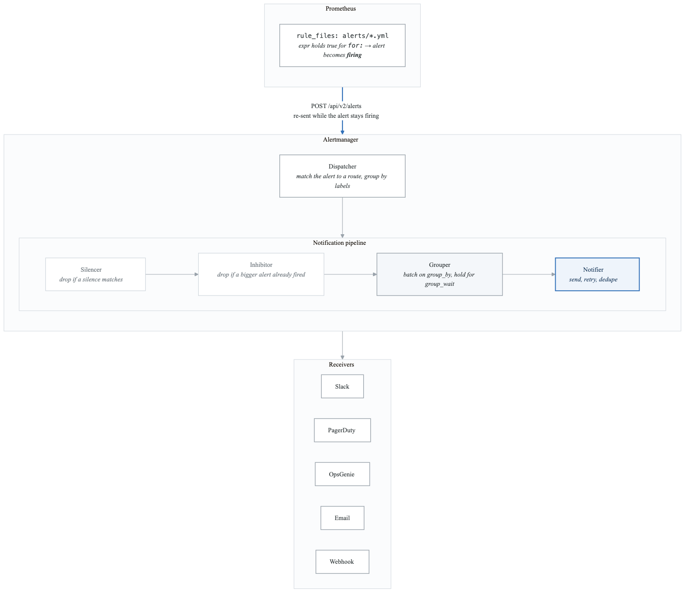
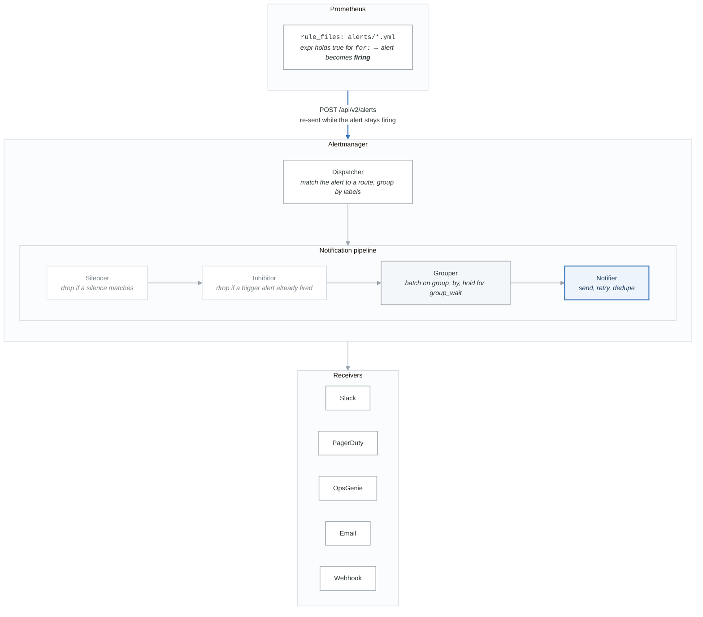

# Module 4: Alertmanager and Intelligent Alerting

## Learning Objectives

By the end of this module, you will be able to:
- Design effective alerting strategies that minimize noise and fatigue
- Configure Alertmanager for intelligent routing, grouping, and silencing
- Implement multi-channel notification workflows
- Create SLO-based alerts that focus on user impact
- Build alerting hierarchies with escalation policies

## Introduction

Alerting is the bridge between observability and action. Poor alerting leads to fatigue, missed incidents, and eroded trust. Effective alerting means the right people get the right information at the right time to take meaningful action.

## 1. Alerting Philosophy

### The Cost of Bad Alerting

**Bad Alerting Symptoms:**

- Alert fatigue: Too many non-actionable alerts
- Ignored alerts: Team stops responding
- Missed incidents: Real problems lost in noise
- Burnout: On-call becomes dreaded
- Distrust: "The monitoring system cries wolf"

**Good Alerting Characteristics:**

- Actionable: Every alert requires specific action
- Relevant: Alerts indicate real user impact
- Timely: Alert fires with enough lead time
- Clear: Alert includes context and runbook
- Rare: Each alert is meaningful and urgent


### Alert Categories

```yaml
# Alert Priority Classification

P1 - Critical:
  description: "User-facing service completely down"
  response_time: "Immediate (< 5 min)"
  notification: "Page on-call, escalate after 15 min"
  examples:
    - "Website completely unavailable"
    - "Payment processing failed 100%"
    - "Data loss detected"

P2 - High:
  description: "Significant degradation affecting users"
  response_time: "< 30 minutes"
  notification: "Page on-call during business hours, Slack after hours"
  examples:
    - "Error rate > 5%"
    - "Latency p99 > 5 seconds"
    - "Primary database failover"

P3 - Medium:
  description: "Degradation not yet affecting users"
  response_time: "< 4 hours"
  notification: "Slack channel, ticket created"
  examples:
    - "Disk space < 20%"
    - "Certificate expiring in 7 days"
    - "Replica count below desired"

P4 - Low:
  description: "Informational, potential future issues"
  response_time: "Next business day"
  notification: "Email digest, ticket"
  examples:
    - "New software version available"
    - "Cost anomaly detected"
    - "Security advisory published"
```

## 2. Alertmanager Architecture

### Component Overview

<!-- figure: generated from the Mermaid below by _shared/diagrams/embed-figures.py — do not edit the image -->


<details>
<summary>Diagram source (Mermaid)</summary>



</details>

### High Availability Cluster

```yaml
# Alertmanager HA Configuration
# All instances receive all alerts, gossip protocol deduplicates

# alertmanager.yml
global:
  resolve_timeout: 5m

# Cluster peers
# alertmanager-0.alertmanager.monitoring.svc:9094
# alertmanager-1.alertmanager.monitoring.svc:9094
# alertmanager-2.alertmanager.monitoring.svc:9094

# Command-line flags for clustering
# --cluster.listen-address=0.0.0.0:9094
# --cluster.peer=alertmanager-0.alertmanager.monitoring.svc:9094
# --cluster.peer=alertmanager-1.alertmanager.monitoring.svc:9094
# --cluster.peer=alertmanager-2.alertmanager.monitoring.svc:9094
```

## 3. Alertmanager Configuration

### Complete Configuration Example

```yaml
# alertmanager.yml

global:
  # Default sender for email
  smtp_smarthost: 'smtp.example.com:587'
  smtp_from: 'alertmanager@example.com'
  smtp_auth_username: 'alertmanager'
  smtp_auth_password_file: '/etc/alertmanager/secrets/smtp_password'

  # Default Slack settings
  slack_api_url_file: '/etc/alertmanager/secrets/slack_webhook'

  # Default PagerDuty settings
  pagerduty_url: 'https://events.pagerduty.com/v2/enqueue'

  # How long to wait before marking alert as resolved
  resolve_timeout: 5m

# Templates for notifications
templates:
  - '/etc/alertmanager/templates/*.tmpl'

# Inhibition rules - suppress alerts when other alerts are firing
inhibit_rules:
  # If cluster is down, don't alert on individual nodes
  - source_match:
      alertname: 'ClusterDown'
    target_match:
      alertname: 'NodeDown'
    equal: ['cluster']

  # If service is down, don't alert on high latency
  - source_match:
      severity: 'critical'
      alertname: 'ServiceDown'
    target_match:
      severity: 'warning'
    equal: ['service']

  # P1 inhibits P2-P4 for same service
  - source_match:
      severity: 'critical'
    target_match_re:
      severity: 'warning|info'
    equal: ['service', 'namespace']

# Routing tree
route:
  # Default receiver
  receiver: 'default-slack'

  # Group alerts by these labels
  group_by: ['alertname', 'cluster', 'service']

  # How long to wait for more alerts before sending
  group_wait: 30s

  # How long to wait before sending updates
  group_interval: 5m

  # How long before resending
  repeat_interval: 4h

  # Child routes (evaluated in order, first match wins)
  routes:
    # Critical alerts - page immediately
    - match:
        severity: critical
      receiver: 'pagerduty-critical'
      group_wait: 10s
      group_interval: 1m
      repeat_interval: 1h
      continue: true  # Also send to next matching route
      routes:
        # Specific team for specific services
        - match:
            team: 'payments'
          receiver: 'pagerduty-payments'

    # Warning alerts - Slack during business hours
    - match:
        severity: warning
      receiver: 'slack-warnings'
      group_wait: 1m
      routes:
        # Database team
        - match_re:
            alertname: 'Database.*|Postgres.*|MySQL.*'
          receiver: 'slack-dba'

    # Info/low priority - daily digest
    - match:
        severity: info
      receiver: 'email-digest'
      group_wait: 1h
      group_interval: 6h
      repeat_interval: 24h

    # Watchdog alert - ensures Alertmanager is working
    - match:
        alertname: 'Watchdog'
      receiver: 'null'

    # Specific namespace routing
    - match:
        namespace: 'production'
      receiver: 'slack-production'
      routes:
        - match:
            team: 'platform'
          receiver: 'slack-platform'

# Receivers define notification channels
receivers:
  - name: 'null'
    # Empty receiver - used to drop alerts

  - name: 'default-slack'
    slack_configs:
      - channel: '#alerts'
        send_resolved: true
        title: '{{ template "slack.title" . }}'
        text: '{{ template "slack.text" . }}'
        actions:
          - type: button
            text: 'Runbook'
            url: '{{ (index .Alerts 0).Annotations.runbook_url }}'
          - type: button
            text: 'Dashboard'
            url: '{{ (index .Alerts 0).Annotations.dashboard_url }}'

  - name: 'slack-warnings'
    slack_configs:
      - channel: '#alerts-warnings'
        send_resolved: true
        color: '{{ if eq .Status "firing" }}warning{{ else }}good{{ end }}'
        title: '{{ template "slack.title" . }}'
        text: '{{ template "slack.text" . }}'

  - name: 'slack-production'
    slack_configs:
      - channel: '#production-alerts'
        send_resolved: true
        title: '{{ template "slack.title" . }}'
        text: '{{ template "slack.text" . }}'

  - name: 'slack-platform'
    slack_configs:
      - channel: '#platform-alerts'
        send_resolved: true

  - name: 'slack-dba'
    slack_configs:
      - channel: '#dba-alerts'
        send_resolved: true

  - name: 'pagerduty-critical'
    pagerduty_configs:
      - service_key_file: '/etc/alertmanager/secrets/pagerduty_key'
        severity: critical
        description: '{{ template "pagerduty.description" . }}'
        details:
          firing: '{{ template "pagerduty.firing" . }}'
          num_firing: '{{ .Alerts.Firing | len }}'
          num_resolved: '{{ .Alerts.Resolved | len }}'

  - name: 'pagerduty-payments'
    pagerduty_configs:
      - service_key_file: '/etc/alertmanager/secrets/pagerduty_payments_key'
        severity: critical

  - name: 'email-digest'
    email_configs:
      - to: 'team@example.com'
        send_resolved: false
        headers:
          Subject: 'Alert Digest: {{ .Alerts | len }} alerts'
        html: '{{ template "email.html" . }}'

  - name: 'opsgenie'
    opsgenie_configs:
      - api_key_file: '/etc/alertmanager/secrets/opsgenie_key'
        message: '{{ .CommonAnnotations.summary }}'
        description: '{{ .CommonAnnotations.description }}'
        priority: '{{ if eq .CommonLabels.severity "critical" }}P1{{ else if eq .CommonLabels.severity "warning" }}P2{{ else }}P3{{ end }}'
        tags: '{{ range .CommonLabels.SortedPairs }}{{ .Name }}:{{ .Value }},{{ end }}'
```

### Notification Templates

```go
{{/* /etc/alertmanager/templates/slack.tmpl */}}

{{ define "slack.title" }}
{{ if eq .Status "firing" }}🔥{{ else }}✅{{ end }} [{{ .Status | toUpper }}{{ if eq .Status "firing" }}:{{ .Alerts.Firing | len }}{{ end }}] {{ .CommonLabels.alertname }}
{{ end }}

{{ define "slack.text" }}
{{ range .Alerts }}
*Alert:* {{ .Annotations.summary }}
*Description:* {{ .Annotations.description }}
*Severity:* {{ .Labels.severity }}
*Service:* {{ .Labels.service }}
*Namespace:* {{ .Labels.namespace }}
{{ if .Annotations.runbook_url }}*Runbook:* {{ .Annotations.runbook_url }}{{ end }}
*Started:* {{ .StartsAt.Format "2006-01-02 15:04:05 MST" }}
{{ if .EndsAt }}*Ended:* {{ .EndsAt.Format "2006-01-02 15:04:05 MST" }}{{ end }}
---
{{ end }}
{{ end }}

{{ define "slack.color" }}
{{ if eq .Status "firing" }}
  {{ if eq .CommonLabels.severity "critical" }}danger
  {{ else if eq .CommonLabels.severity "warning" }}warning
  {{ else }}#439FE0{{ end }}
{{ else }}good{{ end }}
{{ end }}
```

```go
{{/* /etc/alertmanager/templates/pagerduty.tmpl */}}

{{ define "pagerduty.description" }}
{{ .CommonLabels.alertname }}: {{ .CommonAnnotations.summary }}
{{ end }}

{{ define "pagerduty.firing" }}
{{ range .Alerts.Firing }}
Alert: {{ .Labels.alertname }}
Service: {{ .Labels.service }}
Namespace: {{ .Labels.namespace }}
Summary: {{ .Annotations.summary }}
Description: {{ .Annotations.description }}
{{ if .Annotations.runbook_url }}Runbook: {{ .Annotations.runbook_url }}{{ end }}
Started: {{ .StartsAt }}

{{ end }}
{{ end }}
```

## 4. Writing Effective Alert Rules

### Alert Rule Best Practices

```yaml
# /etc/prometheus/alerts/best-practices.yml

groups:
  - name: application_alerts
    rules:
      # Good Alert: SLO-based, actionable, with context
      - alert: ErrorBudgetBurn
        expr: |
          (
            # Fast burn: Consuming 2% of monthly budget in 1 hour
            sum(rate(http_requests_total{status=~"5.."}[1h])) by (service)
            /
            sum(rate(http_requests_total[1h])) by (service)
            > 14.4 * (1 - 0.999)  # 14.4x burn rate for 1h
          )
          or
          (
            # Slow burn: Consuming 5% of monthly budget in 6 hours
            sum(rate(http_requests_total{status=~"5.."}[6h])) by (service)
            /
            sum(rate(http_requests_total[6h])) by (service)
            > 6 * (1 - 0.999)  # 6x burn rate for 6h
          )
        for: 5m
        labels:
          severity: critical
          team: "{{ $labels.service }}-team"
        annotations:
          summary: "Error budget burn rate too high for {{ $labels.service }}"
          description: |
            Service {{ $labels.service }} is consuming error budget faster than sustainable.
            At current rate, monthly error budget will be exhausted prematurely.
            Current error rate: {{ $value | humanizePercentage }}
          dashboard_url: "https://grafana.example.com/d/slo/{{ $labels.service }}"
          runbook_url: "https://runbooks.example.com/error-budget-burn"

      # Good Alert: Based on user impact, not infrastructure
      - alert: HighLatencyUserImpact
        expr: |
          # P99 latency above SLO threshold AND affecting significant traffic
          (
            histogram_quantile(0.99,
              sum(rate(http_request_duration_seconds_bucket[5m])) by (le, service)
            ) > 0.5
          )
          and
          (
            sum(rate(http_requests_total[5m])) by (service) > 10
          )
        for: 10m
        labels:
          severity: warning
        annotations:
          summary: "High latency affecting users for {{ $labels.service }}"
          description: "P99 latency is {{ $value | humanizeDuration }} (threshold: 500ms)"
          runbook_url: "https://runbooks.example.com/high-latency"

      # Anti-pattern: Avoid these patterns

      # BAD: No context, no runbook
      # - alert: HighCPU
      #   expr: node_cpu_seconds_total > 80
      #   labels:
      #     severity: warning

      # BAD: Flapping alert (no 'for' duration)
      # - alert: HighLatency
      #   expr: http_request_duration_seconds > 1
      #   labels:
      #     severity: critical

      # BAD: Too low threshold, not user-impacting
      # - alert: MemoryUsageHigh
      #   expr: container_memory_usage_bytes > 100MB
      #   for: 1m
      #   labels:
      #     severity: critical
```

### Multi-Window Multi-Burn Rate Alerting

```yaml
# SLO-based alerting using multi-window burn rates

groups:
  - name: slo_alerts
    rules:
      # Record: Error rate
      - record: slo:http_request_error_rate:ratio
        expr: |
          sum(rate(http_requests_total{status=~"5.."}[5m])) by (service)
          /
          sum(rate(http_requests_total[5m])) by (service)

      # Record: SLO target (99.9% = 0.1% error budget)
      - record: slo:target
        expr: 0.001

      # Alert: Page-worthy (2% budget in 1h)
      - alert: SLOErrorBudgetBurnCritical
        expr: |
          # Short window high burn
          (
            sum(rate(http_requests_total{status=~"5.."}[1h])) by (service)
            /
            sum(rate(http_requests_total[1h])) by (service)
          ) > 14.4 * 0.001
          and
          # Confirm with 5m window
          (
            sum(rate(http_requests_total{status=~"5.."}[5m])) by (service)
            /
            sum(rate(http_requests_total[5m])) by (service)
          ) > 14.4 * 0.001
        for: 2m
        labels:
          severity: critical
          slo: "availability"
        annotations:
          summary: "Critical SLO burn for {{ $labels.service }}"
          description: "Burning error budget at 14.4x rate. Will exhaust monthly budget in ~5 days."

      # Alert: Ticket-worthy (10% budget in 3 days)
      - alert: SLOErrorBudgetBurnWarning
        expr: |
          # Longer window slower burn
          (
            sum(rate(http_requests_total{status=~"5.."}[6h])) by (service)
            /
            sum(rate(http_requests_total[6h])) by (service)
          ) > 6 * 0.001
          and
          (
            sum(rate(http_requests_total{status=~"5.."}[30m])) by (service)
            /
            sum(rate(http_requests_total[30m])) by (service)
          ) > 6 * 0.001
        for: 15m
        labels:
          severity: warning
          slo: "availability"
        annotations:
          summary: "Warning SLO burn for {{ $labels.service }}"
          description: "Burning error budget at 6x rate. Will exhaust monthly budget in ~12 days."
```

## 5. Silences and Maintenance

### Silence Management

```yaml
# Creating silences via API or amtool

# CLI: Create silence for planned maintenance
# amtool silence add alertname=~".*" namespace="production" \
#   --comment="Scheduled maintenance window" \
#   --author="ops-team" \
#   --duration=2h

# API: POST /api/v2/silences
silence_example:
  matchers:
    - name: alertname
      value: "HighCPU|HighMemory"
      isRegex: true
    - name: namespace
      value: production
      isEqual: true
    - name: cluster
      value: us-east-1
  startsAt: "2024-01-15T02:00:00Z"
  endsAt: "2024-01-15T04:00:00Z"
  createdBy: "ops-team"
  comment: "Scheduled cluster maintenance - upgrading nodes"
```

### Maintenance Windows Automation

```python
#!/usr/bin/env python3
# scripts/maintenance_window.py

import requests
import json
from datetime import datetime, timedelta
import argparse

ALERTMANAGER_URL = "http://alertmanager:9093"

def create_silence(matchers, duration_hours, comment, author):
    """Create a silence in Alertmanager."""
    now = datetime.utcnow()
    end_time = now + timedelta(hours=duration_hours)

    silence = {
        "matchers": matchers,
        "startsAt": now.isoformat() + "Z",
        "endsAt": end_time.isoformat() + "Z",
        "createdBy": author,
        "comment": comment
    }

    response = requests.post(
        f"{ALERTMANAGER_URL}/api/v2/silences",
        json=silence,
        headers={"Content-Type": "application/json"}
    )

    if response.status_code == 200:
        silence_id = response.json()["silenceID"]
        print(f"Created silence: {silence_id}")
        return silence_id
    else:
        raise Exception(f"Failed to create silence: {response.text}")

def delete_silence(silence_id):
    """Delete a silence."""
    response = requests.delete(
        f"{ALERTMANAGER_URL}/api/v2/silence/{silence_id}"
    )

    if response.status_code == 200:
        print(f"Deleted silence: {silence_id}")
    else:
        raise Exception(f"Failed to delete silence: {response.text}")

def maintenance_window(cluster, namespace, duration_hours, reason):
    """Create maintenance window silences."""
    matchers = [
        {"name": "cluster", "value": cluster, "isRegex": False},
        {"name": "namespace", "value": namespace, "isRegex": False}
    ]

    return create_silence(
        matchers=matchers,
        duration_hours=duration_hours,
        comment=f"Maintenance: {reason}",
        author="automation"
    )

if __name__ == "__main__":
    parser = argparse.ArgumentParser()
    parser.add_argument("--cluster", required=True)
    parser.add_argument("--namespace", required=True)
    parser.add_argument("--duration", type=int, default=2)
    parser.add_argument("--reason", required=True)
    args = parser.parse_args()

    maintenance_window(
        args.cluster,
        args.namespace,
        args.duration,
        args.reason
    )
```

## 6. Alert Routing Strategies

### Team-Based Routing

```yaml
# Route alerts based on service ownership

route:
  receiver: 'default'
  routes:
    # Route by team label
    - match:
        team: 'platform'
      receiver: 'slack-platform'
      routes:
        - match:
            severity: 'critical'
          receiver: 'pagerduty-platform'

    - match:
        team: 'payments'
      receiver: 'slack-payments'
      routes:
        - match:
            severity: 'critical'
          receiver: 'pagerduty-payments'

    # Route by service ownership (from service catalog)
    - match_re:
        service: 'checkout-.*|cart-.*|inventory-.*'
      receiver: 'slack-commerce'
      routes:
        - match:
            severity: 'critical'
          receiver: 'opsgenie-commerce'
```

### Time-Based Routing

```yaml
# Different routing based on time of day

route:
  receiver: 'default'
  routes:
    - match:
        severity: 'critical'
      receiver: 'pagerduty-24x7'

    - match:
        severity: 'warning'
      receiver: 'slack-warnings'
      # During business hours, also notify via more channels
      routes:
        - match:
            time_of_day: 'business_hours'  # Requires custom solution
          receiver: 'slack-warnings-urgent'

# Note: Alertmanager doesn't natively support time-based routing
# Solutions:
# 1. Use webhook receiver with logic
# 2. Use Grafana OnCall for schedules
# 3. Use PagerDuty/OpsGenie schedule integration
```

### Escalation Policies

```yaml
# Implement escalation using multiple receivers and continue: true

route:
  receiver: 'default'
  routes:
    - match:
        severity: 'critical'
      receiver: 'level-1-oncall'
      continue: true  # Also match child routes
      routes:
        - match:
            severity: 'critical'
          receiver: 'level-1-slack'
          continue: true

        # After 15 minutes, escalate
        # (This requires external tooling like Grafana OnCall)

# For true escalation, use:
# - PagerDuty escalation policies
# - OpsGenie escalation schedules
# - Grafana OnCall escalation chains
```

## 7. Grafana Alerting (Unified Alerting)

### Grafana Alert Rules

```yaml
# Grafana Unified Alerting configuration

apiVersion: 1

groups:
  - orgId: 1
    name: Application Alerts
    folder: Alerts
    interval: 1m
    rules:
      - uid: high-error-rate
        title: High Error Rate
        condition: C
        data:
          - refId: A
            relativeTimeRange:
              from: 300
              to: 0
            datasourceUid: prometheus
            model:
              expr: sum(rate(http_requests_total{status=~"5.."}[5m])) by (service)
              instant: true
              refId: A

          - refId: B
            relativeTimeRange:
              from: 300
              to: 0
            datasourceUid: prometheus
            model:
              expr: sum(rate(http_requests_total[5m])) by (service)
              instant: true
              refId: B

          - refId: C
            datasourceUid: __expr__
            model:
              type: math
              expression: $A / $B * 100
              refId: C

          - refId: D
            datasourceUid: __expr__
            model:
              type: threshold
              expression: C
              conditions:
                - evaluator:
                    type: gt
                    params: [1]
                  operator:
                    type: and
                  reducer:
                    type: last
              refId: D

        for: 5m
        annotations:
          summary: "High error rate for {{ $labels.service }}"
          description: "Error rate is {{ $values.C | printf \"%.2f\" }}%"
          runbook_url: "https://runbooks.example.com/high-error-rate"
        labels:
          severity: warning
        noDataState: NoData
        execErrState: Error
```

### Contact Points and Notification Policies

```yaml
# Grafana contact points
apiVersion: 1

contactPoints:
  - orgId: 1
    name: slack-alerts
    receivers:
      - uid: slack-1
        type: slack
        settings:
          recipient: "#alerts"
          token: "${SLACK_TOKEN}"
          mentionUsers: "U12345,U67890"
          text: |
            {{ range .Alerts }}
            *{{ .Labels.alertname }}* - {{ .Status }}
            {{ .Annotations.summary }}
            {{ end }}

  - orgId: 1
    name: pagerduty-critical
    receivers:
      - uid: pd-1
        type: pagerduty
        settings:
          integrationKey: "${PD_INTEGRATION_KEY}"
          severity: critical

# Notification policies
policies:
  - orgId: 1
    receiver: slack-alerts
    group_by: ['alertname', 'service']
    group_wait: 30s
    group_interval: 5m
    repeat_interval: 4h
    routes:
      - receiver: pagerduty-critical
        matchers:
          - severity = critical
        continue: true

      - receiver: slack-alerts
        matchers:
          - severity =~ warning|info
```

## 8. On-Call Best Practices

### On-Call Schedule Design

```yaml
# On-call rotation best practices

rotation_design:
  primary_on_call:
    duration: 1_week
    handoff: Monday_9am
    max_incidents_per_shift: 10  # Target, not limit

  secondary_on_call:
    purpose: "Backup and escalation"
    auto_escalate_after: 15_minutes

  shadow_on_call:
    purpose: "Training new team members"
    duration: 2_weeks_minimum

  compensation:
    type: "Comp time or stipend"
    rate: "Per shift, not per page"

handoff_process:
  - Review open incidents
  - Check scheduled maintenance
  - Verify alerting is functioning (Watchdog)
  - Update contact information
  - Brief on known issues
```

### Reducing On-Call Burden

```markdown
# Strategies for sustainable on-call

1. **Fix Recurring Alerts**
   - Track alert frequency by type
   - Dedicate time to fix top offenders
   - Automate common resolutions

2. **Improve Alert Quality**
   - Regular alert review meetings
   - Delete or tune noisy alerts
   - Ensure all alerts are actionable

3. **Automate Responses**
   - Auto-scaling for capacity alerts
   - Self-healing for known failures
   - Runbook automation

4. **Share the Load**
   - Rotate fairly across team
   - Avoid single points of knowledge
   - Cross-train on all services

5. **Measure and Improve**
   - Track pages per shift
   - Measure time to acknowledge/resolve
   - Conduct blameless postmortems
```

## Summary

Effective alerting is a practice that requires continuous refinement. The goal is not to catch every possible issue, but to surface the problems that matter most with enough context for quick resolution.

### Key Takeaways

1. **Less is More**: Fewer, high-quality alerts are better than comprehensive but noisy alerts
2. **SLO-Based Alerting**: Focus on user impact, not infrastructure metrics
3. **Context is Critical**: Every alert should include runbook and relevant links
4. **Route Intelligently**: Get the right alert to the right person at the right time
5. **Continuously Improve**: Regularly review and tune your alerting strategy

## What's Next

In the next module, we'll explore logging at scale with the ELK Stack and Loki, including best practices for log aggregation, analysis, and correlation.

<!-- feynman-check -->

---

## Feynman check

Close the file. Blank page, no notes. Explain each of these to a competent engineer who has never
used this tool — **under five minutes, no jargon you can't define on the spot:**

- Alerting Philosophy
- Alertmanager Architecture
- Alertmanager Configuration
- Writing Effective Alert Rules

**The gap is not what you forgot. It is where you used a word instead of a mechanism.**

| | |
|---|---|
| ✗ | *"Prometheus monitors the service."* |
| ✓ | *"Prometheus discovers targets from the Kubernetes API, applies relabelling rules, scrapes `/metrics` over HTTP on an interval, and appends samples to a local TSDB. Nothing is pushed — so a target missing from a dashboard is a service-discovery problem, not an application one."* |

**Trace it:** A latency regression → a phone ringing. Name each hop: sample, rule evaluation, alert state transition, routing, notification — and where each one can silently stop.

Stop at the first component you cannot name. Reopen this file and read **only** that.

**Go deeper — only once the gap has a name:** [SRE Workbook ch. 5, *Alerting on SLOs*](https://sre.google/workbook/alerting-on-slos/) — free, and the best thing written on why static thresholds page you for nothing.
Full list per domain: [`SOURCES.md`](../SOURCES.md#observability-sre)

→ Protocol, the three levels of knowing, and worked examples: [`MASTERY.md`](../MASTERY.md)

<!-- /feynman-check -->
