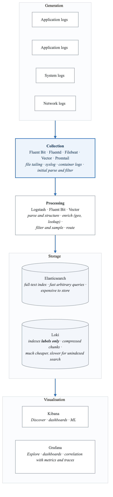
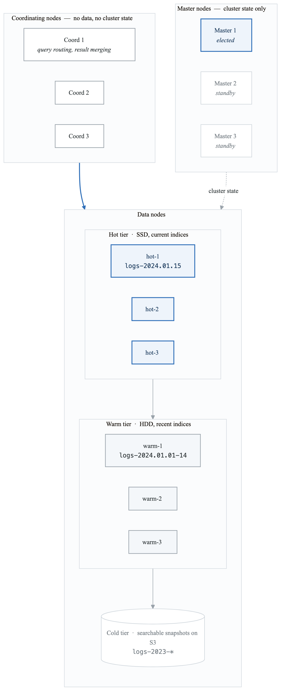
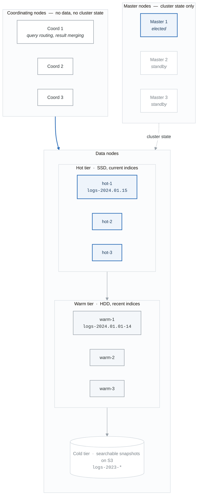
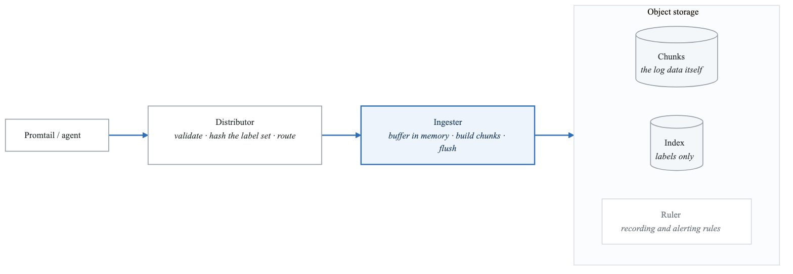
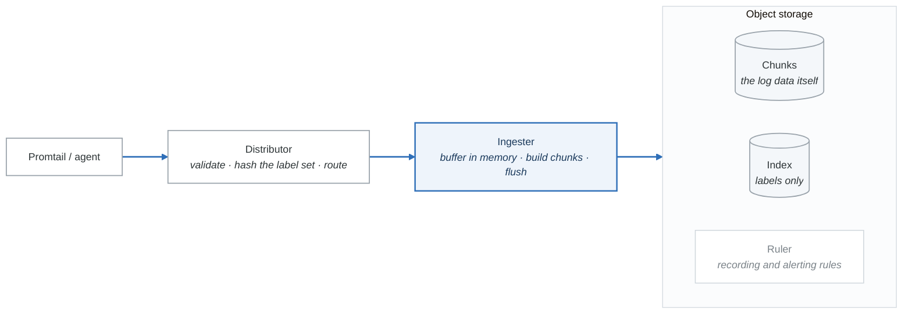
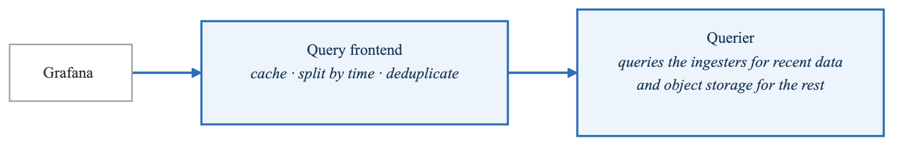
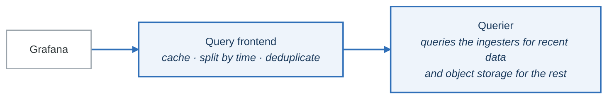

# Module 5: Logging at Scale with ELK Stack and Loki

## Learning Objectives

By the end of this module, you will be able to:
- Design log aggregation architectures for high-volume environments
- Implement and operate the ELK Stack (Elasticsearch, Logstash, Kibana)
- Deploy and configure Grafana Loki for cost-effective log storage
- Write effective log queries using KQL and LogQL
- Implement log-based alerting and anomaly detection

## Introduction

Logs provide the narrative of what happened in your systems. At scale, managing billions of log lines requires careful architecture decisions around collection, storage, indexing, and retention. This module covers two dominant approaches: the feature-rich ELK Stack and the Prometheus-inspired Loki.

## 1. Log Architecture Fundamentals

### Log Pipeline Components

```mermaid
%%{init: {'theme':'base','themeVariables':{'fontFamily':'Helvetica, Arial, sans-serif','fontSize':'13px','primaryColor':'#ffffff','primaryTextColor':'#2d3436','primaryBorderColor':'#9aa3ab','lineColor':'#9aa3ab','textColor':'#2d3436','clusterBkg':'#fbfcfd','clusterBorder':'#d4dae0','edgeLabelBackground':'#ffffff','tertiaryColor':'#eef4fb'},'flowchart':{'curve':'basis','padding':14,'nodeSpacing':42,'rankSpacing':58}}}%%
flowchart TB
  classDef default fill:#ffffff,stroke:#9aa3ab,stroke-width:1.3px,color:#2d3436
  classDef n    fill:#ffffff,stroke:#9aa3ab,stroke-width:1.3px,color:#2d3436
  classDef crit fill:#eef4fb,stroke:#2f6fb8,stroke-width:1.8px,color:#1b3a5c
  classDef data fill:#f4f7fa,stroke:#9aa3ab,stroke-width:1.3px,color:#2d3436
  classDef mut  fill:#ffffff,stroke:#cfd6dc,stroke-width:1.1px,color:#7a8288
  classDef warn fill:#fdf0ec,stroke:#c0522d,stroke-width:1.6px,color:#8a3a1e
  subgraph GEN["Generation"]
    direction LR
    G1["Application logs"]
    G2["Application logs"]
    G3["System logs"]
    G4["Network logs"]
  end
  COL["<b>Collection</b><br/>Fluent Bit · Fluentd · Filebeat · Vector · Promtail<br/><i>file tailing · syslog · container logs · initial parse and filter</i>"]
  PROC["<b>Processing</b><br/>Logstash · Fluent Bit · Vector<br/><i>parse and structure · enrich (geo, lookup) ·<br/>filter and sample · route</i>"]
  subgraph ST["Storage"]
    direction LR
    ES[("Elasticsearch<br/><i>full-text index · fast arbitrary queries ·<br/>expensive to store</i>")]
    LK[("Loki<br/><i>indexes <b>labels only</b> · compressed chunks ·<br/>much cheaper, slower for unindexed search</i>")]
  end
  subgraph VIS["Visualisation"]
    direction LR
    KB["Kibana<br/><i>Discover · dashboards · ML</i>"]
    GF["Grafana<br/><i>Explore · dashboards · correlation with metrics and traces</i>"]
  end
  GEN ==> COL ==> PROC ==> ST ==> VIS
  class G1,G2,G3,G4 n
  class COL crit
  class PROC n
  class ES,LK data
  class KB,GF n
  linkStyle 0,1,2,3 stroke:#2f6fb8,stroke-width:2px

%% The Elasticsearch-versus-Loki choice is the whole cost model. Elasticsearch
%% indexes every field, so any query is fast and storage is several times the
%% raw log volume. Loki indexes only the labels, so storage is close to raw --
%% but a query that does not narrow by label scans chunks, and you feel it.
```

<!-- figure: generated from the Mermaid below by _shared/diagrams/embed-figures.py — do not edit the image -->


<details>
<summary>Diagram source (Mermaid)</summary>



</details>

### Structured Logging Best Practices

```json
// Structured Log Format (JSON)
{
  "timestamp": "2024-01-15T10:30:45.123456Z",
  "level": "error",
  "logger": "order-service",
  "message": "Failed to process order",
  "service": {
    "name": "order-service",
    "version": "1.2.3",
    "environment": "production"
  },
  "trace": {
    "trace_id": "abc123def456789",
    "span_id": "span789xyz",
    "parent_span_id": "parent123"
  },
  "request": {
    "method": "POST",
    "path": "/api/orders",
    "request_id": "req-12345",
    "user_id": "user-789",
    "duration_ms": 234
  },
  "error": {
    "type": "PaymentDeclined",
    "message": "Card declined by issuer",
    "code": "CARD_DECLINED",
    "stack": "PaymentError: Card declined\n  at processPayment..."
  },
  "context": {
    "order_id": "ord-456",
    "amount": 99.99,
    "currency": "USD"
  }
}
```

```python
# Python structured logging with structlog
import structlog
from opentelemetry import trace

# Configure structlog
structlog.configure(
    processors=[
        structlog.stdlib.filter_by_level,
        structlog.stdlib.add_log_level,
        structlog.stdlib.add_logger_name,
        structlog.processors.TimeStamper(fmt="iso"),
        structlog.processors.StackInfoRenderer(),
        structlog.processors.format_exc_info,
        structlog.processors.UnicodeDecoder(),
        structlog.processors.JSONRenderer()
    ],
    wrapper_class=structlog.stdlib.BoundLogger,
    context_class=dict,
    logger_factory=structlog.stdlib.LoggerFactory(),
    cache_logger_on_first_use=True,
)

def get_logger(name: str):
    """Get a logger with trace context."""
    log = structlog.get_logger(name)

    # Add trace context if available
    span = trace.get_current_span()
    if span.is_recording():
        ctx = span.get_span_context()
        log = log.bind(
            trace_id=format(ctx.trace_id, '032x'),
            span_id=format(ctx.span_id, '016x')
        )

    return log

# Usage
logger = get_logger("order-service")

def process_order(order_id: str, user_id: str, amount: float):
    log = logger.bind(order_id=order_id, user_id=user_id, amount=amount)

    log.info("processing_order_started")

    try:
        # Process order...
        result = charge_payment(amount)
        log.info("order_processed", payment_id=result.payment_id)
        return result
    except PaymentError as e:
        log.error("order_processing_failed",
                  error_type=type(e).__name__,
                  error_message=str(e),
                  error_code=e.code)
        raise
```

## 2. ELK Stack Architecture

### Elasticsearch Cluster

<!-- figure: generated from the Mermaid below by _shared/diagrams/embed-figures.py — do not edit the image -->


<details>
<summary>Diagram source (Mermaid)</summary>



</details>

### Elasticsearch Configuration

```yaml
# elasticsearch.yml - Data node

cluster.name: logs-cluster
node.name: data-hot-1

# Node roles
node.roles: [data_hot, data_content]

# Network
network.host: 0.0.0.0
http.port: 9200
transport.port: 9300

# Discovery
discovery.seed_hosts:
  - master-1:9300
  - master-2:9300
  - master-3:9300

# Security
xpack.security.enabled: true
xpack.security.transport.ssl.enabled: true
xpack.security.transport.ssl.verification_mode: certificate
xpack.security.transport.ssl.keystore.path: /etc/elasticsearch/certs/elastic-certificates.p12
xpack.security.transport.ssl.truststore.path: /etc/elasticsearch/certs/elastic-certificates.p12

# Memory
bootstrap.memory_lock: true

# Index settings
action.auto_create_index: true
```

### Index Lifecycle Management (ILM)

```json
// PUT _ilm/policy/logs-policy
{
  "policy": {
    "phases": {
      "hot": {
        "min_age": "0ms",
        "actions": {
          "rollover": {
            "max_size": "50gb",
            "max_age": "1d",
            "max_docs": 100000000
          },
          "set_priority": {
            "priority": 100
          }
        }
      },
      "warm": {
        "min_age": "7d",
        "actions": {
          "shrink": {
            "number_of_shards": 1
          },
          "forcemerge": {
            "max_num_segments": 1
          },
          "allocate": {
            "require": {
              "data": "warm"
            }
          },
          "set_priority": {
            "priority": 50
          }
        }
      },
      "cold": {
        "min_age": "30d",
        "actions": {
          "searchable_snapshot": {
            "snapshot_repository": "logs-snapshots",
            "force_merge_index": true
          },
          "set_priority": {
            "priority": 0
          }
        }
      },
      "delete": {
        "min_age": "90d",
        "actions": {
          "delete": {}
        }
      }
    }
  }
}
```

### Index Templates

```json
// PUT _index_template/logs-template
{
  "index_patterns": ["logs-*"],
  "template": {
    "settings": {
      "number_of_shards": 3,
      "number_of_replicas": 1,
      "index.lifecycle.name": "logs-policy",
      "index.lifecycle.rollover_alias": "logs",
      "index.mapping.total_fields.limit": 2000,
      "index.refresh_interval": "5s"
    },
    "mappings": {
      "properties": {
        "@timestamp": {
          "type": "date",
          "format": "strict_date_optional_time"
        },
        "level": {
          "type": "keyword"
        },
        "message": {
          "type": "text",
          "fields": {
            "keyword": {
              "type": "keyword",
              "ignore_above": 256
            }
          }
        },
        "service": {
          "properties": {
            "name": {"type": "keyword"},
            "version": {"type": "keyword"},
            "environment": {"type": "keyword"}
          }
        },
        "trace": {
          "properties": {
            "trace_id": {"type": "keyword"},
            "span_id": {"type": "keyword"}
          }
        },
        "request": {
          "properties": {
            "method": {"type": "keyword"},
            "path": {"type": "keyword"},
            "duration_ms": {"type": "long"},
            "status_code": {"type": "short"}
          }
        },
        "error": {
          "properties": {
            "type": {"type": "keyword"},
            "message": {"type": "text"},
            "stack": {"type": "text"}
          }
        }
      }
    }
  },
  "priority": 100,
  "composed_of": ["logs-mappings", "logs-settings"]
}
```

### Kibana Query Language (KQL)

```kql
# Basic queries
level: error
service.name: "order-service"
message: "payment" AND level: error

# Wildcards
service.name: order-*
message: *timeout*

# Ranges
request.duration_ms >= 1000
@timestamp >= "2024-01-15" AND @timestamp < "2024-01-16"

# Boolean logic
(level: error OR level: warn) AND service.name: "api-gateway"
NOT level: debug

# Nested fields
error.type: "PaymentDeclined"
request.path: "/api/orders"

# Combined complex query
service.name: "order-service"
  AND level: error
  AND @timestamp >= now-1h
  AND request.duration_ms > 500
  AND NOT error.type: "UserError"
```

## 3. Logstash Processing

### Logstash Pipeline

```ruby
# /etc/logstash/pipelines/main.conf

input {
  # Beats input
  beats {
    port => 5044
    ssl => true
    ssl_certificate_authorities => ["/etc/logstash/certs/ca.crt"]
    ssl_certificate => "/etc/logstash/certs/logstash.crt"
    ssl_key => "/etc/logstash/certs/logstash.key"
  }

  # Kafka input for high-volume
  kafka {
    bootstrap_servers => "kafka-1:9092,kafka-2:9092,kafka-3:9092"
    topics => ["logs-production"]
    group_id => "logstash-consumers"
    consumer_threads => 4
    codec => json
  }
}

filter {
  # Parse JSON logs
  if [message] =~ /^\{/ {
    json {
      source => "message"
      target => "parsed"
    }

    # Promote parsed fields to top level
    mutate {
      rename => {
        "[parsed][timestamp]" => "@timestamp"
        "[parsed][level]" => "level"
        "[parsed][message]" => "log_message"
        "[parsed][service]" => "service"
        "[parsed][trace]" => "trace"
        "[parsed][request]" => "request"
        "[parsed][error]" => "error"
      }
      remove_field => ["parsed", "message"]
    }
  }

  # Parse unstructured logs with grok
  if ![level] {
    grok {
      match => {
        "message" => "%{TIMESTAMP_ISO8601:@timestamp} \[%{LOGLEVEL:level}\] %{DATA:logger} - %{GREEDYDATA:log_message}"
      }
    }
  }

  # Normalize log levels
  mutate {
    lowercase => ["level"]
  }

  # Enrich with GeoIP for client IPs
  if [client_ip] {
    geoip {
      source => "client_ip"
      target => "geoip"
      database => "/etc/logstash/GeoLite2-City.mmdb"
    }
  }

  # Add Kubernetes metadata
  if [kubernetes] {
    mutate {
      add_field => {
        "[@metadata][index_prefix]" => "logs-%{[kubernetes][namespace]}"
      }
    }
  } else {
    mutate {
      add_field => {
        "[@metadata][index_prefix]" => "logs-default"
      }
    }
  }

  # Drop debug logs in production
  if [level] == "debug" and [environment] == "production" {
    drop { }
  }

  # Sample high-volume endpoints
  if [request][path] == "/health" or [request][path] == "/metrics" {
    # Keep only 1% of health check logs
    ruby {
      code => "event.cancel if rand > 0.01"
    }
  }

  # Parse stack traces
  if [error][stack] {
    ruby {
      code => '
        stack = event.get("[error][stack]")
        if stack
          frames = stack.split("\n").take(20)
          event.set("[error][stack_frames]", frames)
        end
      '
    }
  }
}

output {
  # Route to Elasticsearch
  elasticsearch {
    hosts => ["https://elasticsearch:9200"]
    user => "logstash"
    password => "${ES_PASSWORD}"
    ssl => true
    cacert => "/etc/logstash/certs/ca.crt"

    index => "%{[@metadata][index_prefix]}-%{+YYYY.MM.dd}"
    ilm_enabled => true
    ilm_rollover_alias => "%{[@metadata][index_prefix]}"
    ilm_pattern => "{now/d}-000001"
    ilm_policy => "logs-policy"
  }

  # Also send errors to dedicated index
  if [level] == "error" {
    elasticsearch {
      hosts => ["https://elasticsearch:9200"]
      user => "logstash"
      password => "${ES_PASSWORD}"
      ssl => true
      cacert => "/etc/logstash/certs/ca.crt"

      index => "errors-%{+YYYY.MM.dd}"
    }
  }

  # Dead letter queue for failed events
  # Configured in logstash.yml
}
```

## 4. Grafana Loki

### Loki Architecture

**Write path**

<!-- figure: generated from the Mermaid below by _shared/diagrams/embed-figures.py — do not edit the image -->


<details>
<summary>Diagram source (Mermaid)</summary>



</details>

**Read path**

<!-- figure: generated from the Mermaid below by _shared/diagrams/embed-figures.py — do not edit the image -->


<details>
<summary>Diagram source (Mermaid)</summary>



</details>

The querier reading from **both** ingesters and object storage is what makes recent logs available
before they have been flushed. It is also why an ingester crash loses the last few minutes unless
you run the write-ahead log or a replication factor above 1.

### Loki Configuration

```yaml
# loki-config.yaml

auth_enabled: false

server:
  http_listen_port: 3100
  grpc_listen_port: 9096

common:
  path_prefix: /loki
  storage:
    filesystem:
      chunks_directory: /loki/chunks
      rules_directory: /loki/rules
  replication_factor: 3
  ring:
    kvstore:
      store: memberlist

memberlist:
  join_members:
    - loki-memberlist:7946

schema_config:
  configs:
    - from: 2024-01-01
      store: tsdb
      object_store: s3
      schema: v12
      index:
        prefix: loki_index_
        period: 24h

storage_config:
  tsdb_shipper:
    active_index_directory: /loki/tsdb-index
    cache_location: /loki/tsdb-cache
    cache_ttl: 24h

  aws:
    s3: s3://us-east-1/loki-logs
    bucketnames: loki-logs
    region: us-east-1
    access_key_id: ${AWS_ACCESS_KEY_ID}
    secret_access_key: ${AWS_SECRET_ACCESS_KEY}

compactor:
  working_directory: /loki/compactor
  shared_store: s3
  compaction_interval: 5m
  retention_enabled: true
  retention_delete_delay: 2h
  retention_delete_worker_count: 150

limits_config:
  ingestion_rate_mb: 10
  ingestion_burst_size_mb: 20
  max_streams_per_user: 10000
  max_entries_limit_per_query: 5000
  max_query_parallelism: 32
  retention_period: 720h  # 30 days

query_scheduler:
  max_outstanding_requests_per_tenant: 2048

frontend:
  max_outstanding_per_tenant: 2048
  compress_responses: true

query_range:
  parallelise_shardable_queries: true
  cache_results: true

ruler:
  storage:
    type: s3
    s3:
      bucketnames: loki-rules
      region: us-east-1
  alertmanager_url: http://alertmanager:9093
  enable_api: true
```

### Promtail Configuration

```yaml
# promtail-config.yaml

server:
  http_listen_port: 9080
  grpc_listen_port: 0

positions:
  filename: /var/log/positions.yaml

clients:
  - url: http://loki:3100/loki/api/v1/push
    tenant_id: default
    batchwait: 1s
    batchsize: 1048576
    timeout: 10s

scrape_configs:
  # Kubernetes pods
  - job_name: kubernetes-pods
    kubernetes_sd_configs:
      - role: pod

    pipeline_stages:
      # Parse JSON logs
      - json:
          expressions:
            level: level
            message: message
            trace_id: trace.trace_id
            service: service.name
            timestamp: timestamp

      # Use parsed timestamp
      - timestamp:
          source: timestamp
          format: RFC3339Nano

      # Extract labels from JSON
      - labels:
          level:
          service:
          trace_id:

      # Output message field as log line
      - output:
          source: message

    relabel_configs:
      # Keep only pods with logging enabled
      - source_labels: [__meta_kubernetes_pod_annotation_promtail_io_scrape]
        action: keep
        regex: true

      # Use namespace and pod as labels
      - source_labels: [__meta_kubernetes_namespace]
        target_label: namespace

      - source_labels: [__meta_kubernetes_pod_name]
        target_label: pod

      - source_labels: [__meta_kubernetes_pod_container_name]
        target_label: container

      # Add app label
      - source_labels: [__meta_kubernetes_pod_label_app]
        target_label: app

  # System logs
  - job_name: system
    static_configs:
      - targets:
          - localhost
        labels:
          job: varlogs
          __path__: /var/log/*log

    pipeline_stages:
      - regex:
          expression: '^(?P<timestamp>\S+\s+\S+)\s+(?P<hostname>\S+)\s+(?P<process>\S+)\[\d+\]:\s+(?P<message>.*)$'

      - labels:
          hostname:
          process:

      - timestamp:
          source: timestamp
          format: 'Jan 02 15:04:05'

      - output:
          source: message
```

### LogQL Query Language

```logql
# Stream selection (required)
{namespace="production", app="order-service"}
{job="varlogs", filename=~".*/syslog"}

# Label matchers
{app=~"api-.*"}           # Regex match
{namespace!="kube-system"} # Not equal
{level=~"error|warn"}     # Multiple values

# Line filters
{app="order-service"} |= "payment"           # Contains
{app="order-service"} != "health"            # Does not contain
{app="order-service"} |~ "order.*failed"     # Regex match
{app="order-service"} !~ "debug|trace"       # Regex not match

# JSON parsing
{app="order-service"}
  | json
  | level="error"
  | request_path=~"/api/orders.*"

# Line format
{app="order-service"}
  | json
  | line_format "{{.level}} - {{.message}} [{{.trace_id}}]"

# Label format
{app="order-service"}
  | json
  | label_format service_version="{{.service}}-{{.version}}"

# Pattern matching
{app="order-service"}
  | pattern "<timestamp> <level> <message>"
  | level="ERROR"

# Regex extraction
{app="order-service"}
  | regexp `order_id=(?P<order_id>\w+)`
  | order_id != ""

# Metric queries (for alerting and dashboards)
# Count errors per minute
sum(rate({app="order-service", level="error"}[1m])) by (namespace)

# Error rate percentage
sum(rate({app="order-service", level="error"}[5m]))
/
sum(rate({app="order-service"}[5m]))
* 100

# Top 5 error messages
topk(5, sum by (message) (
  count_over_time({app="order-service", level="error"}[1h])
))

# Quantile of log bytes
quantile_over_time(0.95, {app="order-service"} | bytes_over_time[5m]) by (pod)

# Logs with high latency
{app="order-service"}
  | json
  | request_duration_ms > 1000
  | line_format "Slow request: {{.request_path}} took {{.request_duration_ms}}ms"
```

## 5. Log-Based Alerting

### Loki Alerting Rules

```yaml
# loki-rules.yaml

groups:
  - name: application_log_alerts
    interval: 1m
    rules:
      - alert: HighErrorRate
        expr: |
          sum(rate({app="order-service", level="error"}[5m])) by (namespace)
          /
          sum(rate({app="order-service"}[5m])) by (namespace)
          > 0.01
        for: 5m
        labels:
          severity: warning
        annotations:
          summary: "High error rate in logs for {{ $labels.namespace }}"
          description: "Error rate is {{ $value | humanizePercentage }}"

      - alert: CriticalErrorPattern
        expr: |
          count_over_time(
            {app=~".+"}
            |= "FATAL"
            or |= "panic"
            or |= "OOMKilled"
          [5m]) > 0
        for: 1m
        labels:
          severity: critical
        annotations:
          summary: "Critical error pattern detected"
          description: "Found critical error keywords in logs"

      - alert: NoLogsReceived
        expr: |
          absent_over_time({app="order-service"}[15m])
        labels:
          severity: warning
        annotations:
          summary: "No logs received from order-service"
          description: "No logs have been received in the last 15 minutes"

      - alert: SecurityAuditEvent
        expr: |
          count_over_time(
            {app=~".+"} |= "SECURITY_AUDIT"
            | json
            | event_type=~"login_failed|permission_denied|unauthorized_access"
          [5m]) > 10
        for: 0m
        labels:
          severity: warning
        annotations:
          summary: "Multiple security audit events detected"
```

### Elasticsearch Watcher (Alerting)

```json
// PUT _watcher/watch/error_rate_watch
{
  "trigger": {
    "schedule": {
      "interval": "1m"
    }
  },
  "input": {
    "search": {
      "request": {
        "indices": ["logs-*"],
        "body": {
          "size": 0,
          "query": {
            "bool": {
              "must": [
                {"range": {"@timestamp": {"gte": "now-5m"}}},
                {"term": {"level": "error"}}
              ]
            }
          },
          "aggs": {
            "by_service": {
              "terms": {"field": "service.name.keyword"},
              "aggs": {
                "error_count": {"value_count": {"field": "_id"}}
              }
            }
          }
        }
      }
    }
  },
  "condition": {
    "script": {
      "source": """
        for (bucket in ctx.payload.aggregations.by_service.buckets) {
          if (bucket.error_count.value > 100) {
            return true;
          }
        }
        return false;
      """
    }
  },
  "actions": {
    "notify_slack": {
      "webhook": {
        "scheme": "https",
        "host": "hooks.slack.com",
        "port": 443,
        "method": "post",
        "path": "/services/xxx/yyy/zzz",
        "body": """
        {
          "text": "High error rate detected",
          "attachments": [
            {
              "color": "danger",
              "text": "Services with high error counts:\n{{#ctx.payload.aggregations.by_service.buckets}}• {{key}}: {{error_count.value}} errors\n{{/ctx.payload.aggregations.by_service.buckets}}"
            }
          ]
        }
        """
      }
    }
  }
}
```

## 6. Log Analysis Patterns

### Error Clustering

```python
# Python script for log error clustering

from elasticsearch import Elasticsearch
from sklearn.feature_extraction.text import TfidfVectorizer
from sklearn.cluster import DBSCAN
import numpy as np

es = Elasticsearch(['http://elasticsearch:9200'])

def get_error_logs(hours=24):
    """Fetch error logs from Elasticsearch."""
    query = {
        "query": {
            "bool": {
                "must": [
                    {"term": {"level": "error"}},
                    {"range": {"@timestamp": {"gte": f"now-{hours}h"}}}
                ]
            }
        },
        "size": 10000,
        "_source": ["message", "error.message", "error.type"]
    }

    results = es.search(index="logs-*", body=query)
    return [hit['_source'] for hit in results['hits']['hits']]

def cluster_errors(logs):
    """Cluster similar error messages."""
    messages = [
        log.get('error', {}).get('message', log.get('message', ''))
        for log in logs
    ]

    # Vectorize messages
    vectorizer = TfidfVectorizer(
        max_features=1000,
        stop_words='english',
        ngram_range=(1, 2)
    )
    vectors = vectorizer.fit_transform(messages)

    # Cluster using DBSCAN
    clustering = DBSCAN(eps=0.5, min_samples=5, metric='cosine')
    labels = clustering.fit_predict(vectors)

    # Group by cluster
    clusters = {}
    for idx, label in enumerate(labels):
        if label not in clusters:
            clusters[label] = []
        clusters[label].append(messages[idx])

    return clusters

def analyze_clusters(clusters):
    """Analyze error clusters."""
    for label, messages in sorted(clusters.items(), key=lambda x: -len(x[1])):
        if label == -1:
            continue  # Skip noise

        print(f"\n=== Cluster {label}: {len(messages)} errors ===")
        print(f"Sample: {messages[0][:200]}...")

if __name__ == "__main__":
    logs = get_error_logs()
    clusters = cluster_errors(logs)
    analyze_clusters(clusters)
```

### Anomaly Detection with ML

```yaml
# Elasticsearch ML Job for log anomaly detection

# PUT _ml/anomaly_detectors/log_volume_anomaly
{
  "description": "Detect unusual log volume patterns",
  "analysis_config": {
    "bucket_span": "5m",
    "detectors": [
      {
        "function": "count",
        "by_field_name": "service.name.keyword",
        "partition_field_name": "level.keyword"
      }
    ],
    "influencers": [
      "service.name.keyword",
      "level.keyword",
      "kubernetes.namespace.keyword"
    ]
  },
  "data_description": {
    "time_field": "@timestamp"
  },
  "analysis_limits": {
    "model_memory_limit": "256mb"
  },
  "datafeed_config": {
    "indices": ["logs-*"],
    "query": {
      "match_all": {}
    },
    "frequency": "1m"
  }
}
```

## Summary

Effective log management at scale requires careful attention to structure, retention, and query optimization. Whether using ELK Stack for its powerful search capabilities or Loki for its cost-effectiveness, the principles of structured logging and intelligent aggregation remain constant.

### Key Takeaways

1. **Structure from the Start**: Use structured logging (JSON) from the beginning
2. **Index Strategy Matters**: Plan your index lifecycle for cost and performance
3. **Label Cardinality**: In Loki, keep label cardinality low for efficiency
4. **Sampling for Scale**: Sample high-volume, low-value logs
5. **Correlate with Traces**: Include trace IDs for easy correlation

## What's Next

In the next module, we'll explore distributed tracing with Jaeger and OpenTelemetry, completing the observability picture by understanding request flows across services.

<!-- feynman-check -->

---

## Feynman check

Close the file. Blank page, no notes. Explain each of these to a competent engineer who has never
used this tool — **under five minutes, no jargon you can't define on the spot:**

- Log Architecture Fundamentals
- ELK Stack Architecture
- Logstash Processing
- Grafana Loki

**The gap is not what you forgot. It is where you used a word instead of a mechanism.**

| | |
|---|---|
| ✗ | *"Prometheus monitors the service."* |
| ✓ | *"Prometheus discovers targets from the Kubernetes API, applies relabelling rules, scrapes `/metrics` over HTTP on an interval, and appends samples to a local TSDB. Nothing is pushed — so a target missing from a dashboard is a service-discovery problem, not an application one."* |

**Trace it:** A latency regression → a phone ringing. Name each hop: sample, rule evaluation, alert state transition, routing, notification — and where each one can silently stop.

Stop at the first component you cannot name. Reopen this file and read **only** that.

**Go deeper — only once the gap has a name:** [SRE Workbook ch. 5, *Alerting on SLOs*](https://sre.google/workbook/alerting-on-slos/) — free, and the best thing written on why static thresholds page you for nothing.
Full list per domain: [`SOURCES.md`](../SOURCES.md#observability-sre)

→ Protocol, the three levels of knowing, and worked examples: [`MASTERY.md`](../MASTERY.md)

<!-- /feynman-check -->
