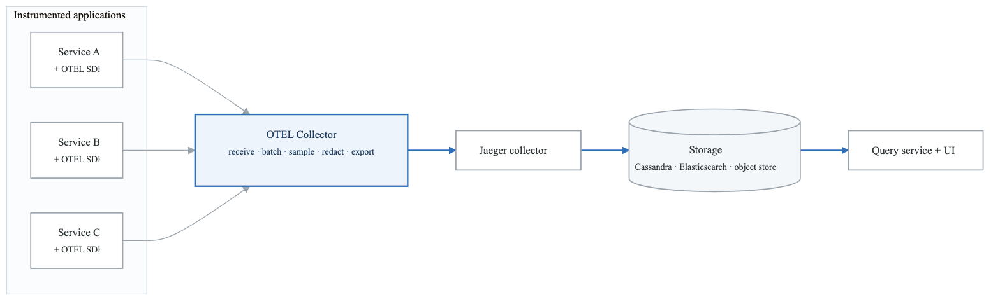
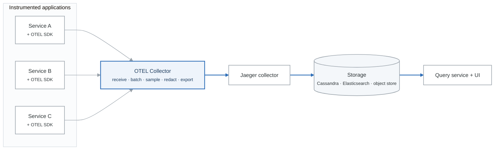

# Module 6: Distributed Tracing with Jaeger and OpenTelemetry

## Learning Objectives

By the end of this module, you will be able to:
- Explain distributed tracing concepts and trace context propagation
- Implement tracing with OpenTelemetry across multiple languages
- Deploy and operate Jaeger for trace storage and visualization
- Use traces for performance analysis and debugging
- Design sampling strategies for high-volume environments

## Introduction

In distributed systems, a single user request may traverse dozens of services. Distributed tracing provides the ability to follow a request's journey, understand dependencies, and identify performance bottlenecks. OpenTelemetry has emerged as the industry standard for instrumentation, while Jaeger and Tempo provide powerful backends for storage and analysis.

## 1. Distributed Tracing Concepts

### Anatomy of a Trace

**One trace, decomposed** — `trace_id: abc123def456789`

| Span | Service | Start | Duration | Notes |
|---|---|---|---|---|
| `HTTP GET /checkout` (root) | frontend | 0 ms | **850 ms** | the user-visible latency |
| ├ `cart.load` | cart-service | 40 ms | 150 ms | |
| │ └ `SELECT …` | postgres | 60 ms | 45 ms | |
| ├ `payment.authorize` | payment-service | 200 ms | **580 ms** | ← the time is here |
| │ └ `POST provider/api` | external | 230 ms | 540 ms | |
| └ `order.write` | order-service | 790 ms | 55 ms | |

A trace is a tree of spans sharing one `trace_id`, each with a parent. The value is that it shows
**where the time went across service boundaries** — here, 540 of the 850 ms is one external call,
which no single service's metrics would have told you.

### Trace Context

```yaml
# W3C Trace Context Standard

traceparent_header:
  format: "{version}-{trace-id}-{parent-id}-{trace-flags}"
  example: "00-4bf92f3577b34da6a3ce929d0e0e4736-00f067aa0ba902b7-01"
  components:
    version: "00"                              # Version (2 hex digits)
    trace_id: "4bf92f3577b34da6..."           # 128-bit trace ID (32 hex)
    parent_id: "00f067aa0ba902b7"             # 64-bit span ID (16 hex)
    trace_flags: "01"                          # 8-bit flags (sampled=01)

tracestate_header:
  format: "vendor1=value1,vendor2=value2"
  purpose: "Vendor-specific trace context"
  example: "dd=s:1;o:prod,sw=ABC123"

baggage_header:
  format: "key1=value1,key2=value2"
  purpose: "Cross-cutting concerns (user ID, tenant ID)"
  example: "userId=12345,tenantId=acme-corp"
```

### Span Attributes

```yaml
# OpenTelemetry Semantic Conventions

http_server_span:
  required:
    - http.request.method: "GET"
    - url.scheme: "https"
    - url.path: "/api/orders"
    - http.response.status_code: 200
  recommended:
    - http.route: "/api/orders/{id}"
    - user_agent.original: "Mozilla/5.0..."
    - client.address: "192.168.1.1"
    - server.address: "api.example.com"
    - server.port: 443

database_span:
  required:
    - db.system: "postgresql"
    - db.operation.name: "SELECT"
  recommended:
    - db.namespace: "orders"
    - db.query.text: "SELECT * FROM orders WHERE id = $1"
    - server.address: "db.example.com"
    - server.port: 5432

messaging_span:
  required:
    - messaging.system: "kafka"
    - messaging.operation.type: "publish"
  recommended:
    - messaging.destination.name: "orders"
    - messaging.message.id: "msg-123"
    - messaging.kafka.partition: 0

rpc_span:
  required:
    - rpc.system: "grpc"
    - rpc.service: "OrderService"
    - rpc.method: "GetOrder"
  recommended:
    - rpc.grpc.status_code: 0
    - server.address: "order-service.default.svc"
```

## 2. OpenTelemetry Instrumentation

### Python Instrumentation

```python
# app.py - Complete OpenTelemetry setup

from opentelemetry import trace, metrics
from opentelemetry.sdk.trace import TracerProvider
from opentelemetry.sdk.trace.export import BatchSpanProcessor
from opentelemetry.exporter.otlp.proto.grpc.trace_exporter import OTLPSpanExporter
from opentelemetry.sdk.resources import Resource, SERVICE_NAME, SERVICE_VERSION
from opentelemetry.instrumentation.flask import FlaskInstrumentor
from opentelemetry.instrumentation.requests import RequestsInstrumentor
from opentelemetry.instrumentation.sqlalchemy import SQLAlchemyInstrumentor
from opentelemetry.instrumentation.redis import RedisInstrumentor
from opentelemetry.propagate import set_global_textmap
from opentelemetry.propagators.b3 import B3MultiFormat
from opentelemetry.trace import Status, StatusCode
import structlog

# Configure resource
resource = Resource.create({
    SERVICE_NAME: "order-service",
    SERVICE_VERSION: "1.0.0",
    "deployment.environment": os.environ.get("ENVIRONMENT", "development"),
    "service.namespace": "ecommerce",
})

# Configure tracer provider
provider = TracerProvider(resource=resource)

# Configure OTLP exporter
otlp_exporter = OTLPSpanExporter(
    endpoint=os.environ.get("OTEL_EXPORTER_OTLP_ENDPOINT", "http://otel-collector:4317"),
    insecure=True
)

# Add batch processor
provider.add_span_processor(BatchSpanProcessor(otlp_exporter))

# Set global tracer provider
trace.set_tracer_provider(provider)

# Get tracer
tracer = trace.get_tracer(__name__)

# Configure propagator (W3C is default, can add B3 for compatibility)
# set_global_textmap(B3MultiFormat())

# Auto-instrument libraries
from flask import Flask
app = Flask(__name__)

FlaskInstrumentor().instrument_app(app)
RequestsInstrumentor().instrument()
SQLAlchemyInstrumentor().instrument()
RedisInstrumentor().instrument()

# Structured logging with trace context
def get_logger():
    span = trace.get_current_span()
    ctx = span.get_span_context()
    return structlog.get_logger().bind(
        trace_id=format(ctx.trace_id, '032x') if ctx.trace_id else None,
        span_id=format(ctx.span_id, '016x') if ctx.span_id else None
    )

# Manual span creation
@app.route('/api/orders', methods=['POST'])
def create_order():
    logger = get_logger()

    with tracer.start_as_current_span("create_order") as span:
        # Add attributes
        span.set_attribute("order.customer_id", request.json['customer_id'])
        span.set_attribute("order.item_count", len(request.json['items']))

        try:
            # Validate order
            with tracer.start_as_current_span("validate_order") as validate_span:
                validate_order(request.json)
                validate_span.set_attribute("validation.passed", True)

            # Process payment
            with tracer.start_as_current_span("process_payment") as payment_span:
                payment_span.set_attribute("payment.amount", request.json['amount'])
                payment_span.set_attribute("payment.currency", "USD")

                result = payment_service.charge(request.json['payment'])
                payment_span.set_attribute("payment.transaction_id", result.transaction_id)

            # Add span event for significant occurrence
            span.add_event("order_created", {
                "order_id": result.order_id,
                "total": request.json['amount']
            })

            logger.info("order_created", order_id=result.order_id)
            return jsonify({"order_id": result.order_id}), 201

        except PaymentError as e:
            # Record exception in span
            span.record_exception(e)
            span.set_status(Status(StatusCode.ERROR, str(e)))
            span.set_attribute("error.type", type(e).__name__)

            logger.error("order_failed", error=str(e))
            raise

# Async span example
import asyncio
from opentelemetry.instrumentation.asyncio import AsyncioInstrumentor

AsyncioInstrumentor().instrument()

async def process_order_async(order_id: str):
    with tracer.start_as_current_span("process_order_async") as span:
        span.set_attribute("order.id", order_id)

        # Run parallel operations
        results = await asyncio.gather(
            check_inventory(order_id),
            validate_payment(order_id),
            notify_warehouse(order_id)
        )

        return results
```

### Go Instrumentation

```go
// main.go - OpenTelemetry setup in Go

package main

import (
    "context"
    "log"
    "net/http"

    "go.opentelemetry.io/otel"
    "go.opentelemetry.io/otel/attribute"
    "go.opentelemetry.io/otel/exporters/otlp/otlptrace/otlptracegrpc"
    "go.opentelemetry.io/otel/propagation"
    "go.opentelemetry.io/otel/sdk/resource"
    sdktrace "go.opentelemetry.io/otel/sdk/trace"
    semconv "go.opentelemetry.io/otel/semconv/v1.21.0"
    "go.opentelemetry.io/otel/trace"
    "go.opentelemetry.io/contrib/instrumentation/net/http/otelhttp"
    "go.opentelemetry.io/contrib/instrumentation/google.golang.org/grpc/otelgrpc"
)

var tracer trace.Tracer

func initTracer(ctx context.Context) func() {
    // Create OTLP exporter
    exporter, err := otlptracegrpc.New(ctx,
        otlptracegrpc.WithEndpoint("otel-collector:4317"),
        otlptracegrpc.WithInsecure(),
    )
    if err != nil {
        log.Fatalf("failed to create exporter: %v", err)
    }

    // Create resource
    res, err := resource.New(ctx,
        resource.WithAttributes(
            semconv.ServiceName("order-service"),
            semconv.ServiceVersion("1.0.0"),
            attribute.String("environment", "production"),
        ),
    )
    if err != nil {
        log.Fatalf("failed to create resource: %v", err)
    }

    // Create tracer provider
    tp := sdktrace.NewTracerProvider(
        sdktrace.WithBatcher(exporter),
        sdktrace.WithResource(res),
        sdktrace.WithSampler(sdktrace.TraceIDRatioBased(0.1)), // 10% sampling
    )

    otel.SetTracerProvider(tp)
    otel.SetTextMapPropagator(propagation.NewCompositeTextMapPropagator(
        propagation.TraceContext{},
        propagation.Baggage{},
    ))

    tracer = tp.Tracer("order-service")

    return func() {
        if err := tp.Shutdown(ctx); err != nil {
            log.Printf("error shutting down tracer provider: %v", err)
        }
    }
}

func main() {
    ctx := context.Background()
    shutdown := initTracer(ctx)
    defer shutdown()

    // Wrap HTTP handler with tracing
    handler := http.HandlerFunc(orderHandler)
    wrappedHandler := otelhttp.NewHandler(handler, "create_order")

    http.Handle("/api/orders", wrappedHandler)
    log.Fatal(http.ListenAndServe(":8080", nil))
}

func orderHandler(w http.ResponseWriter, r *http.Request) {
    ctx := r.Context()

    // Start custom span
    ctx, span := tracer.Start(ctx, "process_order",
        trace.WithAttributes(
            attribute.String("order.customer_id", r.Header.Get("X-Customer-ID")),
        ),
    )
    defer span.End()

    // Validate order
    if err := validateOrder(ctx, r); err != nil {
        span.RecordError(err)
        span.SetStatus(codes.Error, err.Error())
        http.Error(w, err.Error(), http.StatusBadRequest)
        return
    }

    // Process payment with child span
    ctx, paymentSpan := tracer.Start(ctx, "process_payment")
    paymentResult, err := processPayment(ctx, r)
    if err != nil {
        paymentSpan.RecordError(err)
        paymentSpan.SetStatus(codes.Error, err.Error())
        paymentSpan.End()
        http.Error(w, err.Error(), http.StatusPaymentRequired)
        return
    }
    paymentSpan.SetAttributes(
        attribute.String("payment.transaction_id", paymentResult.TransactionID),
    )
    paymentSpan.End()

    // Add event
    span.AddEvent("order_created", trace.WithAttributes(
        attribute.String("order.id", paymentResult.OrderID),
    ))

    w.WriteHeader(http.StatusCreated)
    json.NewEncoder(w).Encode(paymentResult)
}

// HTTP client with tracing
func callExternalService(ctx context.Context, url string) (*http.Response, error) {
    client := &http.Client{
        Transport: otelhttp.NewTransport(http.DefaultTransport),
    }

    req, err := http.NewRequestWithContext(ctx, "GET", url, nil)
    if err != nil {
        return nil, err
    }

    return client.Do(req)
}
```

### JavaScript/Node.js Instrumentation

```javascript
// tracing.js - OpenTelemetry setup

const { NodeSDK } = require('@opentelemetry/sdk-node');
const { getNodeAutoInstrumentations } = require('@opentelemetry/auto-instrumentations-node');
const { OTLPTraceExporter } = require('@opentelemetry/exporter-trace-otlp-grpc');
const { Resource } = require('@opentelemetry/resources');
const { SemanticResourceAttributes } = require('@opentelemetry/semantic-conventions');
const { trace, SpanStatusCode } = require('@opentelemetry/api');

const sdk = new NodeSDK({
  resource: new Resource({
    [SemanticResourceAttributes.SERVICE_NAME]: 'order-service',
    [SemanticResourceAttributes.SERVICE_VERSION]: '1.0.0',
    [SemanticResourceAttributes.DEPLOYMENT_ENVIRONMENT]: process.env.ENVIRONMENT || 'development',
  }),
  traceExporter: new OTLPTraceExporter({
    url: process.env.OTEL_EXPORTER_OTLP_ENDPOINT || 'http://otel-collector:4317',
  }),
  instrumentations: [
    getNodeAutoInstrumentations({
      '@opentelemetry/instrumentation-http': {
        ignoreIncomingRequestHook: (req) => {
          // Ignore health checks
          return req.url === '/health' || req.url === '/ready';
        },
      },
      '@opentelemetry/instrumentation-express': {},
      '@opentelemetry/instrumentation-pg': {},
      '@opentelemetry/instrumentation-redis': {},
      '@opentelemetry/instrumentation-grpc': {},
    }),
  ],
});

sdk.start();

process.on('SIGTERM', () => {
  sdk.shutdown().then(() => process.exit(0));
});

module.exports = { sdk };
```

```javascript
// app.js - Using traces

require('./tracing'); // Initialize before other imports

const express = require('express');
const { trace, SpanStatusCode, context } = require('@opentelemetry/api');

const app = express();
const tracer = trace.getTracer('order-service');

app.post('/api/orders', async (req, res) => {
  // Start custom span
  const span = tracer.startSpan('create_order', {
    attributes: {
      'order.customer_id': req.body.customerId,
      'order.item_count': req.body.items?.length,
    },
  });

  try {
    // Run with span context
    await context.with(trace.setSpan(context.active(), span), async () => {
      // Validate
      await tracer.startActiveSpan('validate_order', async (validateSpan) => {
        try {
          await validateOrder(req.body);
          validateSpan.setAttribute('validation.passed', true);
        } finally {
          validateSpan.end();
        }
      });

      // Process payment
      const paymentResult = await tracer.startActiveSpan('process_payment', async (paymentSpan) => {
        try {
          paymentSpan.setAttribute('payment.amount', req.body.amount);
          const result = await paymentService.charge(req.body.payment);
          paymentSpan.setAttribute('payment.transaction_id', result.transactionId);
          return result;
        } finally {
          paymentSpan.end();
        }
      });

      // Add event
      span.addEvent('order_created', {
        'order.id': paymentResult.orderId,
      });

      res.status(201).json({ orderId: paymentResult.orderId });
    });
  } catch (error) {
    span.recordException(error);
    span.setStatus({ code: SpanStatusCode.ERROR, message: error.message });
    res.status(500).json({ error: error.message });
  } finally {
    span.end();
  }
});

app.listen(8080);
```

## 3. Jaeger Architecture

### Deployment Architecture

<!-- figure: generated from the Mermaid below by _shared/diagrams/embed-figures.py — do not edit the image -->


<details>
<summary>Diagram source (Mermaid)</summary>



</details>

### Jaeger Kubernetes Deployment

```yaml
# jaeger-operator deployment
apiVersion: jaegertracing.io/v1
kind: Jaeger
metadata:
  name: jaeger-production
  namespace: observability
spec:
  strategy: production

  collector:
    replicas: 3
    maxReplicas: 10
    resources:
      limits:
        cpu: "2"
        memory: 4Gi
      requests:
        cpu: 500m
        memory: 1Gi
    options:
      collector:
        num-workers: 100
        queue-size: 10000

  query:
    replicas: 2
    resources:
      limits:
        cpu: "1"
        memory: 2Gi
    options:
      query:
        base-path: /jaeger

  storage:
    type: elasticsearch
    options:
      es:
        server-urls: https://elasticsearch:9200
        index-prefix: jaeger
        tls:
          ca: /es-certs/ca.crt
        num-shards: 5
        num-replicas: 1
    secretName: jaeger-es-secret
    esIndexCleaner:
      enabled: true
      numberOfDays: 14
      schedule: "0 2 * * *"

  ingress:
    enabled: true
    annotations:
      kubernetes.io/ingress.class: nginx
    hosts:
      - jaeger.example.com

  # Sampling configuration
  sampling:
    options:
      default_strategy:
        type: probabilistic
        param: 0.1
      service_strategies:
        - service: "frontend"
          type: probabilistic
          param: 0.5
        - service: "critical-service"
          type: const
          param: 1
```

### OpenTelemetry Collector Configuration

```yaml
# otel-collector-config.yaml

receivers:
  otlp:
    protocols:
      grpc:
        endpoint: 0.0.0.0:4317
      http:
        endpoint: 0.0.0.0:4318

  jaeger:
    protocols:
      thrift_http:
        endpoint: 0.0.0.0:14268
      grpc:
        endpoint: 0.0.0.0:14250

  zipkin:
    endpoint: 0.0.0.0:9411

processors:
  batch:
    timeout: 1s
    send_batch_size: 1024
    send_batch_max_size: 2048

  memory_limiter:
    check_interval: 1s
    limit_percentage: 80
    spike_limit_percentage: 25

  # Tail-based sampling
  tail_sampling:
    decision_wait: 10s
    num_traces: 100000
    expected_new_traces_per_sec: 10000
    policies:
      # Always sample errors
      - name: error-policy
        type: status_code
        status_code:
          status_codes: [ERROR]

      # Always sample slow requests (> 2s)
      - name: latency-policy
        type: latency
        latency:
          threshold_ms: 2000

      # Sample 10% of remaining traces
      - name: probabilistic-policy
        type: probabilistic
        probabilistic:
          sampling_percentage: 10

  # Add resource attributes
  resource:
    attributes:
      - key: environment
        value: production
        action: upsert
      - key: cluster
        value: us-east-1
        action: upsert

  # Filter out health checks
  filter:
    spans:
      exclude:
        match_type: strict
        attributes:
          - key: http.target
            value: /health
          - key: http.target
            value: /ready

exporters:
  jaeger:
    endpoint: jaeger-collector:14250
    tls:
      insecure: true

  # Also send to logging for debugging
  logging:
    verbosity: detailed
    sampling_initial: 5
    sampling_thereafter: 200

  # Prometheus for trace metrics
  prometheus:
    endpoint: 0.0.0.0:8889
    namespace: otel
    const_labels:
      service: otel-collector

extensions:
  health_check:
    endpoint: 0.0.0.0:13133

  pprof:
    endpoint: 0.0.0.0:1777

  zpages:
    endpoint: 0.0.0.0:55679

service:
  extensions: [health_check, pprof, zpages]
  pipelines:
    traces:
      receivers: [otlp, jaeger, zipkin]
      processors: [memory_limiter, filter, tail_sampling, batch, resource]
      exporters: [jaeger, logging]

    metrics:
      receivers: [otlp]
      processors: [memory_limiter, batch]
      exporters: [prometheus]
```

## 4. Sampling Strategies

### Head-Based Sampling

```yaml
# Sampling decision made at trace start

strategies:
  # Probabilistic: Sample X% of traces
  probabilistic:
    param: 0.1  # 10% sampling
    use_case: "High-volume, homogeneous traffic"

  # Rate limiting: Max traces per second
  rate_limiting:
    param: 100  # 100 traces/second max
    use_case: "Control costs, predictable volume"

  # Const: Always sample (1) or never (0)
  const:
    param: 1  # 100% sampling
    use_case: "Critical services, debugging"

  # Remote: Get sampling config from collector
  remote:
    sampling_server_url: http://jaeger-collector:5778/sampling
    initial_sampling_rate: 0.1
    use_case: "Centralized, dynamic configuration"
```

### Tail-Based Sampling

```yaml
# Sampling decision made after trace completes
# Requires buffering complete traces

tail_sampling:
  decision_wait: 30s  # Wait for trace to complete
  num_traces: 50000   # Max traces to buffer

  policies:
    # Always keep errors
    - name: errors
      type: status_code
      status_code:
        status_codes: [ERROR]

    # Always keep slow traces
    - name: slow-traces
      type: latency
      latency:
        threshold_ms: 5000

    # Sample specific operations at higher rate
    - name: important-operations
      type: string_attribute
      string_attribute:
        key: http.route
        values:
          - /api/checkout
          - /api/payment
        enabled_regex_matching: false
        invert_match: false

    # Composite: Error OR slow OR 5% random
    - name: composite
      type: composite
      composite:
        max_total_spans_per_second: 1000
        policy_order: [errors, slow-traces, random]
        rate_allocation:
          - policy: errors
            percent: 50
          - policy: slow-traces
            percent: 30
          - policy: random
            percent: 20

    # Probabilistic fallback
    - name: random
      type: probabilistic
      probabilistic:
        sampling_percentage: 5
```

## 5. Trace Analysis Patterns

### Critical Path Analysis

```mermaid
%%{init: {'theme':'base','themeVariables':{'fontFamily':'Helvetica, Arial, sans-serif','fontSize':'13px','primaryColor':'#ffffff','primaryTextColor':'#2d3436','primaryBorderColor':'#9aa3ab','lineColor':'#9aa3ab','textColor':'#2d3436','clusterBkg':'#fbfcfd','clusterBorder':'#d4dae0','edgeLabelBackground':'#ffffff','tertiaryColor':'#eef4fb'},'flowchart':{'curve':'basis','padding':14,'nodeSpacing':42,'rankSpacing':58}}}%%
gantt
  title One checkout request, by span
  dateFormat  x
  axisFormat  %L ms
  todayMarker off

  section frontend
  HTTP GET /checkout          :done, root, 0, 850ms

  section cart-service
  cart.load                   :active, cart, 40, 150ms
  SELECT items                :db1, 60, 45ms

  section payment-service
  payment.authorize           :crit, pay, 200, 580ms
  POST provider/api           :crit, ext, 230, 540ms

  section order-service
  order.write                 :ord, 790, 55ms
```

<!-- figure: generated from the Mermaid below by _shared/diagrams/embed-figures.py — do not edit the image -->


<details>
<summary>Diagram source (Mermaid)</summary>



</details>

### Service Dependency Analysis

```yaml
# Jaeger API: GET /api/dependencies?endTs=...&lookback=86400000

dependencies:
  - parent: frontend
    child: api-gateway
    callCount: 1523456

  - parent: api-gateway
    child: order-service
    callCount: 432156

  - parent: order-service
    child: payment-service
    callCount: 215789

  - parent: order-service
    child: inventory-service
    callCount: 432156

  - parent: payment-service
    child: stripe-api
    callCount: 215789

# Identify:
# - Critical dependencies (high call count)
# - Single points of failure
# - Unexpected connections
# - Circular dependencies
```

## 6. Grafana Tempo

### Tempo Architecture

```yaml
# Tempo is a cost-effective trace backend
# Uses object storage, only indexes trace IDs

architecture:
  ingesters:
    purpose: "Receive and batch traces"
    storage: "In-memory"
    flush_to: "Object storage"

  compactor:
    purpose: "Merge blocks, manage retention"
    schedule: "Continuous"

  queriers:
    purpose: "Search traces by ID"
    method: "Parallel block scanning"

  query_frontend:
    purpose: "Split large queries"
    caching: "Optional Redis/Memcached"

# Key differences from Jaeger:
# - No indexing of span attributes
# - Lower storage cost
# - Find traces via metrics (exemplars) or logs
# - TraceQL for filtering at query time
```

### Tempo Configuration

```yaml
# tempo.yaml

server:
  http_listen_port: 3200

distributor:
  receivers:
    otlp:
      protocols:
        grpc:
          endpoint: 0.0.0.0:4317
        http:
          endpoint: 0.0.0.0:4318
    jaeger:
      protocols:
        thrift_http:
          endpoint: 0.0.0.0:14268

ingester:
  trace_idle_period: 10s
  max_block_bytes: 1000000000
  max_block_duration: 5m

compactor:
  compaction:
    block_retention: 336h  # 14 days

storage:
  trace:
    backend: s3
    s3:
      bucket: tempo-traces
      endpoint: s3.amazonaws.com
      region: us-east-1
      forcepathstyle: false
    wal:
      path: /var/tempo/wal
    block:
      bloom_filter_false_positive: 0.01

querier:
  frontend_worker:
    frontend_address: tempo-query-frontend:9095

metrics_generator:
  registry:
    external_labels:
      source: tempo
  storage:
    path: /var/tempo/generator/wal
    remote_write:
      - url: http://prometheus:9090/api/v1/write
        send_exemplars: true
  processor:
    service_graphs:
      dimensions:
        - http.method
        - http.route
    span_metrics:
      dimensions:
        - http.method
        - http.route
        - http.status_code
```

### TraceQL Queries

```traceql
# Find traces by service and operation
{ resource.service.name = "order-service" && name = "HTTP POST /orders" }

# Find errors
{ status = error }

# Find slow spans (> 1s)
{ duration > 1s }

# Complex conditions
{ resource.service.name = "payment-service" && span.http.status_code >= 500 }

# Find traces with specific attribute
{ span.order.id = "ord-12345" }

# Regex matching
{ name =~ ".*payment.*" }

# Combine with duration
{ resource.service.name = "api-gateway" && duration > 500ms && status = error }

# Structural queries (Tempo 2.0+)
# Find traces where frontend calls payment-service
{ resource.service.name = "frontend" } >> { resource.service.name = "payment-service" }

# Find traces where db query is slow
{ resource.service.name = "order-service" } >> { name = "SELECT" && duration > 100ms }
```

## Summary

Distributed tracing is essential for understanding request flows in microservices architectures. OpenTelemetry provides vendor-neutral instrumentation, while backends like Jaeger and Tempo offer powerful analysis capabilities.

### Key Takeaways

1. **Instrument Everything**: Use auto-instrumentation where possible, add custom spans for business logic
2. **Propagate Context**: Ensure trace context flows across all service boundaries
3. **Sample Wisely**: Use tail-based sampling to keep interesting traces while controlling costs
4. **Correlate with Metrics/Logs**: Link traces to metrics (exemplars) and logs (trace_id)
5. **Analyze Critical Paths**: Use traces to identify and optimize bottlenecks

## What's Next

In the next module, we'll explore OpenTelemetry in depth, including the Collector architecture, unified telemetry pipelines, and best practices for comprehensive instrumentation.

<!-- feynman-check -->

---

## Feynman check

Close the file. Blank page, no notes. Explain each of these to a competent engineer who has never
used this tool — **under five minutes, no jargon you can't define on the spot:**

- Distributed Tracing Concepts
- OpenTelemetry Instrumentation
- Jaeger Architecture
- Sampling Strategies

**The gap is not what you forgot. It is where you used a word instead of a mechanism.**

| | |
|---|---|
| ✗ | *"Prometheus monitors the service."* |
| ✓ | *"Prometheus discovers targets from the Kubernetes API, applies relabelling rules, scrapes `/metrics` over HTTP on an interval, and appends samples to a local TSDB. Nothing is pushed — so a target missing from a dashboard is a service-discovery problem, not an application one."* |

**Trace it:** A latency regression → a phone ringing. Name each hop: sample, rule evaluation, alert state transition, routing, notification — and where each one can silently stop.

Stop at the first component you cannot name. Reopen this file and read **only** that.

**Go deeper — only once the gap has a name:** [SRE Workbook ch. 5, *Alerting on SLOs*](https://sre.google/workbook/alerting-on-slos/) — free, and the best thing written on why static thresholds page you for nothing.
Full list per domain: [`SOURCES.md`](../SOURCES.md#observability-sre)

→ Protocol, the three levels of knowing, and worked examples: [`MASTERY.md`](../MASTERY.md)

<!-- /feynman-check -->
