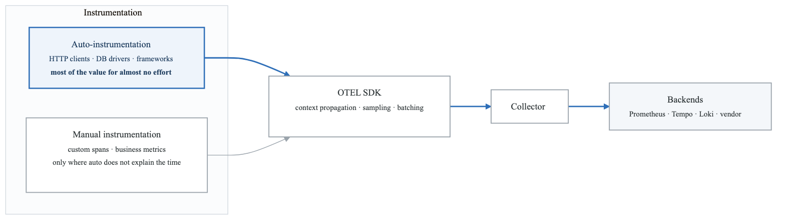
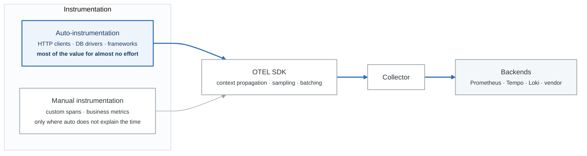
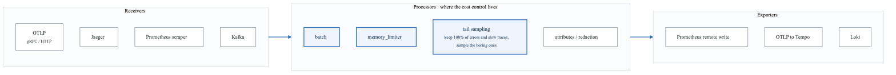

# Module 7: OpenTelemetry - The Observability Standard

## Learning Objectives

By the end of this module, you will be able to:
- Explain OpenTelemetry architecture and components
- Deploy and configure the OpenTelemetry Collector
- Implement comprehensive telemetry across all three signals
- Design telemetry pipelines for complex environments
- Migrate from legacy instrumentation to OpenTelemetry

## Introduction

OpenTelemetry (OTel) is the industry-standard framework for observability instrumentation. It unifies metrics, logs, and traces into a single, vendor-neutral standard, enabling organizations to collect, process, and export telemetry data to any backend of their choice.

## 1. OpenTelemetry Overview

### Component Architecture

<!-- figure: generated from the Mermaid below by _shared/diagrams/embed-figures.py — do not edit the image -->


<details>
<summary>Diagram source (Mermaid)</summary>



</details>

### Core Concepts

```yaml
# OpenTelemetry Core Concepts

signals:
  traces:
    description: "Distributed request tracking"
    components:
      - Trace: "Collection of spans representing a request"
      - Span: "Single operation within a trace"
      - SpanContext: "Trace/span IDs, flags, baggage"
      - Events: "Timestamped annotations on spans"
      - Links: "Connections between traces"

  metrics:
    description: "Numerical measurements"
    types:
      - Counter: "Monotonically increasing value"
      - UpDownCounter: "Value that can increase/decrease"
      - Gauge: "Point-in-time measurement"
      - Histogram: "Distribution of values"

  logs:
    description: "Timestamped text records"
    components:
      - LogRecord: "Single log entry"
      - LoggerProvider: "Creates loggers"
      - LogRecordProcessor: "Processes logs before export"

context:
  propagation:
    description: "Pass context across process boundaries"
    formats:
      - W3C TraceContext: "Standard trace propagation"
      - W3C Baggage: "Cross-cutting concerns"
      - B3: "Zipkin compatibility"
      - Jaeger: "Jaeger compatibility"

  baggage:
    description: "Key-value pairs passed with context"
    use_cases:
      - "User ID for all requests"
      - "Tenant ID for multi-tenant"
      - "Feature flags"

resources:
  description: "Attributes describing the entity producing telemetry"
  common_attributes:
    - service.name
    - service.version
    - deployment.environment
    - host.name
    - cloud.provider
    - k8s.pod.name
```

## 2. OpenTelemetry Collector

### Collector Architecture

```mermaid
%%{init: {'theme':'base','themeVariables':{'fontFamily':'Helvetica, Arial, sans-serif','fontSize':'13px','primaryColor':'#ffffff','primaryTextColor':'#2d3436','primaryBorderColor':'#9aa3ab','lineColor':'#9aa3ab','textColor':'#2d3436','clusterBkg':'#fbfcfd','clusterBorder':'#d4dae0','edgeLabelBackground':'#ffffff','tertiaryColor':'#eef4fb'},'flowchart':{'curve':'basis','padding':14,'nodeSpacing':42,'rankSpacing':58}}}%%
flowchart LR
  classDef default fill:#ffffff,stroke:#9aa3ab,stroke-width:1.3px,color:#2d3436
  classDef n    fill:#ffffff,stroke:#9aa3ab,stroke-width:1.3px,color:#2d3436
  classDef crit fill:#eef4fb,stroke:#2f6fb8,stroke-width:1.8px,color:#1b3a5c
  classDef data fill:#f4f7fa,stroke:#9aa3ab,stroke-width:1.3px,color:#2d3436
  classDef mut  fill:#ffffff,stroke:#cfd6dc,stroke-width:1.1px,color:#7a8288
  classDef warn fill:#fdf0ec,stroke:#c0522d,stroke-width:1.6px,color:#8a3a1e
  subgraph REC["Receivers"]
    direction TB
    R1["OTLP<br/><small>gRPC / HTTP</small>"]:::n
    R2["Jaeger"]:::n
    R3["Prometheus scraper"]:::n
    R4["Kafka"]:::n
  end
  subgraph PROC["Processors · where the cost control lives"]
    direction TB
    P1["batch"]:::crit
    P2["memory_limiter"]:::crit
    P3["tail sampling<br/><small>keep 100% of errors and slow traces,<br/>sample the boring ones</small>"]:::crit
    P4["attributes / redaction"]:::n
  end
  subgraph EXP["Exporters"]
    direction TB
    E1["Prometheus remote write"]:::n
    E2["OTLP to Tempo"]:::n
    E3["Loki"]:::n
  end

  REC --> PROC --> EXP

  linkStyle 0,1 stroke:#2f6fb8,stroke-width:2px
```

<!-- figure: generated from the Mermaid below by _shared/diagrams/embed-figures.py — do not edit the image -->


<details>
<summary>Diagram source (Mermaid)</summary>



</details>

### Complete Collector Configuration

```yaml
# otel-collector-config.yaml

receivers:
  # OTLP receiver (primary)
  otlp:
    protocols:
      grpc:
        endpoint: 0.0.0.0:4317
        max_recv_msg_size_mib: 4
        max_concurrent_streams: 100
      http:
        endpoint: 0.0.0.0:4318
        cors:
          allowed_origins:
            - "http://*"
            - "https://*"

  # Prometheus scraping
  prometheus:
    config:
      scrape_configs:
        - job_name: 'otel-collector'
          scrape_interval: 10s
          static_configs:
            - targets: ['localhost:8888']

        - job_name: 'kubernetes-pods'
          kubernetes_sd_configs:
            - role: pod
          relabel_configs:
            - source_labels: [__meta_kubernetes_pod_annotation_prometheus_io_scrape]
              action: keep
              regex: true

  # Filelog for container logs
  filelog:
    include:
      - /var/log/pods/*/*/*.log
    start_at: beginning
    include_file_path: true
    include_file_name: false
    operators:
      # Parse container log format
      - type: regex_parser
        regex: '^(?P<time>[^ ]+) (?P<stream>stdout|stderr) (?P<logtag>[^ ]*) (?P<log>.*)$'
        timestamp:
          parse_from: attributes.time
          layout: '%Y-%m-%dT%H:%M:%S.%LZ'

      # Parse JSON logs
      - type: json_parser
        parse_from: attributes.log
        if: 'attributes.log != nil and attributes.log matches "^\\{"'

  # Host metrics
  hostmetrics:
    collection_interval: 30s
    scrapers:
      cpu:
      memory:
      disk:
      filesystem:
      network:
      load:

  # Kafka for high-volume ingestion
  kafka:
    brokers:
      - kafka-1:9092
      - kafka-2:9092
      - kafka-3:9092
    topic: otel-spans
    encoding: otlp_proto
    group_id: otel-collector

processors:
  # Memory protection
  memory_limiter:
    check_interval: 1s
    limit_percentage: 80
    spike_limit_percentage: 25

  # Batching for efficiency
  batch:
    timeout: 1s
    send_batch_size: 1024
    send_batch_max_size: 2048

  # Resource detection
  resourcedetection:
    detectors:
      - env
      - system
      - docker
      - ec2
      - gcp
      - azure
      - k8snode
    timeout: 5s
    override: false

  # Kubernetes attributes
  k8sattributes:
    auth_type: "serviceAccount"
    extract:
      metadata:
        - k8s.namespace.name
        - k8s.pod.name
        - k8s.pod.uid
        - k8s.deployment.name
        - k8s.node.name
      labels:
        - tag_name: app
          key: app.kubernetes.io/name
        - tag_name: version
          key: app.kubernetes.io/version
      annotations:
        - tag_name: owner
          key: team

  # Attribute manipulation
  attributes:
    actions:
      - key: environment
        value: production
        action: upsert
      - key: db.password
        action: delete
      - key: credit_card
        action: hash

  # Transform processor
  transform:
    trace_statements:
      - context: span
        statements:
          - set(attributes["service.tier"], "backend") where resource.attributes["service.name"] == "api-service"
          - truncate_all(attributes, 256)

    metric_statements:
      - context: datapoint
        statements:
          - set(attributes["normalized"], true)

    log_statements:
      - context: log
        statements:
          - set(severity_text, "ERROR") where severity_number >= 17

  # Filter unwanted telemetry
  filter:
    error_mode: ignore
    traces:
      span:
        - 'attributes["http.target"] == "/health"'
        - 'attributes["http.target"] == "/ready"'
        - 'attributes["http.target"] == "/metrics"'
    metrics:
      metric:
        - 'name == "go_goroutines"'
        - 'name =~ "process_.*"'
    logs:
      log_record:
        - 'severity_text == "DEBUG"'
        - 'body == "health check"'

  # Tail-based sampling
  tail_sampling:
    decision_wait: 30s
    num_traces: 100000
    expected_new_traces_per_sec: 10000
    policies:
      - name: errors
        type: status_code
        status_code:
          status_codes: [ERROR]
      - name: slow-traces
        type: latency
        latency:
          threshold_ms: 5000
      - name: probabilistic
        type: probabilistic
        probabilistic:
          sampling_percentage: 10

  # Routing for fan-out
  routing:
    default_exporters:
      - jaeger
    table:
      - statement: route() where attributes["signal.type"] == "metrics"
        exporters:
          - prometheus
      - statement: route() where attributes["signal.type"] == "logs"
        exporters:
          - loki

exporters:
  # OTLP to another collector or backend
  otlp:
    endpoint: "otel-backend:4317"
    tls:
      insecure: false
      cert_file: /certs/client.crt
      key_file: /certs/client.key
      ca_file: /certs/ca.crt
    headers:
      Authorization: "Bearer ${API_TOKEN}"
    compression: gzip
    retry_on_failure:
      enabled: true
      initial_interval: 5s
      max_interval: 30s
      max_elapsed_time: 5m

  # Prometheus remote write
  prometheusremotewrite:
    endpoint: "http://prometheus:9090/api/v1/write"
    tls:
      insecure: true
    resource_to_telemetry_conversion:
      enabled: true
    external_labels:
      cluster: production

  # Jaeger
  jaeger:
    endpoint: "jaeger-collector:14250"
    tls:
      insecure: true

  # Loki
  loki:
    endpoint: "http://loki:3100/loki/api/v1/push"
    labels:
      resource:
        service.name: "service"
        k8s.namespace.name: "namespace"
      attributes:
        level: ""
      record:
        severity_text: "level"

  # Debug/logging exporter
  debug:
    verbosity: detailed
    sampling_initial: 5
    sampling_thereafter: 200

  # Kafka for buffering
  kafka:
    brokers:
      - kafka-1:9092
      - kafka-2:9092
    topic: processed-spans
    encoding: otlp_proto

extensions:
  # Health check
  health_check:
    endpoint: 0.0.0.0:13133
    path: /health

  # Performance profiling
  pprof:
    endpoint: 0.0.0.0:1777

  # zPages for debugging
  zpages:
    endpoint: 0.0.0.0:55679

  # Bearer token auth
  bearertokenauth:
    token: "${OTEL_AUTH_TOKEN}"

  # OAuth2
  oauth2client:
    client_id: otel-collector
    client_secret: "${OAUTH_SECRET}"
    token_url: https://auth.example.com/oauth/token
    scopes:
      - telemetry:write

service:
  extensions:
    - health_check
    - pprof
    - zpages

  pipelines:
    traces:
      receivers:
        - otlp
        - jaeger
      processors:
        - memory_limiter
        - k8sattributes
        - resourcedetection
        - attributes
        - filter
        - tail_sampling
        - batch
      exporters:
        - jaeger
        - otlp

    metrics:
      receivers:
        - otlp
        - prometheus
        - hostmetrics
      processors:
        - memory_limiter
        - k8sattributes
        - resourcedetection
        - batch
      exporters:
        - prometheusremotewrite

    logs:
      receivers:
        - otlp
        - filelog
      processors:
        - memory_limiter
        - k8sattributes
        - resourcedetection
        - attributes
        - filter
        - batch
      exporters:
        - loki

  telemetry:
    logs:
      level: info
      development: false
      encoding: json
    metrics:
      level: detailed
      address: 0.0.0.0:8888
```

### Collector Deployment Patterns

```yaml
# Pattern 1: Sidecar (per-pod)
# Good for: Strong isolation, per-service configuration

apiVersion: apps/v1
kind: Deployment
metadata:
  name: my-app
spec:
  template:
    spec:
      containers:
        - name: my-app
          image: my-app:latest
          env:
            - name: OTEL_EXPORTER_OTLP_ENDPOINT
              value: "http://localhost:4317"

        - name: otel-collector
          image: otel/opentelemetry-collector:latest
          args:
            - --config=/etc/otel/config.yaml
          ports:
            - containerPort: 4317
          volumeMounts:
            - name: otel-config
              mountPath: /etc/otel
          resources:
            limits:
              memory: 128Mi
              cpu: 100m

---
# Pattern 2: DaemonSet (per-node)
# Good for: Node-level metrics, log collection

apiVersion: apps/v1
kind: DaemonSet
metadata:
  name: otel-collector-agent
  namespace: observability
spec:
  selector:
    matchLabels:
      app: otel-collector-agent
  template:
    metadata:
      labels:
        app: otel-collector-agent
    spec:
      serviceAccountName: otel-collector
      containers:
        - name: otel-collector
          image: otel/opentelemetry-collector-contrib:latest
          args:
            - --config=/etc/otel/config.yaml
          ports:
            - containerPort: 4317
              hostPort: 4317
            - containerPort: 4318
              hostPort: 4318
          volumeMounts:
            - name: otel-config
              mountPath: /etc/otel
            - name: varlog
              mountPath: /var/log
              readOnly: true
            - name: varlibdockercontainers
              mountPath: /var/lib/docker/containers
              readOnly: true
          resources:
            limits:
              memory: 500Mi
              cpu: 500m

---
# Pattern 3: Gateway (centralized)
# Good for: Protocol translation, centralized processing

apiVersion: apps/v1
kind: Deployment
metadata:
  name: otel-collector-gateway
  namespace: observability
spec:
  replicas: 3
  selector:
    matchLabels:
      app: otel-collector-gateway
  template:
    spec:
      containers:
        - name: otel-collector
          image: otel/opentelemetry-collector-contrib:latest
          args:
            - --config=/etc/otel/config.yaml
          ports:
            - containerPort: 4317
            - containerPort: 4318
            - containerPort: 14250  # Jaeger gRPC
            - containerPort: 14268  # Jaeger HTTP
          resources:
            requests:
              memory: 2Gi
              cpu: 1
            limits:
              memory: 4Gi
              cpu: 2

---
apiVersion: v1
kind: Service
metadata:
  name: otel-collector-gateway
  namespace: observability
spec:
  type: ClusterIP
  ports:
    - name: otlp-grpc
      port: 4317
    - name: otlp-http
      port: 4318
    - name: jaeger-grpc
      port: 14250
    - name: jaeger-http
      port: 14268
  selector:
    app: otel-collector-gateway
```

## 3. Unified Instrumentation

### Complete Application Setup

```python
# otel_config.py - Unified OpenTelemetry configuration

import os
from opentelemetry import trace, metrics, _logs
from opentelemetry.sdk.trace import TracerProvider
from opentelemetry.sdk.trace.export import BatchSpanProcessor
from opentelemetry.sdk.metrics import MeterProvider
from opentelemetry.sdk.metrics.export import PeriodicExportingMetricReader
from opentelemetry.sdk._logs import LoggerProvider, LoggingHandler
from opentelemetry.sdk._logs.export import BatchLogRecordProcessor
from opentelemetry.exporter.otlp.proto.grpc.trace_exporter import OTLPSpanExporter
from opentelemetry.exporter.otlp.proto.grpc.metric_exporter import OTLPMetricExporter
from opentelemetry.exporter.otlp.proto.grpc._log_exporter import OTLPLogExporter
from opentelemetry.sdk.resources import Resource
from opentelemetry.instrumentation.auto_instrumentation import sitecustomize

# Create resource
resource = Resource.create({
    "service.name": os.environ.get("OTEL_SERVICE_NAME", "unknown"),
    "service.version": os.environ.get("SERVICE_VERSION", "unknown"),
    "deployment.environment": os.environ.get("ENVIRONMENT", "development"),
    "service.namespace": os.environ.get("SERVICE_NAMESPACE", "default"),
})

# OTLP endpoint
otlp_endpoint = os.environ.get("OTEL_EXPORTER_OTLP_ENDPOINT", "http://localhost:4317")

def configure_tracing():
    """Configure trace provider and exporter."""
    exporter = OTLPSpanExporter(endpoint=otlp_endpoint)
    provider = TracerProvider(resource=resource)
    provider.add_span_processor(BatchSpanProcessor(exporter))
    trace.set_tracer_provider(provider)
    return trace.get_tracer(__name__)

def configure_metrics():
    """Configure metrics provider and exporter."""
    exporter = OTLPMetricExporter(endpoint=otlp_endpoint)
    reader = PeriodicExportingMetricReader(exporter, export_interval_millis=60000)
    provider = MeterProvider(resource=resource, metric_readers=[reader])
    metrics.set_meter_provider(provider)
    return metrics.get_meter(__name__)

def configure_logging():
    """Configure log provider and exporter."""
    exporter = OTLPLogExporter(endpoint=otlp_endpoint)
    provider = LoggerProvider(resource=resource)
    provider.add_log_record_processor(BatchLogRecordProcessor(exporter))
    _logs.set_logger_provider(provider)

    # Create handler for Python logging
    handler = LoggingHandler(level=logging.DEBUG, logger_provider=provider)
    return handler

def configure_all():
    """Configure all telemetry signals."""
    tracer = configure_tracing()
    meter = configure_metrics()
    log_handler = configure_logging()

    return tracer, meter, log_handler
```

```python
# app.py - Using unified telemetry

import logging
from flask import Flask, request, jsonify
from otel_config import configure_all
from opentelemetry import trace, metrics
from opentelemetry.trace import Status, StatusCode

# Initialize all telemetry
tracer, meter, log_handler = configure_all()

# Configure Python logging with OTel handler
logging.basicConfig(level=logging.INFO, handlers=[log_handler])
logger = logging.getLogger(__name__)

# Create metrics
request_counter = meter.create_counter(
    name="http_requests_total",
    description="Total HTTP requests",
    unit="1"
)

request_duration = meter.create_histogram(
    name="http_request_duration_seconds",
    description="HTTP request duration",
    unit="s"
)

active_requests = meter.create_up_down_counter(
    name="http_active_requests",
    description="Currently active requests",
    unit="1"
)

app = Flask(__name__)

@app.before_request
def before_request():
    request.start_time = time.time()
    active_requests.add(1, {"method": request.method, "path": request.path})

@app.after_request
def after_request(response):
    duration = time.time() - request.start_time

    # Record metrics
    request_counter.add(1, {
        "method": request.method,
        "path": request.path,
        "status": response.status_code
    })

    request_duration.record(duration, {
        "method": request.method,
        "path": request.path
    })

    active_requests.add(-1, {"method": request.method, "path": request.path})

    return response

@app.route('/api/orders', methods=['POST'])
def create_order():
    # All three signals are correlated via trace context
    span = trace.get_current_span()
    span.set_attribute("order.customer_id", request.json.get('customer_id'))

    logger.info("Processing order", extra={
        "customer_id": request.json.get('customer_id'),
        "items": len(request.json.get('items', []))
    })

    try:
        with tracer.start_as_current_span("validate_order") as validate_span:
            validate_order(request.json)
            logger.debug("Order validated successfully")

        with tracer.start_as_current_span("process_payment") as payment_span:
            payment_span.set_attribute("payment.amount", request.json['amount'])
            result = process_payment(request.json)

            # Record business metric
            order_value = meter.create_counter("order_value_total")
            order_value.add(request.json['amount'], {"currency": "USD"})

            logger.info("Payment processed", extra={
                "transaction_id": result.transaction_id,
                "amount": request.json['amount']
            })

        return jsonify({"order_id": result.order_id}), 201

    except PaymentError as e:
        span.record_exception(e)
        span.set_status(Status(StatusCode.ERROR, str(e)))
        logger.error("Payment failed", extra={"error": str(e)})
        raise
```

## 4. Semantic Conventions

### Resource Attributes

```yaml
# OpenTelemetry Semantic Conventions for Resources

service:
  - service.name: "Required: Logical name of service"
  - service.version: "Version of service"
  - service.namespace: "Namespace for service grouping"
  - service.instance.id: "Unique instance identifier"

deployment:
  - deployment.environment: "production, staging, development"

host:
  - host.id: "Unique host identifier"
  - host.name: "Hostname"
  - host.type: "Machine type"
  - host.arch: "CPU architecture"

container:
  - container.id: "Container ID"
  - container.name: "Container name"
  - container.image.name: "Image name"
  - container.image.tag: "Image tag"

kubernetes:
  - k8s.cluster.name: "Cluster name"
  - k8s.namespace.name: "Namespace"
  - k8s.pod.name: "Pod name"
  - k8s.pod.uid: "Pod UID"
  - k8s.deployment.name: "Deployment name"
  - k8s.node.name: "Node name"

cloud:
  - cloud.provider: "aws, gcp, azure"
  - cloud.region: "us-east-1"
  - cloud.availability_zone: "us-east-1a"
  - cloud.account.id: "Account ID"
```

### Span Attributes

```yaml
# HTTP Spans
http:
  client:
    - http.request.method: "GET, POST, etc."
    - url.full: "Full URL"
    - http.response.status_code: "200, 404, 500"
    - server.address: "Target host"
    - server.port: "Target port"

  server:
    - http.request.method: "GET, POST, etc."
    - url.path: "/api/orders"
    - url.scheme: "https"
    - http.route: "/api/orders/{id}"
    - http.response.status_code: "200"
    - client.address: "Client IP"
    - user_agent.original: "User agent string"

# Database Spans
database:
  - db.system: "postgresql, mysql, mongodb"
  - db.namespace: "Database name"
  - db.operation.name: "SELECT, INSERT, UPDATE"
  - db.query.text: "SQL query (sanitized)"
  - server.address: "Database host"
  - server.port: "Database port"

# Messaging Spans
messaging:
  - messaging.system: "kafka, rabbitmq, sqs"
  - messaging.operation.type: "publish, receive, process"
  - messaging.destination.name: "Topic/queue name"
  - messaging.message.id: "Message ID"
  - messaging.consumer.group.name: "Consumer group"

# RPC Spans
rpc:
  - rpc.system: "grpc, aws-api"
  - rpc.service: "Service name"
  - rpc.method: "Method name"
  - rpc.grpc.status_code: "0 (OK), 2 (UNKNOWN), etc."
```

## 5. Migration Strategies

### From Jaeger to OpenTelemetry

```python
# Before: Jaeger client
from jaeger_client import Config as JaegerConfig

config = JaegerConfig(
    config={
        'sampler': {'type': 'const', 'param': 1},
        'local_agent': {'reporting_host': 'jaeger-agent', 'reporting_port': 6831},
    },
    service_name='my-service',
)
tracer = config.initialize_tracer()

# After: OpenTelemetry with Jaeger exporter
from opentelemetry import trace
from opentelemetry.sdk.trace import TracerProvider
from opentelemetry.sdk.trace.export import BatchSpanProcessor
from opentelemetry.exporter.jaeger.thrift import JaegerExporter

# Phase 1: Use Jaeger exporter
jaeger_exporter = JaegerExporter(
    agent_host_name='jaeger-agent',
    agent_port=6831,
)

# Phase 2: Switch to OTLP exporter (collector handles Jaeger export)
from opentelemetry.exporter.otlp.proto.grpc.trace_exporter import OTLPSpanExporter
otlp_exporter = OTLPSpanExporter(endpoint='http://otel-collector:4317')

provider = TracerProvider()
provider.add_span_processor(BatchSpanProcessor(otlp_exporter))
trace.set_tracer_provider(provider)
tracer = trace.get_tracer(__name__)
```

### From Prometheus Client to OpenTelemetry

```python
# Before: Prometheus client
from prometheus_client import Counter, Histogram, REGISTRY, generate_latest

REQUEST_COUNT = Counter('http_requests_total', 'Total requests', ['method', 'path'])
REQUEST_LATENCY = Histogram('http_request_duration_seconds', 'Request latency')

@app.route('/metrics')
def metrics():
    return generate_latest(REGISTRY)

# After: OpenTelemetry metrics
from opentelemetry import metrics
from opentelemetry.sdk.metrics import MeterProvider
from opentelemetry.sdk.metrics.export import PeriodicExportingMetricReader
from opentelemetry.exporter.otlp.proto.grpc.metric_exporter import OTLPMetricExporter

# Option 1: OTLP export (collector exposes Prometheus endpoint)
exporter = OTLPMetricExporter(endpoint='http://otel-collector:4317')
reader = PeriodicExportingMetricReader(exporter)
provider = MeterProvider(metric_readers=[reader])
metrics.set_meter_provider(provider)

meter = metrics.get_meter(__name__)
request_counter = meter.create_counter('http_requests_total', description='Total requests')
request_histogram = meter.create_histogram('http_request_duration_seconds', unit='s')

# Option 2: Continue exposing /metrics endpoint
from opentelemetry.exporter.prometheus import PrometheusMetricReader
from prometheus_client import start_http_server

prometheus_reader = PrometheusMetricReader()
provider = MeterProvider(metric_readers=[prometheus_reader])
start_http_server(8000)  # /metrics on port 8000
```

## Summary

OpenTelemetry provides a unified, vendor-neutral approach to observability instrumentation. By adopting OTel, organizations gain flexibility in their backend choices while ensuring consistent, high-quality telemetry across all services.

### Key Takeaways

1. **Vendor Neutral**: Instrument once, export anywhere
2. **Unified SDK**: One framework for traces, metrics, and logs
3. **Collector is Powerful**: Use it for processing, filtering, and routing
4. **Semantic Conventions**: Follow standards for interoperability
5. **Gradual Migration**: Move incrementally from legacy instrumentation

## What's Next

In the next module, we'll explore Site Reliability Engineering (SRE) practices, including SLOs, error budgets, and reliability-focused operational practices.

<!-- feynman-check -->

---

## Feynman check

Close the file. Blank page, no notes. Explain each of these to a competent engineer who has never
used this tool — **under five minutes, no jargon you can't define on the spot:**

- OpenTelemetry Overview
- OpenTelemetry Collector
- Unified Instrumentation
- Semantic Conventions

**The gap is not what you forgot. It is where you used a word instead of a mechanism.**

| | |
|---|---|
| ✗ | *"Prometheus monitors the service."* |
| ✓ | *"Prometheus discovers targets from the Kubernetes API, applies relabelling rules, scrapes `/metrics` over HTTP on an interval, and appends samples to a local TSDB. Nothing is pushed — so a target missing from a dashboard is a service-discovery problem, not an application one."* |

**Trace it:** A latency regression → a phone ringing. Name each hop: sample, rule evaluation, alert state transition, routing, notification — and where each one can silently stop.

Stop at the first component you cannot name. Reopen this file and read **only** that.

**Go deeper — only once the gap has a name:** [SRE Workbook ch. 5, *Alerting on SLOs*](https://sre.google/workbook/alerting-on-slos/) — free, and the best thing written on why static thresholds page you for nothing.
Full list per domain: [`SOURCES.md`](../SOURCES.md#observability-sre)

→ Protocol, the three levels of knowing, and worked examples: [`MASTERY.md`](../MASTERY.md)

<!-- /feynman-check -->
