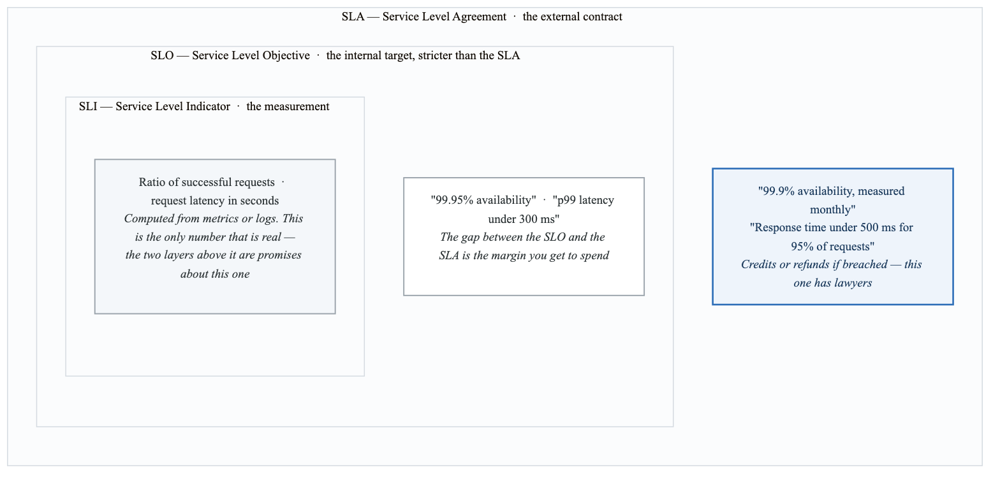
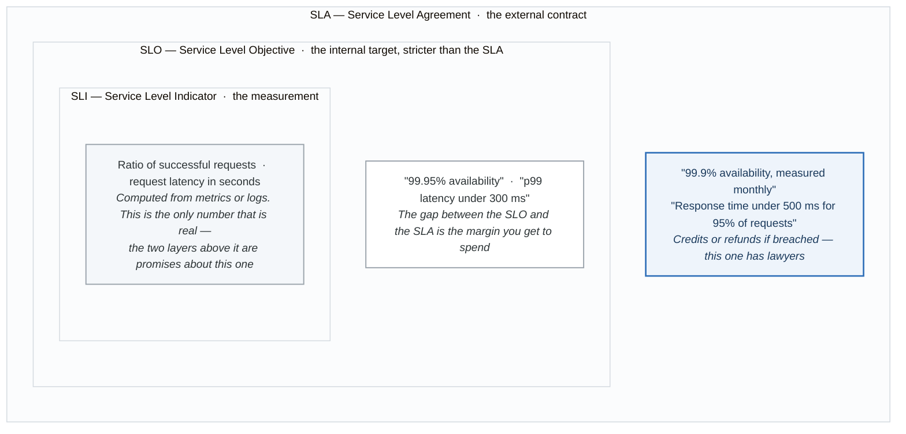

# Module 8: Site Reliability Engineering Practices

## Learning Objectives

By the end of this module, you will be able to:
- Define and implement Service Level Objectives (SLOs)
- Calculate and manage error budgets
- Design reliability-focused operational practices
- Implement SLO-based alerting strategies
- Build a culture of reliability ownership

## Introduction

Site Reliability Engineering (SRE) is a discipline that applies software engineering principles to operations problems. At its core, SRE focuses on creating reliable systems through systematic approaches to measuring, maintaining, and improving service reliability.

## 1. Service Level Fundamentals

### The SLI/SLO/SLA Hierarchy

<!-- figure: generated from the Mermaid below by _shared/diagrams/embed-figures.py — do not edit the image -->


<details>
<summary>Diagram source (Mermaid)</summary>



</details>

### Defining Good SLIs

```yaml
# SLI Specification Template

sli_categories:
  availability:
    definition: "Proportion of valid requests that were served successfully"
    formula: "(good_requests / total_requests) × 100"
    good_request: "HTTP status < 500"
    valid_request: "All requests except health checks"

    prometheus_query: |
      sum(rate(http_requests_total{status!~"5.."}[5m]))
      /
      sum(rate(http_requests_total[5m]))

  latency:
    definition: "Proportion of valid requests served within threshold"
    formula: "(requests_below_threshold / total_requests) × 100"
    threshold: "300ms for P99"

    prometheus_query: |
      sum(rate(http_request_duration_seconds_bucket{le="0.3"}[5m]))
      /
      sum(rate(http_request_duration_seconds_count[5m]))

  throughput:
    definition: "Rate of successful operations"
    formula: "successful_operations / time_period"
    unit: "requests per second"

    prometheus_query: |
      sum(rate(http_requests_total{status="200"}[5m]))

  freshness:
    definition: "Proportion of data updated within threshold"
    formula: "(fresh_data_points / total_data_points) × 100"
    threshold: "Data age < 5 minutes"

    prometheus_query: |
      sum(time() - data_last_updated_timestamp < 300)
      /
      count(data_last_updated_timestamp)

  correctness:
    definition: "Proportion of correct responses"
    formula: "(correct_responses / total_responses) × 100"
    measurement: "Business logic validation"

  durability:
    definition: "Proportion of data retained over time"
    formula: "(objects_preserved / objects_expected) × 100"
    typical_target: "99.999999999% (11 nines)"
```

### SLO Best Practices

```yaml
# SLO Definition Best Practices

principles:
  user_centric:
    description: "SLOs should reflect user experience"
    example:
      bad: "CPU usage < 80%"
      good: "User requests succeed within 500ms"

  measurable:
    description: "SLIs must be quantifiable and automatable"
    requirements:
      - "Derived from metrics or logs"
      - "Calculated in near real-time"
      - "Historically queryable"

  achievable:
    description: "SLOs should be realistic given architecture"
    guideline: "Start with current performance, improve gradually"

  meaningful:
    description: "Missing the SLO should indicate real user impact"
    test: "If we miss this SLO, would users notice?"

  documented:
    description: "Clear definition, measurement, and ownership"
    includes:
      - "SLI calculation method"
      - "SLO target and window"
      - "Error budget policy"
      - "Escalation procedures"

common_mistakes:
  - mistake: "Setting SLO = SLA"
    problem: "No buffer for internal issues before customer impact"
    solution: "SLO should be stricter than SLA"

  - mistake: "Too many SLOs"
    problem: "Diluted focus, alert fatigue"
    solution: "3-5 SLOs per service maximum"

  - mistake: "SLOs too strict"
    problem: "No room for innovation, constant firefighting"
    solution: "Balance reliability with velocity"

  - mistake: "Not revising SLOs"
    problem: "SLOs become irrelevant as service evolves"
    solution: "Review quarterly, adjust based on learnings"
```

## 2. Error Budgets

### Error Budget Calculation

```
Error Budget = 1 - SLO Target

Example: SLO = 99.9% availability
Error Budget = 1 - 0.999 = 0.1% = 0.001

Monthly Error Budget (30 days):
Available downtime = 30 days × 24 hours × 60 minutes × 0.001
                   = 43.2 minutes per month

Error Budget Consumption Rate:
If we've used 30 minutes in 15 days:
- Budget remaining: 43.2 - 30 = 13.2 minutes
- Burn rate: 30 / (43.2 / 2) = 1.39x (burning faster than sustainable)
```

### Error Budget Policies

```yaml
# Error Budget Policy

error_budget_thresholds:
  healthy:
    remaining: ">50%"
    actions:
      - "Normal development velocity"
      - "Feature work prioritized"
      - "Experimentation encouraged"

  caution:
    remaining: "25-50%"
    actions:
      - "Increased code review scrutiny"
      - "Additional testing required"
      - "Reduced deployment frequency"
      - "Weekly reliability review"

  critical:
    remaining: "10-25%"
    actions:
      - "Feature freeze for risky changes"
      - "Focus on reliability improvements"
      - "Daily error budget review"
      - "Postmortems for any incidents"

  exhausted:
    remaining: "<10%"
    actions:
      - "Complete feature freeze"
      - "All hands on reliability"
      - "Mandatory postmortems"
      - "Executive escalation"
      - "Incident response mode"

budget_recovery:
  natural_recovery:
    description: "Budget replenishes as rolling window advances"
    timeline: "Depends on SLO window (typically 30 days)"

  accelerated_recovery:
    triggers:
      - "Fix root cause of budget burn"
      - "Implement reliability improvements"
      - "Add redundancy/fallbacks"
    monitoring: "Track burn rate, not just remaining budget"

stakeholder_communication:
  frequency:
    - "Weekly: Error budget status in team standup"
    - "Monthly: Error budget report to leadership"
    - "Quarterly: SLO review with stakeholders"

  format:
    - "Current error budget: X% remaining"
    - "Burn rate: Y% per day"
    - "Projection: Budget exhausted in Z days at current rate"
    - "Recent incidents and impact"
```

### Error Budget Prometheus Queries

```promql
# SLO: 99.9% availability over 30 days

# Error Budget Total (in requests)
(1 - 0.999) * sum(increase(http_requests_total[30d]))

# Error Budget Consumed
sum(increase(http_requests_total{status=~"5.."}[30d]))

# Error Budget Remaining (percentage)
1 - (
  sum(increase(http_requests_total{status=~"5.."}[30d]))
  /
  ((1 - 0.999) * sum(increase(http_requests_total[30d])))
)

# Error Budget Burn Rate (last 1 hour vs sustainable rate)
(
  sum(rate(http_requests_total{status=~"5.."}[1h]))
  /
  sum(rate(http_requests_total[1h]))
)
/
(1 - 0.999)

# Multi-window burn rate alert
# Fast burn: 2% of 30-day budget in 1 hour
(
  sum(rate(http_requests_total{status=~"5.."}[1h]))
  /
  sum(rate(http_requests_total[1h]))
) > 14.4 * (1 - 0.999)

# Slow burn: 5% of 30-day budget in 6 hours
and
(
  sum(rate(http_requests_total{status=~"5.."}[6h]))
  /
  sum(rate(http_requests_total[6h]))
) > 6 * (1 - 0.999)
```

## 3. SLO-Based Alerting

### Multi-Window Alerting Strategy

```yaml
# Alerting based on error budget burn rate

# Theory: Alert when burning budget faster than sustainable
# Sustainable burn rate = 1x (use exactly 100% budget in window)
# Fast burn = 14.4x (2% in 1 hour = all budget in ~3 days)
# Slow burn = 6x (5% in 6 hours = all budget in ~5 days)

alert_windows:
  - name: "Fast Burn - Page"
    description: "2% of monthly budget burned in 1 hour"
    long_window: 1h
    short_window: 5m
    burn_rate_threshold: 14.4
    action: "Page on-call immediately"

  - name: "Slow Burn - Page"
    description: "5% of monthly budget burned in 6 hours"
    long_window: 6h
    short_window: 30m
    burn_rate_threshold: 6
    action: "Page on-call"

  - name: "Slow Burn - Ticket"
    description: "10% of monthly budget burned in 3 days"
    long_window: 3d
    short_window: 6h
    burn_rate_threshold: 1
    action: "Create ticket for investigation"

# Alert rules
groups:
  - name: slo_alerts
    rules:
      # Page: Fast burn
      - alert: SLOErrorBudgetFastBurn
        expr: |
          (
            sum(rate(http_requests_total{status=~"5.."}[1h]))
            / sum(rate(http_requests_total[1h]))
          ) > 14.4 * (1 - 0.999)
          and
          (
            sum(rate(http_requests_total{status=~"5.."}[5m]))
            / sum(rate(http_requests_total[5m]))
          ) > 14.4 * (1 - 0.999)
        for: 2m
        labels:
          severity: critical
          slo: availability
        annotations:
          summary: "Fast error budget burn for {{ $labels.service }}"
          description: "Burning 2% of monthly error budget per hour"

      # Page: Slow burn
      - alert: SLOErrorBudgetSlowBurn
        expr: |
          (
            sum(rate(http_requests_total{status=~"5.."}[6h]))
            / sum(rate(http_requests_total[6h]))
          ) > 6 * (1 - 0.999)
          and
          (
            sum(rate(http_requests_total{status=~"5.."}[30m]))
            / sum(rate(http_requests_total[30m]))
          ) > 6 * (1 - 0.999)
        for: 15m
        labels:
          severity: warning
          slo: availability
        annotations:
          summary: "Slow error budget burn for {{ $labels.service }}"
          description: "Burning 5% of monthly error budget over 6 hours"

      # Ticket: Sustained degradation
      - alert: SLOErrorBudgetDegraded
        expr: |
          (
            sum(rate(http_requests_total{status=~"5.."}[3d]))
            / sum(rate(http_requests_total[3d]))
          ) > 1 * (1 - 0.999)
        for: 1h
        labels:
          severity: warning
          slo: availability
          ticket: true
        annotations:
          summary: "Sustained error budget consumption"
          description: "Error rate above sustainable level for 3 days"
```

### SLO Dashboard Design

```json
{
  "title": "Service SLO Dashboard",
  "panels": [
    {
      "title": "Error Budget Remaining",
      "type": "gauge",
      "query": "1 - (sum(increase(http_requests_total{status=~\"5..\"}[30d])) / ((1 - 0.999) * sum(increase(http_requests_total[30d]))))",
      "thresholds": [
        {"color": "red", "value": 0},
        {"color": "orange", "value": 0.25},
        {"color": "yellow", "value": 0.5},
        {"color": "green", "value": 0.75}
      ]
    },
    {
      "title": "Current SLI (Availability)",
      "type": "stat",
      "query": "sum(rate(http_requests_total{status!~\"5..\"}[1h])) / sum(rate(http_requests_total[1h]))",
      "format": "percentunit",
      "thresholds": [
        {"color": "red", "value": 0.99},
        {"color": "yellow", "value": 0.999},
        {"color": "green", "value": 0.9999}
      ]
    },
    {
      "title": "Error Budget Burn Rate",
      "type": "graph",
      "queries": [
        {
          "expr": "(sum(rate(http_requests_total{status=~\"5..\"}[1h])) / sum(rate(http_requests_total[1h]))) / (1 - 0.999)",
          "legend": "Current burn rate"
        },
        {
          "expr": "1",
          "legend": "Sustainable rate"
        }
      ]
    },
    {
      "title": "Error Budget Projection",
      "type": "graph",
      "description": "When will error budget be exhausted?",
      "queries": [
        {
          "expr": "(1 - (sum(increase(http_requests_total{status=~\"5..\"}[30d])) / ((1 - 0.999) * sum(increase(http_requests_total[30d]))))) / (sum(rate(http_requests_total{status=~\"5..\"}[1d])) / sum(rate(http_requests_total[1d])) / (1 - 0.999))",
          "legend": "Days until exhausted"
        }
      ]
    },
    {
      "title": "SLO Compliance Trend (30 days rolling)",
      "type": "graph",
      "query": "sum(rate(http_requests_total{status!~\"5..\"}[30d])) / sum(rate(http_requests_total[30d]))"
    }
  ]
}
```

## 4. Reliability Practices

### Toil Management

```yaml
# Toil Definition and Management

toil_characteristics:
  - manual: "Requires human intervention"
  - repetitive: "Done frequently, predictably"
  - automatable: "Could be done by a machine"
  - tactical: "Interrupt-driven, reactive"
  - no_enduring_value: "Doesn't improve the system"
  - scales_linearly: "Effort grows with service size"

toil_examples:
  high_toil:
    - "Manually restarting services after crashes"
    - "Hand-rolling SSL certificates"
    - "Manually scaling during peak traffic"
    - "Copy-pasting configs between environments"
    - "Manual data cleanup jobs"

  not_toil:
    - "Writing automation code"
    - "Postmortem analysis"
    - "Capacity planning"
    - "Architecture reviews"

toil_tracking:
  metrics:
    - name: "toil_hours_per_week"
      target: "<50% of on-call time"
    - name: "tickets_requiring_manual_intervention"
      target: "Decreasing trend"
    - name: "automation_coverage"
      target: "Increasing trend"

  process:
    1. "Identify repetitive tasks"
    2. "Quantify time spent"
    3. "Prioritize by frequency × time"
    4. "Create automation tickets"
    5. "Track reduction over time"

toil_budget:
  target: "Maximum 50% of SRE time on toil"
  enforcement:
    - "Weekly toil tracking"
    - "Automation sprint allocation"
    - "Escalate if threshold exceeded"
```

### Incident Management

```yaml
# Incident Response Framework

severity_levels:
  SEV1:
    description: "Complete service outage or data loss"
    response_time: "< 5 minutes"
    communication: "Executive notification, status page, customer comms"
    roles_required:
      - incident_commander
      - technical_lead
      - communications_lead
      - scribe

  SEV2:
    description: "Major functionality impaired"
    response_time: "< 15 minutes"
    communication: "Status page, affected team notification"
    roles_required:
      - incident_commander
      - technical_lead

  SEV3:
    description: "Minor functionality impaired"
    response_time: "< 1 hour"
    communication: "Team notification"
    roles_required:
      - on_call_engineer

  SEV4:
    description: "No user impact, potential issue"
    response_time: "Next business day"
    communication: "Ticket creation"

incident_lifecycle:
  detect:
    sources:
      - "Automated alerts"
      - "Customer reports"
      - "Internal reports"
      - "Synthetic monitoring"

  respond:
    steps:
      - "Acknowledge alert"
      - "Assess severity"
      - "Assemble response team"
      - "Establish communication channel"
      - "Begin diagnosis"

  mitigate:
    priority: "Restore service first, investigate later"
    strategies:
      - "Rollback recent changes"
      - "Scale up resources"
      - "Enable failover"
      - "Implement temporary fix"

  resolve:
    actions:
      - "Verify service restored"
      - "Implement permanent fix"
      - "Update monitoring"
      - "Document timeline"

  learn:
    outputs:
      - "Blameless postmortem"
      - "Action items"
      - "Process improvements"
      - "Updated runbooks"
```

### Postmortem Process

```yaml
# Blameless Postmortem Template

postmortem:
  title: "[Date] [Service] - Brief description"

  summary:
    duration: "Start time to resolution"
    impact: "Users affected, revenue impact, etc."
    severity: "SEV level"
    detection_method: "How was it detected?"

  timeline:
    format: "Timestamp | Event"
    include:
      - "First signs of issue"
      - "Detection"
      - "Response initiated"
      - "Key diagnostic steps"
      - "Mitigation actions"
      - "Resolution"
      - "Post-resolution monitoring"

  root_cause:
    what_happened: "Technical explanation"
    contributing_factors:
      - "Primary cause"
      - "Secondary factors"
      - "Process gaps"
    five_whys:
      - "Why did the service fail?"
      - "Why was that component vulnerable?"
      - "..."

  impact_analysis:
    users_affected: "Number and percentage"
    error_budget_consumed: "X% of monthly budget"
    financial_impact: "If applicable"
    reputation_impact: "If applicable"

  action_items:
    immediate:
      - item: "Description"
        owner: "Person/team"
        due_date: "Date"
        priority: "P0/P1/P2"

    short_term:
      - item: "Improve monitoring for X"
        owner: "SRE team"
        due_date: "2 weeks"

    long_term:
      - item: "Architectural change to prevent recurrence"
        owner: "Platform team"
        due_date: "Q2"

  lessons_learned:
    what_went_well:
      - "Fast detection"
      - "Effective communication"

    what_went_poorly:
      - "Slow diagnosis"
      - "Missing runbook"

    where_we_got_lucky:
      - "Happened during low traffic"

  review:
    attendees: "List of reviewers"
    date: "Review meeting date"
    follow_up: "30-day action item review date"
```

## 5. Reliability Culture

### SRE Team Structure

```yaml
# SRE Organizational Models

embedded_model:
  description: "SREs embedded within product teams"
  pros:
    - "Deep product knowledge"
    - "Close collaboration"
    - "Fast response times"
  cons:
    - "Siloed practices"
    - "Inconsistent standards"
    - "Isolation from SRE community"

centralized_model:
  description: "Single SRE team serving all products"
  pros:
    - "Consistent practices"
    - "Shared tooling"
    - "Knowledge sharing"
  cons:
    - "Context switching"
    - "Less product depth"
    - "Potential bottleneck"

hybrid_model:
  description: "Central SRE team + embedded SREs"
  structure:
    central_team:
      - "Platform reliability"
      - "Tooling and automation"
      - "Standards and best practices"
      - "Training and enablement"
    embedded_sres:
      - "Product-specific reliability"
      - "On-call for their services"
      - "Implement central standards"

  communication:
    - "Weekly SRE guild meetings"
    - "Shared incident channel"
    - "Quarterly reliability reviews"

engagement_model:
  criteria_for_sre_support:
    - "Service meets production readiness requirements"
    - "Team commits to error budget policy"
    - "Service has documented SLOs"
    - "Adequate observability instrumentation"

  disengagement_triggers:
    - "Error budget consistently exhausted without remediation"
    - "Team repeatedly ignores reliability recommendations"
    - "Service no longer meets criticality threshold"
```

### Production Readiness

```yaml
# Production Readiness Review (PRR)

readiness_checklist:
  observability:
    required:
      - "Structured logging implemented"
      - "Key metrics exposed (RED method)"
      - "Distributed tracing enabled"
      - "SLIs defined and measured"
    recommended:
      - "Custom business metrics"
      - "Profiling capability"
      - "Audit logging"

  reliability:
    required:
      - "SLOs defined and documented"
      - "Error budget policy established"
      - "Alerting rules configured"
      - "Runbooks for common issues"
    recommended:
      - "Chaos testing completed"
      - "Capacity planning done"
      - "DR plan documented"

  operations:
    required:
      - "On-call rotation defined"
      - "Escalation path documented"
      - "Deployment pipeline automated"
      - "Rollback procedure tested"
    recommended:
      - "Feature flags for gradual rollout"
      - "Canary deployment capability"
      - "Blue-green deployment option"

  security:
    required:
      - "Authentication/authorization implemented"
      - "Secrets management (no hardcoded secrets)"
      - "TLS for all external communication"
      - "Vulnerability scanning in CI"
    recommended:
      - "Rate limiting"
      - "WAF protection"
      - "Penetration testing completed"

  documentation:
    required:
      - "Architecture diagram"
      - "API documentation"
      - "Dependency list"
      - "Contact information"
    recommended:
      - "Capacity requirements"
      - "Scaling procedures"
      - "Troubleshooting guide"

prr_process:
  1. "Team submits PRR request"
  2. "SRE reviews against checklist"
  3. "Gap analysis meeting"
  4. "Remediation period"
  5. "Final review and approval"
  6. "Launch support (SRE shadowing)"
  7. "Post-launch review (30 days)"
```

## 6. Capacity Planning

### Demand Forecasting

```python
# Capacity Planning Analysis

import pandas as pd
from sklearn.linear_model import LinearRegression
from scipy import stats

def analyze_growth_trend(metrics_data):
    """
    Analyze traffic growth and predict future capacity needs.
    """
    # Fit linear regression for trend
    X = metrics_data['days_from_start'].values.reshape(-1, 1)
    y = metrics_data['requests_per_day'].values

    model = LinearRegression()
    model.fit(X, y)

    # Predict 90 days ahead
    future_days = np.arange(len(X), len(X) + 90).reshape(-1, 1)
    predictions = model.predict(future_days)

    # Calculate when capacity threshold will be exceeded
    current_capacity = 1000000  # 1M requests/day
    threshold = 0.8  # Alert at 80% capacity

    days_to_threshold = None
    for i, pred in enumerate(predictions):
        if pred > current_capacity * threshold:
            days_to_threshold = i
            break

    return {
        'growth_rate_per_day': model.coef_[0],
        'current_daily_requests': y[-1],
        'predicted_90_days': predictions[-1],
        'days_to_80_percent': days_to_threshold,
        'recommendation': get_recommendation(days_to_threshold)
    }

def get_recommendation(days_to_threshold):
    if days_to_threshold is None:
        return "Capacity sufficient for 90+ days"
    elif days_to_threshold < 30:
        return "URGENT: Scale immediately, capacity exhausted in < 30 days"
    elif days_to_threshold < 60:
        return "Plan scaling within next sprint"
    else:
        return "Monitor closely, plan scaling for next quarter"
```

### Resource Modeling

```yaml
# Capacity Model

service_capacity_model:
  compute:
    unit: "pod"
    capacity_per_unit:
      requests_per_second: 1000
      memory_mb: 512
      cpu_cores: 0.5

    current:
      pods: 10
      total_rps: 10000
      utilization: 0.65

    scaling_policy:
      min_pods: 3
      max_pods: 50
      target_cpu_utilization: 0.7
      scale_up_cooldown: 60s
      scale_down_cooldown: 300s

  database:
    type: "PostgreSQL"
    current:
      connections_max: 200
      connections_used: 120
      storage_gb: 500
      storage_used_gb: 350

    thresholds:
      connection_warning: 0.7
      connection_critical: 0.9
      storage_warning: 0.7
      storage_critical: 0.85

  cache:
    type: "Redis"
    current:
      memory_gb: 16
      memory_used_gb: 12
      hit_rate: 0.92
      connections: 450

    scaling_trigger:
      memory_threshold: 0.8
      hit_rate_minimum: 0.85

capacity_planning_process:
  quarterly:
    - "Review growth trends"
    - "Update capacity model"
    - "Plan infrastructure changes"
    - "Budget allocation"

  monthly:
    - "Review utilization metrics"
    - "Adjust scaling parameters"
    - "Validate alerting thresholds"

  weekly:
    - "Check capacity alerts"
    - "Review autoscaling events"
    - "Analyze traffic patterns"
```

## Summary

SRE practices provide a systematic approach to building and operating reliable systems. By focusing on measurable objectives, error budgets, and continuous improvement, teams can balance innovation velocity with service reliability.

### Key Takeaways

1. **SLOs Drive Decisions**: Use SLOs to make objective reliability decisions
2. **Error Budgets Enable Balance**: Budget provides room for innovation and reliability
3. **Automate Away Toil**: Continuously reduce manual operational work
4. **Learn from Incidents**: Blameless postmortems drive improvement
5. **Culture Matters**: Reliability is everyone's responsibility

## What's Next

In the next module, we'll explore incident management in depth, including on-call practices, runbook automation, and continuous improvement processes.

<!-- feynman-check -->

---

## Feynman check

Close the file. Blank page, no notes. Explain each of these to a competent engineer who has never
used this tool — **under five minutes, no jargon you can't define on the spot:**

- Service Level Fundamentals
- Error Budgets
- SLO-Based Alerting
- Reliability Practices

**The gap is not what you forgot. It is where you used a word instead of a mechanism.**

| | |
|---|---|
| ✗ | *"Prometheus monitors the service."* |
| ✓ | *"Prometheus discovers targets from the Kubernetes API, applies relabelling rules, scrapes `/metrics` over HTTP on an interval, and appends samples to a local TSDB. Nothing is pushed — so a target missing from a dashboard is a service-discovery problem, not an application one."* |

**Trace it:** A latency regression → a phone ringing. Name each hop: sample, rule evaluation, alert state transition, routing, notification — and where each one can silently stop.

Stop at the first component you cannot name. Reopen this file and read **only** that.

**Go deeper — only once the gap has a name:** [SRE Workbook ch. 5, *Alerting on SLOs*](https://sre.google/workbook/alerting-on-slos/) — free, and the best thing written on why static thresholds page you for nothing.
Full list per domain: [`SOURCES.md`](../SOURCES.md#observability-sre)

→ Protocol, the three levels of knowing, and worked examples: [`MASTERY.md`](../MASTERY.md)

<!-- /feynman-check -->
