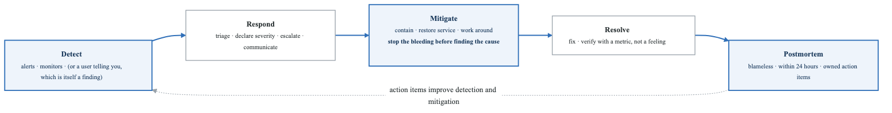
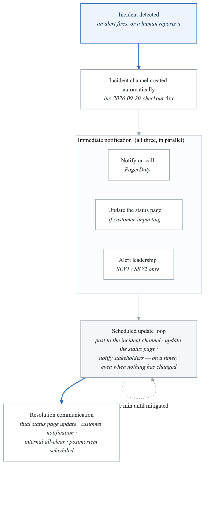
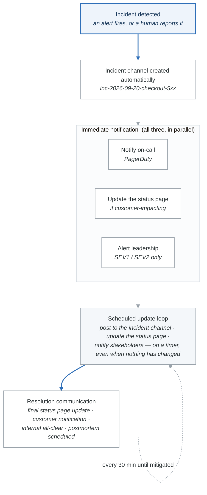

# Module 9: Incident Management and Response

## Learning Objectives

By the end of this module, you will be able to:
- Design and implement effective incident response processes
- Build and maintain comprehensive runbooks
- Manage on-call rotations and reduce burnout
- Conduct blameless postmortems that drive improvement
- Implement automation for incident detection and resolution

## Introduction

Incident management is the practice of responding to unplanned interruptions in service. Effective incident management minimizes user impact, reduces resolution time, and provides learning opportunities to prevent future incidents.

## 1. Incident Response Framework

### Incident Lifecycle

```mermaid
%%{init: {'theme':'base','themeVariables':{'fontFamily':'Helvetica, Arial, sans-serif','fontSize':'13px','primaryColor':'#ffffff','primaryTextColor':'#2d3436','primaryBorderColor':'#9aa3ab','lineColor':'#9aa3ab','textColor':'#2d3436','clusterBkg':'#fbfcfd','clusterBorder':'#d4dae0','edgeLabelBackground':'#ffffff','tertiaryColor':'#eef4fb'},'flowchart':{'curve':'basis','padding':14,'nodeSpacing':42,'rankSpacing':58}}}%%
flowchart LR
  classDef default fill:#ffffff,stroke:#9aa3ab,stroke-width:1.3px,color:#2d3436
  classDef n    fill:#ffffff,stroke:#9aa3ab,stroke-width:1.3px,color:#2d3436
  classDef crit fill:#eef4fb,stroke:#2f6fb8,stroke-width:1.8px,color:#1b3a5c
  classDef data fill:#f4f7fa,stroke:#9aa3ab,stroke-width:1.3px,color:#2d3436
  classDef mut  fill:#ffffff,stroke:#cfd6dc,stroke-width:1.1px,color:#7a8288
  classDef warn fill:#fdf0ec,stroke:#c0522d,stroke-width:1.6px,color:#8a3a1e
  D["<b>Detect</b><br/><small>alerts · monitors · (or a user telling you,<br/>which is itself a finding)</small>"]:::crit
  R["<b>Respond</b><br/><small>triage · declare severity · escalate · communicate</small>"]:::n
  M["<b>Mitigate</b><br/><small>contain · restore service · work around<br/><b>stop the bleeding before finding the cause</b></small>"]:::crit
  RS["<b>Resolve</b><br/><small>fix · verify with a metric, not a feeling</small>"]:::n
  PM["<b>Postmortem</b><br/><small>blameless · within 24 hours · owned action items</small>"]:::crit

  D --> R --> M --> RS --> PM
  PM -.->|"action items improve detection and mitigation"| D

  linkStyle 0,1,2,3 stroke:#2f6fb8,stroke-width:2px
```

<!-- figure: generated from the Mermaid below by _shared/diagrams/embed-figures.py — do not edit the image -->


<details>
<summary>Diagram source (Mermaid)</summary>



</details>

### Severity Classification

```yaml
severity_matrix:
  SEV1:
    name: "Critical"
    description: "Complete service outage affecting all users"
    examples:
      - "Website completely down"
      - "Data breach detected"
      - "All payments failing"
      - "Data loss occurring"
    response:
      time_to_acknowledge: "5 minutes"
      time_to_assemble: "15 minutes"
      war_room: true
      executive_notification: true
      customer_communication: "Required within 30 minutes"
    metrics:
      mtta_target: "5 minutes"
      mttr_target: "4 hours"

  SEV2:
    name: "High"
    description: "Major functionality impaired, significant user impact"
    examples:
      - "Checkout not working for 50% of users"
      - "Search functionality down"
      - "Major performance degradation"
      - "Primary database failover"
    response:
      time_to_acknowledge: "15 minutes"
      time_to_assemble: "30 minutes"
      war_room: false
      executive_notification: "Hourly updates"
      customer_communication: "As needed"
    metrics:
      mtta_target: "15 minutes"
      mttr_target: "8 hours"

  SEV3:
    name: "Medium"
    description: "Minor functionality impaired, limited user impact"
    examples:
      - "Minor feature not working"
      - "Elevated error rate (<5%)"
      - "Secondary system down"
      - "Performance warning"
    response:
      time_to_acknowledge: "1 hour"
      time_to_assemble: "Business hours"
      war_room: false
      executive_notification: false
      customer_communication: false
    metrics:
      mtta_target: "1 hour"
      mttr_target: "24 hours"

  SEV4:
    name: "Low"
    description: "No user impact, potential issue identified"
    examples:
      - "Cosmetic bug"
      - "Non-critical alert"
      - "Capacity warning"
      - "Tech debt issue"
    response:
      time_to_acknowledge: "Next business day"
      war_room: false
      executive_notification: false
    metrics:
      mtta_target: "24 hours"
      mttr_target: "1 week"
```

### Incident Roles

```yaml
incident_roles:
  incident_commander:
    alias: "IC"
    responsibility: "Overall incident leadership"
    duties:
      - "Declare incident severity"
      - "Assign roles"
      - "Coordinate response efforts"
      - "Make decisions when consensus can't be reached"
      - "Manage escalations"
      - "Authorize high-risk actions"
    skills:
      - "Clear communication"
      - "Calm under pressure"
      - "Big-picture thinking"
      - "Decision-making"

  technical_lead:
    alias: "Tech Lead"
    responsibility: "Technical investigation and resolution"
    duties:
      - "Lead debugging efforts"
      - "Propose mitigation strategies"
      - "Coordinate technical team"
      - "Implement fixes"
      - "Validate resolution"
    skills:
      - "Deep technical expertise"
      - "System architecture knowledge"
      - "Debugging skills"

  communications_lead:
    alias: "Comms Lead"
    responsibility: "Internal and external communications"
    duties:
      - "Update status page"
      - "Notify stakeholders"
      - "Draft customer communications"
      - "Manage public channels"
      - "Field questions from leadership"
    skills:
      - "Clear writing"
      - "Stakeholder management"
      - "PR awareness"

  scribe:
    alias: "Scribe"
    responsibility: "Document everything"
    duties:
      - "Maintain incident timeline"
      - "Record key decisions"
      - "Track action items"
      - "Prepare postmortem draft"
      - "Log all communications"
    skills:
      - "Fast, accurate note-taking"
      - "Attention to detail"
      - "Organized"

  subject_matter_expert:
    alias: "SME"
    responsibility: "Provide domain expertise"
    duties:
      - "Answer technical questions"
      - "Suggest investigation paths"
      - "Validate proposed solutions"
      - "Provide historical context"
```

## 2. Communication During Incidents

### Communication Templates

```yaml
internal_templates:
  initial_notification:
    channel: "#incidents"
    template: |
      🚨 *Incident Declared*
      *Severity*: SEV{{ severity }}
      *Impact*: {{ impact_description }}
      *Incident Commander*: @{{ ic_name }}
      *Tech Lead*: @{{ tech_lead }}
      *Bridge*: {{ video_link }}
      *Status Page*: {{ status_page_link }}

      *Next Update*: {{ next_update_time }}

  status_update:
    frequency: "Every 30 minutes for SEV1, hourly for SEV2"
    template: |
      📊 *Incident Update* - {{ incident_id }}
      *Status*: {{ status }}
      *Current Actions*: {{ current_actions }}
      *Latest Findings*: {{ findings }}
      *ETA to Resolution*: {{ eta }}
      *Next Update*: {{ next_update_time }}

  resolution:
    template: |
      ✅ *Incident Resolved* - {{ incident_id }}
      *Duration*: {{ duration }}
      *Resolution*: {{ resolution_summary }}
      *User Impact*: {{ impact_summary }}
      *Postmortem*: Scheduled for {{ postmortem_date }}
      *Action Items*: {{ action_item_count }} items identified

customer_templates:
  initial:
    template: |
      We are currently investigating an issue affecting {{ affected_service }}.
      Some users may experience {{ symptom }}.
      We are actively working to resolve this and will provide updates.

  update:
    template: |
      Update: We have identified the cause of the issue affecting {{ affected_service }}.
      Our team is implementing a fix. Estimated time to resolution: {{ eta }}.
      We apologize for any inconvenience.

  resolution:
    template: |
      Resolved: The issue affecting {{ affected_service }} has been resolved.
      Service is operating normally. Duration: {{ duration }}.
      We apologize for any inconvenience this may have caused.
      A full incident report will be available at {{ report_link }}.

status_page_levels:
  operational: "All Systems Operational"
  degraded_performance: "Degraded Performance"
  partial_outage: "Partial Outage"
  major_outage: "Major Outage"
  maintenance: "Under Maintenance"
```

### Communication Workflow

<!-- figure: generated from the Mermaid below by _shared/diagrams/embed-figures.py — do not edit the image -->


<details>
<summary>Diagram source (Mermaid)</summary>



</details>

## 3. Runbooks

### Runbook Structure

```yaml
# Runbook Template

runbook:
  metadata:
    title: "High Error Rate - Order Service"
    id: "RB-ORDER-001"
    version: "2.3"
    last_updated: "2024-01-15"
    owner: "order-team"
    alert_link: "AlertHighErrorRateOrderService"

  overview:
    description: "This runbook addresses high error rates in the Order Service"
    symptoms:
      - "Alert: ErrorRateHigh (order-service)"
      - "Customer complaints about failed orders"
      - "Error rate > 1% for 5+ minutes"
    user_impact: "Users unable to complete orders"

  prerequisites:
    access_required:
      - "kubectl access to production cluster"
      - "Grafana viewer access"
      - "PagerDuty responder role"
    tools:
      - "kubectl"
      - "k9s (optional)"
      - "curl"

  diagnosis:
    steps:
      - step: 1
        action: "Check current error rate and trend"
        command: |
          # Open Grafana dashboard
          https://grafana.example.com/d/order-service

          # Or query directly
          curl -s 'http://prometheus:9090/api/v1/query?query=rate(http_requests_total{service="order-service",status=~"5.."}[5m])'
        expected: "Error rate above 1%"
        if_not_expected: "Check if alert is stale, may have auto-resolved"

      - step: 2
        action: "Identify error type breakdown"
        command: |
          kubectl logs -l app=order-service --since=10m | \
            jq -r 'select(.level=="error") | .error_type' | \
            sort | uniq -c | sort -rn | head -10
        analysis: "Look for dominant error type"

      - step: 3
        action: "Check recent deployments"
        command: |
          kubectl rollout history deployment/order-service
          # Check last deployment time
          kubectl get deployment order-service -o jsonpath='{.metadata.annotations.kubernetes\.io/change-cause}'
        correlation: "Errors started after deployment?"

      - step: 4
        action: "Check downstream dependencies"
        command: |
          # Payment service health
          curl -s http://payment-service:8080/health

          # Database connectivity
          kubectl exec -it deploy/order-service -- pg_isready -h postgres

          # Cache health
          kubectl exec -it deploy/order-service -- redis-cli ping

  mitigation:
    immediate_actions:
      - action: "Rollback recent deployment (if correlated)"
        command: |
          kubectl rollout undo deployment/order-service
          kubectl rollout status deployment/order-service
        verification: "Error rate should decrease within 2-3 minutes"

      - action: "Scale up (if load-related)"
        command: |
          kubectl scale deployment/order-service --replicas=10
        verification: "CPU/memory utilization should decrease"

      - action: "Enable circuit breaker (if dependency failing)"
        command: |
          kubectl set env deployment/order-service PAYMENT_CIRCUIT_BREAKER=true
        verification: "Errors from payment service should be gracefully handled"

    escalation:
      when: "If error rate doesn't decrease within 15 minutes"
      action: "Page order-team secondary"
      command: |
        pd trigger --service order-service --message "Escalating high error rate incident"

  verification:
    steps:
      - "Error rate below 1% for 5 minutes"
      - "No new customer complaints"
      - "All health checks passing"
      - "Order success rate > 99%"

  post_incident:
    - "Create incident ticket"
    - "Schedule postmortem if SEV1/SEV2"
    - "Update runbook if new learnings"
    - "Document timeline in incident channel"

  appendix:
    related_runbooks:
      - "RB-ORDER-002: Database Connection Issues"
      - "RB-PAYMENT-001: Payment Service Degradation"
    dashboards:
      - "https://grafana.example.com/d/order-service"
      - "https://grafana.example.com/d/order-dependencies"
    contacts:
      - "order-team@example.com"
      - "#order-service-oncall"
```

### Automated Runbooks

```python
# automated_runbook.py - Self-healing automation

import subprocess
import requests
import time
from dataclasses import dataclass
from typing import Optional

@dataclass
class DiagnosticResult:
    check_name: str
    passed: bool
    details: str
    suggested_action: Optional[str] = None

class OrderServiceRunbook:
    """Automated runbook for Order Service incidents."""

    def __init__(self, namespace: str = "production"):
        self.namespace = namespace
        self.service = "order-service"
        self.prometheus_url = "http://prometheus:9090"
        self.results = []

    def run_diagnostics(self) -> list[DiagnosticResult]:
        """Run all diagnostic checks."""
        self.results = [
            self.check_error_rate(),
            self.check_recent_deployment(),
            self.check_pod_health(),
            self.check_database_connection(),
            self.check_cache_connection(),
            self.check_downstream_services(),
        ]
        return self.results

    def check_error_rate(self) -> DiagnosticResult:
        """Check current error rate."""
        query = f'rate(http_requests_total{{service="{self.service}",status=~"5.."}}[5m])'
        response = requests.get(f"{self.prometheus_url}/api/v1/query", params={"query": query})
        data = response.json()

        if data["data"]["result"]:
            error_rate = float(data["data"]["result"][0]["value"][1])
            passed = error_rate < 0.01

            return DiagnosticResult(
                check_name="Error Rate",
                passed=passed,
                details=f"Current error rate: {error_rate:.2%}",
                suggested_action=None if passed else "Investigate error logs"
            )

        return DiagnosticResult(
            check_name="Error Rate",
            passed=True,
            details="No error data available"
        )

    def check_recent_deployment(self) -> DiagnosticResult:
        """Check if there was a recent deployment."""
        result = subprocess.run(
            ["kubectl", "rollout", "history", f"deployment/{self.service}",
             "-n", self.namespace, "--revision", "0"],
            capture_output=True, text=True
        )

        # Parse last deployment time (simplified)
        last_deploy_minutes_ago = 30  # Would parse from output

        passed = last_deploy_minutes_ago > 60

        return DiagnosticResult(
            check_name="Recent Deployment",
            passed=passed,
            details=f"Last deployment: {last_deploy_minutes_ago} minutes ago",
            suggested_action=None if passed else "Consider rollback"
        )

    def check_pod_health(self) -> DiagnosticResult:
        """Check pod health status."""
        result = subprocess.run(
            ["kubectl", "get", "pods", "-l", f"app={self.service}",
             "-n", self.namespace, "-o", "json"],
            capture_output=True, text=True
        )

        import json
        pods = json.loads(result.stdout)

        unhealthy = []
        for pod in pods["items"]:
            phase = pod["status"]["phase"]
            if phase != "Running":
                unhealthy.append(pod["metadata"]["name"])

            # Check container restarts
            for container in pod["status"].get("containerStatuses", []):
                if container["restartCount"] > 5:
                    unhealthy.append(f"{pod['metadata']['name']} (restarts)")

        passed = len(unhealthy) == 0

        return DiagnosticResult(
            check_name="Pod Health",
            passed=passed,
            details=f"Unhealthy pods: {unhealthy}" if unhealthy else "All pods healthy",
            suggested_action=None if passed else "Investigate pod logs and events"
        )

    def check_database_connection(self) -> DiagnosticResult:
        """Check database connectivity."""
        result = subprocess.run(
            ["kubectl", "exec", "-n", self.namespace,
             f"deployment/{self.service}", "--",
             "pg_isready", "-h", "postgres"],
            capture_output=True, text=True
        )

        passed = result.returncode == 0

        return DiagnosticResult(
            check_name="Database Connection",
            passed=passed,
            details="Database accepting connections" if passed else "Database connection failed",
            suggested_action=None if passed else "Check database pod and connection pool"
        )

    def check_cache_connection(self) -> DiagnosticResult:
        """Check Redis cache connectivity."""
        result = subprocess.run(
            ["kubectl", "exec", "-n", self.namespace,
             f"deployment/{self.service}", "--",
             "redis-cli", "-h", "redis", "ping"],
            capture_output=True, text=True
        )

        passed = "PONG" in result.stdout

        return DiagnosticResult(
            check_name="Cache Connection",
            passed=passed,
            details="Redis responding" if passed else "Redis connection failed",
            suggested_action=None if passed else "Check Redis pod health"
        )

    def check_downstream_services(self) -> DiagnosticResult:
        """Check downstream service health."""
        services = ["payment-service", "inventory-service"]
        unhealthy = []

        for service in services:
            try:
                response = requests.get(
                    f"http://{service}.{self.namespace}.svc.cluster.local:8080/health",
                    timeout=5
                )
                if response.status_code != 200:
                    unhealthy.append(service)
            except:
                unhealthy.append(service)

        passed = len(unhealthy) == 0

        return DiagnosticResult(
            check_name="Downstream Services",
            passed=passed,
            details=f"Unhealthy: {unhealthy}" if unhealthy else "All downstream services healthy",
            suggested_action=None if passed else f"Investigate {unhealthy}"
        )

    def suggest_actions(self) -> list[str]:
        """Suggest remediation actions based on diagnostics."""
        actions = []

        for result in self.results:
            if not result.passed and result.suggested_action:
                actions.append(result.suggested_action)

        # Check for patterns
        deployment_issue = any(
            not r.passed and r.check_name == "Recent Deployment"
            for r in self.results
        )
        if deployment_issue:
            actions.insert(0, "🔄 ROLLBACK: Recent deployment may be the cause")

        dependency_issue = any(
            not r.passed and r.check_name in ["Database Connection", "Cache Connection", "Downstream Services"]
            for r in self.results
        )
        if dependency_issue:
            actions.append("🔌 Enable circuit breakers for failing dependencies")

        return actions

    def execute_rollback(self) -> bool:
        """Execute automatic rollback."""
        result = subprocess.run(
            ["kubectl", "rollout", "undo", f"deployment/{self.service}",
             "-n", self.namespace],
            capture_output=True, text=True
        )

        if result.returncode == 0:
            # Wait for rollout to complete
            subprocess.run(
                ["kubectl", "rollout", "status", f"deployment/{self.service}",
                 "-n", self.namespace, "--timeout=300s"],
                capture_output=True
            )
            return True

        return False


def handle_incident(alert_data: dict):
    """Main incident handler."""
    runbook = OrderServiceRunbook()

    print("🔍 Running diagnostics...")
    results = runbook.run_diagnostics()

    print("\n📊 Diagnostic Results:")
    for result in results:
        status = "✅" if result.passed else "❌"
        print(f"  {status} {result.check_name}: {result.details}")

    print("\n💡 Suggested Actions:")
    actions = runbook.suggest_actions()
    for i, action in enumerate(actions, 1):
        print(f"  {i}. {action}")

    # Auto-remediation (with safeguards)
    if actions and "ROLLBACK" in actions[0]:
        print("\n🔄 Initiating automatic rollback...")
        if runbook.execute_rollback():
            print("✅ Rollback completed successfully")
        else:
            print("❌ Rollback failed - manual intervention required")
```

## 4. On-Call Management

### On-Call Rotation Design

```yaml
on_call_rotation:
  structure:
    primary:
      shift_duration: "1 week"
      handoff_day: "Monday"
      handoff_time: "10:00 AM local"
      responsibilities:
        - "First responder for all pages"
        - "Triage incoming alerts"
        - "Coordinate with secondary if needed"

    secondary:
      shift_duration: "1 week"
      offset: "1 week behind primary"
      responsibilities:
        - "Backup for primary"
        - "Escalation point"
        - "Handle overflow during high-volume incidents"

    shadow:
      duration: "2 weeks minimum"
      purpose: "Training for new on-call engineers"
      activities:
        - "Join all incident calls"
        - "Follow along with primary"
        - "Practice with simulated pages"

  scheduling:
    team_size_minimum: 6  # For sustainable rotation
    coverage: "24/7"
    time_zones: "Distributed for follow-the-sun when possible"

  handoff_checklist:
    outgoing:
      - "Brief incoming on active incidents"
      - "Highlight ongoing issues"
      - "Share recent context (deployments, changes)"
      - "Update on-call dashboard"
      - "Ensure contact info is current"

    incoming:
      - "Verify PagerDuty access"
      - "Test page receipt"
      - "Review recent incidents"
      - "Check scheduled maintenance"
      - "Confirm secondary contact"

  compensation:
    model: "Flat rate per shift"
    additional:
      - "Time off after heavy incident week"
      - "Incident bonus for SEV1/SEV2"
      - "Career recognition"
```

### On-Call Health Metrics

```yaml
on_call_metrics:
  workload:
    pages_per_shift:
      target: "<10 actionable pages"
      action_threshold: 20
      burnout_threshold: 50

    pages_by_time:
      business_hours_ratio: ">80%"
      sleep_hours_pages: "<2 per night"

    time_to_acknowledge:
      target: "5 minutes"
      sla: "15 minutes"

  quality:
    actionable_page_ratio:
      target: ">80%"
      description: "Pages requiring real intervention"

    false_positive_rate:
      target: "<10%"
      description: "Alerts that auto-resolve or are duplicates"

    escalation_rate:
      target: "<20%"
      description: "Pages requiring secondary/management"

  health:
    engineer_satisfaction:
      measurement: "Quarterly survey"
      target: ">7/10"

    rotation_skip_rate:
      target: "<5%"
      description: "Shifts requiring coverage swaps"

  improvement:
    toil_reduction:
      track: "Hours spent on manual tasks"
      target: "Decrease 10% quarterly"

    runbook_coverage:
      track: "Alerts with runbooks"
      target: ">90%"

    auto_remediation:
      track: "Incidents resolved automatically"
      target: "Increase 5% quarterly"
```

## 5. Incident Automation

### Incident Bot

```python
# incident_bot.py - Slack-based incident management

from slack_bolt import App
from slack_bolt.adapter.socket_mode import SocketModeHandler
import json
from datetime import datetime

app = App(token=os.environ["SLACK_BOT_TOKEN"])

INCIDENT_STORE = {}  # Would use database in production

@app.command("/incident")
def create_incident(ack, body, client):
    """Create a new incident."""
    ack()

    # Open modal for incident details
    client.views_open(
        trigger_id=body["trigger_id"],
        view={
            "type": "modal",
            "callback_id": "incident_create",
            "title": {"type": "plain_text", "text": "Create Incident"},
            "submit": {"type": "plain_text", "text": "Create"},
            "blocks": [
                {
                    "type": "input",
                    "block_id": "title",
                    "label": {"type": "plain_text", "text": "Incident Title"},
                    "element": {
                        "type": "plain_text_input",
                        "action_id": "title_input"
                    }
                },
                {
                    "type": "input",
                    "block_id": "severity",
                    "label": {"type": "plain_text", "text": "Severity"},
                    "element": {
                        "type": "static_select",
                        "action_id": "severity_select",
                        "options": [
                            {"text": {"type": "plain_text", "text": "SEV1 - Critical"}, "value": "SEV1"},
                            {"text": {"type": "plain_text", "text": "SEV2 - High"}, "value": "SEV2"},
                            {"text": {"type": "plain_text", "text": "SEV3 - Medium"}, "value": "SEV3"},
                            {"text": {"type": "plain_text", "text": "SEV4 - Low"}, "value": "SEV4"},
                        ]
                    }
                },
                {
                    "type": "input",
                    "block_id": "description",
                    "label": {"type": "plain_text", "text": "Description"},
                    "element": {
                        "type": "plain_text_input",
                        "action_id": "description_input",
                        "multiline": True
                    }
                }
            ]
        }
    )

@app.view("incident_create")
def handle_incident_create(ack, body, client, view):
    """Handle incident creation submission."""
    ack()

    values = view["state"]["values"]
    title = values["title"]["title_input"]["value"]
    severity = values["severity"]["severity_select"]["selected_option"]["value"]
    description = values["description"]["description_input"]["value"]
    user_id = body["user"]["id"]

    # Generate incident ID
    incident_id = f"INC-{datetime.now().strftime('%Y%m%d')}-{len(INCIDENT_STORE) + 1:03d}"

    # Create incident channel
    channel_name = f"inc-{datetime.now().strftime('%m%d')}-{title[:20].lower().replace(' ', '-')}"
    channel = client.conversations_create(name=channel_name)
    channel_id = channel["channel"]["id"]

    # Store incident
    incident = {
        "id": incident_id,
        "title": title,
        "severity": severity,
        "description": description,
        "channel_id": channel_id,
        "created_by": user_id,
        "created_at": datetime.utcnow().isoformat(),
        "status": "open",
        "timeline": []
    }
    INCIDENT_STORE[incident_id] = incident

    # Post to incident channel
    client.chat_postMessage(
        channel=channel_id,
        text=f"🚨 *Incident Declared*\n\n"
             f"*ID*: {incident_id}\n"
             f"*Title*: {title}\n"
             f"*Severity*: {severity}\n"
             f"*Description*: {description}\n"
             f"*Created by*: <@{user_id}>\n\n"
             f"Use `/ic assign` to assign Incident Commander\n"
             f"Use `/incident update` to post updates"
    )

    # Post to main incidents channel
    client.chat_postMessage(
        channel="#incidents",
        text=f"🚨 New incident created: *{title}*\n"
             f"Severity: {severity} | Channel: <#{channel_id}>"
    )

    # Page on-call for SEV1/SEV2
    if severity in ["SEV1", "SEV2"]:
        page_oncall(incident)

@app.command("/ic")
def incident_commander(ack, body, client, command):
    """Assign incident commander."""
    ack()

    args = command["text"].split()
    if len(args) < 2:
        client.chat_postMessage(
            channel=body["channel_id"],
            text="Usage: /ic assign @user"
        )
        return

    if args[0] == "assign":
        user = args[1].strip("<@>|")
        # Update incident with IC
        client.chat_postMessage(
            channel=body["channel_id"],
            text=f"🎖️ <@{user}> is now the Incident Commander"
        )

@app.command("/update")
def post_update(ack, body, client, command):
    """Post incident update."""
    ack()

    update_text = command["text"]
    channel_id = body["channel_id"]
    user_id = body["user_id"]

    # Find incident for this channel
    incident = next(
        (i for i in INCIDENT_STORE.values() if i["channel_id"] == channel_id),
        None
    )

    if not incident:
        client.chat_postMessage(
            channel=channel_id,
            text="❌ This doesn't appear to be an incident channel"
        )
        return

    # Add to timeline
    incident["timeline"].append({
        "time": datetime.utcnow().isoformat(),
        "user": user_id,
        "update": update_text
    })

    # Post formatted update
    client.chat_postMessage(
        channel=channel_id,
        text=f"📊 *Status Update* - {datetime.now().strftime('%H:%M:%S')}\n\n"
             f"{update_text}\n\n"
             f"_Posted by <@{user_id}>_"
    )

    # Cross-post to main channel for visibility
    client.chat_postMessage(
        channel="#incidents",
        text=f"📊 Update for *{incident['title']}*: {update_text[:100]}..."
    )

@app.command("/resolve")
def resolve_incident(ack, body, client, command):
    """Resolve incident."""
    ack()

    channel_id = body["channel_id"]

    incident = next(
        (i for i in INCIDENT_STORE.values() if i["channel_id"] == channel_id),
        None
    )

    if not incident:
        return

    resolution = command["text"] or "Resolved"

    incident["status"] = "resolved"
    incident["resolved_at"] = datetime.utcnow().isoformat()
    incident["resolution"] = resolution

    # Calculate duration
    created = datetime.fromisoformat(incident["created_at"])
    resolved = datetime.utcnow()
    duration = resolved - created

    client.chat_postMessage(
        channel=channel_id,
        text=f"✅ *Incident Resolved*\n\n"
             f"*Resolution*: {resolution}\n"
             f"*Duration*: {duration}\n\n"
             f"📝 Postmortem will be scheduled. Use `/postmortem` to create."
    )

    # Update main channel
    client.chat_postMessage(
        channel="#incidents",
        text=f"✅ *{incident['title']}* has been resolved. Duration: {duration}"
    )

def page_oncall(incident):
    """Page on-call via PagerDuty."""
    import requests

    payload = {
        "routing_key": os.environ["PAGERDUTY_ROUTING_KEY"],
        "event_action": "trigger",
        "dedup_key": incident["id"],
        "payload": {
            "summary": f"[{incident['severity']}] {incident['title']}",
            "severity": "critical" if incident["severity"] == "SEV1" else "error",
            "source": "incident-bot",
            "custom_details": {
                "incident_id": incident["id"],
                "description": incident["description"],
                "channel": incident["channel_id"]
            }
        }
    }

    requests.post(
        "https://events.pagerduty.com/v2/enqueue",
        json=payload
    )

if __name__ == "__main__":
    handler = SocketModeHandler(app, os.environ["SLACK_APP_TOKEN"])
    handler.start()
```

## 6. Postmortem Process

### Postmortem Template

```markdown
# Postmortem: [Incident Title]

## Incident Summary

| Field | Value |
|-------|-------|
| **Incident ID** | INC-2024-0115-001 |
| **Date** | January 15, 2024 |
| **Duration** | 2 hours 15 minutes |
| **Severity** | SEV2 |
| **Services Affected** | Order Service, Payment Service |
| **Users Impacted** | ~5,000 (15% of active users) |
| **Revenue Impact** | $12,000 estimated |

## Executive Summary

On January 15, 2024, a database connection pool exhaustion caused the Order Service to reject approximately 15% of incoming orders for 2 hours. The issue was caused by a combination of increased traffic and a configuration change that reduced the connection pool size.

## Timeline

| Time (UTC) | Event |
|------------|-------|
| 14:00 | Deployment of order-service v2.3.1 with reduced connection pool |
| 14:30 | Traffic spike begins (marketing campaign) |
| 14:45 | First error alerts fire |
| 14:47 | On-call engineer acknowledges alert |
| 14:55 | Incident declared as SEV2 |
| 15:10 | Root cause identified as connection pool exhaustion |
| 15:20 | Configuration rollback initiated |
| 15:35 | Service recovery begins |
| 16:00 | Error rate returns to normal |
| 17:00 | Incident declared resolved |

## Root Cause Analysis

### What Happened

The order-service v2.3.1 deployment included a configuration change that reduced the database connection pool from 100 to 20 connections. This change was intended for the staging environment but was accidentally included in the production configuration.

### Why It Happened

1. **Immediate Cause**: Reduced connection pool size couldn't handle normal traffic
2. **Contributing Factor 1**: Marketing campaign started 30 minutes after deployment, increasing traffic 40%
3. **Contributing Factor 2**: Configuration files for staging and production were in the same directory
4. **Contributing Factor 3**: Pre-deployment validation didn't check connection pool settings
5. **Root Cause**: Lack of environment-specific configuration validation

### Five Whys

1. Why did orders fail? → Database connections were exhausted
2. Why were connections exhausted? → Pool size was too small
3. Why was pool size too small? → Wrong configuration was deployed
4. Why was wrong config deployed? → Staging config was mixed with prod
5. Why was staging config in prod? → No automated validation of environment configs

## Impact Analysis

- **Error Budget Consumed**: 15% of monthly budget
- **Orders Lost**: ~750 orders
- **Customer Complaints**: 23 support tickets
- **SLA Impact**: None (within SLA buffer)

## What Went Well

- Alert fired within 5 minutes of issue starting
- On-call responded quickly
- Root cause was identified within 30 minutes
- Communication was clear and timely
- Rollback procedure worked as expected

## What Went Poorly

- Configuration change wasn't caught in code review
- No automated validation of critical settings
- Marketing wasn't notified about deployment timing
- Initial diagnosis focused on wrong area (thought it was DDoS)

## Action Items

| Priority | Action | Owner | Due Date | Status |
|----------|--------|-------|----------|--------|
| P0 | Add connection pool validation to CI pipeline | Platform Team | Jan 20 | Done |
| P1 | Separate staging/prod config directories | DevOps | Jan 25 | In Progress |
| P1 | Add deployment notification to marketing Slack | Release Team | Jan 22 | Done |
| P2 | Create runbook for connection pool issues | SRE Team | Feb 1 | Not Started |
| P2 | Implement gradual rollout for config changes | Platform Team | Feb 15 | Not Started |

## Lessons Learned

1. Configuration changes can be as impactful as code changes
2. Pre-deployment validation should include resource limit checks
3. Cross-team communication about deployments prevents surprise interactions
4. Environment separation is critical for configuration management

## Appendix

### Supporting Data

- [Grafana Dashboard Screenshot](link)
- [Error Logs](link)
- [Deployment Diff](link)

### Attendees

- Postmortem Owner: Jane Smith
- Incident Commander: John Doe
- Tech Lead: Alice Johnson
- Participants: Bob Wilson, Carol White
```

## Summary

Effective incident management combines well-defined processes, clear communication, and continuous improvement. The goal is not just to resolve incidents quickly but to learn from them and prevent recurrence.

### Key Takeaways

1. **Prepare Before Incidents**: Runbooks, on-call training, and communication templates
2. **Respond Systematically**: Clear roles, defined severity levels, structured communication
3. **Learn Continuously**: Blameless postmortems, action items, trend analysis
4. **Automate Where Possible**: Detection, communication, and simple remediations
5. **Take Care of People**: Sustainable on-call, compensation, and support

## What's Next

In the next module, we'll explore chaos engineering and resilience testing, learning how to proactively find weaknesses before they cause incidents.

<!-- feynman-check -->

---

## Feynman check

Close the file. Blank page, no notes. Explain each of these to a competent engineer who has never
used this tool — **under five minutes, no jargon you can't define on the spot:**

- Incident Response Framework
- Communication During Incidents
- Runbooks
- On-Call Management

**The gap is not what you forgot. It is where you used a word instead of a mechanism.**

| | |
|---|---|
| ✗ | *"Prometheus monitors the service."* |
| ✓ | *"Prometheus discovers targets from the Kubernetes API, applies relabelling rules, scrapes `/metrics` over HTTP on an interval, and appends samples to a local TSDB. Nothing is pushed — so a target missing from a dashboard is a service-discovery problem, not an application one."* |

**Trace it:** A latency regression → a phone ringing. Name each hop: sample, rule evaluation, alert state transition, routing, notification — and where each one can silently stop.

Stop at the first component you cannot name. Reopen this file and read **only** that.

**Go deeper — only once the gap has a name:** [SRE Workbook ch. 5, *Alerting on SLOs*](https://sre.google/workbook/alerting-on-slos/) — free, and the best thing written on why static thresholds page you for nothing.
Full list per domain: [`SOURCES.md`](../SOURCES.md#observability-sre)

→ Protocol, the three levels of knowing, and worked examples: [`MASTERY.md`](../MASTERY.md)

<!-- /feynman-check -->
