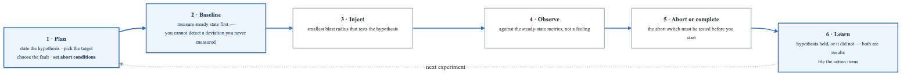
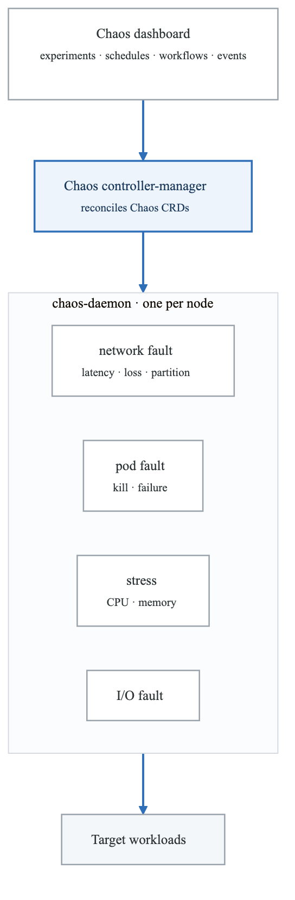
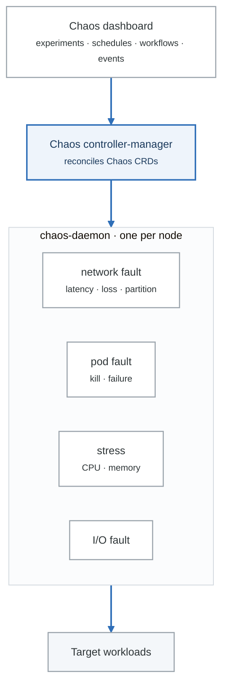

# Module 10: Chaos Engineering and Resilience Testing

## Learning Objectives

By the end of this module, you will be able to:
- Explain chaos engineering principles and practices
- Design and execute chaos experiments safely
- Implement chaos testing in Kubernetes with LitmusChaos and Chaos Mesh
- Build resilience testing into CI/CD pipelines
- Establish a chaos engineering program in your organization

## Introduction

Chaos engineering is the discipline of experimenting on a system to build confidence in its ability to withstand turbulent conditions. Rather than waiting for failures to occur in production, chaos engineering proactively injects failures to uncover weaknesses before they cause outages.

## 1. Chaos Engineering Fundamentals

### The Principles of Chaos

**The principles of chaos engineering**

1. **Build a hypothesis around steady-state behaviour.**
   *"We believe that when 30% of database connections are killed, request latency stays below
   500 ms and the error rate stays under 0.1%."*
   A hypothesis is what separates an experiment from randomly breaking things — random breakage
   has no prediction, so it cannot fail informatively.

2. **Vary real-world events.** Kill instances, exhaust CPU, add network latency, fill a disk, expire
   a certificate. Use failures you have actually seen, or expect to see.

3. **Run experiments in production** — eventually. Start in staging, but staging does not have
   production's traffic, data volume, or dependency behaviour, so a staging-only programme proves
   less than it appears to.

4. **Automate experiments to run continuously.** A one-off game day tells you about one day.

5. **Minimise the blast radius.** Start with one pod, one AZ, one percent of traffic. Have an abort
   switch and know how to use it before you start.

**If you are never surprised, you are testing things you already know** — which is comfortable and
worthless. The experiments that matter are the ones where you are not certain of the answer.

### Chaos Experiment Lifecycle

```mermaid
%%{init: {'theme':'base','themeVariables':{'fontFamily':'Helvetica, Arial, sans-serif','fontSize':'13px','primaryColor':'#ffffff','primaryTextColor':'#2d3436','primaryBorderColor':'#9aa3ab','lineColor':'#9aa3ab','textColor':'#2d3436','clusterBkg':'#fbfcfd','clusterBorder':'#d4dae0','edgeLabelBackground':'#ffffff','tertiaryColor':'#eef4fb'},'flowchart':{'curve':'basis','padding':14,'nodeSpacing':42,'rankSpacing':58}}}%%
flowchart LR
  classDef default fill:#ffffff,stroke:#9aa3ab,stroke-width:1.3px,color:#2d3436
  classDef n    fill:#ffffff,stroke:#9aa3ab,stroke-width:1.3px,color:#2d3436
  classDef crit fill:#eef4fb,stroke:#2f6fb8,stroke-width:1.8px,color:#1b3a5c
  classDef data fill:#f4f7fa,stroke:#9aa3ab,stroke-width:1.3px,color:#2d3436
  classDef mut  fill:#ffffff,stroke:#cfd6dc,stroke-width:1.1px,color:#7a8288
  classDef warn fill:#fdf0ec,stroke:#c0522d,stroke-width:1.6px,color:#8a3a1e
  P["<b>1 · Plan</b><br/><small>state the hypothesis · pick the target<br/>choose the fault · <b>set abort conditions</b></small>"]:::crit
  B["<b>2 · Baseline</b><br/><small>measure steady state first —<br/>you cannot detect a deviation you never measured</small>"]:::crit
  I["<b>3 · Inject</b><br/><small>smallest blast radius that tests the hypothesis</small>"]:::n
  O["<b>4 · Observe</b><br/><small>against the steady-state metrics, not a feeling</small>"]:::n
  A["<b>5 · Abort or complete</b><br/><small>the abort switch must be tested before you start</small>"]:::n
  L["<b>6 · Learn</b><br/><small>hypothesis held, or it did not — both are results<br/>file the action items</small>"]:::crit

  P --> B --> I --> O --> A --> L
  L -.->|"next experiment"| P

  linkStyle 0,1,2,3,4 stroke:#2f6fb8,stroke-width:2px
```

<!-- figure: generated from the Mermaid below by _shared/diagrams/embed-figures.py — do not edit the image -->


<details>
<summary>Diagram source (Mermaid)</summary>



</details>

### Common Failure Modes

```yaml
failure_categories:
  infrastructure:
    node_failure:
      description: "Physical or virtual machine crashes"
      scenarios:
        - "Single node failure"
        - "Multiple node failures"
        - "Availability zone outage"
      testing:
        - "Kill random pods"
        - "Drain nodes"
        - "Terminate EC2 instances"

    network_failures:
      description: "Network connectivity issues"
      scenarios:
        - "Complete network partition"
        - "Partial connectivity loss"
        - "High latency"
        - "Packet loss"
        - "DNS failures"
      testing:
        - "Block network traffic"
        - "Add latency"
        - "Drop packets"
        - "Corrupt DNS responses"

    storage_failures:
      description: "Storage system issues"
      scenarios:
        - "Disk full"
        - "I/O errors"
        - "Slow disk"
        - "Volume detachment"
      testing:
        - "Fill disk"
        - "Inject I/O latency"
        - "Unmount volumes"

  application:
    process_failures:
      description: "Application process issues"
      scenarios:
        - "OOM kill"
        - "CPU exhaustion"
        - "Process crash"
        - "Memory leak"
      testing:
        - "Kill processes"
        - "Consume CPU"
        - "Allocate memory"

    dependency_failures:
      description: "External service issues"
      scenarios:
        - "Database unavailable"
        - "Cache failure"
        - "Third-party API down"
        - "Message queue failure"
      testing:
        - "Block database traffic"
        - "Kill cache"
        - "Mock API failures"

  operational:
    time_issues:
      description: "Time-related problems"
      scenarios:
        - "Clock skew"
        - "Leap second"
        - "Time zone issues"
      testing:
        - "Modify system time"
        - "Inject clock drift"

    configuration:
      description: "Configuration problems"
      scenarios:
        - "Missing config"
        - "Invalid secrets"
        - "Certificate expiry"
      testing:
        - "Delete ConfigMaps"
        - "Invalidate secrets"
```

## 2. Chaos Mesh

### Chaos Mesh Architecture

<!-- figure: generated from the Mermaid below by _shared/diagrams/embed-figures.py — do not edit the image -->


<details>
<summary>Diagram source (Mermaid)</summary>



</details>

### Chaos Mesh Experiments

```yaml
# Pod Kill Experiment
apiVersion: chaos-mesh.org/v1alpha1
kind: PodChaos
metadata:
  name: pod-kill-experiment
  namespace: chaos-testing
spec:
  action: pod-kill
  mode: one               # one, all, fixed, fixed-percent, random-max-percent
  selector:
    namespaces:
      - production
    labelSelectors:
      app: order-service
  duration: "30s"
  scheduler:
    cron: "@every 1h"

---
# Network Latency Experiment
apiVersion: chaos-mesh.org/v1alpha1
kind: NetworkChaos
metadata:
  name: network-latency-experiment
  namespace: chaos-testing
spec:
  action: delay
  mode: all
  selector:
    namespaces:
      - production
    labelSelectors:
      app: order-service
  delay:
    latency: "200ms"
    jitter: "50ms"
    correlation: "25"
  direction: to
  target:
    selector:
      namespaces:
        - production
      labelSelectors:
        app: database
    mode: all
  duration: "5m"

---
# Network Partition Experiment
apiVersion: chaos-mesh.org/v1alpha1
kind: NetworkChaos
metadata:
  name: network-partition-experiment
  namespace: chaos-testing
spec:
  action: partition
  mode: all
  selector:
    namespaces:
      - production
    labelSelectors:
      app: order-service
  direction: both
  target:
    selector:
      namespaces:
        - production
      labelSelectors:
        app: payment-service
    mode: all
  duration: "2m"

---
# Stress Test Experiment
apiVersion: chaos-mesh.org/v1alpha1
kind: StressChaos
metadata:
  name: cpu-stress-experiment
  namespace: chaos-testing
spec:
  mode: all
  selector:
    namespaces:
      - production
    labelSelectors:
      app: order-service
  stressors:
    cpu:
      workers: 2
      load: 80
  duration: "5m"

---
# IO Chaos Experiment
apiVersion: chaos-mesh.org/v1alpha1
kind: IOChaos
metadata:
  name: io-latency-experiment
  namespace: chaos-testing
spec:
  action: latency
  mode: all
  selector:
    namespaces:
      - production
    labelSelectors:
      app: database
  volumePath: /var/lib/postgresql/data
  path: "*"
  delay: "100ms"
  percent: 50
  duration: "5m"

---
# Time Skew Experiment
apiVersion: chaos-mesh.org/v1alpha1
kind: TimeChaos
metadata:
  name: time-skew-experiment
  namespace: chaos-testing
spec:
  mode: one
  selector:
    namespaces:
      - production
    labelSelectors:
      app: order-service
  timeOffset: "-2h"
  duration: "5m"
```

### Chaos Mesh Workflows

```yaml
# Complex workflow with multiple stages
apiVersion: chaos-mesh.org/v1alpha1
kind: Workflow
metadata:
  name: resilience-test-workflow
  namespace: chaos-testing
spec:
  entry: the-entry
  templates:
    - name: the-entry
      templateType: Serial
      children:
        - baseline-check
        - pod-failure-test
        - network-failure-test
        - combined-failure-test
        - validation

    - name: baseline-check
      templateType: Task
      task:
        container:
          name: baseline
          image: curlimages/curl:latest
          command:
            - sh
            - -c
            - |
              echo "Checking baseline metrics..."
              curl -s http://prometheus:9090/api/v1/query?query=up | jq .
              echo "Baseline check complete"

    - name: pod-failure-test
      templateType: Serial
      children:
        - kill-one-pod
        - verify-recovery

    - name: kill-one-pod
      templateType: PodChaos
      deadline: 5m
      podChaos:
        action: pod-kill
        mode: one
        selector:
          namespaces:
            - production
          labelSelectors:
            app: order-service

    - name: verify-recovery
      templateType: Task
      task:
        container:
          name: verify
          image: curlimages/curl:latest
          command:
            - sh
            - -c
            - |
              sleep 60
              # Verify service recovered
              response=$(curl -s -o /dev/null -w "%{http_code}" http://order-service/health)
              if [ "$response" != "200" ]; then
                echo "Service did not recover!"
                exit 1
              fi
              echo "Service recovered successfully"

    - name: network-failure-test
      templateType: NetworkChaos
      deadline: 5m
      networkChaos:
        action: delay
        mode: all
        selector:
          namespaces:
            - production
          labelSelectors:
            app: order-service
        delay:
          latency: "500ms"

    - name: combined-failure-test
      templateType: Parallel
      children:
        - pod-chaos-parallel
        - network-chaos-parallel

    - name: pod-chaos-parallel
      templateType: PodChaos
      deadline: 3m
      podChaos:
        action: pod-failure
        mode: fixed-percent
        value: "30"
        selector:
          namespaces:
            - production
          labelSelectors:
            app: order-service

    - name: network-chaos-parallel
      templateType: NetworkChaos
      deadline: 3m
      networkChaos:
        action: loss
        mode: all
        selector:
          namespaces:
            - production
          labelSelectors:
            app: order-service
        loss:
          loss: "10"

    - name: validation
      templateType: Task
      task:
        container:
          name: validate
          image: curlimages/curl:latest
          command:
            - sh
            - -c
            - |
              echo "Running final validation..."
              # Check error rate stayed within bounds
              error_rate=$(curl -s "http://prometheus:9090/api/v1/query?query=rate(http_requests_total{status=~'5..'}[5m])/rate(http_requests_total[5m])" | jq -r '.data.result[0].value[1]')
              if (( $(echo "$error_rate > 0.05" | bc -l) )); then
                echo "Error rate exceeded 5% during chaos experiment!"
                exit 1
              fi
              echo "Validation passed. Error rate: $error_rate"
```

## 3. LitmusChaos

### LitmusChaos Architecture

```yaml
# Litmus ChaosEngine
apiVersion: litmuschaos.io/v1alpha1
kind: ChaosEngine
metadata:
  name: order-service-chaos
  namespace: production
spec:
  appinfo:
    appns: production
    applabel: app=order-service
    appkind: deployment
  engineState: active
  chaosServiceAccount: litmus-admin

  experiments:
    - name: pod-delete
      spec:
        components:
          env:
            - name: TOTAL_CHAOS_DURATION
              value: "30"
            - name: CHAOS_INTERVAL
              value: "10"
            - name: FORCE
              value: "false"
            - name: PODS_AFFECTED_PERC
              value: "50"

    - name: container-kill
      spec:
        components:
          env:
            - name: TARGET_CONTAINER
              value: "order-service"
            - name: CHAOS_INTERVAL
              value: "10"
            - name: TOTAL_CHAOS_DURATION
              value: "20"

  annotationCheck: "true"
  monitoring: true

---
# LitmusChaos Experiment (Custom Resource)
apiVersion: litmuschaos.io/v1alpha1
kind: ChaosExperiment
metadata:
  name: pod-network-latency
  namespace: production
spec:
  definition:
    scope: Namespaced
    permissions:
      - apiGroups: [""]
        resources: ["pods", "pods/exec", "pods/log", "events"]
        verbs: ["create", "delete", "get", "list", "patch", "update", "watch"]

    image: litmuschaos/go-runner:latest
    imagePullPolicy: Always

    args:
      - -c
      - ./experiments -name pod-network-latency

    command:
      - /bin/bash

    env:
      - name: NETWORK_INTERFACE
        value: eth0
      - name: TARGET_CONTAINER
        value: ""
      - name: NETWORK_LATENCY
        value: "2000"  # 2 seconds
      - name: TOTAL_CHAOS_DURATION
        value: "60"
      - name: CONTAINER_RUNTIME
        value: docker
      - name: LIB
        value: pumba
      - name: LIB_IMAGE
        value: litmuschaos/pumba:latest

    labels:
      name: pod-network-latency
      app.kubernetes.io/part-of: litmus
      app.kubernetes.io/component: experiment-job

---
# Litmus Workflow (Argo-based)
apiVersion: argoproj.io/v1alpha1
kind: Workflow
metadata:
  name: resilience-workflow
  namespace: litmus
spec:
  entrypoint: custom-chaos
  serviceAccountName: argo-chaos
  arguments:
    parameters:
      - name: adminModeNamespace
        value: production
  templates:
    - name: custom-chaos
      steps:
        - - name: install-chaos-experiments
            template: install-experiment

        - - name: pod-delete
            template: pod-delete

        - - name: revert-chaos
            template: revert-chaos

    - name: install-experiment
      inputs:
        artifacts:
          - name: pod-delete-experiment
            path: /tmp/pod-delete.yaml
            raw:
              data: |
                apiVersion: litmuschaos.io/v1alpha1
                kind: ChaosExperiment
                metadata:
                  name: pod-delete
                spec:
                  definition:
                    scope: Namespaced
      container:
        image: litmuschaos/k8s:latest
        command: [sh, -c]
        args:
          - kubectl apply -f /tmp/pod-delete.yaml -n {{workflow.parameters.adminModeNamespace}}

    - name: pod-delete
      inputs:
        artifacts:
          - name: pod-delete-engine
            path: /tmp/chaosengine.yaml
            raw:
              data: |
                apiVersion: litmuschaos.io/v1alpha1
                kind: ChaosEngine
                metadata:
                  name: order-chaos
                  namespace: production
                spec:
                  engineState: active
                  appinfo:
                    appns: production
                    applabel: app=order-service
                    appkind: deployment
                  chaosServiceAccount: litmus-admin
                  experiments:
                    - name: pod-delete
                      spec:
                        components:
                          env:
                            - name: TOTAL_CHAOS_DURATION
                              value: "30"
      container:
        image: litmuschaos/k8s:latest
        command: [sh, -c]
        args:
          - |
            kubectl apply -f /tmp/chaosengine.yaml
            sleep 60
            kubectl get chaosresult -n production

    - name: revert-chaos
      container:
        image: litmuschaos/k8s:latest
        command: [sh, -c]
        args:
          - kubectl delete chaosengine order-chaos -n production || true
```

## 4. GameDay Exercises

### GameDay Planning

```yaml
gameday_template:
  overview:
    name: "Q1 Resilience GameDay"
    date: "2024-03-15"
    duration: "4 hours"
    scope: "Order Processing System"
    participants:
      - "SRE Team"
      - "Order Team"
      - "Payment Team"
      - "Leadership (observers)"

  objectives:
    - "Validate system resilience to database failures"
    - "Test incident response procedures"
    - "Verify monitoring and alerting effectiveness"
    - "Practice cross-team coordination"

  prerequisites:
    technical:
      - "Chaos tools installed and tested"
      - "Dashboards configured"
      - "Rollback procedures documented"
      - "Blast radius controls verified"
    organizational:
      - "Management approval obtained"
      - "Customer support notified"
      - "Maintenance window scheduled"
      - "Communication channels ready"

  scenarios:
    - name: "Database Primary Failure"
      hypothesis: "When the primary database fails, the system will failover to replica within 30 seconds with no more than 0.1% error rate"
      steps:
        1: "Establish baseline metrics"
        2: "Notify team GameDay is starting"
        3: "Kill primary database pod"
        4: "Observe failover behavior"
        5: "Measure error rate and latency"
        6: "Document findings"
        7: "Restore primary"

    - name: "Payment Service Degradation"
      hypothesis: "When payment service latency increases to 5s, circuit breaker activates within 10 requests"
      steps:
        1: "Inject 5s latency to payment service"
        2: "Monitor order service behavior"
        3: "Verify circuit breaker opens"
        4: "Check fallback behavior"
        5: "Remove latency injection"
        6: "Verify circuit breaker closes"

    - name: "Multi-AZ Network Partition"
      hypothesis: "When AZ-a loses connectivity to AZ-b, traffic routes to healthy pods in AZ-c"
      steps:
        1: "Document current pod distribution"
        2: "Inject network partition between AZs"
        3: "Monitor traffic distribution"
        4: "Verify user experience"
        5: "Remove network partition"
        6: "Verify full recovery"

  safety_measures:
    abort_conditions:
      - "Error rate exceeds 5%"
      - "Customer complaints received"
      - "Unrelated production incident"
    abort_procedure:
      1: "Stop all chaos experiments"
      2: "Restore killed pods"
      3: "Remove network manipulations"
      4: "Verify system recovery"
      5: "Notify stakeholders"
    rollback_commands:
      - "kubectl delete chaosengine --all -n chaos-testing"
      - "kubectl rollout restart deployment -l chaos-eligible=true"

  success_criteria:
    - "All hypotheses validated or findings documented"
    - "No extended customer impact"
    - "Incident response procedures followed correctly"
    - "Action items captured for improvements"

  post_gameday:
    - "Conduct retrospective within 48 hours"
    - "Create tickets for identified issues"
    - "Update runbooks based on learnings"
    - "Share findings with broader org"
    - "Schedule follow-up GameDay"
```

### GameDay Execution Runbook

```python
# gameday_runner.py - Automated GameDay execution

import time
from datetime import datetime
from dataclasses import dataclass
from typing import List, Optional
import kubernetes
import requests

@dataclass
class Scenario:
    name: str
    hypothesis: str
    chaos_config: dict
    success_criteria: dict
    max_duration_minutes: int

@dataclass
class ScenarioResult:
    scenario_name: str
    hypothesis_validated: bool
    observations: List[str]
    metrics: dict
    action_items: List[str]

class GameDayRunner:
    def __init__(self, prometheus_url: str, slack_webhook: str):
        self.prometheus_url = prometheus_url
        self.slack_webhook = slack_webhook
        self.results: List[ScenarioResult] = []

    def notify(self, message: str, urgent: bool = False):
        """Send notification to Slack."""
        emoji = "🚨" if urgent else "📢"
        requests.post(self.slack_webhook, json={
            "text": f"{emoji} *GameDay*: {message}"
        })

    def get_baseline_metrics(self) -> dict:
        """Capture baseline metrics before chaos."""
        metrics = {}

        queries = {
            "error_rate": 'rate(http_requests_total{status=~"5.."}[5m])/rate(http_requests_total[5m])',
            "latency_p99": 'histogram_quantile(0.99, rate(http_request_duration_seconds_bucket[5m]))',
            "requests_per_second": 'sum(rate(http_requests_total[5m]))'
        }

        for name, query in queries.items():
            response = requests.get(
                f"{self.prometheus_url}/api/v1/query",
                params={"query": query}
            )
            data = response.json()
            if data["data"]["result"]:
                metrics[name] = float(data["data"]["result"][0]["value"][1])
            else:
                metrics[name] = 0

        return metrics

    def check_abort_conditions(self, baseline: dict) -> bool:
        """Check if abort conditions are met."""
        current = self.get_baseline_metrics()

        # Abort if error rate exceeds 5%
        if current.get("error_rate", 0) > 0.05:
            return True

        # Abort if error rate increased more than 10x from baseline
        if baseline.get("error_rate", 0) > 0:
            if current["error_rate"] / baseline["error_rate"] > 10:
                return True

        return False

    def run_scenario(self, scenario: Scenario) -> ScenarioResult:
        """Execute a single chaos scenario."""
        self.notify(f"Starting scenario: {scenario.name}")

        # Capture baseline
        baseline = self.get_baseline_metrics()
        observations = []
        observations.append(f"Baseline: {baseline}")

        start_time = time.time()
        hypothesis_validated = True

        try:
            # Apply chaos configuration
            self.apply_chaos(scenario.chaos_config)
            observations.append("Chaos applied successfully")

            # Monitor for duration
            while (time.time() - start_time) < scenario.max_duration_minutes * 60:
                # Check abort conditions
                if self.check_abort_conditions(baseline):
                    self.abort_scenario()
                    observations.append("ABORTED: Abort conditions met")
                    hypothesis_validated = False
                    break

                # Collect metrics
                current = self.get_baseline_metrics()
                observations.append(f"T+{int(time.time()-start_time)}s: {current}")

                # Check success criteria
                for metric, threshold in scenario.success_criteria.items():
                    if current.get(metric, 0) > threshold:
                        observations.append(f"Criteria exceeded: {metric} = {current[metric]} > {threshold}")

                time.sleep(30)

        except Exception as e:
            observations.append(f"ERROR: {str(e)}")
            hypothesis_validated = False

        finally:
            # Always clean up
            self.cleanup_chaos()

        # Capture final metrics
        final_metrics = self.get_baseline_metrics()

        # Determine if hypothesis was validated
        for metric, threshold in scenario.success_criteria.items():
            if final_metrics.get(metric, 0) > threshold:
                hypothesis_validated = False

        # Generate action items
        action_items = self.generate_action_items(
            scenario, baseline, final_metrics, observations
        )

        result = ScenarioResult(
            scenario_name=scenario.name,
            hypothesis_validated=hypothesis_validated,
            observations=observations,
            metrics=final_metrics,
            action_items=action_items
        )

        self.results.append(result)
        self.notify(
            f"Completed scenario: {scenario.name} - "
            f"{'✅ PASSED' if hypothesis_validated else '❌ FAILED'}"
        )

        return result

    def apply_chaos(self, config: dict):
        """Apply chaos configuration to cluster."""
        kubernetes.config.load_incluster_config()
        api = kubernetes.client.CustomObjectsApi()

        api.create_namespaced_custom_object(
            group="chaos-mesh.org",
            version="v1alpha1",
            namespace="chaos-testing",
            plural=config["kind"].lower() + "s",
            body=config
        )

    def cleanup_chaos(self):
        """Remove all chaos experiments."""
        kubernetes.config.load_incluster_config()
        api = kubernetes.client.CustomObjectsApi()

        for kind in ["podchaos", "networkchaos", "stresschaos", "iochaos"]:
            try:
                api.delete_collection_namespaced_custom_object(
                    group="chaos-mesh.org",
                    version="v1alpha1",
                    namespace="chaos-testing",
                    plural=kind
                )
            except:
                pass

    def abort_scenario(self):
        """Emergency abort of current scenario."""
        self.notify("🛑 ABORTING SCENARIO", urgent=True)
        self.cleanup_chaos()

    def generate_action_items(self, scenario, baseline, final, observations) -> List[str]:
        """Generate action items based on results."""
        items = []

        # Check for significant degradation
        if final.get("error_rate", 0) > baseline.get("error_rate", 0) * 2:
            items.append("Investigate error rate increase during chaos")

        if final.get("latency_p99", 0) > baseline.get("latency_p99", 0) * 3:
            items.append("Review latency impact and consider timeout adjustments")

        if "ABORTED" in str(observations):
            items.append("Review abort conditions and blast radius")

        return items

    def generate_report(self) -> str:
        """Generate GameDay report."""
        report = f"""
# GameDay Report - {datetime.now().strftime('%Y-%m-%d')}

## Summary
- Total Scenarios: {len(self.results)}
- Passed: {sum(1 for r in self.results if r.hypothesis_validated)}
- Failed: {sum(1 for r in self.results if not r.hypothesis_validated)}

## Scenario Results
"""
        for result in self.results:
            status = "✅ PASSED" if result.hypothesis_validated else "❌ FAILED"
            report += f"""
### {result.scenario_name} - {status}

**Observations:**
{chr(10).join('- ' + o for o in result.observations[-5:])}

**Final Metrics:**
{chr(10).join(f'- {k}: {v}' for k, v in result.metrics.items())}

**Action Items:**
{chr(10).join('- ' + a for a in result.action_items) if result.action_items else '- None identified'}
"""
        return report
```

## 5. Resilience Patterns

### Implementing Resilience

```python
# resilience_patterns.py - Common resilience patterns

import time
import random
from functools import wraps
from dataclasses import dataclass
from typing import Callable, Optional
import threading

@dataclass
class CircuitBreakerConfig:
    failure_threshold: int = 5
    recovery_timeout: int = 30
    half_open_requests: int = 3

class CircuitBreaker:
    """Circuit breaker pattern implementation."""

    def __init__(self, config: CircuitBreakerConfig = CircuitBreakerConfig()):
        self.config = config
        self.failures = 0
        self.state = "closed"  # closed, open, half-open
        self.last_failure_time = None
        self.half_open_successes = 0
        self.lock = threading.Lock()

    def __call__(self, func: Callable) -> Callable:
        @wraps(func)
        def wrapper(*args, **kwargs):
            with self.lock:
                if self.state == "open":
                    if self._should_attempt_reset():
                        self.state = "half-open"
                        self.half_open_successes = 0
                    else:
                        raise CircuitBreakerOpen("Circuit breaker is open")

            try:
                result = func(*args, **kwargs)

                with self.lock:
                    if self.state == "half-open":
                        self.half_open_successes += 1
                        if self.half_open_successes >= self.config.half_open_requests:
                            self.state = "closed"
                            self.failures = 0
                    elif self.state == "closed":
                        self.failures = 0

                return result

            except Exception as e:
                with self.lock:
                    self.failures += 1
                    self.last_failure_time = time.time()

                    if self.state == "half-open":
                        self.state = "open"
                    elif self.failures >= self.config.failure_threshold:
                        self.state = "open"

                raise

        return wrapper

    def _should_attempt_reset(self) -> bool:
        return (
            self.last_failure_time is not None and
            time.time() - self.last_failure_time >= self.config.recovery_timeout
        )


class CircuitBreakerOpen(Exception):
    pass


def retry_with_backoff(
    max_retries: int = 3,
    base_delay: float = 1.0,
    max_delay: float = 60.0,
    exponential: bool = True,
    jitter: bool = True,
    retryable_exceptions: tuple = (Exception,)
):
    """Retry decorator with exponential backoff."""

    def decorator(func: Callable) -> Callable:
        @wraps(func)
        def wrapper(*args, **kwargs):
            last_exception = None

            for attempt in range(max_retries + 1):
                try:
                    return func(*args, **kwargs)
                except retryable_exceptions as e:
                    last_exception = e

                    if attempt == max_retries:
                        raise

                    delay = base_delay
                    if exponential:
                        delay = min(base_delay * (2 ** attempt), max_delay)
                    if jitter:
                        delay = delay * (0.5 + random.random())

                    time.sleep(delay)

            raise last_exception

        return wrapper
    return decorator


class Bulkhead:
    """Bulkhead pattern - limit concurrent executions."""

    def __init__(self, max_concurrent: int, max_wait: float = 10.0):
        self.semaphore = threading.Semaphore(max_concurrent)
        self.max_wait = max_wait

    def __call__(self, func: Callable) -> Callable:
        @wraps(func)
        def wrapper(*args, **kwargs):
            acquired = self.semaphore.acquire(timeout=self.max_wait)
            if not acquired:
                raise BulkheadFull("Bulkhead limit reached")

            try:
                return func(*args, **kwargs)
            finally:
                self.semaphore.release()

        return wrapper


class BulkheadFull(Exception):
    pass


def timeout(seconds: float):
    """Timeout decorator using threading."""

    def decorator(func: Callable) -> Callable:
        @wraps(func)
        def wrapper(*args, **kwargs):
            result = [None]
            exception = [None]

            def target():
                try:
                    result[0] = func(*args, **kwargs)
                except Exception as e:
                    exception[0] = e

            thread = threading.Thread(target=target)
            thread.start()
            thread.join(timeout=seconds)

            if thread.is_alive():
                raise TimeoutError(f"Function timed out after {seconds} seconds")

            if exception[0]:
                raise exception[0]

            return result[0]

        return wrapper
    return decorator


# Usage Example
@CircuitBreaker(CircuitBreakerConfig(failure_threshold=3, recovery_timeout=60))
@retry_with_backoff(max_retries=2, base_delay=0.5)
@timeout(seconds=5.0)
@Bulkhead(max_concurrent=10)
def call_payment_service(order_id: str) -> dict:
    """Call external payment service with resilience patterns."""
    import requests

    response = requests.post(
        "http://payment-service/api/charge",
        json={"order_id": order_id},
        timeout=3.0
    )
    response.raise_for_status()
    return response.json()


# Fallback Pattern
def with_fallback(fallback_func: Callable):
    """Decorator to provide fallback on failure."""

    def decorator(func: Callable) -> Callable:
        @wraps(func)
        def wrapper(*args, **kwargs):
            try:
                return func(*args, **kwargs)
            except Exception:
                return fallback_func(*args, **kwargs)
        return wrapper
    return decorator


def cached_response(order_id: str) -> dict:
    """Fallback: return cached or default response."""
    return {
        "status": "pending",
        "message": "Payment processing delayed. Will retry."
    }


@with_fallback(cached_response)
def process_payment(order_id: str) -> dict:
    return call_payment_service(order_id)
```

## Summary

Chaos engineering is a powerful practice for building confidence in system reliability. By proactively injecting failures, teams can discover weaknesses before they cause production incidents.

### Key Takeaways

1. **Start Small**: Begin with known failure modes in non-production environments
2. **Hypothesis First**: Always have a clear hypothesis before experimenting
3. **Safety Matters**: Have abort conditions and blast radius controls
4. **Automate**: Integrate chaos into CI/CD for continuous validation
5. **Learn and Improve**: Use findings to strengthen systems and processes

## What's Next

In the next module, we'll explore Application Performance Management (APM) and continuous profiling for deep application insights.

<!-- feynman-check -->

---

## Feynman check

Close the file. Blank page, no notes. Explain each of these to a competent engineer who has never
used this tool — **under five minutes, no jargon you can't define on the spot:**

- Chaos Engineering Fundamentals
- Chaos Mesh
- LitmusChaos
- Scenario Results

**The gap is not what you forgot. It is where you used a word instead of a mechanism.**

| | |
|---|---|
| ✗ | *"Prometheus monitors the service."* |
| ✓ | *"Prometheus discovers targets from the Kubernetes API, applies relabelling rules, scrapes `/metrics` over HTTP on an interval, and appends samples to a local TSDB. Nothing is pushed — so a target missing from a dashboard is a service-discovery problem, not an application one."* |

**Trace it:** A latency regression → a phone ringing. Name each hop: sample, rule evaluation, alert state transition, routing, notification — and where each one can silently stop.

Stop at the first component you cannot name. Reopen this file and read **only** that.

**Go deeper — only once the gap has a name:** [SRE Workbook ch. 5, *Alerting on SLOs*](https://sre.google/workbook/alerting-on-slos/) — free, and the best thing written on why static thresholds page you for nothing.
Full list per domain: [`SOURCES.md`](../SOURCES.md#observability-sre)

→ Protocol, the three levels of knowing, and worked examples: [`MASTERY.md`](../MASTERY.md)

<!-- /feynman-check -->
