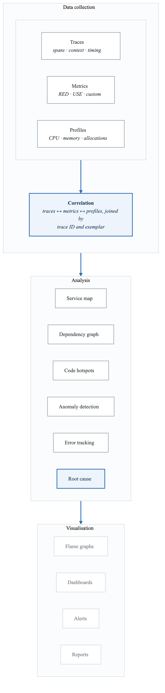
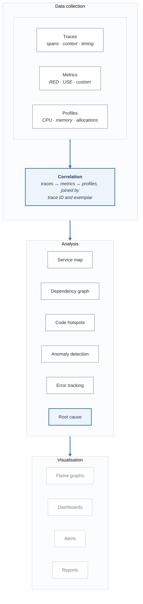
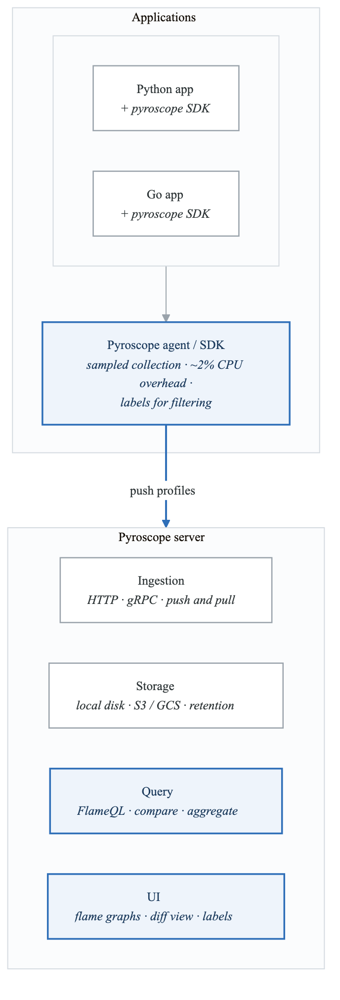
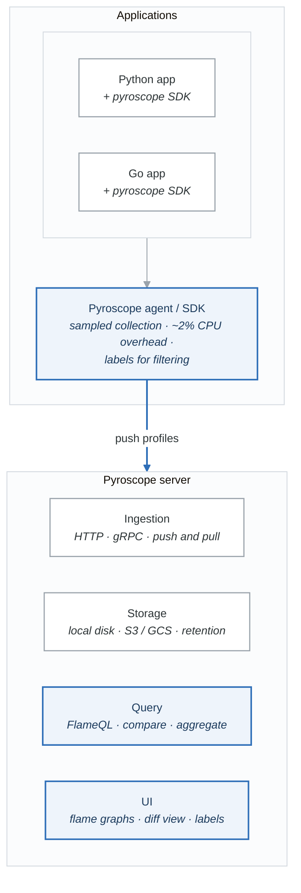

# Module 11: Application Performance Management and Continuous Profiling

## Learning Objectives

By the end of this module, you will be able to:
- Explain APM concepts and their relationship to observability
- Implement continuous profiling for production applications
- Analyze performance bottlenecks using flame graphs
- Configure and use profiling tools like Pyroscope and Parca
- Optimize application performance based on profiling data

## Introduction

Application Performance Management (APM) goes beyond traditional monitoring by providing deep insights into application behavior. Continuous profiling—capturing CPU, memory, and other resource usage in production—enables teams to understand exactly where applications spend their resources.

## 1. APM Fundamentals

### APM Components

<!-- figure: generated from the Mermaid below by _shared/diagrams/embed-figures.py — do not edit the image -->


<details>
<summary>Diagram source (Mermaid)</summary>



</details>

### Metrics Beyond RED

```yaml
apm_metrics:
  golden_signals:
    latency:
      description: "Time to serve requests"
      metrics:
        - "request_duration_seconds"
        - "p50, p90, p99 percentiles"
    traffic:
      description: "Demand on the system"
      metrics:
        - "requests_per_second"
        - "concurrent_connections"
    errors:
      description: "Rate of failed requests"
      metrics:
        - "error_rate_percent"
        - "errors_by_type"
    saturation:
      description: "Resource utilization"
      metrics:
        - "cpu_utilization"
        - "memory_utilization"
        - "connection_pool_usage"

  application_metrics:
    jvm:
      - "jvm_memory_used_bytes"
      - "jvm_gc_pause_seconds"
      - "jvm_threads_current"
      - "jvm_classes_loaded"
    python:
      - "python_gc_collections_total"
      - "python_info"
    nodejs:
      - "nodejs_heap_size_bytes"
      - "nodejs_eventloop_lag_seconds"
      - "nodejs_active_handles_total"
    go:
      - "go_goroutines"
      - "go_memstats_alloc_bytes"
      - "go_gc_duration_seconds"

  database_metrics:
    - "db_query_duration_seconds"
    - "db_connections_active"
    - "db_connections_idle"
    - "db_slow_queries_total"

  cache_metrics:
    - "cache_hit_ratio"
    - "cache_evictions_total"
    - "cache_size_bytes"
```

## 2. Continuous Profiling

### What is Continuous Profiling?

**Traditional vs continuous profiling**

| | Traditional | Continuous |
|---|---|---|
| When | Attach → collect → detach | Always on |
| Overhead | Significant | ~2% — sampled |
| Where | Development or staging | **Production** |
| What you get | A point-in-time snapshot | Historical data you can compare across releases |
| Fidelity | Not representative of production load | Real traffic, real data, real contention |
| Correlation | None | Linked to traces and metrics |

**Profile types**

| Type | Answers |
|---|---|
| **CPU** | Where is CPU time spent? Hot code paths, inefficient algorithms |
| **Memory (heap)** | What is holding memory? Leaks, unexpected retention |
| **Allocation** | Where are allocations happening? Allocation rate, GC pressure |
| **Block / mutex** *(Go)* | Where are goroutines blocked? Lock contention |
| **Wall clock** | Total elapsed time including I/O wait — the right one for I/O-bound services |

The CPU-versus-wall-clock distinction is the one that wastes afternoons. A service that spends 90% of
its time waiting on a database shows almost nothing in a CPU profile, and the temptation is to
conclude the code is fine. It is — the problem is elsewhere, and only the wall-clock profile says so.

### Understanding Flame Graphs

**Reading a flame graph**

| Axis | Means |
|---|---|
| **X** | Stack frames sorted **alphabetically** — *not* time. A flame graph is not a timeline |
| **Y** | Stack depth, root at the bottom |
| **Width** | Time spent in that function, including everything it called |
| **Colour** | Usually arbitrary, sometimes by type (CPU, memory) |

```text
main ................................................. 100%
├── handleRequest ......... 40%     ├── processQueue ..... 30%
│   ├── queryDB ... 25%             │   └── parseMessage . 20%
│   │   └── execute ... 20%         │       └── unmarshal  15%
│   └── serialize . 10%
│       └── toJSON ... 8%
```

**What it tells you**

- `main()` is the entry point, so it is 100% wide by definition
- `handleRequest()` accounts for 40% of total time
- `queryDB()` inside it accounts for 25% **of the total**, not of the 40%
- `execute` at 20% is a single wide block near the bottom of a stack — that is the hotspot

**Look for width, not height.** A deep, narrow tower is a long call chain that costs nothing. A wide
block is where the time goes, and a wide block with nothing above it is where the time is actually
being *spent* rather than passed along.

## 3. Pyroscope

### Pyroscope Architecture

<!-- figure: generated from the Mermaid below by _shared/diagrams/embed-figures.py — do not edit the image -->


<details>
<summary>Diagram source (Mermaid)</summary>



</details>

### Python Integration

```python
# pyroscope_config.py - Pyroscope integration for Python

import pyroscope
from flask import Flask, request, g
import os

# Initialize Pyroscope
pyroscope.configure(
    application_name="order-service",
    server_address=os.environ.get("PYROSCOPE_SERVER", "http://pyroscope:4040"),
    auth_token=os.environ.get("PYROSCOPE_AUTH_TOKEN", ""),

    # Tags for filtering
    tags={
        "region": os.environ.get("REGION", "us-east-1"),
        "env": os.environ.get("ENVIRONMENT", "production"),
        "version": os.environ.get("VERSION", "unknown"),
    },

    # Profile types to collect
    enable_logging=True,
)

app = Flask(__name__)

# Add request-level tags
@app.before_request
def add_profiling_tags():
    g.profile_tags = {
        "endpoint": request.endpoint or "unknown",
        "method": request.method,
    }

@app.route('/api/orders', methods=['POST'])
def create_order():
    # Add custom profiling tag for this request
    with pyroscope.tag_wrapper({
        "operation": "create_order",
        "customer_id": request.json.get("customer_id", "unknown")
    }):
        return process_order(request.json)

def process_order(data):
    # This function's CPU usage will be captured with tags
    # ...
    pass


# Manual profiling for specific code sections
def expensive_operation():
    with pyroscope.tag_wrapper({"function": "expensive_operation"}):
        # Profile only this section with specific tag
        result = perform_heavy_computation()
        return result
```

### Go Integration

```go
// main.go - Pyroscope integration for Go

package main

import (
    "context"
    "net/http"
    "os"
    "runtime"

    "github.com/grafana/pyroscope-go"
)

func main() {
    // Start Pyroscope profiler
    runtime.SetMutexProfileFraction(5)
    runtime.SetBlockProfileRate(5)

    profiler, err := pyroscope.Start(pyroscope.Config{
        ApplicationName: "order-service",
        ServerAddress:   os.Getenv("PYROSCOPE_SERVER"),
        AuthToken:       os.Getenv("PYROSCOPE_AUTH_TOKEN"),

        // Choose which profiles to enable
        ProfileTypes: []pyroscope.ProfileType{
            pyroscope.ProfileCPU,
            pyroscope.ProfileAllocObjects,
            pyroscope.ProfileAllocSpace,
            pyroscope.ProfileInuseObjects,
            pyroscope.ProfileInuseSpace,
            pyroscope.ProfileGoroutines,
            pyroscope.ProfileMutexCount,
            pyroscope.ProfileMutexDuration,
            pyroscope.ProfileBlockCount,
            pyroscope.ProfileBlockDuration,
        },

        // Static tags
        Tags: map[string]string{
            "region":  os.Getenv("REGION"),
            "env":     os.Getenv("ENVIRONMENT"),
            "version": os.Getenv("VERSION"),
        },
    })
    if err != nil {
        panic(err)
    }
    defer profiler.Stop()

    // HTTP handler with profiling context
    http.HandleFunc("/api/orders", func(w http.ResponseWriter, r *http.Request) {
        // Add request-specific tags
        pyroscope.TagWrapper(context.Background(), pyroscope.Labels(
            "endpoint", "/api/orders",
            "method", r.Method,
        ), func(ctx context.Context) {
            handleOrder(ctx, w, r)
        })
    })

    http.ListenAndServe(":8080", nil)
}

func handleOrder(ctx context.Context, w http.ResponseWriter, r *http.Request) {
    // Profile specific operations
    pyroscope.TagWrapper(ctx, pyroscope.Labels("operation", "validate"), func(ctx context.Context) {
        validateOrder(r)
    })

    pyroscope.TagWrapper(ctx, pyroscope.Labels("operation", "process"), func(ctx context.Context) {
        processOrder(ctx)
    })

    w.WriteHeader(http.StatusOK)
}
```

### Kubernetes Deployment

```yaml
# pyroscope-server.yaml
apiVersion: apps/v1
kind: Deployment
metadata:
  name: pyroscope
  namespace: observability
spec:
  replicas: 1
  selector:
    matchLabels:
      app: pyroscope
  template:
    metadata:
      labels:
        app: pyroscope
    spec:
      containers:
        - name: pyroscope
          image: grafana/pyroscope:latest
          args:
            - server
          ports:
            - containerPort: 4040
          env:
            - name: PYROSCOPE_LOG_LEVEL
              value: info
          volumeMounts:
            - name: data
              mountPath: /var/lib/pyroscope
          resources:
            requests:
              cpu: 500m
              memory: 1Gi
            limits:
              cpu: 2
              memory: 4Gi
      volumes:
        - name: data
          persistentVolumeClaim:
            claimName: pyroscope-data

---
# Application with Pyroscope sidecar (eBPF-based)
apiVersion: apps/v1
kind: Deployment
metadata:
  name: order-service
  namespace: production
spec:
  template:
    metadata:
      labels:
        app: order-service
    spec:
      containers:
        - name: order-service
          image: order-service:latest
          # No code changes needed with eBPF profiler

        - name: pyroscope-agent
          image: grafana/pyroscope:latest
          args:
            - ebpf
            - --application-name=order-service
            - --server-address=http://pyroscope.observability:4040
            - --spy-name=ebpfspy
            - --target-pid=1
          securityContext:
            privileged: true  # Required for eBPF
          volumeMounts:
            - name: proc
              mountPath: /host/proc
            - name: sys
              mountPath: /sys
      volumes:
        - name: proc
          hostPath:
            path: /proc
        - name: sys
          hostPath:
            path: /sys
```

## 4. Parca

### Parca Architecture

```yaml
# Parca - Open source continuous profiling
# Uses eBPF for zero-instrumentation profiling

architecture:
  parca_agent:
    type: DaemonSet
    technology: eBPF
    capabilities:
      - "Profile all processes on node"
      - "No code changes required"
      - "Symbol resolution from debug info"
      - "Container-aware"

  parca_server:
    features:
      - "Profile storage and querying"
      - "Flame graph generation"
      - "Profile diff/comparison"
      - "OpenTelemetry integration"
      - "Grafana plugin available"

# Deployment
---
apiVersion: apps/v1
kind: DaemonSet
metadata:
  name: parca-agent
  namespace: parca
spec:
  selector:
    matchLabels:
      app: parca-agent
  template:
    metadata:
      labels:
        app: parca-agent
    spec:
      hostPID: true
      containers:
        - name: parca-agent
          image: ghcr.io/parca-dev/parca-agent:latest
          args:
            - /bin/parca-agent
            - --node=$(NODE_NAME)
            - --store-address=parca.parca.svc:7070
            - --insecure
            - --log-level=info
            - --kubernetes
          env:
            - name: NODE_NAME
              valueFrom:
                fieldRef:
                  fieldPath: spec.nodeName
          securityContext:
            privileged: true
          volumeMounts:
            - name: sys
              mountPath: /sys
            - name: modules
              mountPath: /lib/modules
            - name: debugfs
              mountPath: /sys/kernel/debug
            - name: cgroup
              mountPath: /sys/fs/cgroup
      volumes:
        - name: sys
          hostPath:
            path: /sys
        - name: modules
          hostPath:
            path: /lib/modules
        - name: debugfs
          hostPath:
            path: /sys/kernel/debug
        - name: cgroup
          hostPath:
            path: /sys/fs/cgroup

---
apiVersion: apps/v1
kind: Deployment
metadata:
  name: parca
  namespace: parca
spec:
  replicas: 1
  selector:
    matchLabels:
      app: parca
  template:
    metadata:
      labels:
        app: parca
    spec:
      containers:
        - name: parca
          image: ghcr.io/parca-dev/parca:latest
          args:
            - /parca
            - --config-path=/etc/parca/parca.yaml
          ports:
            - containerPort: 7070
          volumeMounts:
            - name: config
              mountPath: /etc/parca
            - name: data
              mountPath: /var/lib/parca
      volumes:
        - name: config
          configMap:
            name: parca-config
        - name: data
          persistentVolumeClaim:
            claimName: parca-data
```

## 5. Performance Analysis Patterns

### Identifying Common Bottlenecks

```python
# performance_analysis.py - Common bottleneck patterns

class PerformanceAnalyzer:
    """Analyze profiling data for common patterns."""

    def analyze_cpu_profile(self, flame_graph_data):
        """Identify CPU bottlenecks."""
        patterns = []

        # Pattern 1: Hot loops
        hot_functions = self.find_functions_by_cpu_percent(
            flame_graph_data, threshold=10
        )
        for func in hot_functions:
            if self.contains_loop(func):
                patterns.append({
                    "type": "hot_loop",
                    "function": func.name,
                    "cpu_percent": func.cpu_percent,
                    "recommendation": "Consider optimizing loop or using caching"
                })

        # Pattern 2: Excessive serialization
        serialization_funcs = self.find_functions_matching(
            flame_graph_data, ["json", "marshal", "serialize", "encode"]
        )
        total_serialization = sum(f.cpu_percent for f in serialization_funcs)
        if total_serialization > 15:
            patterns.append({
                "type": "excessive_serialization",
                "cpu_percent": total_serialization,
                "recommendation": "Consider protocol buffers or reducing payload size"
            })

        # Pattern 3: Regex compilation
        regex_funcs = self.find_functions_matching(
            flame_graph_data, ["compile", "regex", "pattern"]
        )
        if regex_funcs:
            patterns.append({
                "type": "regex_compilation",
                "functions": [f.name for f in regex_funcs],
                "recommendation": "Cache compiled regex patterns"
            })

        # Pattern 4: Cryptographic operations
        crypto_funcs = self.find_functions_matching(
            flame_graph_data, ["hash", "encrypt", "decrypt", "sign", "verify"]
        )
        total_crypto = sum(f.cpu_percent for f in crypto_funcs)
        if total_crypto > 10:
            patterns.append({
                "type": "high_crypto_overhead",
                "cpu_percent": total_crypto,
                "recommendation": "Consider caching results or optimizing crypto calls"
            })

        return patterns

    def analyze_memory_profile(self, heap_data):
        """Identify memory issues."""
        patterns = []

        # Pattern 1: String concatenation
        string_allocs = self.find_allocation_sites(
            heap_data, type_filter="string"
        )
        for site in string_allocs:
            if site.allocation_rate > 1000:  # Per second
                patterns.append({
                    "type": "string_concatenation",
                    "location": site.location,
                    "rate": site.allocation_rate,
                    "recommendation": "Use string builder or buffer"
                })

        # Pattern 2: Large allocations in hot path
        large_allocs = self.find_allocation_sites(
            heap_data, size_threshold=1024*1024  # 1MB
        )
        for site in large_allocs:
            if self.is_in_hot_path(site):
                patterns.append({
                    "type": "large_allocation_in_hot_path",
                    "location": site.location,
                    "size": site.size,
                    "recommendation": "Consider pooling or pre-allocation"
                })

        # Pattern 3: Potential memory leak
        growing_objects = self.find_growing_allocations(heap_data)
        for obj in growing_objects:
            patterns.append({
                "type": "potential_memory_leak",
                "object_type": obj.type,
                "growth_rate": obj.growth_rate,
                "recommendation": "Review object lifecycle and cleanup"
            })

        return patterns

    def analyze_goroutine_profile(self, goroutine_data):
        """Analyze Go goroutine profiles for issues."""
        patterns = []

        # Pattern 1: Goroutine leak
        if goroutine_data.count > 10000:
            patterns.append({
                "type": "goroutine_leak",
                "count": goroutine_data.count,
                "recommendation": "Review goroutine lifecycle and channel usage"
            })

        # Pattern 2: Lock contention
        blocked_goroutines = [g for g in goroutine_data.goroutines
                            if g.state == "blocked"]
        if len(blocked_goroutines) > goroutine_data.count * 0.1:
            patterns.append({
                "type": "lock_contention",
                "blocked_count": len(blocked_goroutines),
                "recommendation": "Consider reducing lock scope or using RWMutex"
            })

        # Pattern 3: Channel blocking
        channel_blocked = [g for g in goroutine_data.goroutines
                         if "chan receive" in g.stack or "chan send" in g.stack]
        if channel_blocked:
            patterns.append({
                "type": "channel_blocking",
                "count": len(channel_blocked),
                "recommendation": "Check channel buffer sizes and consumers"
            })

        return patterns


def generate_optimization_report(profiles):
    """Generate actionable optimization report."""
    analyzer = PerformanceAnalyzer()

    report = {
        "cpu_issues": analyzer.analyze_cpu_profile(profiles["cpu"]),
        "memory_issues": analyzer.analyze_memory_profile(profiles["heap"]),
        "concurrency_issues": analyzer.analyze_goroutine_profile(profiles["goroutine"]),
    }

    # Prioritize by impact
    all_issues = []
    for category, issues in report.items():
        for issue in issues:
            issue["category"] = category
            all_issues.append(issue)

    # Sort by estimated impact
    prioritized = sorted(all_issues,
                        key=lambda x: x.get("cpu_percent", 0) + x.get("growth_rate", 0),
                        reverse=True)

    return {
        "issues": prioritized[:10],  # Top 10 issues
        "summary": {
            "cpu_issues": len(report["cpu_issues"]),
            "memory_issues": len(report["memory_issues"]),
            "concurrency_issues": len(report["concurrency_issues"]),
        }
    }
```

### Comparing Profiles

```python
# profile_comparison.py - Compare profiles over time

from dataclasses import dataclass
from typing import Dict, List
import numpy as np

@dataclass
class ProfileDiff:
    function: str
    before_percent: float
    after_percent: float
    change_percent: float
    significance: str

def compare_profiles(before: Dict, after: Dict) -> List[ProfileDiff]:
    """Compare two CPU profiles and identify significant changes."""
    diffs = []

    all_functions = set(before.keys()) | set(after.keys())

    for func in all_functions:
        before_pct = before.get(func, 0)
        after_pct = after.get(func, 0)

        if before_pct == 0 and after_pct == 0:
            continue

        if before_pct == 0:
            change = float('inf')
        else:
            change = ((after_pct - before_pct) / before_pct) * 100

        # Determine significance
        if abs(after_pct - before_pct) < 0.5:
            significance = "negligible"
        elif change > 50:
            significance = "regression"
        elif change < -30:
            significance = "improvement"
        else:
            significance = "minor"

        diffs.append(ProfileDiff(
            function=func,
            before_percent=before_pct,
            after_percent=after_pct,
            change_percent=change,
            significance=significance
        ))

    # Sort by absolute change
    diffs.sort(key=lambda x: abs(x.after_percent - x.before_percent), reverse=True)

    return diffs


def regression_analysis(baseline_profiles: List[Dict], current: Dict) -> Dict:
    """Statistical analysis against baseline."""
    results = {}

    for func in current.keys():
        baseline_values = [p.get(func, 0) for p in baseline_profiles]

        if not any(baseline_values):
            continue

        mean = np.mean(baseline_values)
        std = np.std(baseline_values)
        current_val = current[func]

        # Calculate z-score
        if std > 0:
            z_score = (current_val - mean) / std
        else:
            z_score = 0 if current_val == mean else float('inf')

        results[func] = {
            "current": current_val,
            "baseline_mean": mean,
            "baseline_std": std,
            "z_score": z_score,
            "is_regression": z_score > 2,  # 2 standard deviations
            "is_improvement": z_score < -2
        }

    return results
```

## 6. Integration with Observability Stack

### Linking Profiles to Traces

```yaml
# Grafana configuration for profile-trace correlation

datasources:
  - name: Tempo
    type: tempo
    url: http://tempo:3200
    jsonData:
      nodeGraph:
        enabled: true
      tracesToProfiles:
        datasourceUid: pyroscope
        tags:
          - key: service.name
            value: service_name
          - key: span.name
            value: span_name
        profileTypeId: process_cpu:cpu:nanoseconds:cpu:nanoseconds
        customQuery: true
        query: |
          {service_name="${__span.tags.service.name}"}

  - name: Pyroscope
    type: grafana-pyroscope-datasource
    url: http://pyroscope:4040
    jsonData:
      minStep: "15s"

  - name: Prometheus
    type: prometheus
    url: http://prometheus:9090
    jsonData:
      exemplarTraceIdDestinations:
        - name: trace_id
          datasourceUid: tempo
```

### APM Dashboard

```json
{
  "title": "Application Performance Dashboard",
  "panels": [
    {
      "title": "Request Rate & Latency",
      "type": "timeseries",
      "targets": [
        {
          "expr": "rate(http_requests_total[5m])",
          "legendFormat": "Requests/sec"
        },
        {
          "expr": "histogram_quantile(0.99, rate(http_request_duration_seconds_bucket[5m]))",
          "legendFormat": "P99 Latency"
        }
      ],
      "exemplars": true
    },
    {
      "title": "CPU Profile - Top Functions",
      "type": "flamegraph",
      "datasource": "Pyroscope",
      "targets": [
        {
          "labelSelector": "{service_name=\"order-service\"}",
          "profileTypeId": "process_cpu:cpu:nanoseconds:cpu:nanoseconds"
        }
      ]
    },
    {
      "title": "Memory Allocation Rate",
      "type": "timeseries",
      "datasource": "Pyroscope",
      "targets": [
        {
          "labelSelector": "{service_name=\"order-service\"}",
          "profileTypeId": "memory:alloc_objects:count:space:bytes"
        }
      ]
    },
    {
      "title": "Slow Traces",
      "type": "traces",
      "datasource": "Tempo",
      "targets": [
        {
          "queryType": "search",
          "minDuration": "1s",
          "serviceName": "order-service"
        }
      ],
      "links": [
        {
          "title": "View Profile",
          "targetBlank": true,
          "url": "/explore?left={\"datasource\":\"Pyroscope\",\"queries\":[{\"profileTypeId\":\"process_cpu:cpu:nanoseconds:cpu:nanoseconds\",\"labelSelector\":\"{service_name=\\\"order-service\\\"}\"}]}&range={\"from\":\"${__data.fields.startTime}\",\"to\":\"${__data.fields.endTime}\"}"
        }
      ]
    }
  ]
}
```

## Summary

APM and continuous profiling provide deep insights into application behavior that metrics and traces alone cannot reveal. By understanding where CPU and memory are spent, teams can make targeted optimizations with measurable impact.

### Key Takeaways

1. **Profile in Production**: Development profiling misses real-world patterns
2. **Low Overhead is Key**: Use sampling-based profilers (<5% overhead)
3. **Correlate Signals**: Link profiles to traces and metrics
4. **Compare Over Time**: Track performance regressions against baselines
5. **Act on Data**: Use profiling insights to drive optimization priorities

## What's Next

In the next module, we'll bring everything together in building a complete observability platform, including architecture decisions, tooling choices, and operational practices.

<!-- feynman-check -->

---

## Feynman check

Close the file. Blank page, no notes. Explain each of these to a competent engineer who has never
used this tool — **under five minutes, no jargon you can't define on the spot:**

- APM Fundamentals
- Continuous Profiling
- Pyroscope
- Parca

**The gap is not what you forgot. It is where you used a word instead of a mechanism.**

| | |
|---|---|
| ✗ | *"Prometheus monitors the service."* |
| ✓ | *"Prometheus discovers targets from the Kubernetes API, applies relabelling rules, scrapes `/metrics` over HTTP on an interval, and appends samples to a local TSDB. Nothing is pushed — so a target missing from a dashboard is a service-discovery problem, not an application one."* |

**Trace it:** A latency regression → a phone ringing. Name each hop: sample, rule evaluation, alert state transition, routing, notification — and where each one can silently stop.

Stop at the first component you cannot name. Reopen this file and read **only** that.

**Go deeper — only once the gap has a name:** [SRE Workbook ch. 5, *Alerting on SLOs*](https://sre.google/workbook/alerting-on-slos/) — free, and the best thing written on why static thresholds page you for nothing.
Full list per domain: [`SOURCES.md`](../SOURCES.md#observability-sre)

→ Protocol, the three levels of knowing, and worked examples: [`MASTERY.md`](../MASTERY.md)

<!-- /feynman-check -->
