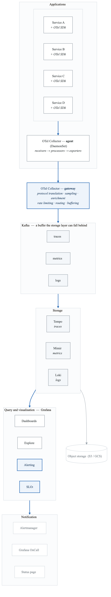

# Module 12: Building an Observability Platform

## Learning Objectives

By the end of this module, you will be able to:
- Design a comprehensive observability platform architecture
- Select and integrate appropriate tools for your organization
- Implement observability standards and governance
- Build self-service capabilities for development teams
- Establish an observability center of excellence

## Introduction

Building an observability platform is more than deploying tools—it's about creating a cohesive system that enables teams to understand their services, troubleshoot issues quickly, and continuously improve reliability. This module brings together all the concepts from this phase into a unified platform design.

## 1. Platform Architecture

### Reference Architecture

```mermaid
%%{init: {'theme':'base','themeVariables':{'fontFamily':'Helvetica, Arial, sans-serif','fontSize':'13px','primaryColor':'#ffffff','primaryTextColor':'#2d3436','primaryBorderColor':'#9aa3ab','lineColor':'#9aa3ab','textColor':'#2d3436','clusterBkg':'#fbfcfd','clusterBorder':'#d4dae0','edgeLabelBackground':'#ffffff','tertiaryColor':'#eef4fb'},'flowchart':{'curve':'basis','padding':14,'nodeSpacing':42,'rankSpacing':58}}}%%
flowchart TB
  classDef default fill:#ffffff,stroke:#9aa3ab,stroke-width:1.3px,color:#2d3436
  classDef n    fill:#ffffff,stroke:#9aa3ab,stroke-width:1.3px,color:#2d3436
  classDef crit fill:#eef4fb,stroke:#2f6fb8,stroke-width:1.8px,color:#1b3a5c
  classDef data fill:#f4f7fa,stroke:#9aa3ab,stroke-width:1.3px,color:#2d3436
  classDef mut  fill:#ffffff,stroke:#cfd6dc,stroke-width:1.1px,color:#7a8288
  classDef warn fill:#fdf0ec,stroke:#c0522d,stroke-width:1.6px,color:#8a3a1e
  subgraph APP["Applications"]
    direction TB
    subgraph SVCS[" "]
      direction LR
      A["Service A<br/><i>+ OTel SDK</i>"]
      B["Service B<br/><i>+ OTel SDK</i>"]
      C["Service C<br/><i>+ OTel SDK</i>"]
      D["Service D<br/><i>+ OTel SDK</i>"]
    end
    AGENT["OTel Collector — <b>agent</b> &nbsp;(DaemonSet)<br/><i>receivers → processors → exporters</i>"]
    SVCS ==> AGENT
  end
  GW["OTel Collector — <b>gateway</b><br/><i>protocol translation · sampling · enrichment<br/>rate limiting · routing · buffering</i>"]
  subgraph KQ["Kafka &nbsp;—&nbsp; a buffer the storage layer can fall behind"]
    direction LR
    KT["traces"]
    KM["metrics"]
    KL["logs"]
  end
  subgraph ST["Storage"]
    direction LR
    TE["Tempo<br/><i>traces</i>"]
    MI["Mimir<br/><i>metrics</i>"]
    LO["Loki<br/><i>logs</i>"]
  end
  OBJ[("Object storage &nbsp;(S3 / GCS)")]
  subgraph QV["Query and visualisation &nbsp;—&nbsp; Grafana"]
    direction LR
    DB2["Dashboards"]
    EX["Explore"]
    AL["Alerting"]
    SLO["SLOs"]
  end
  subgraph NOT["Notification"]
    direction LR
    AM["Alertmanager"]
    OC["Grafana OnCall"]
    SP["Status page"]
  end
  AGENT ==> GW ==> KQ ==> ST --> OBJ
  ST ==> QV ==> NOT
  class A,B,C,D n
  class AGENT n
  class GW crit
  class KT,KM,KL data
  class TE,MI,LO data
  class OBJ mut
  class DB2,EX n
  class AL,SLO crit
  class AM,OC,SP mut
  linkStyle 0,1,2,3,5,6 stroke:#2f6fb8,stroke-width:2px

%% Kafka between the gateway and storage is the difference between a platform
%% and a pipeline. Without it, a Mimir restart drops whatever was in flight and
%% the gap is permanent. With it, the storage layer can be down for minutes and
%% simply catch up -- which is what lets you upgrade it during working hours.
```

<!-- figure: generated from the Mermaid below by _shared/diagrams/embed-figures.py — do not edit the image -->


<details>
<summary>Diagram source (Mermaid)</summary>



</details>

### Component Selection Matrix

```yaml
components:
  instrumentation:
    standard: "OpenTelemetry"
    rationale:
      - "Vendor neutral"
      - "Unified API for all signals"
      - "Wide language support"
      - "Active community"

  collection:
    primary: "OpenTelemetry Collector"
    alternatives:
      - "Vector (high performance)"
      - "Fluent Bit (logs focus)"
    rationale:
      - "Native OTel support"
      - "Flexible pipeline"
      - "Rich processor ecosystem"

  metrics_storage:
    options:
      prometheus:
        use_case: "Small to medium scale"
        retention: "15 days"
        cardinality: "< 10M series"

      mimir:
        use_case: "Large scale, multi-tenant"
        retention: "Years"
        cardinality: "Billions of series"

      victoria_metrics:
        use_case: "Cost-effective scale"
        retention: "Long term"

  trace_storage:
    options:
      tempo:
        use_case: "Cost-effective, no indexing"
        query: "By trace ID only"

      jaeger:
        use_case: "Full search capability"
        storage: "Elasticsearch/Cassandra"

  log_storage:
    options:
      loki:
        use_case: "Label-based queries"
        cost: "Low (no indexing)"

      elasticsearch:
        use_case: "Full-text search"
        cost: "Higher (full indexing)"

  visualization:
    primary: "Grafana"
    rationale:
      - "Unified view of all signals"
      - "Rich plugin ecosystem"
      - "Dashboard as code"
      - "Alerting integration"

  alerting:
    primary: "Grafana Alerting + Alertmanager"
    escalation: "Grafana OnCall or PagerDuty"
```

## 2. Platform Implementation

### Kubernetes Deployment

```yaml
# observability-namespace.yaml
apiVersion: v1
kind: Namespace
metadata:
  name: observability
  labels:
    istio-injection: enabled

---
# Grafana stack using Helm
# helm repo add grafana https://grafana.github.io/helm-charts

# mimir-values.yaml
mimir:
  structuredConfig:
    multitenancy_enabled: true
    limits:
      max_global_series_per_user: 1000000
      max_global_series_per_metric: 50000

    blocks_storage:
      backend: s3
      s3:
        bucket_name: mimir-blocks
        endpoint: s3.amazonaws.com

    alertmanager_storage:
      backend: s3
      s3:
        bucket_name: mimir-alertmanager

    ruler_storage:
      backend: s3
      s3:
        bucket_name: mimir-ruler

  ingester:
    replicas: 3
    resources:
      requests:
        cpu: 1
        memory: 4Gi

  distributor:
    replicas: 2

  querier:
    replicas: 2

  query_frontend:
    replicas: 2

  compactor:
    replicas: 1

---
# tempo-values.yaml
tempo:
  storage:
    trace:
      backend: s3
      s3:
        bucket: tempo-traces
        endpoint: s3.amazonaws.com
        region: us-east-1

  ingester:
    replicas: 3

  querier:
    replicas: 2

  query_frontend:
    replicas: 2

  metrics_generator:
    enabled: true
    remoteWriteUrl: http://mimir-distributor:8080/api/v1/push

---
# loki-values.yaml
loki:
  loki:
    auth_enabled: true

    storage:
      bucketNames:
        chunks: loki-chunks
        ruler: loki-ruler
        admin: loki-admin
      type: s3
      s3:
        region: us-east-1

    schemaConfig:
      configs:
        - from: 2024-01-01
          store: tsdb
          object_store: s3
          schema: v12
          index:
            prefix: loki_index_
            period: 24h

  ingester:
    replicas: 3

  querier:
    replicas: 2

  query_frontend:
    replicas: 2

---
# grafana-values.yaml
grafana:
  replicas: 2

  persistence:
    enabled: true
    size: 10Gi

  datasources:
    datasources.yaml:
      apiVersion: 1
      datasources:
        - name: Mimir
          type: prometheus
          url: http://mimir-query-frontend:8080/prometheus
          isDefault: true
          jsonData:
            httpHeaderName1: X-Scope-OrgID
          secureJsonData:
            httpHeaderValue1: ${TENANT_ID}

        - name: Tempo
          type: tempo
          url: http://tempo-query-frontend:3200
          jsonData:
            tracesToLogs:
              datasourceUid: loki
              filterByTraceID: true
              filterBySpanID: false
            tracesToMetrics:
              datasourceUid: mimir
            nodeGraph:
              enabled: true

        - name: Loki
          type: loki
          url: http://loki-query-frontend:3100
          jsonData:
            derivedFields:
              - name: TraceID
                matcherRegex: '"trace_id":"([^"]+)"'
                url: '${__value.raw}'
                datasourceUid: tempo

  dashboardProviders:
    dashboardproviders.yaml:
      apiVersion: 1
      providers:
        - name: default
          folder: ''
          type: file
          disableDeletion: true
          options:
            path: /var/lib/grafana/dashboards

  sidecar:
    dashboards:
      enabled: true
      label: grafana_dashboard
    datasources:
      enabled: true
      label: grafana_datasource
```

### OpenTelemetry Collector Configuration

```yaml
# otel-collector-config.yaml

apiVersion: v1
kind: ConfigMap
metadata:
  name: otel-collector-gateway-config
  namespace: observability
data:
  config.yaml: |
    receivers:
      otlp:
        protocols:
          grpc:
            endpoint: 0.0.0.0:4317
          http:
            endpoint: 0.0.0.0:4318

      prometheus:
        config:
          scrape_configs:
            - job_name: 'kubernetes-pods'
              kubernetes_sd_configs:
                - role: pod
              relabel_configs:
                - source_labels: [__meta_kubernetes_pod_annotation_prometheus_io_scrape]
                  action: keep
                  regex: true

    processors:
      memory_limiter:
        check_interval: 1s
        limit_percentage: 80
        spike_limit_percentage: 25

      batch:
        timeout: 1s
        send_batch_size: 1024

      k8sattributes:
        auth_type: serviceAccount
        extract:
          metadata:
            - k8s.namespace.name
            - k8s.pod.name
            - k8s.deployment.name
            - k8s.node.name

      resource:
        attributes:
          - key: cluster
            value: ${CLUSTER_NAME}
            action: upsert

      transform:
        trace_statements:
          - context: resource
            statements:
              - set(attributes["tenant_id"], attributes["k8s.namespace.name"])

      tail_sampling:
        decision_wait: 30s
        num_traces: 100000
        policies:
          - name: errors
            type: status_code
            status_code:
              status_codes: [ERROR]
          - name: slow
            type: latency
            latency:
              threshold_ms: 5000
          - name: probabilistic
            type: probabilistic
            probabilistic:
              sampling_percentage: 10

    exporters:
      otlphttp/tempo:
        endpoint: http://tempo-distributor:4318
        tls:
          insecure: true

      prometheusremotewrite:
        endpoint: http://mimir-distributor:8080/api/v1/push
        headers:
          X-Scope-OrgID: ${TENANT_ID}

      loki:
        endpoint: http://loki-distributor:3100/loki/api/v1/push
        tenant_id: ${TENANT_ID}

    extensions:
      health_check:
        endpoint: 0.0.0.0:13133

    service:
      extensions: [health_check]
      pipelines:
        traces:
          receivers: [otlp]
          processors: [memory_limiter, k8sattributes, resource, tail_sampling, batch]
          exporters: [otlphttp/tempo]

        metrics:
          receivers: [otlp, prometheus]
          processors: [memory_limiter, k8sattributes, resource, batch]
          exporters: [prometheusremotewrite]

        logs:
          receivers: [otlp]
          processors: [memory_limiter, k8sattributes, resource, batch]
          exporters: [loki]
```

## 3. Standards and Governance

### Instrumentation Standards

```yaml
# observability-standards.yaml

standards:
  naming_conventions:
    metrics:
      pattern: "<namespace>_<subsystem>_<name>_<unit>"
      examples:
        - "http_server_requests_total"
        - "http_server_request_duration_seconds"
        - "database_connections_active"
      units:
        - "Use base units (seconds not milliseconds)"
        - "total for counters, _bytes for memory"

    spans:
      naming:
        - "Use verb + noun format: 'HTTP GET /api/users'"
        - "Include operation type"
        - "Be descriptive but concise"
      required_attributes:
        - service.name
        - service.version
        - deployment.environment

    logs:
      format: "JSON structured"
      required_fields:
        - timestamp
        - level
        - message
        - service
        - trace_id (if in trace context)
        - span_id (if in trace context)

  cardinality_guidelines:
    labels:
      allowed:
        - "Fixed set values (status codes, methods)"
        - "Environment identifiers"
        - "Service names"
      forbidden:
        - "User IDs"
        - "Request IDs"
        - "Email addresses"
        - "Any PII"
      warning_threshold: 1000  # unique values per label

  slo_requirements:
    mandatory:
      - "Every production service must have defined SLOs"
      - "SLOs must cover availability and latency"
      - "Error budgets must be tracked"

    review_cadence:
      - "Monthly SLO review"
      - "Quarterly target adjustment"

  dashboard_standards:
    required_panels:
      - "Request rate"
      - "Error rate"
      - "Latency percentiles (p50, p90, p99)"
      - "Saturation metrics"
    naming: "[Team] - [Service] - [Dashboard Type]"
    variables:
      - "environment selector"
      - "time range"
      - "refresh interval"
```

### Onboarding Checklist

```yaml
# service-onboarding-checklist.yaml

onboarding:
  phase_1_instrumentation:
    tasks:
      - name: "Add OpenTelemetry SDK"
        details: "Include language-specific OTel SDK"
        documentation: "/docs/instrumentation/sdk-setup"

      - name: "Configure auto-instrumentation"
        details: "Enable automatic instrumentation for HTTP, DB, etc."
        documentation: "/docs/instrumentation/auto-instrumentation"

      - name: "Add service resource attributes"
        required_attributes:
          - service.name
          - service.version
          - deployment.environment
          - team

      - name: "Verify trace propagation"
        details: "Ensure trace context flows between services"

  phase_2_metrics:
    tasks:
      - name: "Expose Prometheus metrics"
        endpoint: "/metrics"
        required_metrics:
          - "http_requests_total"
          - "http_request_duration_seconds"
          - "http_requests_in_flight"

      - name: "Add business metrics"
        examples:
          - "orders_created_total"
          - "payment_processed_amount"

      - name: "Configure service discovery"
        details: "Add prometheus.io/scrape annotation"

  phase_3_logging:
    tasks:
      - name: "Implement structured logging"
        format: "JSON"
        required_fields:
          - timestamp
          - level
          - message
          - service

      - name: "Include trace context in logs"
        fields:
          - trace_id
          - span_id

      - name: "Configure log levels appropriately"
        production: "INFO and above"
        development: "DEBUG and above"

  phase_4_alerting:
    tasks:
      - name: "Define SLOs"
        template: "/templates/slo-document.md"

      - name: "Create alerting rules"
        required_alerts:
          - "High error rate"
          - "High latency"
          - "Service down"

      - name: "Create runbooks"
        template: "/templates/runbook.md"

  phase_5_dashboards:
    tasks:
      - name: "Create service dashboard"
        template: "/templates/service-dashboard.json"

      - name: "Add to team overview dashboard"
        location: "Team Dashboards folder"

      - name: "Configure dashboard variables"
        required:
          - environment
          - cluster
          - time_range

  validation:
    checklist:
      - "Traces visible in Grafana Explore"
      - "Metrics scraped and queryable"
      - "Logs aggregated in Loki"
      - "Alerts firing correctly"
      - "Dashboard loads without errors"
      - "SLO tracking enabled"
```

## 4. Self-Service Platform

### Developer Portal Integration

```yaml
# backstage-observability-plugin.yaml

apiVersion: backstage.io/v1alpha1
kind: Component
metadata:
  name: order-service
  annotations:
    grafana/dashboard-selector: "app=order-service"
    prometheus.io/scrape: "true"
    slo.observability/slo-name: "order-service-availability"

spec:
  type: service
  lifecycle: production
  owner: order-team

---
# Backstage Template for New Service
apiVersion: scaffolder.backstage.io/v1beta3
kind: Template
metadata:
  name: new-service-with-observability
  title: Create New Service with Full Observability
spec:
  parameters:
    - title: Service Details
      properties:
        name:
          type: string
        team:
          type: string

  steps:
    - id: generate
      name: Generate Service
      action: fetch:template
      input:
        url: ./skeleton
        values:
          name: ${{ parameters.name }}
          team: ${{ parameters.team }}

    - id: create-grafana-dashboard
      name: Create Grafana Dashboard
      action: http:backstage:request
      input:
        method: POST
        path: /api/grafana/dashboards
        body:
          dashboard: ${{ include './templates/service-dashboard.json' }}
          folderId: ${{ parameters.team }}

    - id: create-alerting-rules
      name: Create Alerting Rules
      action: http:backstage:request
      input:
        method: POST
        path: /api/grafana/alerting/rules
        body: ${{ include './templates/alert-rules.yaml' }}

    - id: create-slo
      name: Create SLO
      action: http:backstage:request
      input:
        method: POST
        path: /api/sloth/slos
        body:
          service: ${{ parameters.name }}
          slos:
            - name: availability
              objective: 99.9
            - name: latency
              objective: 95
              threshold: 0.5
```

### Terraform Module for Observability

```hcl
# modules/service-observability/main.tf

variable "service_name" {
  description = "Name of the service"
  type        = string
}

variable "team" {
  description = "Team owning the service"
  type        = string
}

variable "slo_availability_target" {
  description = "Availability SLO target (0-100)"
  type        = number
  default     = 99.9
}

variable "slo_latency_target" {
  description = "Latency SLO target in seconds"
  type        = number
  default     = 0.5
}

# Create Grafana folder
resource "grafana_folder" "service" {
  title = "${var.team}/${var.service_name}"
}

# Create service dashboard
resource "grafana_dashboard" "service" {
  folder    = grafana_folder.service.id
  overwrite = true

  config_json = templatefile("${path.module}/templates/service-dashboard.json", {
    service_name = var.service_name
    team         = var.team
  })
}

# Create alert rules
resource "grafana_rule_group" "service_alerts" {
  name             = "${var.service_name}-alerts"
  folder_uid       = grafana_folder.service.uid
  interval_seconds = 60

  rule {
    name           = "High Error Rate"
    condition      = "C"
    for            = "5m"

    annotations = {
      summary     = "High error rate for ${var.service_name}"
      runbook_url = "https://runbooks.example.com/${var.service_name}/high-error-rate"
    }

    labels = {
      severity = "warning"
      service  = var.service_name
      team     = var.team
    }

    data {
      ref_id = "A"
      datasource_uid = data.grafana_data_source.mimir.uid
      model = jsonencode({
        expr     = "sum(rate(http_requests_total{service=\"${var.service_name}\",status=~\"5..\"}[5m]))"
        refId    = "A"
      })
    }

    data {
      ref_id = "B"
      datasource_uid = data.grafana_data_source.mimir.uid
      model = jsonencode({
        expr     = "sum(rate(http_requests_total{service=\"${var.service_name}\"}[5m]))"
        refId    = "B"
      })
    }

    data {
      ref_id = "C"
      datasource_uid = "__expr__"
      model = jsonencode({
        type       = "math"
        expression = "$A / $B * 100"
      })
    }
  }
}

# Create SLO using Sloth
resource "local_file" "slo_spec" {
  filename = "${path.module}/generated/slo-${var.service_name}.yaml"
  content = templatefile("${path.module}/templates/slo-spec.yaml", {
    service_name        = var.service_name
    team               = var.team
    availability_target = var.slo_availability_target
    latency_target     = var.slo_latency_target
  })
}

resource "null_resource" "generate_slo_rules" {
  triggers = {
    slo_spec = local_file.slo_spec.content
  }

  provisioner "local-exec" {
    command = "sloth generate -i ${local_file.slo_spec.filename} -o ${path.module}/generated/slo-rules-${var.service_name}.yaml"
  }
}

# Outputs
output "dashboard_url" {
  value = "https://grafana.example.com/d/${grafana_dashboard.service.uid}"
}

output "slo_dashboard_url" {
  value = "https://grafana.example.com/d/slo-${var.service_name}"
}
```

## 5. Cost Optimization

### Cost Management Strategies

```yaml
cost_optimization:
  storage:
    metrics:
      strategies:
        - name: "Aggressive downsampling"
          description: "Reduce resolution for older data"
          implementation:
            - "1m resolution for < 24h"
            - "5m resolution for 24h-7d"
            - "1h resolution for 7d-30d"
            - "4h resolution for > 30d"

        - name: "Recording rules"
          description: "Pre-aggregate common queries"
          benefit: "Reduce query cost and storage"

        - name: "Cardinality management"
          description: "Monitor and limit high-cardinality metrics"
          tools:
            - "Mimir cardinality analysis"
            - "Metric relabeling to drop"

    traces:
      strategies:
        - name: "Tail-based sampling"
          keep: "Errors, slow traces, 10% random"
          reduction: "~70% volume reduction"

        - name: "Short retention"
          production: "7 days"
          staging: "3 days"
          development: "1 day"

        - name: "Span filtering"
          drop: "Health checks, internal framework spans"

    logs:
      strategies:
        - name: "Log level filtering"
          production: "INFO and above"
          reduction: "~50% volume"

        - name: "Sampling high-volume logs"
          targets: "Access logs, health checks"
          sample_rate: "1%"

        - name: "Compression"
          format: "Snappy or LZ4"

  compute:
    strategies:
      - name: "Right-sizing"
        description: "Match resources to actual usage"
        review: "Monthly"

      - name: "Autoscaling"
        description: "Scale based on ingestion rate"
        implementation: "HPA on collectors and ingesters"

      - name: "Spot instances"
        suitable_for:
          - "Compactors"
          - "Query workers"
          - "Non-critical components"

  cost_monitoring:
    metrics:
      - "ingestion_rate_per_tenant"
      - "storage_bytes_per_tenant"
      - "query_cost_per_tenant"
      - "active_series_per_service"

    dashboards:
      - "Cost by tenant"
      - "Cost by service"
      - "Cost trends over time"
      - "Top cost contributors"

    alerts:
      - "Ingestion rate spike (>2x normal)"
      - "Storage growth anomaly"
      - "Query cost exceeds budget"
```

### Cost Allocation

```python
# cost_allocation.py - Chargeback/showback implementation

from dataclasses import dataclass
from typing import Dict, List
import requests

@dataclass
class TenantCost:
    tenant_id: str
    metrics_ingested_bytes: float
    traces_ingested_bytes: float
    logs_ingested_bytes: float
    queries_executed: int
    total_cost_usd: float

class CostCalculator:
    def __init__(self, prometheus_url: str, cost_config: Dict):
        self.prometheus_url = prometheus_url
        self.cost_config = cost_config

    def calculate_tenant_costs(self, time_range: str = "30d") -> List[TenantCost]:
        """Calculate costs per tenant."""
        tenants = self._get_tenants()
        costs = []

        for tenant in tenants:
            # Get ingestion volumes
            metrics_bytes = self._query_metric(
                f'sum(increase(cortex_ingester_received_samples_total{{tenant="{tenant}"}}[{time_range}])) * 8'
            )
            traces_bytes = self._query_metric(
                f'sum(increase(tempo_distributor_bytes_received_total{{tenant="{tenant}"}}[{time_range}]))'
            )
            logs_bytes = self._query_metric(
                f'sum(increase(loki_distributor_bytes_received_total{{tenant="{tenant}"}}[{time_range}]))'
            )
            queries = self._query_metric(
                f'sum(increase(cortex_query_frontend_queries_total{{tenant="{tenant}"}}[{time_range}]))'
            )

            # Calculate cost
            total_cost = (
                (metrics_bytes / 1e9) * self.cost_config["metrics_per_gb"] +
                (traces_bytes / 1e9) * self.cost_config["traces_per_gb"] +
                (logs_bytes / 1e9) * self.cost_config["logs_per_gb"] +
                queries * self.cost_config["queries_per_1k"] / 1000
            )

            costs.append(TenantCost(
                tenant_id=tenant,
                metrics_ingested_bytes=metrics_bytes,
                traces_ingested_bytes=traces_bytes,
                logs_ingested_bytes=logs_bytes,
                queries_executed=int(queries),
                total_cost_usd=total_cost
            ))

        return costs

    def _get_tenants(self) -> List[str]:
        """Get list of active tenants."""
        response = requests.get(
            f"{self.prometheus_url}/api/v1/label/tenant/values"
        )
        return response.json()["data"]

    def _query_metric(self, query: str) -> float:
        """Execute Prometheus query."""
        response = requests.get(
            f"{self.prometheus_url}/api/v1/query",
            params={"query": query}
        )
        data = response.json()
        if data["data"]["result"]:
            return float(data["data"]["result"][0]["value"][1])
        return 0.0


def generate_cost_report(costs: List[TenantCost]) -> str:
    """Generate monthly cost report."""
    total = sum(c.total_cost_usd for c in costs)

    report = f"""
# Monthly Observability Cost Report

## Summary
- **Total Cost**: ${total:,.2f}
- **Number of Tenants**: {len(costs)}

## Cost by Tenant

| Tenant | Metrics (GB) | Traces (GB) | Logs (GB) | Queries | Cost |
|--------|-------------|-------------|-----------|---------|------|
"""
    for c in sorted(costs, key=lambda x: x.total_cost_usd, reverse=True):
        report += f"| {c.tenant_id} | {c.metrics_ingested_bytes/1e9:.1f} | "
        report += f"{c.traces_ingested_bytes/1e9:.1f} | {c.logs_ingested_bytes/1e9:.1f} | "
        report += f"{c.queries_executed:,} | ${c.total_cost_usd:,.2f} |\n"

    return report
```

## 6. Center of Excellence

### Observability CoE Structure

```yaml
center_of_excellence:
  mission: |
    Enable all teams to achieve operational excellence through
    comprehensive observability practices and tooling.

  structure:
    core_team:
      size: "3-5 engineers"
      responsibilities:
        - "Platform development and maintenance"
        - "Tool evaluation and integration"
        - "Standards definition"
        - "Training and enablement"
        - "Cost optimization"

    embedded_champions:
      description: "One engineer per major team"
      responsibilities:
        - "Implement observability in team services"
        - "Represent team needs to CoE"
        - "Train team members"
        - "Advocate best practices"

  programs:
    training:
      - name: "Observability 101"
        audience: "All engineers"
        frequency: "Monthly"
        topics:
          - "Three pillars overview"
          - "Tool introduction"
          - "Basic troubleshooting"

      - name: "Advanced Observability"
        audience: "Senior engineers"
        frequency: "Quarterly"
        topics:
          - "SLO design"
          - "PromQL/LogQL advanced"
          - "Performance optimization"

      - name: "Champion Certification"
        audience: "Embedded champions"
        frequency: "Bi-annual"
        topics:
          - "Platform internals"
          - "Troubleshooting deep dive"
          - "Cost optimization"

    office_hours:
      schedule: "Weekly, 1 hour"
      format: "Open Q&A and consultation"

    review_process:
      new_services:
        - "Observability readiness review"
        - "SLO definition review"
        - "Dashboard review"

      existing_services:
        frequency: "Quarterly"
        scope: "SLO achievement, cost efficiency"

  success_metrics:
    adoption:
      - "% services with full instrumentation"
      - "% services with defined SLOs"
      - "% alerts with runbooks"

    quality:
      - "Mean time to detection (MTTD)"
      - "Mean time to resolution (MTTR)"
      - "False positive alert rate"

    efficiency:
      - "Cost per service"
      - "Query performance"
      - "Storage efficiency"

    satisfaction:
      - "Developer satisfaction score"
      - "On-call experience rating"
      - "Tool adoption rate"
```

## Summary

Building an observability platform is a journey, not a destination. It requires continuous evolution as your organization's needs change and new capabilities become available.

### Key Takeaways

1. **Start with Standards**: Define conventions before deploying tools
2. **Think Platform**: Build for self-service, not one-off solutions
3. **Cost Awareness**: Build cost visibility from day one
4. **Enable Teams**: The goal is enabling others, not gatekeeping
5. **Iterate Continuously**: Improve based on user feedback and metrics

### Platform Maturity Model

```
Level 1 - Basic:
- Individual tool deployments
- Manual instrumentation
- Reactive troubleshooting

Level 2 - Standardized:
- Unified collection (OTel)
- Consistent dashboards
- Basic SLOs

Level 3 - Proactive:
- Full correlation across signals
- SLO-based operations
- Self-service for teams

Level 4 - Optimized:
- Automated remediation
- Predictive alerting
- Cost optimization

Level 5 - Innovative:
- ML-driven insights
- Continuous profiling
- Business outcome correlation
```

## Course Summary

Congratulations on completing the Observability & SRE phase! You've learned:

1. **Fundamentals**: The three pillars and their correlation
2. **Metrics**: Prometheus, PromQL, and high availability
3. **Visualization**: Grafana dashboards and best practices
4. **Alerting**: Intelligent alerting with Alertmanager
5. **Logging**: ELK Stack and Loki at scale
6. **Tracing**: Distributed tracing with Jaeger and Tempo
7. **OpenTelemetry**: The unified observability standard
8. **SRE Practices**: SLOs, error budgets, and reliability culture
9. **Incident Management**: Response, runbooks, and postmortems
10. **Chaos Engineering**: Proactive resilience testing
11. **APM & Profiling**: Deep application insights
12. **Platform Building**: Creating a comprehensive observability solution

You're now equipped to build and operate observable, reliable systems at scale!

<!-- feynman-check -->

---

## Feynman check

Close the file. Blank page, no notes. Explain each of these to a competent engineer who has never
used this tool — **under five minutes, no jargon you can't define on the spot:**

- Platform Architecture
- Platform Implementation
- Standards and Governance
- Self-Service Platform

**The gap is not what you forgot. It is where you used a word instead of a mechanism.**

| | |
|---|---|
| ✗ | *"Prometheus monitors the service."* |
| ✓ | *"Prometheus discovers targets from the Kubernetes API, applies relabelling rules, scrapes `/metrics` over HTTP on an interval, and appends samples to a local TSDB. Nothing is pushed — so a target missing from a dashboard is a service-discovery problem, not an application one."* |

**Trace it:** A latency regression → a phone ringing. Name each hop: sample, rule evaluation, alert state transition, routing, notification — and where each one can silently stop.

Stop at the first component you cannot name. Reopen this file and read **only** that.

**Go deeper — only once the gap has a name:** [SRE Workbook ch. 5, *Alerting on SLOs*](https://sre.google/workbook/alerting-on-slos/) — free, and the best thing written on why static thresholds page you for nothing.
Full list per domain: [`SOURCES.md`](../SOURCES.md#observability-sre)

→ Protocol, the three levels of knowing, and worked examples: [`MASTERY.md`](../MASTERY.md)

<!-- /feynman-check -->
