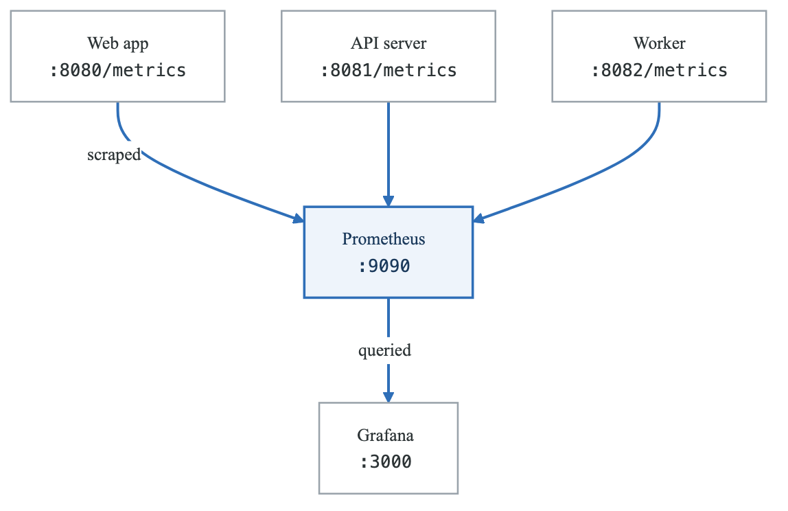
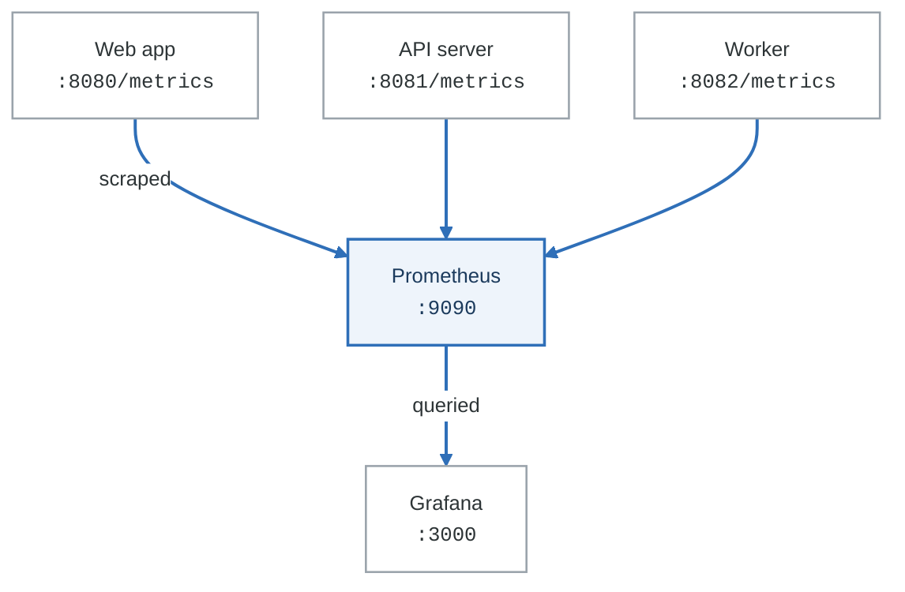

# Lab 01: Prometheus Fundamentals

## Overview
Master Prometheus metrics collection, PromQL querying, and alerting rules through hands-on exercises with a microservices application.

## Prerequisites
- Docker and Docker Compose installed
- Basic understanding of metrics concepts
- Familiarity with YAML configuration
- Text editor (VS Code recommended)

## Learning Objectives
- Deploy and configure Prometheus
- Instrument applications with metrics
- Write effective PromQL queries
- Create recording and alerting rules
- Understand service discovery mechanisms

## Lab Environment

### Architecture
<!-- figure: generated from the Mermaid below by _shared/diagrams/embed-figures.py — do not edit the image -->


<details>
<summary>Diagram source (Mermaid)</summary>



</details>

### Initial Setup
```bash
# Clone the lab repository
git clone https://github.com/devops-academy/prometheus-lab.git
cd prometheus-lab

# Start the environment
docker-compose up -d

# Verify all services are running
docker-compose ps
```

### docker-compose.yml
```yaml
version: '3.8'

services:
  prometheus:
    image: prom/prometheus:v2.45.0
    container_name: prometheus
    ports:
      - "9090:9090"
    volumes:
      - ./prometheus:/etc/prometheus
      - prometheus_data:/prometheus
    command:
      - '--config.file=/etc/prometheus/prometheus.yml'
      - '--storage.tsdb.path=/prometheus'
      - '--web.enable-lifecycle'
      - '--web.enable-admin-api'
    networks:
      - monitoring

  grafana:
    image: grafana/grafana:10.0.0
    container_name: grafana
    ports:
      - "3000:3000"
    environment:
      - GF_SECURITY_ADMIN_PASSWORD=admin
      - GF_USERS_ALLOW_SIGN_UP=false
    volumes:
      - grafana_data:/var/lib/grafana
      - ./grafana/provisioning:/etc/grafana/provisioning
    networks:
      - monitoring

  webapp:
    build: ./apps/webapp
    container_name: webapp
    ports:
      - "8080:8080"
    environment:
      - API_URL=http://api:8081
    networks:
      - monitoring

  api:
    build: ./apps/api
    container_name: api
    ports:
      - "8081:8081"
    networks:
      - monitoring

  worker:
    build: ./apps/worker
    container_name: worker
    ports:
      - "8082:8082"
    networks:
      - monitoring

  node-exporter:
    image: prom/node-exporter:v1.6.0
    container_name: node-exporter
    ports:
      - "9100:9100"
    networks:
      - monitoring

volumes:
  prometheus_data:
  grafana_data:

networks:
  monitoring:
    driver: bridge
```

---

## Part 1: Guided Exercises

### Exercise 1.1: Basic Prometheus Configuration

**Objective:** Configure Prometheus to scrape metrics from multiple targets.

**Step 1:** Create the Prometheus configuration file.

```bash
mkdir -p prometheus
cat > prometheus/prometheus.yml << 'EOF'
global:
  scrape_interval: 15s
  evaluation_interval: 15s
  external_labels:
    cluster: 'lab-cluster'
    env: 'development'

scrape_configs:
  # Prometheus self-monitoring
  - job_name: 'prometheus'
    static_configs:
      - targets: ['localhost:9090']

  # Node Exporter
  - job_name: 'node'
    static_configs:
      - targets: ['node-exporter:9100']
    relabel_configs:
      - source_labels: [__address__]
        target_label: instance
        regex: '([^:]+):\d+'
        replacement: '${1}'

  # Application metrics
  - job_name: 'webapp'
    static_configs:
      - targets: ['webapp:8080']
    metrics_path: /metrics

  - job_name: 'api'
    static_configs:
      - targets: ['api:8081']
    metrics_path: /metrics

  - job_name: 'worker'
    static_configs:
      - targets: ['worker:8082']
    metrics_path: /metrics
EOF
```

**Step 2:** Reload Prometheus configuration.

```bash
# Using the lifecycle API
curl -X POST http://localhost:9090/-/reload

# Verify configuration
curl http://localhost:9090/api/v1/status/config | jq '.data.yaml' | head -20
```

**Step 3:** Verify targets are being scraped.

```bash
# Check target status via API
curl -s http://localhost:9090/api/v1/targets | jq '.data.activeTargets[] | {job: .labels.job, health: .health, lastScrape: .lastScrape}'
```

**Expected Output:**
```json
{
  "job": "prometheus",
  "health": "up",
  "lastScrape": "2024-01-15T10:30:00.123Z"
}
{
  "job": "webapp",
  "health": "up",
  "lastScrape": "2024-01-15T10:30:05.456Z"
}
```

**Verification:**
- [ ] All targets show "up" status in Prometheus UI (http://localhost:9090/targets)
- [ ] No scrape errors in target details
- [ ] Metrics are queryable in the expression browser

---

### Exercise 1.2: Application Instrumentation with Python

**Objective:** Add Prometheus metrics to a Python application.

**Step 1:** Review the base application code.

```python
# apps/api/app.py - Original version
from flask import Flask, jsonify
import time
import random

app = Flask(__name__)

@app.route('/api/users')
def get_users():
    # Simulate database query
    time.sleep(random.uniform(0.01, 0.1))
    return jsonify({"users": ["alice", "bob", "charlie"]})

@app.route('/api/orders')
def get_orders():
    # Simulate processing
    time.sleep(random.uniform(0.05, 0.2))
    if random.random() < 0.1:
        return jsonify({"error": "Database timeout"}), 500
    return jsonify({"orders": [1, 2, 3]})

@app.route('/health')
def health():
    return jsonify({"status": "healthy"})

if __name__ == '__main__':
    app.run(host='0.0.0.0', port=8081)
```

**Step 2:** Add Prometheus instrumentation.

```python
# apps/api/app.py - Instrumented version
from flask import Flask, jsonify, request
from prometheus_client import (
    Counter, Histogram, Gauge, Info,
    generate_latest, CONTENT_TYPE_LATEST,
    CollectorRegistry, multiprocess, REGISTRY
)
import time
import random
import os

app = Flask(__name__)

# Define metrics
REQUEST_COUNT = Counter(
    'api_requests_total',
    'Total API requests',
    ['method', 'endpoint', 'status']
)

REQUEST_LATENCY = Histogram(
    'api_request_duration_seconds',
    'Request latency in seconds',
    ['method', 'endpoint'],
    buckets=[0.01, 0.025, 0.05, 0.1, 0.25, 0.5, 1.0, 2.5, 5.0]
)

IN_PROGRESS = Gauge(
    'api_requests_in_progress',
    'Number of requests currently in progress',
    ['endpoint']
)

ACTIVE_USERS = Gauge(
    'api_active_users',
    'Number of active users'
)

APP_INFO = Info(
    'api_app',
    'Application information'
)

# Set application info
APP_INFO.info({
    'version': os.getenv('APP_VERSION', '1.0.0'),
    'python_version': '3.11',
    'framework': 'flask'
})

# Middleware for automatic instrumentation
@app.before_request
def before_request():
    request.start_time = time.time()
    IN_PROGRESS.labels(endpoint=request.endpoint or 'unknown').inc()

@app.after_request
def after_request(response):
    # Record request count
    REQUEST_COUNT.labels(
        method=request.method,
        endpoint=request.endpoint or 'unknown',
        status=response.status_code
    ).inc()

    # Record latency
    latency = time.time() - request.start_time
    REQUEST_LATENCY.labels(
        method=request.method,
        endpoint=request.endpoint or 'unknown'
    ).observe(latency)

    # Decrement in-progress
    IN_PROGRESS.labels(endpoint=request.endpoint or 'unknown').dec()

    return response

@app.route('/api/users')
def get_users():
    # Simulate database query
    time.sleep(random.uniform(0.01, 0.1))
    # Update active users gauge (simulated)
    ACTIVE_USERS.set(random.randint(10, 100))
    return jsonify({"users": ["alice", "bob", "charlie"]})

@app.route('/api/orders')
def get_orders():
    # Simulate processing
    time.sleep(random.uniform(0.05, 0.2))
    if random.random() < 0.1:
        return jsonify({"error": "Database timeout"}), 500
    return jsonify({"orders": [1, 2, 3]})

@app.route('/health')
def health():
    return jsonify({"status": "healthy"})

@app.route('/metrics')
def metrics():
    return generate_latest(REGISTRY), 200, {'Content-Type': CONTENT_TYPE_LATEST}

if __name__ == '__main__':
    app.run(host='0.0.0.0', port=8081)
```

**Step 3:** Update requirements and rebuild.

```bash
# Add to apps/api/requirements.txt
cat >> apps/api/requirements.txt << 'EOF'
prometheus-client==0.17.1
EOF

# Rebuild the container
docker-compose build api
docker-compose up -d api
```

**Step 4:** Verify metrics are exposed.

```bash
# Check metrics endpoint
curl -s http://localhost:8081/metrics | grep -E "^api_"
```

**Expected Output:**
```
# HELP api_requests_total Total API requests
# TYPE api_requests_total counter
api_requests_total{endpoint="get_users",method="GET",status="200"} 5.0
# HELP api_request_duration_seconds Request latency in seconds
# TYPE api_request_duration_seconds histogram
api_request_duration_seconds_bucket{endpoint="get_users",method="GET",le="0.01"} 0.0
api_request_duration_seconds_bucket{endpoint="get_users",method="GET",le="0.025"} 2.0
```

**Verification:**
- [ ] `/metrics` endpoint returns Prometheus format
- [ ] Custom metrics appear with correct labels
- [ ] Histograms have appropriate buckets

---

### Exercise 1.3: PromQL Fundamentals

**Objective:** Learn essential PromQL queries for metrics analysis.

**Step 1:** Generate traffic for realistic metrics.

```bash
# Generate traffic with the load generator
cat > generate_traffic.sh << 'EOF'
#!/bin/bash
for i in {1..100}; do
    curl -s http://localhost:8081/api/users > /dev/null &
    curl -s http://localhost:8081/api/orders > /dev/null &
    sleep 0.1
done
wait
echo "Traffic generation complete"
EOF

chmod +x generate_traffic.sh
./generate_traffic.sh
```

**Step 2:** Execute basic PromQL queries.

Access Prometheus UI at http://localhost:9090 and run these queries:

```promql
# 1. Instant vector - current request count
api_requests_total

# 2. Label filtering - only successful requests
api_requests_total{status="200"}

# 3. Range vector - last 5 minutes of data
api_requests_total[5m]

# 4. Rate calculation - requests per second
rate(api_requests_total[5m])

# 5. Sum by label - total requests per endpoint
sum by (endpoint) (rate(api_requests_total[5m]))

# 6. Increase - total requests in last hour
increase(api_requests_total[1h])
```

**Step 3:** Calculate latency percentiles.

```promql
# 50th percentile (median) latency
histogram_quantile(0.50,
  sum by (le, endpoint) (
    rate(api_request_duration_seconds_bucket[5m])
  )
)

# 95th percentile latency
histogram_quantile(0.95,
  sum by (le, endpoint) (
    rate(api_request_duration_seconds_bucket[5m])
  )
)

# 99th percentile latency
histogram_quantile(0.99,
  sum by (le, endpoint) (
    rate(api_request_duration_seconds_bucket[5m])
  )
)
```

**Step 4:** Calculate error rates.

```promql
# Error rate as percentage
sum(rate(api_requests_total{status=~"5.."}[5m]))
/
sum(rate(api_requests_total[5m]))
* 100

# Error rate by endpoint
sum by (endpoint) (rate(api_requests_total{status=~"5.."}[5m]))
/
sum by (endpoint) (rate(api_requests_total[5m]))
* 100
```

**Step 5:** Resource utilization queries.

```promql
# CPU usage percentage
100 - (avg by (instance) (irate(node_cpu_seconds_total{mode="idle"}[5m])) * 100)

# Memory usage percentage
(1 - (node_memory_MemAvailable_bytes / node_memory_MemTotal_bytes)) * 100

# Disk usage percentage
(1 - (node_filesystem_avail_bytes{mountpoint="/"} / node_filesystem_size_bytes{mountpoint="/"})) * 100
```

**Verification:**
- [ ] All queries return expected data types
- [ ] Percentile calculations produce values between 0 and max latency
- [ ] Error rates reflect simulated errors (~10%)

---

### Exercise 1.4: Recording Rules

**Objective:** Create recording rules to pre-compute expensive queries.

**Step 1:** Create recording rules file.

```bash
cat > prometheus/rules/recording_rules.yml << 'EOF'
groups:
  - name: api_recording_rules
    interval: 30s
    rules:
      # Request rate by endpoint
      - record: api:request_rate:5m
        expr: sum by (endpoint) (rate(api_requests_total[5m]))
        labels:
          aggregation: "5m"

      # Error rate by endpoint
      - record: api:error_rate:5m
        expr: |
          sum by (endpoint) (rate(api_requests_total{status=~"5.."}[5m]))
          /
          sum by (endpoint) (rate(api_requests_total[5m]))
        labels:
          aggregation: "5m"

      # Latency percentiles
      - record: api:latency_p50:5m
        expr: |
          histogram_quantile(0.50,
            sum by (le, endpoint) (rate(api_request_duration_seconds_bucket[5m]))
          )

      - record: api:latency_p95:5m
        expr: |
          histogram_quantile(0.95,
            sum by (le, endpoint) (rate(api_request_duration_seconds_bucket[5m]))
          )

      - record: api:latency_p99:5m
        expr: |
          histogram_quantile(0.99,
            sum by (le, endpoint) (rate(api_request_duration_seconds_bucket[5m]))
          )

  - name: node_recording_rules
    interval: 30s
    rules:
      # CPU usage percentage
      - record: node:cpu_usage:5m
        expr: |
          100 - (avg by (instance) (irate(node_cpu_seconds_total{mode="idle"}[5m])) * 100)

      # Memory usage percentage
      - record: node:memory_usage:percentage
        expr: |
          (1 - (node_memory_MemAvailable_bytes / node_memory_MemTotal_bytes)) * 100

      # Disk usage percentage
      - record: node:disk_usage:percentage
        expr: |
          (1 - (node_filesystem_avail_bytes{mountpoint="/"} / node_filesystem_size_bytes{mountpoint="/"})) * 100
EOF
```

**Step 2:** Update Prometheus configuration to load rules.

```bash
cat > prometheus/prometheus.yml << 'EOF'
global:
  scrape_interval: 15s
  evaluation_interval: 15s
  external_labels:
    cluster: 'lab-cluster'
    env: 'development'

rule_files:
  - "rules/*.yml"

scrape_configs:
  - job_name: 'prometheus'
    static_configs:
      - targets: ['localhost:9090']

  - job_name: 'node'
    static_configs:
      - targets: ['node-exporter:9100']

  - job_name: 'webapp'
    static_configs:
      - targets: ['webapp:8080']

  - job_name: 'api'
    static_configs:
      - targets: ['api:8081']

  - job_name: 'worker'
    static_configs:
      - targets: ['worker:8082']
EOF
```

**Step 3:** Reload and verify rules.

```bash
# Reload Prometheus
curl -X POST http://localhost:9090/-/reload

# Check rules via API
curl -s http://localhost:9090/api/v1/rules | jq '.data.groups[].rules[] | {name: .name, type: .type}'
```

**Step 4:** Query using recorded metrics.

```promql
# These queries are now instant!
api:request_rate:5m
api:latency_p95:5m
node:cpu_usage:5m
```

**Verification:**
- [ ] Rules appear in Prometheus UI under Status > Rules
- [ ] Recorded metrics can be queried
- [ ] Recording rule evaluation time is much faster than raw query

---

### Exercise 1.5: Alerting Rules

**Objective:** Create alerting rules for common scenarios.

**Step 1:** Create alerting rules file.

```bash
cat > prometheus/rules/alerting_rules.yml << 'EOF'
groups:
  - name: api_alerts
    rules:
      # High error rate
      - alert: HighErrorRate
        expr: api:error_rate:5m > 0.05
        for: 2m
        labels:
          severity: warning
        annotations:
          summary: "High error rate on {{ $labels.endpoint }}"
          description: "Error rate is {{ $value | humanizePercentage }} on endpoint {{ $labels.endpoint }}"
          runbook_url: "https://wiki.example.com/runbooks/high-error-rate"

      # Critical error rate
      - alert: CriticalErrorRate
        expr: api:error_rate:5m > 0.10
        for: 1m
        labels:
          severity: critical
        annotations:
          summary: "Critical error rate on {{ $labels.endpoint }}"
          description: "Error rate is {{ $value | humanizePercentage }} - immediate action required"
          runbook_url: "https://wiki.example.com/runbooks/critical-error-rate"

      # High latency
      - alert: HighLatency
        expr: api:latency_p95:5m > 0.5
        for: 5m
        labels:
          severity: warning
        annotations:
          summary: "High P95 latency on {{ $labels.endpoint }}"
          description: "P95 latency is {{ $value | humanizeDuration }}"

      # Service down
      - alert: APIServiceDown
        expr: up{job="api"} == 0
        for: 1m
        labels:
          severity: critical
        annotations:
          summary: "API service is down"
          description: "API service has been down for more than 1 minute"

  - name: infrastructure_alerts
    rules:
      # High CPU usage
      - alert: HighCPUUsage
        expr: node:cpu_usage:5m > 80
        for: 5m
        labels:
          severity: warning
        annotations:
          summary: "High CPU usage on {{ $labels.instance }}"
          description: "CPU usage is {{ $value | printf \"%.1f\" }}%"

      # High memory usage
      - alert: HighMemoryUsage
        expr: node:memory_usage:percentage > 85
        for: 5m
        labels:
          severity: warning
        annotations:
          summary: "High memory usage on {{ $labels.instance }}"
          description: "Memory usage is {{ $value | printf \"%.1f\" }}%"

      # Disk space warning
      - alert: DiskSpaceWarning
        expr: node:disk_usage:percentage > 80
        for: 5m
        labels:
          severity: warning
        annotations:
          summary: "Disk space low on {{ $labels.instance }}"
          description: "Disk usage is {{ $value | printf \"%.1f\" }}%"

      # Disk space critical
      - alert: DiskSpaceCritical
        expr: node:disk_usage:percentage > 90
        for: 5m
        labels:
          severity: critical
        annotations:
          summary: "Disk space critically low on {{ $labels.instance }}"
          description: "Disk usage is {{ $value | printf \"%.1f\" }}% - immediate action required"

  - name: prometheus_alerts
    rules:
      # Prometheus target down
      - alert: PrometheusTargetMissing
        expr: up == 0
        for: 5m
        labels:
          severity: warning
        annotations:
          summary: "Prometheus target {{ $labels.job }} is down"
          description: "Target {{ $labels.instance }} in job {{ $labels.job }} has been down for 5 minutes"

      # Prometheus scrape slow
      - alert: PrometheusScrapeSlow
        expr: scrape_duration_seconds > 10
        for: 5m
        labels:
          severity: warning
        annotations:
          summary: "Slow scrape for {{ $labels.job }}"
          description: "Scrape duration for {{ $labels.instance }} is {{ $value | humanizeDuration }}"
EOF
```

**Step 2:** Reload and verify alerts.

```bash
# Reload configuration
curl -X POST http://localhost:9090/-/reload

# Check alert rules
curl -s http://localhost:9090/api/v1/rules | jq '.data.groups[].rules[] | select(.type=="alerting") | {name: .name, state: .state}'

# Check active alerts
curl -s http://localhost:9090/api/v1/alerts | jq '.data.alerts[]'
```

**Step 3:** Test alert by triggering an error spike.

```bash
# Trigger errors to fire alert
for i in {1..50}; do
    curl -s http://localhost:8081/api/error-test > /dev/null 2>&1 &
done
wait

# Wait and check alerts
sleep 120
curl -s http://localhost:9090/api/v1/alerts | jq '.data.alerts[] | {name: .labels.alertname, state: .state}'
```

**Verification:**
- [ ] Alert rules appear in Prometheus UI under Alerts
- [ ] Alerts transition through pending → firing states correctly
- [ ] Alert annotations render properly with values

---

## Part 2: Semi-Guided Exercises

### Exercise 2.1: File-Based Service Discovery

**Objective:** Implement file-based service discovery for dynamic target management.

**Requirements:**
1. Create a service discovery directory structure
2. Configure Prometheus to use file-based SD
3. Implement a script that updates targets dynamically
4. Test adding and removing targets

**Hints:**
- Use `file_sd_configs` in scrape configuration
- Target files should be JSON or YAML arrays
- Prometheus watches files for changes automatically
- Include labels in the target definitions

**Starting Point:**
```yaml
# File SD target format
- targets:
    - 'host1:9100'
    - 'host2:9100'
  labels:
    env: production
    team: platform
```

**Expected Deliverables:**
- [ ] File SD configuration in prometheus.yml
- [ ] Target discovery script
- [ ] Verification that new targets are picked up automatically

<details>
<summary>Solution Outline</summary>

```bash
# Create discovery directory
mkdir -p prometheus/file_sd

# Create initial targets file
cat > prometheus/file_sd/targets.json << 'EOF'
[
  {
    "targets": ["webapp:8080"],
    "labels": {
      "service": "webapp",
      "env": "development"
    }
  },
  {
    "targets": ["api:8081"],
    "labels": {
      "service": "api",
      "env": "development"
    }
  }
]
EOF

# Update prometheus.yml
# Add file_sd_configs to scrape_config
```
</details>

---

### Exercise 2.2: Histogram Optimization

**Objective:** Design optimal histogram bucket configurations for different use cases.

**Requirements:**
1. Analyze current latency distribution
2. Design custom buckets for API latencies
3. Implement linear and exponential bucket strategies
4. Compare query accuracy with different bucket sizes

**Hints:**
- Use `histogram_quantile` to check accuracy
- Consider the range of expected values
- More buckets = more accuracy but more storage
- Exponential buckets work well for latency

**Starting Point:**
```python
# Bucket design considerations:
# - Minimum expected value
# - Maximum expected value
# - Precision needed at different ranges
# - Storage overhead vs accuracy tradeoff
```

**Expected Deliverables:**
- [ ] Analysis of current latency distribution
- [ ] Custom bucket configurations for different services
- [ ] Comparison report of bucket strategies

---

### Exercise 2.3: Relabeling Configuration

**Objective:** Use relabeling to transform and filter metrics.

**Requirements:**
1. Extract metadata from target addresses
2. Drop high-cardinality metrics
3. Rename metric labels for consistency
4. Filter targets based on labels

**Hints:**
- `relabel_configs` apply before scrape
- `metric_relabel_configs` apply after scrape
- Use `action: drop` to filter out metrics
- `__meta_*` labels contain discovery metadata

**Expected Deliverables:**
- [ ] Relabel configuration that extracts hostname from address
- [ ] Metric relabel config that drops debug metrics
- [ ] Label renaming for consistency across jobs

---

### Exercise 2.4: Federation Setup

**Objective:** Set up Prometheus federation for hierarchical metrics collection.

**Requirements:**
1. Deploy a second Prometheus instance (aggregator)
2. Configure federation to scrape from the first instance
3. Create aggregated recording rules
4. Set up appropriate relabeling

**Hints:**
- Federation endpoint is `/federate`
- Use `match[]` parameter to select metrics
- Honor timestamps with `honor_labels: true`
- Recording rules on aggregator for cross-instance queries

**Starting Point:**
```yaml
# Federation scrape config
- job_name: 'federate'
  honor_labels: true
  metrics_path: '/federate'
  params:
    'match[]':
      - '{job="api"}'
  static_configs:
    - targets:
      - 'prometheus-dc1:9090'
```

**Expected Deliverables:**
- [ ] Aggregator Prometheus deployment
- [ ] Federation configuration
- [ ] Cross-instance aggregation queries

---

## Part 3: Challenge Exercises

### Challenge 3.1: SLO Monitoring Implementation

**Objective:** Implement a complete SLO monitoring system with error budgets.

**Scenario:**
You're tasked with implementing SLO monitoring for the API service. The SLOs are:
- Availability: 99.9% of requests must succeed
- Latency: 95% of requests must complete within 200ms

**Requirements:**
1. Define SLI metrics that accurately measure the SLOs
2. Create recording rules for SLI calculations
3. Implement error budget tracking and burn rate alerts
4. Create multi-window alerting for SLO violations

**Constraints:**
- Use the existing `api_requests_total` and `api_request_duration_seconds` metrics
- Implement 1h, 6h, and 30d windows
- Alerts should fire before error budget is exhausted

**Success Criteria:**
- [ ] SLI recording rules calculate correct percentages
- [ ] Error budget remaining is trackable over time
- [ ] Multi-window alerts catch fast burns (2% in 1h)
- [ ] Multi-window alerts catch slow burns (10% in 6h)
- [ ] Dashboard shows SLO status and burn rate

---

### Challenge 3.2: High-Cardinality Metrics Management

**Objective:** Handle and optimize high-cardinality metric scenarios.

**Scenario:**
The development team added user_id labels to all metrics, causing cardinality explosion with 100,000+ unique label combinations.

**Requirements:**
1. Identify and measure current cardinality issues
2. Implement metric relabeling to control cardinality
3. Create aggregation rules that preserve useful data
4. Design a metrics taxonomy for future prevention

**Constraints:**
- Cannot immediately change application code
- Must preserve ability to debug individual user issues
- Storage quota is limited to 100GB

**Success Criteria:**
- [ ] Cardinality reduced by 90% without losing critical observability
- [ ] Aggregated metrics available for capacity planning
- [ ] Debug capability maintained through exemplars or logs
- [ ] Documentation of metrics taxonomy guidelines

---

### Challenge 3.3: Multi-Tenant Prometheus Architecture

**Objective:** Design and implement a multi-tenant Prometheus setup.

**Scenario:**
Three development teams need isolated Prometheus instances with:
- Separate metric namespaces
- Role-based access control
- Shared visualization through Grafana
- Cross-team aggregation for platform metrics

**Requirements:**
1. Deploy isolated Prometheus instances per team
2. Implement namespace enforcement through relabeling
3. Configure Grafana with data source provisioning
4. Create cross-instance alerting rules

**Constraints:**
- Each team can only see their own metrics
- Platform team needs visibility across all instances
- Single Alertmanager for centralized notification

**Success Criteria:**
- [ ] Three isolated Prometheus instances running
- [ ] Namespace labels automatically added to all metrics
- [ ] Grafana properly restricts access per team
- [ ] Platform-wide dashboard aggregates from all instances
- [ ] Alerts properly route to correct team channels

---

## Cleanup

```bash
# Stop all containers
docker-compose down

# Remove volumes (optional - removes all data)
docker-compose down -v

# Remove generated files
rm -rf prometheus/rules prometheus/file_sd
rm generate_traffic.sh
```

## Additional Resources

- [Prometheus Documentation](https://prometheus.io/docs/)
- [PromQL Tutorial](https://prometheus.io/docs/prometheus/latest/querying/basics/)
- [Prometheus Best Practices](https://prometheus.io/docs/practices/)
- [Robust Perception Blog](https://www.robustperception.io/blog/)
- [SLO Alerting](https://sre.google/workbook/alerting-on-slos/)

## Next Lab
Continue to [Lab 02: Grafana Dashboards](../lab-02-grafana-dashboards/README.md) to visualize the metrics collected in this lab.

<!-- feynman-check -->

---

## Feynman check

Close the file. Blank page, no notes. Explain each of these to a competent engineer who has never
used this tool — **under five minutes, no jargon you can't define on the spot:**

- 1: Basic Prometheus Configuration
- 2: Application Instrumentation with Python
- 3: PromQL Fundamentals
- 4: Recording Rules

**The gap is not what you forgot. It is where you used a word instead of a mechanism.**

| | |
|---|---|
| ✗ | *"Prometheus monitors the service."* |
| ✓ | *"Prometheus discovers targets from the Kubernetes API, applies relabelling rules, scrapes `/metrics` over HTTP on an interval, and appends samples to a local TSDB. Nothing is pushed — so a target missing from a dashboard is a service-discovery problem, not an application one."* |

**Trace it:** A latency regression → a phone ringing. Name each hop: sample, rule evaluation, alert state transition, routing, notification — and where each one can silently stop.

Stop at the first component you cannot name. Reopen this file and read **only** that.

**Go deeper — only once the gap has a name:** [SRE Workbook ch. 5, *Alerting on SLOs*](https://sre.google/workbook/alerting-on-slos/) — free, and the best thing written on why static thresholds page you for nothing.
Full list per domain: [`SOURCES.md`](../SOURCES.md#observability-sre)

→ Protocol, the three levels of knowing, and worked examples: [`MASTERY.md`](../MASTERY.md)

<!-- /feynman-check -->
