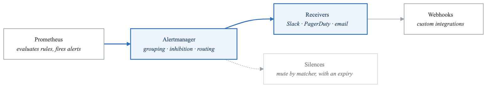
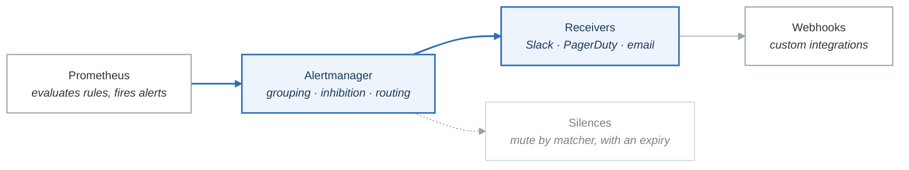

# Lab 03: Alertmanager Configuration

## Overview
Master Alertmanager routing, grouping, inhibition, and notification integrations for production-grade alerting workflows.

## Prerequisites
- Completed Labs 01-02
- Docker and Docker Compose
- Understanding of alerting concepts
- Slack workspace (optional) for notifications

## Learning Objectives
- Configure complex routing trees
- Implement alert grouping and deduplication
- Set up inhibition rules
- Create notification templates
- Integrate with multiple receivers

## Lab Environment

### Architecture
<!-- figure: generated from the Mermaid below by _shared/diagrams/embed-figures.py — do not edit the image -->


<details>
<summary>Diagram source (Mermaid)</summary>



</details>

### Extended docker-compose.yml
```yaml
version: '3.8'

services:
  alertmanager:
    image: prom/alertmanager:v0.26.0
    container_name: alertmanager
    ports:
      - "9093:9093"
    volumes:
      - ./alertmanager:/etc/alertmanager
      - alertmanager_data:/alertmanager
    command:
      - '--config.file=/etc/alertmanager/alertmanager.yml'
      - '--storage.path=/alertmanager'
      - '--web.external-url=http://localhost:9093'
      - '--cluster.listen-address='
    networks:
      - monitoring

  # Webhook receiver for testing
  webhook-receiver:
    image: python:3.11-slim
    container_name: webhook-receiver
    ports:
      - "5001:5001"
    volumes:
      - ./webhook-receiver:/app
    command: python /app/server.py
    networks:
      - monitoring

volumes:
  alertmanager_data:
```

### Initial Setup
```bash
# Create directories
mkdir -p alertmanager webhook-receiver

# Start services
docker-compose up -d alertmanager webhook-receiver

# Verify Alertmanager is running
curl -s http://localhost:9093/api/v2/status | jq '.cluster.status'
```

---

## Part 1: Guided Exercises

### Exercise 1.1: Basic Alertmanager Configuration

**Objective:** Configure Alertmanager with basic routing and receivers.

**Step 1:** Create initial configuration.

```yaml
# alertmanager/alertmanager.yml
global:
  # Global SMTP settings
  smtp_smarthost: 'smtp.gmail.com:587'
  smtp_from: 'alertmanager@example.com'
  smtp_auth_username: 'alerts@example.com'
  smtp_auth_password: 'app-password'

  # Global Slack settings
  slack_api_url: 'https://hooks.slack.com/services/xxx/yyy/zzz'

  # Resolution timeout
  resolve_timeout: 5m

# Templates for notifications
templates:
  - '/etc/alertmanager/templates/*.tmpl'

# Routing tree
route:
  # Default receiver
  receiver: 'default-receiver'

  # Group alerts by these labels
  group_by: ['alertname', 'service', 'severity']

  # Wait time before sending first notification
  group_wait: 30s

  # Wait time before sending updates
  group_interval: 5m

  # Repeat interval for ongoing alerts
  repeat_interval: 4h

  # Child routes (evaluated in order)
  routes:
    # Critical alerts - immediate notification
    - match:
        severity: critical
      receiver: 'critical-receiver'
      group_wait: 10s
      group_interval: 1m
      repeat_interval: 1h
      continue: false  # Stop processing on match

    # Warning alerts
    - match:
        severity: warning
      receiver: 'warning-receiver'
      group_wait: 1m
      group_interval: 5m
      repeat_interval: 4h

# Receivers define notification targets
receivers:
  - name: 'default-receiver'
    webhook_configs:
      - url: 'http://webhook-receiver:5001/webhook'
        send_resolved: true

  - name: 'critical-receiver'
    webhook_configs:
      - url: 'http://webhook-receiver:5001/webhook/critical'
        send_resolved: true
    # Uncomment for Slack
    # slack_configs:
    #   - channel: '#critical-alerts'
    #     send_resolved: true

  - name: 'warning-receiver'
    webhook_configs:
      - url: 'http://webhook-receiver:5001/webhook/warning'
        send_resolved: true

# Inhibition rules
inhibit_rules:
  # If critical alert fires, suppress warning for same service
  - source_match:
      severity: 'critical'
    target_match:
      severity: 'warning'
    equal: ['alertname', 'service']
```

**Step 2:** Create webhook receiver for testing.

```python
# webhook-receiver/server.py
from http.server import HTTPServer, BaseHTTPRequestHandler
import json
from datetime import datetime

class WebhookHandler(BaseHTTPRequestHandler):
    def do_POST(self):
        content_length = int(self.headers['Content-Length'])
        post_data = self.rfile.read(content_length)

        try:
            alerts = json.loads(post_data)

            print(f"\n{'='*60}")
            print(f"[{datetime.now().isoformat()}] Received webhook: {self.path}")
            print(f"{'='*60}")

            for alert in alerts.get('alerts', []):
                status = alert.get('status', 'unknown')
                labels = alert.get('labels', {})
                annotations = alert.get('annotations', {})

                print(f"\nAlert: {labels.get('alertname', 'N/A')}")
                print(f"  Status: {status}")
                print(f"  Severity: {labels.get('severity', 'N/A')}")
                print(f"  Service: {labels.get('service', 'N/A')}")
                print(f"  Summary: {annotations.get('summary', 'N/A')}")
                print(f"  Description: {annotations.get('description', 'N/A')}")

            print(f"\n{'='*60}\n")

        except Exception as e:
            print(f"Error processing webhook: {e}")

        self.send_response(200)
        self.send_header('Content-Type', 'application/json')
        self.end_headers()
        self.wfile.write(b'{"status": "ok"}')

    def log_message(self, format, *args):
        pass  # Suppress default logging

if __name__ == '__main__':
    server = HTTPServer(('0.0.0.0', 5001), WebhookHandler)
    print("Webhook receiver running on port 5001")
    server.serve_forever()
```

**Step 3:** Reload and verify configuration.

```bash
# Restart Alertmanager
docker-compose restart alertmanager

# Check configuration via API
curl -s http://localhost:9093/api/v2/status | jq '.config.original'

# View webhook receiver logs
docker-compose logs -f webhook-receiver
```

**Verification:**
- [ ] Alertmanager starts without errors
- [ ] Configuration visible in API
- [ ] Webhook receiver accepting connections

---

### Exercise 1.2: Update Prometheus for Alertmanager Integration

**Objective:** Configure Prometheus to send alerts to Alertmanager.

**Step 1:** Update Prometheus configuration.

```yaml
# prometheus/prometheus.yml
global:
  scrape_interval: 15s
  evaluation_interval: 15s

alerting:
  alertmanagers:
    - static_configs:
        - targets:
            - alertmanager:9093
      timeout: 10s
      api_version: v2

rule_files:
  - "rules/*.yml"

scrape_configs:
  - job_name: 'prometheus'
    static_configs:
      - targets: ['localhost:9090']

  - job_name: 'alertmanager'
    static_configs:
      - targets: ['alertmanager:9093']

  - job_name: 'webapp'
    static_configs:
      - targets: ['webapp:8080']

  - job_name: 'api'
    static_configs:
      - targets: ['api:8081']
```

**Step 2:** Create test alerting rules.

```yaml
# prometheus/rules/test_alerts.yml
groups:
  - name: test_alerts
    rules:
      # Always firing alert for testing
      - alert: TestAlertCritical
        expr: vector(1)
        for: 0m
        labels:
          severity: critical
          service: test-service
        annotations:
          summary: "Test critical alert"
          description: "This is a test critical alert for verification"

      - alert: TestAlertWarning
        expr: vector(1)
        for: 0m
        labels:
          severity: warning
          service: test-service
        annotations:
          summary: "Test warning alert"
          description: "This is a test warning alert for verification"
```

**Step 3:** Reload and verify alerts flow.

```bash
# Reload Prometheus
curl -X POST http://localhost:9090/-/reload

# Check alerts in Prometheus
curl -s http://localhost:9090/api/v1/alerts | jq '.data.alerts[] | {name: .labels.alertname, state: .state}'

# Check alerts in Alertmanager
curl -s http://localhost:9093/api/v2/alerts | jq '.[] | {name: .labels.alertname, status: .status.state}'
```

**Step 4:** Observe webhook notifications.

```bash
# Watch webhook receiver output
docker-compose logs -f webhook-receiver
```

**Expected Output:**
```
============================================================
[2024-01-15T10:30:00] Received webhook: /webhook/critical
============================================================

Alert: TestAlertCritical
  Status: firing
  Severity: critical
  Service: test-service
  Summary: Test critical alert
```

**Verification:**
- [ ] Alerts appear in Prometheus UI
- [ ] Alerts forwarded to Alertmanager
- [ ] Webhook receives notifications
- [ ] Inhibition suppresses warning (same service as critical)

---

### Exercise 1.3: Advanced Routing Configuration

**Objective:** Implement complex routing based on multiple labels.

**Step 1:** Update configuration with team-based routing.

```yaml
# alertmanager/alertmanager.yml
global:
  resolve_timeout: 5m

route:
  receiver: 'default-receiver'
  group_by: ['alertname', 'service']
  group_wait: 30s
  group_interval: 5m
  repeat_interval: 4h

  routes:
    # Platform team alerts
    - match:
        team: platform
      receiver: 'platform-team'
      routes:
        - match:
            severity: critical
          receiver: 'platform-critical'
          group_wait: 10s
        - match:
            severity: warning
          receiver: 'platform-warning'

    # Application team alerts
    - match:
        team: application
      receiver: 'application-team'
      routes:
        - match:
            severity: critical
          receiver: 'application-critical'

    # Database alerts - regex matching
    - match_re:
        service: '.*-db$'
      receiver: 'database-team'
      group_by: ['alertname', 'service', 'instance']

    # Time-based routing (business hours)
    - match:
        severity: warning
      receiver: 'business-hours'
      active_time_intervals:
        - business-hours
      continue: true  # Continue to next route

    # After-hours escalation
    - match:
        severity: critical
      receiver: 'on-call-pager'

# Time intervals for routing
time_intervals:
  - name: business-hours
    time_intervals:
      - weekdays: ['monday:friday']
        times:
          - start_time: '09:00'
            end_time: '17:00'
        location: 'America/New_York'

receivers:
  - name: 'default-receiver'
    webhook_configs:
      - url: 'http://webhook-receiver:5001/webhook/default'

  - name: 'platform-team'
    webhook_configs:
      - url: 'http://webhook-receiver:5001/webhook/platform'

  - name: 'platform-critical'
    webhook_configs:
      - url: 'http://webhook-receiver:5001/webhook/platform/critical'

  - name: 'platform-warning'
    webhook_configs:
      - url: 'http://webhook-receiver:5001/webhook/platform/warning'

  - name: 'application-team'
    webhook_configs:
      - url: 'http://webhook-receiver:5001/webhook/application'

  - name: 'application-critical'
    webhook_configs:
      - url: 'http://webhook-receiver:5001/webhook/application/critical'

  - name: 'database-team'
    webhook_configs:
      - url: 'http://webhook-receiver:5001/webhook/database'

  - name: 'business-hours'
    webhook_configs:
      - url: 'http://webhook-receiver:5001/webhook/business-hours'

  - name: 'on-call-pager'
    webhook_configs:
      - url: 'http://webhook-receiver:5001/webhook/oncall'
```

**Step 2:** Create team-based alert rules.

```yaml
# prometheus/rules/team_alerts.yml
groups:
  - name: platform_team_alerts
    rules:
      - alert: PlatformHighCPU
        expr: node:cpu_usage:5m > 80
        for: 5m
        labels:
          severity: warning
          team: platform
          service: infrastructure
        annotations:
          summary: "High CPU usage on platform infrastructure"

      - alert: PlatformDiskCritical
        expr: node:disk_usage:percentage > 90
        for: 2m
        labels:
          severity: critical
          team: platform
          service: infrastructure
        annotations:
          summary: "Critical disk space on platform infrastructure"

  - name: application_team_alerts
    rules:
      - alert: AppHighErrorRate
        expr: api:error_rate:5m > 0.05
        for: 5m
        labels:
          severity: warning
          team: application
          service: api
        annotations:
          summary: "High error rate in application API"

      - alert: AppServiceDown
        expr: up{job="api"} == 0
        for: 1m
        labels:
          severity: critical
          team: application
          service: api
        annotations:
          summary: "Application API service is down"

  - name: database_alerts
    rules:
      - alert: DatabaseConnectionPoolExhausted
        expr: database_connections_active / database_connections_max > 0.9
        for: 5m
        labels:
          severity: critical
          service: postgres-db
        annotations:
          summary: "Database connection pool nearly exhausted"
```

**Step 3:** Test routing behavior.

```bash
# Send test alert for platform team
curl -X POST http://localhost:9093/api/v2/alerts \
  -H "Content-Type: application/json" \
  -d '[{
    "labels": {
      "alertname": "TestPlatformAlert",
      "severity": "critical",
      "team": "platform"
    },
    "annotations": {
      "summary": "Test platform critical alert"
    }
  }]'

# Send test alert for application team
curl -X POST http://localhost:9093/api/v2/alerts \
  -H "Content-Type: application/json" \
  -d '[{
    "labels": {
      "alertname": "TestAppAlert",
      "severity": "warning",
      "team": "application"
    },
    "annotations": {
      "summary": "Test application warning alert"
    }
  }]'

# Send test alert for database
curl -X POST http://localhost:9093/api/v2/alerts \
  -H "Content-Type: application/json" \
  -d '[{
    "labels": {
      "alertname": "TestDBAlert",
      "severity": "critical",
      "service": "postgres-db"
    },
    "annotations": {
      "summary": "Test database alert"
    }
  }]'
```

**Verification:**
- [ ] Platform alerts route to platform receivers
- [ ] Application alerts route to application receivers
- [ ] Database alerts (matching regex) route to database team
- [ ] Routing tree visible in Alertmanager UI

---

### Exercise 1.4: Notification Templates

**Objective:** Create custom notification templates for different receivers.

**Step 1:** Create templates directory and files.

```bash
mkdir -p alertmanager/templates
```

```tmpl
{{/* alertmanager/templates/slack.tmpl */}}

{{ define "slack.default.title" -}}
[{{ .Status | toUpper }}{{ if eq .Status "firing" }}:{{ .Alerts.Firing | len }}{{ end }}] {{ .CommonLabels.alertname }}
{{- end }}

{{ define "slack.default.text" -}}
{{ range .Alerts }}
*Alert:* {{ .Labels.alertname }}
*Severity:* {{ .Labels.severity }}
*Status:* {{ .Status }}
{{ if .Labels.service }}*Service:* {{ .Labels.service }}{{ end }}
{{ if .Labels.instance }}*Instance:* {{ .Labels.instance }}{{ end }}

*Summary:* {{ .Annotations.summary }}
*Description:* {{ .Annotations.description }}

*Started:* {{ .StartsAt.Format "2006-01-02 15:04:05 MST" }}
{{ if eq .Status "resolved" }}*Resolved:* {{ .EndsAt.Format "2006-01-02 15:04:05 MST" }}{{ end }}

{{ if .Annotations.runbook_url }}:book: <{{ .Annotations.runbook_url }}|Runbook>{{ end }}
{{ if .GeneratorURL }}:chart_with_upwards_trend: <{{ .GeneratorURL }}|Source>{{ end }}
---
{{ end }}
{{- end }}

{{ define "slack.critical.title" -}}
:rotating_light: CRITICAL: {{ .CommonLabels.alertname }}
{{- end }}

{{ define "slack.critical.text" -}}
*IMMEDIATE ACTION REQUIRED*

{{ range .Alerts }}
:fire: *{{ .Labels.alertname }}* on {{ .Labels.service | default "unknown service" }}

*What's happening:*
{{ .Annotations.description }}

*Impact:*
{{ .Annotations.impact | default "Unknown impact" }}

*Runbook:* {{ .Annotations.runbook_url | default "No runbook available" }}

*Time:* {{ .StartsAt.Format "15:04:05 MST" }}
{{ end }}
{{- end }}
```

```tmpl
{{/* alertmanager/templates/email.tmpl */}}

{{ define "email.default.subject" -}}
[{{ .Status | toUpper }}] {{ .CommonLabels.alertname }} - {{ .CommonLabels.service }}
{{- end }}

{{ define "email.default.html" -}}
<!DOCTYPE html>
<html>
<head>
  <style>
    body { font-family: Arial, sans-serif; margin: 0; padding: 20px; }
    .alert { border-left: 4px solid #ccc; padding: 10px; margin: 10px 0; }
    .critical { border-color: #dc3545; background: #f8d7da; }
    .warning { border-color: #ffc107; background: #fff3cd; }
    .resolved { border-color: #28a745; background: #d4edda; }
    .label { display: inline-block; padding: 2px 8px; border-radius: 4px; font-size: 12px; }
    .label-critical { background: #dc3545; color: white; }
    .label-warning { background: #ffc107; color: black; }
    table { border-collapse: collapse; width: 100%; }
    th, td { border: 1px solid #ddd; padding: 8px; text-align: left; }
    th { background-color: #f2f2f2; }
  </style>
</head>
<body>
  <h2>Alertmanager Notification</h2>
  <p>Status: <strong>{{ .Status | toUpper }}</strong></p>
  <p>Group: {{ .CommonLabels.alertname }}</p>

  <h3>Alerts ({{ .Alerts | len }})</h3>
  {{ range .Alerts }}
  <div class="alert {{ .Labels.severity }}">
    <h4>{{ .Labels.alertname }}</h4>
    <p><span class="label label-{{ .Labels.severity }}">{{ .Labels.severity }}</span></p>

    <table>
      <tr><th>Field</th><th>Value</th></tr>
      <tr><td>Status</td><td>{{ .Status }}</td></tr>
      <tr><td>Service</td><td>{{ .Labels.service }}</td></tr>
      <tr><td>Instance</td><td>{{ .Labels.instance }}</td></tr>
      <tr><td>Started</td><td>{{ .StartsAt.Format "2006-01-02 15:04:05 MST" }}</td></tr>
      {{ if eq .Status "resolved" }}
      <tr><td>Resolved</td><td>{{ .EndsAt.Format "2006-01-02 15:04:05 MST" }}</td></tr>
      {{ end }}
    </table>

    <h5>Summary</h5>
    <p>{{ .Annotations.summary }}</p>

    <h5>Description</h5>
    <p>{{ .Annotations.description }}</p>

    {{ if .Annotations.runbook_url }}
    <p><a href="{{ .Annotations.runbook_url }}">View Runbook</a></p>
    {{ end }}
  </div>
  {{ end }}

  <hr>
  <p><small>Sent by Alertmanager at {{ .ExternalURL }}</small></p>
</body>
</html>
{{- end }}
```

```tmpl
{{/* alertmanager/templates/pagerduty.tmpl */}}

{{ define "pagerduty.default.description" -}}
{{ .CommonAnnotations.summary }}
{{- end }}

{{ define "pagerduty.default.client" -}}
Alertmanager
{{- end }}

{{ define "pagerduty.default.client_url" -}}
{{ .ExternalURL }}
{{- end }}

{{ define "pagerduty.default.instances" -}}
{{ range .Alerts }}{{ .Labels.instance }} {{ end }}
{{- end }}
```

**Step 2:** Update Alertmanager to use templates.

```yaml
# alertmanager/alertmanager.yml (updated)
global:
  resolve_timeout: 5m
  slack_api_url: 'https://hooks.slack.com/services/xxx'

templates:
  - '/etc/alertmanager/templates/*.tmpl'

route:
  receiver: 'default-receiver'
  group_by: ['alertname', 'service']
  routes:
    - match:
        severity: critical
      receiver: 'slack-critical'

receivers:
  - name: 'default-receiver'
    webhook_configs:
      - url: 'http://webhook-receiver:5001/webhook'

  - name: 'slack-critical'
    slack_configs:
      - channel: '#critical-alerts'
        send_resolved: true
        title: '{{ template "slack.critical.title" . }}'
        text: '{{ template "slack.critical.text" . }}'
        color: '{{ if eq .Status "firing" }}danger{{ else }}good{{ end }}'
        actions:
          - type: button
            text: 'Runbook :book:'
            url: '{{ (index .Alerts 0).Annotations.runbook_url }}'
          - type: button
            text: 'Silence :mute:'
            url: '{{ .ExternalURL }}/#/silences/new?filter=%7Balertname%3D%22{{ .CommonLabels.alertname }}%22%7D'
```

**Step 3:** Reload and test templates.

```bash
# Restart Alertmanager
docker-compose restart alertmanager

# Send test alert
curl -X POST http://localhost:9093/api/v2/alerts \
  -H "Content-Type: application/json" \
  -d '[{
    "labels": {
      "alertname": "TemplateTest",
      "severity": "critical",
      "service": "payment-api",
      "instance": "payment-01"
    },
    "annotations": {
      "summary": "Payment API experiencing high latency",
      "description": "P99 latency has exceeded 2 seconds for the past 5 minutes",
      "runbook_url": "https://wiki.example.com/runbooks/payment-latency"
    }
  }]'
```

**Verification:**
- [ ] Templates render correctly in webhook output
- [ ] Variables substitute properly
- [ ] Conditional blocks work (resolved vs firing)

---

### Exercise 1.5: Silences and Maintenance Windows

**Objective:** Manage alert silences for maintenance and known issues.

**Step 1:** Create a silence via API.

```bash
# Calculate timestamps (2 hour window)
START_TIME=$(date -u +"%Y-%m-%dT%H:%M:%SZ")
END_TIME=$(date -u -v+2H +"%Y-%m-%dT%H:%M:%SZ" 2>/dev/null || date -u -d "+2 hours" +"%Y-%m-%dT%H:%M:%SZ")

# Create silence
curl -X POST http://localhost:9093/api/v2/silences \
  -H "Content-Type: application/json" \
  -d '{
    "matchers": [
      {
        "name": "alertname",
        "value": "HighCPUUsage",
        "isRegex": false,
        "isEqual": true
      },
      {
        "name": "instance",
        "value": "web-01",
        "isRegex": false,
        "isEqual": true
      }
    ],
    "startsAt": "'"$START_TIME"'",
    "endsAt": "'"$END_TIME"'",
    "createdBy": "admin@example.com",
    "comment": "Scheduled maintenance - CPU upgrade"
  }'
```

**Step 2:** List active silences.

```bash
# Get all silences
curl -s http://localhost:9093/api/v2/silences | jq '.[] | {id: .id, status: .status.state, matchers: .matchers, comment: .comment}'
```

**Step 3:** Create regex-based silence.

```bash
# Silence all alerts for a service pattern
curl -X POST http://localhost:9093/api/v2/silences \
  -H "Content-Type: application/json" \
  -d '{
    "matchers": [
      {
        "name": "service",
        "value": "legacy-.*",
        "isRegex": true,
        "isEqual": true
      }
    ],
    "startsAt": "'"$START_TIME"'",
    "endsAt": "'"$END_TIME"'",
    "createdBy": "admin@example.com",
    "comment": "Legacy services scheduled for decommission"
  }'
```

**Step 4:** Delete a silence.

```bash
# Get silence ID
SILENCE_ID=$(curl -s http://localhost:9093/api/v2/silences | jq -r '.[0].id')

# Delete silence
curl -X DELETE "http://localhost:9093/api/v2/silence/$SILENCE_ID"

# Verify deletion
curl -s http://localhost:9093/api/v2/silences | jq 'length'
```

**Step 5:** Create maintenance window script.

```bash
#!/bin/bash
# maintenance-window.sh

ACTION=${1:-start}
DURATION=${2:-2h}
SERVICE=$3
COMMENT=$4

ALERTMANAGER_URL="http://localhost:9093"

case $ACTION in
  start)
    if [ -z "$SERVICE" ]; then
      echo "Usage: $0 start <duration> <service> <comment>"
      exit 1
    fi

    START_TIME=$(date -u +"%Y-%m-%dT%H:%M:%SZ")
    # Convert duration to seconds and add to current time
    case $DURATION in
      *h) SECONDS=$((${DURATION%h} * 3600)) ;;
      *m) SECONDS=$((${DURATION%m} * 60)) ;;
      *)  SECONDS=$DURATION ;;
    esac
    END_TIME=$(date -u -v+${SECONDS}S +"%Y-%m-%dT%H:%M:%SZ" 2>/dev/null || date -u -d "+$SECONDS seconds" +"%Y-%m-%dT%H:%M:%SZ")

    RESPONSE=$(curl -s -X POST "$ALERTMANAGER_URL/api/v2/silences" \
      -H "Content-Type: application/json" \
      -d '{
        "matchers": [{"name": "service", "value": "'"$SERVICE"'", "isRegex": false, "isEqual": true}],
        "startsAt": "'"$START_TIME"'",
        "endsAt": "'"$END_TIME"'",
        "createdBy": "'"$(whoami)"'",
        "comment": "'"${COMMENT:-Maintenance window}"'"
      }')

    SILENCE_ID=$(echo $RESPONSE | jq -r '.silenceID')
    echo "Created silence: $SILENCE_ID"
    echo "Maintenance window active until: $END_TIME"
    ;;

  list)
    curl -s "$ALERTMANAGER_URL/api/v2/silences" | jq '.[] | select(.status.state == "active") | {id: .id, service: .matchers[0].value, endsAt: .endsAt, comment: .comment}'
    ;;

  stop)
    SILENCE_ID=$2
    if [ -z "$SILENCE_ID" ]; then
      echo "Usage: $0 stop <silence_id>"
      exit 1
    fi
    curl -s -X DELETE "$ALERTMANAGER_URL/api/v2/silence/$SILENCE_ID"
    echo "Deleted silence: $SILENCE_ID"
    ;;

  *)
    echo "Usage: $0 {start|list|stop}"
    exit 1
    ;;
esac
```

**Verification:**
- [ ] Silences created and visible in UI
- [ ] Matching alerts are silenced
- [ ] Silences can be deleted
- [ ] Maintenance script works correctly

---

## Part 2: Semi-Guided Exercises

### Exercise 2.1: Multi-Receiver Notification

**Objective:** Configure alerts to notify multiple receivers simultaneously.

**Requirements:**
1. Send critical alerts to Slack AND PagerDuty
2. Send warning alerts to Slack AND email
3. Implement fallback receivers for failures
4. Add retry configuration

**Hints:**
- Use `continue: true` in routes
- Configure `send_resolved` per receiver
- Use `http_config` for custom timeout/retry

**Expected Deliverables:**
- [ ] Multi-receiver route configuration
- [ ] Retry configuration for each receiver
- [ ] Verification of dual notification

---

### Exercise 2.2: Alert Deduplication Strategy

**Objective:** Implement intelligent alert deduplication and grouping.

**Requirements:**
1. Group related alerts to reduce noise
2. Deduplicate across similar services
3. Create aggregation rules for mass failures
4. Implement rate limiting per receiver

**Hints:**
- `group_by` controls grouping labels
- Consider grouping by cluster/datacenter
- External labels can differentiate sources

**Expected Deliverables:**
- [ ] Custom grouping configuration
- [ ] Documentation of deduplication strategy
- [ ] Test scenarios demonstrating reduction

---

### Exercise 2.3: Alert Escalation Chain

**Objective:** Build a tiered escalation system for unacknowledged alerts.

**Requirements:**
1. Level 1: Notify on-call engineer (immediate)
2. Level 2: Notify team lead (after 15 min)
3. Level 3: Notify manager (after 30 min)
4. Track acknowledgment status

**Hints:**
- Multiple routes with different repeat intervals
- Webhook can track acknowledgment
- Consider using external escalation manager

**Expected Deliverables:**
- [ ] Three-tier escalation configuration
- [ ] Acknowledgment webhook handler
- [ ] Documentation of escalation flow

---

### Exercise 2.4: Geographic-Based Routing

**Objective:** Route alerts based on geographic region and follow-the-sun support.

**Requirements:**
1. Route to region-specific teams
2. Implement follow-the-sun during business hours
3. Route to global on-call after hours
4. Handle regional failover

**Hints:**
- Use time intervals for regional routing
- Labels should include region information
- Consider timezone handling

**Expected Deliverables:**
- [ ] Regional routing configuration
- [ ] Business hours configuration per region
- [ ] Global fallback configuration

---

## Part 3: Challenge Exercises

### Challenge 3.1: Intelligent Alert Correlation

**Objective:** Implement alert correlation to identify root causes.

**Scenario:**
When multiple services fail simultaneously, operators receive floods of alerts. You need to correlate related alerts and identify the root cause.

**Requirements:**
1. Detect when multiple related alerts fire together
2. Identify likely root cause alerts
3. Create aggregated notifications with context
4. Suppress symptom alerts when cause is known

**Constraints:**
- Use only Alertmanager configuration (no external systems)
- Must work with existing alert labels
- Correlation window of 2 minutes

**Success Criteria:**
- [ ] Related alerts grouped into single notification
- [ ] Root cause clearly identified in notification
- [ ] Symptom alerts suppressed via inhibition
- [ ] Documentation of correlation logic

---

### Challenge 3.2: Custom Notification Gateway

**Objective:** Build a custom notification gateway with enrichment.

**Scenario:**
Notifications need enrichment with:
- Service owner information from CMDB
- Current deployment status
- Related incident tickets
- Historical alert frequency

**Requirements:**
1. Create webhook receiver that enriches alerts
2. Integrate with mock CMDB API
3. Add deployment status from mock CI/CD
4. Include alert history statistics

**Constraints:**
- Gateway must respond within 5 seconds
- Must handle 100 alerts/minute
- Graceful degradation if enrichment fails

**Success Criteria:**
- [ ] Custom webhook receiver deployed
- [ ] Enrichment visible in final notifications
- [ ] Fallback for enrichment failures
- [ ] Performance metrics collected

---

### Challenge 3.3: Multi-Cluster Alertmanager HA

**Objective:** Deploy high-availability Alertmanager across multiple clusters.

**Scenario:**
Your organization runs alerts across three Kubernetes clusters. You need:
- Deduplicated alerts across clusters
- No single point of failure
- Consistent silence management
- Geographic redundancy

**Requirements:**
1. Deploy Alertmanager cluster with 3 nodes
2. Configure mesh networking
3. Implement cross-cluster silence sync
4. Create failover testing procedures

**Constraints:**
- Must survive loss of any single node
- Notification delivery guarantee
- Sub-minute failover time

**Success Criteria:**
- [ ] Three-node Alertmanager cluster running
- [ ] Silences synchronized across nodes
- [ ] Failover tested and documented
- [ ] Split-brain scenario handled

---

## Cleanup

```bash
# Remove test alerts
curl -s http://localhost:9093/api/v2/alerts | jq -r '.[].fingerprint' | while read fp; do
  curl -X DELETE "http://localhost:9093/api/v2/alert/$fp"
done

# Remove silences
curl -s http://localhost:9093/api/v2/silences | jq -r '.[].id' | while read id; do
  curl -X DELETE "http://localhost:9093/api/v2/silence/$id"
done

# Stop services
docker-compose down
```

## Additional Resources

- [Alertmanager Documentation](https://prometheus.io/docs/alerting/latest/alertmanager/)
- [Alertmanager Configuration](https://prometheus.io/docs/alerting/latest/configuration/)
- [Notification Templates](https://prometheus.io/docs/alerting/latest/notification_examples/)
- [Routing Tree Visualization](https://prometheus.io/webtools/alerting/routing-tree-editor/)

## Next Lab
Continue to [Lab 04: Logging with ELK](../lab-04-logging-elk/README.md) to implement centralized logging.

<!-- feynman-check -->

---

## Feynman check

Close the file. Blank page, no notes. Explain each of these to a competent engineer who has never
used this tool — **under five minutes, no jargon you can't define on the spot:**

- Extended docker-compose.yml
- 1: Basic Alertmanager Configuration
- 2: Update Prometheus for Alertmanager Integration
- 3: Advanced Routing Configuration

**The gap is not what you forgot. It is where you used a word instead of a mechanism.**

| | |
|---|---|
| ✗ | *"Prometheus monitors the service."* |
| ✓ | *"Prometheus discovers targets from the Kubernetes API, applies relabelling rules, scrapes `/metrics` over HTTP on an interval, and appends samples to a local TSDB. Nothing is pushed — so a target missing from a dashboard is a service-discovery problem, not an application one."* |

**Trace it:** A latency regression → a phone ringing. Name each hop: sample, rule evaluation, alert state transition, routing, notification — and where each one can silently stop.

Stop at the first component you cannot name. Reopen this file and read **only** that.

**Go deeper — only once the gap has a name:** [SRE Workbook ch. 5, *Alerting on SLOs*](https://sre.google/workbook/alerting-on-slos/) — free, and the best thing written on why static thresholds page you for nothing.
Full list per domain: [`SOURCES.md`](../SOURCES.md#observability-sre)

→ Protocol, the three levels of knowing, and worked examples: [`MASTERY.md`](../MASTERY.md)

<!-- /feynman-check -->
