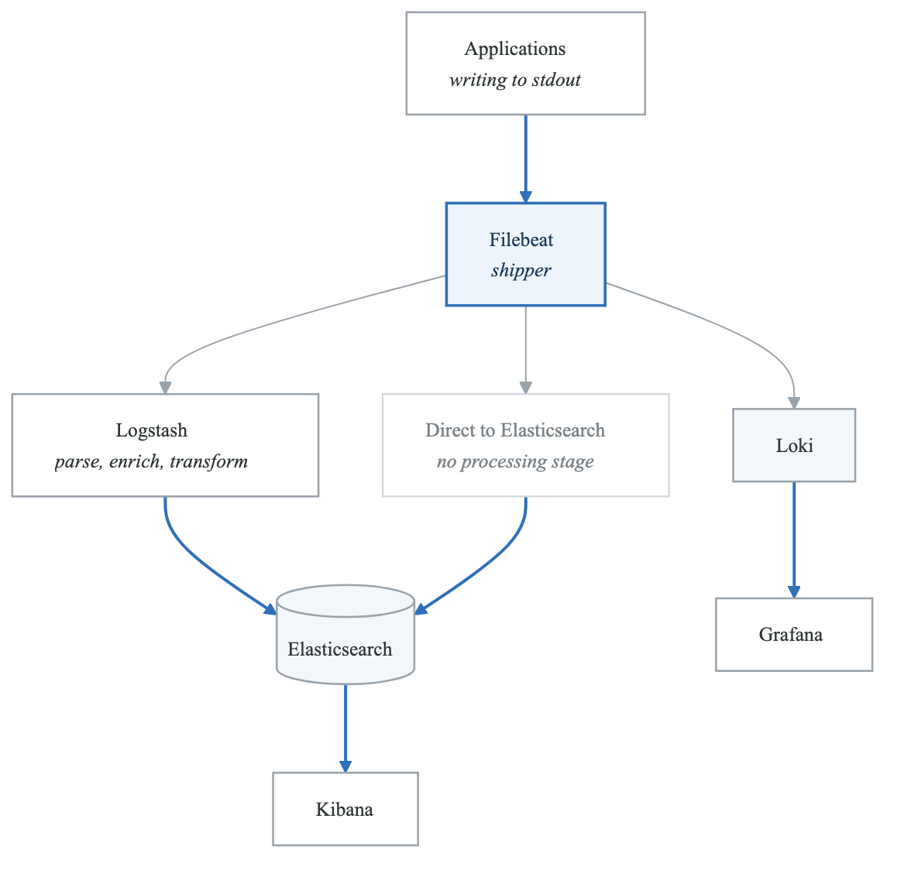
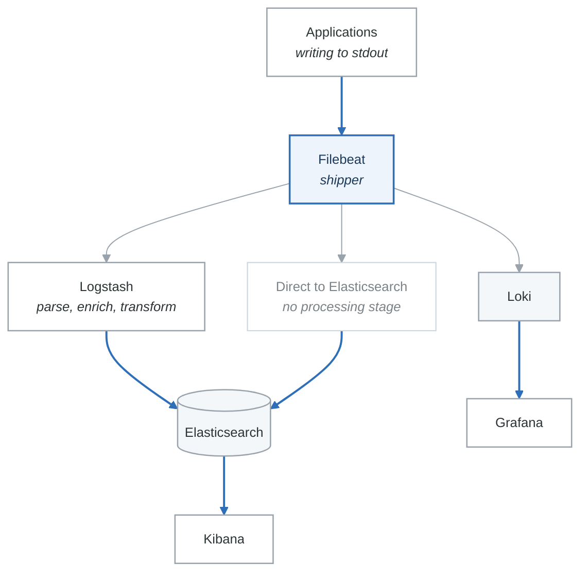

# Lab 04: Centralized Logging with ELK and Loki

## Overview
Implement centralized logging using both the ELK Stack (Elasticsearch, Logstash, Kibana) and Grafana Loki for comprehensive log management.

## Prerequisites
- Docker and Docker Compose
- At least 8GB RAM available
- Understanding of logging concepts
- Basic Kubernetes knowledge (for Loki section)

## Learning Objectives
- Deploy and configure the ELK Stack
- Create Logstash parsing pipelines
- Build Kibana dashboards and searches
- Deploy Grafana Loki for efficient logging
- Write effective log queries (KQL and LogQL)

## Lab Environment

### Architecture
<!-- figure: generated from the Mermaid below by _shared/diagrams/embed-figures.py — do not edit the image -->


<details>
<summary>Diagram source (Mermaid)</summary>



</details>

### docker-compose.yml
```yaml
version: '3.8'

services:
  elasticsearch:
    image: docker.elastic.co/elasticsearch/elasticsearch:8.11.0
    container_name: elasticsearch
    environment:
      - discovery.type=single-node
      - xpack.security.enabled=false
      - "ES_JAVA_OPTS=-Xms1g -Xmx1g"
      - cluster.name=logging-cluster
    ports:
      - "9200:9200"
    volumes:
      - elasticsearch_data:/usr/share/elasticsearch/data
    networks:
      - logging
    healthcheck:
      test: ["CMD-SHELL", "curl -s http://localhost:9200/_cluster/health | grep -E '(green|yellow)'"]
      interval: 30s
      timeout: 10s
      retries: 5

  logstash:
    image: docker.elastic.co/logstash/logstash:8.11.0
    container_name: logstash
    volumes:
      - ./logstash/pipeline:/usr/share/logstash/pipeline
      - ./logstash/config:/usr/share/logstash/config
    ports:
      - "5044:5044"
      - "9600:9600"
    environment:
      - "LS_JAVA_OPTS=-Xms512m -Xmx512m"
    depends_on:
      elasticsearch:
        condition: service_healthy
    networks:
      - logging

  kibana:
    image: docker.elastic.co/kibana/kibana:8.11.0
    container_name: kibana
    ports:
      - "5601:5601"
    environment:
      - ELASTICSEARCH_HOSTS=http://elasticsearch:9200
    depends_on:
      elasticsearch:
        condition: service_healthy
    networks:
      - logging

  filebeat:
    image: docker.elastic.co/beats/filebeat:8.11.0
    container_name: filebeat
    user: root
    volumes:
      - ./filebeat/filebeat.yml:/usr/share/filebeat/filebeat.yml:ro
      - /var/lib/docker/containers:/var/lib/docker/containers:ro
      - /var/run/docker.sock:/var/run/docker.sock:ro
      - filebeat_data:/usr/share/filebeat/data
    command: filebeat -e -strict.perms=false
    depends_on:
      - logstash
    networks:
      - logging

  # Loki stack
  loki:
    image: grafana/loki:2.9.0
    container_name: loki
    ports:
      - "3100:3100"
    volumes:
      - ./loki/loki-config.yml:/etc/loki/local-config.yaml
      - loki_data:/loki
    command: -config.file=/etc/loki/local-config.yaml
    networks:
      - logging

  promtail:
    image: grafana/promtail:2.9.0
    container_name: promtail
    volumes:
      - ./promtail/promtail-config.yml:/etc/promtail/config.yml
      - /var/lib/docker/containers:/var/lib/docker/containers:ro
      - /var/run/docker.sock:/var/run/docker.sock:ro
    command: -config.file=/etc/promtail/config.yml
    depends_on:
      - loki
    networks:
      - logging

  grafana:
    image: grafana/grafana:10.0.0
    container_name: grafana
    ports:
      - "3000:3000"
    environment:
      - GF_SECURITY_ADMIN_PASSWORD=admin
    volumes:
      - grafana_data:/var/lib/grafana
      - ./grafana/provisioning:/etc/grafana/provisioning
    networks:
      - logging

  # Sample application for logs
  webapp:
    build: ./apps/webapp
    container_name: webapp
    ports:
      - "8080:8080"
    labels:
      - "logging=true"
      - "service=webapp"
    networks:
      - logging

volumes:
  elasticsearch_data:
  filebeat_data:
  loki_data:
  grafana_data:

networks:
  logging:
    driver: bridge
```

### Initial Setup
```bash
# Create directories
mkdir -p logstash/{pipeline,config} filebeat loki promtail grafana/provisioning/datasources apps/webapp

# Start services
docker-compose up -d

# Wait for services to be healthy
sleep 60

# Verify Elasticsearch
curl -s http://localhost:9200/_cluster/health | jq

# Verify Loki
curl -s http://localhost:3100/ready
```

---

## Part 1: Guided Exercises

### Exercise 1.1: ELK Stack Configuration

**Objective:** Configure Elasticsearch, Logstash, and Kibana for log ingestion.

**Step 1:** Create Logstash configuration.

```ruby
# logstash/config/logstash.yml
http.host: "0.0.0.0"
xpack.monitoring.enabled: false
pipeline.workers: 2
pipeline.batch.size: 125
```

```ruby
# logstash/pipeline/main.conf
input {
  beats {
    port => 5044
    tags => ["filebeat"]
  }

  tcp {
    port => 5000
    codec => json_lines
    tags => ["tcp-json"]
  }
}

filter {
  # Parse Docker container logs
  if [container][name] {
    mutate {
      add_field => { "service" => "%{[container][name]}" }
    }
  }

  # Parse JSON logs
  if [message] =~ /^\{.*\}$/ {
    json {
      source => "message"
      target => "parsed"
      skip_on_invalid_json => true
    }

    if [parsed] {
      mutate {
        rename => {
          "[parsed][level]" => "log_level"
          "[parsed][msg]" => "log_message"
          "[parsed][timestamp]" => "log_timestamp"
          "[parsed][trace_id]" => "trace_id"
          "[parsed][span_id]" => "span_id"
        }
      }
    }
  }

  # Parse Apache/Nginx access logs
  if [service] == "nginx" or [log][file][path] =~ /access/ {
    grok {
      match => {
        "message" => '%{IPORHOST:client_ip} - %{DATA:user} \[%{HTTPDATE:timestamp}\] "%{WORD:method} %{URIPATHPARAM:request} HTTP/%{NUMBER:http_version}" %{NUMBER:status:int} %{NUMBER:bytes:int} "%{DATA:referrer}" "%{DATA:user_agent}"'
      }
      tag_on_failure => ["_grokparsefailure_access"]
    }

    date {
      match => ["timestamp", "dd/MMM/yyyy:HH:mm:ss Z"]
      target => "@timestamp"
    }

    geoip {
      source => "client_ip"
      target => "geoip"
    }

    useragent {
      source => "user_agent"
      target => "user_agent_parsed"
    }
  }

  # Parse application error logs
  if [log_level] == "error" or [log_level] == "ERROR" {
    mutate {
      add_tag => ["error"]
    }

    # Extract stack trace if present
    if [message] =~ /(?m)^\s+at\s+/ {
      grok {
        match => {
          "message" => "(?m)%{GREEDYDATA:error_message}\n%{GREEDYDATA:stack_trace}"
        }
        tag_on_failure => ["_grokparsefailure_stacktrace"]
      }
    }
  }

  # Normalize log levels
  if [log_level] {
    mutate {
      lowercase => ["log_level"]
    }
  }

  # Add processing metadata
  mutate {
    add_field => {
      "[@metadata][index_prefix]" => "logs"
      "processed_at" => "%{+YYYY-MM-dd'T'HH:mm:ss.SSSZ}"
    }
  }

  # Route to different indices based on content
  if "error" in [tags] {
    mutate {
      update => { "[@metadata][index_prefix]" => "logs-errors" }
    }
  } else if [service] == "nginx" {
    mutate {
      update => { "[@metadata][index_prefix]" => "logs-access" }
    }
  }
}

output {
  elasticsearch {
    hosts => ["elasticsearch:9200"]
    index => "%{[@metadata][index_prefix]}-%{+YYYY.MM.dd}"
    manage_template => true
    template_name => "logs"
    template_overwrite => true
  }

  # Debug output (disable in production)
  # stdout { codec => rubydebug }
}
```

**Step 2:** Create Filebeat configuration.

```yaml
# filebeat/filebeat.yml
filebeat.inputs:
  # Docker container logs
  - type: container
    paths:
      - '/var/lib/docker/containers/*/*.log'
    processors:
      - add_docker_metadata:
          host: "unix:///var/run/docker.sock"

  # Application log files
  - type: log
    enabled: true
    paths:
      - /var/log/apps/*.log
    multiline:
      pattern: '^\d{4}-\d{2}-\d{2}'
      negate: true
      match: after
    fields:
      log_type: application

output.logstash:
  hosts: ["logstash:5044"]

logging.level: info
logging.to_files: true
logging.files:
  path: /var/log/filebeat
  name: filebeat
  keepfiles: 7
  permissions: 0644
```

**Step 3:** Create sample application with structured logging.

```python
# apps/webapp/app.py
import logging
import json
import sys
import uuid
import time
import random
from datetime import datetime
from flask import Flask, request, g

# Custom JSON formatter
class JSONFormatter(logging.Formatter):
    def format(self, record):
        log_record = {
            "timestamp": datetime.utcnow().isoformat() + "Z",
            "level": record.levelname,
            "logger": record.name,
            "msg": record.getMessage(),
            "module": record.module,
            "function": record.funcName,
            "line": record.lineno
        }

        # Add trace context if available
        if hasattr(record, 'trace_id'):
            log_record['trace_id'] = record.trace_id
        if hasattr(record, 'span_id'):
            log_record['span_id'] = record.span_id
        if hasattr(record, 'request_id'):
            log_record['request_id'] = record.request_id

        # Add extra fields
        if hasattr(record, 'extra_fields'):
            log_record.update(record.extra_fields)

        # Add exception info
        if record.exc_info:
            log_record['exception'] = self.formatException(record.exc_info)

        return json.dumps(log_record)

# Configure logging
handler = logging.StreamHandler(sys.stdout)
handler.setFormatter(JSONFormatter())
logging.basicConfig(level=logging.INFO, handlers=[handler])
logger = logging.getLogger(__name__)

app = Flask(__name__)

@app.before_request
def before_request():
    g.request_id = request.headers.get('X-Request-ID', str(uuid.uuid4()))
    g.start_time = time.time()
    logger.info(
        "Request started",
        extra={
            'extra_fields': {
                'request_id': g.request_id,
                'method': request.method,
                'path': request.path,
                'remote_addr': request.remote_addr
            }
        }
    )

@app.after_request
def after_request(response):
    duration = time.time() - g.start_time
    logger.info(
        "Request completed",
        extra={
            'extra_fields': {
                'request_id': g.request_id,
                'method': request.method,
                'path': request.path,
                'status': response.status_code,
                'duration_ms': round(duration * 1000, 2)
            }
        }
    )
    return response

@app.route('/')
def home():
    return {"message": "Hello World"}

@app.route('/api/users')
def get_users():
    # Simulate some processing
    time.sleep(random.uniform(0.01, 0.1))
    logger.info("Fetched users", extra={'extra_fields': {'user_count': 10}})
    return {"users": ["alice", "bob", "charlie"]}

@app.route('/api/error')
def error_endpoint():
    logger.error("Intentional error triggered", extra={
        'extra_fields': {
            'error_code': 'TEST_ERROR',
            'request_id': g.request_id
        }
    })
    return {"error": "Test error"}, 500

@app.route('/api/exception')
def exception_endpoint():
    try:
        raise ValueError("This is a test exception")
    except Exception as e:
        logger.exception("Unhandled exception occurred")
        return {"error": str(e)}, 500

if __name__ == '__main__':
    app.run(host='0.0.0.0', port=8080)
```

```dockerfile
# apps/webapp/Dockerfile
FROM python:3.11-slim
WORKDIR /app
RUN pip install flask
COPY app.py .
CMD ["python", "app.py"]
```

**Step 4:** Restart services and verify logs.

```bash
# Rebuild and restart
docker-compose up -d --build

# Generate some logs
for i in {1..20}; do
  curl -s http://localhost:8080/api/users
  curl -s http://localhost:8080/api/error
done

# Check Elasticsearch indices
curl -s http://localhost:9200/_cat/indices?v | grep logs

# Query logs
curl -s "http://localhost:9200/logs-*/_search?pretty" -H 'Content-Type: application/json' -d'
{
  "query": {"match_all": {}},
  "size": 5,
  "sort": [{"@timestamp": "desc"}]
}'
```

**Verification:**
- [ ] Logs appear in Elasticsearch
- [ ] JSON logs are properly parsed
- [ ] Custom fields extracted correctly

---

### Exercise 1.2: Kibana Dashboards and Discover

**Objective:** Create Kibana searches and visualizations for log analysis.

**Step 1:** Create index pattern in Kibana.

1. Open Kibana at http://localhost:5601
2. Navigate to Stack Management → Index Patterns
3. Create pattern `logs-*`
4. Set `@timestamp` as time field

**Step 2:** Build common searches in Discover.

```kql
# All error logs
log_level: "error"

# Errors from specific service
service: "webapp" and log_level: "error"

# Requests with high latency
parsed.duration_ms > 100

# 5xx status codes
status: [500 TO 599]

# Specific time range with errors
log_level: "error" and @timestamp >= "2024-01-15T00:00:00" and @timestamp < "2024-01-16T00:00:00"

# Full text search
message: "exception" or message: "error"

# Combine conditions
service: "webapp" and (log_level: "error" or status >= 500)
```

**Step 3:** Create visualizations.

1. **Log Volume Over Time**
   - Type: Line chart
   - Metrics: Count
   - Buckets: Date Histogram on @timestamp
   - Split series by log_level

2. **Error Rate by Service**
   - Type: Pie chart
   - Metrics: Count
   - Buckets: Terms on service
   - Filter: log_level: "error"

3. **Response Time Distribution**
   - Type: Histogram
   - Metrics: Count
   - Buckets: Histogram on parsed.duration_ms (interval: 10)

4. **Top Error Messages**
   - Type: Data Table
   - Metrics: Count
   - Buckets: Terms on parsed.error_code
   - Filter: log_level: "error"

**Step 4:** Create dashboard.

1. Create new dashboard: "Application Logs Overview"
2. Add all visualizations
3. Add saved search for recent errors
4. Set time range to last 24 hours
5. Save dashboard

**Verification:**
- [ ] Index pattern created successfully
- [ ] Searches return expected results
- [ ] Visualizations display data
- [ ] Dashboard loads all components

---

### Exercise 1.3: Loki Configuration

**Objective:** Deploy and configure Grafana Loki for log aggregation.

**Step 1:** Create Loki configuration.

```yaml
# loki/loki-config.yml
auth_enabled: false

server:
  http_listen_port: 3100
  grpc_listen_port: 9096

common:
  instance_addr: 127.0.0.1
  path_prefix: /loki
  storage:
    filesystem:
      chunks_directory: /loki/chunks
      rules_directory: /loki/rules
  replication_factor: 1
  ring:
    kvstore:
      store: inmemory

query_range:
  results_cache:
    cache:
      embedded_cache:
        enabled: true
        max_size_mb: 100

schema_config:
  configs:
    - from: 2020-10-24
      store: boltdb-shipper
      object_store: filesystem
      schema: v11
      index:
        prefix: index_
        period: 24h

ruler:
  alertmanager_url: http://alertmanager:9093

limits_config:
  enforce_metric_name: false
  reject_old_samples: true
  reject_old_samples_max_age: 168h
  max_entries_limit_per_query: 5000
  ingestion_rate_mb: 10
  ingestion_burst_size_mb: 20
  per_stream_rate_limit: 5MB
  per_stream_rate_limit_burst: 15MB

chunk_store_config:
  max_look_back_period: 0s

table_manager:
  retention_deletes_enabled: false
  retention_period: 0s

compactor:
  working_directory: /loki/compactor
  shared_store: filesystem
  compaction_interval: 10m
```

**Step 2:** Create Promtail configuration.

```yaml
# promtail/promtail-config.yml
server:
  http_listen_port: 9080
  grpc_listen_port: 0

positions:
  filename: /tmp/positions.yaml

clients:
  - url: http://loki:3100/loki/api/v1/push

scrape_configs:
  # Docker container logs
  - job_name: containers
    static_configs:
      - targets:
          - localhost
        labels:
          job: docker
          __path__: /var/lib/docker/containers/*/*.log

    pipeline_stages:
      # Parse Docker JSON logs
      - json:
          expressions:
            log: log
            stream: stream
            time: time
            attrs: attrs

      # Extract container labels
      - json:
          source: attrs
          expressions:
            container_name: 'com.docker.compose.service'
            container_id:

      # Parse application JSON logs
      - match:
          selector: '{job="docker"}'
          stages:
            - json:
                source: log
                expressions:
                  level: level
                  msg: msg
                  timestamp: timestamp
                  trace_id: trace_id
                  request_id: request_id
                  duration_ms: duration_ms

            - labels:
                level:
                container_name:

            - timestamp:
                source: timestamp
                format: RFC3339Nano

      # Drop empty logs
      - drop:
          expression: "^\\s*$"

      # Output the log message
      - output:
          source: msg

  # Relabel to add service labels
  - job_name: docker-relabel
    docker_sd_configs:
      - host: unix:///var/run/docker.sock
        refresh_interval: 5s

    relabel_configs:
      - source_labels: ['__meta_docker_container_name']
        regex: '/(.*)'
        target_label: 'container'
      - source_labels: ['__meta_docker_container_label_logging']
        target_label: 'logging'
      - source_labels: ['__meta_docker_container_label_service']
        target_label: 'service'
      - action: keep
        source_labels: ['__meta_docker_container_label_logging']
        regex: 'true'

    pipeline_stages:
      - docker: {}
      - json:
          expressions:
            level: level
            msg: msg
      - labels:
          level:
```

**Step 3:** Configure Grafana data source.

```yaml
# grafana/provisioning/datasources/datasources.yml
apiVersion: 1

datasources:
  - name: Loki
    type: loki
    access: proxy
    url: http://loki:3100
    isDefault: false
    jsonData:
      maxLines: 1000
      derivedFields:
        - name: TraceID
          matcherRegex: '"trace_id":"(\w+)"'
          url: 'http://localhost:16686/trace/$${__value.raw}'
          datasourceUid: tempo

  - name: Elasticsearch
    type: elasticsearch
    access: proxy
    url: http://elasticsearch:9200
    database: "logs-*"
    isDefault: false
    jsonData:
      esVersion: "8.0.0"
      timeField: "@timestamp"
      logMessageField: message
      logLevelField: log_level
```

**Step 4:** Restart and verify.

```bash
# Restart services
docker-compose up -d

# Generate logs
for i in {1..30}; do
  curl -s http://localhost:8080/api/users
  sleep 0.5
done

# Query Loki directly
curl -s "http://localhost:3100/loki/api/v1/query" \
  --data-urlencode 'query={job="docker"}' | jq '.data.result[0].values[:5]'

# Check Loki labels
curl -s "http://localhost:3100/loki/api/v1/labels" | jq
```

**Verification:**
- [ ] Loki ingesting logs
- [ ] Labels extracted correctly
- [ ] Grafana can query Loki

---

### Exercise 1.4: LogQL Queries

**Objective:** Master LogQL for log analysis in Grafana.

**Step 1:** Basic log queries in Grafana Explore.

```logql
# All logs from a container
{container_name="webapp"}

# Filter by log level
{container_name="webapp"} |= `error`

# JSON parsing
{container_name="webapp"} | json | level="error"

# Line contains
{job="docker"} |~ "(?i)error|exception"

# Line does not contain
{job="docker"} != "health"
```

**Step 2:** Advanced filtering and parsing.

```logql
# Parse JSON and filter
{container_name="webapp"}
| json
| level = "error"
| line_format "{{.msg}}"

# Extract specific fields
{container_name="webapp"}
| json
| duration_ms > 100
| line_format "Request {{.request_id}} took {{.duration_ms}}ms"

# Pattern parsing for non-JSON logs
{job="nginx"}
| pattern `<ip> - - [<_>] "<method> <path> <_>" <status> <bytes>`
| status >= 400

# Regex extraction
{container_name="webapp"}
| regexp `request_id=(?P<rid>[a-f0-9-]+)`
| rid != ""
```

**Step 3:** Metric queries from logs.

```logql
# Count errors per minute
count_over_time({container_name="webapp"} |= `error` [1m])

# Rate of requests
rate({container_name="webapp"} |= `Request completed` [5m])

# Error rate as percentage
sum(rate({container_name="webapp"} |= `error` [5m]))
/
sum(rate({container_name="webapp"} [5m]))

# Bytes processed (requires extracted label)
{job="nginx"}
| pattern `<_> - - [<_>] "<_>" <_> <bytes>`
| unwrap bytes
| sum_over_time([5m]) by (container_name)

# Latency percentiles
{container_name="webapp"}
| json
| unwrap duration_ms
| quantile_over_time(0.95, [5m])
```

**Step 4:** Log aggregations.

```logql
# Top endpoints by request count
topk(10,
  sum by (path) (
    count_over_time(
      {container_name="webapp"}
      | json
      | path != ""
      [1h]
    )
  )
)

# Error distribution by type
sum by (error_code) (
  count_over_time(
    {container_name="webapp"}
    | json
    | level = "error"
    [1h]
  )
)

# Average response time by endpoint
avg by (path) (
  avg_over_time(
    {container_name="webapp"}
    | json
    | unwrap duration_ms
    [5m]
  )
)
```

**Verification:**
- [ ] Log stream queries return data
- [ ] JSON parsing extracts fields
- [ ] Metric queries produce time series
- [ ] Aggregations calculate correctly

---

### Exercise 1.5: Log-Based Alerting

**Objective:** Create alerts based on log patterns and volumes.

**Step 1:** Create Loki alerting rules.

```yaml
# loki/rules/alerts.yml
groups:
  - name: log_alerts
    rules:
      - alert: HighErrorRate
        expr: |
          sum(rate({container_name="webapp"} |= `error` [5m])) by (container_name)
          /
          sum(rate({container_name="webapp"} [5m])) by (container_name)
          > 0.05
        for: 5m
        labels:
          severity: warning
        annotations:
          summary: "High error rate in {{ $labels.container_name }}"
          description: "Error rate is {{ $value | printf \"%.2f\" }}%"

      - alert: NoLogsReceived
        expr: |
          absent_over_time({job="docker"} [15m])
        for: 5m
        labels:
          severity: critical
        annotations:
          summary: "No logs received for 15 minutes"
          description: "Log pipeline may be broken"

      - alert: ExceptionDetected
        expr: |
          count_over_time({container_name="webapp"} |~ `(?i)exception|traceback|stack.?trace` [5m]) > 5
        for: 2m
        labels:
          severity: warning
        annotations:
          summary: "Multiple exceptions detected"
          description: "{{ $value }} exceptions in last 5 minutes"
```

**Step 2:** Create Elasticsearch Watcher alert.

```json
// PUT _watcher/watch/error_rate_alert
{
  "trigger": {
    "schedule": {
      "interval": "5m"
    }
  },
  "input": {
    "search": {
      "request": {
        "indices": ["logs-*"],
        "body": {
          "size": 0,
          "query": {
            "bool": {
              "must": [
                {"term": {"log_level": "error"}},
                {"range": {"@timestamp": {"gte": "now-5m"}}}
              ]
            }
          },
          "aggs": {
            "error_count": {
              "value_count": {"field": "_id"}
            }
          }
        }
      }
    }
  },
  "condition": {
    "compare": {
      "ctx.payload.aggregations.error_count.value": {
        "gt": 100
      }
    }
  },
  "actions": {
    "log_alert": {
      "logging": {
        "text": "High error rate detected: {{ctx.payload.aggregations.error_count.value}} errors in last 5 minutes"
      }
    },
    "webhook_alert": {
      "webhook": {
        "scheme": "http",
        "host": "webhook-receiver",
        "port": 5001,
        "method": "POST",
        "path": "/webhook/elasticsearch",
        "headers": {
          "Content-Type": "application/json"
        },
        "body": "{ \"alert\": \"high_error_rate\", \"count\": {{ctx.payload.aggregations.error_count.value}} }"
      }
    }
  }
}
```

**Verification:**
- [ ] Loki rules loaded successfully
- [ ] Alerts fire when conditions met
- [ ] Elasticsearch watcher executes
- [ ] Notifications delivered

---

## Part 2: Semi-Guided Exercises

### Exercise 2.1: Log Enrichment Pipeline

**Objective:** Build a log enrichment pipeline that adds context from external sources.

**Requirements:**
1. Look up service owner from a mock service registry
2. Add geographical information for IP addresses
3. Enrich with deployment version information
4. Add business context (customer tier, etc.)

**Hints:**
- Use Logstash's `http` filter for external lookups
- GeoIP enrichment is built into Logstash
- Consider caching for performance

**Expected Deliverables:**
- [ ] Enrichment pipeline configuration
- [ ] Mock service registry endpoint
- [ ] Enriched log examples

---

### Exercise 2.2: Log Retention and Lifecycle

**Objective:** Implement log retention policies and index lifecycle management.

**Requirements:**
1. Configure hot-warm-cold architecture concepts
2. Set up index lifecycle policies
3. Implement log rotation for Loki
4. Create retention dashboards

**Hints:**
- Elasticsearch ILM manages index lifecycle
- Loki uses compactor for retention
- Consider different retention per log type

**Expected Deliverables:**
- [ ] ILM policy configuration
- [ ] Loki retention configuration
- [ ] Storage monitoring dashboard

---

### Exercise 2.3: Log Correlation Across Services

**Objective:** Implement request tracing through logs across multiple services.

**Requirements:**
1. Propagate correlation IDs through requests
2. Create views that show full request flow
3. Build correlation dashboard
4. Link logs to traces (if available)

**Hints:**
- Use X-Request-ID or X-Correlation-ID headers
- Derived fields in Grafana can link to traces
- Consider using consistent timestamp formats

**Expected Deliverables:**
- [ ] Correlation ID implementation
- [ ] Cross-service log view
- [ ] Request flow visualization

---

### Exercise 2.4: Security Log Analysis

**Objective:** Create security-focused log analysis and alerting.

**Requirements:**
1. Detect failed login attempts
2. Identify suspicious patterns (SQL injection, XSS attempts)
3. Create security dashboard
4. Implement real-time alerting

**Hints:**
- OWASP patterns for common attacks
- Geo-anomaly detection for access patterns
- Consider rate limiting alerts

**Expected Deliverables:**
- [ ] Security parsing rules
- [ ] Attack detection alerts
- [ ] Security dashboard

---

## Part 3: Challenge Exercises

### Challenge 3.1: Multi-Tenant Log Platform

**Objective:** Build a log platform that supports multiple teams with isolation.

**Scenario:**
Three teams need:
- Isolated log storage
- Team-specific retention policies
- Cross-team platform metrics
- Self-service log queries

**Requirements:**
1. Implement tenant isolation in Elasticsearch
2. Configure Loki multi-tenancy
3. Create team-specific dashboards
4. Build admin oversight dashboard

**Constraints:**
- Teams cannot see each other's logs
- Platform team sees aggregated metrics only
- Retention varies by team (7d, 14d, 30d)

**Success Criteria:**
- [ ] Tenant isolation verified
- [ ] Team dashboards provisioned
- [ ] Retention policies working
- [ ] Platform metrics available

---

### Challenge 3.2: Log Analytics Pipeline

**Objective:** Build an analytics pipeline for business insights from logs.

**Scenario:**
Product team needs:
- User journey analysis from logs
- Feature usage statistics
- Error impact on users
- Performance trends

**Requirements:**
1. Extract business events from logs
2. Create analytics aggregations
3. Build product dashboard
4. Export data for BI tools

**Constraints:**
- Must not impact log ingestion performance
- Real-time updates (< 5 min delay)
- Support for ad-hoc queries

**Success Criteria:**
- [ ] Business events extracted
- [ ] Analytics aggregations running
- [ ] Product dashboard functional
- [ ] Export mechanism working

---

### Challenge 3.3: Disaster Recovery for Logs

**Objective:** Implement disaster recovery procedures for the logging platform.

**Scenario:**
The logging platform needs to survive:
- Single node failures
- Complete cluster failure
- Data corruption
- Regional outage

**Requirements:**
1. Implement Elasticsearch snapshots
2. Create Loki backup procedures
3. Document recovery procedures
4. Test failover scenarios

**Constraints:**
- RPO: 1 hour (max data loss)
- RTO: 4 hours (max downtime)
- Backup storage cost considerations

**Success Criteria:**
- [ ] Automated backup procedures
- [ ] Recovery runbook documented
- [ ] Failover tested successfully
- [ ] RPO/RTO met in tests

---

## Cleanup

```bash
# Stop all services
docker-compose down

# Remove volumes
docker-compose down -v

# Clean up directories
rm -rf logstash filebeat loki promtail grafana apps
```

## Additional Resources

- [Elasticsearch Documentation](https://www.elastic.co/guide/en/elasticsearch/reference/current/index.html)
- [Logstash Documentation](https://www.elastic.co/guide/en/logstash/current/index.html)
- [Kibana Documentation](https://www.elastic.co/guide/en/kibana/current/index.html)
- [Loki Documentation](https://grafana.com/docs/loki/latest/)
- [LogQL Reference](https://grafana.com/docs/loki/latest/logql/)

## Next Lab
Continue to [Lab 05: Distributed Tracing](labs-lab-05-distributed-tracing-README.md) to implement request tracing.

<!-- feynman-check -->

---

## Feynman check

Close the file. Blank page, no notes. Explain each of these to a competent engineer who has never
used this tool — **under five minutes, no jargon you can't define on the spot:**

- 1: ELK Stack Configuration
- 2: Kibana Dashboards and Discover
- 3: Loki Configuration
- 4: LogQL Queries

**The gap is not what you forgot. It is where you used a word instead of a mechanism.**

| | |
|---|---|
| ✗ | *"Prometheus monitors the service."* |
| ✓ | *"Prometheus discovers targets from the Kubernetes API, applies relabelling rules, scrapes `/metrics` over HTTP on an interval, and appends samples to a local TSDB. Nothing is pushed — so a target missing from a dashboard is a service-discovery problem, not an application one."* |

**Trace it:** A latency regression → a phone ringing. Name each hop: sample, rule evaluation, alert state transition, routing, notification — and where each one can silently stop.

Stop at the first component you cannot name. Reopen this file and read **only** that.

**Go deeper — only once the gap has a name:** [SRE Workbook ch. 5, *Alerting on SLOs*](https://sre.google/workbook/alerting-on-slos/) — free, and the best thing written on why static thresholds page you for nothing.
Full list per domain: [`SOURCES.md`](../SOURCES.md#observability-sre)

→ Protocol, the three levels of knowing, and worked examples: [`MASTERY.md`](../MASTERY.md)

<!-- /feynman-check -->
