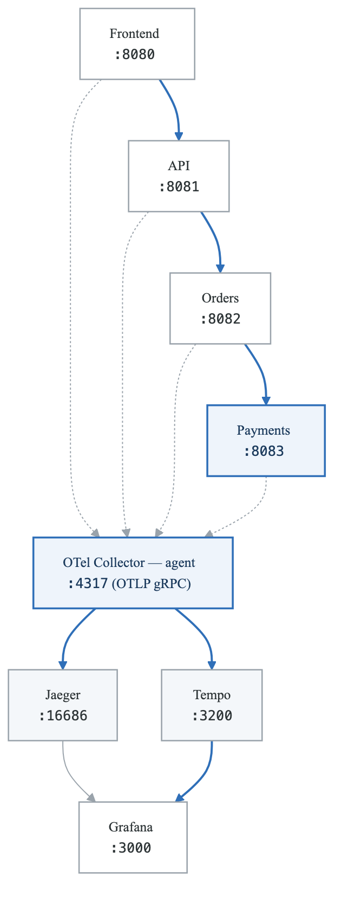
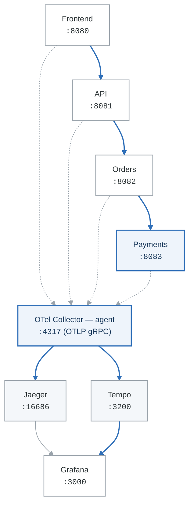

# Lab 05: Distributed Tracing with Jaeger and Tempo

## Overview
Implement distributed tracing across microservices using Jaeger and Grafana Tempo to understand request flows and identify performance bottlenecks.

## Prerequisites
- Docker and Docker Compose
- Python 3.8+ with OpenTelemetry SDK
- Understanding of microservices concepts
- Completed Labs 01-04

## Learning Objectives
- Instrument applications for distributed tracing
- Deploy Jaeger for trace collection and analysis
- Configure Grafana Tempo for trace storage
- Analyze traces to identify performance issues
- Implement sampling strategies

## Lab Environment

### Architecture
<!-- figure: generated from the Mermaid below by _shared/diagrams/embed-figures.py — do not edit the image -->


<details>
<summary>Diagram source (Mermaid)</summary>



</details>

### docker-compose.yml
```yaml
version: '3.8'

services:
  # Jaeger all-in-one
  jaeger:
    image: jaegertracing/all-in-one:1.50
    container_name: jaeger
    environment:
      - COLLECTOR_OTLP_ENABLED=true
    ports:
      - "5775:5775/udp"
      - "6831:6831/udp"
      - "6832:6832/udp"
      - "5778:5778"
      - "16686:16686"   # UI
      - "14250:14250"   # gRPC
      - "14268:14268"   # HTTP
      - "14269:14269"   # Admin
      - "4317:4317"     # OTLP gRPC
      - "4318:4318"     # OTLP HTTP
    networks:
      - tracing

  # Grafana Tempo
  tempo:
    image: grafana/tempo:2.3.0
    container_name: tempo
    command: ["-config.file=/etc/tempo/tempo.yaml"]
    volumes:
      - ./tempo/tempo.yaml:/etc/tempo/tempo.yaml
      - tempo_data:/tmp/tempo
    ports:
      - "3200:3200"     # Tempo
      - "4320:4317"     # OTLP gRPC (mapped to different port)
      - "4321:4318"     # OTLP HTTP (mapped to different port)
    networks:
      - tracing

  # OpenTelemetry Collector
  otel-collector:
    image: otel/opentelemetry-collector-contrib:0.88.0
    container_name: otel-collector
    command: ["--config=/etc/otel-collector/config.yaml"]
    volumes:
      - ./otel-collector/config.yaml:/etc/otel-collector/config.yaml
    ports:
      - "4319:4317"     # OTLP gRPC (for apps)
      - "4322:4318"     # OTLP HTTP
      - "8888:8888"     # Prometheus metrics
      - "8889:8889"     # Prometheus exporter
      - "13133:13133"   # Health check
    depends_on:
      - jaeger
      - tempo
    networks:
      - tracing

  # Frontend service
  frontend:
    build: ./apps/frontend
    container_name: frontend
    environment:
      - OTEL_SERVICE_NAME=frontend
      - OTEL_EXPORTER_OTLP_ENDPOINT=http://otel-collector:4317
      - API_URL=http://api:8081
    ports:
      - "8080:8080"
    depends_on:
      - otel-collector
      - api
    networks:
      - tracing

  # API Gateway
  api:
    build: ./apps/api
    container_name: api
    environment:
      - OTEL_SERVICE_NAME=api-gateway
      - OTEL_EXPORTER_OTLP_ENDPOINT=http://otel-collector:4317
      - ORDERS_URL=http://orders:8082
      - PAYMENTS_URL=http://payments:8083
    ports:
      - "8081:8081"
    depends_on:
      - otel-collector
    networks:
      - tracing

  # Orders service
  orders:
    build: ./apps/orders
    container_name: orders
    environment:
      - OTEL_SERVICE_NAME=orders
      - OTEL_EXPORTER_OTLP_ENDPOINT=http://otel-collector:4317
      - PAYMENTS_URL=http://payments:8083
    ports:
      - "8082:8082"
    depends_on:
      - otel-collector
    networks:
      - tracing

  # Payments service
  payments:
    build: ./apps/payments
    container_name: payments
    environment:
      - OTEL_SERVICE_NAME=payments
      - OTEL_EXPORTER_OTLP_ENDPOINT=http://otel-collector:4317
    ports:
      - "8083:8083"
    depends_on:
      - otel-collector
    networks:
      - tracing

  # Grafana
  grafana:
    image: grafana/grafana:10.0.0
    container_name: grafana
    environment:
      - GF_SECURITY_ADMIN_PASSWORD=admin
      - GF_FEATURE_TOGGLES_ENABLE=traceqlEditor
    ports:
      - "3000:3000"
    volumes:
      - ./grafana/provisioning:/etc/grafana/provisioning
      - grafana_data:/var/lib/grafana
    networks:
      - tracing

volumes:
  tempo_data:
  grafana_data:

networks:
  tracing:
    driver: bridge
```

### Initial Setup
```bash
# Create directories
mkdir -p tempo otel-collector grafana/provisioning/datasources apps/{frontend,api,orders,payments}

# Start infrastructure
docker-compose up -d jaeger tempo otel-collector grafana

# Wait for services
sleep 30

# Verify services
curl -s http://localhost:16686/api/services | jq  # Jaeger
curl -s http://localhost:3200/ready               # Tempo
curl -s http://localhost:13133/                    # OTel Collector
```

---

## Part 1: Guided Exercises

### Exercise 1.1: Infrastructure Configuration

**Objective:** Configure Tempo, OTel Collector, and Grafana for trace collection.

**Step 1:** Create Tempo configuration.

```yaml
# tempo/tempo.yaml
server:
  http_listen_port: 3200

distributor:
  receivers:
    otlp:
      protocols:
        grpc:
        http:

ingester:
  trace_idle_period: 10s
  max_block_bytes: 1_000_000
  max_block_duration: 5m

compactor:
  compaction:
    compaction_window: 1h
    max_block_bytes: 100_000_000
    block_retention: 1h
    compacted_block_retention: 10m

storage:
  trace:
    backend: local
    local:
      path: /tmp/tempo/blocks
    wal:
      path: /tmp/tempo/wal
    pool:
      max_workers: 100
      queue_depth: 10000

querier:
  frontend_worker:
    frontend_address: localhost:9095

metrics_generator:
  registry:
    external_labels:
      source: tempo
      cluster: docker-compose
  storage:
    path: /tmp/tempo/generator/wal
    remote_write:
      - url: http://prometheus:9090/api/v1/write
        send_exemplars: true

overrides:
  defaults:
    metrics_generator:
      processors: [service-graphs, span-metrics]
```

**Step 2:** Create OTel Collector configuration.

```yaml
# otel-collector/config.yaml
receivers:
  otlp:
    protocols:
      grpc:
        endpoint: 0.0.0.0:4317
      http:
        endpoint: 0.0.0.0:4318

processors:
  batch:
    timeout: 1s
    send_batch_size: 1024

  memory_limiter:
    check_interval: 1s
    limit_mib: 512
    spike_limit_mib: 128

  attributes:
    actions:
      - key: environment
        value: development
        action: insert

  resource:
    attributes:
      - key: deployment.environment
        value: docker-compose
        action: upsert

  # Probabilistic sampling
  probabilistic_sampler:
    sampling_percentage: 100

  # Tail-based sampling
  tail_sampling:
    decision_wait: 10s
    num_traces: 100
    expected_new_traces_per_sec: 10
    policies:
      - name: errors-policy
        type: status_code
        status_code:
          status_codes: [ERROR]
      - name: slow-traces-policy
        type: latency
        latency:
          threshold_ms: 1000
      - name: probabilistic-policy
        type: probabilistic
        probabilistic:
          sampling_percentage: 10

exporters:
  # Jaeger
  otlp/jaeger:
    endpoint: jaeger:4317
    tls:
      insecure: true

  # Tempo
  otlp/tempo:
    endpoint: tempo:4317
    tls:
      insecure: true

  # Debug logging
  logging:
    verbosity: detailed
    sampling_initial: 5
    sampling_thereafter: 200

  # Prometheus metrics
  prometheus:
    endpoint: 0.0.0.0:8889
    namespace: otel
    const_labels:
      exporter: otel-collector

extensions:
  health_check:
    endpoint: 0.0.0.0:13133

  pprof:
    endpoint: 0.0.0.0:1777

  zpages:
    endpoint: 0.0.0.0:55679

service:
  extensions: [health_check, pprof, zpages]
  pipelines:
    traces:
      receivers: [otlp]
      processors: [memory_limiter, batch, attributes, resource]
      exporters: [otlp/jaeger, otlp/tempo, logging]
```

**Step 3:** Configure Grafana data sources.

```yaml
# grafana/provisioning/datasources/datasources.yml
apiVersion: 1

datasources:
  - name: Jaeger
    type: jaeger
    access: proxy
    url: http://jaeger:16686
    isDefault: false

  - name: Tempo
    type: tempo
    access: proxy
    url: http://tempo:3200
    isDefault: true
    jsonData:
      httpMethod: GET
      tracesToLogs:
        datasourceUid: loki
        tags: ['service.name', 'operation']
        spanStartTimeShift: '-1h'
        spanEndTimeShift: '1h'
        filterByTraceID: true
        filterBySpanID: false
      tracesToMetrics:
        datasourceUid: prometheus
        tags:
          - key: service.name
            value: service
        queries:
          - name: 'Request rate'
            query: 'sum(rate(traces_spanmetrics_calls_total{$$__tags}[5m]))'
          - name: 'Error rate'
            query: 'sum(rate(traces_spanmetrics_calls_total{status_code="STATUS_CODE_ERROR",$$__tags}[5m]))'
      serviceMap:
        datasourceUid: prometheus
      nodeGraph:
        enabled: true
      search:
        hide: false
      lokiSearch:
        datasourceUid: loki
```

**Step 4:** Restart services.

```bash
docker-compose up -d

# Verify Grafana data sources
curl -s -u admin:admin http://localhost:3000/api/datasources | jq '.[].name'
```

**Verification:**
- [ ] Tempo is receiving traces
- [ ] Jaeger UI accessible
- [ ] Grafana data sources configured

---

### Exercise 1.2: Application Instrumentation

**Objective:** Instrument Python microservices with OpenTelemetry.

**Step 1:** Create the shared tracing module.

```python
# apps/common/tracing.py
import os
from opentelemetry import trace
from opentelemetry.sdk.trace import TracerProvider
from opentelemetry.sdk.trace.export import BatchSpanProcessor
from opentelemetry.exporter.otlp.proto.grpc.trace_exporter import OTLPSpanExporter
from opentelemetry.sdk.resources import Resource
from opentelemetry.semconv.resource import ResourceAttributes
from opentelemetry.instrumentation.flask import FlaskInstrumentor
from opentelemetry.instrumentation.requests import RequestsInstrumentor
from opentelemetry.propagate import set_global_textmap
from opentelemetry.propagators.b3 import B3MultiFormat

def configure_tracing(service_name: str):
    """Configure OpenTelemetry tracing for a service."""

    # Create resource with service information
    resource = Resource.create({
        ResourceAttributes.SERVICE_NAME: service_name,
        ResourceAttributes.SERVICE_VERSION: os.getenv("SERVICE_VERSION", "1.0.0"),
        ResourceAttributes.DEPLOYMENT_ENVIRONMENT: os.getenv("ENVIRONMENT", "development"),
    })

    # Create tracer provider
    provider = TracerProvider(resource=resource)

    # Configure OTLP exporter
    otlp_endpoint = os.getenv("OTEL_EXPORTER_OTLP_ENDPOINT", "http://localhost:4317")
    exporter = OTLPSpanExporter(endpoint=otlp_endpoint, insecure=True)

    # Add batch processor
    provider.add_span_processor(BatchSpanProcessor(exporter))

    # Set global tracer provider
    trace.set_tracer_provider(provider)

    # Set propagator (W3C TraceContext is default, but you can add B3 for compatibility)
    # set_global_textmap(B3MultiFormat())

    return trace.get_tracer(service_name)


def instrument_flask(app):
    """Instrument Flask application."""
    FlaskInstrumentor().instrument_app(app)


def instrument_requests():
    """Instrument requests library for outgoing HTTP calls."""
    RequestsInstrumentor().instrument()
```

**Step 2:** Create the Frontend service.

```python
# apps/frontend/app.py
import os
import requests
from flask import Flask, jsonify, request

# Import tracing configuration
import sys
sys.path.append('/app')
from common.tracing import configure_tracing, instrument_flask, instrument_requests

# Configure tracing
tracer = configure_tracing("frontend")
instrument_requests()

app = Flask(__name__)
instrument_flask(app)

API_URL = os.getenv("API_URL", "http://localhost:8081")

@app.route('/')
def index():
    return jsonify({
        "service": "frontend",
        "version": "1.0.0",
        "endpoints": ["/checkout", "/orders"]
    })

@app.route('/checkout', methods=['POST'])
def checkout():
    """Initiate checkout process."""
    with tracer.start_as_current_span("process_checkout") as span:
        # Get order details from request
        order_data = request.json or {"items": ["item1", "item2"], "total": 99.99}

        span.set_attribute("order.item_count", len(order_data.get("items", [])))
        span.set_attribute("order.total", order_data.get("total", 0))

        # Call API gateway
        response = requests.post(
            f"{API_URL}/api/orders",
            json=order_data,
            headers={"Content-Type": "application/json"}
        )

        if response.status_code != 200:
            span.set_attribute("error", True)
            span.set_attribute("error.message", response.text)

        return jsonify(response.json()), response.status_code

@app.route('/orders')
def list_orders():
    """List all orders."""
    with tracer.start_as_current_span("list_orders") as span:
        response = requests.get(f"{API_URL}/api/orders")
        span.set_attribute("order.count", len(response.json().get("orders", [])))
        return jsonify(response.json())

if __name__ == '__main__':
    app.run(host='0.0.0.0', port=8080)
```

```dockerfile
# apps/frontend/Dockerfile
FROM python:3.11-slim
WORKDIR /app
RUN pip install flask requests \
    opentelemetry-api \
    opentelemetry-sdk \
    opentelemetry-exporter-otlp-proto-grpc \
    opentelemetry-instrumentation-flask \
    opentelemetry-instrumentation-requests

COPY ../common /app/common
COPY app.py .
CMD ["python", "app.py"]
```

**Step 3:** Create the API Gateway service.

```python
# apps/api/app.py
import os
import time
import random
import requests
from flask import Flask, jsonify, request
from opentelemetry import trace

import sys
sys.path.append('/app')
from common.tracing import configure_tracing, instrument_flask, instrument_requests

tracer = configure_tracing("api-gateway")
instrument_requests()

app = Flask(__name__)
instrument_flask(app)

ORDERS_URL = os.getenv("ORDERS_URL", "http://localhost:8082")
PAYMENTS_URL = os.getenv("PAYMENTS_URL", "http://localhost:8083")

@app.route('/api/orders', methods=['GET', 'POST'])
def orders():
    """Handle order operations."""
    current_span = trace.get_current_span()
    current_span.set_attribute("http.route", "/api/orders")

    if request.method == 'POST':
        with tracer.start_as_current_span("validate_request") as span:
            # Simulate validation
            time.sleep(random.uniform(0.01, 0.05))
            order_data = request.json
            span.set_attribute("validation.passed", True)

        # Forward to orders service
        response = requests.post(
            f"{ORDERS_URL}/orders",
            json=order_data,
            headers={"Content-Type": "application/json"}
        )
        return jsonify(response.json()), response.status_code
    else:
        response = requests.get(f"{ORDERS_URL}/orders")
        return jsonify(response.json())

@app.route('/api/payments', methods=['POST'])
def process_payment():
    """Process payment."""
    with tracer.start_as_current_span("route_payment") as span:
        payment_data = request.json
        span.set_attribute("payment.amount", payment_data.get("amount", 0))

        response = requests.post(
            f"{PAYMENTS_URL}/payments",
            json=payment_data,
            headers={"Content-Type": "application/json"}
        )
        return jsonify(response.json()), response.status_code

if __name__ == '__main__':
    app.run(host='0.0.0.0', port=8081)
```

**Step 4:** Create the Orders service.

```python
# apps/orders/app.py
import os
import time
import random
import uuid
import requests
from flask import Flask, jsonify, request
from opentelemetry import trace

import sys
sys.path.append('/app')
from common.tracing import configure_tracing, instrument_flask, instrument_requests

tracer = configure_tracing("orders")
instrument_requests()

app = Flask(__name__)
instrument_flask(app)

PAYMENTS_URL = os.getenv("PAYMENTS_URL", "http://localhost:8083")

# In-memory order storage
orders = {}

@app.route('/orders', methods=['GET', 'POST'])
def handle_orders():
    if request.method == 'POST':
        return create_order()
    return list_orders()

def create_order():
    """Create a new order."""
    with tracer.start_as_current_span("create_order") as span:
        order_data = request.json
        order_id = str(uuid.uuid4())

        span.set_attribute("order.id", order_id)
        span.set_attribute("order.item_count", len(order_data.get("items", [])))

        # Simulate database operation
        with tracer.start_as_current_span("db_insert_order") as db_span:
            db_span.set_attribute("db.system", "postgresql")
            db_span.set_attribute("db.operation", "INSERT")
            db_span.set_attribute("db.table", "orders")
            time.sleep(random.uniform(0.02, 0.1))

        # Process payment
        with tracer.start_as_current_span("process_payment") as payment_span:
            payment_response = requests.post(
                f"{PAYMENTS_URL}/payments",
                json={
                    "order_id": order_id,
                    "amount": order_data.get("total", 0),
                    "currency": "USD"
                }
            )

            if payment_response.status_code != 200:
                span.set_attribute("error", True)
                payment_span.set_attribute("error", True)
                return jsonify({"error": "Payment failed"}), 400

            payment_result = payment_response.json()
            payment_span.set_attribute("payment.id", payment_result.get("payment_id", ""))

        # Store order
        orders[order_id] = {
            "id": order_id,
            "items": order_data.get("items", []),
            "total": order_data.get("total", 0),
            "payment_id": payment_result.get("payment_id"),
            "status": "completed"
        }

        return jsonify(orders[order_id]), 201

def list_orders():
    """List all orders."""
    with tracer.start_as_current_span("list_orders") as span:
        # Simulate database query
        with tracer.start_as_current_span("db_select_orders") as db_span:
            db_span.set_attribute("db.system", "postgresql")
            db_span.set_attribute("db.operation", "SELECT")
            time.sleep(random.uniform(0.01, 0.05))

        span.set_attribute("order.count", len(orders))
        return jsonify({"orders": list(orders.values())})

if __name__ == '__main__':
    app.run(host='0.0.0.0', port=8082)
```

**Step 5:** Create the Payments service.

```python
# apps/payments/app.py
import time
import random
import uuid
from flask import Flask, jsonify, request
from opentelemetry import trace
from opentelemetry.trace import Status, StatusCode

import sys
sys.path.append('/app')
from common.tracing import configure_tracing, instrument_flask

tracer = configure_tracing("payments")

app = Flask(__name__)
instrument_flask(app)

@app.route('/payments', methods=['POST'])
def process_payment():
    """Process a payment."""
    with tracer.start_as_current_span("process_payment") as span:
        payment_data = request.json
        payment_id = str(uuid.uuid4())

        span.set_attribute("payment.id", payment_id)
        span.set_attribute("payment.amount", payment_data.get("amount", 0))
        span.set_attribute("payment.currency", payment_data.get("currency", "USD"))
        span.set_attribute("payment.order_id", payment_data.get("order_id", ""))

        # Validate payment
        with tracer.start_as_current_span("validate_payment") as validate_span:
            time.sleep(random.uniform(0.01, 0.03))
            if payment_data.get("amount", 0) <= 0:
                validate_span.set_status(Status(StatusCode.ERROR, "Invalid amount"))
                span.set_attribute("error", True)
                return jsonify({"error": "Invalid payment amount"}), 400
            validate_span.set_attribute("validation.passed", True)

        # Check fraud
        with tracer.start_as_current_span("fraud_check") as fraud_span:
            fraud_span.set_attribute("fraud.service", "fraud-detector-v2")
            time.sleep(random.uniform(0.05, 0.15))

            # Simulate occasional fraud detection
            if random.random() < 0.05:  # 5% fraud rate
                fraud_span.set_status(Status(StatusCode.ERROR, "Fraud detected"))
                span.set_attribute("error", True)
                span.set_attribute("fraud.detected", True)
                return jsonify({"error": "Payment flagged for fraud"}), 400

            fraud_span.set_attribute("fraud.score", random.uniform(0, 0.3))
            fraud_span.set_attribute("fraud.passed", True)

        # Process with payment gateway
        with tracer.start_as_current_span("payment_gateway") as gateway_span:
            gateway_span.set_attribute("gateway.provider", "stripe")
            gateway_span.set_attribute("gateway.timeout_ms", 5000)

            # Simulate external API call
            time.sleep(random.uniform(0.1, 0.3))

            # Simulate occasional gateway errors
            if random.random() < 0.02:  # 2% error rate
                gateway_span.set_status(Status(StatusCode.ERROR, "Gateway timeout"))
                span.set_attribute("error", True)
                return jsonify({"error": "Payment gateway timeout"}), 503

            gateway_span.set_attribute("gateway.transaction_id", f"txn_{uuid.uuid4().hex[:8]}")

        # Store payment record
        with tracer.start_as_current_span("db_insert_payment") as db_span:
            db_span.set_attribute("db.system", "postgresql")
            db_span.set_attribute("db.operation", "INSERT")
            db_span.set_attribute("db.table", "payments")
            time.sleep(random.uniform(0.01, 0.05))

        span.set_attribute("payment.status", "completed")
        return jsonify({
            "payment_id": payment_id,
            "status": "completed",
            "order_id": payment_data.get("order_id")
        })

@app.route('/payments/<payment_id>')
def get_payment(payment_id):
    """Get payment details."""
    with tracer.start_as_current_span("get_payment") as span:
        span.set_attribute("payment.id", payment_id)

        with tracer.start_as_current_span("db_select_payment") as db_span:
            db_span.set_attribute("db.system", "postgresql")
            db_span.set_attribute("db.operation", "SELECT")
            time.sleep(random.uniform(0.01, 0.03))

        return jsonify({
            "payment_id": payment_id,
            "status": "completed",
            "amount": 99.99
        })

if __name__ == '__main__':
    app.run(host='0.0.0.0', port=8083)
```

**Step 6:** Create common module and Dockerfiles.

```bash
# Create common directory
mkdir -p apps/common
cp apps/common/tracing.py apps/common/
touch apps/common/__init__.py

# Create Dockerfiles for each service
for service in api orders payments; do
cat > apps/$service/Dockerfile << 'EOF'
FROM python:3.11-slim
WORKDIR /app
RUN pip install flask requests \
    opentelemetry-api \
    opentelemetry-sdk \
    opentelemetry-exporter-otlp-proto-grpc \
    opentelemetry-instrumentation-flask \
    opentelemetry-instrumentation-requests

COPY ../common /app/common
COPY app.py .
CMD ["python", "app.py"]
EOF
done
```

**Step 7:** Build and run services.

```bash
# Build all services
docker-compose build

# Start all services
docker-compose up -d

# Generate traffic
for i in {1..20}; do
  curl -s -X POST http://localhost:8080/checkout \
    -H "Content-Type: application/json" \
    -d '{"items": ["item1", "item2"], "total": 99.99}'
  sleep 1
done
```

**Verification:**
- [ ] All services running
- [ ] Traces visible in Jaeger UI
- [ ] Service map shows connections

---

### Exercise 1.3: Trace Analysis with Jaeger

**Objective:** Analyze distributed traces using Jaeger UI.

**Step 1:** Access Jaeger UI at http://localhost:16686

**Step 2:** Find traces by service.

1. Select "frontend" from service dropdown
2. Set operation to "POST /checkout"
3. Set time range to last hour
4. Click "Find Traces"

**Step 3:** Analyze trace details.

1. Click on a trace to view details
2. Observe the span tree showing the call flow:
   - frontend: process_checkout
   - api-gateway: /api/orders
   - orders: create_order
   - payments: process_payment

3. Identify timing breakdown:
   - Total trace duration
   - Time in each service
   - Database operation times
   - External API call times

**Step 4:** Find error traces.

```bash
# Generate some errors
for i in {1..10}; do
  curl -s -X POST http://localhost:8080/checkout \
    -H "Content-Type: application/json" \
    -d '{"items": [], "total": -10}'  # Invalid order
done
```

In Jaeger:
1. Set Tags filter: `error=true`
2. Find traces with errors
3. Analyze error propagation

**Step 5:** Compare traces.

1. Select two similar traces
2. Click "Compare" button
3. Identify timing differences
4. Look for anomalies

**Verification:**
- [ ] Can find traces by service
- [ ] Can view trace waterfall
- [ ] Error traces identified
- [ ] Comparison shows differences

---

### Exercise 1.4: Grafana Tempo and TraceQL

**Objective:** Query traces using TraceQL in Grafana.

**Step 1:** Access Grafana Explore at http://localhost:3000/explore

**Step 2:** Basic TraceQL queries.

```traceql
# Find all traces for a service
{resource.service.name = "orders"}

# Find traces with errors
{status = error}

# Find slow traces (> 500ms)
{duration > 500ms}

# Find specific operation
{name = "process_payment"}

# Combine conditions
{resource.service.name = "payments" && status = error}
```

**Step 3:** Advanced TraceQL queries.

```traceql
# Find traces with specific attribute
{span.payment.amount > 100}

# Find traces calling specific endpoint
{span.http.url =~ ".*payments.*"}

# Find database operations
{span.db.system = "postgresql"}

# Find slow database queries
{span.db.operation = "SELECT" && duration > 50ms}

# Find traces with high fraud scores
{span.fraud.score > 0.2}

# Pipeline query - find errors in payment processing
{resource.service.name = "payments"} | status = error
```

**Step 4:** Structural queries.

```traceql
# Find traces where orders called payments
{resource.service.name = "orders"} >> {resource.service.name = "payments"}

# Find traces with specific call depth
{resource.service.name = "frontend"} >> {resource.service.name = "api-gateway"} >> {resource.service.name = "orders"}

# Find traces with parallel calls
{resource.service.name = "api-gateway"} && {name =~ ".*validate.*"} ~ {name =~ ".*db.*"}
```

**Step 5:** Aggregation queries.

```traceql
# Count traces by service
{} | count() by (resource.service.name)

# Average duration by operation
{resource.service.name = "payments"} | avg(duration) by (name)

# P95 latency
{resource.service.name = "orders"} | quantile_over_time(duration, 0.95)
```

**Verification:**
- [ ] TraceQL queries return results
- [ ] Can find traces by attributes
- [ ] Structural queries work
- [ ] Aggregations produce metrics

---

### Exercise 1.5: Service Maps and Dependencies

**Objective:** Visualize service dependencies and analyze topology.

**Step 1:** View Jaeger Service Dependencies.

1. Navigate to Jaeger UI
2. Click "System Architecture" tab
3. View dependency graph
4. Observe call relationships

**Step 2:** Enable Tempo service graph.

Add to Tempo config:
```yaml
# tempo/tempo.yaml (add to existing)
metrics_generator:
  registry:
    external_labels:
      source: tempo
  storage:
    path: /tmp/tempo/generator/wal
  processor:
    service_graphs:
      wait: 10s
      max_items: 10000
      workers: 10
    span_metrics:
      dimensions:
        - service.name
        - operation
        - status_code
```

**Step 3:** Query service graph metrics.

```promql
# Service graph - calls between services
traces_service_graph_request_total

# Latency between services
traces_service_graph_request_server_seconds_bucket

# Error rate between services
sum(rate(traces_service_graph_request_failed_total[5m])) by (client, server)
/
sum(rate(traces_service_graph_request_total[5m])) by (client, server)
```

**Step 4:** Create Node Graph panel in Grafana.

1. Create new dashboard
2. Add panel with "Node Graph" visualization
3. Configure to use Tempo service graph

**Verification:**
- [ ] Service map visible in Jaeger
- [ ] Tempo generating service graph metrics
- [ ] Node graph panel shows topology

---

## Part 2: Semi-Guided Exercises

### Exercise 2.1: Custom Span Attributes

**Objective:** Add business-relevant attributes to spans for better analysis.

**Requirements:**
1. Add customer ID to all spans
2. Track order value tiers (small/medium/large)
3. Add feature flags to spans
4. Include deployment version

**Hints:**
- Use span.set_attribute() for custom attributes
- Context propagation passes attributes downstream
- Consider cardinality impact

**Expected Deliverables:**
- [ ] Customer ID in all spans
- [ ] Order tier classification
- [ ] Feature flag attributes
- [ ] TraceQL queries using custom attributes

---

### Exercise 2.2: Sampling Strategies

**Objective:** Implement intelligent sampling to manage trace volume.

**Requirements:**
1. Sample 100% of error traces
2. Sample 100% of slow traces (>1s)
3. Sample 10% of normal traces
4. Implement per-service sampling rates

**Hints:**
- Use tail-based sampling in OTel Collector
- Configure multiple sampling policies
- Consider parent-based sampling

**Expected Deliverables:**
- [ ] Tail sampling configuration
- [ ] Policy for errors and slow traces
- [ ] Volume reduction metrics
- [ ] Documentation of sampling strategy

---

### Exercise 2.3: Trace-Log Correlation

**Objective:** Correlate traces with application logs.

**Requirements:**
1. Include trace ID in log entries
2. Configure Grafana to link traces to logs
3. Create correlation dashboard
4. Enable click-through from trace to logs

**Hints:**
- Extract trace context in logging
- Derived fields in Grafana link data sources
- Use consistent time ranges

**Expected Deliverables:**
- [ ] Logs include trace ID
- [ ] Grafana shows logs in trace view
- [ ] Click-through working
- [ ] Correlation dashboard

---

### Exercise 2.4: Performance Baseline and Anomaly Detection

**Objective:** Establish performance baselines and detect anomalies.

**Requirements:**
1. Create baseline latency metrics from traces
2. Set up alerts for latency anomalies
3. Track baseline drift over time
4. Create SLO based on trace data

**Hints:**
- Use span metrics generator in Tempo
- Recording rules for baseline calculation
- Compare current vs historical percentiles

**Expected Deliverables:**
- [ ] Baseline latency dashboard
- [ ] Anomaly detection alerts
- [ ] Trend analysis over 7 days
- [ ] SLO tracking

---

## Part 3: Challenge Exercises

### Challenge 3.1: Distributed Transaction Tracing

**Objective:** Implement tracing for distributed transactions with compensation.

**Scenario:**
E-commerce checkout requires:
- Inventory reservation
- Payment processing
- Order creation
- Notification sending

If any step fails, previous steps must be compensated (saga pattern).

**Requirements:**
1. Trace the complete transaction flow
2. Track compensation operations
3. Visualize saga execution
4. Alert on failed sagas

**Success Criteria:**
- [ ] Full transaction traced
- [ ] Compensation spans linked to original
- [ ] Saga state visible in traces
- [ ] Failed saga alerts working

---

### Challenge 3.2: Multi-Cluster Tracing

**Objective:** Implement tracing across multiple Kubernetes clusters.

**Scenario:**
Services span three clusters:
- Frontend cluster (user-facing)
- Backend cluster (business logic)
- Data cluster (databases and cache)

**Requirements:**
1. Propagate context across cluster boundaries
2. Configure collectors in each cluster
3. Aggregate traces centrally
4. Maintain cluster attribution

**Success Criteria:**
- [ ] Cross-cluster traces complete
- [ ] Cluster labels in spans
- [ ] Centralized trace storage
- [ ] Per-cluster service maps

---

### Challenge 3.3: Real-Time Trace Analytics

**Objective:** Build real-time analytics pipeline from trace data.

**Scenario:**
Product team needs real-time insights:
- Feature usage from traces
- User journey analysis
- Conversion funnel metrics
- A/B test performance comparison

**Requirements:**
1. Stream trace data for real-time processing
2. Extract business metrics from spans
3. Create real-time dashboards
4. Compare variant performance

**Success Criteria:**
- [ ] Real-time trace streaming
- [ ] Business metrics extracted
- [ ] Live dashboards updating
- [ ] A/B test comparison working

---

## Cleanup

```bash
# Stop all services
docker-compose down -v

# Remove generated files
rm -rf tempo otel-collector grafana apps
```

## Additional Resources

- [OpenTelemetry Documentation](https://opentelemetry.io/docs/)
- [Jaeger Documentation](https://www.jaegertracing.io/docs/)
- [Grafana Tempo Documentation](https://grafana.com/docs/tempo/latest/)
- [TraceQL Reference](https://grafana.com/docs/tempo/latest/traceql/)
- [Distributed Tracing Best Practices](https://opentelemetry.io/docs/concepts/sampling/)

## Next Lab
Continue to [Lab 06: OpenTelemetry](labs-lab-06-opentelemetry-README.md) to implement unified telemetry collection.

<!-- feynman-check -->

---

## Feynman check

Close the file. Blank page, no notes. Explain each of these to a competent engineer who has never
used this tool — **under five minutes, no jargon you can't define on the spot:**

- 1: Infrastructure Configuration
- 2: Application Instrumentation
- 3: Trace Analysis with Jaeger
- 4: Grafana Tempo and TraceQL

**The gap is not what you forgot. It is where you used a word instead of a mechanism.**

| | |
|---|---|
| ✗ | *"Prometheus monitors the service."* |
| ✓ | *"Prometheus discovers targets from the Kubernetes API, applies relabelling rules, scrapes `/metrics` over HTTP on an interval, and appends samples to a local TSDB. Nothing is pushed — so a target missing from a dashboard is a service-discovery problem, not an application one."* |

**Trace it:** A latency regression → a phone ringing. Name each hop: sample, rule evaluation, alert state transition, routing, notification — and where each one can silently stop.

Stop at the first component you cannot name. Reopen this file and read **only** that.

**Go deeper — only once the gap has a name:** [SRE Workbook ch. 5, *Alerting on SLOs*](https://sre.google/workbook/alerting-on-slos/) — free, and the best thing written on why static thresholds page you for nothing.
Full list per domain: [`SOURCES.md`](../SOURCES.md#observability-sre)

→ Protocol, the three levels of knowing, and worked examples: [`MASTERY.md`](../MASTERY.md)

<!-- /feynman-check -->
