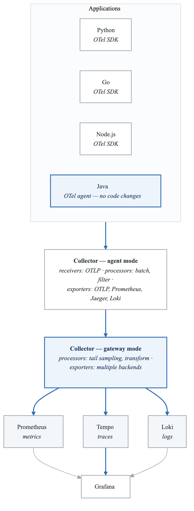
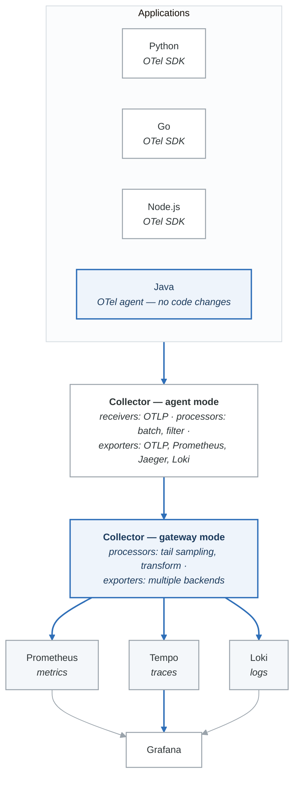

# Lab 06: OpenTelemetry Unified Telemetry

## Overview
Implement comprehensive observability using OpenTelemetry to collect metrics, logs, and traces through a unified instrumentation framework.

## Prerequisites
- Docker and Docker Compose
- Completed Labs 01-05
- Python, Go, or Node.js development experience
- Understanding of all three observability pillars

## Learning Objectives
- Deploy OpenTelemetry Collector in various configurations
- Implement auto and manual instrumentation
- Configure exporters for multiple backends
- Correlate metrics, logs, and traces
- Design production-ready OTel architecture

## Lab Environment

### Architecture
<!-- figure: generated from the Mermaid below by _shared/diagrams/embed-figures.py — do not edit the image -->


<details>
<summary>Diagram source (Mermaid)</summary>



</details>

### docker-compose.yml
```yaml
version: '3.8'

services:
  # OpenTelemetry Collector - Agent mode (per-node)
  otel-agent:
    image: otel/opentelemetry-collector-contrib:0.88.0
    container_name: otel-agent
    command: ["--config=/etc/otel/config.yaml"]
    volumes:
      - ./otel-agent/config.yaml:/etc/otel/config.yaml
    ports:
      - "4317:4317"   # OTLP gRPC
      - "4318:4318"   # OTLP HTTP
      - "8888:8888"   # Metrics endpoint
    networks:
      - otel

  # OpenTelemetry Collector - Gateway mode (central)
  otel-gateway:
    image: otel/opentelemetry-collector-contrib:0.88.0
    container_name: otel-gateway
    command: ["--config=/etc/otel/config.yaml"]
    volumes:
      - ./otel-gateway/config.yaml:/etc/otel/config.yaml
    ports:
      - "14317:4317"  # OTLP gRPC from agents
      - "14318:4318"  # OTLP HTTP from agents
      - "18888:8888"  # Metrics endpoint
    depends_on:
      - prometheus
      - tempo
      - loki
    networks:
      - otel

  # Prometheus
  prometheus:
    image: prom/prometheus:v2.45.0
    container_name: prometheus
    command:
      - '--config.file=/etc/prometheus/prometheus.yml'
      - '--web.enable-remote-write-receiver'
      - '--enable-feature=exemplar-storage'
    volumes:
      - ./prometheus/prometheus.yml:/etc/prometheus/prometheus.yml
    ports:
      - "9090:9090"
    networks:
      - otel

  # Tempo
  tempo:
    image: grafana/tempo:2.3.0
    container_name: tempo
    command: ["-config.file=/etc/tempo/tempo.yaml"]
    volumes:
      - ./tempo/tempo.yaml:/etc/tempo/tempo.yaml
    ports:
      - "3200:3200"
    networks:
      - otel

  # Loki
  loki:
    image: grafana/loki:2.9.0
    container_name: loki
    command: ["-config.file=/etc/loki/loki.yaml"]
    volumes:
      - ./loki/loki.yaml:/etc/loki/loki.yaml
    ports:
      - "3100:3100"
    networks:
      - otel

  # Grafana
  grafana:
    image: grafana/grafana:10.0.0
    container_name: grafana
    environment:
      - GF_SECURITY_ADMIN_PASSWORD=admin
      - GF_FEATURE_TOGGLES_ENABLE=traceqlEditor
    volumes:
      - ./grafana/provisioning:/etc/grafana/provisioning
    ports:
      - "3000:3000"
    networks:
      - otel

  # Sample Python Application
  python-app:
    build: ./apps/python
    container_name: python-app
    environment:
      - OTEL_SERVICE_NAME=python-service
      - OTEL_EXPORTER_OTLP_ENDPOINT=http://otel-agent:4317
      - OTEL_LOGS_EXPORTER=otlp
      - OTEL_METRICS_EXPORTER=otlp
      - OTEL_TRACES_EXPORTER=otlp
    ports:
      - "8080:8080"
    depends_on:
      - otel-agent
    networks:
      - otel

  # Sample Go Application
  go-app:
    build: ./apps/go
    container_name: go-app
    environment:
      - OTEL_SERVICE_NAME=go-service
      - OTEL_EXPORTER_OTLP_ENDPOINT=otel-agent:4317
    ports:
      - "8081:8081"
    depends_on:
      - otel-agent
    networks:
      - otel

  # Sample Node.js Application
  node-app:
    build: ./apps/node
    container_name: node-app
    environment:
      - OTEL_SERVICE_NAME=node-service
      - OTEL_EXPORTER_OTLP_ENDPOINT=http://otel-agent:4317
    ports:
      - "8082:8082"
    depends_on:
      - otel-agent
    networks:
      - otel

networks:
  otel:
    driver: bridge
```

### Initial Setup
```bash
# Create directories
mkdir -p otel-agent otel-gateway prometheus tempo loki grafana/provisioning/datasources
mkdir -p apps/{python,go,node}

# Create configurations (see exercises below)

# Start infrastructure first
docker-compose up -d prometheus tempo loki grafana

# Wait for backends
sleep 30

# Start collectors
docker-compose up -d otel-agent otel-gateway
```

---

## Part 1: Guided Exercises

### Exercise 1.1: OTel Collector Configuration

**Objective:** Configure OpenTelemetry Collectors in agent and gateway modes.

**Step 1:** Create agent collector configuration.

```yaml
# otel-agent/config.yaml
receivers:
  otlp:
    protocols:
      grpc:
        endpoint: 0.0.0.0:4317
      http:
        endpoint: 0.0.0.0:4318

  # Host metrics
  hostmetrics:
    collection_interval: 30s
    scrapers:
      cpu:
      memory:
      disk:
      filesystem:
      network:
      load:
      process:
        include:
          match_type: regexp
          names: [".*"]

  # Docker stats
  docker_stats:
    endpoint: unix:///var/run/docker.sock
    collection_interval: 30s

  # Prometheus scrape
  prometheus:
    config:
      scrape_configs:
        - job_name: 'otel-agent'
          scrape_interval: 15s
          static_configs:
            - targets: ['localhost:8888']

processors:
  # Batch for efficiency
  batch:
    timeout: 1s
    send_batch_size: 1024

  # Memory limiter
  memory_limiter:
    check_interval: 1s
    limit_mib: 256
    spike_limit_mib: 64

  # Resource detection
  resourcedetection:
    detectors: [env, system, docker]
    timeout: 5s
    override: false

  # Add common attributes
  resource:
    attributes:
      - key: deployment.environment
        value: development
        action: upsert
      - key: collector.mode
        value: agent
        action: upsert

  # Transform metrics
  transform:
    metric_statements:
      - context: datapoint
        statements:
          - set(attributes["collector"], "otel-agent")

  # Filter unwanted telemetry
  filter:
    metrics:
      exclude:
        match_type: regexp
        metric_names:
          - ".*test.*"
    logs:
      exclude:
        match_type: regexp
        bodies:
          - ".*healthcheck.*"

exporters:
  # Forward to gateway
  otlp:
    endpoint: otel-gateway:4317
    tls:
      insecure: true

  # Debug output
  logging:
    verbosity: detailed
    sampling_initial: 5
    sampling_thereafter: 200

  # Local prometheus for agent metrics
  prometheus:
    endpoint: 0.0.0.0:8889
    namespace: otel_agent

extensions:
  health_check:
    endpoint: 0.0.0.0:13133

  zpages:
    endpoint: 0.0.0.0:55679

  pprof:
    endpoint: 0.0.0.0:1777

service:
  extensions: [health_check, zpages, pprof]

  pipelines:
    traces:
      receivers: [otlp]
      processors: [memory_limiter, resourcedetection, resource, batch]
      exporters: [otlp, logging]

    metrics:
      receivers: [otlp, hostmetrics, prometheus]
      processors: [memory_limiter, resourcedetection, resource, transform, batch]
      exporters: [otlp, prometheus]

    logs:
      receivers: [otlp]
      processors: [memory_limiter, resourcedetection, resource, filter, batch]
      exporters: [otlp, logging]

  telemetry:
    logs:
      level: info
    metrics:
      address: 0.0.0.0:8888
```

**Step 2:** Create gateway collector configuration.

```yaml
# otel-gateway/config.yaml
receivers:
  otlp:
    protocols:
      grpc:
        endpoint: 0.0.0.0:4317
      http:
        endpoint: 0.0.0.0:4318

processors:
  batch:
    timeout: 5s
    send_batch_size: 2048
    send_batch_max_size: 4096

  memory_limiter:
    check_interval: 1s
    limit_mib: 1024
    spike_limit_mib: 256

  # Tail-based sampling for traces
  tail_sampling:
    decision_wait: 10s
    num_traces: 10000
    expected_new_traces_per_sec: 100
    policies:
      # Always sample errors
      - name: errors-policy
        type: status_code
        status_code:
          status_codes: [ERROR]
      # Always sample slow traces
      - name: latency-policy
        type: latency
        latency:
          threshold_ms: 1000
      # Sample by string attribute
      - name: important-traces
        type: string_attribute
        string_attribute:
          key: priority
          values: [high, critical]
      # Probabilistic sampling for the rest
      - name: probabilistic-policy
        type: probabilistic
        probabilistic:
          sampling_percentage: 10

  # Transform logs to add parsed fields
  transform:
    log_statements:
      - context: log
        statements:
          - set(attributes["processed_by"], "otel-gateway")
          - set(severity_text, "INFO") where severity_number == 9

  # Span metrics connector
  spanmetrics:
    histogram:
      explicit:
        buckets: [5ms, 10ms, 25ms, 50ms, 100ms, 250ms, 500ms, 1s, 2.5s, 5s, 10s]
    dimensions:
      - name: http.method
      - name: http.status_code
      - name: service.name
    exemplars:
      enabled: true
    dimensions_cache_size: 1000

connectors:
  spanmetrics:

exporters:
  # Prometheus remote write
  prometheusremotewrite:
    endpoint: http://prometheus:9090/api/v1/write
    tls:
      insecure: true
    resource_to_telemetry_conversion:
      enabled: true

  # Tempo for traces
  otlp/tempo:
    endpoint: tempo:4317
    tls:
      insecure: true

  # Loki for logs
  loki:
    endpoint: http://loki:3100/loki/api/v1/push
    labels:
      attributes:
        service.name: "service"
        severity: "level"
      resource:
        deployment.environment: "env"

  logging:
    verbosity: normal

extensions:
  health_check:
    endpoint: 0.0.0.0:13133

  zpages:
    endpoint: 0.0.0.0:55679

service:
  extensions: [health_check, zpages]

  pipelines:
    traces:
      receivers: [otlp]
      processors: [memory_limiter, tail_sampling, batch]
      exporters: [otlp/tempo, spanmetrics, logging]

    # Metrics from span metrics connector
    metrics/spanmetrics:
      receivers: [spanmetrics]
      processors: [batch]
      exporters: [prometheusremotewrite]

    metrics:
      receivers: [otlp]
      processors: [memory_limiter, batch]
      exporters: [prometheusremotewrite]

    logs:
      receivers: [otlp]
      processors: [memory_limiter, transform, batch]
      exporters: [loki, logging]

  telemetry:
    logs:
      level: info
    metrics:
      address: 0.0.0.0:8888
```

**Step 3:** Create backend configurations.

```yaml
# prometheus/prometheus.yml
global:
  scrape_interval: 15s

scrape_configs:
  - job_name: 'prometheus'
    static_configs:
      - targets: ['localhost:9090']

  - job_name: 'otel-gateway'
    static_configs:
      - targets: ['otel-gateway:8888']
```

```yaml
# tempo/tempo.yaml
server:
  http_listen_port: 3200

distributor:
  receivers:
    otlp:
      protocols:
        grpc:

storage:
  trace:
    backend: local
    local:
      path: /tmp/tempo/traces
    wal:
      path: /tmp/tempo/wal
```

```yaml
# loki/loki.yaml
auth_enabled: false

server:
  http_listen_port: 3100

common:
  path_prefix: /loki
  storage:
    filesystem:
      chunks_directory: /loki/chunks
      rules_directory: /loki/rules
  replication_factor: 1
  ring:
    kvstore:
      store: inmemory

schema_config:
  configs:
    - from: 2020-10-24
      store: boltdb-shipper
      object_store: filesystem
      schema: v11
      index:
        prefix: index_
        period: 24h
```

**Step 4:** Create Grafana datasources.

```yaml
# grafana/provisioning/datasources/datasources.yml
apiVersion: 1

datasources:
  - name: Prometheus
    type: prometheus
    access: proxy
    url: http://prometheus:9090
    isDefault: true
    jsonData:
      exemplarTraceIdDestinations:
        - name: trace_id
          datasourceUid: tempo

  - name: Tempo
    type: tempo
    access: proxy
    url: http://tempo:3200
    uid: tempo
    jsonData:
      tracesToLogs:
        datasourceUid: loki
        tags: ['service']
      serviceMap:
        datasourceUid: prometheus

  - name: Loki
    type: loki
    access: proxy
    url: http://loki:3100
    uid: loki
    jsonData:
      derivedFields:
        - name: trace_id
          matcherRegex: "trace_id=(\\w+)"
          url: '$${__value.raw}'
          datasourceUid: tempo
```

**Step 5:** Start and verify collectors.

```bash
docker-compose up -d

# Verify agent
curl -s http://localhost:13133/  # Health check
curl -s http://localhost:8888/metrics | head -20  # Metrics

# Verify gateway
curl -s http://localhost:18888/metrics | head -20
```

**Verification:**
- [ ] Agent collector healthy
- [ ] Gateway collector healthy
- [ ] All backends receiving data

---

### Exercise 1.2: Python Application with OTel SDK

**Objective:** Instrument a Python application with full OpenTelemetry support.

**Step 1:** Create requirements.txt.

```text
# apps/python/requirements.txt
flask==3.0.0
opentelemetry-api==1.21.0
opentelemetry-sdk==1.21.0
opentelemetry-exporter-otlp-proto-grpc==1.21.0
opentelemetry-instrumentation-flask==0.42b0
opentelemetry-instrumentation-requests==0.42b0
opentelemetry-instrumentation-logging==0.42b0
requests==2.31.0
```

**Step 2:** Create instrumented application.

```python
# apps/python/app.py
import logging
import os
import random
import time

from flask import Flask, jsonify, request

# OpenTelemetry imports
from opentelemetry import trace, metrics
from opentelemetry.sdk.trace import TracerProvider
from opentelemetry.sdk.trace.export import BatchSpanProcessor
from opentelemetry.sdk.metrics import MeterProvider
from opentelemetry.sdk.metrics.export import PeriodicExportingMetricReader
from opentelemetry.sdk.resources import Resource
from opentelemetry.sdk._logs import LoggerProvider, LoggingHandler
from opentelemetry.sdk._logs.export import BatchLogRecordProcessor
from opentelemetry.exporter.otlp.proto.grpc.trace_exporter import OTLPSpanExporter
from opentelemetry.exporter.otlp.proto.grpc.metric_exporter import OTLPMetricExporter
from opentelemetry.exporter.otlp.proto.grpc._log_exporter import OTLPLogExporter
from opentelemetry.instrumentation.flask import FlaskInstrumentor
from opentelemetry.instrumentation.requests import RequestsInstrumentor
from opentelemetry.instrumentation.logging import LoggingInstrumentor
from opentelemetry.semconv.resource import ResourceAttributes
from opentelemetry.trace import Status, StatusCode

# Configuration
SERVICE_NAME = os.getenv("OTEL_SERVICE_NAME", "python-service")
OTLP_ENDPOINT = os.getenv("OTEL_EXPORTER_OTLP_ENDPOINT", "http://localhost:4317")

# Create resource
resource = Resource.create({
    ResourceAttributes.SERVICE_NAME: SERVICE_NAME,
    ResourceAttributes.SERVICE_VERSION: "1.0.0",
    ResourceAttributes.DEPLOYMENT_ENVIRONMENT: os.getenv("ENVIRONMENT", "development"),
})

# Configure Tracing
trace_provider = TracerProvider(resource=resource)
trace_exporter = OTLPSpanExporter(endpoint=OTLP_ENDPOINT, insecure=True)
trace_provider.add_span_processor(BatchSpanProcessor(trace_exporter))
trace.set_tracer_provider(trace_provider)
tracer = trace.get_tracer(__name__)

# Configure Metrics
metric_exporter = OTLPMetricExporter(endpoint=OTLP_ENDPOINT, insecure=True)
metric_reader = PeriodicExportingMetricReader(metric_exporter, export_interval_millis=10000)
meter_provider = MeterProvider(resource=resource, metric_readers=[metric_reader])
metrics.set_meter_provider(meter_provider)
meter = metrics.get_meter(__name__)

# Configure Logging
logger_provider = LoggerProvider(resource=resource)
log_exporter = OTLPLogExporter(endpoint=OTLP_ENDPOINT, insecure=True)
logger_provider.add_log_record_processor(BatchLogRecordProcessor(log_exporter))

# Set up logging handler
handler = LoggingHandler(level=logging.INFO, logger_provider=logger_provider)
logging.getLogger().addHandler(handler)
logging.getLogger().setLevel(logging.INFO)

# Instrument logging to include trace context
LoggingInstrumentor().instrument(set_logging_format=True)

logger = logging.getLogger(__name__)

# Create custom metrics
request_counter = meter.create_counter(
    "app.requests.total",
    description="Total number of requests",
    unit="1"
)

request_duration = meter.create_histogram(
    "app.request.duration",
    description="Request duration in milliseconds",
    unit="ms"
)

active_requests = meter.create_up_down_counter(
    "app.requests.active",
    description="Number of active requests",
    unit="1"
)

# Create Flask app
app = Flask(__name__)

# Instrument Flask and Requests
FlaskInstrumentor().instrument_app(app)
RequestsInstrumentor().instrument()

@app.before_request
def before_request():
    request.start_time = time.time()
    active_requests.add(1, {"endpoint": request.endpoint or "unknown"})

@app.after_request
def after_request(response):
    duration = (time.time() - request.start_time) * 1000

    # Record metrics
    request_counter.add(1, {
        "method": request.method,
        "endpoint": request.endpoint or "unknown",
        "status": str(response.status_code)
    })
    request_duration.record(duration, {
        "method": request.method,
        "endpoint": request.endpoint or "unknown"
    })
    active_requests.add(-1, {"endpoint": request.endpoint or "unknown"})

    return response

@app.route('/')
def index():
    logger.info("Index endpoint accessed")
    return jsonify({"service": SERVICE_NAME, "status": "healthy"})

@app.route('/api/process')
def process():
    """Endpoint demonstrating tracing with child spans."""
    with tracer.start_as_current_span("process_request") as span:
        span.set_attribute("request.id", request.args.get("id", "unknown"))

        # Simulate validation
        with tracer.start_as_current_span("validate_input") as validate_span:
            time.sleep(random.uniform(0.01, 0.05))
            validate_span.set_attribute("validation.passed", True)
            logger.info("Input validation completed")

        # Simulate database query
        with tracer.start_as_current_span("database_query") as db_span:
            db_span.set_attribute("db.system", "postgresql")
            db_span.set_attribute("db.operation", "SELECT")
            time.sleep(random.uniform(0.05, 0.15))
            logger.info("Database query executed")

        # Simulate processing
        with tracer.start_as_current_span("business_logic") as logic_span:
            time.sleep(random.uniform(0.02, 0.08))

            # Simulate occasional errors
            if random.random() < 0.1:
                logic_span.set_status(Status(StatusCode.ERROR, "Processing failed"))
                logger.error("Processing failed due to internal error")
                return jsonify({"error": "Processing failed"}), 500

        return jsonify({"result": "success", "processed": True})

@app.route('/api/external')
def external_call():
    """Endpoint demonstrating external HTTP call tracing."""
    import requests as req

    with tracer.start_as_current_span("external_api_call") as span:
        span.set_attribute("external.service", "httpbin")

        try:
            # This call will be automatically traced
            response = req.get("https://httpbin.org/delay/1", timeout=5)
            span.set_attribute("external.status_code", response.status_code)
            logger.info(f"External call completed: {response.status_code}")
            return jsonify({"external_status": response.status_code})
        except Exception as e:
            span.set_status(Status(StatusCode.ERROR, str(e)))
            logger.exception("External call failed")
            return jsonify({"error": str(e)}), 500

@app.route('/api/metrics-demo')
def metrics_demo():
    """Endpoint demonstrating custom metrics."""
    with tracer.start_as_current_span("metrics_demo") as span:
        # Record some custom metrics
        items_processed = random.randint(1, 100)

        item_counter = meter.create_counter("app.items.processed")
        item_counter.add(items_processed, {"type": "demo"})

        span.set_attribute("items.count", items_processed)
        logger.info(f"Processed {items_processed} items")

        return jsonify({"items_processed": items_processed})

if __name__ == '__main__':
    logger.info(f"Starting {SERVICE_NAME}")
    app.run(host='0.0.0.0', port=8080)
```

**Step 3:** Create Dockerfile.

```dockerfile
# apps/python/Dockerfile
FROM python:3.11-slim
WORKDIR /app
COPY requirements.txt .
RUN pip install --no-cache-dir -r requirements.txt
COPY app.py .
CMD ["python", "app.py"]
```

**Step 4:** Build and test.

```bash
# Build
docker-compose build python-app

# Start
docker-compose up -d python-app

# Generate traffic
for i in {1..20}; do
  curl -s http://localhost:8080/api/process?id=$i
  sleep 0.5
done

# Check logs
docker-compose logs python-app
```

**Verification:**
- [ ] Application starts successfully
- [ ] Traces appear in Tempo
- [ ] Metrics appear in Prometheus
- [ ] Logs appear in Loki with trace IDs

---

### Exercise 1.3: Go Application with OTel SDK

**Objective:** Instrument a Go application with OpenTelemetry.

**Step 1:** Create Go module and dependencies.

```go
// apps/go/go.mod
module go-service

go 1.21

require (
    github.com/gin-gonic/gin v1.9.1
    go.opentelemetry.io/otel v1.21.0
    go.opentelemetry.io/otel/exporters/otlp/otlptrace/otlptracegrpc v1.21.0
    go.opentelemetry.io/otel/exporters/otlp/otlpmetric/otlpmetricgrpc v0.44.0
    go.opentelemetry.io/otel/sdk v1.21.0
    go.opentelemetry.io/otel/sdk/metric v1.21.0
    go.opentelemetry.io/contrib/instrumentation/github.com/gin-gonic/gin/otelgin v0.46.0
    go.opentelemetry.io/otel/trace v1.21.0
    go.opentelemetry.io/otel/metric v1.21.0
    google.golang.org/grpc v1.59.0
)
```

**Step 2:** Create instrumented application.

```go
// apps/go/main.go
package main

import (
    "context"
    "log"
    "math/rand"
    "net/http"
    "os"
    "time"

    "github.com/gin-gonic/gin"
    "go.opentelemetry.io/contrib/instrumentation/github.com/gin-gonic/gin/otelgin"
    "go.opentelemetry.io/otel"
    "go.opentelemetry.io/otel/attribute"
    "go.opentelemetry.io/otel/exporters/otlp/otlpmetric/otlpmetricgrpc"
    "go.opentelemetry.io/otel/exporters/otlp/otlptrace/otlptracegrpc"
    "go.opentelemetry.io/otel/metric"
    "go.opentelemetry.io/otel/propagation"
    sdkmetric "go.opentelemetry.io/otel/sdk/metric"
    "go.opentelemetry.io/otel/sdk/resource"
    sdktrace "go.opentelemetry.io/otel/sdk/trace"
    semconv "go.opentelemetry.io/otel/semconv/v1.21.0"
    "go.opentelemetry.io/otel/trace"
    "google.golang.org/grpc"
    "google.golang.org/grpc/credentials/insecure"
)

var (
    serviceName = getEnv("OTEL_SERVICE_NAME", "go-service")
    otlpEndpoint = getEnv("OTEL_EXPORTER_OTLP_ENDPOINT", "localhost:4317")

    tracer trace.Tracer
    meter  metric.Meter

    requestCounter metric.Int64Counter
    requestDuration metric.Float64Histogram
)

func getEnv(key, fallback string) string {
    if value, exists := os.LookupEnv(key); exists {
        return value
    }
    return fallback
}

func initTracer(ctx context.Context) (*sdktrace.TracerProvider, error) {
    res, err := resource.New(ctx,
        resource.WithAttributes(
            semconv.ServiceName(serviceName),
            semconv.ServiceVersion("1.0.0"),
            attribute.String("environment", "development"),
        ),
    )
    if err != nil {
        return nil, err
    }

    conn, err := grpc.DialContext(ctx, otlpEndpoint,
        grpc.WithTransportCredentials(insecure.NewCredentials()),
        grpc.WithBlock(),
    )
    if err != nil {
        return nil, err
    }

    traceExporter, err := otlptracegrpc.New(ctx, otlptracegrpc.WithGRPCConn(conn))
    if err != nil {
        return nil, err
    }

    tp := sdktrace.NewTracerProvider(
        sdktrace.WithBatcher(traceExporter),
        sdktrace.WithResource(res),
        sdktrace.WithSampler(sdktrace.AlwaysSample()),
    )

    otel.SetTracerProvider(tp)
    otel.SetTextMapPropagator(propagation.NewCompositeTextMapPropagator(
        propagation.TraceContext{},
        propagation.Baggage{},
    ))

    return tp, nil
}

func initMeter(ctx context.Context) (*sdkmetric.MeterProvider, error) {
    res, err := resource.New(ctx,
        resource.WithAttributes(
            semconv.ServiceName(serviceName),
            semconv.ServiceVersion("1.0.0"),
        ),
    )
    if err != nil {
        return nil, err
    }

    conn, err := grpc.DialContext(ctx, otlpEndpoint,
        grpc.WithTransportCredentials(insecure.NewCredentials()),
        grpc.WithBlock(),
    )
    if err != nil {
        return nil, err
    }

    metricExporter, err := otlpmetricgrpc.New(ctx, otlpmetricgrpc.WithGRPCConn(conn))
    if err != nil {
        return nil, err
    }

    mp := sdkmetric.NewMeterProvider(
        sdkmetric.WithReader(sdkmetric.NewPeriodicReader(metricExporter)),
        sdkmetric.WithResource(res),
    )

    otel.SetMeterProvider(mp)
    return mp, nil
}

func initMetrics() error {
    var err error
    requestCounter, err = meter.Int64Counter(
        "app.requests.total",
        metric.WithDescription("Total number of requests"),
    )
    if err != nil {
        return err
    }

    requestDuration, err = meter.Float64Histogram(
        "app.request.duration",
        metric.WithDescription("Request duration in milliseconds"),
        metric.WithUnit("ms"),
    )
    return err
}

func main() {
    ctx := context.Background()

    // Initialize tracing
    tp, err := initTracer(ctx)
    if err != nil {
        log.Fatalf("Failed to initialize tracer: %v", err)
    }
    defer tp.Shutdown(ctx)

    // Initialize metrics
    mp, err := initMeter(ctx)
    if err != nil {
        log.Fatalf("Failed to initialize meter: %v", err)
    }
    defer mp.Shutdown(ctx)

    tracer = otel.Tracer(serviceName)
    meter = otel.Meter(serviceName)

    if err := initMetrics(); err != nil {
        log.Fatalf("Failed to initialize metrics: %v", err)
    }

    // Create Gin router
    gin.SetMode(gin.ReleaseMode)
    r := gin.New()
    r.Use(gin.Recovery())
    r.Use(otelgin.Middleware(serviceName))

    // Routes
    r.GET("/", indexHandler)
    r.GET("/api/process", processHandler)
    r.GET("/api/compute", computeHandler)

    log.Printf("Starting %s on :8081", serviceName)
    r.Run(":8081")
}

func indexHandler(c *gin.Context) {
    c.JSON(http.StatusOK, gin.H{
        "service": serviceName,
        "status":  "healthy",
    })
}

func processHandler(c *gin.Context) {
    ctx := c.Request.Context()
    start := time.Now()

    _, span := tracer.Start(ctx, "process_request")
    defer span.End()

    span.SetAttributes(
        attribute.String("request.id", c.Query("id")),
    )

    // Simulate work
    simulateWork(ctx, "validate", 10, 50)
    simulateWork(ctx, "database", 50, 150)
    simulateWork(ctx, "process", 20, 80)

    // Record metrics
    duration := float64(time.Since(start).Milliseconds())
    requestCounter.Add(ctx, 1, metric.WithAttributes(
        attribute.String("method", "GET"),
        attribute.String("endpoint", "process"),
        attribute.Int("status", 200),
    ))
    requestDuration.Record(ctx, duration, metric.WithAttributes(
        attribute.String("endpoint", "process"),
    ))

    c.JSON(http.StatusOK, gin.H{"result": "success"})
}

func computeHandler(c *gin.Context) {
    ctx := c.Request.Context()

    _, span := tracer.Start(ctx, "compute_request")
    defer span.End()

    // Simulate CPU-intensive work
    result := 0
    for i := 0; i < 1000000; i++ {
        result += i
    }

    span.SetAttributes(attribute.Int("compute.result", result))

    c.JSON(http.StatusOK, gin.H{"computed": result})
}

func simulateWork(ctx context.Context, name string, minMs, maxMs int) {
    _, span := tracer.Start(ctx, name)
    defer span.End()

    duration := time.Duration(minMs+rand.Intn(maxMs-minMs)) * time.Millisecond
    time.Sleep(duration)

    span.SetAttributes(
        attribute.Int64("duration_ms", duration.Milliseconds()),
    )
}
```

**Step 3:** Create Dockerfile.

```dockerfile
# apps/go/Dockerfile
FROM golang:1.21-alpine AS builder
WORKDIR /app
COPY go.mod go.sum ./
RUN go mod download
COPY . .
RUN CGO_ENABLED=0 go build -o server .

FROM alpine:3.18
WORKDIR /app
COPY --from=builder /app/server .
CMD ["./server"]
```

**Verification:**
- [ ] Go application starts
- [ ] Traces include custom spans
- [ ] Metrics exported to Prometheus

---

### Exercise 1.4: Correlating Telemetry Signals

**Objective:** Link traces, metrics, and logs for unified observability.

**Step 1:** Configure exemplars in Prometheus.

Exemplars link metrics to traces. Update Prometheus config:

```yaml
# prometheus/prometheus.yml
global:
  scrape_interval: 15s

# Enable exemplar storage
storage:
  exemplars:
    enabled: true

scrape_configs:
  - job_name: 'prometheus'
    static_configs:
      - targets: ['localhost:9090']

  - job_name: 'otel-gateway'
    static_configs:
      - targets: ['otel-gateway:8888']
```

**Step 2:** Query metrics with exemplars in Grafana.

1. Go to Grafana Explore
2. Select Prometheus datasource
3. Run query with exemplars:
```promql
histogram_quantile(0.95, sum by (le) (rate(app_request_duration_bucket[5m])))
```
4. Enable "Exemplars" toggle
5. Click on exemplar points to jump to traces

**Step 3:** Configure trace-to-logs correlation.

In Grafana Tempo datasource settings:
```yaml
tracesToLogs:
  datasourceUid: loki
  tags: ['service.name']
  mappedTags:
    - key: service.name
      value: service
  spanStartTimeShift: '-1h'
  spanEndTimeShift: '1h'
  filterByTraceID: true
  filterBySpanID: false
```

**Step 4:** Test correlation flow.

1. Generate traffic:
```bash
curl -s http://localhost:8080/api/process?id=test123
```

2. Find the trace in Tempo:
   - Search by service.name = "python-service"
   - Click on trace
   - Observe "Logs for this span" section

3. From Prometheus metrics:
   - Find metric with exemplar
   - Click exemplar to open trace

4. From Loki logs:
   - Search: `{service="python-service"} |= "trace_id"`
   - Click on trace_id link

**Verification:**
- [ ] Exemplars visible on metrics
- [ ] Can navigate from metric to trace
- [ ] Can navigate from trace to logs
- [ ] Can navigate from log to trace

---

### Exercise 1.5: Custom Processors and Extensions

**Objective:** Create custom processing pipelines for telemetry data.

**Step 1:** Add transform processor for enrichment.

```yaml
# Add to otel-gateway/config.yaml processors section
processors:
  transform:
    trace_statements:
      - context: span
        statements:
          # Add custom attribute based on span name
          - set(attributes["span.category"], "database") where name == "database_query"
          - set(attributes["span.category"], "http") where attributes["http.method"] != nil
          # Extract error message
          - set(attributes["error.short"], Substring(status.message, 0, 100)) where status.code == 2

    metric_statements:
      - context: datapoint
        statements:
          # Add deployment info
          - set(attributes["deployment"], "blue")

    log_statements:
      - context: log
        statements:
          # Parse JSON body if present
          - merge_maps(attributes, ParseJSON(body), "upsert") where IsMatch(body, "^\\{")
          # Classify log level
          - set(severity_text, "ERROR") where severity_number >= 17
          - set(severity_text, "WARN") where severity_number >= 13 and severity_number < 17
          - set(severity_text, "INFO") where severity_number >= 9 and severity_number < 13
```

**Step 2:** Add attributes processor for sensitive data.

```yaml
processors:
  attributes/remove_sensitive:
    actions:
      # Remove sensitive attributes
      - key: user.password
        action: delete
      - key: credit_card
        action: delete
      # Hash user email
      - key: user.email
        action: hash
      # Redact certain patterns
      - key: http.url
        pattern: "api_key=[^&]*"
        replacement: "api_key=REDACTED"
        action: extract
```

**Step 3:** Add routing processor.

```yaml
processors:
  routing:
    from_attribute: service.name
    table:
      - value: payment-service
        exporters: [otlp/secure]
      - value: test-service
        exporters: [logging]
    default_exporters: [otlp/default]
```

**Step 4:** Reload and test.

```bash
# Restart gateway
docker-compose restart otel-gateway

# Generate test traffic
curl -s http://localhost:8080/api/process

# Check transformed telemetry in Grafana
```

**Verification:**
- [ ] Transform rules applied
- [ ] Sensitive data removed/hashed
- [ ] Routing works correctly

---

## Part 2: Semi-Guided Exercises

### Exercise 2.1: Node.js Application Instrumentation

**Objective:** Instrument a Node.js application with OpenTelemetry.

**Requirements:**
1. Create Express.js application
2. Add tracing with automatic instrumentation
3. Add custom metrics
4. Export logs with trace context

**Hints:**
- Use `@opentelemetry/auto-instrumentations-node`
- Configure through environment variables
- Use Winston or Pino for structured logging

**Expected Deliverables:**
- [ ] Instrumented Node.js application
- [ ] Custom business metrics
- [ ] Correlated logs

---

### Exercise 2.2: Kubernetes Deployment

**Objective:** Deploy OTel Collector in Kubernetes with DaemonSet and Deployment patterns.

**Requirements:**
1. Deploy agent collector as DaemonSet
2. Deploy gateway collector as Deployment
3. Configure auto-instrumentation operator
4. Set up proper RBAC

**Hints:**
- Use Helm charts for deployment
- ConfigMaps for configuration
- Service accounts for API access

**Expected Deliverables:**
- [ ] Kubernetes manifests
- [ ] Helm values files
- [ ] Auto-instrumentation working

---

### Exercise 2.3: Multi-Protocol Support

**Objective:** Configure collector to receive telemetry from multiple protocols.

**Requirements:**
1. Add Zipkin receiver for legacy apps
2. Add Jaeger receiver for existing integration
3. Add Prometheus receiver for scraping
4. Normalize all data to OTLP

**Expected Deliverables:**
- [ ] Multi-protocol receiver configuration
- [ ] Protocol translation working
- [ ] Unified backend storage

---

### Exercise 2.4: High Availability Setup

**Objective:** Deploy highly available OTel Collector infrastructure.

**Requirements:**
1. Multiple collector instances
2. Load balancing
3. Graceful shutdown handling
4. Health monitoring

**Expected Deliverables:**
- [ ] HA collector deployment
- [ ] Load balancer configuration
- [ ] Failover testing results

---

## Part 3: Challenge Exercises

### Challenge 3.1: Zero-Code Instrumentation Platform

**Objective:** Build a platform for automatic instrumentation without code changes.

**Scenario:**
Development teams want observability without modifying their applications.

**Requirements:**
1. Use OTel auto-instrumentation for Java/Python/Node
2. Configure eBPF-based instrumentation where applicable
3. Create deployment automation
4. Build self-service onboarding

**Success Criteria:**
- [ ] Auto-instrumentation for 3+ languages
- [ ] No application code changes required
- [ ] Self-service onboarding process
- [ ] Documentation for teams

---

### Challenge 3.2: Cost-Optimized Telemetry Pipeline

**Objective:** Build a telemetry pipeline optimized for cost control.

**Scenario:**
With 1000+ services, telemetry costs are significant. Optimize for:
- Intelligent sampling
- Data tiering
- Cardinality control
- Retention policies

**Requirements:**
1. Implement adaptive sampling based on importance
2. Route high-value data to premium storage
3. Aggregate high-cardinality metrics
4. Create cost visibility dashboard

**Success Criteria:**
- [ ] 80% reduction in trace volume
- [ ] 50% reduction in metric cardinality
- [ ] Cost dashboard functional
- [ ] No loss of critical observability

---

### Challenge 3.3: Federated Observability

**Objective:** Build federated observability across multiple clusters/regions.

**Scenario:**
Organization has:
- 5 Kubernetes clusters
- 3 cloud providers
- 2 on-premise data centers

**Requirements:**
1. Local collection in each environment
2. Central aggregation for cross-environment views
3. Data sovereignty compliance
4. Unified querying interface

**Success Criteria:**
- [ ] Local and global views available
- [ ] Cross-environment correlation working
- [ ] Data residency requirements met
- [ ] Query federation operational

---

## Cleanup

```bash
docker-compose down -v
rm -rf otel-agent otel-gateway prometheus tempo loki grafana apps
```

## Additional Resources

- [OpenTelemetry Documentation](https://opentelemetry.io/docs/)
- [OTel Collector Contrib](https://github.com/open-telemetry/opentelemetry-collector-contrib)
- [OTel Python SDK](https://opentelemetry.io/docs/instrumentation/python/)
- [OTel Go SDK](https://opentelemetry.io/docs/instrumentation/go/)
- [Grafana LGTM Stack](https://grafana.com/docs/grafana/latest/fundamentals/intro-to-prometheus/)

## Next Lab
Continue to [Lab 07: SRE Practices](labs-lab-07-sre-practices-README.md) to implement SLOs and error budgets.

<!-- feynman-check -->

---

## Feynman check

Close the file. Blank page, no notes. Explain each of these to a competent engineer who has never
used this tool — **under five minutes, no jargon you can't define on the spot:**

- 1: OTel Collector Configuration
- 2: Python Application with OTel SDK
- 3: Go Application with OTel SDK
- 4: Correlating Telemetry Signals

**The gap is not what you forgot. It is where you used a word instead of a mechanism.**

| | |
|---|---|
| ✗ | *"Prometheus monitors the service."* |
| ✓ | *"Prometheus discovers targets from the Kubernetes API, applies relabelling rules, scrapes `/metrics` over HTTP on an interval, and appends samples to a local TSDB. Nothing is pushed — so a target missing from a dashboard is a service-discovery problem, not an application one."* |

**Trace it:** A latency regression → a phone ringing. Name each hop: sample, rule evaluation, alert state transition, routing, notification — and where each one can silently stop.

Stop at the first component you cannot name. Reopen this file and read **only** that.

**Go deeper — only once the gap has a name:** [SRE Workbook ch. 5, *Alerting on SLOs*](https://sre.google/workbook/alerting-on-slos/) — free, and the best thing written on why static thresholds page you for nothing.
Full list per domain: [`SOURCES.md`](../SOURCES.md#observability-sre)

→ Protocol, the three levels of knowing, and worked examples: [`MASTERY.md`](../MASTERY.md)

<!-- /feynman-check -->
