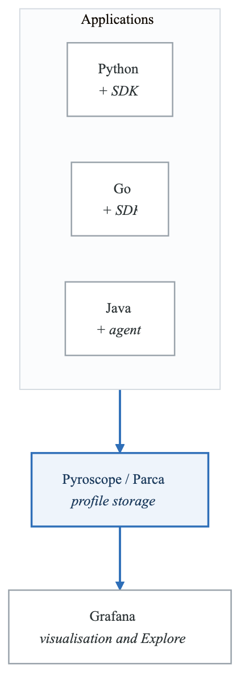
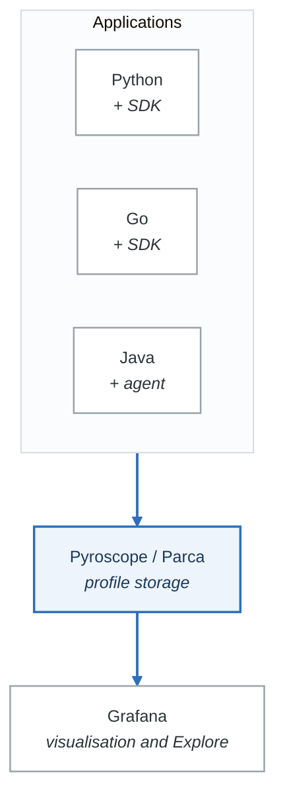

# Lab 11: APM and Continuous Profiling

## Overview
Implement Application Performance Monitoring and continuous profiling using Pyroscope and Parca to identify performance bottlenecks at the code level.

## Prerequisites
- Docker and Docker Compose
- Python, Go, or Java application
- Understanding of profiling concepts
- Observability stack from previous labs

## Learning Objectives
- Deploy continuous profiling infrastructure
- Instrument applications for profiling
- Analyze flame graphs
- Identify performance bottlenecks
- Integrate profiling with observability

## Lab Environment

### Architecture
<!-- figure: generated from the Mermaid below by _shared/diagrams/embed-figures.py — do not edit the image -->


<details>
<summary>Diagram source (Mermaid)</summary>



</details>

### docker-compose.yml
```yaml
version: '3.8'

services:
  pyroscope:
    image: grafana/pyroscope:1.2.0
    container_name: pyroscope
    ports:
      - "4040:4040"
    volumes:
      - pyroscope_data:/var/lib/pyroscope
    command:
      - "server"
    networks:
      - profiling

  parca:
    image: ghcr.io/parca-dev/parca:v0.19.0
    container_name: parca
    ports:
      - "7070:7070"
    volumes:
      - ./parca/parca.yaml:/etc/parca/parca.yaml
      - parca_data:/var/lib/parca
    command:
      - "/parca"
      - "--config-path=/etc/parca/parca.yaml"
    networks:
      - profiling

  # Python application with profiling
  python-app:
    build: ./apps/python
    container_name: python-app
    environment:
      - PYROSCOPE_SERVER_ADDRESS=http://pyroscope:4040
      - PYROSCOPE_APPLICATION_NAME=python-api
    ports:
      - "8080:8080"
    depends_on:
      - pyroscope
    networks:
      - profiling

  # Go application with profiling
  go-app:
    build: ./apps/go
    container_name: go-app
    environment:
      - PYROSCOPE_SERVER_ADDRESS=http://pyroscope:4040
      - PYROSCOPE_APPLICATION_NAME=go-service
    ports:
      - "8081:8081"
    depends_on:
      - pyroscope
    networks:
      - profiling

  grafana:
    image: grafana/grafana:10.0.0
    container_name: grafana
    environment:
      - GF_SECURITY_ADMIN_PASSWORD=admin
    volumes:
      - ./grafana/provisioning:/etc/grafana/provisioning
    ports:
      - "3000:3000"
    networks:
      - profiling

volumes:
  pyroscope_data:
  parca_data:

networks:
  profiling:
    driver: bridge
```

---

## Part 1: Guided Exercises

### Exercise 1.1: Pyroscope Setup

**Objective:** Deploy and configure Pyroscope for continuous profiling.

**Step 1:** Create Pyroscope configuration.

```yaml
# pyroscope/config.yaml (optional, uses defaults)
log-level: info

storage:
  backend: filesystem
  filesystem:
    data-path: /var/lib/pyroscope

scrape-configs:
  - job-name: 'python-apps'
    enabled-profiles: [cpu, mem]
    static-configs:
      - application: python-api
        targets:
          - python-app:8080
        labels:
          env: development
```

**Step 2:** Start Pyroscope.

```bash
mkdir -p pyroscope
docker-compose up -d pyroscope

# Verify Pyroscope is running
curl -s http://localhost:4040/ready
```

**Step 3:** Access Pyroscope UI.

Navigate to http://localhost:4040 to access the Pyroscope interface.

**Verification:**
- [ ] Pyroscope running
- [ ] UI accessible
- [ ] Ready endpoint responding

---

### Exercise 1.2: Python Application Profiling

**Objective:** Instrument a Python application with Pyroscope.

**Step 1:** Create instrumented Python application.

```python
# apps/python/app.py
import os
import time
import random
import hashlib
from flask import Flask, jsonify

# Pyroscope instrumentation
import pyroscope

pyroscope.configure(
    application_name=os.getenv("PYROSCOPE_APPLICATION_NAME", "python-api"),
    server_address=os.getenv("PYROSCOPE_SERVER_ADDRESS", "http://localhost:4040"),
    tags={
        "env": os.getenv("ENVIRONMENT", "development"),
        "version": "1.0.0",
    }
)

app = Flask(__name__)

# Simulated CPU-intensive function
def cpu_intensive_work(iterations: int = 1000000):
    """Simulate CPU-intensive computation."""
    result = 0
    for i in range(iterations):
        result += i * i
        if i % 10000 == 0:
            # Simulate some string operations
            _ = hashlib.md5(str(result).encode()).hexdigest()
    return result

# Simulated memory-intensive function
def memory_intensive_work(size: int = 10000):
    """Simulate memory allocation."""
    data = []
    for i in range(size):
        data.append({
            "id": i,
            "data": "x" * 100,
            "nested": {"value": i * 2}
        })
    return len(data)

# Simulated I/O-bound function
def io_bound_work(delay: float = 0.1):
    """Simulate I/O operations."""
    time.sleep(delay)
    return True

@app.route('/')
def index():
    return jsonify({"service": "python-api", "status": "ok"})

@app.route('/api/compute')
def compute():
    """CPU-intensive endpoint."""
    with pyroscope.tag_wrapper({"endpoint": "compute"}):
        result = cpu_intensive_work(500000)
        return jsonify({"result": result})

@app.route('/api/memory')
def memory():
    """Memory-intensive endpoint."""
    with pyroscope.tag_wrapper({"endpoint": "memory"}):
        count = memory_intensive_work(5000)
        return jsonify({"items_created": count})

@app.route('/api/io')
def io():
    """I/O-bound endpoint."""
    with pyroscope.tag_wrapper({"endpoint": "io"}):
        io_bound_work(random.uniform(0.05, 0.2))
        return jsonify({"status": "completed"})

@app.route('/api/mixed')
def mixed():
    """Mixed workload endpoint."""
    with pyroscope.tag_wrapper({"endpoint": "mixed"}):
        # Some CPU work
        cpu_result = cpu_intensive_work(100000)

        # Some memory work
        mem_count = memory_intensive_work(1000)

        # Some I/O
        io_bound_work(0.05)

        return jsonify({
            "cpu_result": cpu_result,
            "memory_items": mem_count
        })

@app.route('/api/inefficient')
def inefficient():
    """Intentionally inefficient endpoint for demonstration."""
    with pyroscope.tag_wrapper({"endpoint": "inefficient"}):
        # N+1 query simulation
        results = []
        for i in range(100):
            # Inefficient: fetching one at a time
            time.sleep(0.01)
            results.append({"id": i, "data": f"item_{i}"})

        # Inefficient string concatenation
        output = ""
        for r in results:
            output += str(r) + "\n"

        return jsonify({"count": len(results)})

if __name__ == '__main__':
    app.run(host='0.0.0.0', port=8080, threaded=True)
```

**Step 2:** Create requirements and Dockerfile.

```text
# apps/python/requirements.txt
flask==3.0.0
pyroscope-io==0.8.6
```

```dockerfile
# apps/python/Dockerfile
FROM python:3.11-slim
WORKDIR /app
COPY requirements.txt .
RUN pip install --no-cache-dir -r requirements.txt
COPY app.py .
CMD ["python", "app.py"]
```

**Step 3:** Build and run.

```bash
docker-compose build python-app
docker-compose up -d python-app
```

**Step 4:** Generate profiling data.

```bash
# Generate load
for i in {1..50}; do
  curl -s http://localhost:8080/api/compute &
  curl -s http://localhost:8080/api/memory &
  curl -s http://localhost:8080/api/mixed &
  curl -s http://localhost:8080/api/inefficient &
  sleep 0.5
done
wait
```

**Step 5:** Analyze in Pyroscope UI.

1. Navigate to http://localhost:4040
2. Select "python-api" application
3. View CPU flame graph
4. Identify hot spots in the code

**Verification:**
- [ ] Profiles appearing in Pyroscope
- [ ] CPU flame graph visible
- [ ] Can identify hot functions

---

### Exercise 1.3: Go Application Profiling

**Objective:** Instrument a Go application with continuous profiling.

**Step 1:** Create Go application with Pyroscope.

```go
// apps/go/main.go
package main

import (
    "encoding/json"
    "fmt"
    "log"
    "math/rand"
    "net/http"
    "os"
    "runtime"
    "sync"
    "time"

    "github.com/grafana/pyroscope-go"
)

var profiler *pyroscope.Profiler

func init() {
    var err error
    profiler, err = pyroscope.Start(pyroscope.Config{
        ApplicationName: getEnv("PYROSCOPE_APPLICATION_NAME", "go-service"),
        ServerAddress:   getEnv("PYROSCOPE_SERVER_ADDRESS", "http://localhost:4040"),
        Tags: map[string]string{
            "env":     getEnv("ENVIRONMENT", "development"),
            "version": "1.0.0",
        },
        ProfileTypes: []pyroscope.ProfileType{
            pyroscope.ProfileCPU,
            pyroscope.ProfileAllocObjects,
            pyroscope.ProfileAllocSpace,
            pyroscope.ProfileInuseObjects,
            pyroscope.ProfileInuseSpace,
            pyroscope.ProfileGoroutines,
            pyroscope.ProfileMutexCount,
            pyroscope.ProfileMutexDuration,
            pyroscope.ProfileBlockCount,
            pyroscope.ProfileBlockDuration,
        },
    })
    if err != nil {
        log.Printf("Failed to start Pyroscope: %v", err)
    }
}

func getEnv(key, fallback string) string {
    if value, exists := os.LookupEnv(key); exists {
        return value
    }
    return fallback
}

// CPU-intensive function
func cpuIntensive(iterations int) int64 {
    var result int64
    for i := 0; i < iterations; i++ {
        result += int64(i * i)
        if i%10000 == 0 {
            // Force some computation
            _ = fmt.Sprintf("%d", result)
        }
    }
    return result
}

// Memory-intensive function
func memoryIntensive(size int) int {
    data := make([]map[string]interface{}, size)
    for i := 0; i < size; i++ {
        data[i] = map[string]interface{}{
            "id":   i,
            "data": string(make([]byte, 100)),
        }
    }
    runtime.GC() // Force GC to show allocation
    return len(data)
}

// Goroutine-intensive function
func goroutineIntensive(count int) int {
    var wg sync.WaitGroup
    results := make(chan int, count)

    for i := 0; i < count; i++ {
        wg.Add(1)
        go func(n int) {
            defer wg.Done()
            time.Sleep(time.Duration(rand.Intn(50)) * time.Millisecond)
            results <- n * 2
        }(i)
    }

    go func() {
        wg.Wait()
        close(results)
    }()

    sum := 0
    for r := range results {
        sum += r
    }
    return sum
}

// Mutex contention function
var mu sync.Mutex
var counter int

func mutexContention(iterations int) int {
    for i := 0; i < iterations; i++ {
        mu.Lock()
        counter++
        mu.Unlock()
    }
    return counter
}

func computeHandler(w http.ResponseWriter, r *http.Request) {
    pyroscope.TagWrapper(r.Context(), pyroscope.Labels("endpoint", "compute"), func(ctx context.Context) {
        result := cpuIntensive(500000)
        json.NewEncoder(w).Encode(map[string]int64{"result": result})
    })
}

func memoryHandler(w http.ResponseWriter, r *http.Request) {
    pyroscope.TagWrapper(r.Context(), pyroscope.Labels("endpoint", "memory"), func(ctx context.Context) {
        count := memoryIntensive(10000)
        json.NewEncoder(w).Encode(map[string]int{"items": count})
    })
}

func goroutineHandler(w http.ResponseWriter, r *http.Request) {
    pyroscope.TagWrapper(r.Context(), pyroscope.Labels("endpoint", "goroutines"), func(ctx context.Context) {
        result := goroutineIntensive(100)
        json.NewEncoder(w).Encode(map[string]int{"sum": result})
    })
}

func mutexHandler(w http.ResponseWriter, r *http.Request) {
    pyroscope.TagWrapper(r.Context(), pyroscope.Labels("endpoint", "mutex"), func(ctx context.Context) {
        result := mutexContention(10000)
        json.NewEncoder(w).Encode(map[string]int{"counter": result})
    })
}

func main() {
    http.HandleFunc("/", func(w http.ResponseWriter, r *http.Request) {
        json.NewEncoder(w).Encode(map[string]string{"service": "go-service", "status": "ok"})
    })
    http.HandleFunc("/api/compute", computeHandler)
    http.HandleFunc("/api/memory", memoryHandler)
    http.HandleFunc("/api/goroutines", goroutineHandler)
    http.HandleFunc("/api/mutex", mutexHandler)

    log.Println("Starting Go service on :8081")
    log.Fatal(http.ListenAndServe(":8081", nil))
}
```

**Step 2:** Create Go module and Dockerfile.

```go
// apps/go/go.mod
module go-service

go 1.21

require github.com/grafana/pyroscope-go v1.1.1
```

```dockerfile
# apps/go/Dockerfile
FROM golang:1.21-alpine AS builder
WORKDIR /app
COPY go.mod go.sum ./
RUN go mod download
COPY . .
RUN CGO_ENABLED=0 go build -o server .

FROM alpine:3.18
WORKDIR /app
COPY --from=builder /app/server .
CMD ["./server"]
```

**Step 3:** Build and run.

```bash
docker-compose build go-app
docker-compose up -d go-app

# Generate load
for i in {1..50}; do
  curl -s http://localhost:8081/api/compute &
  curl -s http://localhost:8081/api/memory &
  curl -s http://localhost:8081/api/goroutines &
  curl -s http://localhost:8081/api/mutex &
  sleep 0.5
done
wait
```

**Verification:**
- [ ] Go profiles in Pyroscope
- [ ] Multiple profile types visible
- [ ] Goroutine and mutex profiles available

---

### Exercise 1.4: Flame Graph Analysis

**Objective:** Learn to interpret flame graphs for performance optimization.

**Step 1:** Understanding flame graph structure.

```markdown
# Flame Graph Interpretation Guide

## Structure
- Width = Time spent in function (or allocations)
- Height = Call stack depth
- Color = Usually random (for visual distinction)

## Reading the Graph
1. Wide bars at the bottom = High-level entry points
2. Wide bars at the top = Where time is actually spent
3. Narrow towers = Deep call stacks with little time
4. Flat tops = Functions without children (leaf functions)

## Identifying Problems
- Wide leaf functions = Optimization targets
- Many similar towers = Repeated expensive operations
- Unexpected functions = Potential bugs or inefficiencies
```

**Step 2:** Analyze Python CPU profile.

In Pyroscope UI:
1. Select "python-api" application
2. Choose "cpu" profile type
3. Look for wide bars in the flame graph
4. Click on functions to see details

Common findings:
- `cpu_intensive_work` should dominate
- `hashlib.md5` appears as a hot spot
- String operations in the loop

**Step 3:** Analyze Go memory profile.

1. Select "go-service" application
2. Choose "alloc_space" profile type
3. Identify allocation hot spots
4. Compare with "inuse_space" for current memory

**Step 4:** Compare profiles over time.

Use Pyroscope's comparison feature:
1. Select two time ranges
2. Click "Compare"
3. See diff flame graph showing changes

**Verification:**
- [ ] Can identify hot spots
- [ ] Understand flame graph layout
- [ ] Can compare time periods

---

### Exercise 1.5: Grafana Integration

**Objective:** Integrate profiling data with Grafana for unified observability.

**Step 1:** Configure Pyroscope data source.

```yaml
# grafana/provisioning/datasources/datasources.yml
apiVersion: 1

datasources:
  - name: Pyroscope
    type: grafana-pyroscope-datasource
    access: proxy
    url: http://pyroscope:4040
    isDefault: false
    jsonData:
      minStep: '15s'
```

**Step 2:** Create profiling dashboard.

```json
{
  "dashboard": {
    "title": "Application Profiling",
    "panels": [
      {
        "title": "CPU Profile - Python API",
        "type": "flamegraph",
        "gridPos": {"h": 12, "w": 12, "x": 0, "y": 0},
        "targets": [{
          "datasource": "Pyroscope",
          "profileTypeId": "process_cpu:cpu:nanoseconds:cpu:nanoseconds",
          "labelSelector": "{service_name=\"python-api\"}",
          "queryType": "profile"
        }]
      },
      {
        "title": "Memory Profile - Go Service",
        "type": "flamegraph",
        "gridPos": {"h": 12, "w": 12, "x": 12, "y": 0},
        "targets": [{
          "datasource": "Pyroscope",
          "profileTypeId": "memory:alloc_space:bytes:space:bytes",
          "labelSelector": "{service_name=\"go-service\"}",
          "queryType": "profile"
        }]
      }
    ]
  }
}
```

**Step 3:** Link traces to profiles.

Configure trace-to-profile correlation:

```yaml
# In Tempo datasource configuration
jsonData:
  tracesToProfiles:
    datasourceUid: pyroscope
    tags:
      - key: service.name
        value: service_name
    profileTypeId: process_cpu:cpu:nanoseconds:cpu:nanoseconds
```

**Verification:**
- [ ] Pyroscope data source configured
- [ ] Flame graphs in Grafana
- [ ] Trace-to-profile links working

---

## Part 2: Semi-Guided Exercises

### Exercise 2.1: Parca Setup and eBPF Profiling

**Objective:** Deploy Parca for eBPF-based profiling.

**Requirements:**
1. Deploy Parca server
2. Deploy Parca agent
3. Enable eBPF profiling
4. View system-wide profiles

**Hints:**
- Parca agent requires kernel support
- Use scrape targets for pull-based profiling
- eBPF provides low-overhead profiling

---

### Exercise 2.2: Java Application Profiling

**Objective:** Profile a Java application with async-profiler.

**Requirements:**
1. Add async-profiler agent
2. Configure Pyroscope Java integration
3. Analyze JVM-specific profiles
4. Identify GC impact

---

### Exercise 2.3: Profile-Guided Optimization

**Objective:** Use profiling data to optimize code.

**Requirements:**
1. Identify top 3 CPU hot spots
2. Implement optimizations
3. Verify improvements
4. Document before/after

---

### Exercise 2.4: Production Profiling Strategy

**Objective:** Design safe production profiling approach.

**Requirements:**
1. Define sampling rates
2. Implement gradual rollout
3. Create alerting for overhead
4. Document safety guidelines

---

## Part 3: Challenge Exercises

### Challenge 3.1: Automated Performance Regression Detection

**Objective:** Detect performance regressions from profile changes.

**Requirements:**
1. Baseline profile collection
2. Automated comparison
3. Alert on significant changes
4. CI/CD integration

---

### Challenge 3.2: Distributed Profiling Correlation

**Objective:** Correlate profiles across distributed services.

**Requirements:**
1. Propagate profiling context
2. Aggregate distributed profiles
3. Visualize end-to-end
4. Identify cross-service bottlenecks

---

### Challenge 3.3: Custom Profile Types

**Objective:** Implement custom application-specific profiling.

**Requirements:**
1. Define custom metrics
2. Instrument collection
3. Visualize in flame graphs
4. Document interpretation

---

## Cleanup

```bash
docker-compose down -v
rm -rf apps pyroscope parca grafana
```

## Additional Resources

- [Pyroscope Documentation](https://pyroscope.io/docs/)
- [Parca Documentation](https://www.parca.dev/docs/)
- [Flame Graph Interpretation](https://www.brendangregg.com/flamegraphs.html)
- [Go Profiling](https://go.dev/blog/pprof)

## Next Lab
Continue to [Lab 12: Observability Platform](../lab-12-observability-platform/README.md) to build a complete observability platform.

<!-- feynman-check -->

---

## Feynman check

Close the file. Blank page, no notes. Explain each of these to a competent engineer who has never
used this tool — **under five minutes, no jargon you can't define on the spot:**

- Reading the Graph
- Identifying Problems
- 1: Pyroscope Setup
- 2: Python Application Profiling

**The gap is not what you forgot. It is where you used a word instead of a mechanism.**

| | |
|---|---|
| ✗ | *"Prometheus monitors the service."* |
| ✓ | *"Prometheus discovers targets from the Kubernetes API, applies relabelling rules, scrapes `/metrics` over HTTP on an interval, and appends samples to a local TSDB. Nothing is pushed — so a target missing from a dashboard is a service-discovery problem, not an application one."* |

**Trace it:** A latency regression → a phone ringing. Name each hop: sample, rule evaluation, alert state transition, routing, notification — and where each one can silently stop.

Stop at the first component you cannot name. Reopen this file and read **only** that.

**Go deeper — only once the gap has a name:** [SRE Workbook ch. 5, *Alerting on SLOs*](https://sre.google/workbook/alerting-on-slos/) — free, and the best thing written on why static thresholds page you for nothing.
Full list per domain: [`SOURCES.md`](../SOURCES.md#observability-sre)

→ Protocol, the three levels of knowing, and worked examples: [`MASTERY.md`](../MASTERY.md)

<!-- /feynman-check -->
