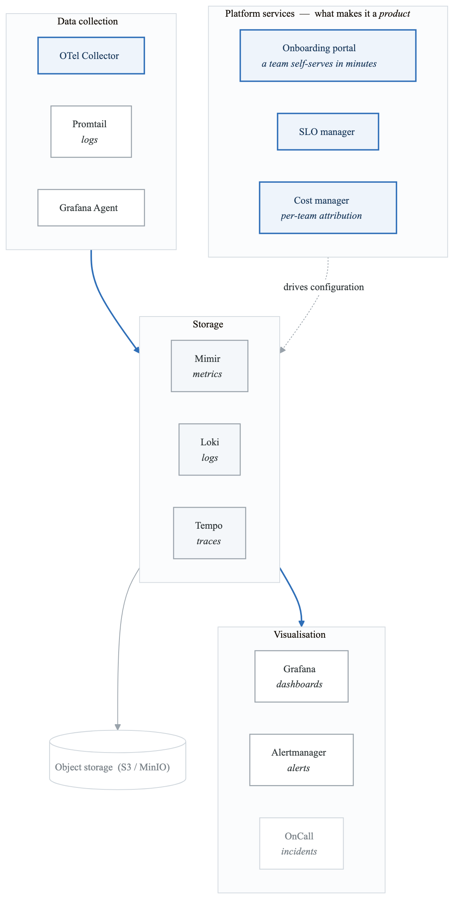
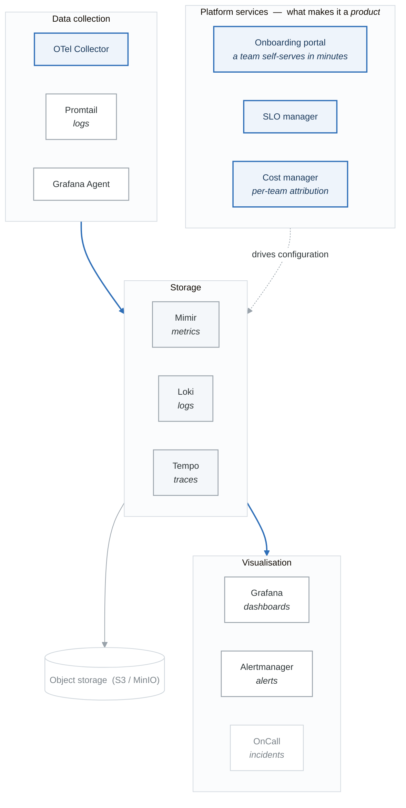

# Lab 12: Building an Observability Platform

## Overview
Build a comprehensive, production-ready observability platform integrating metrics, logs, traces, and profiling into a unified self-service system.

## Prerequisites
- Completed Labs 01-11
- Kubernetes cluster
- Understanding of all observability pillars
- Experience with Helm and GitOps

## Learning Objectives
- Design unified observability architecture
- Implement multi-tenant observability
- Build self-service onboarding
- Create operational runbooks
- Establish governance and standards

## Lab Environment

### Complete Platform Architecture
<!-- figure: generated from the Mermaid below by _shared/diagrams/embed-figures.py — do not edit the image -->


<details>
<summary>Diagram source (Mermaid)</summary>



</details>

### Kubernetes Namespace Structure
```bash
# Create namespaces
kubectl create namespace observability
kubectl create namespace observability-system
kubectl create namespace monitoring

# Label namespaces
kubectl label namespace observability purpose=platform
kubectl label namespace observability-system purpose=infrastructure
```

---

## Part 1: Guided Exercises

### Exercise 1.1: Storage Layer with MinIO

**Objective:** Deploy object storage for long-term data retention.

**Step 1:** Deploy MinIO.

```yaml
# minio/minio-deployment.yaml
apiVersion: v1
kind: Namespace
metadata:
  name: minio
---
apiVersion: apps/v1
kind: Deployment
metadata:
  name: minio
  namespace: minio
spec:
  replicas: 1
  selector:
    matchLabels:
      app: minio
  template:
    metadata:
      labels:
        app: minio
    spec:
      containers:
        - name: minio
          image: minio/minio:RELEASE.2024-01-01T16-36-33Z
          args:
            - server
            - /data
            - --console-address
            - ":9001"
          env:
            - name: MINIO_ROOT_USER
              value: "admin"
            - name: MINIO_ROOT_PASSWORD
              value: "supersecret"
          ports:
            - containerPort: 9000
            - containerPort: 9001
          volumeMounts:
            - name: data
              mountPath: /data
      volumes:
        - name: data
          persistentVolumeClaim:
            claimName: minio-pvc
---
apiVersion: v1
kind: Service
metadata:
  name: minio
  namespace: minio
spec:
  selector:
    app: minio
  ports:
    - name: api
      port: 9000
    - name: console
      port: 9001
---
apiVersion: v1
kind: PersistentVolumeClaim
metadata:
  name: minio-pvc
  namespace: minio
spec:
  accessModes:
    - ReadWriteOnce
  resources:
    requests:
      storage: 50Gi
```

**Step 2:** Create buckets for each service.

```bash
# Port forward to MinIO
kubectl port-forward -n minio svc/minio 9000:9000 9001:9001 &

# Install mc (MinIO client)
# Create buckets
mc alias set local http://localhost:9000 admin supersecret
mc mb local/mimir-blocks
mc mb local/mimir-ruler
mc mb local/loki-chunks
mc mb local/loki-ruler
mc mb local/tempo-traces
```

**Verification:**
- [ ] MinIO running
- [ ] Buckets created
- [ ] Console accessible

---

### Exercise 1.2: Metrics Storage with Mimir

**Objective:** Deploy Grafana Mimir for scalable metrics storage.

**Step 1:** Create Mimir configuration.

```yaml
# mimir/mimir-config.yaml
apiVersion: v1
kind: ConfigMap
metadata:
  name: mimir-config
  namespace: observability
data:
  mimir.yaml: |
    multitenancy_enabled: true

    server:
      http_listen_port: 8080
      grpc_listen_port: 9095

    common:
      storage:
        backend: s3
        s3:
          endpoint: minio.minio.svc:9000
          bucket_name: mimir-blocks
          access_key_id: admin
          secret_access_key: supersecret
          insecure: true

    blocks_storage:
      backend: s3
      s3:
        endpoint: minio.minio.svc:9000
        bucket_name: mimir-blocks
        access_key_id: admin
        secret_access_key: supersecret
        insecure: true
      tsdb:
        dir: /data/tsdb
      bucket_store:
        sync_dir: /data/tsdb-sync

    ruler_storage:
      backend: s3
      s3:
        endpoint: minio.minio.svc:9000
        bucket_name: mimir-ruler
        access_key_id: admin
        secret_access_key: supersecret
        insecure: true

    limits:
      max_global_series_per_user: 1500000
      max_global_series_per_metric: 50000
      ingestion_rate: 100000
      ingestion_burst_size: 200000

    distributor:
      ring:
        kvstore:
          store: memberlist

    ingester:
      ring:
        kvstore:
          store: memberlist
        replication_factor: 1

    compactor:
      data_dir: /data/compactor
      sharding_ring:
        kvstore:
          store: memberlist

    store_gateway:
      sharding_ring:
        kvstore:
          store: memberlist

    memberlist:
      join_members:
        - mimir-memberlist:7946
```

**Step 2:** Deploy Mimir.

```yaml
# mimir/mimir-deployment.yaml
apiVersion: apps/v1
kind: Deployment
metadata:
  name: mimir
  namespace: observability
spec:
  replicas: 1
  selector:
    matchLabels:
      app: mimir
  template:
    metadata:
      labels:
        app: mimir
    spec:
      containers:
        - name: mimir
          image: grafana/mimir:2.11.0
          args:
            - -config.file=/etc/mimir/mimir.yaml
            - -target=all
          ports:
            - containerPort: 8080
            - containerPort: 9095
          volumeMounts:
            - name: config
              mountPath: /etc/mimir
            - name: data
              mountPath: /data
      volumes:
        - name: config
          configMap:
            name: mimir-config
        - name: data
          emptyDir: {}
---
apiVersion: v1
kind: Service
metadata:
  name: mimir
  namespace: observability
spec:
  selector:
    app: mimir
  ports:
    - name: http
      port: 8080
    - name: grpc
      port: 9095
---
apiVersion: v1
kind: Service
metadata:
  name: mimir-memberlist
  namespace: observability
spec:
  clusterIP: None
  selector:
    app: mimir
  ports:
    - name: memberlist
      port: 7946
```

**Step 3:** Apply and verify.

```bash
kubectl apply -f mimir/

# Verify Mimir is running
kubectl get pods -n observability -l app=mimir
kubectl logs -n observability -l app=mimir --tail=20
```

**Verification:**
- [ ] Mimir pods running
- [ ] Can write metrics
- [ ] Can query metrics

---

### Exercise 1.3: Log Storage with Loki

**Objective:** Deploy Grafana Loki for log aggregation.

**Step 1:** Create Loki configuration.

```yaml
# loki/loki-config.yaml
apiVersion: v1
kind: ConfigMap
metadata:
  name: loki-config
  namespace: observability
data:
  loki.yaml: |
    auth_enabled: true

    server:
      http_listen_port: 3100
      grpc_listen_port: 9096

    common:
      path_prefix: /loki
      storage:
        s3:
          endpoint: minio.minio.svc:9000
          bucketnames: loki-chunks
          access_key_id: admin
          secret_access_key: supersecret
          insecure: true
          s3forcepathstyle: true
      replication_factor: 1
      ring:
        kvstore:
          store: memberlist

    memberlist:
      join_members:
        - loki-memberlist:7946

    schema_config:
      configs:
        - from: 2020-10-24
          store: boltdb-shipper
          object_store: s3
          schema: v11
          index:
            prefix: index_
            period: 24h

    storage_config:
      boltdb_shipper:
        active_index_directory: /loki/index
        cache_location: /loki/cache
        shared_store: s3

    limits_config:
      enforce_metric_name: false
      reject_old_samples: true
      reject_old_samples_max_age: 168h
      max_entries_limit_per_query: 5000
      ingestion_rate_mb: 10
      ingestion_burst_size_mb: 20

    chunk_store_config:
      max_look_back_period: 0s

    table_manager:
      retention_deletes_enabled: true
      retention_period: 720h  # 30 days

    ruler:
      storage:
        type: s3
        s3:
          bucketnames: loki-ruler
          endpoint: minio.minio.svc:9000
          access_key_id: admin
          secret_access_key: supersecret
          insecure: true
          s3forcepathstyle: true
      rule_path: /loki/rules
      alertmanager_url: http://alertmanager.observability.svc:9093
      ring:
        kvstore:
          store: memberlist
```

**Step 2:** Deploy Loki.

```yaml
# loki/loki-deployment.yaml
apiVersion: apps/v1
kind: Deployment
metadata:
  name: loki
  namespace: observability
spec:
  replicas: 1
  selector:
    matchLabels:
      app: loki
  template:
    metadata:
      labels:
        app: loki
    spec:
      containers:
        - name: loki
          image: grafana/loki:2.9.0
          args:
            - -config.file=/etc/loki/loki.yaml
            - -target=all
          ports:
            - containerPort: 3100
            - containerPort: 9096
          volumeMounts:
            - name: config
              mountPath: /etc/loki
            - name: data
              mountPath: /loki
      volumes:
        - name: config
          configMap:
            name: loki-config
        - name: data
          emptyDir: {}
---
apiVersion: v1
kind: Service
metadata:
  name: loki
  namespace: observability
spec:
  selector:
    app: loki
  ports:
    - name: http
      port: 3100
    - name: grpc
      port: 9096
```

**Verification:**
- [ ] Loki pods running
- [ ] Can ingest logs
- [ ] Can query logs

---

### Exercise 1.4: Trace Storage with Tempo

**Objective:** Deploy Grafana Tempo for distributed tracing.

**Step 1:** Create Tempo configuration.

```yaml
# tempo/tempo-config.yaml
apiVersion: v1
kind: ConfigMap
metadata:
  name: tempo-config
  namespace: observability
data:
  tempo.yaml: |
    multitenancy_enabled: true

    server:
      http_listen_port: 3200
      grpc_listen_port: 9095

    distributor:
      receivers:
        otlp:
          protocols:
            grpc:
            http:
        jaeger:
          protocols:
            thrift_http:
            grpc:
            thrift_binary:
            thrift_compact:
        zipkin:

    ingester:
      trace_idle_period: 10s
      max_block_bytes: 1_000_000
      max_block_duration: 5m

    compactor:
      compaction:
        compaction_window: 1h
        max_block_bytes: 100_000_000
        block_retention: 1h
        compacted_block_retention: 10m

    storage:
      trace:
        backend: s3
        s3:
          bucket: tempo-traces
          endpoint: minio.minio.svc:9000
          access_key: admin
          secret_key: supersecret
          insecure: true
        wal:
          path: /var/tempo/wal
        local:
          path: /var/tempo/blocks
        pool:
          max_workers: 100
          queue_depth: 10000

    querier:
      frontend_worker:
        frontend_address: tempo-query-frontend:9095

    metrics_generator:
      registry:
        external_labels:
          source: tempo
      storage:
        path: /var/tempo/generator/wal
        remote_write:
          - url: http://mimir.observability.svc:8080/api/v1/push
            headers:
              X-Scope-OrgID: platform

    overrides:
      defaults:
        metrics_generator:
          processors: [service-graphs, span-metrics]
```

**Step 2:** Deploy Tempo.

```yaml
# tempo/tempo-deployment.yaml
apiVersion: apps/v1
kind: Deployment
metadata:
  name: tempo
  namespace: observability
spec:
  replicas: 1
  selector:
    matchLabels:
      app: tempo
  template:
    metadata:
      labels:
        app: tempo
    spec:
      containers:
        - name: tempo
          image: grafana/tempo:2.3.0
          args:
            - -config.file=/etc/tempo/tempo.yaml
            - -target=all
          ports:
            - containerPort: 3200
            - containerPort: 4317
            - containerPort: 4318
          volumeMounts:
            - name: config
              mountPath: /etc/tempo
            - name: data
              mountPath: /var/tempo
      volumes:
        - name: config
          configMap:
            name: tempo-config
        - name: data
          emptyDir: {}
---
apiVersion: v1
kind: Service
metadata:
  name: tempo
  namespace: observability
spec:
  selector:
    app: tempo
  ports:
    - name: http
      port: 3200
    - name: otlp-grpc
      port: 4317
    - name: otlp-http
      port: 4318
```

**Verification:**
- [ ] Tempo pods running
- [ ] Can receive traces
- [ ] Service graph generating

---

### Exercise 1.5: Unified Grafana Setup

**Objective:** Deploy Grafana with all data sources configured.

**Step 1:** Create Grafana configuration.

```yaml
# grafana/grafana-config.yaml
apiVersion: v1
kind: ConfigMap
metadata:
  name: grafana-config
  namespace: observability
data:
  grafana.ini: |
    [server]
    root_url = http://localhost:3000

    [security]
    admin_user = admin
    admin_password = admin

    [auth]
    disable_login_form = false

    [auth.anonymous]
    enabled = true
    org_role = Viewer

    [users]
    allow_sign_up = false

    [feature_toggles]
    enable = traceqlEditor tempoServiceGraph tempoSearch tempoBackendSearch

    [unified_alerting]
    enabled = true

    [alerting]
    enabled = false
---
apiVersion: v1
kind: ConfigMap
metadata:
  name: grafana-datasources
  namespace: observability
data:
  datasources.yaml: |
    apiVersion: 1
    datasources:
      - name: Mimir
        type: prometheus
        access: proxy
        url: http://mimir.observability.svc:8080/prometheus
        isDefault: true
        jsonData:
          httpHeaderName1: X-Scope-OrgID
          manageAlerts: true
          alertmanagerUid: alertmanager
          prometheusType: Mimir
        secureJsonData:
          httpHeaderValue1: platform
        editable: false

      - name: Loki
        type: loki
        access: proxy
        url: http://loki.observability.svc:3100
        jsonData:
          httpHeaderName1: X-Scope-OrgID
          maxLines: 1000
          derivedFields:
            - name: TraceID
              matcherRegex: '"trace_id":"(\w+)"'
              url: '$${__value.raw}'
              datasourceUid: tempo
        secureJsonData:
          httpHeaderValue1: platform
        editable: false

      - name: Tempo
        type: tempo
        access: proxy
        url: http://tempo.observability.svc:3200
        uid: tempo
        jsonData:
          httpHeaderName1: X-Scope-OrgID
          tracesToLogs:
            datasourceUid: loki
            tags: ['service.name']
            mappedTags:
              - key: service.name
                value: service
            spanStartTimeShift: '-1h'
            spanEndTimeShift: '1h'
            filterByTraceID: true
          tracesToMetrics:
            datasourceUid: mimir
            tags:
              - key: service.name
                value: service
            queries:
              - name: 'Request rate'
                query: 'sum(rate(traces_spanmetrics_calls_total{$$__tags}[5m]))'
          serviceMap:
            datasourceUid: mimir
          nodeGraph:
            enabled: true
          search:
            hide: false
          lokiSearch:
            datasourceUid: loki
        secureJsonData:
          httpHeaderValue1: platform
        editable: false

      - name: Alertmanager
        type: alertmanager
        access: proxy
        url: http://alertmanager.observability.svc:9093
        uid: alertmanager
        jsonData:
          implementation: prometheus
        editable: false
```

**Step 2:** Deploy Grafana.

```yaml
# grafana/grafana-deployment.yaml
apiVersion: apps/v1
kind: Deployment
metadata:
  name: grafana
  namespace: observability
spec:
  replicas: 1
  selector:
    matchLabels:
      app: grafana
  template:
    metadata:
      labels:
        app: grafana
    spec:
      containers:
        - name: grafana
          image: grafana/grafana:10.2.0
          ports:
            - containerPort: 3000
          env:
            - name: GF_PATHS_PROVISIONING
              value: /etc/grafana/provisioning
          volumeMounts:
            - name: config
              mountPath: /etc/grafana/grafana.ini
              subPath: grafana.ini
            - name: datasources
              mountPath: /etc/grafana/provisioning/datasources
            - name: data
              mountPath: /var/lib/grafana
      volumes:
        - name: config
          configMap:
            name: grafana-config
        - name: datasources
          configMap:
            name: grafana-datasources
        - name: data
          emptyDir: {}
---
apiVersion: v1
kind: Service
metadata:
  name: grafana
  namespace: observability
spec:
  selector:
    app: grafana
  ports:
    - port: 3000
  type: LoadBalancer
```

**Verification:**
- [ ] Grafana running
- [ ] All data sources connected
- [ ] Cross-signal correlation working

---

## Part 2: Semi-Guided Exercises

### Exercise 2.1: Self-Service Onboarding Portal

**Objective:** Build a self-service portal for team onboarding.

**Requirements:**
1. Team registration form
2. Automatic namespace creation
3. Default dashboard provisioning
4. Alert rule templates

---

### Exercise 2.2: Multi-Tenant Configuration

**Objective:** Implement proper multi-tenancy.

**Requirements:**
1. Tenant isolation in all backends
2. Tenant-specific retention policies
3. RBAC per tenant
4. Cross-tenant admin views

---

### Exercise 2.3: Cost Allocation

**Objective:** Implement observability cost tracking.

**Requirements:**
1. Per-tenant usage metrics
2. Cost calculation rules
3. Showback dashboards
4. Budget alerts

---

### Exercise 2.4: Platform SLOs

**Objective:** Define SLOs for the observability platform itself.

**Requirements:**
1. Data ingestion SLOs
2. Query latency SLOs
3. Availability SLOs
4. Data freshness SLOs

---

## Part 3: Challenge Exercises

### Challenge 3.1: GitOps-Managed Observability

**Objective:** Manage entire platform via GitOps.

**Requirements:**
1. All configs in Git
2. ArgoCD/Flux deployment
3. Environment promotion
4. Rollback procedures

---

### Challenge 3.2: Federated Observability

**Objective:** Build federation across multiple clusters.

**Requirements:**
1. Cross-cluster querying
2. Central aggregation
3. Local retention
4. Failover handling

---

### Challenge 3.3: AI/ML-Enhanced Observability

**Objective:** Add intelligent features to platform.

**Requirements:**
1. Anomaly detection
2. Root cause analysis
3. Predictive alerting
4. Auto-remediation

---

## Platform Operations Guide

### Daily Operations Checklist
```markdown
- [ ] Check platform component health
- [ ] Review storage utilization
- [ ] Verify ingestion rates normal
- [ ] Check alert pipeline
- [ ] Review error rates
```

### Capacity Planning
```promql
# Storage growth rate
rate(mimir_tsdb_blocks_loaded_total[24h])

# Ingestion rate
sum(rate(mimir_distributor_received_samples_total[5m]))

# Query latency
histogram_quantile(0.99, sum by (le) (rate(mimir_query_frontend_query_seconds_bucket[5m])))
```

### Troubleshooting Guide
```markdown
## High Ingestion Latency
1. Check distributor queue depth
2. Verify ingester health
3. Check network saturation
4. Review rate limits

## Missing Data
1. Check collector health
2. Verify network connectivity
3. Review tenant limits
4. Check storage availability
```

---

## Cleanup

```bash
# Delete all resources
kubectl delete namespace observability
kubectl delete namespace observability-system
kubectl delete namespace minio

# Delete cluster (if using kind)
kind delete cluster --name observability-lab
```

## Additional Resources

- [Grafana LGTM Stack](https://grafana.com/docs/)
- [Mimir Documentation](https://grafana.com/docs/mimir/latest/)
- [Loki Documentation](https://grafana.com/docs/loki/latest/)
- [Tempo Documentation](https://grafana.com/docs/tempo/latest/)
- [OpenTelemetry Operator](https://opentelemetry.io/docs/kubernetes/operator/)

## Congratulations!
You have completed the Observability & SRE labs. You now have the skills to build and operate a production-grade observability platform.

<!-- feynman-check -->

---

## Feynman check

Close the file. Blank page, no notes. Explain each of these to a competent engineer who has never
used this tool — **under five minutes, no jargon you can't define on the spot:**

- Platform Operations Guide
- High Ingestion Latency
- Missing Data
- Congratulations!

**The gap is not what you forgot. It is where you used a word instead of a mechanism.**

| | |
|---|---|
| ✗ | *"Prometheus monitors the service."* |
| ✓ | *"Prometheus discovers targets from the Kubernetes API, applies relabelling rules, scrapes `/metrics` over HTTP on an interval, and appends samples to a local TSDB. Nothing is pushed — so a target missing from a dashboard is a service-discovery problem, not an application one."* |

**Trace it:** A latency regression → a phone ringing. Name each hop: sample, rule evaluation, alert state transition, routing, notification — and where each one can silently stop.

Stop at the first component you cannot name. Reopen this file and read **only** that.

**Go deeper — only once the gap has a name:** [SRE Workbook ch. 5, *Alerting on SLOs*](https://sre.google/workbook/alerting-on-slos/) — free, and the best thing written on why static thresholds page you for nothing.
Full list per domain: [`SOURCES.md`](../SOURCES.md#observability-sre)

→ Protocol, the three levels of knowing, and worked examples: [`MASTERY.md`](../MASTERY.md)

<!-- /feynman-check -->
