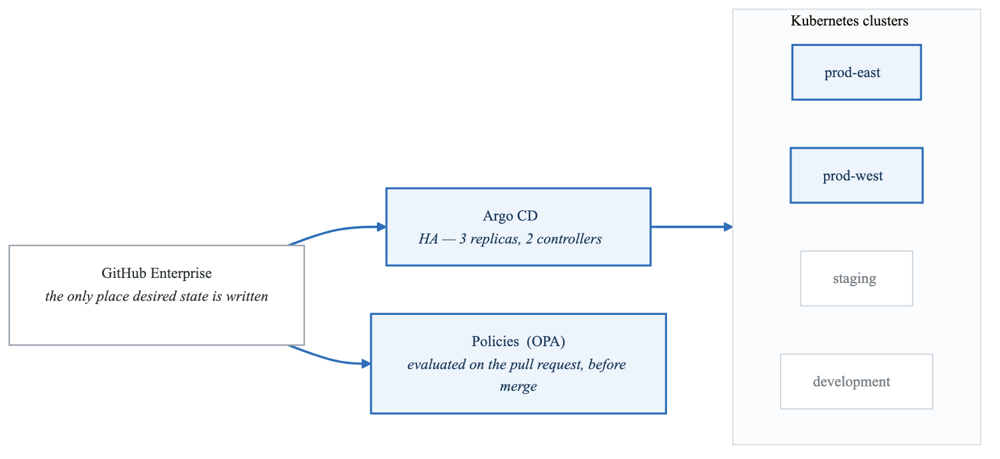
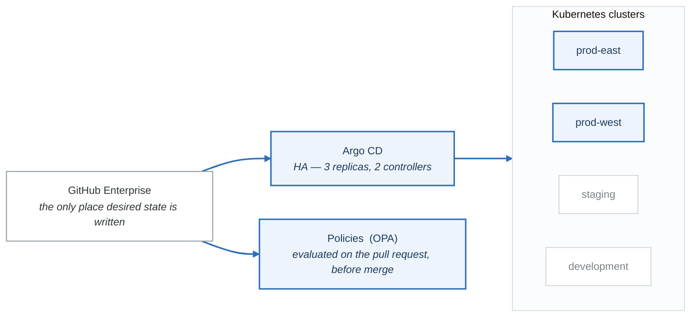
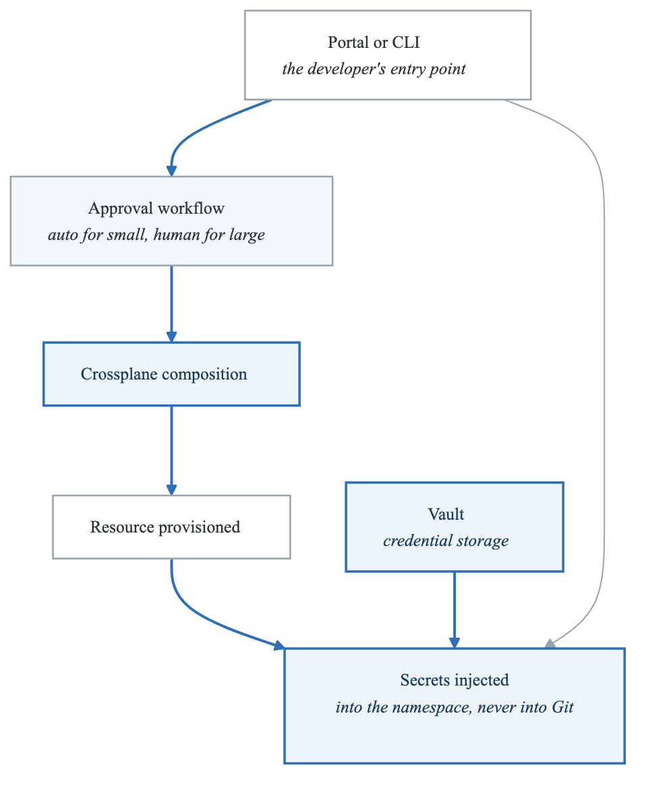
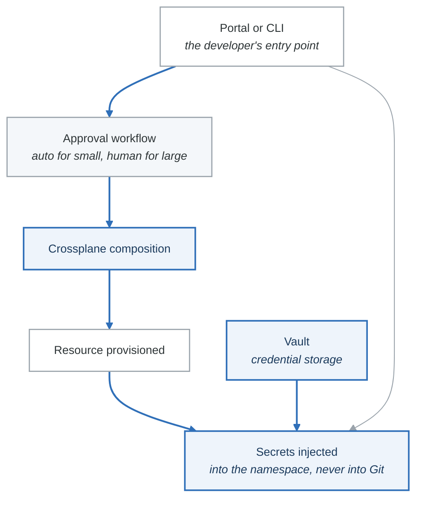

# Case Study 1: Enterprise Platform Transformation at GlobalFinance

## Executive Summary

GlobalFinance, a Fortune 500 financial services company with 2,500 engineers across 180 teams, embarked on a three-year journey to build an Internal Developer Platform (IDP). This case study examines their transformation from fragmented, team-specific tooling to a unified platform that reduced deployment time from weeks to hours and increased developer satisfaction scores by 45%.

## Company Background

### Organization Profile

| Attribute | Details |
|-----------|---------|
| **Industry** | Financial Services (Banking, Insurance, Wealth Management) |
| **Size** | 2,500 engineers, 180 teams |
| **Technology Estate** | 1,200+ microservices, 3 data centers, 2 cloud providers |
| **Annual IT Budget** | $2.1 billion |
| **Regulatory Environment** | SOX, PCI-DSS, GDPR, SEC regulations |

### Pre-Transformation State

GlobalFinance had accumulated significant technical debt over 15 years of digital transformation:

**Deployment Landscape:**
- 47 different CI/CD tools across teams
- 23 different deployment methods
- Average deployment time: 2-4 weeks
- Deployment success rate: 72%
- Manual change approval boards meeting twice weekly

**Developer Experience:**
- New developer onboarding: 8-12 weeks
- 40% of developer time spent on infrastructure tasks
- No standardized development environments
- Knowledge siloed within individual teams
- High attrition among senior engineers

**Operational Challenges:**
- 340 production incidents per month
- Mean time to recovery: 4.2 hours
- No centralized service catalog
- Inconsistent monitoring and alerting
- Manual compliance documentation

## The Transformation Initiative

### Strategic Vision

The CTO, Maria Chen, articulated a bold vision:

> "We will build an Internal Developer Platform that makes the right thing the easy thing. Every developer should be able to deploy a production-ready service within their first week, and routine infrastructure tasks should take minutes, not days."

### Goals and Success Metrics

| Goal | Baseline | Target | Timeline |
|------|----------|--------|----------|
| Deployment frequency | 2/month/team | 10/day/team | Year 3 |
| Lead time for changes | 3 weeks | 1 hour | Year 3 |
| Deployment success rate | 72% | 99% | Year 2 |
| New developer productivity | Week 8 | Week 1 | Year 2 |
| Developer time on infrastructure | 40% | 10% | Year 2 |
| Platform adoption | 0% | 80% | Year 2 |

### Organizational Structure

**Platform Engineering Team Structure:**

**Platform Engineering Division (65 people)**

- Platform Architecture (8)
  - Principal Architects (3)
  - Solutions Architects (5)
- Developer Experience (15)
  - Portal Team (6)
  - CLI/SDK Team (5)
  - Documentation Team (4)
- Infrastructure Platform (18)
  - Compute Platform (6)
  - Data Platform (6)
  - Network/Security (6)
- Reliability Engineering (12)
  - SRE Core (8)
  - Observability (4)
- Platform Operations (12)
  - Support Engineering (8)
  - FinOps (4)


**Governance Structure:**

- **Platform Steering Committee:** C-level sponsors, meets monthly
- **Architecture Review Board:** Reviews major platform decisions
- **Developer Advisory Council:** 20 developers from across the org
- **Security & Compliance Working Group:** Ensures regulatory compliance

## Phase 1: Foundation (Months 1-12)

### Key Initiatives

#### 1.1 Platform Team Formation

The first challenge was building the platform team:

**Hiring Strategy:**
- Recruited 15 external platform engineers with IDP experience
- Internal transfers from 25 volunteers across product teams
- Embedded platform engineers with 5 pilot teams
- Established platform engineering career ladder

**Culture Building:**
- Weekly platform engineering learning sessions
- "Product mindset" training for all platform engineers
- Developer empathy exercises (shadowing product teams)
- Regular internal conference talks and demos

#### 1.2 Developer Portal Implementation

Deployed Backstage as the central developer portal:

**Initial Capabilities:**
```yaml
backstage_v1_features:
  service_catalog:
    - Automated discovery of 1,200+ services
    - Ownership mapping via LDAP integration
    - Dependency visualization
    - API documentation aggregation

  software_templates:
    - Java Spring Boot microservice
    - Node.js Express API
    - Python FastAPI service
    - React frontend application

  techdocs:
    - Automated documentation generation
    - Architecture decision records
    - Runbook integration

  integrations:
    - GitHub Enterprise
    - Jenkins (legacy)
    - ServiceNow
    - PagerDuty
```

**Portal Adoption Metrics (Year 1):**
- Daily active users: 850 (34% of engineers)
- Templates used: 124 new services created
- TechDocs pages: 3,400 published
- Search queries: 12,000/day

#### 1.3 GitOps Foundation

Implemented ArgoCD for GitOps-based deployments:

**Architecture:**

<!-- figure: generated from the Mermaid below by _shared/diagrams/embed-figures.py — do not edit the image -->


<details>
<summary>Diagram source (Mermaid)</summary>



</details>

**Migration Strategy:**
- Phase 1: New services required to use GitOps (124 services)
- Phase 2: High-change services migrated (340 services)
- Phase 3: Remaining services (736 services)
- Legacy exceptions documented and time-bounded

#### 1.4 Observability Standardization

Deployed unified observability stack:

**Stack Components:**
```yaml
observability_platform:
  metrics:
    collection: OpenTelemetry Collector
    storage: Prometheus (Thanos for long-term)
    visualization: Grafana

  logs:
    collection: FluentBit
    storage: Elasticsearch (OpenSearch)
    visualization: Grafana Loki dashboards

  traces:
    collection: OpenTelemetry
    storage: Jaeger
    analysis: Grafana Tempo

  alerting:
    engine: Prometheus Alertmanager
    routing: PagerDuty integration
    runbooks: Linked via alert annotations
```

### Phase 1 Challenges and Solutions

**Challenge 1: Resistance from Existing Teams**

Several teams had invested years in their own tooling and resisted standardization.

*Solution:*
- Created "Platform Champions" program with 2 advocates per team
- Demonstrated concrete time savings with pilot teams
- Published weekly "Platform Wins" newsletter
- Executive mandate with flexibility: "use platform OR demonstrate equivalent capabilities"

**Challenge 2: Regulatory Compliance Requirements**

Financial regulators required extensive audit trails and change documentation.

*Solution:*
- Built compliance automation into the platform
- GitOps provided immutable audit trail
- Automated SOX control evidence generation
- Integrated with existing GRC (Governance, Risk, Compliance) tools
- Engaged regulators early to validate approach

**Challenge 3: Legacy System Integration**

Many critical systems couldn't be containerized or modernized quickly.

*Solution:*
- Created "Platform Bridge" adapters for legacy systems
- ServiceNow integration for ITSM workflows
- Hybrid deployments: GitOps for new, legacy pipelines for old
- Gradual migration with clear sunset dates

### Phase 1 Results

| Metric | Baseline | Year 1 Result | Target |
|--------|----------|---------------|--------|
| Platform adoption | 0% | 35% | 80% |
| Deployment success rate | 72% | 89% | 99% |
| New service deployment time | 4 weeks | 3 days | 1 hour |
| Developer satisfaction (NPS) | -12 | +15 | +40 |
| Production incidents/month | 340 | 245 | <100 |

## Phase 2: Self-Service Acceleration (Months 13-24)

### Key Initiatives

#### 2.1 Infrastructure Abstraction with Crossplane

Implemented Crossplane for infrastructure self-service:

**Available Abstractions:**

```yaml
infrastructure_catalog:
  databases:
    postgresql:
      tiers: [small, medium, large, xlarge]
      features: [backup, replication, encryption]
      provisioning_time: 15 minutes

    mongodb:
      tiers: [small, medium, large]
      features: [sharding, backup]
      provisioning_time: 20 minutes

  messaging:
    kafka:
      type: managed_topic
      provisioning_time: 5 minutes

    rabbitmq:
      tiers: [dev, standard, ha]
      provisioning_time: 10 minutes

  storage:
    s3_compatible:
      tiers: [standard, infrequent, archive]
      provisioning_time: 2 minutes

  caching:
    redis:
      tiers: [dev, standard, cluster]
      provisioning_time: 8 minutes
```

**Self-Service Workflow:**

<!-- figure: generated from the Mermaid below by _shared/diagrams/embed-figures.py — do not edit the image -->


<details>
<summary>Diagram source (Mermaid)</summary>



</details>

#### 2.2 Golden Path Expansion

Expanded software templates based on usage patterns:

**Template Catalog:**

```yaml
golden_paths:
  backend_services:
    - java_spring_boot_api
    - java_spring_boot_kafka_consumer
    - kotlin_ktor_api
    - python_fastapi
    - python_celery_worker
    - go_chi_api
    - nodejs_express_api

  frontend_applications:
    - react_spa
    - nextjs_ssr
    - angular_enterprise

  data_pipelines:
    - spark_batch_job
    - kafka_streams_processor
    - airflow_dag_template

  infrastructure:
    - kubernetes_namespace
    - aws_application_account
    - database_migration
```

**Template Quality Standards:**
- All templates pass security scanning
- Automated compliance validation
- Built-in observability (metrics, logs, traces)
- Pre-configured CI/CD pipelines
- TechDocs documentation scaffolding

#### 2.3 Policy as Code Implementation

Deployed comprehensive policy framework:

**Policy Categories:**

```yaml
policy_framework:
  security_policies:
    - no_privileged_containers
    - required_security_context
    - approved_image_registries
    - no_latest_tags
    - secrets_in_vault_only
    - network_policy_required
    - pod_security_standards

  compliance_policies:
    - required_labels: [team, cost-center, data-classification]
    - required_annotations: [owner, oncall-team, runbook-url]
    - approved_namespaces_only
    - resource_quota_enforcement

  operational_policies:
    - minimum_replicas_production
    - required_health_probes
    - pdb_required_production
    - horizontal_autoscaler_required
    - resource_limits_required

  financial_policies:
    - budget_tagging_required
    - approved_instance_types
    - reserved_capacity_preference
```

**Exception Management:**

Created automated exception workflow:

```python
# Exception request structure
exception_request = {
    "policy": "minimum_replicas_production",
    "resource": "deployment/legacy-batch-processor",
    "namespace": "finance-batch",
    "justification": "Single-instance batch job, not customer-facing",
    "requested_by": "john.smith@globalfinance.com",
    "approved_by": None,  # Requires VP approval
    "expiration": "2024-06-30",
    "risk_acceptance": True
}
```

- 73% of exceptions auto-approved based on risk criteria
- Average approval time: 2.3 hours (down from 5 days)
- All exceptions tracked and auditable
- Automatic expiration and cleanup

#### 2.4 Developer Onboarding Automation

Implemented zero-touch developer onboarding:

**Onboarding Flow:**

```yaml
automated_onboarding:
  trigger: new_employee_in_workday

  day_0:
    - create_github_account
    - provision_laptop_configuration
    - setup_vpn_access
    - create_personal_dev_namespace

  day_1:
    - assign_team_membership
    - grant_repository_access
    - setup_kubernetes_rbac
    - send_welcome_email_with_quickstart

  week_1:
    - assign_learning_path
    - schedule_platform_orientation
    - pair_with_onboarding_buddy
    - first_deployment_challenge

  week_2:
    - architecture_overview_session
    - security_training_assignment
    - compliance_training_assignment

  day_30:
    - onboarding_feedback_survey
    - capability_assessment
    - remove_training_wheels
```

**Results:**
- Time to first commit: 4 hours (was 2 weeks)
- Time to first production deployment: 3 days (was 8 weeks)
- Onboarding satisfaction: 4.6/5.0 (was 2.8/5.0)

### Phase 2 Challenges and Solutions

**Challenge 1: Platform Performance at Scale**

As adoption increased, platform components experienced performance issues.

*Solution:*
- Implemented horizontal scaling for all platform components
- Added caching layers for frequent operations
- Optimized database queries and added read replicas
- Created performance SLOs for platform services

**Challenge 2: Security Team Concerns**

Security team worried about self-service reducing their visibility.

*Solution:*
- Built security dashboards showing real-time posture
- Integrated security scanning into all templates
- Created automated compliance reporting
- Security team became "enablers" not "blockers"

**Challenge 3: Multi-Cloud Complexity**

Different teams needed resources in AWS and Azure.

*Solution:*
- Crossplane compositions abstracted cloud differences
- Same API, different cloud implementations
- Cost optimization across clouds
- Consistent security policies regardless of cloud

### Phase 2 Results

| Metric | Year 1 | Year 2 Result | Target |
|--------|--------|---------------|--------|
| Platform adoption | 35% | 78% | 80% |
| Self-service success rate | N/A | 94% | 95% |
| Infrastructure request time | 5 days | 18 minutes | <30 min |
| Developer satisfaction (NPS) | +15 | +38 | +40 |
| Compliance automation | 20% | 85% | 90% |

## Phase 3: Optimization and Excellence (Months 25-36)

### Key Initiatives

#### 3.1 Developer Productivity Measurement

Implemented comprehensive productivity metrics:

**DORA Metrics:**

```yaml
dora_metrics_year_3:
  deployment_frequency:
    elite_teams: 47  # (>60% of teams)
    high_teams: 31
    medium_teams: 8
    low_teams: 4

  lead_time_for_changes:
    average: 2.3 hours
    p50: 1.1 hours
    p95: 8.2 hours

  change_failure_rate:
    average: 2.1%
    target: <5%

  mean_time_to_recovery:
    average: 23 minutes
    target: <1 hour
```

**SPACE Framework Integration:**

```yaml
space_metrics:
  satisfaction:
    developer_nps: +42
    platform_satisfaction: 4.5/5.0

  performance:
    code_review_time: 3.2 hours
    build_time: 4.2 minutes
    test_coverage: 82%

  activity:
    commits_per_developer: 12/week
    deployments_per_team: 8/day

  collaboration:
    cross_team_prs: 15%
    documentation_contributions: 340/month

  efficiency:
    flow_state_time: 4.2 hours/day
    meeting_load: 18%
    infrastructure_time: 8%
```

#### 3.2 Platform Product Management

Evolved platform team to full product organization:

**Product Management Practices:**

```yaml
platform_product_management:
  user_research:
    - monthly_developer_interviews: 20
    - quarterly_surveys: response_rate_78%
    - usage_analytics: real_time
    - support_ticket_analysis: weekly

  prioritization:
    method: RICE_scoring
    stakeholder_input: developer_advisory_council
    strategic_alignment: quarterly_review

  roadmap:
    visibility: public_in_backstage
    update_frequency: monthly
    feedback_channel: dedicated_slack

  communication:
    release_notes: automated_from_commits
    newsletter: bi_weekly
    demo_sessions: monthly
    office_hours: weekly
```

#### 3.3 FinOps Integration

Built comprehensive cost management:

**Cost Visibility:**

```yaml
finops_capabilities:
  tagging:
    enforcement: 99.7%
    dimensions: [team, product, environment, cost-center]

  reporting:
    team_dashboards: real_time
    executive_summary: weekly
    anomaly_detection: automated

  optimization:
    rightsizing_recommendations: automated
    unused_resource_cleanup: scheduled
    reserved_instance_coverage: 78%

  chargeback:
    model: full_allocation
    accuracy: 97%
    dispute_rate: 0.3%
```

**Cost Reduction Results:**
- 34% reduction in cloud spend
- $8.2M annual savings identified and realized
- Teams accountable for their costs
- Cost considered in architecture decisions

#### 3.4 Platform Reliability

Achieved enterprise-grade reliability:

**Platform SLOs:**

| Service | SLI | SLO | Actual |
|---------|-----|-----|--------|
| Developer Portal | Availability | 99.95% | 99.97% |
| Developer Portal | Latency (p99) | <1s | 0.6s |
| GitOps Engine | Sync Success | 99.9% | 99.94% |
| GitOps Engine | Sync Latency | <3min | 1.8min |
| Self-Service API | Success Rate | 99.5% | 99.7% |
| Self-Service API | Provisioning Time | <15min | 8min |

**Incident Management:**
- Platform incidents: 4 per quarter (down from 45)
- Mean time to detect: 2.3 minutes
- Mean time to resolve: 18 minutes
- Automated runbooks executed: 89%

## Financial Impact

### Total Cost of Ownership

**Platform Investment:**

| Category | Year 1 | Year 2 | Year 3 | Total |
|----------|--------|--------|--------|-------|
| Personnel | $8.5M | $11.2M | $12.1M | $31.8M |
| Infrastructure | $3.2M | $4.8M | $5.1M | $13.1M |
| Licensing | $1.8M | $2.4M | $2.6M | $6.8M |
| Training | $0.8M | $0.5M | $0.3M | $1.6M |
| **Total Investment** | $14.3M | $18.9M | $20.1M | **$53.3M** |

**Value Delivered:**

| Benefit Category | Annual Value | Calculation Basis |
|------------------|--------------|-------------------|
| Developer productivity | $45M | 32% time saved × 2,500 engineers |
| Faster time to market | $28M | Revenue from accelerated launches |
| Reduced incidents | $12M | Incident cost reduction |
| Cloud optimization | $8.2M | Direct cost savings |
| Reduced attrition | $6M | Lower replacement costs |
| Compliance automation | $4M | Audit effort reduction |
| **Total Annual Value** | **$103.2M** | |

**ROI Calculation:**
- Total investment: $53.3M
- Annual value (Year 3): $103.2M
- Simple ROI: 194%
- Payback period: 18 months

## Lessons Learned

### What Worked Well

1. **Executive Sponsorship**
   - CTO personally championed the initiative
   - Regular board-level updates
   - Protected budget during economic uncertainty

2. **Developer-First Approach**
   - Extensive user research before building
   - Developer Advisory Council influence
   - Focus on developer experience metrics

3. **Incremental Delivery**
   - Early wins built credibility
   - Pilot teams demonstrated value
   - Gradual migration reduced risk

4. **Platform as Product**
   - Dedicated product management
   - Clear roadmap and communication
   - Continuous feedback incorporation

### What Could Have Been Done Better

1. **Earlier Security Integration**
   - Security team engaged late in Phase 1
   - Caused rework and delays
   - Should have been founding partner

2. **Change Management Investment**
   - Underestimated organizational resistance
   - More change management resources needed
   - Better communication earlier

3. **Legacy System Strategy**
   - Some legacy systems still not integrated
   - Need clearer sunset timelines
   - Technical debt still accumulating in places

4. **Platform Team Scaling**
   - Hiring took longer than expected
   - More internal training would have helped
   - Career path clarity needed earlier

## Key Success Factors

1. **Clear Vision and Metrics**
   - Specific, measurable goals
   - Regular progress tracking
   - Transparent reporting

2. **Strong Team Culture**
   - Platform engineering excellence
   - Developer empathy
   - Continuous learning

3. **Sustainable Pace**
   - Three-year timeline was realistic
   - Avoided burnout
   - Quality over speed

4. **Flexibility in Approach**
   - Adapted to feedback
   - Changed course when needed
   - Pragmatic about perfection

## Conclusion

GlobalFinance's platform engineering transformation demonstrates that even large, regulated enterprises can successfully build Internal Developer Platforms that dramatically improve developer productivity and business outcomes. The keys to success were executive commitment, developer-centric design, incremental delivery, and treating the platform as a product.

The platform continues to evolve, with current initiatives including AI-assisted development tools, enhanced self-service capabilities, and expansion to additional business units. The platform team has become a model for other internal teams and a recruiting advantage for the organization.

---

## Discussion Questions

1. How did GlobalFinance balance standardization with team autonomy?
2. What strategies were most effective for overcoming organizational resistance?
3. How would you approach the legacy system integration differently?
4. What metrics would you prioritize in a similar transformation?
5. How did regulatory requirements shape the platform architecture?

## Further Reading

- Team Topologies by Matthew Skelton and Manuel Pais
- Platform Strategy by Gregor Hohpe
- Accelerate by Nicole Forsgren, Jez Humble, and Gene Kim
- The DevOps Handbook by Gene Kim et al.

<!-- feynman-check -->

---

## Feynman check

Close the file. Blank page, no notes. Explain each of these to a competent engineer who has never
used this tool — **under five minutes, no jargon you can't define on the spot:**

- The Transformation Initiative
- Foundation (Months 1-12)
- Self-Service Acceleration (Months 13-24)
- Optimization and Excellence (Months 25-36)

**The gap is not what you forgot. It is where you used a word instead of a mechanism.**

| | |
|---|---|
| ✗ | *"The platform makes developers more productive."* |
| ✓ | *"A golden path is a template that produces a repository with CI, manifests, dashboards and alerts already wired, so the product team owns none of them. It reduces cognitive load by removing decisions, not by adding features — and without a documented escape hatch it is a cage."* |

**Trace it:** A developer commits `service.yaml` → a running service with a dashboard and a paging rule. Name every system that acts, and which team owns each one.

Stop at the first component you cannot name. Reopen this file and read **only** that.

**Go deeper — only once the gap has a name:** [Team Topologies — cognitive load](https://teamtopologies.com/key-concepts) and the [CNCF Platforms White Paper](https://tag-app-delivery.cncf.io/whitepapers/platforms/) — why golden paths exist at all.
Full list per domain: [`SOURCES.md`](../SOURCES.md#platform-engineering)

→ Protocol, the three levels of knowing, and worked examples: [`MASTERY.md`](../MASTERY.md)

<!-- /feynman-check -->
