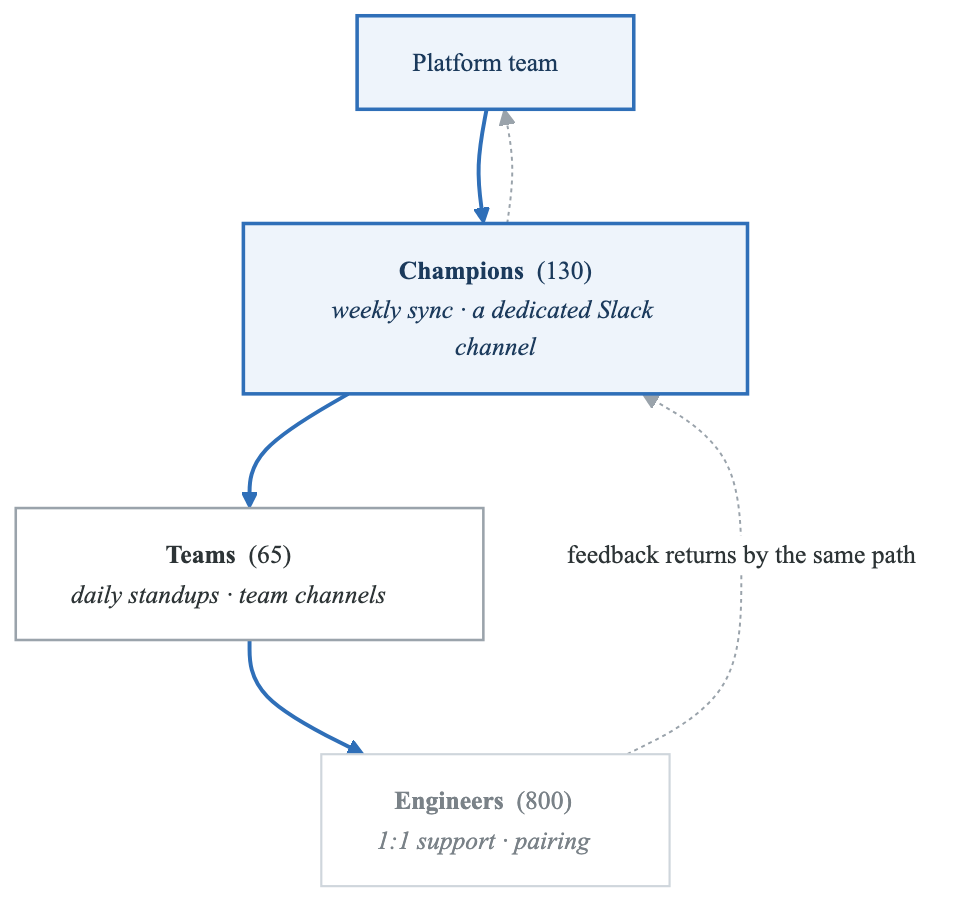
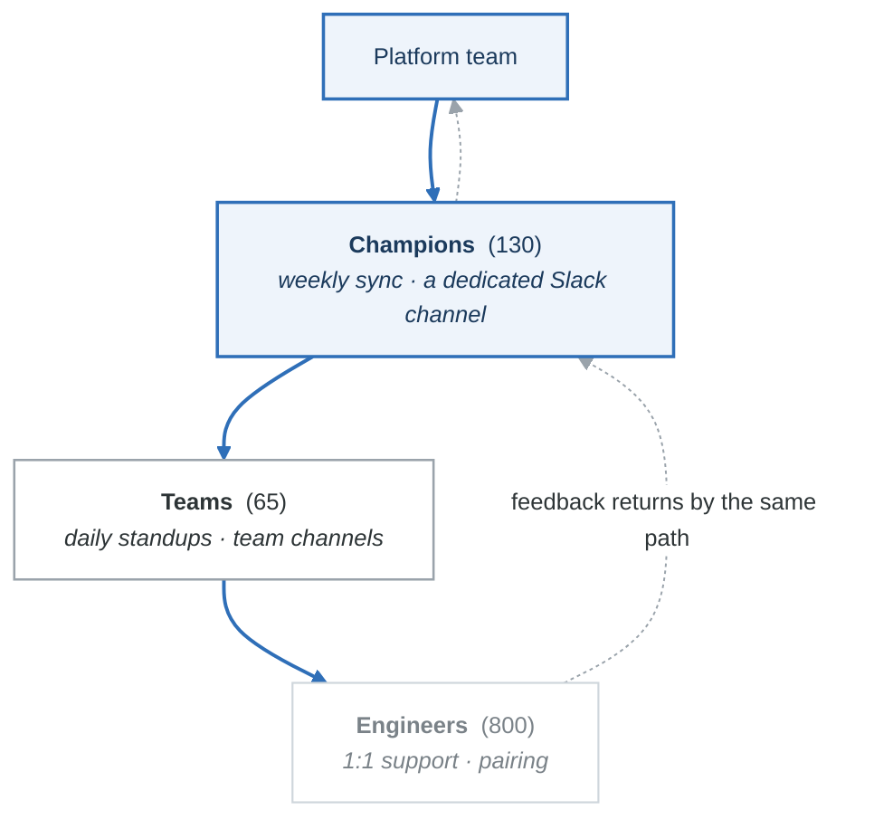

# Case Study 3: Platform Adoption and Organizational Transformation at HealthFirst

## Executive Summary

HealthFirst, a digital health company serving 45 million patients, faced a critical challenge: their newly built Internal Developer Platform had only 23% adoption after 18 months and $12M investment. This case study examines how they pivoted from a "build it and they will come" approach to a deliberate adoption strategy that achieved 91% platform adoption within 12 months, transformed their engineering culture, and fundamentally changed how they approached organizational change.

## Company Background

### Organization Profile

| Attribute | Details |
|-----------|---------|
| **Industry** | Healthcare Technology (Digital Health) |
| **Size** | 800 engineers across 65 teams |
| **Technology Estate** | 420 microservices, hybrid cloud (AWS + on-premises) |
| **Regulatory Requirements** | HIPAA, SOC 2, FDA (some products) |
| **Business Model** | B2B2C (Enterprise health plans, consumer apps) |

### The Platform Investment

HealthFirst had invested significantly in building an Internal Developer Platform:

**Platform Components Built:**

```yaml
platform_components:
  developer_portal:
    technology: Backstage
    features:
      - Service catalog
      - Software templates (8 templates)
      - TechDocs integration
      - Kubernetes dashboard

  infrastructure_abstraction:
    technology: Crossplane
    resources:
      - PostgreSQL
      - Redis
      - S3 buckets
      - Kafka topics

  gitops:
    technology: ArgoCD
    features:
      - Multi-cluster deployment
      - Automated sync
      - Rollback capability

  ci_cd:
    technology: GitHub Actions
    features:
      - Standardized workflows
      - Security scanning
      - Artifact management

  observability:
    technology: Grafana Stack
    features:
      - Prometheus metrics
      - Loki logs
      - Tempo traces
```

**Investment Summary:**
- Platform team: 18 engineers
- Development cost: $8.2M
- Infrastructure cost: $2.4M
- Licensing: $1.4M
- **Total: $12M over 18 months**

### The Adoption Crisis

Despite significant investment, platform adoption stalled:

**Adoption Metrics at Month 18:**

| Metric | Target | Actual | Gap |
|--------|--------|--------|-----|
| Teams on platform | 80% | 23% | -57% |
| Services using templates | 60% | 12% | -48% |
| Self-service usage | 70% | 18% | -52% |
| GitOps deployments | 75% | 31% | -44% |

**Symptoms of Failure:**

```yaml
failure_indicators:
  usage_patterns:
    - Portal daily active users: 45 (out of 800 engineers)
    - Templates used in last quarter: 4
    - Self-service requests: 12/month (vs 200 manual tickets)
    - Documentation page views: declining 15% monthly

  sentiment:
    - "The platform doesn't solve my actual problems"
    - "It's easier to do things the old way"
    - "Nobody asked us what we needed"
    - "The platform team doesn't understand our domain"

  behaviors:
    - Teams building parallel solutions
    - Workarounds documented in tribal knowledge
    - Platform team tickets ignored or deprioritized
    - Leadership disengagement from platform initiatives
```

## Diagnosing the Failure

### The Investigation

New VP of Engineering, Dr. Sarah Martinez, commissioned a thorough investigation:

**Research Methods:**

1. **Quantitative Analysis**
   - Usage analytics deep-dive
   - Ticket analysis (platform vs. alternatives)
   - Time tracking data
   - Cost allocation review

2. **Qualitative Research**
   - 60 developer interviews (stratified sample)
   - 15 team lead focus groups
   - 8 manager interviews
   - Platform team retrospective

3. **Competitive Analysis**
   - How teams solved problems without platform
   - Alternative tools teams had adopted
   - Shadow IT inventory

### Root Causes Identified

**1. Technology-Push vs. Problem-Pull**

```yaml
root_cause_1:
  description: "Built features without understanding actual problems"

  evidence:
    - Templates designed around platform capabilities, not developer needs
    - 6 of 8 templates unused because they didn't match actual use cases
    - Self-service provisioned resources nobody requested
    - Features prioritized by technical interest, not user impact

  example:
    built: "Sophisticated multi-region database failover automation"
    needed: "Simple way to get a dev database in 5 minutes"
    result: "Complex feature nobody uses, basic need unmet"
```

**2. Change Resistance Underestimated**

```yaml
root_cause_2:
  description: "Ignored organizational and cultural resistance"

  evidence:
    - No change management plan or resources
    - Teams not consulted during design phase
    - Senior engineers felt expertise devalued
    - Team leads saw platform as threatening autonomy
    - No executive alignment on migration expectations

  quotes:
    - "We've been doing this for years, why change now?"
    - "The platform team doesn't understand healthcare complexity"
    - "My team's approach is better for our specific needs"
```

**3. Migration Path Non-Existent**

```yaml
root_cause_3:
  description: "No clear path from current state to platform"

  evidence:
    - Templates only worked for greenfield services
    - Existing services had no migration tooling
    - Breaking changes with no deprecation period
    - 85% of services are existing, not new
    - "Big bang" migration expectations unrealistic

  impact:
    - Teams would need to rewrite to adopt platform
    - ROI negative for existing services
    - Only new projects could benefit
```

**4. Value Not Demonstrated**

```yaml
root_cause_4:
  description: "Platform value proposition unclear and unproven"

  evidence:
    - No case studies from successful adopters
    - Metrics focused on platform, not developer outcomes
    - No comparison with alternative approaches
    - Benefits theoretical, not demonstrated

  perception:
    team_view: "More complexity for unclear benefit"
    reality: "Genuine benefits, but poorly communicated"
```

**5. Support and Documentation Gaps**

```yaml
root_cause_5:
  description: "Unable to succeed even when trying to adopt"

  evidence:
    - Documentation assumed deep platform knowledge
    - No office hours or direct support
    - Issues took weeks to resolve
    - Error messages unhelpful
    - Training non-existent

  developer_journey:
    - Try to use platform
    - Hit confusing error
    - Search documentation (no answer)
    - Ask in Slack (no response for days)
    - Give up and use old approach
    - Tell colleagues "platform doesn't work"
```

## The Transformation Strategy

### New Approach: "Adoption as a Product"

Dr. Martinez reframed the challenge:

> "We have a product problem, not a technology problem. We built a platform nobody wants to use. We need to treat adoption as a product with its own roadmap, metrics, and dedicated team. The platform is only valuable if people use it."

### Restructured Organization

**Platform Organization (28 people, was 18)**

- Platform Engineering (12, unchanged)
  - Core Platform (6)
  - Reliability (6)
- Developer Enablement (NEW: 10)
  - Adoption Team (4)
  - Developer Advocacy (3)
  - Documentation & Training (3)
- Platform Product (NEW: 6)
  - Product Management (2)
  - User Research (2)
  - Analytics (2)


### The Adoption Framework

**Four Pillars of Adoption:**

```yaml
adoption_framework:
  pillar_1_value:
    name: "Demonstrate Clear Value"
    goal: "Developers choose platform because it's obviously better"
    activities:
      - Solve top 5 developer pain points
      - Create compelling case studies
      - Show quantified time savings
      - Before/after demonstrations

  pillar_2_ease:
    name: "Make Adoption Easy"
    goal: "Path of least resistance leads to platform"
    activities:
      - Migration tooling for existing services
      - Incremental adoption (not all-or-nothing)
      - Excellent documentation and training
      - Responsive support

  pillar_3_social:
    name: "Leverage Social Proof"
    goal: "Teams adopt because respected peers have adopted"
    activities:
      - Platform champions program
      - Success story amplification
      - Peer-to-peer learning
      - Leadership endorsement

  pillar_4_incentives:
    name: "Align Incentives"
    goal: "Adoption is recognized and rewarded"
    activities:
      - Executive accountability
      - Team-level metrics
      - Career ladder recognition
      - Reduced operational burden
```

## Phase 1: Reset and Quick Wins (Months 1-4)

### Initiative 1.1: User Research Blitz

**Comprehensive Research Program:**

```yaml
research_program:
  developer_interviews:
    count: 80
    method: 1-hour structured interviews
    focus:
      - Current workflow pain points
      - Platform experience and blockers
      - Desired future state
      - Trusted information sources

  workflow_observation:
    count: 20 developers
    method: "Day in the life" shadowing
    captured:
      - Actual time spent on tasks
      - Workarounds and frustrations
      - Tools actually used
      - Collaboration patterns

  surveys:
    - Developer experience survey (380 responses)
    - Platform-specific satisfaction (210 responses)
    - Feature prioritization exercise (290 responses)

  competitive_analysis:
    - Document all alternative tools teams use
    - Understand why they chose alternatives
    - Identify successful patterns to adopt
```

**Key Research Findings:**

```yaml
research_insights:
  top_pain_points:
    1: "Getting a development environment takes too long (4+ hours)"
    2: "I don't know who owns or maintains other services"
    3: "Debugging production issues is like archaeology"
    4: "I can't find documentation for anything"
    5: "Deployments are scary and often fail"

  platform_blockers:
    1: "Templates don't match our actual tech stack"
    2: "No way to migrate existing services"
    3: "Can't figure out how to use it (docs unclear)"
    4: "When I hit problems, no one helps me"
    5: "Leadership doesn't seem to care about it"

  what_developers_want:
    1: "Work instantly in any repo (dev environments)"
    2: "See who owns what and how things connect"
    3: "One place for all documentation"
    4: "Deploy confidently with easy rollback"
    5: "Self-service for common infrastructure"
```

### Initiative 1.2: Quick Win Delivery

**Prioritized based on research:**

**Quick Win 1: Development Environments (Week 2-6)**

```yaml
dev_environments:
  before:
    - 4-6 hours to set up new developer
    - Each repo had different setup instructions
    - "Works on my machine" issues constant
    - Major pain point in every interview

  solution:
    - Dev Containers for all services
    - Codespaces integration
    - One-click environment launch
    - Standardized tooling

  implementation:
    week_2: Pilot with 3 teams (15 services)
    week_3: Expand to 10 teams
    week_4: Self-service migration tool
    week_5: Documentation and training
    week_6: Full availability

  results:
    - Setup time: 4 hours → 8 minutes
    - Adoption: 67% of teams within 6 weeks
    - Developer satisfaction: 8.4/10
```

**Quick Win 2: Service Catalog Population (Week 2-4)**

```yaml
service_catalog:
  before:
    - Catalog had 45 services (out of 420)
    - Ownership unclear for most services
    - No dependency information
    - Developers couldn't find anything

  solution:
    - Automated discovery from GitHub, Kubernetes, AWS
    - Ownership auto-detection from git history
    - Dependency mapping from traces
    - Enrichment from existing wikis

  implementation:
    week_2: Build automated discovery
    week_3: Run enrichment, manual cleanup
    week_4: Launch with 95% coverage

  results:
    - Services cataloged: 45 → 398
    - Ownership assigned: 8% → 94%
    - Search queries: 12/day → 340/day
```

**Quick Win 3: Documentation Consolidation (Week 3-8)**

```yaml
documentation:
  before:
    - 14 different wikis
    - 70% of docs outdated
    - Search was useless
    - Developers gave up looking

  solution:
    - Migrate everything to TechDocs
    - Automated freshness checking
    - Algolia search integration
    - Documentation quality metrics

  implementation:
    week_3_4: Migrate critical docs
    week_5_6: Team-by-team migration support
    week_7_8: Deprecate old wikis

  results:
    - Single source of truth
    - Freshness: 23% → 78% current
    - Search success: 34% → 82%
```

### Initiative 1.3: Support Excellence

**Transformed Support Model:**

```yaml
support_transformation:
  before:
    response_time: 3.2 days
    resolution_time: 2+ weeks
    satisfaction: 2.1/5
    escalation_path: unclear

  after:
    channels:
      slack_support:
        sla: 2 hour response
        coverage: business hours
        staffing: rotating platform engineers

      office_hours:
        schedule: daily 2pm-3pm
        format: drop-in Zoom
        attendance: avg 12 developers

      documentation:
        searchable: yes
        feedback: inline comments
        freshness: automated checking

      escalation:
        clear_path: documented
        on_call: 24/7 for critical
        executive_sponsor: named

    results:
      response_time: 3.2 days → 1.4 hours
      resolution_time: 14 days → 1.8 days
      satisfaction: 2.1 → 4.4
```

### Phase 1 Results

| Metric | Month 0 | Month 4 | Change |
|--------|---------|---------|--------|
| Platform adoption | 23% | 41% | +18% |
| Portal DAU | 45 | 234 | +420% |
| Self-service usage | 18% | 52% | +34% |
| Support satisfaction | 2.1 | 4.4 | +110% |
| Developer NPS (platform) | -34 | +12 | +46 pts |

## Phase 2: Migration and Champions (Months 5-8)

### Initiative 2.1: Migration Tooling

**The Migration Challenge:**

```yaml
migration_reality:
  total_services: 420
  greenfield_per_year: ~30
  existing_services: 390

  implication: |
    If platform only works for greenfield, adoption ceiling is 7% per year.
    Must enable migration of existing services to achieve adoption goals.
```

**Migration Approach:**

```yaml
migration_tooling:
  service_migration_cli:
    name: "platform migrate"
    capabilities:
      - Analyze existing service structure
      - Generate platform-compatible configs
      - Create GitOps manifests
      - Setup observability integration
      - Incremental migration (not big bang)

  migration_levels:
    level_1_catalog:
      effort: 5 minutes
      benefits:
        - Service visible in catalog
        - Ownership tracked
        - Dependencies mapped
      adoption_target: 100%

    level_2_observability:
      effort: 30 minutes
      benefits:
        - Unified logging
        - Standard metrics
        - Distributed tracing
      adoption_target: 80%

    level_3_deployment:
      effort: 2-4 hours
      benefits:
        - GitOps deployment
        - Automated rollbacks
        - Deployment history
      adoption_target: 70%

    level_4_full:
      effort: 1-2 days
      benefits:
        - Full template alignment
        - Self-service infrastructure
        - Automated everything
      adoption_target: 50%
```

**Migration CLI Example:**

```bash
$ platform migrate analyze patient-api

Analyzing patient-api...

Service Analysis Report
══════════════════════════════════════════════════════════════

Current State:
  Language: Python 3.9
  Framework: Flask
  Database: PostgreSQL (RDS)
  Deployment: Manual kubectl
  Monitoring: Custom Prometheus config

Migration Recommendations:
  Level 1 (Catalog):     Ready to migrate ✓
  Level 2 (Observability): 2 changes needed
    - Add OpenTelemetry instrumentation
    - Update logging format
  Level 3 (Deployment):  3 changes needed
    - Add kustomize manifests
    - Create ArgoCD Application
    - Update Dockerfile
  Level 4 (Full):        Not recommended
    - Flask template not available
    - Would require rewrite

Recommended Migration Path:
  1. Register in catalog (now)
  2. Add observability (this sprint)
  3. Move to GitOps (next sprint)

Run 'platform migrate start patient-api --level 2' to begin
```

**Migration Results:**

| Level | Month 4 | Month 8 | Target |
|-------|---------|---------|--------|
| Level 1 (Catalog) | 34% | 94% | 100% |
| Level 2 (Observability) | 18% | 71% | 80% |
| Level 3 (Deployment) | 12% | 58% | 70% |
| Level 4 (Full) | 8% | 32% | 50% |

### Initiative 2.2: Platform Champions Program

**Champions Program Design:**

```yaml
champions_program:
  overview:
    purpose: "Distributed advocates who support adoption in their teams"
    target: 2 champions per team (130 total)
    recognition: Formal role, career ladder credit

  selection_criteria:
    required:
      - Minimum 1 year at HealthFirst
      - Technical credibility with peers
      - Interest in platform work
      - Time allocation approved by manager
    preferred:
      - Previous platform adoption experience
      - Good communication skills
      - Diverse team representation

  responsibilities:
    weekly:
      - Answer team questions about platform
      - Report blockers to platform team
      - Share platform updates in team standup
    monthly:
      - Attend champions sync meeting
      - Complete platform training modules
      - Lead team migration activity
    quarterly:
      - Present platform win at all-hands
      - Mentor new champions
      - Contribute to platform roadmap

  support:
    training:
      - 2-day intensive onboarding
      - Weekly office hours (champions-only)
      - Early access to new features
    resources:
      - Champions Slack channel (direct to platform team)
      - Documentation and talking points
      - Swag and recognition
    time:
      - 10% dedicated time for platform work
      - Protected from regular on-call during training
```

**Champions Communication Flow:**

<!-- figure: generated from the Mermaid below by _shared/diagrams/embed-figures.py — do not edit the image -->


<details>
<summary>Diagram source (Mermaid)</summary>



</details>

**Champions Impact:**

| Metric | Without Champion | With Champion |
|--------|------------------|---------------|
| Team adoption rate | 34% | 78% |
| Time to Level 2 migration | 6 weeks | 2 weeks |
| Support tickets | 4.2/team/month | 1.1/team/month |
| Feature feedback | Rare | Regular |

### Initiative 2.3: Executive Alignment

**The Executive Challenge:**

```yaml
executive_problem:
  symptoms:
    - No executive asking about platform adoption
    - Platform not mentioned in company OKRs
    - Team leads not accountable for migration
    - Budget questioned but not outcomes

  root_cause: |
    Platform was treated as infrastructure project, not strategic initiative.
    No executive had "platform adoption" as a success metric.
```

**Executive Alignment Strategy:**

```yaml
executive_alignment:
  education:
    cto_briefings:
      - Monthly platform metrics review
      - Industry benchmark comparisons
      - ROI analysis and projections

    leadership_demo:
      - Quarterly hands-on session for VPs
      - "Day in the life" comparison
      - Q&A with developer panel

  accountability:
    company_okrs:
      - "Platform adoption >70%" added to company OKRs
      - Engineering VP bonus tied to adoption
      - Team leads report adoption in quarterlies

    reporting:
      - Weekly adoption dashboard to CTO
      - Monthly board summary
      - Quarterly detailed review

  messaging:
    executive_talking_points:
      - Platform is strategic investment in velocity
      - Every team contributes to platform success
      - Adoption metrics matter as much as feature delivery
```

**Executive Communication (Example):**

```
From: Dr. Sarah Martinez (VP Engineering)
To: Engineering All-Hands
Subject: Platform Adoption Update - Q3

Team,

I want to share our platform adoption progress and why it matters:

WHERE WE ARE:
- 73% of teams now use the platform (up from 23% six months ago)
- Development environment setup: 8 minutes (was 4 hours)
- Deployment success rate: 97.2% (was 81%)
- Developer satisfaction with platform: +34 NPS (was -34)

WHY IT MATTERS:
- Teams on platform ship 3x more frequently
- Production incidents down 45% for platform services
- New engineers productive in 1 week instead of 6

WHAT'S NEXT:
- Target: 85% adoption by end of Q4
- Focus: Migration support for remaining teams
- New: AI-assisted coding tools coming in Q4

Platform adoption is now part of team performance discussions.
Talk to your Platform Champion about your team's migration plan.

Questions? Join me at Friday's office hours.

Sarah
```

### Phase 2 Results

| Metric | Month 4 | Month 8 | Change |
|--------|---------|---------|--------|
| Platform adoption | 41% | 73% | +32% |
| Services migrated (L2+) | 78 | 298 | +282% |
| Active champions | 0 | 118 | - |
| Executive mentions/month | 1 | 14 | +1300% |

## Phase 3: Optimization and Culture (Months 9-12)

### Initiative 3.1: Measuring Developer Experience

**Comprehensive Measurement:**

```yaml
measurement_framework:
  quantitative_metrics:
    dora:
      - deployment_frequency
      - lead_time_for_changes
      - change_failure_rate
      - mean_time_to_recovery

    platform_specific:
      - self_service_success_rate
      - template_usage_rate
      - migration_completion_rate
      - support_resolution_time

    productivity:
      - build_time
      - pr_merge_time
      - environment_setup_time
      - time_to_first_deploy

  qualitative_metrics:
    surveys:
      - Monthly pulse survey (5 questions)
      - Quarterly DX survey (25 questions)
      - Annual comprehensive survey

    interviews:
      - Monthly developer interviews (15/month)
      - Exit interview analysis
      - New hire feedback at 30 days

  leading_indicators:
    - Portal login frequency
    - Documentation search success
    - Self-service request volume
    - Champion activity level
```

**Developer Experience Index:**

```python
# Composite metric for developer experience health
def calculate_dx_index(metrics):
    """
    DX Index: 0-100 score combining multiple factors
    """
    weights = {
        'dora_score': 0.25,        # DORA metrics composite
        'satisfaction': 0.20,      # Survey-based satisfaction
        'productivity': 0.20,      # Time-based productivity metrics
        'self_service': 0.15,      # Self-service success rate
        'support_quality': 0.10,   # Support satisfaction
        'documentation': 0.10,     # Doc search success + freshness
    }

    return sum(
        metrics[key] * weight
        for key, weight in weights.items()
    )

# Results over time
dx_index_history = {
    'month_0': 34,
    'month_4': 52,
    'month_8': 71,
    'month_12': 84,
}
```

### Initiative 3.2: Continuous Improvement Engine

**Feedback Loop System:**

```yaml
feedback_loops:
  real_time:
    - In-product feedback buttons
    - CLI telemetry (opt-in)
    - Error tracking with context
    - Support ticket analysis

  weekly:
    - Champions sync feedback
    - Slack sentiment analysis
    - Usage anomaly detection
    - A/B test results review

  monthly:
    - Developer interview synthesis
    - Pulse survey analysis
    - Feature request prioritization
    - Adoption barrier identification

  quarterly:
    - Comprehensive DX survey
    - Roadmap community input
    - Platform retrospective
    - Strategy alignment check
```

**Prioritization Framework:**

```yaml
feature_prioritization:
  framework: "Impact × Reach × Effort"

  criteria:
    impact:
      scale: 1-10
      factors:
        - Time saved per developer
        - Quality improvement
        - Risk reduction

    reach:
      scale: 1-10
      factors:
        - Number of developers affected
        - Frequency of use
        - Strategic importance

    effort:
      scale: 1-10 (inverted: 10 = low effort)
      factors:
        - Development time
        - Complexity
        - Dependencies

  process:
    1: Developer research identifies pain points
    2: Product manager scores criteria
    3: Champions provide input
    4: Engineering estimates effort
    5: Stack rank and commit
    6: Communicate roadmap
```

### Initiative 3.3: Culture Transformation

**From Tool Users to Platform Thinkers:**

```yaml
culture_transformation:
  old_mindset:
    - "Platform is something the platform team does"
    - "I just want to ship my feature"
    - "Standards slow me down"
    - "My team's way is best"

  new_mindset:
    - "Platform is how we all work better together"
    - "Platform enables me to ship faster and safer"
    - "Standards free me to focus on what matters"
    - "We learn from each other's approaches"

  transformation_activities:
    inner_source:
      - Platform contributions from product teams
      - Cross-team PR reviews
      - Shared ownership of platform components

    knowledge_sharing:
      - Monthly "Platform Show & Tell"
      - Team-to-team learning sessions
      - Written case studies

    celebration:
      - Platform adoption milestones recognized
      - Contributor spotlight in all-hands
      - Team of the quarter for platform excellence
```

**Inner Source Metrics:**

| Metric | Month 8 | Month 12 |
|--------|---------|----------|
| Product team PRs to platform | 12 | 87 |
| Teams with platform contributors | 8% | 34% |
| Cross-team code reviews | 45/month | 210/month |
| Shared components created | 5 | 23 |

### Initiative 3.4: Sustaining Adoption

**Preventing Regression:**

```yaml
adoption_sustainability:
  onboarding:
    - Platform training mandatory for new hires
    - First-week platform certification
    - Buddy assignment includes platform mentor

  ongoing:
    - Quarterly platform updates (mandatory viewing)
    - Annual certification renewal
    - Team adoption reviewed in performance discussions

  governance:
    - New services MUST use platform
    - Exceptions require VP approval
    - Technical debt tracked and addressed

  incentives:
    - Platform adoption in team OKRs
    - Career ladder includes platform skills
    - Platform champions eligible for promotion track
```

### Phase 3 Results

| Metric | Month 8 | Month 12 | Change |
|--------|---------|---------|--------|
| Platform adoption | 73% | 91% | +18% |
| DX Index | 71 | 84 | +13 |
| Inner source PRs | 12 | 87 | +625% |
| Developer NPS (platform) | +34 | +52 | +18 pts |

## Final Results and Impact

### Adoption Journey Summary

**Adoption over twelve months**

| Month | Adoption | Phase |
|---|---|---|
| 0 | 23% | **Reset** — quick wins, rebuild credibility |
| 4 | 41% | **Migration** — champions recruited, first cohort moves |
| 8 | 73% | **Culture** — adoption becomes the default choice |
| 12 | **91%** | **Optimization** — the remaining 9% are genuine exceptions |

```text
100% │                                          ┌── 91%
     │                                  ┌───────┘
 75% │                          ┌───────┘ 73%
     │                  ┌───────┘
 50% │          ┌───────┘ 41%
     │          │
 25% │──────────┘ 23%
   0%└──────────────────────────────────────────────
     Month 0        4          8          12
     └── Reset ─┘└─ Migration ┘└─ Culture ─┘
```

The shape matters more than the endpoint. Adoption is slow for four months and then bends — that is
what social proof looks like, and it is why judging a platform on its first-quarter numbers kills
projects that were about to work.

The last 9% is deliberate. A platform that reaches 100% has either solved every case or has forbidden
the exceptions, and it is almost never the first one.

### Quantitative Impact

**Adoption Metrics:**

| Metric | Before | After | Improvement |
|--------|--------|-------|-------------|
| Platform adoption | 23% | 91% | +296% |
| Services migrated | 78 | 378 | +385% |
| Self-service usage | 18% | 89% | +394% |
| GitOps deployments | 31% | 87% | +181% |

**Developer Experience Metrics:**

| Metric | Before | After | Improvement |
|--------|--------|-------|-------------|
| Developer NPS (platform) | -34 | +52 | +86 points |
| Support satisfaction | 2.1/5 | 4.6/5 | +119% |
| Documentation satisfaction | 2.4/5 | 4.3/5 | +79% |
| Environment setup time | 4 hours | 8 minutes | 97% reduction |

**Business Metrics:**

| Metric | Before | After | Improvement |
|--------|--------|-------|-------------|
| Deployment frequency | 0.4/team/day | 3.2/team/day | 700% |
| Lead time | 12 days | 1.4 days | 88% reduction |
| Change failure rate | 18% | 3.2% | 82% reduction |
| MTTR | 3.8 hours | 22 minutes | 90% reduction |

### Financial Impact

**Investment (Transformation Phase):**

| Category | Investment |
|----------|------------|
| Additional headcount (10 FTEs) | $2.4M |
| Training and enablement | $0.3M |
| Champion program | $0.2M |
| Tooling improvements | $0.4M |
| **Total Additional Investment** | **$3.3M** |

**Value Delivered:**

| Category | Annual Value | Calculation |
|----------|--------------|-------------|
| Developer productivity | $14.2M | Time saved × 800 engineers |
| Faster time to market | $8.5M | Revenue from faster launches |
| Reduced incidents | $4.2M | Incident cost reduction |
| Reduced attrition | $2.8M | Lower replacement costs |
| **Total Annual Value** | **$29.7M** |

**ROI Analysis:**
- Total platform investment: $15.3M ($12M original + $3.3M transformation)
- Annual value: $29.7M
- Payback period: 6.2 months
- 3-year ROI: 482%

## Lessons Learned

### What Changed Everything

1. **Treating Adoption as a Product**
   - Dedicated adoption team with own roadmap
   - User research before building
   - Metrics focused on adoption, not features

2. **Meeting Developers Where They Are**
   - Migration paths for existing services
   - Quick wins that solved real problems
   - Support that actually helped

3. **Social Proof Through Champions**
   - Peer influence more powerful than mandates
   - Local advocates scaled knowledge
   - Created ownership beyond platform team

4. **Executive Alignment**
   - Platform in company OKRs
   - Regular leadership communication
   - Accountability for adoption

### Key Adoption Principles

```yaml
adoption_principles:
  1_solve_real_problems:
    description: "Build for pain points, not platform capabilities"
    application: "Research first, build second"

  2_reduce_friction:
    description: "Make adoption easier than alternatives"
    application: "Migration tooling, excellent docs, responsive support"

  3_leverage_social_proof:
    description: "People follow respected peers"
    application: "Champions program, success stories, visible wins"

  4_align_incentives:
    description: "Make adoption good for careers and teams"
    application: "Executive sponsorship, team metrics, recognition"

  5_iterate_continuously:
    description: "Adoption is ongoing, not a destination"
    application: "Feedback loops, regular improvements, evolving platform"
```

### What We'd Do Differently

1. **Start with Adoption Strategy**
   - Should have been part of initial planning
   - Not an afterthought when adoption failed
   - Cheaper to build right than fix later

2. **Hire Developer Advocates Earlier**
   - Needed voices from developer community
   - Technical writing from day one
   - Support excellence from launch

3. **Smaller Initial Scope**
   - Fewer features, more polished
   - One excellent template vs. eight mediocre ones
   - Depth over breadth

## Key Takeaways

1. **Building it is easy; adoption is hard** - Most platform failures are adoption failures, not technical failures

2. **Research before building** - User research prevents building features nobody wants

3. **Migration > Greenfield** - In mature organizations, most services are existing; migration tooling is essential

4. **Champions scale knowledge** - You can't be everywhere; champions extend your reach

5. **Executive alignment is essential** - Without leadership support, adoption is optional and will be deprioritized

6. **Measure adoption, not features** - Feature count is vanity; adoption rate is sanity

---

## Discussion Questions

1. What were the early warning signs that adoption was failing?
2. How did the champions program create different outcomes than top-down mandates?
3. What role did migration tooling play in achieving adoption?
4. How would you measure the success of an adoption program?
5. What organizational factors made HealthFirst's transformation successful?

## Further Reading

- "Crossing the Chasm" by Geoffrey Moore
- "Switch: How to Change Things When Change Is Hard" by Chip and Dan Heath
- "Thinking in Systems" by Donella Meadows
- "Team Topologies" by Matthew Skelton and Manuel Pais
- "The Phoenix Project" by Gene Kim, Kevin Behr, and George Spafford

<!-- feynman-check -->

---

## Feynman check

Close the file. Blank page, no notes. Explain each of these to a competent engineer who has never
used this tool — **under five minutes, no jargon you can't define on the spot:**

- Diagnosing the Failure
- The Transformation Strategy
- Reset and Quick Wins (Months 1-4)
- Migration and Champions (Months 5-8)

**The gap is not what you forgot. It is where you used a word instead of a mechanism.**

| | |
|---|---|
| ✗ | *"The platform makes developers more productive."* |
| ✓ | *"A golden path is a template that produces a repository with CI, manifests, dashboards and alerts already wired, so the product team owns none of them. It reduces cognitive load by removing decisions, not by adding features — and without a documented escape hatch it is a cage."* |

**Trace it:** A developer commits `service.yaml` → a running service with a dashboard and a paging rule. Name every system that acts, and which team owns each one.

Stop at the first component you cannot name. Reopen this file and read **only** that.

**Go deeper — only once the gap has a name:** [Team Topologies — cognitive load](https://teamtopologies.com/key-concepts) and the [CNCF Platforms White Paper](https://tag-app-delivery.cncf.io/whitepapers/platforms/) — why golden paths exist at all.
Full list per domain: [`SOURCES.md`](../SOURCES.md#platform-engineering)

→ Protocol, the three levels of knowing, and worked examples: [`MASTERY.md`](../MASTERY.md)

<!-- /feynman-check -->
