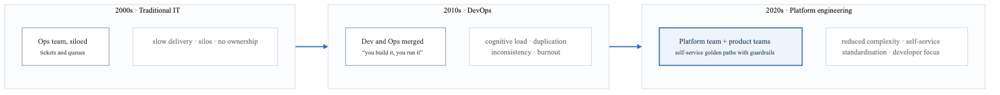
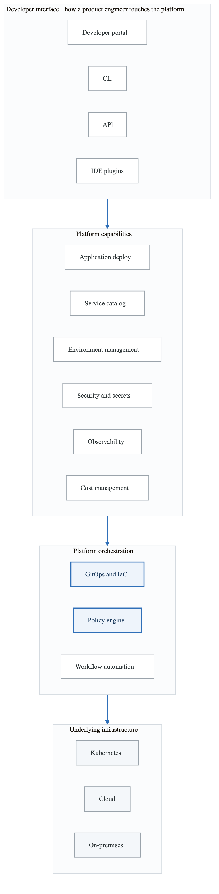
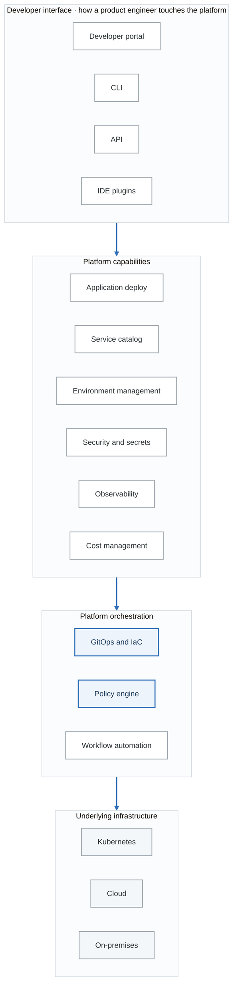
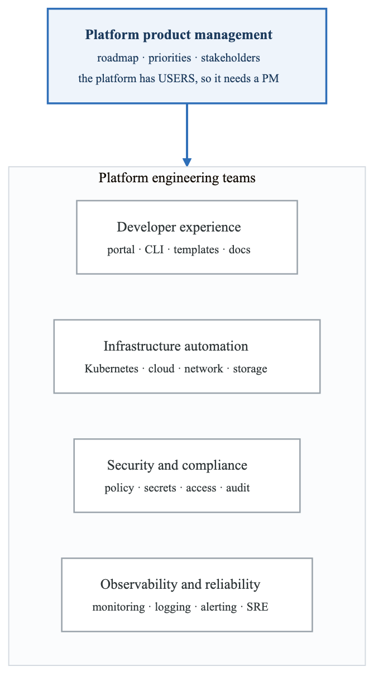
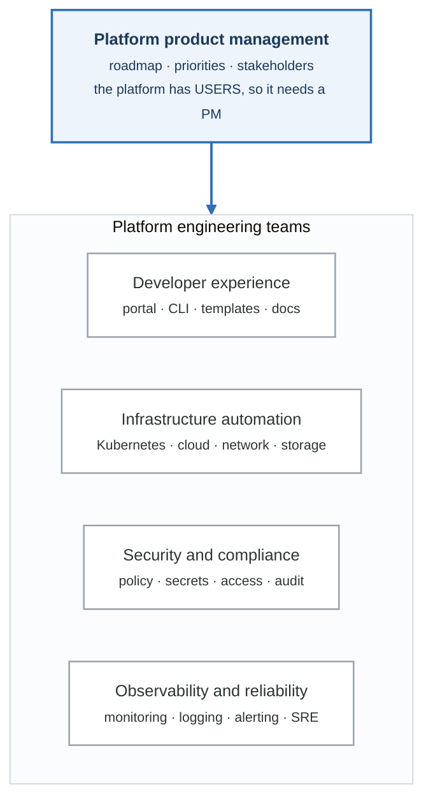

# Module 1: Platform Engineering Fundamentals

## Introduction

Platform Engineering has emerged as a discipline focused on designing and building toolchains and workflows that enable self-service capabilities for software engineering organizations. This module introduces the foundational concepts, principles, and practices that define modern platform engineering.

## Learning Objectives

By the end of this module, you will be able to:
- Define platform engineering and its role in modern organizations
- Explain the evolution from DevOps to Platform Engineering
- Identify the core components of an Internal Developer Platform
- Understand the platform team operating model
- Evaluate platform maturity and capabilities

## What is Platform Engineering?

### Definition

Platform Engineering is the discipline of designing and building self-service capabilities for software development organizations, enabling developers to deploy and operate applications without needing deep infrastructure expertise.

> **Platform engineering mission**
>
> *"Reduce cognitive load on development teams by providing curated self-service capabilities with
> sensible defaults."*

**Key outcomes**

| Outcome | Direction |
|---|---|
| Developer productivity | ↑ |
| Time to production | ↓ |
| Operational burden on product teams | ↓ |
| Consistency and compliance | ↑ |
| Innovation velocity | ↑ |

Every word in that sentence is load-bearing. **Curated** means somebody chose, so the developer does
not have to. **Self-service** means no ticket and no waiting. **Sensible defaults** means the easy
path is already the correct one — which is the only form of governance that survives a deadline.

### The Evolution to Platform Engineering

```mermaid
%%{init: {'theme':'base','themeVariables':{'fontFamily':'Helvetica, Arial, sans-serif','fontSize':'13px','primaryColor':'#ffffff','primaryTextColor':'#2d3436','primaryBorderColor':'#9aa3ab','lineColor':'#9aa3ab','textColor':'#2d3436','clusterBkg':'#fbfcfd','clusterBorder':'#d4dae0','edgeLabelBackground':'#ffffff','tertiaryColor':'#eef4fb'},'flowchart':{'curve':'basis','padding':14,'nodeSpacing':42,'rankSpacing':58}}}%%
flowchart LR
  classDef default fill:#ffffff,stroke:#9aa3ab,stroke-width:1.3px,color:#2d3436
  classDef n    fill:#ffffff,stroke:#9aa3ab,stroke-width:1.3px,color:#2d3436
  classDef crit fill:#eef4fb,stroke:#2f6fb8,stroke-width:1.8px,color:#1b3a5c
  classDef data fill:#f4f7fa,stroke:#9aa3ab,stroke-width:1.3px,color:#2d3436
  classDef mut  fill:#ffffff,stroke:#cfd6dc,stroke-width:1.1px,color:#7a8288
  classDef warn fill:#fdf0ec,stroke:#c0522d,stroke-width:1.6px,color:#8a3a1e
  subgraph E1["2000s · Traditional IT"]
    direction TB
    A["Ops team, siloed<br/><small>tickets and queues</small>"]:::n
    A1["slow delivery · silos · no ownership"]:::mut
  end
  subgraph E2["2010s · DevOps"]
    direction TB
    B["Dev and Ops merged<br/><small>“you build it, you run it”</small>"]:::n
    B1["cognitive load · duplication<br/>inconsistency · burnout"]:::mut
  end
  subgraph E3["2020s · Platform engineering"]
    direction TB
    C["Platform team + product teams<br/><small>self-service golden paths with guardrails</small>"]:::crit
    C1["reduced complexity · self-service<br/>standardisation · developer focus"]:::mut
  end

  E1 --> E2 --> E3

  linkStyle 0,1 stroke:#2f6fb8,stroke-width:2px
```

<!-- figure: generated from the Mermaid below by _shared/diagrams/embed-figures.py — do not edit the image -->


<details>
<summary>Diagram source (Mermaid)</summary>



</details>

### Platform Engineering vs DevOps vs SRE

```yaml
Comparison:
  DevOps:
    focus: "Culture and practices for Dev-Ops collaboration"
    responsibility: "Shared ownership between dev and ops"
    implementation: "Process changes, automation, cultural shift"
    outcome: "Faster delivery, better collaboration"

  SRE:
    focus: "Reliability and operational excellence"
    responsibility: "Dedicated SRE team or embedded SREs"
    implementation: "SLOs, error budgets, toil reduction"
    outcome: "Reliable systems, sustainable operations"

  Platform Engineering:
    focus: "Self-service capabilities and developer experience"
    responsibility: "Platform team building products for developers"
    implementation: "Internal developer platform, golden paths"
    outcome: "Developer productivity, reduced cognitive load"

Relationship:
  - "DevOps provides the cultural foundation"
  - "SRE provides the reliability practices"
  - "Platform Engineering provides the tooling and abstraction"
  - "All three work together in modern organizations"
```

## Internal Developer Platforms (IDP)

### What is an IDP?

An Internal Developer Platform is a layer on top of existing infrastructure and tooling that provides self-service capabilities to development teams.

<!-- figure: generated from the Mermaid below by _shared/diagrams/embed-figures.py — do not edit the image -->


<details>
<summary>Diagram source (Mermaid)</summary>



</details>

### Core IDP Components

```yaml
1. Developer Portal:
   purpose: "Central hub for developer self-service"
   features:
     - Service catalog and discovery
     - Documentation and runbooks
     - Service creation wizards
     - Team and ownership management
   examples: ["Backstage", "Port", "Cortex", "OpsLevel"]

2. Service Catalog:
   purpose: "Inventory of all services and their metadata"
   features:
     - Service ownership tracking
     - Dependency mapping
     - Tech stack inventory
     - Scorecards and maturity tracking
   benefits:
     - "Know what runs in production"
     - "Understand service relationships"
     - "Track technical debt"

3. Golden Paths (Paved Roads):
   purpose: "Pre-configured, opinionated templates"
   features:
     - Project scaffolding
     - CI/CD templates
     - Infrastructure templates
     - Security baselines
   philosophy: |
     "Make the right thing easy to do.
      Don't block alternatives, but make
      the golden path so good that teams
      choose it voluntarily."

4. Self-Service Infrastructure:
   purpose: "On-demand resource provisioning"
   features:
     - Environment creation
     - Database provisioning
     - Queue/messaging setup
     - Network configuration
   implementation:
     - Infrastructure as Code
     - GitOps workflows
     - Policy automation

5. Integrated Observability:
   purpose: "Unified visibility into systems"
   features:
     - Automatic instrumentation
     - Pre-configured dashboards
     - Alerting templates
     - Cost visibility
```

### The Golden Path Concept

> **A golden path is an opinionated and supported route to building something.** It gets a team up
> and running quickly, while still allowing them to step off it when they genuinely need to.

**What the template ships with**

| | |
|---|---|
| Source scaffolding | Go / Python / Node, with a working `/health` and `/ready` |
| Dockerfile | hardened by default — non-root, distroless, read-only root filesystem |
| Kubernetes manifests | probes, resource limits, NetworkPolicy |
| CI/CD pipeline | the golden-path pipeline for that language |
| Terraform | the backing services the service declared |
| Observability | dashboard, alerts, SLO — generated, never opt-in |
| Security scanning | SAST, SCA, secret scanning, image signing |
| Documentation | README and runbook stubs, pre-filled |

**What that looks like to the developer**

```console
$ platform create service --template go-microservice
? Service name: payment-processor
? Team: payments
? Dependencies: [postgres, redis]
  ✓ repository created
  ✓ CI/CD pipeline configured
  ✓ Kubernetes namespace created
  ✓ databases provisioned
  ✓ monitoring dashboards created
Ready to deploy.
```

The developer never had to learn what `seccompProfile` is, and got one anyway. That is the whole
idea: **make the secure thing the default, not the thing you are rejected for forgetting.**

## Platform Team Operating Model

### Team Structure

<!-- figure: generated from the Mermaid below by _shared/diagrams/embed-figures.py — do not edit the image -->


<details>
<summary>Diagram source (Mermaid)</summary>



</details>

### Platform as a Product

```yaml
Product Mindset for Platforms:
  Core Principle: |
    "The platform is a product, and development teams
     are the customers. Apply product management
     practices to platform development."

  Product Management Practices:
    User Research:
      - Developer surveys
      - Usage analytics
      - Feedback sessions
      - Shadowing developers

    Roadmap Planning:
      - Feature prioritization
      - Quarterly planning
      - Stakeholder alignment
      - Communication

    Success Metrics:
      - Developer satisfaction (NPS)
      - Time to first deploy
      - Platform adoption rate
      - Support ticket volume

  Anti-Patterns to Avoid:
    - "Build it and they will come"
    - "We know what developers need"
    - "Mandate platform usage"
    - "Build everything at once"

  Success Patterns:
    - Start with real developer pain points
    - Build incrementally, iterate quickly
    - Measure adoption, not just deployment
    - Market your platform internally
```

### Platform Adoption Strategies

**Mandatory versus voluntary adoption**

| | Mandatory — "all teams must use the platform" | Voluntary — "teams use it if it helps" |
|---|---|---|
| **Pros** | fast adoption · consistency | organic proof · better UX · willing users |
| **Cons** | resistance · poor UX goes unfixed · **shadow IT** | slower adoption · fragmentation |

**Start voluntary, prove value, then expand.** Adoption you mandate gets routed around — teams
build what they need anyway, outside your visibility, and now you maintain two platforms. Adoption
you earn survives, which is why the paved road has to genuinely be the fastest option.

**The adoption curve**

| Phase | Share of teams | What you do |
|---|---|---|
| **1 · Early adopters** | 10–15% | Find teams whose pain the platform actually solves. Work closely with them. Iterate on feedback. Document the wins. |
| **2 · Early majority** | 15–50% | Use the early wins to attract others. Cut onboarding friction. Provide migration support. Build internal champions. |
| **3 · Late majority** | 50–85% | Standardise. Now consider making the path the default for new services. |
| **4 · Laggards** | 85%+ | Support the genuine exceptions — see the escape hatches doc. Some teams should stay off the path. |

## Platform Maturity Model

### Maturity Levels

```yaml
Level 1 - Initial (Reactive):
  characteristics:
    - Ad-hoc infrastructure provisioning
    - Manual, ticket-based workflows
    - Inconsistent environments
    - Limited documentation
  indicators:
    - Deployment frequency: Monthly
    - Provisioning time: Days to weeks
    - Developer satisfaction: Low
    - Platform team: Firefighting

Level 2 - Managed (Documented):
  characteristics:
    - Documented processes
    - Some automation
    - Centralized tooling
    - Basic self-service
  indicators:
    - Deployment frequency: Weekly
    - Provisioning time: Hours to days
    - Developer satisfaction: Medium
    - Platform team: Reactive support

Level 3 - Defined (Standardized):
  characteristics:
    - Golden paths established
    - Self-service infrastructure
    - Integrated CI/CD
    - Developer portal
  indicators:
    - Deployment frequency: Daily
    - Provisioning time: Minutes to hours
    - Developer satisfaction: Good
    - Platform team: Proactive improvement

Level 4 - Quantitatively Managed (Measured):
  characteristics:
    - Comprehensive metrics
    - SLOs for platform services
    - Data-driven decisions
    - Automated compliance
  indicators:
    - Deployment frequency: Multiple daily
    - Provisioning time: Minutes
    - Developer satisfaction: High
    - Platform team: Product-focused

Level 5 - Optimizing (Continuous Improvement):
  characteristics:
    - Continuous platform evolution
    - Innovation enabling
    - Industry-leading practices
    - Platform as competitive advantage
  indicators:
    - Deployment frequency: On-demand
    - Provisioning time: Seconds
    - Developer satisfaction: Excellent
    - Platform team: Strategic enabler
```

### Platform Capability Assessment

| Capability | L1 | L2 | L3 | L4 | L5 |  |
|---|---|---|---|---|---|---|
| INFRASTRUCTURE |  |  |  |  |  |  |
| Compute Provisioning | Tkt | Auto | Self | API | Intent |  |
| Network Configuration | Ops | IaC | Auto | Self | SDN |  |
| Storage Management | Ops | Req | Self | Auto | Smart |  |
| Environment Management | None | Doc | Self | Auto | Ephem |  |
| APPLICATION LIFECYCLE |  |  |  |  |  |  |
| CI/CD Pipeline | None | Shared | Temp | Self | Int |  |
| Deployment | Ops | Semi | Auto | GitOps | Prog |  |
| Feature Flags | None | Tool | Int | Self | AI |  |
| Rollback | Man | Semi | Auto | 1-Clk | Auto |  |
| OBSERVABILITY |  |  |  |  |  |  |
| Logging | Ad-hoc | Cent | Auto | Corr | AI |  |
| Metrics | None | Basic | Auto | SLO | Pred |  |
| Tracing | None | Tool | Auto | Full | AI |  |
| Alerting | Man | Basic | Smart | SLO | AIOps |  |
| SECURITY & COMPLIANCE |  |  |  |  |  |  |
| Secret Management | File | Vault | Auto | Dyn | Zero |  |
| Access Control | Root | RBAC | Self | Auto | ABAC |  |
| Compliance Scanning | Man | Tool | CI | Cont | Block |  |
| Vulnerability Mgmt | None | Scan | Auto | Rem | Pred |  |
| DEVELOPER EXPERIENCE |  |  |  |  |  |  |
| Documentation | Wiki | Port | Auto | Int | AI |  |
| Service Catalog | None | List | Port | Full | Smart |  |
| Onboarding | Doc | Guide | Self | Auto | 1-Hr |  |
| Support | Tkt | Chat | Self | AI | Pred |  |


## Key Metrics for Platform Teams

### DORA Metrics Impact

```yaml
Developer Productivity Metrics:
  Deployment Frequency:
    definition: "How often code is deployed to production"
    target: "Multiple times per day"
    platform_impact: "CI/CD templates, automated testing"

  Lead Time for Changes:
    definition: "Time from commit to production"
    target: "Less than one day"
    platform_impact: "Self-service environments, automated deployments"

  Time to Restore:
    definition: "Time to recover from production incident"
    target: "Less than one hour"
    platform_impact: "Automated rollback, observability"

  Change Failure Rate:
    definition: "Percentage of changes causing failures"
    target: "Less than 15%"
    platform_impact: "Testing automation, canary deployments"

Platform-Specific Metrics:
  Time to First Deploy:
    definition: "Time for new developer to deploy first change"
    target: "Less than 1 day"
    measurement: "From laptop setup to production deployment"

  Environment Provisioning Time:
    definition: "Time to create a new environment"
    target: "Less than 30 minutes"
    measurement: "From request to usable environment"

  Platform Adoption Rate:
    definition: "Percentage of teams using platform"
    target: "Greater than 80%"
    measurement: "Teams on platform / total teams"

  Developer Satisfaction (NPS):
    definition: "Net Promoter Score for platform"
    target: "Greater than 30"
    measurement: "Quarterly developer survey"

  Support Ticket Volume:
    definition: "Platform-related support requests"
    target: "Decreasing trend"
    measurement: "Tickets per developer per month"
```

### Measuring Platform Success

**Platform success metrics — a real dashboard**

| Category | Metric | Current | Change |
|---|---|---|---|
| **Developer productivity** | deployment frequency | 12/day | ↑ 25% |
| | lead time for changes | 4 hrs | ↓ 40% |
| | **time to first deploy** (new engineer) | 6 hrs | ↓ 60% |
| **Adoption** | teams on the platform | 85% | ↑ 15% |
| | golden path usage | 78% | ↑ 20% |
| | self-service usage | 72% | ↑ 30% |
| **Developer experience** | developer NPS | +42 | ↑ 12 |
| | support tickets per developer | 0.8/mo | ↓ 50% |
| | documentation coverage | 88% | ↑ 22% |
| **Reliability and security** | platform availability | 99.95% | — |
| | change failure rate | 8% | ↓ 7% |
| | security compliance | 94% | ↑ 8% |
| **Cost** | cost per deployment | $12 | ↓ 45% |

**Time to first deploy is the single best proxy for platform quality**, and support ticket volume
is the one that should *fall* as the platform matures. Adoption is the load-bearing number: a
platform nobody uses is a failed product regardless of how good the engineering is.

## Common Platform Anti-Patterns

### Anti-Patterns to Avoid

```yaml
1. The Ivory Tower Platform:
   symptom: "Platform team builds without developer input"
   consequence: "Low adoption, frustrated developers"
   solution: "Embed with product teams, continuous feedback"

2. The Everything Platform:
   symptom: "Trying to solve every problem at once"
   consequence: "Never ships, scope creep"
   solution: "Start small, iterate, prioritize ruthlessly"

3. The Mandatory Platform:
   symptom: "Force teams to use platform regardless of fit"
   consequence: "Shadow IT, workarounds, resentment"
   solution: "Make it so good teams want to use it"

4. The Technology-First Platform:
   symptom: "Built around cool tech, not user needs"
   consequence: "Solves wrong problems"
   solution: "Start with developer pain points"

5. The Undocumented Platform:
   symptom: "Tribal knowledge, no documentation"
   consequence: "Support burden, slow onboarding"
   solution: "Documentation as first-class feature"

6. The Unmaintained Platform:
   symptom: "Built once, never updated"
   consequence: "Technical debt, security vulnerabilities"
   solution: "Dedicated maintenance capacity"

7. The One-Size-Fits-All Platform:
   symptom: "No flexibility for legitimate exceptions"
   consequence: "Teams work around platform"
   solution: "Escape hatches with guardrails"
```

## Summary

Platform Engineering represents the maturation of DevOps practices into a product-focused discipline. Key takeaways:

1. **Platform as Product**: Treat developers as customers, apply product management practices
2. **Golden Paths**: Provide opinionated but flexible paths to production
3. **Self-Service**: Enable developers to be autonomous while maintaining guardrails
4. **Measure Success**: Track adoption, satisfaction, and productivity metrics
5. **Iterate Continuously**: Build incrementally based on feedback

## Additional Resources

### Recommended Reading
- "Team Topologies" by Matthew Skelton and Manuel Pais
- "Platform Engineering on Kubernetes" by Mauricio Salatino
- Gartner Platform Engineering research
- CNCF Platform Engineering whitepaper

### Tools and Technologies
- Backstage (Developer Portal)
- Crossplane (Infrastructure Control Plane)
- Argo CD (GitOps)
- Port (Developer Portal)
- Kratix (Platform Orchestration)

### Communities
- Platform Engineering community (platformengineering.org)
- CNCF Platform working group
- Internal Developer Platform Slack community

<!-- feynman-check -->

---

## Feynman check

Close the file. Blank page, no notes. Explain each of these to a competent engineer who has never
used this tool — **under five minutes, no jargon you can't define on the spot:**

- What is Platform Engineering?
- Internal Developer Platforms (IDP)
- Platform Team Operating Model
- Platform Maturity Model

**The gap is not what you forgot. It is where you used a word instead of a mechanism.**

| | |
|---|---|
| ✗ | *"The platform makes developers more productive."* |
| ✓ | *"A golden path is a template that produces a repository with CI, manifests, dashboards and alerts already wired, so the product team owns none of them. It reduces cognitive load by removing decisions, not by adding features — and without a documented escape hatch it is a cage."* |

**Trace it:** A developer commits `service.yaml` → a running service with a dashboard and a paging rule. Name every system that acts, and which team owns each one.

Stop at the first component you cannot name. Reopen this file and read **only** that.

**Go deeper — only once the gap has a name:** [Team Topologies — cognitive load](https://teamtopologies.com/key-concepts) and the [CNCF Platforms White Paper](https://tag-app-delivery.cncf.io/whitepapers/platforms/) — why golden paths exist at all.
Full list per domain: [`SOURCES.md`](../SOURCES.md#platform-engineering)

→ Protocol, the three levels of knowing, and worked examples: [`MASTERY.md`](../MASTERY.md)

<!-- /feynman-check -->
