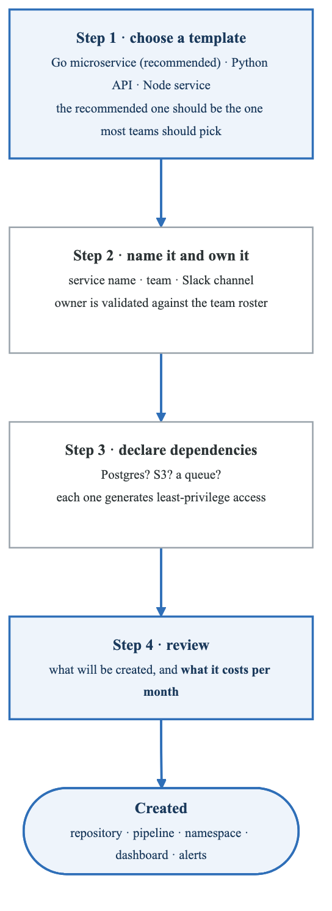
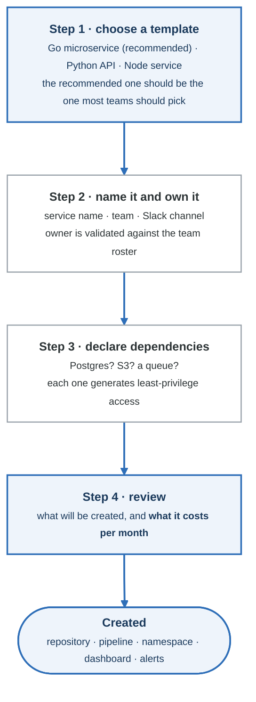

# Module 2: Developer Experience Design

## Introduction

Developer Experience (DevEx or DX) refers to the overall experience developers have when using tools, platforms, and processes to build and deploy software. This module covers the principles and practices of designing exceptional developer experiences within platform engineering.

## Learning Objectives

By the end of this module, you will be able to:
- Define developer experience and its components
- Apply UX principles to platform design
- Design intuitive developer interfaces
- Measure and improve developer experience
- Build effective developer portals

## Understanding Developer Experience

### What is Developer Experience?

> **Developer experience = productivity × satisfaction × impact**

| | The question it answers | What it takes |
|---|---|---|
| **Productivity** | "How efficiently can I do my work?" | fast feedback loops · minimal context switching · effective tooling · good documentation · automation of the repetitive |
| **Satisfaction** | "How do I feel about my work environment?" | low frustration · autonomy · tools that respect my time · **clear error messages** · a supportive culture |
| **Impact** | "Can I see the results of my work?" | a direct path to production · visibility into outcomes · ownership of features · meaningful work |

It is a product, so the three multiply rather than add. A platform that makes people productive and
miserable does not score well.

### The SPACE Framework

```yaml
SPACE Framework for Developer Productivity:
  Satisfaction and Well-being:
    definition: "How developers feel about their work"
    measures:
      - Developer satisfaction surveys
      - Burnout indicators
      - Retention rates
    platform_impact:
      - Reduce frustrating workflows
      - Minimize on-call burden
      - Provide good tooling

  Performance:
    definition: "Outcomes of developer work"
    measures:
      - Quality of code shipped
      - Customer satisfaction
      - Reliability improvements
    platform_impact:
      - Enable quality practices
      - Automate quality gates
      - Provide visibility

  Activity:
    definition: "Count of actions performed"
    measures:
      - Number of commits
      - PRs merged
      - Deployments
    caution: "Activity alone is a poor measure"
    platform_impact:
      - Don't optimize for vanity metrics
      - Focus on valuable outcomes

  Communication and Collaboration:
    definition: "How effectively teams work together"
    measures:
      - Code review turnaround
      - Documentation quality
      - Knowledge sharing
    platform_impact:
      - Integrated collaboration tools
      - Shared documentation
      - Service discovery

  Efficiency and Flow:
    definition: "Ability to complete work without interruption"
    measures:
      - Flow state frequency
      - Context switches
      - Wait times
    platform_impact:
      - Fast feedback loops
      - Self-service capabilities
      - Reduced dependencies
```

### Cognitive Load Theory for Developers

> **Cognitive load** is the mental effort required to complete a task, and it is the binding
> constraint on what a team can do. (*Team Topologies* is the source.)

| Type | Examples | Verdict |
|---|---|---|
| **Intrinsic** — necessary | understanding business requirements · algorithm design · architecture decisions · problem solving | **This is the valuable work.** Protect it. |
| **Extraneous** — unnecessary | figuring out the deployment process · managing infrastructure by hand · navigating complex tooling · hunting for documentation · waiting on another team | **This is waste.** The platform exists to remove it. |

**The goal: minimise extraneous load so capacity is available for the intrinsic kind.**

That also gives you the test for whether a platform feature is worth building: *does this reduce
what a product engineer must know, or add to it?* A "platform" that requires developers to learn
Backstage **and** Kubernetes **and** Terraform has increased cognitive load and called it a platform.

## Principles of Good Developer Experience

### The 10 Principles

```yaml
1. Optimize for Developer Flow:
   description: "Minimize interruptions and context switches"
   practices:
     - Fast feedback loops (< 10 seconds for unit tests)
     - Integrated tooling (don't make devs jump between tools)
     - Async-first communication
   example: |
     CI that runs in 5 minutes vs 45 minutes
     The difference is multiple flow states preserved per day

2. Make the Right Thing Easy:
   description: "Default to best practices"
   practices:
     - Golden paths with sensible defaults
     - Security built-in, not bolted-on
     - Compliance automated
   example: |
     Template that includes security scanning,
     logging, and monitoring by default

3. Provide Clear Feedback:
   description: "Tell developers what's happening and why"
   practices:
     - Progress indicators
     - Actionable error messages
     - Clear success states
   example: |
     Bad: "Deployment failed"
     Good: "Deployment failed: Pod image pull error.
            The image 'myapp:latest' was not found.
            Did you push to the registry? [View logs]"

4. Be Forgiving:
   description: "Allow recovery from mistakes"
   practices:
     - Easy rollback
     - Draft/preview states
     - Confirmation for destructive actions
   example: |
     "You're about to delete production database.
      Type 'delete-production-db' to confirm."

5. Reduce Dependencies:
   description: "Enable autonomy"
   practices:
     - Self-service capabilities
     - Clear ownership boundaries
     - API-first design
   example: |
     Developer creates own environment
     instead of filing a ticket

6. Consistency Over Novelty:
   description: "Familiar patterns reduce cognitive load"
   practices:
     - Consistent naming conventions
     - Similar experiences across tools
     - Predictable behaviors
   example: |
     All CLIs use same flags: --verbose, --output json

7. Meet Developers Where They Are:
   description: "Support existing workflows"
   practices:
     - IDE integration
     - CLI tools
     - API access
     - Web interfaces
   example: |
     Platform accessible from terminal, VSCode,
     and web portal - developer's choice

8. Transparent Operations:
   description: "Show what's happening behind the scenes"
   practices:
     - Deployment progress
     - Resource status
     - Cost visibility
   example: |
     Real-time deployment log streaming
     showing each step

9. Progressive Disclosure:
   description: "Simple by default, powerful when needed"
   practices:
     - Basic mode for common cases
     - Advanced options accessible
     - Expert customization possible
   example: |
     Simple: "Deploy to production"
     Advanced: Custom resource limits, regions, rollout %

10. Continuous Improvement:
    description: "Platform evolves with user needs"
    practices:
      - Regular feedback collection
      - Usage analytics
      - Iterative enhancement
    example: |
      Monthly developer surveys
      Quarterly platform improvements
```

### Designing for Developer Personas

**Developer personas — design for the one you actually have**

| Persona | Goals | What they need from the platform |
|---|---|---|
| **New developer** (< 6 months) | get productive quickly · understand how things work · avoid breaking things | guided onboarding · sensible defaults · **error messages that say what to do next** · a short path to a first deploy |
| **Experienced product engineer** | ship features · not think about infrastructure | a paved road that is genuinely the fastest option · no tickets · self-service |
| **Tech lead** | consistency across the team · visibility | golden paths they can point people at · dashboards · cost visibility per service |
| **Infrastructure specialist** | control and depth | documented escape hatches · access to the underlying tools · not being blocked by the abstraction |

The middle two are the platform's actual users. The last one is the persona platform teams
accidentally design for, because it is the persona they themselves are.

## Developer Portal Design

### Portal Architecture

**What a developer portal actually contains**

| Area | Contents |
|---|---|
| **Navigation** | home · catalog · create · docs · APIs · search |
| **Quick actions** | new service · new component · request a database · create an environment |
| **My services** | the ones this developer owns, with health at a glance |
| **Service catalog** | every service, its owner, its health, its dependencies |
| **Docs** | TechDocs rendered from the repo, so it cannot drift |

**Search is the feature people underestimate.** A catalog nobody can search is a spreadsheet. The
two questions a portal must answer instantly are *"who owns this?"* and *"is it healthy?"* — the
rest is nice to have.

### Service Catalog Design

```yaml
Service Catalog Features:

Service Entry Structure:
  Basic Information:
    - Name and description
    - Owner team and contact
    - Repository links
    - Documentation links
    - API reference

  Technical Details:
    - Tech stack and dependencies
    - Deployment targets
    - Resource consumption
    - SLOs and current status

  Lifecycle Information:
    - Version history
    - Recent changes
    - Incidents
    - Deprecation status

  Relationships:
    - Dependencies (what it uses)
    - Dependents (what uses it)
    - API consumers
    - Data flows

Example Service Card:
  ┌─────────────────────────────────────────────────────────────┐
  │  ┌──────┐                                                    │
  │  │ 🔷  │  payment-service                        [⚡ Healthy] │
  │  └──────┘  Process payments and refunds                     │
  │                                                              │
  │  Owner: payments-team    |    Language: Go                  │
  │  Last deploy: 2 hours ago    |    Tier: Critical           │
  │                                                              │
  │  Dependencies: postgres, redis, stripe-api                  │
  │  Dependents: checkout-ui, order-service                     │
  │                                                              │
  │  [View] [Deploy] [Logs] [Metrics] [Docs]                   │
  └─────────────────────────────────────────────────────────────┘

Discovery Features:
  Search:
    - Full-text search across all services
    - Filter by team, language, tier
    - Search by API endpoint
    - Find by dependency

  Browse:
    - Category-based navigation
    - Team view
    - System/domain view
    - Dependency graph

  Recommendations:
    - Recently viewed
    - Popular services
    - Team services
    - Related services
```

### Self-Service Workflows

<!-- figure: generated from the Mermaid below by _shared/diagrams/embed-figures.py — do not edit the image -->


<details>
<summary>Diagram source (Mermaid)</summary>



</details>

## CLI Design for Platforms

### CLI Design Principles

```yaml
CLI Design Best Practices:

1. Consistent Command Structure:
   pattern: "platform <resource> <action> [options]"
   examples:
     - "platform service create"
     - "platform env list"
     - "platform deploy start"

2. Helpful Output:
   default: "Human-readable for interactive use"
   options:
     --json: "Machine-readable JSON output"
     --quiet: "Minimal output for scripts"
     --verbose: "Detailed output for debugging"

3. Progressive Disclosure:
   basic: "platform deploy"
   advanced: "platform deploy --canary --percentage 10"
   expert: "platform deploy --custom-config ./deploy.yaml"

4. Interactive Mode:
   trigger: "When required arguments missing"
   example: |
     $ platform service create
     ? Service name: payment-api
     ? Template: [Go Microservice]
     ? Team: payments
     Creating service...

5. Confirmation for Destructive Actions:
   example: |
     $ platform service delete payment-api
     ⚠️  This will delete:
       - Repository: org/payment-api
       - 3 environments
       - All deployment history
     Type 'payment-api' to confirm: _

6. Helpful Error Messages:
   bad: "Error: invalid argument"
   good: |
     Error: Unknown service 'payment-ap'
     Did you mean 'payment-api'?

     Available services:
       - payment-api
       - payment-processor
       - payment-gateway
```

### Example CLI Implementation

```bash
# Platform CLI Command Reference

# Authentication
platform auth login              # Interactive login
platform auth status             # Show current auth status
platform auth logout             # Logout

# Service Management
platform service list            # List all services
platform service list --team payments  # Filter by team
platform service create          # Interactive service creation
platform service create --template go-microservice --name my-api
platform service info my-api     # Service details
platform service delete my-api   # Delete service (with confirmation)

# Deployments
platform deploy start my-api     # Deploy latest to default env
platform deploy start my-api --env production --version v1.2.3
platform deploy status           # Show deployment progress
platform deploy logs             # Stream deployment logs
platform deploy rollback         # Rollback to previous version
platform deploy history my-api   # Show deployment history

# Environments
platform env list                # List environments
platform env create staging      # Create environment
platform env info staging        # Environment details
platform env delete staging      # Delete environment

# Resources
platform resource list           # List provisioned resources
platform resource create postgres --name mydb
platform resource connect mydb   # Get connection info
platform resource delete mydb

# Observability
platform logs my-api             # Stream logs
platform logs my-api --since 1h --grep "error"
platform metrics my-api          # Show key metrics
platform dashboard my-api        # Open dashboard in browser

# Configuration
platform config list             # List config values
platform config set KEY=value    # Set config
platform config secret set API_KEY  # Set secret (prompts for value)

# Utility
platform status                  # Platform health status
platform version                 # CLI version
platform upgrade                 # Upgrade CLI
platform doctor                  # Diagnose issues
platform feedback                # Submit feedback
```

### CLI Output Design

```
Good CLI Output Examples:

# Success State
$ platform service create payment-api
Creating service payment-api...

✓ Repository created: github.com/org/payment-api
✓ CI/CD pipeline configured
✓ Kubernetes namespace created
✓ Monitoring dashboard ready

Service payment-api is ready!

Next steps:
  cd payment-api
  platform deploy start

Documentation: https://docs.platform.io/getting-started

---

# Progress Indication
$ platform deploy start payment-api --env production
Deploying payment-api to production...

Building image          [████████████████████] 100% (45s)
Pushing to registry     [████████████████████] 100% (12s)
Updating deployment     [██████████░░░░░░░░░░]  50%
  → Waiting for pods to be ready (3/6)

---

# Error with Context
$ platform deploy start payment-ap
Error: Service 'payment-ap' not found

Did you mean one of these?
  • payment-api
  • payment-processor

To list all services:
  platform service list

---

# Table Output
$ platform service list --team payments
NAME               TIER       STATUS    LAST DEPLOY    OWNER
payment-api        critical   healthy   2h ago         payments-team
payment-processor  standard   healthy   1d ago         payments-team
refund-service     standard   warning   3d ago         payments-team

3 services | 2 healthy | 1 warning

---

# JSON Output for Scripting
$ platform service info payment-api --json
{
  "name": "payment-api",
  "tier": "critical",
  "status": "healthy",
  "owner": "payments-team",
  "lastDeploy": "2024-01-15T10:30:00Z",
  "metrics": {
    "requestsPerSecond": 1250,
    "errorRate": 0.001,
    "p99Latency": 45
  }
}
```

## Documentation as Developer Experience

### Documentation Strategy

```yaml
Documentation Layers:

1. Getting Started (5-minute success):
   goal: "First successful action quickly"
   contents:
     - Prerequisites
     - Installation
     - Hello world example
     - Next steps
   format: "Step-by-step with copy-paste commands"

2. Tutorials (Learning paths):
   goal: "Teach concepts through building"
   contents:
     - Build a complete feature
     - Explain decisions along the way
     - Cover common scenarios
   format: "Narrative with code samples"

3. How-To Guides (Task completion):
   goal: "Complete specific tasks"
   contents:
     - Focused on single task
     - Assume some knowledge
     - Provide variations
   format: "Numbered steps with examples"

4. Reference (Complete information):
   goal: "Accurate, complete details"
   contents:
     - API documentation
     - Configuration options
     - CLI commands
   format: "Structured, searchable"

5. Explanation (Understanding):
   goal: "Deeper understanding"
   contents:
     - Architecture decisions
     - Design philosophy
     - Trade-offs
   format: "Prose with diagrams"
```

### Documentation Best Practices

**Documentation excellence**

| ✅ Do | ❌ Don't |
|---|---|
| Use concrete examples | Use abstract descriptions |
| Show actual commands | Assume prior knowledge |
| Include copy-pasteable code | Leave placeholder values |
| Explain the **why** | Only show the **what** |
| Keep examples current | Let docs go stale |
| Test every code sample | Assume the code still works |
| Provide troubleshooting | Stop at the happy path |
| Link to related docs | Create documentation silos |

**What good looks like**

````markdown
## Create a new service

This guide walks you through creating your first service.

### Prerequisites
- Platform CLI installed ([installation guide](/install))
- Authenticated (`platform auth login`)

### Steps

1. Create the service:

   ```bash
   platform service create my-first-api --language python --tier experimental
   ```

2. Open the pull request it generated and merge it.

3. In about eight minutes you will get a comment with your URLs.

### If something went wrong
- `403 Forbidden` — your token has expired; run `platform auth login` again
- The PR check fails on `owner` — your team must exist in `platform/teams/teams.yaml`
````

The row that gets skipped is *"test every code sample."* A command that has silently rotted is worse
than no documentation, because the reader spends twenty minutes assuming the mistake is theirs.

## Measuring Developer Experience

### DevEx Metrics

```yaml
Quantitative Metrics:

Time-Based Metrics:
  Time to First Commit:
    definition: "Time from account creation to first merged PR"
    target: "< 1 day"
    measurement: "Git + HR systems"

  Deployment Frequency:
    definition: "How often code is deployed"
    target: "Multiple times per day per service"
    measurement: "Deployment system logs"

  Lead Time:
    definition: "Commit to production time"
    target: "< 1 day"
    measurement: "Git to deployment correlation"

  Environment Provisioning Time:
    definition: "Request to ready environment"
    target: "< 30 minutes"
    measurement: "Platform metrics"

Usage Metrics:
  Self-Service Adoption:
    definition: "% of requests via self-service vs tickets"
    target: "> 80%"

  Golden Path Usage:
    definition: "% of new services using templates"
    target: "> 70%"

  Documentation Coverage:
    definition: "% of services with docs"
    target: "> 90%"

Qualitative Metrics:

Developer Satisfaction Survey (Quarterly):
  Questions:
    - "How productive do you feel?" (1-10)
    - "How satisfied are you with deployment process?" (1-10)
    - "How easy is it to get help?" (1-10)
    - "What's your biggest productivity blocker?" (open)
    - NPS: "How likely to recommend platform?" (0-10)

Developer Interviews (Monthly):
  Format: "30-minute 1:1 with sample of developers"
  Topics:
    - Recent pain points
    - Features they wish existed
    - What's working well
    - Improvement suggestions
```

### DevEx Dashboard

**Developer experience metrics**

| Area | Metric | Current | Change |
|---|---|---|---|
| **Satisfaction** | Developer NPS | +38 | ↑ 5 |
| | Satisfaction score | 7.8 / 10 | — |
| **Productivity** | Deployment frequency | 24 per day | ↑ 15% |
| | Lead time | 4.2 hours | — |

Satisfaction and productivity are on the same dashboard deliberately. Either one alone can be gamed:
productivity rises when you stop reviewing things, satisfaction rises when you stop asking anything
of anyone. The pair is what tells you the platform is working rather than just being used.

## Developer Experience Anti-Patterns

### Common Anti-Patterns

```yaml
1. The Documentation Desert:
   symptom: "Critical information exists only in people's heads"
   impact: "Slow onboarding, repeated questions, key person dependency"
   solution: "Documentation-first culture, templates, reviews"

2. The Configuration Labyrinth:
   symptom: "Getting started requires editing 15 config files"
   impact: "Frustration, errors, abandoned adoption"
   solution: "Sensible defaults, configuration wizards, validation"

3. The Feedback Black Hole:
   symptom: "Developers submit feedback that disappears"
   impact: "Learned helplessness, shadow IT"
   solution: "Visible roadmap, feedback acknowledgment, updates"

4. The One-Size-Fits-All Platform:
   symptom: "Platform optimized for one use case, forced on all"
   impact: "Workarounds, poor fit, resistance"
   solution: "Multiple golden paths, escape hatches, feedback loops"

5. The Moving Target:
   symptom: "Platform changes break developer workflows weekly"
   impact: "Trust erosion, stability preference over features"
   solution: "Versioning, deprecation policies, migration support"

6. The Expert-Only Interface:
   symptom: "Using platform requires deep infrastructure knowledge"
   impact: "Only senior engineers can deploy"
   solution: "Progressive disclosure, guided workflows, good defaults"

7. The Silent Failure:
   symptom: "Operations fail without clear error messages"
   impact: "Debugging time, support tickets, frustration"
   solution: "Actionable errors, logging, troubleshooting guides"

8. The Mandatory Training:
   symptom: "2-day training required before using platform"
   impact: "Slow adoption, resentment"
   solution: "Intuitive design, just-in-time learning, embedded help"
```

## Summary

Developer Experience is the cornerstone of successful platform engineering. Key principles:

1. **Reduce cognitive load** by abstracting complexity
2. **Make the right thing easy** with golden paths and defaults
3. **Provide clear feedback** at every step
4. **Measure and iterate** based on developer feedback
5. **Treat developers as customers** of your platform product

## Additional Resources

- "The DevEx Framework" - GitHub research
- "Measuring Developer Productivity" - DORA research
- Nielsen Norman Group - UX principles
- Backstage documentation - Portal design patterns

<!-- feynman-check -->

---

## Feynman check

Close the file. Blank page, no notes. Explain each of these to a competent engineer who has never
used this tool — **under five minutes, no jargon you can't define on the spot:**

- Understanding Developer Experience
- Principles of Good Developer Experience
- Developer Portal Design
- CLI Design for Platforms

**The gap is not what you forgot. It is where you used a word instead of a mechanism.**

| | |
|---|---|
| ✗ | *"The platform makes developers more productive."* |
| ✓ | *"A golden path is a template that produces a repository with CI, manifests, dashboards and alerts already wired, so the product team owns none of them. It reduces cognitive load by removing decisions, not by adding features — and without a documented escape hatch it is a cage."* |

**Trace it:** A developer commits `service.yaml` → a running service with a dashboard and a paging rule. Name every system that acts, and which team owns each one.

Stop at the first component you cannot name. Reopen this file and read **only** that.

**Go deeper — only once the gap has a name:** [Team Topologies — cognitive load](https://teamtopologies.com/key-concepts) and the [CNCF Platforms White Paper](https://tag-app-delivery.cncf.io/whitepapers/platforms/) — why golden paths exist at all.
Full list per domain: [`SOURCES.md`](../SOURCES.md#platform-engineering)

→ Protocol, the three levels of knowing, and worked examples: [`MASTERY.md`](../MASTERY.md)

<!-- /feynman-check -->
