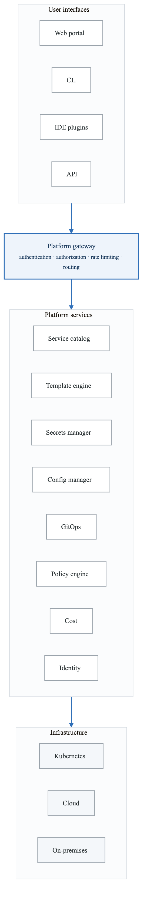
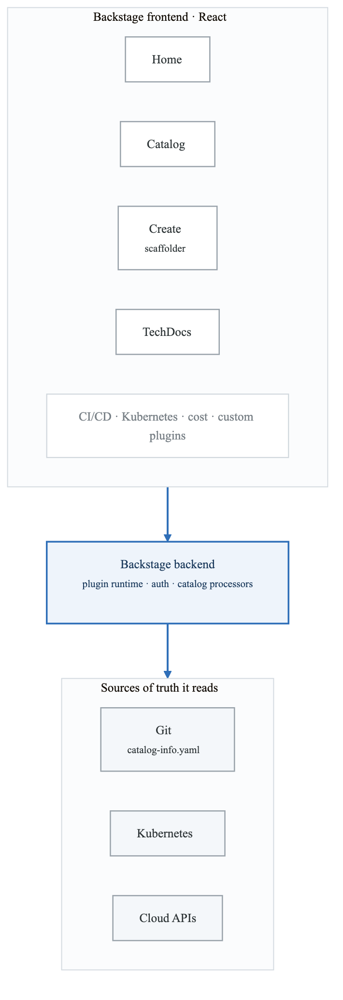
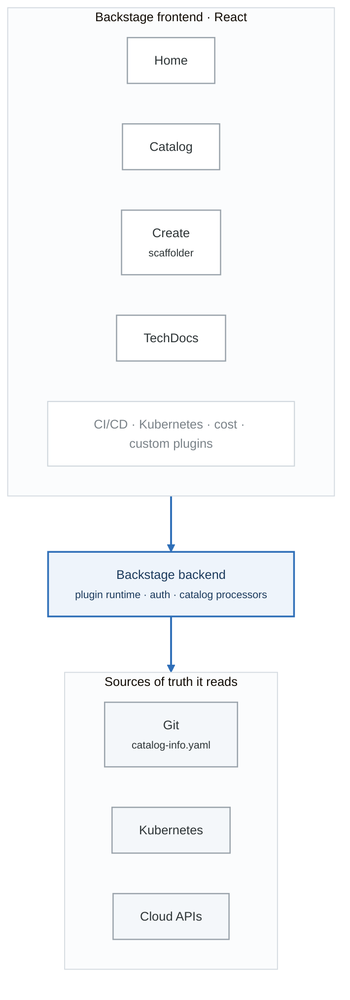
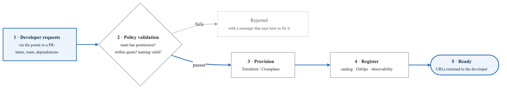
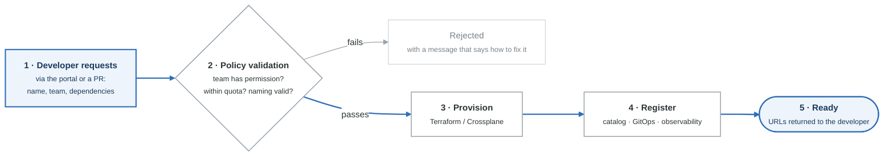

# Module 3: Building Internal Developer Platforms

## Introduction

This module provides a deep dive into the technical architecture, implementation patterns, and technology choices for building Internal Developer Platforms (IDPs). We'll explore the components, integration patterns, and best practices for creating a platform that developers love to use.

## Learning Objectives

By the end of this module, you will be able to:
- Design the technical architecture of an IDP
- Select appropriate technologies for each platform layer
- Implement service catalogs and developer portals
- Build self-service infrastructure provisioning
- Create and maintain golden paths and templates

## IDP Technical Architecture

### Reference Architecture

```mermaid
%%{init: {'theme':'base','themeVariables':{'fontFamily':'Helvetica, Arial, sans-serif','fontSize':'13px','primaryColor':'#ffffff','primaryTextColor':'#2d3436','primaryBorderColor':'#9aa3ab','lineColor':'#9aa3ab','textColor':'#2d3436','clusterBkg':'#fbfcfd','clusterBorder':'#d4dae0','edgeLabelBackground':'#ffffff','tertiaryColor':'#eef4fb'},'flowchart':{'curve':'basis','padding':14,'nodeSpacing':42,'rankSpacing':58}}}%%
flowchart TB
  classDef default fill:#ffffff,stroke:#9aa3ab,stroke-width:1.3px,color:#2d3436
  classDef n    fill:#ffffff,stroke:#9aa3ab,stroke-width:1.3px,color:#2d3436
  classDef crit fill:#eef4fb,stroke:#2f6fb8,stroke-width:1.8px,color:#1b3a5c
  classDef data fill:#f4f7fa,stroke:#9aa3ab,stroke-width:1.3px,color:#2d3436
  classDef mut  fill:#ffffff,stroke:#cfd6dc,stroke-width:1.1px,color:#7a8288
  classDef warn fill:#fdf0ec,stroke:#c0522d,stroke-width:1.6px,color:#8a3a1e
  subgraph UI["User interfaces"]
    direction LR
    U1["Web portal"]:::n
    U2["CLI"]:::n
    U3["IDE plugins"]:::n
    U4["API"]:::n
  end
  GW["Platform gateway<br/><small>authentication · authorization · rate limiting · routing</small>"]:::crit
  subgraph SVC["Platform services"]
    direction LR
    S1["Service catalog"]:::n
    S2["Template engine"]:::n
    S3["Secrets manager"]:::n
    S4["Config manager"]:::n
    S5["GitOps"]:::n
    S6["Policy engine"]:::n
    S7["Cost"]:::n
    S8["Identity"]:::n
  end
  subgraph INF["Infrastructure"]
    direction LR
    I1["Kubernetes"]:::data
    I2["Cloud"]:::data
    I3["On-premises"]:::data
  end

  UI --> GW --> SVC --> INF

  linkStyle 0,1,2 stroke:#2f6fb8,stroke-width:2px
```

<!-- figure: generated from the Mermaid below by _shared/diagrams/embed-figures.py — do not edit the image -->


<details>
<summary>Diagram source (Mermaid)</summary>



</details>

### Component Deep Dives

```yaml
1. Developer Portal:
   purpose: "Web-based interface for all platform capabilities"
   technologies:
     - Backstage (AudioWave)
     - Port
     - Cortex
     - OpsLevel
     - Custom (React/Next.js)

   key_features:
     - Service catalog
     - Software templates
     - TechDocs
     - Search
     - Plugins architecture

2. Service Catalog:
   purpose: "Single source of truth for all services"
   data_model:
     Service:
       - metadata (name, description, owner)
       - spec (type, lifecycle, dependencies)
       - relations (dependsOn, ownedBy, partOf)
       - annotations (custom metadata)

   sources:
     - Git repositories (catalog-info.yaml)
     - Kubernetes (annotations)
     - Cloud resources (tags)
     - CI/CD systems

3. Template Engine:
   purpose: "Scaffolding and golden paths"
   technologies:
     - Backstage Software Templates
     - Cookiecutter
     - Yeoman
     - Custom templating

   capabilities:
     - Variable substitution
     - Conditional sections
     - External API calls
     - Multi-file generation
     - Post-creation hooks

4. GitOps Controller:
   purpose: "Declarative infrastructure management"
   technologies:
     - Argo CD
     - Flux
     - Crossplane
     - Terraform Cloud

   patterns:
     - Git as source of truth
     - Automated reconciliation
     - Drift detection
     - Rollback capability

5. Policy Engine:
   purpose: "Governance and guardrails"
   technologies:
     - Open Policy Agent (OPA)
     - Kyverno
     - Gatekeeper
     - Checkov

   enforcement_points:
     - Admission control
     - CI pipeline
     - PR checks
     - Runtime
```

## Building with Backstage

### Backstage Architecture

<!-- figure: generated from the Mermaid below by _shared/diagrams/embed-figures.py — do not edit the image -->


<details>
<summary>Diagram source (Mermaid)</summary>



</details>

### Catalog Entity Definition

```yaml
# catalog-info.yaml - Service Definition
apiVersion: backstage.io/v1alpha1
kind: Component
metadata:
  name: payment-service
  description: Processes payments and refunds
  tags:
    - python
    - payments
    - critical
  annotations:
    github.com/project-slug: org/payment-service
    pagerduty.com/service-id: PAYMENT123
    backstage.io/techdocs-ref: dir:.
    grafana/dashboard-selector: "payment-service"
    sonarqube.org/project-key: payment-service
  links:
    - url: https://payment-service.internal/
      title: Service URL
    - url: https://runbook.internal/payment-service
      title: Runbook
spec:
  type: service
  lifecycle: production
  owner: group:payments-team
  system: payments-system
  dependsOn:
    - resource:default/payments-db
    - component:default/stripe-integration
  providesApis:
    - payment-api
  consumesApis:
    - stripe-api
    - notification-api

---
apiVersion: backstage.io/v1alpha1
kind: API
metadata:
  name: payment-api
  description: Payment processing API
spec:
  type: openapi
  lifecycle: production
  owner: group:payments-team
  definition:
    $text: ./openapi.yaml

---
apiVersion: backstage.io/v1alpha1
kind: Resource
metadata:
  name: payments-db
  description: PostgreSQL database for payments
spec:
  type: database
  owner: group:payments-team
  system: payments-system

---
apiVersion: backstage.io/v1alpha1
kind: System
metadata:
  name: payments-system
  description: All payment-related services
spec:
  owner: group:payments-team
  domain: financial

---
apiVersion: backstage.io/v1alpha1
kind: Group
metadata:
  name: payments-team
  description: Payment processing team
spec:
  type: team
  profile:
    displayName: Payments Team
    email: payments@company.com
  parent: engineering
  children: []
  members:
    - user:alice
    - user:bob
```

### Software Template Example

```yaml
# template.yaml - Golden Path Template
apiVersion: scaffolder.backstage.io/v1beta3
kind: Template
metadata:
  name: go-microservice
  title: Go Microservice
  description: Create a production-ready Go microservice
  tags:
    - recommended
    - go
    - microservice
spec:
  owner: platform-team
  type: service

  parameters:
    - title: Service Information
      required:
        - name
        - description
        - owner
      properties:
        name:
          title: Service Name
          type: string
          description: Unique name for the service
          pattern: '^[a-z0-9-]+$'
          ui:autofocus: true
        description:
          title: Description
          type: string
          description: What does this service do?
        owner:
          title: Owner
          type: string
          description: Team that owns this service
          ui:field: OwnerPicker
          ui:options:
            catalogFilter:
              kind: Group

    - title: Technical Configuration
      properties:
        tier:
          title: Service Tier
          type: string
          description: Criticality level
          default: standard
          enum:
            - critical
            - standard
            - experimental
          enumNames:
            - Critical (99.99% SLA)
            - Standard (99.9% SLA)
            - Experimental (Best effort)
        database:
          title: Database
          type: string
          description: Primary database
          default: none
          enum:
            - postgres
            - mysql
            - mongodb
            - none
        cache:
          title: Cache
          type: boolean
          description: Include Redis cache
          default: false
        messaging:
          title: Messaging
          type: string
          default: none
          enum:
            - kafka
            - rabbitmq
            - none

    - title: Repository Settings
      required:
        - repoUrl
      properties:
        repoUrl:
          title: Repository Location
          type: string
          ui:field: RepoUrlPicker
          ui:options:
            allowedHosts:
              - github.com

  steps:
    # Fetch and template the code
    - id: fetch-base
      name: Fetch Base Template
      action: fetch:template
      input:
        url: ./skeleton
        values:
          name: ${{ parameters.name }}
          description: ${{ parameters.description }}
          owner: ${{ parameters.owner }}
          tier: ${{ parameters.tier }}
          database: ${{ parameters.database }}
          cache: ${{ parameters.cache }}
          messaging: ${{ parameters.messaging }}

    # Create the GitHub repository
    - id: publish
      name: Publish to GitHub
      action: publish:github
      input:
        allowedHosts: ['github.com']
        repoUrl: ${{ parameters.repoUrl }}
        description: ${{ parameters.description }}
        defaultBranch: main
        protectDefaultBranch: true
        requireCodeOwnerReviews: true

    # Register in catalog
    - id: register
      name: Register in Catalog
      action: catalog:register
      input:
        repoContentsUrl: ${{ steps.publish.output.repoContentsUrl }}
        catalogInfoPath: '/catalog-info.yaml'

    # Provision database if requested
    - id: provision-db
      name: Provision Database
      if: ${{ parameters.database !== 'none' }}
      action: http:backstage:request
      input:
        method: POST
        path: /api/provisioning/database
        body:
          name: ${{ parameters.name }}-db
          type: ${{ parameters.database }}
          owner: ${{ parameters.owner }}

    # Create Kubernetes namespace
    - id: create-namespace
      name: Create Kubernetes Namespace
      action: kubernetes:create-namespace
      input:
        namespace: ${{ parameters.name }}
        labels:
          owner: ${{ parameters.owner }}
          tier: ${{ parameters.tier }}

    # Set up monitoring
    - id: setup-monitoring
      name: Configure Monitoring
      action: http:backstage:request
      input:
        method: POST
        path: /api/observability/setup
        body:
          service: ${{ parameters.name }}
          tier: ${{ parameters.tier }}
          dashboards: true
          alerts: true

  output:
    links:
      - title: Repository
        url: ${{ steps.publish.output.remoteUrl }}
      - title: Service in Catalog
        icon: catalog
        entityRef: ${{ steps.register.output.entityRef }}
      - title: CI/CD Pipeline
        url: ${{ steps.publish.output.remoteUrl }}/actions
```

### Template Skeleton Structure

**`skeleton/`**

- `catalog-info.yaml`
- `README.md`
- Dockerfile
- Makefile
- `go.mod`
- `go.sum`
- `cmd/`
  - `server/`
    - `main.go`
- `internal/`
  - `api/`
    - `handler.go`
    - `routes.go`
  - `config/`
    - `config.go`
  - `service/`
    - `service.go`
- `deployments/`
  - `kubernetes/`
    - `deployment.yaml`
    - `service.yaml`
    - `ingress.yaml`
    - `kustomization.yaml`
  - `helm/`
    - `Chart.yaml`
    - `values.yaml`
    - `templates/`
- `.github/`
  - `workflows/`
    - `ci.yaml`
    - `cd.yaml`
- `docs/`
  - `index.md`
- `tests/`
  - `integration/`
    - `api_test.go`


```yaml
# skeleton/catalog-info.yaml (templated)
apiVersion: backstage.io/v1alpha1
kind: Component
metadata:
  name: ${{ values.name }}
  description: ${{ values.description }}
  tags:
    - go
    - microservice
    - ${{ values.tier }}
  annotations:
    github.com/project-slug: org/${{ values.name }}
    backstage.io/techdocs-ref: dir:.
spec:
  type: service
  lifecycle: production
  owner: ${{ values.owner }}

  dependsOn:
    - resource:default/${{ values.name }}-db

```

## Self-Service Infrastructure

### Infrastructure Abstraction Patterns

```yaml
Pattern 1: API-Based Provisioning
  Description: "REST API for resource requests"

  Flow:
    1. Developer calls platform API
    2. Platform validates request against policies
    3. Platform translates to IaC
    4. GitOps applies infrastructure
    5. Platform returns connection info

  Example API:
    POST /api/v1/resources/database:
      request:
        name: "myapp-db"
        type: "postgres"
        size: "small"
        environment: "development"
      response:
        id: "db-abc123"
        status: "provisioning"
        connection_string: "will be available when ready"

Pattern 2: Custom Resource Definitions (CRDs)
  Description: "Kubernetes-native abstractions"

  Example:
    apiVersion: platform.company.io/v1
    kind: Database
    metadata:
      name: myapp-db
      namespace: myapp
    spec:
      engine: postgres
      version: "15"
      size: small
      backup:
        enabled: true
        retention: 7d

  Controller:
    - Watches for Database CRDs
    - Provisions actual database (RDS, Cloud SQL, etc.)
    - Updates status with connection info
    - Manages lifecycle (scaling, backup, deletion)

Pattern 3: Crossplane Compositions
  Description: "Composite resources from primitives"

  Example:
    apiVersion: platform.company.io/v1
    kind: ApplicationEnvironment
    metadata:
      name: myapp-staging
    spec:
      team: myteam
      tier: standard
      components:
        database:
          enabled: true
          engine: postgres
        cache:
          enabled: true
        queue:
          enabled: false
```

### Crossplane Implementation

```yaml
# Composite Resource Definition (XRD)
apiVersion: apiextensions.crossplane.io/v1
kind: CompositeResourceDefinition
metadata:
  name: applicationenvironments.platform.company.io
spec:
  group: platform.company.io
  names:
    kind: ApplicationEnvironment
    plural: applicationenvironments
  claimNames:
    kind: Environment
    plural: environments
  versions:
    - name: v1
      served: true
      referenceable: true
      schema:
        openAPIV3Schema:
          type: object
          properties:
            spec:
              type: object
              required:
                - team
              properties:
                team:
                  type: string
                  description: Team that owns this environment
                tier:
                  type: string
                  enum: [development, staging, production]
                  default: development
                database:
                  type: object
                  properties:
                    enabled:
                      type: boolean
                      default: false
                    engine:
                      type: string
                      enum: [postgres, mysql]
                      default: postgres
                    size:
                      type: string
                      enum: [small, medium, large]
                      default: small
                cache:
                  type: object
                  properties:
                    enabled:
                      type: boolean
                      default: false

---
# Composition - What actually gets created
apiVersion: apiextensions.crossplane.io/v1
kind: Composition
metadata:
  name: environment-aws
  labels:
    provider: aws
spec:
  compositeTypeRef:
    apiVersion: platform.company.io/v1
    kind: ApplicationEnvironment

  resources:
    # VPC for the environment
    - name: vpc
      base:
        apiVersion: ec2.aws.crossplane.io/v1beta1
        kind: VPC
        spec:
          forProvider:
            region: us-west-2
            cidrBlock: 10.0.0.0/16
            enableDnsHostNames: true
            enableDnsSupport: true
            tags:
              - key: ManagedBy
                value: crossplane

    # Database (conditional)
    - name: database
      base:
        apiVersion: rds.aws.crossplane.io/v1beta1
        kind: DBInstance
        spec:
          forProvider:
            region: us-west-2
            dbInstanceClass: db.t3.micro
            allocatedStorage: 20
            engine: postgres
            engineVersion: "15"
            masterUsername: admin
            skipFinalSnapshot: true
          writeConnectionSecretToRef:
            namespace: crossplane-system
      patches:
        - type: FromCompositeFieldPath
          fromFieldPath: spec.database.engine
          toFieldPath: spec.forProvider.engine
        - type: FromCompositeFieldPath
          fromFieldPath: spec.database.size
          toFieldPath: spec.forProvider.dbInstanceClass
          transforms:
            - type: map
              map:
                small: db.t3.micro
                medium: db.t3.small
                large: db.t3.medium
        - type: FromCompositeFieldPath
          fromFieldPath: metadata.name
          toFieldPath: spec.writeConnectionSecretToRef.name
          transforms:
            - type: string
              string:
                fmt: "%s-db-conn"
      # Only create if database.enabled is true
      patches:
        - type: FromCompositeFieldPath
          fromFieldPath: spec.database.enabled
          toFieldPath: metadata.annotations[crossplane.io/external-create-pending]
          transforms:
            - type: convert
              convert:
                toType: string
            - type: map
              map:
                "false": "skip"

    # ElastiCache (conditional)
    - name: cache
      base:
        apiVersion: elasticache.aws.crossplane.io/v1beta1
        kind: CacheCluster
        spec:
          forProvider:
            region: us-west-2
            cacheNodeType: cache.t3.micro
            engine: redis
            numCacheNodes: 1
```

### Self-Service Portal Workflow

<!-- figure: generated from the Mermaid below by _shared/diagrams/embed-figures.py — do not edit the image -->


<details>
<summary>Diagram source (Mermaid)</summary>



</details>

## GitOps Integration

### GitOps Repository Structure

**`gitops-repo/`**

- `apps/` — Application deployments
  - `production/`
    - `payment-service/`
      - `kustomization.yaml`
      - `deployment.yaml`
      - `ingress.yaml`
    - `user-service/`
      - `...`
  - `staging/`
    - `...`
  - `development/`
    - `...`
- `infrastructure/` — Infrastructure configs
  - `production/`
    - `databases/`
    - `caches/`
    - `queues/`
  - `staging/`
  - `development/`
- `platform/` — Platform components
  - `argo-cd/`
  - `crossplane/`
  - `cert-manager/`
  - `external-secrets/`
- `clusters/` — Cluster configurations
  - `production/`
    - `cluster-config.yaml`
    - `app-of-apps.yaml`
  - `staging/`
  - `development/`
- `base/` — Shared base configs
  - `deployment-base/`
  - `service-base/`
  - `ingress-base/`


### Argo CD Application Sets

```yaml
# ApplicationSet for all services in an environment
apiVersion: argoproj.io/v1alpha1
kind: ApplicationSet
metadata:
  name: services-production
  namespace: argocd
spec:
  generators:
    # Generate apps from Git directory structure
    - git:
        repoURL: https://github.com/org/gitops-repo.git
        revision: HEAD
        directories:
          - path: apps/production/*

  template:
    metadata:
      name: '{{path.basename}}-production'
      labels:
        environment: production
    spec:
      project: production
      source:
        repoURL: https://github.com/org/gitops-repo.git
        targetRevision: HEAD
        path: '{{path}}'
      destination:
        server: https://kubernetes.default.svc
        namespace: '{{path.basename}}'
      syncPolicy:
        automated:
          prune: true
          selfHeal: true
        syncOptions:
          - CreateNamespace=true
          - PrunePropagationPolicy=foreground
        retry:
          limit: 5
          backoff:
            duration: 5s
            factor: 2
            maxDuration: 3m

---
# ApplicationSet from catalog entries
apiVersion: argoproj.io/v1alpha1
kind: ApplicationSet
metadata:
  name: catalog-driven-apps
spec:
  generators:
    # Pull from Backstage catalog
    - plugin:
        configMapRef:
          name: backstage-plugin
        input:
          parameters:
            filter:
              kind: Component
              type: service
              lifecycle: production

  template:
    metadata:
      name: '{{metadata.name}}'
    spec:
      project: default
      source:
        repoURL: '{{metadata.annotations.github.com/project-slug}}'
        path: deployments/kubernetes
        targetRevision: main
      destination:
        server: https://kubernetes.default.svc
        namespace: '{{metadata.name}}'
```

## Policy Enforcement

### OPA Gatekeeper Policies

```yaml
# Constraint Template - Require resource limits
apiVersion: templates.gatekeeper.sh/v1
kind: ConstraintTemplate
metadata:
  name: k8srequiredlimits
spec:
  crd:
    spec:
      names:
        kind: K8sRequiredLimits
      validation:
        openAPIV3Schema:
          type: object
          properties:
            limits:
              type: array
              items:
                type: string
  targets:
    - target: admission.k8s.gatekeeper.sh
      rego: |
        package k8srequiredlimits

        violation[{"msg": msg}] {
          container := input.review.object.spec.containers[_]
          not container.resources.limits
          msg := sprintf("Container %v must have resource limits", [container.name])
        }

        violation[{"msg": msg}] {
          container := input.review.object.spec.containers[_]
          required := input.parameters.limits[_]
          not container.resources.limits[required]
          msg := sprintf("Container %v must have %v limit", [container.name, required])
        }

---
# Apply the constraint
apiVersion: constraints.gatekeeper.sh/v1beta1
kind: K8sRequiredLimits
metadata:
  name: container-must-have-limits
spec:
  match:
    kinds:
      - apiGroups: [""]
        kinds: ["Pod"]
    excludedNamespaces:
      - kube-system
      - gatekeeper-system
  parameters:
    limits:
      - cpu
      - memory

---
# Platform-wide required labels
apiVersion: templates.gatekeeper.sh/v1
kind: ConstraintTemplate
metadata:
  name: k8srequiredlabels
spec:
  crd:
    spec:
      names:
        kind: K8sRequiredLabels
      validation:
        openAPIV3Schema:
          type: object
          properties:
            labels:
              type: array
              items:
                type: string
  targets:
    - target: admission.k8s.gatekeeper.sh
      rego: |
        package k8srequiredlabels

        violation[{"msg": msg}] {
          provided := {label | input.review.object.metadata.labels[label]}
          required := {label | label := input.parameters.labels[_]}
          missing := required - provided
          count(missing) > 0
          msg := sprintf("Missing required labels: %v", [missing])
        }

---
apiVersion: constraints.gatekeeper.sh/v1beta1
kind: K8sRequiredLabels
metadata:
  name: require-platform-labels
spec:
  match:
    kinds:
      - apiGroups: ["apps"]
        kinds: ["Deployment"]
  parameters:
    labels:
      - app.kubernetes.io/name
      - app.kubernetes.io/owner
      - platform.company.io/tier
```

### Platform Guardrails

```yaml
Platform Guardrails:

Security Guardrails:
  - No privileged containers
  - No host network/PID/IPC
  - Read-only root filesystem
  - Non-root user required
  - Approved base images only
  - No latest tags
  - Secrets from vault only

Resource Guardrails:
  - CPU/memory limits required
  - Within team quota
  - PVC size limits
  - Replica count limits

Compliance Guardrails:
  - Required labels present
  - Approved namespaces only
  - Network policies required
  - TLS required for ingress

Enforcement Strategy:
  Soft Enforcement (Warning):
    - New policies during adoption
    - Non-critical best practices
    - Recommendations

  Hard Enforcement (Block):
    - Security requirements
    - Compliance requirements
    - Critical best practices

  Progressive Enforcement:
    development: soft
    staging: soft
    production: hard
```

## Platform Observability

### Platform Metrics

```yaml
Platform Health Metrics:

Infrastructure Metrics:
  platform_resources_total:
    description: "Total resources managed by platform"
    labels: [type, environment, team]

  platform_provisioning_duration_seconds:
    description: "Time to provision resources"
    labels: [type, result]

  platform_gitops_sync_status:
    description: "GitOps sync status"
    labels: [app, environment]

Usage Metrics:
  platform_service_count:
    description: "Number of services in catalog"
    labels: [team, tier, lifecycle]

  platform_deployment_total:
    description: "Total deployments"
    labels: [service, environment, result]

  platform_template_usage_total:
    description: "Template usage count"
    labels: [template_name]

Developer Experience Metrics:
  platform_onboarding_duration_seconds:
    description: "Time from signup to first deploy"

  platform_self_service_requests_total:
    description: "Self-service actions"
    labels: [action, result]

  platform_support_tickets_total:
    description: "Support tickets created"
    labels: [category, priority]
```

### Platform Dashboard

**Platform operations dashboard**

| Platform component | Status | | Resource | Count |
|---|---|---|---|---|
| Developer portal | healthy | | Services | 156 |
| Argo CD | healthy | | Environments | 42 |
| Crossplane | healthy | | Databases | 38 |
| Vault | healthy | | Cache clusters | 15 |
| Policy engine | healthy | | Queues | 12 |

The platform is itself a production service with users. It needs its own SLO, its own on-call, and
its own dashboard — a platform team that monitors everyone else's workloads and not its own has
missed the point.

## Summary

Building an Internal Developer Platform requires thoughtful architecture across multiple layers. Key components include:

1. **Developer Portal**: Central hub for self-service (Backstage, Port)
2. **Service Catalog**: Track all services and ownership
3. **Template Engine**: Golden paths for consistency
4. **GitOps**: Declarative, auditable infrastructure
5. **Policy Engine**: Guardrails without blocking

The platform should abstract complexity while maintaining flexibility for advanced use cases.

## Additional Resources

- Backstage documentation
- Crossplane guides
- Argo CD documentation
- Platform Engineering community resources
- CNCF Platform Working Group

<!-- feynman-check -->

---

## Feynman check

Close the file. Blank page, no notes. Explain each of these to a competent engineer who has never
used this tool — **under five minutes, no jargon you can't define on the spot:**

- IDP Technical Architecture
- Building with Backstage
- Self-Service Infrastructure
- GitOps Integration

**The gap is not what you forgot. It is where you used a word instead of a mechanism.**

| | |
|---|---|
| ✗ | *"The platform makes developers more productive."* |
| ✓ | *"A golden path is a template that produces a repository with CI, manifests, dashboards and alerts already wired, so the product team owns none of them. It reduces cognitive load by removing decisions, not by adding features — and without a documented escape hatch it is a cage."* |

**Trace it:** A developer commits `service.yaml` → a running service with a dashboard and a paging rule. Name every system that acts, and which team owns each one.

Stop at the first component you cannot name. Reopen this file and read **only** that.

**Go deeper — only once the gap has a name:** [Team Topologies — cognitive load](https://teamtopologies.com/key-concepts) and the [CNCF Platforms White Paper](https://tag-app-delivery.cncf.io/whitepapers/platforms/) — why golden paths exist at all.
Full list per domain: [`SOURCES.md`](../SOURCES.md#platform-engineering)

→ Protocol, the three levels of knowing, and worked examples: [`MASTERY.md`](../MASTERY.md)

<!-- /feynman-check -->
