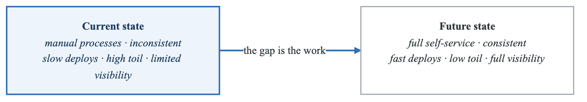
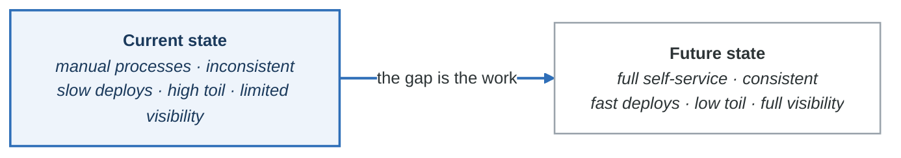
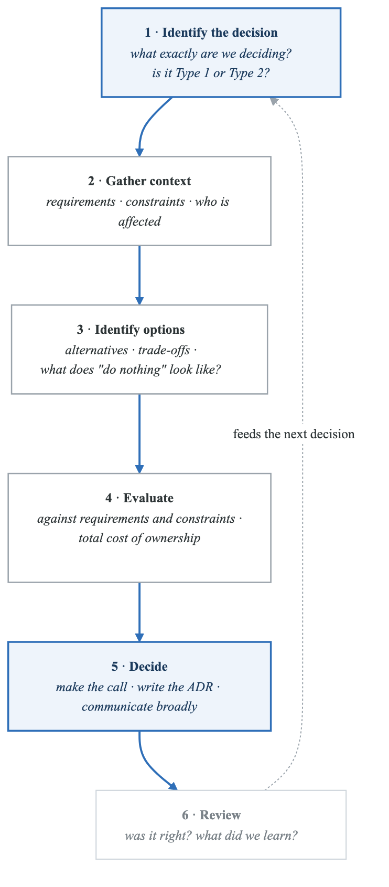
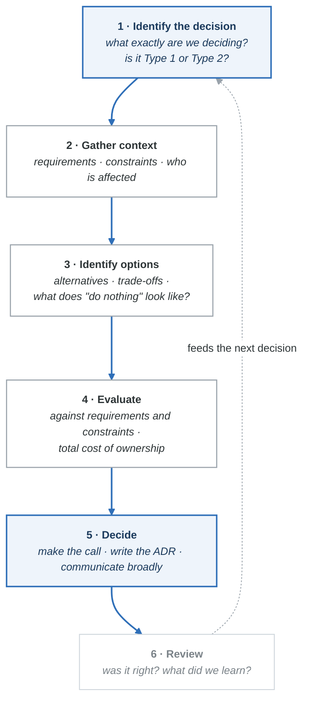

# Module 4: Technical Leadership in Platform Engineering

## Introduction

Technical leadership in platform engineering requires a unique blend of deep technical expertise, product thinking, and people skills. This module covers the essential leadership competencies needed to build successful platform teams and drive organizational transformation.

## Learning Objectives

By the end of this module, you will be able to:
- Develop technical vision and strategy for platform initiatives
- Lead platform teams effectively
- Navigate organizational dynamics and stakeholder management
- Make sound architectural decisions with organizational impact
- Drive adoption and change management

## The Platform Engineering Leader

### Role Definition

**Platform engineering leadership roles**

| | **Staff / Principal Engineer** | **Engineering Manager** | **Director / Head of Platform** |
|---|---|---|---|
| **Focus** | Technical excellence across the platform | Team delivery and growth | Strategy and organisational impact |
| | Define platform architecture | Team building and hiring | Platform vision and strategy |
| | Lead complex technical initiatives | Career development | Executive communication |
| **Responsibilities** | Mentor platform engineers | Delivery management | Budget and resource allocation |
| | Set technical standards | Stakeholder communication | Organisational design |
| | Drive technical decision-making | Process improvement | Cross-functional alignment |

**Where the time actually goes**

| | Staff / Principal | Manager | Director |
|---|---|---|---|
| 40% | Hands-on technical | People management | Strategy and planning |
| 30% | Architecture and design | Stakeholders and planning | Stakeholder management |
| 20% | Mentorship and collaboration | Technical involvement | Team leadership |
| 10% | Planning and process | Process and admin | Technical oversight |

The three columns are not a ladder. Read the first row across: a Staff engineer spends 40% of their
week writing things, a Director spends 10%. Choosing between these paths is choosing which of those
numbers you want, not choosing how senior to be.

### Leadership Competencies

```yaml
Technical Leadership Competencies:

1. Technical Vision:
   description: "Ability to see the future state and chart a path"
   behaviors:
     - Define long-term platform architecture
     - Anticipate technology trends
     - Balance innovation with stability
     - Create compelling technical narratives
   development:
     - Study industry trends
     - Learn from other organizations
     - Experiment with emerging technologies
     - Write and share vision documents

2. Systems Thinking:
   description: "Understanding complex systems and interactions"
   behaviors:
     - See beyond immediate problems
     - Understand second-order effects
     - Consider organizational dynamics
     - Balance competing priorities
   development:
     - Practice root cause analysis
     - Map system dependencies
     - Study organizational behavior
     - Learn from incidents

3. Decision Making:
   description: "Making sound decisions with incomplete information"
   behaviors:
     - Gather relevant data quickly
     - Consider multiple perspectives
     - Make reversible decisions fast
     - Document decisions and rationale
   development:
     - Use decision frameworks
     - Practice decision journaling
     - Learn from past decisions
     - Seek diverse input

4. Communication:
   description: "Adapting message to audience"
   behaviors:
     - Technical depth with engineers
     - Business outcomes with executives
     - Clear documentation
     - Active listening
   development:
     - Practice presenting to different audiences
     - Write for different readers
     - Seek feedback on communication
     - Observe effective communicators

5. Influence Without Authority:
   description: "Getting things done across organizational boundaries"
   behaviors:
     - Build relationships
     - Understand others' motivations
     - Find win-win solutions
     - Lead through example
   development:
     - Practice stakeholder mapping
     - Develop empathy skills
     - Build cross-functional relationships
     - Create shared goals
```

## Developing Technical Vision

### Vision Framework

**Technical vision**

<!-- figure: generated from the Mermaid below by _shared/diagrams/embed-figures.py — do not edit the image -->


<details>
<summary>Diagram source (Mermaid)</summary>



</details>

**Gap analysis**

| Technical gaps | Organisational gaps |
|---|---|
| No unified platform | Skills and training |
| Fragmented tooling | Process maturity |
| Manual provisioning | Cultural readiness |

**Roadmap**

| Phase | When | Delivers |
|---|---|---|
| **1 — Foundation** | Q1–Q2 | Core platform, the first golden paths |
| **2 — Adoption** | Q3–Q4 | Migration support, expanded capabilities |
| **3 — Optimisation** | Year 2 | Advanced features, continuous improvement |

The right-hand column of the gap analysis is the one that sinks platform projects. Technical gaps
have owners and estimates; *cultural readiness* has neither, and it is still the thing that decides
whether anyone uses what you built.

### Writing a Technical Vision Document

```markdown
# Platform Vision Document Template

## Executive Summary
[2-3 paragraphs summarizing the vision, why it matters, and expected outcomes]

## Current State Assessment

### What's Working
- [List current strengths]

### Pain Points
- [Developer feedback and data]
- [Operational challenges]
- [Business impact]

### Quantified Impact
| Metric | Current | Industry Benchmark |
|--------|---------|-------------------|
| Deploy frequency | Weekly | Multiple/day |
| Lead time | 2 weeks | < 1 day |
| Developer NPS | +10 | +30 |

## Future State Vision

### Target Experience
[Describe the ideal developer experience in narrative form]

### Key Capabilities
1. [Capability 1 - what it enables]
2. [Capability 2 - what it enables]
3. [Capability 3 - what it enables]

### Success Metrics
| Metric | Current | Target | Timeline |
|--------|---------|--------|----------|
| Deploy frequency | Weekly | Daily | 12 months |
| Self-service % | 20% | 80% | 12 months |

## Strategic Approach

### Guiding Principles
1. [Principle 1 - explanation]
2. [Principle 2 - explanation]

### Technology Strategy
[High-level technical direction without implementation details]

### Organizational Strategy
[Team structure, skills, adoption approach]

## Roadmap

### Phase 1: Foundation (Months 1-6)
**Theme:** [Theme name]
**Outcomes:**
- [Outcome 1]
- [Outcome 2]

### Phase 2: Adoption (Months 7-12)
**Theme:** [Theme name]
**Outcomes:**
- [Outcome 1]
- [Outcome 2]

## Investment Required

### Team
- [Headcount and roles]

### Technology
- [Major technology investments]

### Timeline
- [Overall timeline]

## Risks and Mitigations

| Risk | Likelihood | Impact | Mitigation |
|------|------------|--------|------------|
| [Risk 1] | Medium | High | [Mitigation] |

## Call to Action
[What you're asking for - approval, feedback, resources]
```

## Stakeholder Management

### Stakeholder Mapping

**Stakeholder analysis**

Two axes: how much **influence** someone has over whether the platform succeeds, and how much
**interest** they have in it.

| | **Low interest** | **High interest** |
|---|---|---|
| **High influence** | **Keep satisfied**<br/>CFO · Legal and compliance<br/><br/>*Regular updates; address concerns before they are raised* | **Manage closely**<br/>CTO · VP Engineering · Product leadership · Dev team leads<br/><br/>*Close collaboration, shared decision-making* |
| **Low influence** | **Monitor**<br/>HR · Facilities<br/><br/>*Minimal effort; inform when relevant* | **Keep informed**<br/>Individual developers · SRE · Security · QA<br/><br/>*Keep informed, gather feedback, your early adopters* |

The bottom-right quadrant is the one platform teams under-serve and the one that decides adoption.
Individual developers have almost no influence on whether the project is funded and complete control
over whether it is used.

### Communication Strategy by Stakeholder

```yaml
Stakeholder Communication:

Executive Leadership (CTO, VP Eng):
  frequency: "Bi-weekly or monthly"
  format: "30-minute 1:1 or brief deck"
  content:
    - Progress against strategic goals
    - Key metrics and trends
    - Blockers requiring escalation
    - Resource needs
    - Risk updates
  tips:
    - Lead with outcomes, not activities
    - Quantify impact in business terms
    - Be concise and direct
    - Come with solutions, not just problems

Engineering Managers:
  frequency: "Weekly"
  format: "Slack updates + monthly sync"
  content:
    - Upcoming changes
    - Migration timelines
    - Support for their teams
    - Feedback collection
  tips:
    - Make their job easier
    - Provide migration support
    - Listen to concerns
    - Share success stories

Individual Contributors:
  frequency: "As needed + monthly all-hands"
  format: "Slack, docs, office hours"
  content:
    - How to use the platform
    - New features
    - Known issues
    - Feedback channels
  tips:
    - Be responsive
    - Acknowledge feedback
    - Show you're listening
    - Make documentation excellent

Security/Compliance:
  frequency: "Bi-weekly or as needed"
  format: "Meeting + documentation"
  content:
    - Security architecture
    - Compliance controls
    - Audit requirements
    - Risk assessments
  tips:
    - Involve early in design
    - Document everything
    - Proactively address concerns
    - Make security easy
```

### Managing Resistance

**Handling resistance**

| What you hear | What it is | How to respond |
|---|---|---|
| *"It won't work here"* | Scepticism | Show a similar success · start with a pilot · prove value with data · involve the sceptics early |
| *"We don't have time"* | Capacity | Show the time saved · provide migration help · start with low-risk items · celebrate quick wins |
| *"Our needs are special"* | Uniqueness | Listen to the requirements · find common ground · **provide escape hatches** · adapt where reasonable |
| *"I built the current system"* | Ownership | Acknowledge the contribution · include them in the new design · offer a leadership role · recognise the expertise |
| *"Leadership won't support this"* | Authority | Get an executive sponsor · build the business case · show peer success · start small and prove value |

**Principles**

1. Listen first, respond second
2. Address the underlying concern, not the surface objection
3. Find allies who can influence the sceptics
4. Make resistance visible and addressable — resistance you cannot see is the dangerous kind
5. **Don't mandate adoption; make it attractive**

The fourth row is the one people mishandle. *"I built the current system"* is rarely a technical
objection at all — and responding to it technically guarantees you have made an enemy of the person
who understands the existing system best.

## Building Platform Teams

### Team Structure Patterns

```yaml
Team Structure Options:

Pattern 1: Centralized Platform Team
  structure:
    - Single platform team owns all platform capabilities
    - Product teams consume platform services
  pros:
    - Consistent standards
    - Deep expertise
    - Efficient resource use
  cons:
    - Can become bottleneck
    - May be disconnected from users
    - Scaling challenges
  best_for:
    - Small to medium organizations
    - Early platform stages

Pattern 2: Federated Platform Teams
  structure:
    - Core platform team owns foundation
    - Embedded platform engineers in product teams
    - Community of practice
  pros:
    - Close to users
    - Scales better
    - Distributed ownership
  cons:
    - Coordination overhead
    - Potential inconsistency
    - Diluted expertise
  best_for:
    - Large organizations
    - Mature platforms

Pattern 3: Platform Product Teams
  structure:
    - Multiple teams own different platform products
    - Each team has full-stack ownership
    - Internal product management
  pros:
    - Clear ownership
    - Product focus
    - Independent velocity
  cons:
    - Integration challenges
    - Potential duplication
    - Coordination needs
  best_for:
    - Large platforms
    - Multiple product lines
```

### Team Composition

**Platform team composition**

**Core roles**

| Role | Ratio | Responsibilities | Skills |
|---|---|---|---|
| **Platform engineers** | 60–70% of the team | Build and maintain platform components · implement self-service · support users · on-call for the platform | Kubernetes and cloud infrastructure · CI/CD · IaC (Terraform, Crossplane) · automation · system design |
| **Platform product manager** | ~1 per 10 engineers | Define the roadmap · gather user feedback · prioritise · manage stakeholders · own the success metrics | Product management · enough technical depth to argue · user research · data analysis |

**Specialist roles, as needed**

| Role | Owns |
|---|---|
| Developer experience engineer | Portal, CLI tooling, documentation |
| Security engineer | Controls, compliance, policy |
| SRE / reliability engineer | Platform reliability, observability, incident response |
| Technical writer | Documentation, guides, tutorials |

**Sizing**

| Developers served | Platform engineers |
|---|---|
| 50 | 3–5 |
| 100 | 5–10 |
| 500 | 15–25 |
| 1,000+ | 25–50+ |

The product manager is the role teams skip and then rebuild a year later. Without one, the roadmap
becomes whatever the loudest team asked for most recently, and nobody is accountable for whether the
platform is actually *used*.

### Hiring for Platform Teams

```yaml
Platform Engineer Hiring:

Role Levels:
  Junior/Mid (1-3 years):
    expectations:
      - Implement features with guidance
      - Debug and troubleshoot issues
      - Write documentation
      - Participate in on-call
    growth_path:
      - Increase scope and independence
      - Take ownership of components

  Senior (3-6 years):
    expectations:
      - Lead feature development
      - Design platform components
      - Mentor juniors
      - Drive technical decisions
    growth_path:
      - Increase organizational impact
      - Lead larger initiatives

  Staff+ (6+ years):
    expectations:
      - Define technical strategy
      - Solve ambiguous problems
      - Influence across organization
      - Develop other engineers
    growth_path:
      - Principal Engineer or Management

Interview Process:
  Screen (30 min):
    - Background and experience
    - Platform engineering interest
    - Communication skills

  Technical Deep-Dive (60 min):
    - System design discussion
    - Infrastructure knowledge
    - Problem-solving approach

  Coding/Hands-on (60 min):
    - Practical exercise
    - Automation/IaC
    - Debugging skills

  Culture/Values (45 min):
    - Customer obsession
    - Collaboration
    - Learning orientation

  Hiring Manager (45 min):
    - Career goals
    - Team fit
    - Role expectations

Key Interview Questions:
  - "Describe a platform or tool you built that other developers used."
  - "How do you handle conflicting requirements from different teams?"
  - "Walk me through how you would approach [specific problem]."
  - "Tell me about a time you had to influence without authority."
  - "How do you decide what to build vs. buy vs. adopt open source?"
```

## Architectural Decision Making

### Decision Framework

**Architecture decision framework**

The first question is not *what should we choose* — it is *how reversible is this*.

| | **Type 1 — irreversible** | **Type 2 — reversible** |
|---|---|---|
| Characteristics | Hard to undo · high impact · significant investment | Can be changed later · lower impact · a chance to learn |
| Examples | Primary cloud provider · core technology stack · major architectural patterns | Specific tool choices · process details · implementation approaches |
| Approach | Gather extensive data · seek multiple perspectives · evaluate formally · **take the time** | Decide quickly · experiment · learn and iterate · **do not over-analyse** |

Most decisions are Type 2 and get treated as Type 1, which is where months go.

**The process**

<!-- figure: generated from the Mermaid below by _shared/diagrams/embed-figures.py — do not edit the image -->


<details>
<summary>Diagram source (Mermaid)</summary>



</details>

Step 3 includes *"what does do-nothing look like"* deliberately. It is the option nobody writes down, it is sometimes correct, and costing it honestly is what stops a roadmap from being a list of things that sounded good.

### Architecture Decision Records (ADRs)

```markdown
# ADR Template

## ADR-XXX: [Title]

### Status
[Proposed | Accepted | Deprecated | Superseded by ADR-YYY]

### Context
What is the issue that we're seeing that is motivating this decision?

### Decision Drivers
- [Driver 1]
- [Driver 2]
- [Driver 3]

### Considered Options
1. **Option A**: [Brief description]
2. **Option B**: [Brief description]
3. **Option C**: [Brief description]

### Decision Outcome
Chosen option: **[Option X]**, because [justification].

### Consequences

#### Positive
- [Positive consequence 1]
- [Positive consequence 2]

#### Negative
- [Negative consequence 1]
- [Negative consequence 2]

### Option Comparison

| Criteria | Option A | Option B | Option C |
|----------|----------|----------|----------|
| Criterion 1 | ++ | + | - |
| Criterion 2 | + | ++ | + |
| Criterion 3 | - | + | ++ |

### Implementation Notes
[Any important implementation details]

### Related Decisions
- ADR-XXX: [Related decision]

### References
- [Link to relevant documentation]
```

### Example ADR

```markdown
# ADR-005: Developer Portal Technology Selection

## Status
Accepted

## Context
We need a developer portal to provide self-service capabilities, service
catalog, and documentation for our Internal Developer Platform. The portal
will serve 200+ developers across 30 teams.

## Decision Drivers
- Time to value (need MVP in 3 months)
- Extensibility for custom features
- Active community and long-term viability
- Integration with existing tools (GitHub, PagerDuty, Datadog)
- Team's ability to maintain and extend

## Considered Options

1. **Backstage (AudioWave)**: Open-source developer portal with plugin system
2. **Port**: Commercial developer portal platform
3. **Custom Build**: Build from scratch using React/Node.js
4. **OpsLevel**: Commercial service catalog focused platform

## Decision Outcome
Chosen option: **Backstage**, because it provides the best balance of
customization, community support, and cost for our needs.

## Consequences

### Positive
- Large plugin ecosystem reduces development time
- Active open-source community
- No licensing costs
- Full control over customization
- Learning opportunity for team

### Negative
- Requires more engineering effort than SaaS
- Team needs to learn Backstage architecture
- Responsible for operations and upgrades
- Plugin quality varies

## Option Comparison

| Criteria | Backstage | Port | Custom | OpsLevel |
|----------|-----------|------|--------|----------|
| Time to MVP | + | ++ | - | ++ |
| Customization | ++ | + | ++ | + |
| Community | ++ | + | - | + |
| Cost | ++ | - | + | - |
| Maintenance | - | ++ | -- | ++ |
| Integration | ++ | + | + | + |

## Implementation Notes
- Start with core catalog and software templates
- Add plugins incrementally based on user needs
- Plan for dedicated 0.5 FTE for portal maintenance
- Contribute useful plugins back to community

## References
- [Backstage documentation](https://backstage.io/docs)
- [Internal platform requirements doc]
```

## Change Management

### Platform Adoption Journey

**The adoption curve**

| Segment | Share | Strategy |
|---|---|---|
| **Innovators** | 2–3% | Engage the enthusiasts · get feedback on rough prototypes · build relationships for later advocacy |
| **Early adopters** | 10–15% | Find teams with a clear pain point · high-touch support · document the success stories · build the champion network |
| **Early majority** | 30–35% | Use social proof from the early adopters · make migration easy · self-service resources · address common concerns before they are raised |
| **Late majority** | 30–35% | Make the platform the default for new projects · migration tooling · consider policy incentives · document the migration paths |
| **Laggards** | 15–20% | Understand the specific blocker · dedicated migration help · allow exceptions where justified · **don't force it when the reason is legitimate** |

The gap between early adopters and early majority is where platforms die. Everything that worked so
far — enthusiasm, hand-holding, being interesting — stops working, and what the early majority wants
instead is evidence that someone like them already did this successfully and it was boring.

The last row is a strategy, not a concession. A team held back by a genuine constraint is information
about a gap in the platform; treating them as an attitude problem loses both the team and the
information.

### Communication Plan

```yaml
Platform Communication Plan:

Pre-Launch (2-4 weeks before):
  Audiences:
    - Engineering leadership
    - Team leads
    - Early adopter teams
  Activities:
    - Preview sessions
    - Feedback collection
    - Champion identification
  Channels:
    - Direct meetings
    - Slack announcements
    - Email

Launch:
  Audiences:
    - All engineers
    - Cross-functional stakeholders
  Activities:
    - Launch announcement
    - Getting started guide
    - Office hours schedule
  Channels:
    - All-hands meeting
    - Email announcement
    - Slack channel
    - Documentation site

Post-Launch (Ongoing):
  Weekly:
    - Platform updates in Slack
    - Office hours
    - Support rotation
  Monthly:
    - Newsletter with features, tips
    - Usage metrics sharing
    - Feedback summary
  Quarterly:
    - Roadmap preview
    - Success stories
    - Platform all-hands

Templates:
  Launch Announcement: |
    Subject: Introducing [Platform Name] - Your New Developer Experience

    Hi team,

    We're excited to announce [Platform Name], our new internal developer
    platform. Starting today, you can:

    • [Key capability 1]
    • [Key capability 2]
    • [Key capability 3]

    **Getting Started:**
    [Link to docs]

    **Office Hours:**
    [Schedule]

    **Questions?**
    Join #platform-support

    [Platform Team]

  Weekly Update: |
    🚀 Platform Weekly Update

    **New This Week:**
    • [Feature/improvement]

    **Tips:**
    • [Helpful tip]

    **Coming Soon:**
    • [Upcoming feature]

    **Metrics:**
    • X services on platform
    • Y deployments this week
```

## Summary

Technical leadership in platform engineering requires:

1. **Vision**: Ability to see and articulate the future state
2. **Communication**: Tailoring message to different audiences
3. **Stakeholder Management**: Building relationships and managing expectations
4. **Team Building**: Hiring and developing platform talent
5. **Decision Making**: Sound architectural decisions with organizational impact
6. **Change Management**: Driving adoption through influence, not mandate

The most successful platform leaders combine deep technical expertise with strong people skills and business acumen.

## Additional Resources

- "An Elegant Puzzle" by Will Larson
- "The Manager's Path" by Camille Fournier
- "Staff Engineer" by Will Larson
- StaffEng.com community
- LeadDev conference and resources

<!-- feynman-check -->

---

## Feynman check

Close the file. Blank page, no notes. Explain each of these to a competent engineer who has never
used this tool — **under five minutes, no jargon you can't define on the spot:**

- The Platform Engineering Leader
- Developing Technical Vision
- Current State Assessment
- Future State Vision

**The gap is not what you forgot. It is where you used a word instead of a mechanism.**

| | |
|---|---|
| ✗ | *"The platform makes developers more productive."* |
| ✓ | *"A golden path is a template that produces a repository with CI, manifests, dashboards and alerts already wired, so the product team owns none of them. It reduces cognitive load by removing decisions, not by adding features — and without a documented escape hatch it is a cage."* |

**Trace it:** A developer commits `service.yaml` → a running service with a dashboard and a paging rule. Name every system that acts, and which team owns each one.

Stop at the first component you cannot name. Reopen this file and read **only** that.

**Go deeper — only once the gap has a name:** [Team Topologies — cognitive load](https://teamtopologies.com/key-concepts) and the [CNCF Platforms White Paper](https://tag-app-delivery.cncf.io/whitepapers/platforms/) — why golden paths exist at all.
Full list per domain: [`SOURCES.md`](../SOURCES.md#platform-engineering)

→ Protocol, the three levels of knowing, and worked examples: [`MASTERY.md`](../MASTERY.md)

<!-- /feynman-check -->
