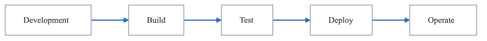
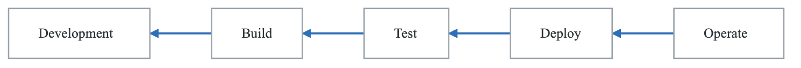

# Module 5: DevOps Culture and Organizational Transformation

## Introduction

Technology alone cannot deliver the benefits of DevOps and platform engineering. Cultural transformation—changing how people work, collaborate, and think—is essential for sustainable success. This module explores the cultural aspects of DevOps transformation and how to drive lasting organizational change.

## Learning Objectives

By the end of this module, you will be able to:
- Understand the cultural foundations of DevOps
- Assess organizational culture and readiness
- Design and execute cultural transformation initiatives
- Build high-performing engineering teams
- Sustain cultural change over time

## Understanding DevOps Culture

### The Three Ways of DevOps

**The Three Ways**

**First Way — Flow.** Optimise left to right, from development to the customer.

```mermaid
%%{init: {'theme':'base','themeVariables':{'fontFamily':'Helvetica, Arial, sans-serif','fontSize':'13px','primaryColor':'#ffffff','primaryTextColor':'#2d3436','primaryBorderColor':'#9aa3ab','lineColor':'#9aa3ab','textColor':'#2d3436','clusterBkg':'#fbfcfd','clusterBorder':'#d4dae0','edgeLabelBackground':'#ffffff','tertiaryColor':'#eef4fb'},'flowchart':{'curve':'basis','padding':14,'nodeSpacing':42,'rankSpacing':58}}}%%
flowchart LR
  classDef default fill:#ffffff,stroke:#9aa3ab,stroke-width:1.3px,color:#2d3436
  classDef n    fill:#ffffff,stroke:#9aa3ab,stroke-width:1.3px,color:#2d3436
  classDef crit fill:#eef4fb,stroke:#2f6fb8,stroke-width:1.8px,color:#1b3a5c
  classDef data fill:#f4f7fa,stroke:#9aa3ab,stroke-width:1.3px,color:#2d3436
  classDef mut  fill:#ffffff,stroke:#cfd6dc,stroke-width:1.1px,color:#7a8288
  classDef warn fill:#fdf0ec,stroke:#c0522d,stroke-width:1.6px,color:#8a3a1e
  D["Development"] ==> B["Build"] ==> T["Test"] ==> DE["Deploy"] ==> O["Operate"]
  class D,B,T,DE,O n
  linkStyle 0,1,2,3 stroke:#2f6fb8,stroke-width:2px
```

<!-- figure: generated from the Mermaid below by _shared/diagrams/embed-figures.py — do not edit the image -->


<details>
<summary>Diagram source (Mermaid)</summary>



</details>

| Principles | Practices |
|---|---|
| Make work visible | Continuous integration |
| Limit work in progress | Automated testing |
| Reduce batch sizes | Continuous deployment |
| Reduce handoffs | Infrastructure as code |
| Identify and remove constraints | |

**Second Way — Feedback.** Amplify the signal coming back, right to left.

```mermaid
%%{init: {'theme':'base','themeVariables':{'fontFamily':'Helvetica, Arial, sans-serif','fontSize':'13px','primaryColor':'#ffffff','primaryTextColor':'#2d3436','primaryBorderColor':'#9aa3ab','lineColor':'#9aa3ab','textColor':'#2d3436','clusterBkg':'#fbfcfd','clusterBorder':'#d4dae0','edgeLabelBackground':'#ffffff','tertiaryColor':'#eef4fb'},'flowchart':{'curve':'basis','padding':14,'nodeSpacing':42,'rankSpacing':58}}}%%
flowchart RL
  classDef default fill:#ffffff,stroke:#9aa3ab,stroke-width:1.3px,color:#2d3436
  classDef n    fill:#ffffff,stroke:#9aa3ab,stroke-width:1.3px,color:#2d3436
  classDef crit fill:#eef4fb,stroke:#2f6fb8,stroke-width:1.8px,color:#1b3a5c
  classDef data fill:#f4f7fa,stroke:#9aa3ab,stroke-width:1.3px,color:#2d3436
  classDef mut  fill:#ffffff,stroke:#cfd6dc,stroke-width:1.1px,color:#7a8288
  classDef warn fill:#fdf0ec,stroke:#c0522d,stroke-width:1.6px,color:#8a3a1e
  O["Operate"] ==> DE["Deploy"] ==> T["Test"] ==> B["Build"] ==> D["Development"]
  class O,DE,T,B,D n
  linkStyle 0,1,2,3 stroke:#2f6fb8,stroke-width:2px
```

<!-- figure: generated from the Mermaid below by _shared/diagrams/embed-figures.py — do not edit the image -->


<details>
<summary>Diagram source (Mermaid)</summary>



</details>

| Principles | Practices |
|---|---|
| See problems as they occur | Monitoring and alerting |
| Swarm and solve them | Telemetry everywhere |
| Push quality closer to the source | Reviews and retrospectives |
| Enable fast recovery | Blameless post-mortems |

**Third Way — Continual learning and experimentation.**

| Principles | Practices |
|---|---|
| Create a culture of experimentation | Game days and chaos engineering |
| Enable learning from failure | Dedicated improvement time |
| Accept that repetition is a prerequisite for mastery | Internal conferences · innovation time |

The order is not arbitrary. Feedback without flow floods you with signals about work you cannot
change quickly; learning without both is a book club.

### CALMS Framework

```yaml
CALMS Framework for DevOps Culture:

Culture:
  description: "How people work together"
  elements:
    - Shared responsibility
    - Collaboration over silos
    - Trust and psychological safety
    - Blameless culture
    - Customer focus
  assessment_questions:
    - "Do development and operations work as one team?"
    - "Is it safe to take risks and admit mistakes?"
    - "Is blame avoided when things go wrong?"

Automation:
  description: "Automating repetitive tasks"
  elements:
    - CI/CD pipelines
    - Infrastructure as Code
    - Automated testing
    - Self-service platforms
  assessment_questions:
    - "Can developers deploy without manual intervention?"
    - "Is infrastructure provisioned automatically?"
    - "Are tests automated and trusted?"

Lean:
  description: "Eliminating waste and improving flow"
  elements:
    - Small batch sizes
    - Limited WIP
    - Continuous improvement
    - Value stream optimization
  assessment_questions:
    - "How long does it take for a commit to reach production?"
    - "How much work is in progress at any time?"
    - "Are bottlenecks identified and addressed?"

Measurement:
  description: "Data-driven decision making"
  elements:
    - Performance metrics
    - Business metrics
    - Feedback loops
    - Continuous monitoring
  assessment_questions:
    - "Do you measure deployment frequency and lead time?"
    - "Can you measure the business impact of changes?"
    - "Is data used to drive improvement decisions?"

Sharing:
  description: "Knowledge sharing and collaboration"
  elements:
    - Documentation
    - Runbooks and playbooks
    - Post-mortems
    - Cross-team learning
  assessment_questions:
    - "Are learnings documented and shared?"
    - "Do teams learn from each other's incidents?"
    - "Is knowledge accessible to all who need it?"
```

## Cultural Assessment

### Westrum Organizational Culture Model

**Westrum Model - Organizational Culture Types:**

```
         PATHOLOGICAL        BUREAUCRATIC        GENERATIVE
         (Power-oriented)    (Rule-oriented)     (Performance)
  Information
  Handling      Hidden         Ignored           Actively sought
  Messengers    Shot           Neglected         Trained
  Responsibilities Shirked     Narrow            Shared
  Bridging      Discouraged    Tolerated         Encouraged
  Failure       Scapegoating   Justice           Inquiry
  Novelty       Crushed        Problematic       Implemented
  Characteristics by Type:
  PATHOLOGICAL:
  • Low cooperation
  • Messengers are punished
  • Responsibilities are avoided
  • Failure leads to scapegoating
  • New ideas are crushed
  BUREAUCRATIC:
  • Modest cooperation
  • Messengers are ignored
  • Responsibilities are narrowly defined
  • Failure leads to seeking justice
  • New ideas create problems
  GENERATIVE:
  • High cooperation
  • Messengers are trained
  • Responsibilities are shared
  • Failure leads to learning
  • New ideas are welcomed
  DORA Research Finding:
  Generative culture is predictive of:
  • Higher software delivery performance
  • Lower change failure rate
  • Faster recovery from incidents
  • Higher job satisfaction
```


### Culture Assessment Survey

```yaml
DevOps Culture Assessment Survey:

Section 1: Collaboration (1-5 scale)
  questions:
    - "Development and operations work together effectively"
    - "There is shared ownership of systems between teams"
    - "Cross-functional collaboration is encouraged"
    - "Teams help each other succeed"

Section 2: Psychological Safety (1-5 scale)
  questions:
    - "It's safe to take risks without fear of punishment"
    - "Mistakes are treated as learning opportunities"
    - "People feel comfortable speaking up about problems"
    - "Asking for help is encouraged"

Section 3: Learning and Improvement (1-5 scale)
  questions:
    - "We regularly learn from incidents and near-misses"
    - "Time is allocated for learning and improvement"
    - "Experimentation is encouraged"
    - "Knowledge is documented and shared"

Section 4: Trust and Transparency (1-5 scale)
  questions:
    - "Information flows freely across teams"
    - "Decisions and their rationale are shared"
    - "Leaders trust teams to make good decisions"
    - "Metrics and dashboards are accessible to all"

Section 5: Customer Focus (1-5 scale)
  questions:
    - "We understand how our work impacts customers"
    - "Customer feedback drives our priorities"
    - "Everyone feels responsible for customer outcomes"
    - "We can see the impact of our changes on customers"

Scoring:
  4.0-5.0: Strong DevOps culture
  3.0-3.9: Developing culture, room for improvement
  2.0-2.9: Significant cultural challenges
  1.0-1.9: Major cultural transformation needed

Action Planning:
  For each area below 3.5:
    - Identify specific behaviors to change
    - Define improvement initiatives
    - Set measurable goals
    - Assign ownership
    - Review progress quarterly
```

## Driving Cultural Change

### Change Model

**Kotter's eight steps, applied to a DevOps transformation**

| Step | What it means here |
|---|---|
| **1 · Create urgency** | Share the data on current pain — deployment frequency, lead time, incident rate. Highlight competitive pressure, the cost of the current state, and customer impact stories |
| **2 · Build a guiding coalition** | Champions across teams · executive sponsorship · *respected* engineers, not just available ones · a cross-functional steering group |
| **3 · Form a strategic vision** | Define the end state · make it a narrative · connect it to business outcomes · make it memorable enough to repeat |
| **4 · Enlist a volunteer army** | Communicate broadly · find the early adopters · create ways to take part · build a community of practice |
| **5 · Remove barriers** | Identify and address blockers · provide tools and training · **adjust incentives and metrics** · remove organisational obstacles |
| **6 · Generate short-term wins** | Plan for visible improvements · celebrate publicly · build momentum · show value early |
| **7 · Sustain acceleration** | Build on wins to take on bigger problems · **don't declare victory too early** · keep removing barriers · bring in new change agents |
| **8 · Institute change** | Embed it in practices · connect it to hiring and promotion · update processes and policies · keep telling the stories |

Step 5 is where most transformations quietly fail. If people are still measured on the thing the new
way makes slower, no amount of tooling will move them — and adjusting incentives is the one item on
this list that a platform team cannot do alone.

### Building Psychological Safety

```yaml
Psychological Safety Practices:

At the Team Level:
  Meeting Practices:
    - Start with check-ins
    - Explicitly invite dissenting views
    - Thank people for speaking up
    - Follow up on concerns raised

  Mistake Handling:
    - Focus on system, not individuals
    - Ask "what" not "who"
    - Treat incidents as learning opportunities
    - Share learnings widely

  Feedback Culture:
    - Regular 1:1s
    - Real-time feedback
    - Recognition for learning
    - Celebrate productive failure

At the Organization Level:
  Blameless Post-Mortems:
    principles:
      - Focus on timeline of events
      - Identify systemic factors
      - Avoid blame language
      - Seek to understand decisions in context
    format: |
      1. What happened (timeline)
      2. What we learned
      3. What we're changing
      4. How we'll prevent recurrence

  Learning Reviews:
    - Quarterly incident review (anonymized)
    - Share learnings across teams
    - Recognize teams that share openly
    - Track improvements implemented

  Leader Behaviors:
    do:
      - Admit your own mistakes
      - Ask questions, show curiosity
      - Thank people for raising issues
      - Respond constructively to bad news
    avoid:
      - Blaming individuals
      - Punishing messengers
      - Dismissing concerns
      - Overreacting to failures
```

### Communities of Practice

**Community of practice**

**Purpose:** share platform knowledge and practice across teams that do not report to each other.

| | |
|---|---|
| **Leadership** | A community lead (2–4 hrs/week) · a co-lead for succession · an executive sponsor |
| **Membership** | Open to all engineers. *Active members* participate regularly · *contributors* create content · *champions* lead initiatives |
| **Resources** | A dedicated Slack channel · a meeting calendar · a wiki space · a recording library · a real budget for events and speakers |

**Cadence**

| Frequency | Activity |
|---|---|
| Weekly | Office hours · Slack discussion |
| Monthly | Tech talk or demo · Q&A |
| Quarterly | Retrospective · planning · an outside speaker |

**Success metrics**

| Metric | Target |
|---|---|
| Membership | 30%+ of the target audience |
| Engagement | 50%+ monthly active participation |
| NPS from members | +40 |
| Content | 2+ new resources per month |

The co-lead is the item that looks optional and is not. A community of practice with one lead has an
expiry date — the date that person changes team.

## High-Performing Teams

### Team Effectiveness Model

```yaml
Google's Project Aristotle - Effective Teams:

Key Factors (in order of importance):

1. Psychological Safety:
   definition: "Team members feel safe to take risks"
   indicators:
     - People ask questions freely
     - Mistakes are discussed openly
     - Diverse opinions are welcome
   build_by:
     - Lead by example (admit mistakes)
     - Thank people for speaking up
     - Frame failures as learning

2. Dependability:
   definition: "Team members deliver on commitments"
   indicators:
     - Work is completed on time
     - Quality standards are met
     - Teammates can rely on each other
   build_by:
     - Clear expectations
     - Reasonable commitments
     - Address issues early

3. Structure and Clarity:
   definition: "Clear goals, roles, and plans"
   indicators:
     - Everyone knows what's expected
     - Goals are understood
     - Roles are clear
   build_by:
     - Regular planning
     - Clear documentation
     - Role definitions

4. Meaning:
   definition: "Work is personally meaningful"
   indicators:
     - Connected to purpose
     - Pride in work
     - Sense of contribution
   build_by:
     - Connect to impact
     - Recognize contributions
     - Autonomy in how

5. Impact:
   definition: "Work matters and makes a difference"
   indicators:
     - Visible outcomes
     - Customer impact
     - Organizational value
   build_by:
     - Share metrics
     - Customer feedback
     - Celebrate impact
```

### Team Health Practices

**Squad health check — a worked example**

Rate each area 🟢 *great* · 🟡 *some concerns* · 🔴 *needs attention*, and record the **trend**.

| Area | Status | Trend | Action |
|---|---|---|---|
| Delivering value | 🟢 | ↑ | |
| Easy to release | 🟡 | → | Improve the CI pipeline |
| Fun | 🟢 | → | |
| Health of codebase | 🟡 | ↓ | Tech-debt sprint |
| Learning | 🔴 | ↓ | Learning Fridays |
| Mission | 🟢 | → | |
| Pawns or players | 🟢 | ↑ | |
| Speed | 🟡 | → | Review dependencies |
| Suitable process | 🟢 | → | |
| Support | 🟢 | → | |
| Teamwork | 🟢 | ↑ | |

**Overall: 🟢 good — 8 of 11 green.** Focus for the quarter: technical debt, learning opportunities,
and the release process.

**The questions behind each area** — the team picks whichever sentence is closer to true:

| Area | 🟢 | 🔴 |
|---|---|---|
| Delivering value | "We deliver great stuff quickly" | "We never seem to finish things" |
| Easy to release | "Releasing is painless and mostly automated" | "Releasing is risky, painful, and needs coordination" |
| Fun | "We love coming to work and have fun together" | "Work is boring and tedious" |
| Health of codebase | "We're proud of our code and can change it easily" | "Our code is a mess and changes are scary" |
| Learning | "We're learning new things all the time" | "We never have time to learn" |
| Mission | "We know why we exist and are excited about it" | "We have no idea why we exist" |
| Pawns or players | "We control our own destiny and decide what to build" | "We're pawns, told what to do" |
| Speed | "We get things done quickly" | "We get stuck and things take forever" |
| Suitable process | "Our way of working fits us" | "Our process feels wrong and bureaucratic" |
| Support | "We get help when we need it" | "We're blocked and can't get help" |
| Teamwork | "We're a team with shared goals" | "We're individuals working independently" |

Note the *Learning* row in the example: red **and** falling. A single red with a flat trend is a
known trade-off; red and falling is the one to act on this quarter.

## Sustaining Culture

### Embedding in Practices

```yaml
Embedding Culture in Daily Practices:

Hiring:
  Include Culture Assessment:
    - Collaboration examples
    - Handling failure
    - Learning orientation
    - Customer focus
  Interview Questions:
    - "Tell me about a time you made a mistake and what you learned"
    - "How have you collaborated with other teams?"
    - "Describe how you've helped a teammate grow"

Onboarding:
  Culture Elements:
    - Pair with culture ambassadors
    - Share company values and stories
    - Include cross-team introductions
    - Post-mortem participation
  First-Week Activities:
    - Attend post-mortem
    - Deploy to production
    - Participate in team rituals

Performance Management:
  Evaluate Cultural Behaviors:
    - Collaboration
    - Knowledge sharing
    - Psychological safety contributions
    - Learning and growth
  Avoid:
    - Hero culture
    - Blame behaviors
    - Siloed work

Recognition:
  Recognize Cultural Behaviors:
    - Helping others
    - Learning from failure
    - Cross-team collaboration
    - Knowledge sharing
  Programs:
    - Peer recognition
    - Culture awards
    - Learning celebrations

Rituals:
  Weekly:
    - Team stand-ups
    - Cross-team syncs
    - Wins and learnings sharing

  Monthly:
    - Team retrospectives
    - Learning sessions
    - All-hands updates

  Quarterly:
    - Team health checks
    - Culture surveys
    - Improvement planning
```

### Measuring Culture

**Culture health metrics**

| Area | Metric | Current | Change |
|---|---|---|---|
| **Engagement** | eNPS | +35 | ↑ 8 |
| | Survey participation | 78% | → |
| **Collaboration** | Cross-team pull requests | 42% of total | ↑ 5% |
| | Cross-team meetings | 3.2 per week | ↑ |
| **Psychological safety** | *"Safe to take risks"* | 4.1 / 5.0 | ↑ 0.3 |
| | *"Mistakes treated as learning"* | 4.3 / 5.0 | ↑ 0.2 |
| **Learning** | Post-mortems per month | 8 | ↑ 2 |
| | Learning sessions this quarter | 12 | ↑ 4 |
| **Team health** | Teams at green | 72% | ↑ 12% |
| | Teams needing attention | 2 | ↓ 1 |
| **Retention** | Voluntary turnover | 8% annually | ↓ 4% |
| | **Regrettable** loss | 3% annually | ↓ 2% |

**Recent**

- Blameless post-mortem training launched
- Cross-team learning sessions started
- Recognition programme implemented

**Next**

- Leadership psychological-safety workshop
- Community of practice expansion
- Culture ambassador programme

Two of these rows are worth more than the rest. **Regrettable loss** separated from total turnover is
the only retention number that means anything — losing the people you wanted to keep is a different
problem from churn. And **survey participation** is the validity check on everything above it: an
eNPS of +35 from 78% of the company is a finding; the same number from 20% is a self-selected sample
of people who still feel like answering.

## Anti-Patterns and Solutions

### Common Cultural Anti-Patterns

```yaml
Anti-Pattern 1: Hero Culture
  symptoms:
    - Certain individuals always save the day
    - Knowledge concentrated in few people
    - Heroes rewarded for firefighting
    - Others feel inadequate
  consequences:
    - Bus factor of 1
    - Burnout of heroes
    - Rest of team disengaged
    - No systemic improvement
  solutions:
    - Spread knowledge through pairing
    - Recognize prevention, not firefighting
    - Rotate responsibilities
    - Document institutional knowledge

Anti-Pattern 2: Blame Culture
  symptoms:
    - "Who did this?" after incidents
    - People hide mistakes
    - Finger-pointing in meetings
    - Fear of taking risks
  consequences:
    - Low psychological safety
    - Problems hidden until crisis
    - No learning from failure
    - Innovation stifled
  solutions:
    - Implement blameless post-mortems
    - Leader modeling (admit own mistakes)
    - Focus on systems, not individuals
    - Celebrate learning from failure

Anti-Pattern 3: Silo Mentality
  symptoms:
    - "Not my problem" attitude
    - Minimal cross-team communication
    - Duplicated effort
    - Blaming other teams
  consequences:
    - Slow delivery
    - Poor customer experience
    - Wasted resources
    - Low morale
  solutions:
    - Cross-functional teams
    - Shared goals and metrics
    - Communities of practice
    - Rotation programs

Anti-Pattern 4: Meeting Culture
  symptoms:
    - Calendars full of meetings
    - Meetings without purpose
    - Key people never available
    - Decisions not documented
  consequences:
    - No time for deep work
    - Decision fatigue
    - Slow progress
    - Frustration
  solutions:
    - Meeting-free days
    - Clear meeting purposes
    - Documentation requirements
    - Async-first communication

Anti-Pattern 5: Perfectionism Paralysis
  symptoms:
    - Long review cycles
    - Fear of shipping
    - Over-engineering
    - "Not ready yet" forever
  consequences:
    - Slow delivery
    - Missed opportunities
    - Frustrated stakeholders
    - Demoralized team
  solutions:
    - Ship small, iterate fast
    - Define "good enough"
    - Celebrate learning
    - Set deadlines
```

## Summary

Cultural transformation is the foundation of successful DevOps and platform engineering. Key points:

1. **The Three Ways** provide a framework for DevOps practices
2. **CALMS** (Culture, Automation, Lean, Measurement, Sharing) enables assessment
3. **Psychological Safety** is the foundation of high-performing teams
4. **Change Management** requires systematic approach
5. **Embedding in Practices** sustains cultural change
6. **Continuous Measurement** ensures progress

Culture change takes time—expect years, not months. Start with small wins, build momentum, and persist through setbacks.

## Additional Resources

- "The DevOps Handbook" by Gene Kim, et al.
- "Accelerate" by Nicole Forsgren, et al.
- "Team Topologies" by Matthew Skelton and Manuel Pais
- "The Five Dysfunctions of a Team" by Patrick Lencioni
- Google re:Work resources on team effectiveness
- DORA State of DevOps reports

<!-- feynman-check -->

---

## Feynman check

Close the file. Blank page, no notes. Explain each of these to a competent engineer who has never
used this tool — **under five minutes, no jargon you can't define on the spot:**

- Understanding DevOps Culture
- Cultural Assessment
- Driving Cultural Change
- High-Performing Teams

**The gap is not what you forgot. It is where you used a word instead of a mechanism.**

| | |
|---|---|
| ✗ | *"The platform makes developers more productive."* |
| ✓ | *"A golden path is a template that produces a repository with CI, manifests, dashboards and alerts already wired, so the product team owns none of them. It reduces cognitive load by removing decisions, not by adding features — and without a documented escape hatch it is a cage."* |

**Trace it:** A developer commits `service.yaml` → a running service with a dashboard and a paging rule. Name every system that acts, and which team owns each one.

Stop at the first component you cannot name. Reopen this file and read **only** that.

**Go deeper — only once the gap has a name:** [Team Topologies — cognitive load](https://teamtopologies.com/key-concepts) and the [CNCF Platforms White Paper](https://tag-app-delivery.cncf.io/whitepapers/platforms/) — why golden paths exist at all.
Full list per domain: [`SOURCES.md`](../SOURCES.md#platform-engineering)

→ Protocol, the three levels of knowing, and worked examples: [`MASTERY.md`](../MASTERY.md)

<!-- /feynman-check -->
