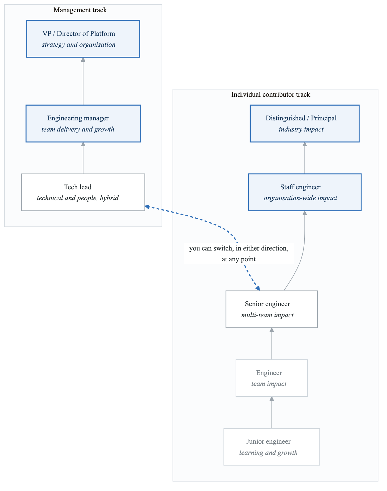
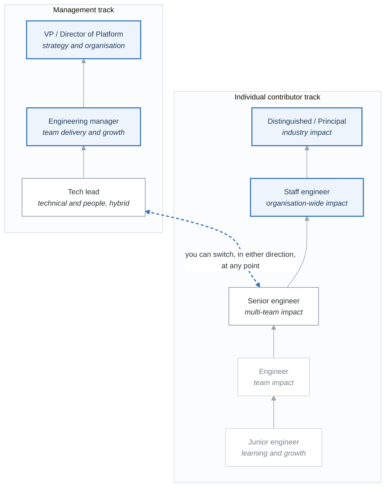

# Module 6: Career Development and Industry Trends

## Introduction

The DevOps and Platform Engineering field continues to evolve rapidly. This module focuses on career development strategies, industry trends, and how to build a sustainable career in this dynamic field.

## Learning Objectives

By the end of this module, you will be able to:
- Navigate career paths in DevOps and Platform Engineering
- Build skills strategically for career growth
- Stay current with industry trends
- Develop a personal brand and professional network
- Prepare for leadership roles

## Career Paths

### DevOps Career Ladder

**Career paths**

<!-- figure: generated from the Mermaid below by _shared/diagrams/embed-figures.py — do not edit the image -->


<details>
<summary>Diagram source (Mermaid)</summary>



</details>

**Specialist paths**

| From | Through | To |
|---|---|---|
| SRE | SRE lead | Principal SRE |
| Security engineer | Security lead | Security architect |
| Cloud architect | — | Principal architect |
| Developer advocate | — | Head of DevRel |

The dotted line is the important one. The two tracks are not a fork you take once — the industry norm
is moving between them, and a manager with recent hands-on years is worth more than one without.

### Role Expectations by Level

```yaml
Junior/Associate (0-2 years):
  scope: "Individual tasks and features"
  technical:
    - Execute defined tasks
    - Learn codebase and systems
    - Write documentation
    - Participate in on-call (shadowing)
  professional:
    - Ask questions
    - Seek feedback
    - Learn continuously
  growth_focus:
    - Technical fundamentals
    - Company systems and processes
    - Communication skills

Mid-Level Engineer (2-4 years):
  scope: "Features and small projects"
  technical:
    - Own features end-to-end
    - Debug complex issues
    - Review code
    - Participate in on-call
  professional:
    - Mentor juniors informally
    - Communicate status effectively
    - Manage time independently
  growth_focus:
    - System design basics
    - Broader technical knowledge
    - Influence skills

Senior Engineer (4-7 years):
  scope: "Projects and team impact"
  technical:
    - Lead technical projects
    - Design systems
    - Set team standards
    - Handle complex incidents
  professional:
    - Mentor others formally
    - Influence team direction
    - Drive improvements
  growth_focus:
    - Architecture skills
    - Cross-team collaboration
    - Technical leadership

Staff Engineer (7+ years):
  scope: "Organization-wide impact"
  technical:
    - Define technical strategy
    - Solve ambiguous problems
    - Enable other teams
    - Lead major initiatives
  professional:
    - Influence without authority
    - Navigate organizational dynamics
    - Develop senior engineers
  growth_focus:
    - Strategic thinking
    - Executive communication
    - Industry perspective

Principal/Distinguished (10+ years):
  scope: "Industry impact"
  technical:
    - Set industry direction
    - Solve industry problems
    - External visibility
    - Advise executives
  professional:
    - External thought leadership
    - Cross-company influence
    - Build organizations
  growth_focus:
    - Industry relationships
    - Public speaking/writing
    - Organizational design
```

### Skill Development Framework

**Skill development matrix**

**Core technical**

| | Junior | Mid | Senior | Staff |
|---|---|---|---|---|
| **Infrastructure** | Linux basics, networking fundamentals | Cloud services, IaC, containers | Multi-cloud, complex architectures | Platform design, technology strategy |
| **Automation** | Scripts, basic pipelines | CI/CD, test automation | Complex workflows, self-healing | Automation strategy, platform capabilities |
| **Observability** | Basic monitoring, reading logs | Dashboards, alerting, SLIs | Observability architecture, SLOs | Observability strategy, cost control |
| **Security** | Basic hygiene | Scanning, secrets management | Security architecture, compliance | Security strategy, risk management |

**Platform-specific, junior → staff**

| Area | Progression |
|---|---|
| Kubernetes | User → admin → architect → strategist |
| Cloud (AWS / GCP) | Services → solutions → architecture |
| Infrastructure as code | User → author → designer → evangelist |
| GitOps | Consumer → implementer → designer |
| Developer portal | User → contributor → designer |

**Professional**

| | Junior | Mid | Senior | Staff |
|---|---|---|---|---|
| **Communication** | Clear writing, status updates | Technical docs, presentations | Stakeholder communication, proposals | Executive communication, vision documents |
| **Leadership** | Self-management | Peer leadership, mentoring | Team leadership, project management | Organisational leadership, strategic influence |
| **Product thinking** | User perspective | Feature scoping | Product strategy | Platform vision |

The third table is the one that decides who reaches Staff. The technical rows are a matter of time
and exposure; *product thinking* — the habit of asking who this is for and whether they will use it —
is the skill most infrastructure engineers never deliberately practise.

## Building Your Career

### Career Development Plan

```yaml
Career Development Framework:

1. Self-Assessment:
   questions:
     - "Where am I now? (skills, experience, level)"
     - "Where do I want to be in 2-3 years?"
     - "What are my strengths?"
     - "What are my gaps?"
   tools:
     - Skill assessment matrix
     - 360 feedback
     - Career conversation with manager
     - Industry benchmarking

2. Goal Setting:
   framework: "SMART goals"
   categories:
     - Technical skills to develop
     - Leadership capabilities to build
     - Projects to complete
     - Network to build
   example:
     goal: "Advance to Senior Platform Engineer"
     specific: "Lead a major platform initiative"
     measurable: "Deliver self-service capability used by 5+ teams"
     achievable: "Have foundational skills, need project opportunity"
     relevant: "Aligns with platform team roadmap"
     time_bound: "Within 18 months"

3. Learning Plan:
   methods:
     - On-the-job learning (70%)
     - Mentoring and coaching (20%)
     - Formal training (10%)
   resources:
     - Internal training programs
     - External certifications
     - Conferences and workshops
     - Books and courses
     - Community participation

4. Execution:
   practices:
     - Weekly learning time
     - Monthly check-ins with mentor
     - Quarterly goal review
     - Annual career conversation
   tracking:
     - Learning log
     - Project portfolio
     - Feedback collection
     - Skill progression

5. Review and Adjust:
   frequency: "Quarterly"
   questions:
     - "What progress have I made?"
     - "What worked well?"
     - "What needs adjustment?"
     - "Are my goals still relevant?"
```

### Building Visibility

**Building professional visibility**

**Internal — this is the one that affects your next promotion**

| | |
|---|---|
| **Document your work** | Clear PR descriptions · architecture decision records · runbooks and how-to guides · post-mortem learnings shared widely |
| **Share knowledge** | Present at team meetings · run lunch-and-learns · contribute to the internal blog · answer questions in Slack |
| **Cross-team engagement** | Take part in guilds and communities of practice · volunteer for cross-team projects · help other teams with their problems · build relationships outside your team |

**External**

| | |
|---|---|
| **Content** | Blog posts · open-source contributions · tutorials · a newsletter or podcast |
| **Speaking** | Local meetups (**start here**) · internal conferences · industry conferences · webinars and podcasts |
| **Community** | CNCF and DevOps groups · Slack and Discord communities · LinkedIn · Stack Overflow |
| **Open source** | Contribute to what you already use · start with documentation · progress to code · eventually maintain |

**Networking**

| | |
|---|---|
| **Build relationships** | Reach out to people whose work you admire · introduce yourself at events · follow up meaningfully · **offer value before asking for help** |
| **Mentorship** | Find mentors, formal or not · be one · join a programme |
| **Professional** | Stay connected with former colleagues · build a relationship with a few recruiters · engage with vendors and partners |

Internal visibility compounds faster than external. A conference talk reaches thousands of people who
cannot promote you; a well-written ADR reaches the six who can.

## Industry Trends

### Current and Emerging Trends

```yaml
Platform Engineering Trends:

1. Internal Developer Platforms (IDPs):
   status: "Mainstream adoption"
   direction: "Platform-as-a-Product mindset"
   technologies:
     - Backstage, Port, Cortex
     - Crossplane, Kratix
     - Score, Humanitec
   career_impact: "High demand for platform engineers"

2. AI/ML in DevOps (AIOps):
   status: "Early mainstream"
   direction: "AI-assisted operations"
   applications:
     - Intelligent alerting
     - Automated remediation
     - Code review assistance
     - Incident prediction
   career_impact: "Need to understand AI/ML basics"

3. Platform Orchestration:
   status: "Emerging"
   direction: "Unified control planes"
   technologies:
     - Crossplane, Kratix
     - Terraform Cloud, Pulumi
     - AWS Service Catalog, Azure Blueprints
   career_impact: "Abstraction skills valuable"

4. GitOps Maturity:
   status: "Mainstream"
   direction: "GitOps for everything"
   technologies:
     - Argo CD, Flux
     - Argo Workflows, Tekton
   career_impact: "GitOps skills essential"

5. FinOps Integration:
   status: "Growing rapidly"
   direction: "Cost awareness in developer workflow"
   applications:
     - Real-time cost visibility
     - Budget enforcement
     - Optimization recommendations
   career_impact: "Cost management skills valuable"

6. Developer Experience Focus:
   status: "Mainstream priority"
   direction: "DevEx as strategic investment"
   aspects:
     - Reduced cognitive load
     - Faster feedback loops
     - Self-service everything
   career_impact: "UX thinking for platforms"

7. Security Shift-Left:
   status: "Mainstream"
   direction: "Security embedded everywhere"
   technologies:
     - Policy-as-code
     - Supply chain security
     - Zero-trust platforms
   career_impact: "Security knowledge essential"

8. Sustainability/Green IT:
   status: "Emerging"
   direction: "Carbon-aware computing"
   applications:
     - Energy-efficient scheduling
     - Carbon metrics
     - Green cloud regions
   career_impact: "Growing importance"
```

### Technology Radar

**Technology radar**

| **Adopt** *(use in production)* | **Trial** *(limited projects)* | **Assess** *(explore)* | **Hold** *(phase out)* |
|---|---|---|---|
| Kubernetes | Crossplane | Kratix — platform-as-a-product | Manual infrastructure provisioning |
| Terraform | Cilium — eBPF networking | WebAssembly for cloud workloads | Long-lived branches |
| Argo CD / Flux | OpenTelemetry | eBPF for security | Manual deployment processes |
| Prometheus / Grafana | Sigstore — supply chain | AI coding assistants | Siloed DevOps teams |
| GitHub Actions / GitLab CI | Keptn | Carbon-aware computing | Monolithic CI/CD pipelines |
| Backstage | Kyverno | Confidential computing | Pre-GitOps workflows |
| OPA / Gatekeeper | Score — workload specification | Port — developer portal | |
| HashiCorp Vault | | | |

A radar is a snapshot with an expiry date, and its value is the *argument* behind each placement, not
the placement. Keep your own — the exercise of having to justify why something moved from Assess to
Trial is what the artifact is for.

## Certifications and Learning

### Certification Paths

```yaml
Recommended Certifications:

Cloud Provider Certifications:
  AWS:
    entry: "AWS Solutions Architect Associate"
    advanced: "AWS DevOps Engineer Professional"
    specialist: "AWS Security Specialty"
    value: "High - AWS market dominance"

  Google Cloud:
    entry: "Associate Cloud Engineer"
    advanced: "Professional Cloud DevOps Engineer"
    specialist: "Professional Cloud Architect"
    value: "High - Growing market share"

  Azure:
    entry: "Azure Administrator Associate"
    advanced: "Azure DevOps Engineer Expert"
    specialist: "Azure Solutions Architect Expert"
    value: "High - Enterprise market"

Kubernetes Certifications:
  path:
    - "CKA (Certified Kubernetes Administrator)"
    - "CKAD (Certified Kubernetes App Developer)"
    - "CKS (Certified Kubernetes Security)"
  value: "Very High - Industry standard"
  note: "CKA is most valuable for platform engineers"

Other Valuable Certifications:
  terraform:
    name: "HashiCorp Terraform Associate"
    value: "High - IaC standard"

  security:
    options:
      - "CompTIA Security+"
      - "CISSP (advanced)"
    value: "Growing importance"

  gitops:
    name: "Argo CD certification"
    value: "Emerging"

Certification Strategy:
  junior:
    - Cloud associate level
    - CKA
  mid:
    - Cloud professional level
    - Terraform
  senior:
    - Specialty certifications
    - CKS for security focus
```

### Continuous Learning

**Learning resources**

**Structured**

| | |
|---|---|
| **Courses** | A Cloud Guru · Coursera, Udemy, Pluralsight · KodeKloud (Kubernetes) · the cloud providers' own training |
| **Books — foundational** | *The Phoenix Project* (Kim) · *The DevOps Handbook* (Kim et al.) · *Accelerate* (Forsgren et al.) · *Site Reliability Engineering* (Google) · *Team Topologies* (Skelton & Pais) |
| **Books — technical** | *Kubernetes in Action* · *Infrastructure as Code* (Morris) · *Cloud Native DevOps with Kubernetes* · *Platform Engineering on Kubernetes* |

**Community**

| | |
|---|---|
| **Conferences** | KubeCon + CloudNativeCon · DevOps Enterprise Summit · PlatformCon · HashiConf · re:Invent, Google Next, Ignite |
| **Podcasts** | Kubernetes Podcast · DevOps Paradox · Ship It! · Arrested DevOps · The Platform Weekly |
| **Newsletters** | TLDR · DevOps Weekly · Platform Engineering Weekly · KubeWeekly · SRE Weekly |
| **Communities** | CNCF Slack · Platform Engineering Slack · HashiCorp Community · r/devops, r/kubernetes · local meetups |

**Hands-on**

| | |
|---|---|
| **Labs and sandboxes** | Cloud provider free tiers · kind and minikube locally · hosted playgrounds |
| **Personal projects** | Build a homelab · contribute to open source · automate something you actually do · keep a portfolio of examples |

If you read only two of the foundational books, make them *Accelerate* — because it is the one with
evidence behind it — and *Team Topologies*, because it is the one that explains why the technical
answer keeps failing for organisational reasons.

## Preparing for Interviews

### Interview Preparation

```yaml
Platform Engineering Interview Preparation:

Technical Areas to Master:
  Infrastructure:
    - Kubernetes architecture and troubleshooting
    - Cloud services (compute, storage, networking)
    - Infrastructure as Code
    - Networking fundamentals
    - Linux system administration

  Automation:
    - CI/CD pipeline design
    - GitOps workflows
    - Scripting (Python, Bash, Go)
    - Testing strategies

  Observability:
    - Monitoring and alerting
    - Log aggregation
    - Distributed tracing
    - SLIs, SLOs, SLAs

  Security:
    - Secret management
    - Network security
    - Identity and access management
    - Compliance automation

Common Interview Questions:
  System Design:
    - "Design a CI/CD pipeline for a microservices application"
    - "Design a self-service infrastructure platform"
    - "How would you implement zero-downtime deployments?"
    - "Design a disaster recovery solution"

  Troubleshooting:
    - "Walk me through debugging a slow application"
    - "How would you investigate a production incident?"
    - "A deployment is stuck - how do you troubleshoot?"

  Behavioral:
    - "Tell me about a challenging incident you handled"
    - "How have you improved developer experience?"
    - "Describe a time you had to influence without authority"
    - "How do you prioritize competing demands?"

  Technical Deep-Dive:
    - Kubernetes internals
    - Terraform state management
    - Container networking
    - Observability architecture

Interview Tips:
  - Think out loud during problem solving
  - Ask clarifying questions
  - Consider trade-offs
  - Draw diagrams
  - Discuss monitoring and reliability
  - Show security awareness
  - Demonstrate growth mindset
```

### Portfolio Building

**Building a portfolio**

**GitHub profile**

- An active contribution graph
- Repositories that are *documented*, not just present
- IaC examples — Terraform, Kubernetes
- Automation scripts
- Open-source contributions

**Example repositories**

| Repository | Demonstrates |
|---|---|
| `terraform-aws-platform/` | Production-grade IaC modules |
| `kubernetes-gitops-demo/` | A GitOps setup with Argo CD |
| `ci-cd-templates/` | Reusable pipeline templates |
| `platform-engineering-examples/` | Golden path templates |

**Written content**

Technical blog posts · architecture decision records · runbooks · post-mortem write-ups.

Post ideas that work because they have a number or a scar in them:

- *"How we cut deployment time by 80%"*
- *"Building a self-service platform"*
- *"Lessons from our biggest incident"*
- *"GitOps in practice: what worked and what didn't"*

**Professional presence**

| | |
|---|---|
| LinkedIn | Complete and current · a clear headline (*"Platform Engineer · Kubernetes · AWS"*) · quantified achievements · regular engagement |
| Personal site | Optional, but it is the one link you control |
| Talks | Link the video if there is one |
| Certifications | Listed, with dates |

The fourth blog-post idea is the one that gets read. "What didn't work" is rare, useful, and the
fastest way to look like someone who has actually run a platform rather than read about one.

## Summary

Building a successful career in DevOps and Platform Engineering requires:

1. **Clear Career Path**: Understand IC vs management tracks
2. **Skill Development**: Build both technical and professional skills
3. **Continuous Learning**: Stay current with evolving technology
4. **Visibility**: Share knowledge internally and externally
5. **Network**: Build relationships in the community
6. **Portfolio**: Demonstrate your capabilities tangibly

The field continues to evolve rapidly, creating opportunities for those who invest in continuous learning and adaptation.

## Key Takeaways

**Career Success Formula:**

  SKILLS + VISIBILITY + NETWORK + ADAPTABILITY = CAREER SUCCESS
  Skills:
  • Deep expertise in core areas
  • Breadth across the stack
  • Continuous learning
  Visibility:
  • Document and share your work
  • Present and teach
  • Build a portfolio
  Network:
  • Internal relationships
  • Industry connections
  • Community participation
  Adaptability:
  • Embrace change
  • Learn new technologies
  • Evolve with the industry


## Additional Resources

- StaffEng.com - Staff engineer stories and resources
- LeadDev - Engineering leadership content
- platformengineering.org - Community resources
- CNCF - Cloud native landscape and resources
- State of DevOps Report (annual)

<!-- feynman-check -->

---

## Feynman check

Close the file. Blank page, no notes. Explain each of these to a competent engineer who has never
used this tool — **under five minutes, no jargon you can't define on the spot:**

- Career Paths
- Building Your Career
- Industry Trends
- Certifications and Learning

**The gap is not what you forgot. It is where you used a word instead of a mechanism.**

| | |
|---|---|
| ✗ | *"The platform makes developers more productive."* |
| ✓ | *"A golden path is a template that produces a repository with CI, manifests, dashboards and alerts already wired, so the product team owns none of them. It reduces cognitive load by removing decisions, not by adding features — and without a documented escape hatch it is a cage."* |

**Trace it:** A developer commits `service.yaml` → a running service with a dashboard and a paging rule. Name every system that acts, and which team owns each one.

Stop at the first component you cannot name. Reopen this file and read **only** that.

**Go deeper — only once the gap has a name:** [Team Topologies — cognitive load](https://teamtopologies.com/key-concepts) and the [CNCF Platforms White Paper](https://tag-app-delivery.cncf.io/whitepapers/platforms/) — why golden paths exist at all.
Full list per domain: [`SOURCES.md`](../SOURCES.md#platform-engineering)

→ Protocol, the three levels of knowing, and worked examples: [`MASTERY.md`](../MASTERY.md)

<!-- /feynman-check -->
