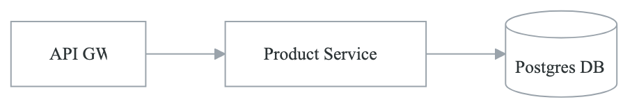
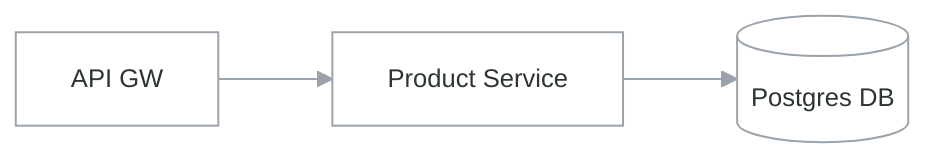

# Lab 1: Building a Developer Portal with Backstage

## Lab Overview

In this lab, you will deploy and customize Backstage, an open-source developer portal framework created by AudioWave. You'll learn how to set up a service catalog, create software templates, and integrate with external systems.

**Duration:** 3-4 hours
**Difficulty:** Intermediate
**Prerequisites:**
- Docker and Docker Compose installed
- Node.js 18+ installed
- Git installed
- Basic understanding of React/TypeScript
- GitHub account

## Learning Objectives

By the end of this lab, you will be able to:
- Deploy Backstage locally and understand its architecture
- Configure the software catalog with services and components
- Create software templates for golden paths
- Integrate with GitHub for authentication and repository management
- Add custom plugins to extend functionality

## Lab Environment Setup

### Step 1: Create Backstage Application

```bash
# Create a new Backstage app
npx @backstage/create-app@latest

# Follow the prompts:
# ? Enter a name for the app: platform-portal
# ? Select database for the backend: SQLite (recommended for dev)

# Navigate to the app directory
cd platform-portal
```

### Step 2: Understand the Directory Structure

**`platform-portal/`**

- `app-config.yaml` — Main configuration
- `app-config.local.yaml` — Local overrides (gitignored)
- `app-config.production.yaml` — Production configuration
- `catalog-info.yaml` — Backstage's own catalog entry
- `package.json`
- `packages/`
  - `app/` — Frontend React application
    - `src/`
      - `App.tsx`
      - `components/`
    - `package.json`
  - `backend/` — Backend Node.js application
    - `src/`
      - `index.ts`
      - `plugins/`
    - `package.json`
- `plugins/` — Custom plugins


### Step 3: Start Backstage in Development Mode

```bash
# Start the development server
yarn dev

# This starts both frontend (port 3000) and backend (port 7007)
# Access the portal at http://localhost:3000
```

## Exercise 1: Configure the Software Catalog

### Step 1: Create Catalog Entities

Create a file `catalog-entities/services.yaml`:

```yaml
# catalog-entities/services.yaml
---
apiVersion: backstage.io/v1alpha1
kind: System
metadata:
  name: e-commerce-platform
  description: E-commerce platform for online retail
  annotations:
    backstage.io/techdocs-ref: dir:.
spec:
  owner: platform-team
  domain: retail

---
apiVersion: backstage.io/v1alpha1
kind: Component
metadata:
  name: product-service
  description: Manages product catalog and inventory
  tags:
    - python
    - fastapi
    - critical
  annotations:
    github.com/project-slug: your-org/product-service
    pagerduty.com/service-id: PXXXXXX
  links:
    - url: https://product-service.internal/
      title: Service URL
    - url: https://grafana.internal/d/product-service
      title: Grafana Dashboard
spec:
  type: service
  lifecycle: production
  owner: group:catalog-team
  system: e-commerce-platform
  dependsOn:
    - resource:default/products-db
  providesApis:
    - product-api

---
apiVersion: backstage.io/v1alpha1
kind: Component
metadata:
  name: order-service
  description: Handles order processing and fulfillment
  tags:
    - go
    - grpc
    - critical
  annotations:
    github.com/project-slug: your-org/order-service
spec:
  type: service
  lifecycle: production
  owner: group:orders-team
  system: e-commerce-platform
  dependsOn:
    - component:default/product-service
    - component:default/payment-service
    - resource:default/orders-db
  consumesApis:
    - product-api
    - payment-api

---
apiVersion: backstage.io/v1alpha1
kind: Component
metadata:
  name: payment-service
  description: Processes payments via multiple gateways
  tags:
    - java
    - spring-boot
    - critical
    - pci-compliant
  annotations:
    github.com/project-slug: your-org/payment-service
spec:
  type: service
  lifecycle: production
  owner: group:payments-team
  system: e-commerce-platform
  providesApis:
    - payment-api
```

### Step 2: Define APIs

Create `catalog-entities/apis.yaml`:

```yaml
# catalog-entities/apis.yaml
---
apiVersion: backstage.io/v1alpha1
kind: API
metadata:
  name: product-api
  description: Product catalog and inventory API
  tags:
    - rest
    - openapi
spec:
  type: openapi
  lifecycle: production
  owner: group:catalog-team
  definition: |
    openapi: "3.0.0"
    info:
      title: Product API
      version: "1.0"
    servers:
      - url: https://api.internal/products
    paths:
      /products:
        get:
          summary: List all products
          responses:
            '200':
              description: List of products
              content:
                application/json:
                  schema:
                    type: array
                    items:
                      $ref: '#/components/schemas/Product'
      /products/{id}:
        get:
          summary: Get product by ID
          parameters:
            - name: id
              in: path
              required: true
              schema:
                type: string
          responses:
            '200':
              description: Product details
              content:
                application/json:
                  schema:
                    $ref: '#/components/schemas/Product'
    components:
      schemas:
        Product:
          type: object
          properties:
            id:
              type: string
            name:
              type: string
            price:
              type: number
            inventory:
              type: integer

---
apiVersion: backstage.io/v1alpha1
kind: API
metadata:
  name: payment-api
  description: Payment processing API
  tags:
    - grpc
spec:
  type: grpc
  lifecycle: production
  owner: group:payments-team
  definition: |
    syntax = "proto3";
    package payments;

    service PaymentService {
      rpc ProcessPayment(PaymentRequest) returns (PaymentResponse);
      rpc RefundPayment(RefundRequest) returns (RefundResponse);
    }

    message PaymentRequest {
      string order_id = 1;
      int64 amount_cents = 2;
      string currency = 3;
      string payment_method_id = 4;
    }

    message PaymentResponse {
      string payment_id = 1;
      string status = 2;
    }
```

### Step 3: Define Resources

Create `catalog-entities/resources.yaml`:

```yaml
# catalog-entities/resources.yaml
---
apiVersion: backstage.io/v1alpha1
kind: Resource
metadata:
  name: products-db
  description: PostgreSQL database for product catalog
  tags:
    - postgresql
spec:
  type: database
  owner: group:catalog-team
  system: e-commerce-platform

---
apiVersion: backstage.io/v1alpha1
kind: Resource
metadata:
  name: orders-db
  description: PostgreSQL database for orders
  tags:
    - postgresql
spec:
  type: database
  owner: group:orders-team
  system: e-commerce-platform

---
apiVersion: backstage.io/v1alpha1
kind: Resource
metadata:
  name: product-cache
  description: Redis cache for product data
  tags:
    - redis
spec:
  type: cache
  owner: group:catalog-team
  system: e-commerce-platform
```

### Step 4: Define Teams

Create `catalog-entities/teams.yaml`:

```yaml
# catalog-entities/teams.yaml
---
apiVersion: backstage.io/v1alpha1
kind: Group
metadata:
  name: engineering
  description: Engineering department
spec:
  type: department
  children:
    - platform-team
    - catalog-team
    - orders-team
    - payments-team

---
apiVersion: backstage.io/v1alpha1
kind: Group
metadata:
  name: platform-team
  description: Platform engineering team
spec:
  type: team
  profile:
    displayName: Platform Team
    email: platform@company.com
  parent: engineering
  members:
    - alice
    - bob

---
apiVersion: backstage.io/v1alpha1
kind: Group
metadata:
  name: catalog-team
  description: Product catalog team
spec:
  type: team
  profile:
    displayName: Catalog Team
    email: catalog@company.com
  parent: engineering
  members:
    - charlie
    - diana

---
apiVersion: backstage.io/v1alpha1
kind: User
metadata:
  name: alice
spec:
  profile:
    displayName: Alice Smith
    email: alice@company.com
  memberOf:
    - platform-team

---
apiVersion: backstage.io/v1alpha1
kind: User
metadata:
  name: bob
spec:
  profile:
    displayName: Bob Jones
    email: bob@company.com
  memberOf:
    - platform-team
```

### Step 5: Register Catalog Locations

Update `app-config.yaml`:

```yaml
# Add to app-config.yaml
catalog:
  import:
    entityFilename: catalog-info.yaml
    pullRequestBranchName: backstage-integration
  rules:
    - allow: [Component, System, API, Resource, Location, Group, User, Domain]
  locations:
    # Local example data, replace with your org
    - type: file
      target: ./catalog-entities/services.yaml
    - type: file
      target: ./catalog-entities/apis.yaml
    - type: file
      target: ./catalog-entities/resources.yaml
    - type: file
      target: ./catalog-entities/teams.yaml
```

### Verification

1. Restart Backstage: `yarn dev`
2. Navigate to http://localhost:3000/catalog
3. Verify all entities appear in the catalog
4. Click on "product-service" and verify dependencies are shown

## Exercise 2: Create Software Templates

### Step 1: Create Template Directory Structure

```bash
mkdir -p templates/go-microservice/skeleton
mkdir -p templates/go-microservice/skeleton/.github/workflows
mkdir -p templates/go-microservice/skeleton/cmd/server
mkdir -p templates/go-microservice/skeleton/internal/api
mkdir -p templates/go-microservice/skeleton/deployments/kubernetes
```

### Step 2: Create Template Definition

Create `templates/go-microservice/template.yaml`:

```yaml
apiVersion: scaffolder.backstage.io/v1beta3
kind: Template
metadata:
  name: go-microservice-template
  title: Go Microservice
  description: Create a production-ready Go microservice with CI/CD
  tags:
    - recommended
    - go
    - microservice
spec:
  owner: platform-team
  type: service

  parameters:
    - title: Service Information
      required:
        - name
        - description
        - owner
      properties:
        name:
          title: Service Name
          type: string
          description: Unique name for the service (lowercase, alphanumeric, hyphens)
          pattern: '^[a-z][a-z0-9-]*[a-z0-9]$'
          ui:autofocus: true
        description:
          title: Description
          type: string
          description: Brief description of what this service does
        owner:
          title: Owner
          type: string
          description: Team that owns this service
          ui:field: OwnerPicker
          ui:options:
            catalogFilter:
              kind: Group

    - title: Technical Configuration
      properties:
        tier:
          title: Service Tier
          type: string
          description: Service criticality level
          default: standard
          enum:
            - critical
            - standard
            - experimental
          enumNames:
            - Critical (99.99% SLA)
            - Standard (99.9% SLA)
            - Experimental (best effort)
        port:
          title: Service Port
          type: integer
          description: Port the service listens on
          default: 8080
        includeDatabase:
          title: Include PostgreSQL Database
          type: boolean
          default: false
        includeRedis:
          title: Include Redis Cache
          type: boolean
          default: false

    - title: Repository Configuration
      required:
        - repoUrl
      properties:
        repoUrl:
          title: Repository Location
          type: string
          ui:field: RepoUrlPicker
          ui:options:
            allowedHosts:
              - github.com

  steps:
    - id: fetch-base
      name: Fetch Base Template
      action: fetch:template
      input:
        url: ./skeleton
        values:
          name: ${{ parameters.name }}
          description: ${{ parameters.description }}
          owner: ${{ parameters.owner }}
          tier: ${{ parameters.tier }}
          port: ${{ parameters.port }}
          includeDatabase: ${{ parameters.includeDatabase }}
          includeRedis: ${{ parameters.includeRedis }}

    - id: publish
      name: Publish to GitHub
      action: publish:github
      input:
        allowedHosts: ['github.com']
        repoUrl: ${{ parameters.repoUrl }}
        description: ${{ parameters.description }}
        defaultBranch: main
        protectDefaultBranch: true

    - id: register
      name: Register in Catalog
      action: catalog:register
      input:
        repoContentsUrl: ${{ steps.publish.output.repoContentsUrl }}
        catalogInfoPath: '/catalog-info.yaml'

  output:
    links:
      - title: Repository
        url: ${{ steps.publish.output.remoteUrl }}
      - title: Open in catalog
        icon: catalog
        entityRef: ${{ steps.register.output.entityRef }}
```

### Step 3: Create Template Skeleton Files

Create `templates/go-microservice/skeleton/catalog-info.yaml`:

```yaml
apiVersion: backstage.io/v1alpha1
kind: Component
metadata:
  name: ${{ values.name }}
  description: ${{ values.description }}
  tags:
    - go
    - microservice
    - ${{ values.tier }}
  annotations:
    github.com/project-slug: ${{ values.repoUrl | parseRepoUrl | pick('owner') }}/${{ values.name }}
    backstage.io/techdocs-ref: dir:.
spec:
  type: service
  lifecycle: production
  owner: ${{ values.owner }}

  dependsOn:
    - resource:default/${{ values.name }}-db

```

Create `templates/go-microservice/skeleton/go.mod`:

```
module github.com/{{ values.repoUrl | parseRepoUrl | pick('owner') }}/{{ values.name }}

go 1.21
```

Create `templates/go-microservice/skeleton/cmd/server/main.go`:

```go
package main

import (
	"context"
	"fmt"
	"log"
	"net/http"
	"os"
	"os/signal"
	"syscall"
	"time"
)

func main() {
	port := os.Getenv("PORT")
	if port == "" {
		port = "{{ values.port }}"
	}

	mux := http.NewServeMux()

	// Health check endpoint
	mux.HandleFunc("/health", func(w http.ResponseWriter, r *http.Request) {
		w.WriteHeader(http.StatusOK)
		fmt.Fprintf(w, `{"status": "healthy"}`)
	})

	// Readiness endpoint
	mux.HandleFunc("/ready", func(w http.ResponseWriter, r *http.Request) {
		w.WriteHeader(http.StatusOK)
		fmt.Fprintf(w, `{"status": "ready"}`)
	})

	// Main endpoint
	mux.HandleFunc("/", func(w http.ResponseWriter, r *http.Request) {
		w.Header().Set("Content-Type", "application/json")
		fmt.Fprintf(w, `{"service": "{{ values.name }}", "version": "1.0.0"}`)
	})

	server := &http.Server{
		Addr:         ":" + port,
		Handler:      mux,
		ReadTimeout:  15 * time.Second,
		WriteTimeout: 15 * time.Second,
		IdleTimeout:  60 * time.Second,
	}

	// Start server in goroutine
	go func() {
		log.Printf("Starting {{ values.name }} on port %s", port)
		if err := server.ListenAndServe(); err != nil && err != http.ErrServerClosed {
			log.Fatalf("Could not start server: %v", err)
		}
	}()

	// Wait for interrupt signal
	quit := make(chan os.Signal, 1)
	signal.Notify(quit, syscall.SIGINT, syscall.SIGTERM)
	<-quit

	log.Println("Shutting down server...")
	ctx, cancel := context.WithTimeout(context.Background(), 30*time.Second)
	defer cancel()

	if err := server.Shutdown(ctx); err != nil {
		log.Fatalf("Server forced to shutdown: %v", err)
	}

	log.Println("Server exited")
}
```

Create `templates/go-microservice/skeleton/Dockerfile`:

```dockerfile
# Build stage
FROM golang:1.21-alpine AS builder

WORKDIR /app

COPY go.mod go.sum ./
RUN go mod download

COPY . .
RUN CGO_ENABLED=0 GOOS=linux go build -o /{{ values.name }} ./cmd/server

# Runtime stage
FROM alpine:3.18

RUN apk --no-cache add ca-certificates

WORKDIR /

COPY --from=builder /{{ values.name }} /{{ values.name }}

EXPOSE {{ values.port }}

USER nobody:nobody

ENTRYPOINT ["/{{ values.name }}"]
```

Create `templates/go-microservice/skeleton/.github/workflows/ci.yaml`:

```yaml
name: CI

on:
  push:
    branches: [main]
  pull_request:
    branches: [main]

jobs:
  test:
    runs-on: ubuntu-latest
    steps:
      - uses: actions/checkout@v4

      - name: Set up Go
        uses: actions/setup-go@v4
        with:
          go-version: '1.21'

      - name: Build
        run: go build -v ./...

      - name: Test
        run: go test -v ./...

  lint:
    runs-on: ubuntu-latest
    steps:
      - uses: actions/checkout@v4

      - name: Set up Go
        uses: actions/setup-go@v4
        with:
          go-version: '1.21'

      - name: golangci-lint
        uses: golangci/golangci-lint-action@v3
        with:
          version: latest

  build-image:
    needs: [test, lint]
    runs-on: ubuntu-latest
    steps:
      - uses: actions/checkout@v4

      - name: Build Docker image
        run: docker build -t {{ '${{ github.repository }}' }}:{{ '${{ github.sha }}' }} .
```

Create `templates/go-microservice/skeleton/deployments/kubernetes/deployment.yaml`:

```yaml
apiVersion: apps/v1
kind: Deployment
metadata:
  name: {{ values.name }}
  labels:
    app.kubernetes.io/name: {{ values.name }}
    app.kubernetes.io/component: service
    platform.company.io/tier: {{ values.tier }}
spec:
  replicas: 32
  selector:
    matchLabels:
      app.kubernetes.io/name: {{ values.name }}
  template:
    metadata:
      labels:
        app.kubernetes.io/name: {{ values.name }}
    spec:
      containers:
        - name: {{ values.name }}
          image: {{ values.name }}:latest
          ports:
            - containerPort: {{ values.port }}
          env:
            - name: PORT
              value: "{{ values.port }}"
          resources:
            requests:
              cpu: "100m"
              memory: "128Mi"
            limits:
              cpu: "500m"
              memory: "512Mi"
          livenessProbe:
            httpGet:
              path: /health
              port: {{ values.port }}
            initialDelaySeconds: 10
            periodSeconds: 10
          readinessProbe:
            httpGet:
              path: /ready
              port: {{ values.port }}
            initialDelaySeconds: 5
            periodSeconds: 5
```

### Step 4: Register Template in Catalog

Update `app-config.yaml`:

```yaml
catalog:
  locations:
    # ... existing locations ...
    - type: file
      target: ./templates/go-microservice/template.yaml
      rules:
        - allow: [Template]
```

### Verification

1. Restart Backstage
2. Navigate to http://localhost:3000/create
3. You should see "Go Microservice" template
4. Click "Choose" and fill out the form
5. Verify the template generates correct files

## Exercise 3: Configure GitHub Integration

### Step 1: Create GitHub OAuth App

1. Go to GitHub Settings → Developer settings → OAuth Apps
2. Click "New OAuth App"
3. Fill in:
   - Application name: `Backstage Local`
   - Homepage URL: `http://localhost:3000`
   - Authorization callback URL: `http://localhost:7007/api/auth/github/handler/frame`
4. Note the Client ID and Client Secret

### Step 2: Configure GitHub Authentication

Update `app-config.local.yaml`:

```yaml
auth:
  environment: development
  providers:
    github:
      development:
        clientId: ${GITHUB_CLIENT_ID}
        clientSecret: ${GITHUB_CLIENT_SECRET}

integrations:
  github:
    - host: github.com
      token: ${GITHUB_TOKEN}
```

### Step 3: Set Environment Variables

```bash
export GITHUB_CLIENT_ID=your_client_id
export GITHUB_CLIENT_SECRET=your_client_secret
export GITHUB_TOKEN=your_personal_access_token
```

### Step 4: Enable Sign-In

Update `packages/app/src/App.tsx`:

```tsx
import { githubAuthApiRef } from '@backstage/core-plugin-api';

// In the app configuration
const app = createApp({
  apis,
  components: {
    SignInPage: props => (
      <SignInPage
        {...props}
        auto
        providers={[
          {
            id: 'github-auth-provider',
            title: 'GitHub',
            message: 'Sign in using GitHub',
            apiRef: githubAuthApiRef,
          },
        ]}
      />
    ),
  },
});
```

### Verification

1. Restart Backstage
2. Navigate to http://localhost:3000
3. You should see GitHub sign-in option
4. Sign in and verify your identity appears in the header

## Exercise 4: Add Tech Docs

### Step 1: Configure TechDocs

Update `app-config.yaml`:

```yaml
techdocs:
  builder: 'local'
  generator:
    runIn: 'local'
  publisher:
    type: 'local'
```

### Step 2: Install TechDocs Dependencies

```bash
# Install mkdocs and plugins
pip install mkdocs mkdocs-material mkdocs-techdocs-core
```

### Step 3: Create Documentation for a Service

Add to `catalog-entities/services.yaml` (product-service annotations):

```yaml
annotations:
  backstage.io/techdocs-ref: url:https://github.com/your-org/product-service
```

Create `docs/index.md` in the service repository:

````markdown
# Product Service

## Overview

The Product Service manages the product catalog and inventory for the e-commerce platform.

## Architecture

<!-- figure: generated from the Mermaid below by _shared/diagrams/embed-figures.py — do not edit the image -->


<details>
<summary>Diagram source (Mermaid)</summary>



</details>

## API Reference

### GET /products

Returns a list of all products.

### GET /products/{id}

Returns a specific product by ID.

## Runbook

### Common Issues

#### High Latency

1. Check database connection pool
2. Verify cache hit rate
3. Check for slow queries

#### Out of Memory

1. Check for memory leaks
2. Increase pod memory limits
3. Review recent deployments
````

Create `mkdocs.yml`:

```yaml
site_name: Product Service Documentation
nav:
  - Home: index.md
  - API: api.md
  - Runbook: runbook.md

plugins:
  - techdocs-core
```

### Verification

1. Build docs: `npx @techdocs/cli generate --source-dir . --output-dir ./site`
2. In Backstage, navigate to the service page
3. Click on "Docs" tab
4. Verify documentation renders correctly

## Challenge Exercise: Custom Plugin

Create a simple custom plugin that shows team on-call information.

### Step 1: Generate Plugin

```bash
cd packages
yarn new --select plugin
# Name: oncall
```

### Step 2: Implement Plugin Component

Edit `plugins/oncall/src/components/OncallCard/OncallCard.tsx`:

```tsx
import React from 'react';
import { InfoCard, Progress } from '@backstage/core-components';
import { useEntity } from '@backstage/plugin-catalog-react';
import { Typography, List, ListItem, ListItemText, Avatar, ListItemAvatar } from '@material-ui/core';
import PersonIcon from '@material-ui/icons/Person';

export const OncallCard = () => {
  const { entity } = useEntity();
  const owner = entity.spec?.owner as string;

  // In a real implementation, this would fetch from PagerDuty or Opsgenie
  const oncallData = {
    primary: {
      name: 'Alice Smith',
      email: 'alice@company.com',
      phone: '+1-555-0100',
    },
    secondary: {
      name: 'Bob Jones',
      email: 'bob@company.com',
      phone: '+1-555-0101',
    },
  };

  return (
    <InfoCard title="On-Call">
      <List>
        <ListItem>
          <ListItemAvatar>
            <Avatar>
              <PersonIcon />
            </Avatar>
          </ListItemAvatar>
          <ListItemText
            primary={`Primary: ${oncallData.primary.name}`}
            secondary={oncallData.primary.email}
          />
        </ListItem>
        <ListItem>
          <ListItemAvatar>
            <Avatar>
              <PersonIcon />
            </Avatar>
          </ListItemAvatar>
          <ListItemText
            primary={`Secondary: ${oncallData.secondary.name}`}
            secondary={oncallData.secondary.email}
          />
        </ListItem>
      </List>
    </InfoCard>
  );
};
```

### Step 3: Add Plugin to Entity Page

Edit `packages/app/src/components/catalog/EntityPage.tsx`:

```tsx
import { OncallCard } from '@internal/plugin-oncall';

// Add to serviceEntityPage
const serviceEntityPage = (
  <EntityLayout>
    <EntityLayout.Route path="/" title="Overview">
      <Grid container spacing={3}>
        {/* ... existing cards ... */}
        <Grid item md={6}>
          <OncallCard />
        </Grid>
      </Grid>
    </EntityLayout.Route>
    {/* ... */}
  </EntityLayout>
);
```

## Cleanup

```bash
# Stop Backstage
# Press Ctrl+C in the terminal running yarn dev

# Optional: Remove created files
rm -rf platform-portal
```

## Summary

In this lab, you learned how to:

1. **Deploy Backstage** and understand its architecture
2. **Configure the catalog** with services, APIs, resources, and teams
3. **Create software templates** for golden paths
4. **Integrate with GitHub** for authentication and repository management
5. **Enable TechDocs** for service documentation
6. **Create custom plugins** to extend functionality

## Additional Challenges

1. Add integration with PagerDuty for real on-call data
2. Create a template for Python FastAPI services
3. Implement a cost tracking plugin using cloud billing data
4. Add Kubernetes plugin to show deployment status
5. Create scorecards for service maturity tracking

<!-- feynman-check -->

---

## Feynman check

Close the file. Blank page, no notes. Explain each of these to a competent engineer who has never
used this tool — **under five minutes, no jargon you can't define on the spot:**

- Configure the Software Catalog
- Create Software Templates
- Configure GitHub Integration
- Add Tech Docs

**The gap is not what you forgot. It is where you used a word instead of a mechanism.**

| | |
|---|---|
| ✗ | *"The platform makes developers more productive."* |
| ✓ | *"A golden path is a template that produces a repository with CI, manifests, dashboards and alerts already wired, so the product team owns none of them. It reduces cognitive load by removing decisions, not by adding features — and without a documented escape hatch it is a cage."* |

**Trace it:** A developer commits `service.yaml` → a running service with a dashboard and a paging rule. Name every system that acts, and which team owns each one.

Stop at the first component you cannot name. Reopen this file and read **only** that.

**Go deeper — only once the gap has a name:** [Team Topologies — cognitive load](https://teamtopologies.com/key-concepts) and the [CNCF Platforms White Paper](https://tag-app-delivery.cncf.io/whitepapers/platforms/) — why golden paths exist at all.
Full list per domain: [`SOURCES.md`](../SOURCES.md#platform-engineering)

→ Protocol, the three levels of knowing, and worked examples: [`MASTERY.md`](../MASTERY.md)

<!-- /feynman-check -->
