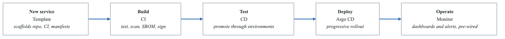

# Lab 4: Golden Paths and Software Templates

## Lab Overview

| Attribute | Details |
|-----------|---------|
| **Duration** | 3-4 hours |
| **Level** | Advanced |
| **Prerequisites** | Lab 01, Backstage fundamentals, GitOps |
| **Environment** | Kubernetes cluster, Backstage, GitHub |
| **Learning Objectives** | Design golden paths, create reusable templates, implement guardrails |

## Introduction

Golden paths are opinionated, well-supported ways to build and deploy software within your organization. They reduce cognitive load on developers by providing pre-configured, production-ready starting points. In this lab, you'll design and implement golden paths using Backstage software templates.

## Part 1: Golden Path Strategy

### Understanding Golden Paths

```mermaid
%%{init: {'theme':'base','themeVariables':{'fontFamily':'Helvetica, Arial, sans-serif','fontSize':'13px','primaryColor':'#ffffff','primaryTextColor':'#2d3436','primaryBorderColor':'#9aa3ab','lineColor':'#9aa3ab','textColor':'#2d3436','clusterBkg':'#fbfcfd','clusterBorder':'#d4dae0','edgeLabelBackground':'#ffffff','tertiaryColor':'#eef4fb'},'flowchart':{'curve':'basis','padding':14,'nodeSpacing':42,'rankSpacing':58}}}%%
flowchart LR
  classDef default fill:#ffffff,stroke:#9aa3ab,stroke-width:1.3px,color:#2d3436
  classDef n    fill:#ffffff,stroke:#9aa3ab,stroke-width:1.3px,color:#2d3436
  classDef crit fill:#eef4fb,stroke:#2f6fb8,stroke-width:1.8px,color:#1b3a5c
  classDef data fill:#f4f7fa,stroke:#9aa3ab,stroke-width:1.3px,color:#2d3436
  classDef mut  fill:#ffffff,stroke:#cfd6dc,stroke-width:1.1px,color:#7a8288
  classDef warn fill:#fdf0ec,stroke:#c0522d,stroke-width:1.6px,color:#8a3a1e
  T["<b>New service</b><br/>Template<br/><i>scaffolds repo, CI, manifests</i>"]
  CI["<b>Build</b><br/>CI<br/><i>test, scan, SBOM, sign</i>"]
  CD["<b>Test</b><br/>CD<br/><i>promote through environments</i>"]
  DEP["<b>Deploy</b><br/>Argo CD<br/><i>progressive rollout</i>"]
  MON["<b>Operate</b><br/>Monitor<br/><i>dashboards and alerts, pre-wired</i>"]
  T ==> CI ==> CD ==> DEP ==> MON
  class T,CI,CD,DEP,MON n
  linkStyle 0,1,2,3 stroke:#2f6fb8,stroke-width:2px
```

<!-- figure: generated from the Mermaid below by _shared/diagrams/embed-figures.py — do not edit the image -->


<details>
<summary>Diagram source (Mermaid)</summary>



</details>

*"The paved road that most developers should follow."* Every box above is
pre-configured, tested, and supported by the platform team — a developer who stays
on the road gets all five for free and owns none of them.

**Principles**

- Opinionated but not restrictive — the road is paved, the off-ramp is signposted
- Production-ready on day one: probes, limits, logging, and alerting already wired
- Every integration a service needs is in the template, not in a wiki page
- The template is versioned, so improvements reach services that already shipped

A golden path with no escape hatch is a cage; an escape hatch with no golden path
is a wiki. You need both, and you need to know how many teams took the off-ramp —
that number is the platform's real satisfaction score.

### Exercise 1.1: Define Your Golden Paths

Create the golden path catalog:

```yaml
# golden-paths/catalog.yaml
apiVersion: backstage.io/v1alpha1
kind: Resource
metadata:
  name: golden-paths-catalog
  title: Golden Paths Catalog
  description: Organization-wide golden paths for software development
  annotations:
    backstage.io/managed-by-location: url:https://github.com/platform-team/golden-paths
spec:
  type: documentation
  owner: platform-team
---
# Define golden path categories
apiVersion: backstage.io/v1alpha1
kind: System
metadata:
  name: backend-services
  title: Backend Services
  description: Golden paths for backend service development
spec:
  owner: platform-team
---
apiVersion: backstage.io/v1alpha1
kind: System
metadata:
  name: frontend-applications
  title: Frontend Applications
  description: Golden paths for frontend application development
spec:
  owner: platform-team
---
apiVersion: backstage.io/v1alpha1
kind: System
metadata:
  name: data-pipelines
  title: Data Pipelines
  description: Golden paths for data pipeline development
spec:
  owner: platform-team
---
apiVersion: backstage.io/v1alpha1
kind: System
metadata:
  name: machine-learning
  title: Machine Learning
  description: Golden paths for ML model development and deployment
spec:
  owner: platform-team
```

### Exercise 1.2: Golden Path Decision Matrix

```yaml
# golden-paths/decision-matrix.yaml
goldenPaths:
  backendServices:
    - name: rest-api-go
      description: REST API service in Go
      useWhen:
        - High performance requirements
        - Microservices architecture
        - Team has Go experience
      technologies:
        language: Go 1.21+
        framework: Chi/Gin
        database: PostgreSQL
        cache: Redis
        messaging: Kafka
      includes:
        - OpenAPI specification
        - Health checks
        - Prometheus metrics
        - Structured logging
        - Database migrations
        - CI/CD pipeline
        - Kubernetes manifests
        - Integration tests

    - name: rest-api-python
      description: REST API service in Python
      useWhen:
        - Rapid development priority
        - Data-heavy operations
        - ML model serving
      technologies:
        language: Python 3.11+
        framework: FastAPI
        database: PostgreSQL
        cache: Redis
        messaging: Celery/RabbitMQ
      includes:
        - OpenAPI auto-generation
        - Health checks
        - Prometheus metrics
        - Structured logging
        - Alembic migrations
        - CI/CD pipeline
        - Kubernetes manifests
        - Pytest suite

    - name: event-driven-service
      description: Event-driven microservice
      useWhen:
        - Async processing requirements
        - High throughput event processing
        - Decoupled architecture
      technologies:
        language: Go/Python
        messaging: Kafka/NATS
        storage: PostgreSQL/MongoDB
      includes:
        - Event schemas (Avro/Protobuf)
        - Dead letter queue handling
        - Retry mechanisms
        - Idempotency patterns

  frontendApplications:
    - name: react-spa
      description: React Single Page Application
      useWhen:
        - Complex interactive UI
        - Single page application
        - Team has React experience
      technologies:
        framework: React 18+
        stateManagement: Redux Toolkit
        styling: TailwindCSS
        testing: Jest + React Testing Library
      includes:
        - Component library integration
        - Authentication flow
        - API client generation
        - CI/CD pipeline
        - CDN deployment

    - name: nextjs-fullstack
      description: Next.js Full-Stack Application
      useWhen:
        - SEO requirements
        - Server-side rendering needed
        - Full-stack in one repo
      technologies:
        framework: Next.js 14+
        database: Prisma + PostgreSQL
        authentication: NextAuth.js
        styling: TailwindCSS
```

## Part 2: Production-Ready Templates

### Exercise 2.1: Complete Go Microservice Template

```yaml
# templates/go-microservice/template.yaml
apiVersion: scaffolder.backstage.io/v1beta3
kind: Template
metadata:
  name: go-microservice-golden-path
  title: Go Microservice (Golden Path)
  description: Production-ready Go microservice with all platform integrations
  tags:
    - go
    - microservice
    - golden-path
    - recommended
  annotations:
    backstage.io/techdocs-ref: dir:.
spec:
  owner: platform-team
  type: service

  parameters:
    - title: Service Information
      required:
        - name
        - description
        - owner
      properties:
        name:
          title: Service Name
          type: string
          description: Unique service identifier (lowercase, hyphens only)
          pattern: '^[a-z][a-z0-9-]*$'
          maxLength: 63
          ui:autofocus: true
        description:
          title: Description
          type: string
          description: Brief description of the service purpose
          maxLength: 200
        owner:
          title: Owner Team
          type: string
          description: Team responsible for this service
          ui:field: OwnerPicker
          ui:options:
            catalogFilter:
              kind: Group

    - title: Service Configuration
      required:
        - serviceType
        - database
      properties:
        serviceType:
          title: Service Type
          type: string
          description: Type of service to create
          enum:
            - rest-api
            - grpc-service
            - event-processor
            - scheduled-job
          enumNames:
            - REST API Service
            - gRPC Service
            - Event Processor
            - Scheduled Job
          default: rest-api
        database:
          title: Database
          type: string
          enum:
            - postgresql
            - mysql
            - mongodb
            - none
          enumNames:
            - PostgreSQL (Recommended)
            - MySQL
            - MongoDB
            - No Database
          default: postgresql
        cache:
          title: Cache
          type: string
          enum:
            - redis
            - memcached
            - none
          default: redis
        messaging:
          title: Messaging
          type: string
          enum:
            - kafka
            - rabbitmq
            - nats
            - none
          default: none

    - title: Deployment Configuration
      required:
        - environment
      properties:
        environment:
          title: Initial Environments
          type: array
          items:
            type: string
            enum:
              - development
              - staging
              - production
          uniqueItems: true
          default:
            - development
            - staging
        replicas:
          title: Initial Replicas
          type: object
          properties:
            development:
              type: integer
              default: 1
            staging:
              type: integer
              default: 2
            production:
              type: integer
              default: 3
        resources:
          title: Resource Profile
          type: string
          enum:
            - small
            - medium
            - large
          enumNames:
            - Small (256Mi/250m)
            - Medium (512Mi/500m)
            - Large (1Gi/1000m)
          default: small

    - title: Repository Settings
      required:
        - repoUrl
      properties:
        repoUrl:
          title: Repository Location
          type: string
          ui:field: RepoUrlPicker
          ui:options:
            allowedHosts:
              - github.com
            allowedOwners:
              - ${{ parameters.owner }}
        visibility:
          title: Repository Visibility
          type: string
          enum:
            - private
            - internal
            - public
          default: private

  steps:
    # Step 1: Fetch base template
    - id: fetch-base
      name: Fetch Base Template
      action: fetch:template
      input:
        url: ./skeleton
        values:
          name: ${{ parameters.name }}
          description: ${{ parameters.description }}
          owner: ${{ parameters.owner }}
          serviceType: ${{ parameters.serviceType }}
          database: ${{ parameters.database }}
          cache: ${{ parameters.cache }}
          messaging: ${{ parameters.messaging }}

    # Step 2: Generate API specification
    - id: generate-api
      name: Generate API Specification
      action: fetch:template
      if: ${{ parameters.serviceType == 'rest-api' }}
      input:
        url: ./api-templates/openapi
        targetPath: ./api
        values:
          name: ${{ parameters.name }}
          description: ${{ parameters.description }}

    # Step 3: Generate gRPC definitions
    - id: generate-grpc
      name: Generate gRPC Definitions
      action: fetch:template
      if: ${{ parameters.serviceType == 'grpc-service' }}
      input:
        url: ./api-templates/grpc
        targetPath: ./proto
        values:
          name: ${{ parameters.name }}

    # Step 4: Generate database migrations
    - id: generate-migrations
      name: Generate Database Migrations
      action: fetch:template
      if: ${{ parameters.database != 'none' }}
      input:
        url: ./database-templates/${{ parameters.database }}
        targetPath: ./migrations
        values:
          name: ${{ parameters.name }}

    # Step 5: Generate Kubernetes manifests
    - id: generate-k8s
      name: Generate Kubernetes Manifests
      action: fetch:template
      input:
        url: ./k8s-templates
        targetPath: ./deploy/kubernetes
        values:
          name: ${{ parameters.name }}
          owner: ${{ parameters.owner }}
          environments: ${{ parameters.environment }}
          replicas: ${{ parameters.replicas }}
          resources: ${{ parameters.resources }}
          database: ${{ parameters.database }}
          cache: ${{ parameters.cache }}

    # Step 6: Generate CI/CD pipeline
    - id: generate-cicd
      name: Generate CI/CD Pipeline
      action: fetch:template
      input:
        url: ./cicd-templates/github-actions
        targetPath: ./.github
        values:
          name: ${{ parameters.name }}
          serviceType: ${{ parameters.serviceType }}
          environments: ${{ parameters.environment }}

    # Step 7: Generate monitoring configuration
    - id: generate-monitoring
      name: Generate Monitoring Configuration
      action: fetch:template
      input:
        url: ./monitoring-templates
        targetPath: ./deploy/monitoring
        values:
          name: ${{ parameters.name }}
          owner: ${{ parameters.owner }}

    # Step 8: Create repository
    - id: publish
      name: Create Repository
      action: publish:github
      input:
        allowedHosts:
          - github.com
        repoUrl: ${{ parameters.repoUrl }}
        description: ${{ parameters.description }}
        defaultBranch: main
        protectDefaultBranch: true
        requireCodeOwnerReviews: true
        deleteBranchOnMerge: true
        repoVisibility: ${{ parameters.visibility }}
        topics:
          - ${{ parameters.serviceType }}
          - golden-path
          - ${{ parameters.owner }}

    # Step 9: Create ArgoCD application
    - id: create-argocd
      name: Create ArgoCD Application
      action: argocd:create-resources
      input:
        appName: ${{ parameters.name }}
        projectName: ${{ parameters.owner }}
        repoUrl: ${{ steps.publish.output.remoteUrl }}
        path: deploy/kubernetes/overlays
        namespace: ${{ parameters.name }}

    # Step 10: Register in catalog
    - id: register
      name: Register in Catalog
      action: catalog:register
      input:
        repoContentsUrl: ${{ steps.publish.output.repoContentsUrl }}
        catalogInfoPath: /catalog-info.yaml

    # Step 11: Create PagerDuty service
    - id: create-pagerduty
      name: Create PagerDuty Service
      action: pagerduty:create-service
      input:
        name: ${{ parameters.name }}
        description: ${{ parameters.description }}
        escalationPolicyId: ${{ parameters.owner }}-policy

    # Step 12: Notify team
    - id: notify
      name: Notify Team
      action: slack:send-message
      input:
        channel: "#${{ parameters.owner }}-notifications"
        message: |
          :rocket: New service created: *${{ parameters.name }}*
          Repository: ${{ steps.publish.output.remoteUrl }}
          Owner: ${{ parameters.owner }}
          Created by: ${{ user.entity.metadata.name }}

  output:
    links:
      - title: Repository
        url: ${{ steps.publish.output.remoteUrl }}
      - title: Open in Catalog
        icon: catalog
        entityRef: ${{ steps.register.output.entityRef }}
      - title: ArgoCD Application
        url: https://argocd.company.com/applications/${{ parameters.name }}
      - title: PagerDuty Service
        url: ${{ steps['create-pagerduty'].output.serviceUrl }}
    text:
      - title: Getting Started
        content: |
          ## Your service is ready!

          ### Next Steps:
          1. Clone the repository: `git clone ${{ steps.publish.output.remoteUrl }}`
          2. Review the generated code and configuration
          3. Update the API specification in `/api/openapi.yaml`
          4. Run locally: `make run`
          5. Deploy to development: `git push` (triggers CI/CD)

          ### Documentation
          - [Service Development Guide](https://docs.company.com/guides/go-services)
          - [Deployment Guide](https://docs.company.com/guides/deployment)
          - [Monitoring Guide](https://docs.company.com/guides/monitoring)
```

### Exercise 2.2: Template Skeleton Files

Create the skeleton directory structure:

```go
// templates/go-microservice/skeleton/cmd/server/main.go
package main

import (
	"context"
	"fmt"
	"net/http"
	"os"
	"os/signal"
	"syscall"
	"time"

	"github.com/{{ .Values.owner }}/{{ .Values.name }}/internal/config"
	"github.com/{{ .Values.owner }}/{{ .Values.name }}/internal/handlers"
	"github.com/{{ .Values.owner }}/{{ .Values.name }}/internal/middleware"
	"github.com/{{ .Values.owner }}/{{ .Values.name }}/pkg/observability"
	"github.com/go-chi/chi/v5"
	"go.uber.org/zap"
)

func main() {
	// Initialize configuration
	cfg, err := config.Load()
	if err != nil {
		fmt.Fprintf(os.Stderr, "failed to load config: %v\n", err)
		os.Exit(1)
	}

	// Initialize logger
	logger, err := observability.NewLogger(cfg.LogLevel, cfg.Environment)
	if err != nil {
		fmt.Fprintf(os.Stderr, "failed to create logger: %v\n", err)
		os.Exit(1)
	}
	defer logger.Sync()

	// Initialize tracing
	shutdown, err := observability.InitTracing(cfg.ServiceName, cfg.OTLPEndpoint)
	if err != nil {
		logger.Fatal("failed to initialize tracing", zap.Error(err))
	}
	defer shutdown(context.Background())

	// Initialize metrics
	observability.InitMetrics(cfg.ServiceName)

	{{- if ne .Values.database "none" }}
	// Initialize database
	db, err := database.Connect(cfg.DatabaseURL)
	if err != nil {
		logger.Fatal("failed to connect to database", zap.Error(err))
	}
	defer db.Close()
	{{- end }}

	{{- if eq .Values.cache "redis" }}
	// Initialize Redis
	redis, err := cache.NewRedisClient(cfg.RedisURL)
	if err != nil {
		logger.Fatal("failed to connect to Redis", zap.Error(err))
	}
	defer redis.Close()
	{{- end }}

	// Initialize router
	r := chi.NewRouter()

	// Apply middleware
	r.Use(middleware.RequestID)
	r.Use(middleware.Logger(logger))
	r.Use(middleware.Recoverer)
	r.Use(middleware.Metrics)
	r.Use(middleware.Tracing)

	// Health endpoints
	r.Get("/health", handlers.HealthCheck)
	r.Get("/ready", handlers.ReadinessCheck)

	// API routes
	r.Route("/api/v1", func(r chi.Router) {
		r.Use(middleware.RateLimit)
		{{- if eq .Values.serviceType "rest-api" }}
		// TODO: Add your API routes here
		r.Get("/", handlers.Root)
		{{- end }}
	})

	// Metrics endpoint
	r.Handle("/metrics", observability.MetricsHandler())

	// Create server
	server := &http.Server{
		Addr:         fmt.Sprintf(":%d", cfg.Port),
		Handler:      r,
		ReadTimeout:  15 * time.Second,
		WriteTimeout: 15 * time.Second,
		IdleTimeout:  60 * time.Second,
	}

	// Start server
	go func() {
		logger.Info("starting server",
			zap.Int("port", cfg.Port),
			zap.String("environment", cfg.Environment),
		)
		if err := server.ListenAndServe(); err != nil && err != http.ErrServerClosed {
			logger.Fatal("server failed", zap.Error(err))
		}
	}()

	// Wait for shutdown signal
	quit := make(chan os.Signal, 1)
	signal.Notify(quit, syscall.SIGINT, syscall.SIGTERM)
	<-quit

	logger.Info("shutting down server")

	// Graceful shutdown
	ctx, cancel := context.WithTimeout(context.Background(), 30*time.Second)
	defer cancel()

	if err := server.Shutdown(ctx); err != nil {
		logger.Error("server forced to shutdown", zap.Error(err))
	}

	logger.Info("server stopped")
}
```

```yaml
# templates/go-microservice/skeleton/catalog-info.yaml
apiVersion: backstage.io/v1alpha1
kind: Component
metadata:
  name: ${{ values.name }}
  title: ${{ values.name | title }}
  description: ${{ values.description }}
  annotations:
    backstage.io/techdocs-ref: dir:.
    github.com/project-slug: ${{ values.owner }}/${{ values.name }}
    argocd/app-name: ${{ values.name }}
    pagerduty.com/service-id: ${{ values.name }}
    prometheus.io/scrape-path: /metrics
    grafana/dashboard-selector: app=${{ values.name }}
  tags:
    - go
    - ${{ values.serviceType }}
    - golden-path
  links:
    - url: https://github.com/${{ values.owner }}/${{ values.name }}
      title: Repository
      icon: github
    - url: https://argocd.company.com/applications/${{ values.name }}
      title: ArgoCD
      icon: cloud
    - url: https://grafana.company.com/d/${{ values.name }}
      title: Grafana Dashboard
      icon: dashboard
spec:
  type: service
  lifecycle: production
  owner: ${{ values.owner }}
  system: backend-services
  {{- if ne .Values.database "none" }}
  dependsOn:
    - resource:${{ values.name }}-db
  {{- end }}
  providesApis:
    - ${{ values.name }}-api
---
apiVersion: backstage.io/v1alpha1
kind: API
metadata:
  name: ${{ values.name }}-api
  title: ${{ values.name | title }} API
  description: API for ${{ values.name }}
spec:
  type: openapi
  lifecycle: production
  owner: ${{ values.owner }}
  definition:
    $text: ./api/openapi.yaml
{{- if ne .Values.database "none" }}
---
apiVersion: backstage.io/v1alpha1
kind: Resource
metadata:
  name: ${{ values.name }}-db
  title: ${{ values.name | title }} Database
  description: ${{ values.database | title }} database for ${{ values.name }}
spec:
  type: database
  owner: ${{ values.owner }}
  system: backend-services
{{- end }}
```

## Part 3: Template Testing and Validation

### Exercise 3.1: Template Validation Pipeline

```yaml
# .github/workflows/validate-templates.yaml
name: Validate Templates

on:
  push:
    paths:
      - 'templates/**'
  pull_request:
    paths:
      - 'templates/**'

jobs:
  validate-syntax:
    name: Validate Template Syntax
    runs-on: ubuntu-latest
    steps:
      - uses: actions/checkout@v4

      - name: Setup Node.js
        uses: actions/setup-node@v4
        with:
          node-version: '20'

      - name: Install Backstage CLI
        run: npm install -g @backstage/cli

      - name: Validate Template YAML
        run: |
          for template in templates/*/template.yaml; do
            echo "Validating $template"
            yq eval '.' "$template" > /dev/null
          done

      - name: Validate JSON Schemas
        run: |
          npm install ajv-cli
          for template in templates/*/template.yaml; do
            echo "Validating schema for $template"
            npx ajv validate -s schemas/template.json -d "$template"
          done

  test-templates:
    name: Test Template Generation
    runs-on: ubuntu-latest
    needs: validate-syntax
    strategy:
      matrix:
        template:
          - go-microservice
          - python-fastapi
          - react-frontend
    steps:
      - uses: actions/checkout@v4

      - name: Setup Test Environment
        run: |
          docker-compose -f docker-compose.test.yaml up -d

      - name: Generate from Template
        run: |
          ./scripts/test-template.sh ${{ matrix.template }}

      - name: Validate Generated Code
        run: |
          cd output/${{ matrix.template }}

          # Check required files exist
          test -f catalog-info.yaml
          test -f Dockerfile
          test -f Makefile
          test -d deploy/kubernetes
          test -d .github/workflows

      - name: Build Generated Service
        run: |
          cd output/${{ matrix.template }}
          make build

      - name: Run Generated Tests
        run: |
          cd output/${{ matrix.template }}
          make test

      - name: Lint Generated Code
        run: |
          cd output/${{ matrix.template }}
          make lint

  security-scan:
    name: Security Scan Templates
    runs-on: ubuntu-latest
    needs: validate-syntax
    steps:
      - uses: actions/checkout@v4

      - name: Scan for secrets
        uses: trufflesecurity/trufflehog@main
        with:
          path: ./templates

      - name: Scan for vulnerabilities
        run: |
          for template in templates/*/skeleton; do
            if [ -f "$template/go.mod" ]; then
              cd "$template"
              go mod download
              govulncheck ./...
              cd -
            fi
          done
```

### Exercise 3.2: Template Testing Script

```bash
#!/bin/bash
# scripts/test-template.sh

set -euo pipefail

TEMPLATE_NAME="${1:-go-microservice}"
OUTPUT_DIR="output/${TEMPLATE_NAME}"
TEST_VALUES_FILE="templates/${TEMPLATE_NAME}/test-values.yaml"

echo "Testing template: ${TEMPLATE_NAME}"

# Clean previous output
rm -rf "${OUTPUT_DIR}"
mkdir -p "${OUTPUT_DIR}"

# Read test values
if [ -f "${TEST_VALUES_FILE}" ]; then
    TEST_VALUES=$(cat "${TEST_VALUES_FILE}")
else
    # Default test values
    TEST_VALUES=$(cat <<EOF
name: test-service
description: Test service for template validation
owner: platform-team
serviceType: rest-api
database: postgresql
cache: redis
messaging: none
environment:
  - development
  - staging
replicas:
  development: 1
  staging: 2
resources: small
EOF
)
fi

# Generate from template
echo "Generating from template..."
npx @backstage/create-app \
    --template "templates/${TEMPLATE_NAME}" \
    --values <(echo "${TEST_VALUES}") \
    --output "${OUTPUT_DIR}"

# Validate generated files
echo "Validating generated files..."

required_files=(
    "catalog-info.yaml"
    "Dockerfile"
    "Makefile"
    "README.md"
    "deploy/kubernetes/base/deployment.yaml"
    "deploy/kubernetes/base/service.yaml"
    ".github/workflows/ci.yaml"
)

for file in "${required_files[@]}"; do
    if [ ! -f "${OUTPUT_DIR}/${file}" ]; then
        echo "ERROR: Required file missing: ${file}"
        exit 1
    fi
    echo "  ✓ ${file}"
done

# Validate YAML files
echo "Validating YAML syntax..."
find "${OUTPUT_DIR}" -name "*.yaml" -o -name "*.yml" | while read -r file; do
    if ! yq eval '.' "$file" > /dev/null 2>&1; then
        echo "ERROR: Invalid YAML: ${file}"
        exit 1
    fi
    echo "  ✓ ${file}"
done

# Validate Kubernetes manifests
echo "Validating Kubernetes manifests..."
if command -v kubeval &> /dev/null; then
    find "${OUTPUT_DIR}/deploy/kubernetes" -name "*.yaml" | while read -r file; do
        kubeval --strict "$file"
    done
fi

# Run language-specific validations
if [ -f "${OUTPUT_DIR}/go.mod" ]; then
    echo "Validating Go code..."
    cd "${OUTPUT_DIR}"
    go mod tidy
    go build ./...
    go vet ./...
    cd -
fi

if [ -f "${OUTPUT_DIR}/requirements.txt" ]; then
    echo "Validating Python code..."
    cd "${OUTPUT_DIR}"
    python -m py_compile *.py
    cd -
fi

echo "Template validation successful!"
```

## Part 4: Template Lifecycle Management

### Exercise 4.1: Template Versioning Strategy

```yaml
# templates/versioning/template-versions.yaml
apiVersion: v1
kind: ConfigMap
metadata:
  name: template-versions
  namespace: backstage
data:
  versions.yaml: |
    templates:
      go-microservice:
        latest: "2.1.0"
        supported:
          - version: "2.1.0"
            releaseDate: "2024-01-15"
            status: current
            changelog: |
              - Added OpenTelemetry support
              - Updated to Go 1.21
              - Added structured error handling
          - version: "2.0.0"
            releaseDate: "2023-10-01"
            status: supported
            deprecationDate: "2024-06-01"
            changelog: |
              - Major refactoring of project structure
              - Added gRPC support
              - Migrated to Chi router
          - version: "1.5.0"
            releaseDate: "2023-06-01"
            status: deprecated
            eolDate: "2024-03-01"
            migrationGuide: docs/migrations/go-microservice-v1-to-v2.md

      python-fastapi:
        latest: "1.3.0"
        supported:
          - version: "1.3.0"
            releaseDate: "2024-01-10"
            status: current
          - version: "1.2.0"
            releaseDate: "2023-11-01"
            status: supported

    policies:
      deprecationPeriod: "6 months"
      supportPeriod: "12 months"
      notificationChannels:
        - slack: "#platform-announcements"
        - email: "engineering@company.com"
```

### Exercise 4.2: Template Update Automation

```yaml
# .github/workflows/template-updates.yaml
name: Template Updates

on:
  schedule:
    - cron: '0 9 * * 1'  # Weekly on Monday
  workflow_dispatch:

jobs:
  check-updates:
    name: Check for Dependency Updates
    runs-on: ubuntu-latest
    outputs:
      updates: ${{ steps.check.outputs.updates }}
    steps:
      - uses: actions/checkout@v4

      - name: Check Go Dependencies
        id: check-go
        run: |
          for template in templates/*/skeleton; do
            if [ -f "$template/go.mod" ]; then
              cd "$template"
              go list -u -m all 2>/dev/null | grep '\[' || true
              cd -
            fi
          done

      - name: Check Python Dependencies
        id: check-python
        run: |
          pip install pip-audit
          for template in templates/*/skeleton; do
            if [ -f "$template/requirements.txt" ]; then
              pip-audit -r "$template/requirements.txt" --format json || true
            fi
          done

      - name: Check Docker Base Images
        id: check-docker
        run: |
          for template in templates/*/skeleton; do
            if [ -f "$template/Dockerfile" ]; then
              image=$(grep "^FROM" "$template/Dockerfile" | head -1 | awk '{print $2}')
              # Check for newer versions
              skopeo inspect "docker://${image}" 2>/dev/null | jq -r '.Digest'
            fi
          done

  notify-updates:
    name: Notify About Updates
    runs-on: ubuntu-latest
    needs: check-updates
    if: needs.check-updates.outputs.updates != ''
    steps:
      - name: Create Issue
        uses: actions/github-script@v7
        with:
          script: |
            const updates = JSON.parse('${{ needs.check-updates.outputs.updates }}');

            const body = `## Template Dependency Updates Available

            The following templates have available updates:

            ${updates.map(u => `- **${u.template}**: ${u.updates.join(', ')}`).join('\n')}

            Please review and update as necessary.
            `;

            github.rest.issues.create({
              owner: context.repo.owner,
              repo: context.repo.repo,
              title: 'Weekly Template Update Review',
              body: body,
              labels: ['templates', 'maintenance']
            });
```

## Part 5: Advanced Template Patterns

### Exercise 5.1: Composite Templates

```yaml
# templates/full-stack-application/template.yaml
apiVersion: scaffolder.backstage.io/v1beta3
kind: Template
metadata:
  name: full-stack-application
  title: Full-Stack Application
  description: Complete application with frontend, backend, and infrastructure
spec:
  owner: platform-team
  type: system

  parameters:
    - title: Application Information
      required:
        - name
        - owner
      properties:
        name:
          title: Application Name
          type: string
          pattern: '^[a-z][a-z0-9-]*$'
        owner:
          title: Owner
          type: string
          ui:field: OwnerPicker

    - title: Component Selection
      properties:
        frontend:
          title: Frontend Framework
          type: string
          enum:
            - react
            - nextjs
            - vue
        backend:
          title: Backend Service
          type: string
          enum:
            - go-rest
            - python-fastapi
            - nodejs-express
        database:
          title: Database
          type: string
          enum:
            - postgresql
            - mysql
            - mongodb

  steps:
    # Create parent system
    - id: create-system
      name: Create System
      action: catalog:write
      input:
        entity:
          apiVersion: backstage.io/v1alpha1
          kind: System
          metadata:
            name: ${{ parameters.name }}
            description: Full-stack application system
          spec:
            owner: ${{ parameters.owner }}

    # Scaffold backend service
    - id: scaffold-backend
      name: Scaffold Backend
      action: scaffolder:template
      input:
        templateRef: template:default/go-microservice-golden-path
        values:
          name: ${{ parameters.name }}-api
          owner: ${{ parameters.owner }}
          serviceType: rest-api
          database: ${{ parameters.database }}

    # Scaffold frontend application
    - id: scaffold-frontend
      name: Scaffold Frontend
      action: scaffolder:template
      input:
        templateRef: template:default/${{ parameters.frontend }}-application
        values:
          name: ${{ parameters.name }}-web
          owner: ${{ parameters.owner }}
          apiUrl: https://api.${{ parameters.name }}.company.com

    # Create infrastructure
    - id: scaffold-infrastructure
      name: Scaffold Infrastructure
      action: scaffolder:template
      input:
        templateRef: template:default/infrastructure-as-code
        values:
          name: ${{ parameters.name }}-infra
          owner: ${{ parameters.owner }}
          components:
            - backend: ${{ steps['scaffold-backend'].output.name }}
            - frontend: ${{ steps['scaffold-frontend'].output.name }}
            - database: ${{ parameters.database }}

  output:
    links:
      - title: System in Catalog
        icon: catalog
        entityRef: ${{ steps['create-system'].output.entityRef }}
      - title: Backend Repository
        url: ${{ steps['scaffold-backend'].output.repoUrl }}
      - title: Frontend Repository
        url: ${{ steps['scaffold-frontend'].output.repoUrl }}
      - title: Infrastructure Repository
        url: ${{ steps['scaffold-infrastructure'].output.repoUrl }}
```

### Exercise 5.2: Template with Interactive Prompts

```yaml
# templates/guided-service-creation/template.yaml
apiVersion: scaffolder.backstage.io/v1beta3
kind: Template
metadata:
  name: guided-service-creation
  title: Guided Service Creation
  description: Interactive wizard for creating services
spec:
  owner: platform-team
  type: wizard

  parameters:
    # Step 1: Understand the use case
    - title: What are you building?
      properties:
        useCase:
          title: Primary Use Case
          type: string
          enum:
            - user-facing-api
            - internal-service
            - data-processing
            - scheduled-jobs
            - event-handling
          enumNames:
            - User-Facing API (external traffic)
            - Internal Service (service-to-service)
            - Data Processing Pipeline
            - Scheduled/Batch Jobs
            - Event-Driven Processing
          ui:widget: radio
          ui:help: |
            Choose based on your primary use case:
            - User-Facing: APIs called by frontend/mobile apps
            - Internal: Microservices called by other services
            - Data Processing: ETL, analytics pipelines
            - Scheduled: Cron jobs, periodic tasks
            - Event-Driven: Message queue consumers

    # Step 2: Based on use case, show relevant options
    - title: Performance Requirements
      properties:
        trafficPattern:
          title: Expected Traffic Pattern
          type: string
          enum:
            - steady-low
            - steady-high
            - bursty
            - scheduled
          enumNames:
            - Steady Low (<100 req/s)
            - Steady High (100-10000 req/s)
            - Bursty (unpredictable spikes)
            - Scheduled (predictable peaks)
        latencyRequirement:
          title: Latency Requirement
          type: string
          enum:
            - best-effort
            - standard
            - low
            - ultra-low
          enumNames:
            - Best Effort (>500ms OK)
            - Standard (<200ms p95)
            - Low (<50ms p95)
            - Ultra-Low (<10ms p99)

    # Step 3: Data requirements
    - title: Data Requirements
      properties:
        dataStorage:
          title: What data will you store?
          type: array
          items:
            type: string
            enum:
              - relational
              - documents
              - key-value
              - time-series
              - files
              - none
          uniqueItems: true
          ui:widget: checkboxes
        dataCompliance:
          title: Compliance Requirements
          type: array
          items:
            type: string
            enum:
              - pii
              - pci
              - hipaa
              - none
          uniqueItems: true
          ui:widget: checkboxes

  steps:
    # Determine best template based on answers
    - id: recommend-template
      name: Analyze Requirements
      action: http:backstage:request
      input:
        method: POST
        path: /api/template-advisor/recommend
        body:
          useCase: ${{ parameters.useCase }}
          trafficPattern: ${{ parameters.trafficPattern }}
          latencyRequirement: ${{ parameters.latencyRequirement }}
          dataStorage: ${{ parameters.dataStorage }}
          dataCompliance: ${{ parameters.dataCompliance }}

    # Show recommendation to user
    - id: show-recommendation
      name: Review Recommendation
      action: debug:wait
      input:
        message: |
          Based on your requirements, we recommend:

          **Template:** ${{ steps['recommend-template'].output.body.template }}
          **Language:** ${{ steps['recommend-template'].output.body.language }}
          **Database:** ${{ steps['recommend-template'].output.body.database }}

          ${{ steps['recommend-template'].output.body.rationale }}

    # Continue with actual scaffolding
    - id: scaffold
      name: Create Service
      action: scaffolder:template
      input:
        templateRef: ${{ steps['recommend-template'].output.body.templateRef }}
        values: ${{ steps['recommend-template'].output.body.defaultValues }}
```

## Verification Checklist

After completing this lab, verify:

- [ ] Golden path catalog is defined and documented
- [ ] Decision matrix helps teams choose appropriate paths
- [ ] Production-ready template generates all required components
- [ ] Template includes all platform integrations (monitoring, CI/CD, etc.)
- [ ] Template testing pipeline validates generated code
- [ ] Template versioning strategy is implemented
- [ ] Composite templates work for complex applications
- [ ] Templates follow security best practices

## Troubleshooting

### Template Not Appearing in Catalog

1. Verify template location is registered in app-config.yaml
2. Check template YAML syntax
3. Verify apiVersion matches supported version
4. Check Backstage logs for parsing errors

### Generated Code Fails to Build

1. Ensure all dependencies are correctly versioned
2. Check template variable substitution
3. Verify skeleton code compiles before templating
4. Test with multiple parameter combinations

### Integration Failures

1. Verify external service credentials
2. Check network connectivity from Backstage
3. Review action logs in Backstage UI
4. Ensure required permissions exist

## Summary

In this lab, you learned to:

- Design golden paths that reduce developer cognitive load
- Create production-ready software templates
- Implement template testing and validation pipelines
- Manage template lifecycle with versioning
- Build composite templates for complex applications
- Create interactive guided experiences

Golden paths and templates are core to platform engineering success. They encode organizational best practices while giving developers the freedom to focus on business logic rather than infrastructure.

<!-- feynman-check -->

---

## Feynman check

Close the file. Blank page, no notes. Explain each of these to a competent engineer who has never
used this tool — **under five minutes, no jargon you can't define on the spot:**

- Golden Path Strategy
- Production-Ready Templates
- Template Testing and Validation
- Template Lifecycle Management

**The gap is not what you forgot. It is where you used a word instead of a mechanism.**

| | |
|---|---|
| ✗ | *"The platform makes developers more productive."* |
| ✓ | *"A golden path is a template that produces a repository with CI, manifests, dashboards and alerts already wired, so the product team owns none of them. It reduces cognitive load by removing decisions, not by adding features — and without a documented escape hatch it is a cage."* |

**Trace it:** A developer commits `service.yaml` → a running service with a dashboard and a paging rule. Name every system that acts, and which team owns each one.

Stop at the first component you cannot name. Reopen this file and read **only** that.

**Go deeper — only once the gap has a name:** [Team Topologies — cognitive load](https://teamtopologies.com/key-concepts) and the [CNCF Platforms White Paper](https://tag-app-delivery.cncf.io/whitepapers/platforms/) — why golden paths exist at all.
Full list per domain: [`SOURCES.md`](../SOURCES.md#platform-engineering)

→ Protocol, the three levels of knowing, and worked examples: [`MASTERY.md`](../MASTERY.md)

<!-- /feynman-check -->
