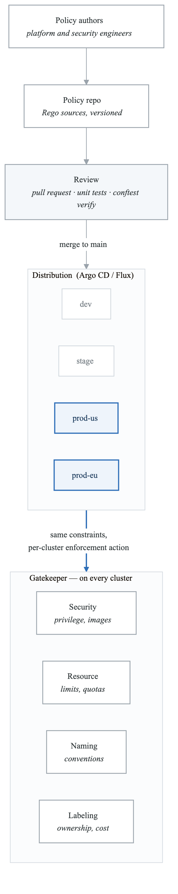
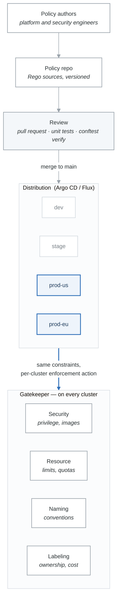

# Lab 6: Policy as Code and Platform Governance

## Lab Overview

| Attribute | Details |
|-----------|---------|
| **Duration** | 3-4 hours |
| **Level** | Advanced |
| **Prerequisites** | Kubernetes, OPA/Gatekeeper, Git |
| **Environment** | Kubernetes cluster with Gatekeeper |
| **Learning Objectives** | Implement policy-as-code, enforce standards, create governance workflows |

## Introduction

Platform governance ensures consistency, security, and compliance across all services while maintaining developer velocity. This lab covers implementing comprehensive policy-as-code using Open Policy Agent (OPA) and Gatekeeper, creating governance workflows, and balancing control with developer autonomy.

## Part 1: OPA Gatekeeper Setup

### Governance Architecture

<!-- figure: generated from the Mermaid below by _shared/diagrams/embed-figures.py — do not edit the image -->


<details>
<summary>Diagram source (Mermaid)</summary>



</details>

### Exercise 1.1: Install and Configure Gatekeeper

```bash
# Install Gatekeeper
helm repo add gatekeeper https://open-policy-agent.github.io/gatekeeper/charts
helm repo update

helm install gatekeeper gatekeeper/gatekeeper \
  --namespace gatekeeper-system \
  --create-namespace \
  --set replicas=3 \
  --set audit.replicas=2 \
  --set audit.writeToRAMDisk=true \
  --set constraintViolationsLimit=100
```

```yaml
# gatekeeper/config.yaml
apiVersion: config.gatekeeper.sh/v1alpha1
kind: Config
metadata:
  name: config
  namespace: gatekeeper-system
spec:
  sync:
    syncOnly:
      - group: ""
        version: "v1"
        kind: "Namespace"
      - group: ""
        version: "v1"
        kind: "Pod"
      - group: "apps"
        version: "v1"
        kind: "Deployment"
      - group: "networking.k8s.io"
        version: "v1"
        kind: "Ingress"
  match:
    - excludedNamespaces:
        - kube-system
        - gatekeeper-system
      processes:
        - "*"
  validation:
    traces:
      - user: "*"
        kind:
          group: ""
          version: "v1"
          kind: "*"
```

### Exercise 1.2: Create Constraint Templates

```yaml
# policies/templates/required-labels.yaml
apiVersion: templates.gatekeeper.sh/v1
kind: ConstraintTemplate
metadata:
  name: k8srequiredlabels
  annotations:
    description: "Requires specified labels on resources"
spec:
  crd:
    spec:
      names:
        kind: K8sRequiredLabels
      validation:
        openAPIV3Schema:
          type: object
          properties:
            labels:
              type: array
              description: "Required label keys"
              items:
                type: object
                properties:
                  key:
                    type: string
                  allowedRegex:
                    type: string
                    description: "Optional regex for allowed values"
  targets:
    - target: admission.k8s.gatekeeper.sh
      rego: |
        package k8srequiredlabels

        violation[{"msg": msg, "details": {"missing_labels": missing}}] {
          provided := {label | input.review.object.metadata.labels[label]}
          required := {label | label := input.parameters.labels[_].key}
          missing := required - provided
          count(missing) > 0
          msg := sprintf("Missing required labels: %v", [missing])
        }

        violation[{"msg": msg, "details": {"invalid_label": label}}] {
          value := input.review.object.metadata.labels[key]
          label := input.parameters.labels[_]
          label.key == key
          label.allowedRegex != ""
          not re_match(label.allowedRegex, value)
          msg := sprintf("Label '%s' has invalid value '%s'. Must match: %s", [key, value, label.allowedRegex])
        }
---
# policies/templates/container-limits.yaml
apiVersion: templates.gatekeeper.sh/v1
kind: ConstraintTemplate
metadata:
  name: k8scontainerlimits
  annotations:
    description: "Requires container resource limits"
spec:
  crd:
    spec:
      names:
        kind: K8sContainerLimits
      validation:
        openAPIV3Schema:
          type: object
          properties:
            cpu:
              type: string
              description: "Maximum CPU limit"
            memory:
              type: string
              description: "Maximum memory limit"
            exemptImages:
              type: array
              items:
                type: string
              description: "Images exempt from limits"
  targets:
    - target: admission.k8s.gatekeeper.sh
      rego: |
        package k8scontainerlimits

        violation[{"msg": msg}] {
          container := input.review.object.spec.containers[_]
          not is_exempt(container.image)
          not container.resources.limits.cpu
          msg := sprintf("Container '%s' has no CPU limit", [container.name])
        }

        violation[{"msg": msg}] {
          container := input.review.object.spec.containers[_]
          not is_exempt(container.image)
          not container.resources.limits.memory
          msg := sprintf("Container '%s' has no memory limit", [container.name])
        }

        violation[{"msg": msg}] {
          container := input.review.object.spec.containers[_]
          not is_exempt(container.image)
          limit := container.resources.limits.cpu
          max_cpu := input.parameters.cpu
          exceeds_limit(limit, max_cpu)
          msg := sprintf("Container '%s' CPU limit %s exceeds maximum %s", [container.name, limit, max_cpu])
        }

        is_exempt(image) {
          exempt := input.parameters.exemptImages[_]
          startswith(image, exempt)
        }

        exceeds_limit(actual, max) {
          actual_millicores := parse_cpu(actual)
          max_millicores := parse_cpu(max)
          actual_millicores > max_millicores
        }

        parse_cpu(cpu) = millicores {
          endswith(cpu, "m")
          millicores := to_number(trim_suffix(cpu, "m"))
        }

        parse_cpu(cpu) = millicores {
          not endswith(cpu, "m")
          millicores := to_number(cpu) * 1000
        }
---
# policies/templates/allowed-repos.yaml
apiVersion: templates.gatekeeper.sh/v1
kind: ConstraintTemplate
metadata:
  name: k8sallowedrepos
  annotations:
    description: "Restricts container images to approved repositories"
spec:
  crd:
    spec:
      names:
        kind: K8sAllowedRepos
      validation:
        openAPIV3Schema:
          type: object
          properties:
            repos:
              type: array
              items:
                type: string
  targets:
    - target: admission.k8s.gatekeeper.sh
      rego: |
        package k8sallowedrepos

        violation[{"msg": msg}] {
          container := input.review.object.spec.containers[_]
          not image_allowed(container.image)
          msg := sprintf("Container '%s' uses image '%s' from unauthorized repository. Allowed: %v",
            [container.name, container.image, input.parameters.repos])
        }

        violation[{"msg": msg}] {
          container := input.review.object.spec.initContainers[_]
          not image_allowed(container.image)
          msg := sprintf("Init container '%s' uses image '%s' from unauthorized repository",
            [container.name, container.image])
        }

        image_allowed(image) {
          repo := input.parameters.repos[_]
          startswith(image, repo)
        }
---
# policies/templates/network-policy-required.yaml
apiVersion: templates.gatekeeper.sh/v1
kind: ConstraintTemplate
metadata:
  name: k8snetworkpolicyrequired
  annotations:
    description: "Requires NetworkPolicy for namespaces with workloads"
spec:
  crd:
    spec:
      names:
        kind: K8sNetworkPolicyRequired
      validation:
        openAPIV3Schema:
          type: object
          properties:
            exemptNamespaces:
              type: array
              items:
                type: string
  targets:
    - target: admission.k8s.gatekeeper.sh
      rego: |
        package k8snetworkpolicyrequired

        violation[{"msg": msg}] {
          input.review.kind.kind == "Deployment"
          namespace := input.review.object.metadata.namespace
          not is_exempt(namespace)
          not has_network_policy(namespace)
          msg := sprintf("Namespace '%s' must have a NetworkPolicy before deploying workloads", [namespace])
        }

        is_exempt(ns) {
          exempt := input.parameters.exemptNamespaces[_]
          ns == exempt
        }

        has_network_policy(ns) {
          policies := data.inventory.namespace[ns]["networking.k8s.io/v1"]["NetworkPolicy"]
          count(policies) > 0
        }
```

## Part 2: Implementing Policy Constraints

### Exercise 2.1: Security Policies

```yaml
# policies/constraints/security/required-security-labels.yaml
apiVersion: constraints.gatekeeper.sh/v1beta1
kind: K8sRequiredLabels
metadata:
  name: deployment-required-labels
spec:
  enforcementAction: deny
  match:
    kinds:
      - apiGroups: ["apps"]
        kinds: ["Deployment"]
    excludedNamespaces:
      - kube-system
      - gatekeeper-system
  parameters:
    labels:
      - key: "app.kubernetes.io/name"
      - key: "app.kubernetes.io/version"
      - key: "app.kubernetes.io/component"
      - key: "team"
        allowedRegex: "^[a-z]+-team$"
      - key: "cost-center"
        allowedRegex: "^[A-Z]{2}[0-9]{4}$"
---
# policies/constraints/security/pod-security-standards.yaml
apiVersion: templates.gatekeeper.sh/v1
kind: ConstraintTemplate
metadata:
  name: k8spodsecurity
spec:
  crd:
    spec:
      names:
        kind: K8sPodSecurity
      validation:
        openAPIV3Schema:
          type: object
          properties:
            allowPrivilegeEscalation:
              type: boolean
            allowHostNamespace:
              type: boolean
            allowHostNetwork:
              type: boolean
            requiredDropCapabilities:
              type: array
              items:
                type: string
  targets:
    - target: admission.k8s.gatekeeper.sh
      rego: |
        package k8spodsecurity

        violation[{"msg": msg}] {
          not input.parameters.allowPrivilegeEscalation
          container := input.review.object.spec.containers[_]
          container.securityContext.allowPrivilegeEscalation == true
          msg := sprintf("Container '%s' must not allow privilege escalation", [container.name])
        }

        violation[{"msg": msg}] {
          not input.parameters.allowHostNamespace
          input.review.object.spec.hostPID == true
          msg := "Pods must not use host PID namespace"
        }

        violation[{"msg": msg}] {
          not input.parameters.allowHostNamespace
          input.review.object.spec.hostIPC == true
          msg := "Pods must not use host IPC namespace"
        }

        violation[{"msg": msg}] {
          not input.parameters.allowHostNetwork
          input.review.object.spec.hostNetwork == true
          msg := "Pods must not use host network"
        }

        violation[{"msg": msg}] {
          required := input.parameters.requiredDropCapabilities[_]
          container := input.review.object.spec.containers[_]
          not has_dropped_capability(container, required)
          msg := sprintf("Container '%s' must drop capability '%s'", [container.name, required])
        }

        has_dropped_capability(container, cap) {
          dropped := container.securityContext.capabilities.drop[_]
          dropped == cap
        }

        has_dropped_capability(container, cap) {
          dropped := container.securityContext.capabilities.drop[_]
          dropped == "ALL"
        }
---
apiVersion: constraints.gatekeeper.sh/v1beta1
kind: K8sPodSecurity
metadata:
  name: pod-security-restricted
spec:
  enforcementAction: deny
  match:
    kinds:
      - apiGroups: [""]
        kinds: ["Pod"]
      - apiGroups: ["apps"]
        kinds: ["Deployment", "StatefulSet", "DaemonSet"]
    namespaceSelector:
      matchLabels:
        security-level: restricted
  parameters:
    allowPrivilegeEscalation: false
    allowHostNamespace: false
    allowHostNetwork: false
    requiredDropCapabilities:
      - ALL
---
# policies/constraints/security/no-latest-tag.yaml
apiVersion: templates.gatekeeper.sh/v1
kind: ConstraintTemplate
metadata:
  name: k8snolatestag
spec:
  crd:
    spec:
      names:
        kind: K8sNoLatestTag
  targets:
    - target: admission.k8s.gatekeeper.sh
      rego: |
        package k8snolatestag

        violation[{"msg": msg}] {
          container := input.review.object.spec.containers[_]
          has_latest_tag(container.image)
          msg := sprintf("Container '%s' uses 'latest' tag. Use specific version tags", [container.name])
        }

        violation[{"msg": msg}] {
          container := input.review.object.spec.containers[_]
          not has_tag(container.image)
          msg := sprintf("Container '%s' image has no tag. Specify a version tag", [container.name])
        }

        has_latest_tag(image) {
          endswith(image, ":latest")
        }

        has_tag(image) {
          contains(image, ":")
        }
---
apiVersion: constraints.gatekeeper.sh/v1beta1
kind: K8sNoLatestTag
metadata:
  name: no-latest-tag
spec:
  enforcementAction: deny
  match:
    kinds:
      - apiGroups: [""]
        kinds: ["Pod"]
      - apiGroups: ["apps"]
        kinds: ["Deployment", "StatefulSet", "DaemonSet"]
    excludedNamespaces:
      - kube-system
```

### Exercise 2.2: Resource and Cost Policies

```yaml
# policies/constraints/resources/container-limits.yaml
apiVersion: constraints.gatekeeper.sh/v1beta1
kind: K8sContainerLimits
metadata:
  name: container-must-have-limits
spec:
  enforcementAction: deny
  match:
    kinds:
      - apiGroups: [""]
        kinds: ["Pod"]
      - apiGroups: ["apps"]
        kinds: ["Deployment", "StatefulSet"]
    excludedNamespaces:
      - kube-system
  parameters:
    cpu: "4000m"
    memory: "8Gi"
    exemptImages:
      - "gcr.io/istio-release/"
---
# policies/constraints/resources/replica-limits.yaml
apiVersion: templates.gatekeeper.sh/v1
kind: ConstraintTemplate
metadata:
  name: k8sreplicalimits
spec:
  crd:
    spec:
      names:
        kind: K8sReplicaLimits
      validation:
        openAPIV3Schema:
          type: object
          properties:
            ranges:
              type: array
              items:
                type: object
                properties:
                  namespace_pattern:
                    type: string
                  min_replicas:
                    type: integer
                  max_replicas:
                    type: integer
  targets:
    - target: admission.k8s.gatekeeper.sh
      rego: |
        package k8sreplicalimits

        violation[{"msg": msg}] {
          namespace := input.review.object.metadata.namespace
          replicas := input.review.object.spec.replicas
          range := get_range(namespace)
          replicas < range.min_replicas
          msg := sprintf("Deployment must have at least %d replicas in namespace '%s'", [range.min_replicas, namespace])
        }

        violation[{"msg": msg}] {
          namespace := input.review.object.metadata.namespace
          replicas := input.review.object.spec.replicas
          range := get_range(namespace)
          replicas > range.max_replicas
          msg := sprintf("Deployment cannot exceed %d replicas in namespace '%s'", [range.max_replicas, namespace])
        }

        get_range(namespace) = range {
          ranges := input.parameters.ranges
          range := ranges[_]
          regex.match(range.namespace_pattern, namespace)
        }

        get_range(namespace) = {"min_replicas": 1, "max_replicas": 100} {
          not matches_any_pattern(namespace)
        }

        matches_any_pattern(namespace) {
          ranges := input.parameters.ranges
          range := ranges[_]
          regex.match(range.namespace_pattern, namespace)
        }
---
apiVersion: constraints.gatekeeper.sh/v1beta1
kind: K8sReplicaLimits
metadata:
  name: replica-limits
spec:
  enforcementAction: deny
  match:
    kinds:
      - apiGroups: ["apps"]
        kinds: ["Deployment"]
  parameters:
    ranges:
      - namespace_pattern: ".*-prod$"
        min_replicas: 2
        max_replicas: 50
      - namespace_pattern: ".*-staging$"
        min_replicas: 1
        max_replicas: 10
      - namespace_pattern: ".*-dev$"
        min_replicas: 1
        max_replicas: 3
```

## Part 3: Policy Testing and CI/CD

### Exercise 3.1: Policy Testing Framework

```yaml
# policies/tests/required-labels-test.yaml
apiVersion: gatekeeper.sh/v1alpha1
kind: Suite
metadata:
  name: required-labels-tests
tests:
  - name: deployment-missing-required-labels
    template: k8srequiredlabels
    constraint: deployment-required-labels
    cases:
      - name: missing-all-labels
        object: policies/tests/fixtures/deployment-no-labels.yaml
        assertions:
          - violations: yes

      - name: missing-some-labels
        object: policies/tests/fixtures/deployment-partial-labels.yaml
        assertions:
          - violations: yes
            message: "Missing required labels"

      - name: all-labels-present
        object: policies/tests/fixtures/deployment-all-labels.yaml
        assertions:
          - violations: no

      - name: invalid-team-label
        object: policies/tests/fixtures/deployment-invalid-team.yaml
        assertions:
          - violations: yes
            message: "invalid value"
---
# policies/tests/fixtures/deployment-all-labels.yaml
apiVersion: apps/v1
kind: Deployment
metadata:
  name: test-deployment
  namespace: default
  labels:
    app.kubernetes.io/name: test-app
    app.kubernetes.io/version: "1.0.0"
    app.kubernetes.io/component: backend
    team: platform-team
    cost-center: US1234
spec:
  replicas: 1
  selector:
    matchLabels:
      app: test-app
  template:
    metadata:
      labels:
        app: test-app
    spec:
      containers:
        - name: app
          image: nginx:1.25.0
          resources:
            limits:
              cpu: "500m"
              memory: "256Mi"
---
# policies/tests/fixtures/deployment-invalid-team.yaml
apiVersion: apps/v1
kind: Deployment
metadata:
  name: test-deployment
  namespace: default
  labels:
    app.kubernetes.io/name: test-app
    app.kubernetes.io/version: "1.0.0"
    app.kubernetes.io/component: backend
    team: invalid_format  # Should fail regex
    cost-center: US1234
spec:
  replicas: 1
  selector:
    matchLabels:
      app: test-app
  template:
    metadata:
      labels:
        app: test-app
    spec:
      containers:
        - name: app
          image: nginx:1.25.0
          resources:
            limits:
              cpu: "500m"
              memory: "256Mi"
```

### Exercise 3.2: Policy CI/CD Pipeline

```yaml
# .github/workflows/policy-pipeline.yaml
name: Policy Pipeline

on:
  push:
    paths:
      - 'policies/**'
  pull_request:
    paths:
      - 'policies/**'

env:
  GATEKEEPER_VERSION: "v3.14.0"

jobs:
  validate-syntax:
    name: Validate Policy Syntax
    runs-on: ubuntu-latest
    steps:
      - uses: actions/checkout@v4

      - name: Validate YAML Syntax
        run: |
          find policies -name "*.yaml" | while read file; do
            echo "Validating: $file"
            yq eval '.' "$file" > /dev/null
          done

      - name: Validate Rego Syntax
        run: |
          # Install OPA
          curl -L -o opa https://openpolicyagent.org/downloads/latest/opa_linux_amd64
          chmod +x opa

          # Extract and validate Rego from templates
          for template in policies/templates/*.yaml; do
            echo "Checking Rego in: $template"
            yq eval '.spec.targets[].rego' "$template" > /tmp/policy.rego
            ./opa check /tmp/policy.rego
          done

  test-policies:
    name: Test Policies
    runs-on: ubuntu-latest
    needs: validate-syntax
    steps:
      - uses: actions/checkout@v4

      - name: Setup Kind Cluster
        uses: helm/kind-action@v1
        with:
          cluster_name: policy-test

      - name: Install Gatekeeper
        run: |
          helm repo add gatekeeper https://open-policy-agent.github.io/gatekeeper/charts
          helm install gatekeeper gatekeeper/gatekeeper \
            --namespace gatekeeper-system \
            --create-namespace \
            --wait

      - name: Install Constraint Templates
        run: |
          kubectl apply -f policies/templates/
          sleep 30  # Wait for templates to be ready

      - name: Run Gatekeeper Tests
        run: |
          # Install gator
          curl -Lo gator https://github.com/open-policy-agent/gatekeeper/releases/download/${{ env.GATEKEEPER_VERSION }}/gator-${{ env.GATEKEEPER_VERSION }}-linux-amd64
          chmod +x gator

          # Run tests
          ./gator verify policies/tests/...

      - name: Test Policy Enforcement
        run: |
          # Apply constraints
          kubectl apply -f policies/constraints/

          # Test that violations are caught
          if kubectl apply -f policies/tests/fixtures/deployment-no-labels.yaml 2>&1 | grep -q "denied"; then
            echo "✓ Policy correctly denied deployment without labels"
          else
            echo "✗ Policy should have denied deployment"
            exit 1
          fi

  policy-diff:
    name: Generate Policy Diff
    runs-on: ubuntu-latest
    if: github.event_name == 'pull_request'
    steps:
      - uses: actions/checkout@v4
        with:
          fetch-depth: 0

      - name: Generate Policy Changes Report
        run: |
          echo "## Policy Changes" >> $GITHUB_STEP_SUMMARY
          echo "" >> $GITHUB_STEP_SUMMARY

          # New templates
          echo "### New Templates" >> $GITHUB_STEP_SUMMARY
          git diff --name-status origin/main...HEAD -- 'policies/templates/*.yaml' | grep "^A" | awk '{print "- " $2}' >> $GITHUB_STEP_SUMMARY

          # Modified templates
          echo "### Modified Templates" >> $GITHUB_STEP_SUMMARY
          git diff --name-status origin/main...HEAD -- 'policies/templates/*.yaml' | grep "^M" | awk '{print "- " $2}' >> $GITHUB_STEP_SUMMARY

          # New constraints
          echo "### New Constraints" >> $GITHUB_STEP_SUMMARY
          git diff --name-status origin/main...HEAD -- 'policies/constraints/*.yaml' | grep "^A" | awk '{print "- " $2}' >> $GITHUB_STEP_SUMMARY

          # Modified constraints
          echo "### Modified Constraints" >> $GITHUB_STEP_SUMMARY
          git diff --name-status origin/main...HEAD -- 'policies/constraints/*.yaml' | grep "^M" | awk '{print "- " $2}' >> $GITHUB_STEP_SUMMARY

      - name: Comment on PR
        uses: actions/github-script@v7
        with:
          script: |
            const fs = require('fs');

            // Read diff details
            const { execSync } = require('child_process');
            const diff = execSync('git diff origin/main...HEAD -- policies/', { encoding: 'utf-8' });

            let body = '## Policy Change Review\n\n';
            body += 'This PR modifies platform policies. Please review carefully.\n\n';

            // Count changes
            const templateChanges = execSync('git diff --name-status origin/main...HEAD -- policies/templates/*.yaml', { encoding: 'utf-8' });
            const constraintChanges = execSync('git diff --name-status origin/main...HEAD -- policies/constraints/*.yaml', { encoding: 'utf-8' });

            if (templateChanges) {
              body += '### Template Changes\n```\n' + templateChanges + '\n```\n';
            }
            if (constraintChanges) {
              body += '### Constraint Changes\n```\n' + constraintChanges + '\n```\n';
            }

            body += '\n**Checklist:**\n';
            body += '- [ ] Policy logic reviewed\n';
            body += '- [ ] Tests pass\n';
            body += '- [ ] Impact on existing workloads assessed\n';
            body += '- [ ] Documentation updated\n';

            github.rest.issues.createComment({
              issue_number: context.issue.number,
              owner: context.repo.owner,
              repo: context.repo.repo,
              body: body
            });

  deploy-policies:
    name: Deploy Policies
    runs-on: ubuntu-latest
    needs: [test-policies]
    if: github.ref == 'refs/heads/main'
    environment: production
    steps:
      - uses: actions/checkout@v4

      - name: Configure kubectl
        uses: azure/k8s-set-context@v3
        with:
          kubeconfig: ${{ secrets.KUBECONFIG }}

      - name: Apply Constraint Templates
        run: |
          kubectl apply -f policies/templates/
          kubectl wait --for=condition=Ready constrainttemplate --all --timeout=120s

      - name: Apply Constraints (Dry Run)
        run: |
          kubectl apply -f policies/constraints/ --dry-run=server

      - name: Apply Constraints
        run: |
          kubectl apply -f policies/constraints/

      - name: Verify Deployment
        run: |
          # Check constraint status
          kubectl get constraints -o wide
          echo ""

          # Check for any audit violations
          echo "Current violations:"
          kubectl get constraint -o json | jq '.items[].status.totalViolations // 0' | awk '{s+=$1} END {print s}'
```

## Part 4: Policy Exceptions and Governance Workflows

### Exercise 4.1: Exception Management System

```yaml
# policies/exceptions/exception-template.yaml
apiVersion: templates.gatekeeper.sh/v1
kind: ConstraintTemplate
metadata:
  name: k8spolicyexception
  annotations:
    description: "Allows policy exceptions with approval tracking"
spec:
  crd:
    spec:
      names:
        kind: K8sPolicyException
      validation:
        openAPIV3Schema:
          type: object
          properties:
            exceptions:
              type: array
              items:
                type: object
                properties:
                  namespace:
                    type: string
                  resource:
                    type: string
                  policy:
                    type: string
                  approver:
                    type: string
                  expiration:
                    type: string
                  justification:
                    type: string
  targets:
    - target: admission.k8s.gatekeeper.sh
      rego: |
        package k8spolicyexception

        has_valid_exception {
          exception := input.parameters.exceptions[_]
          exception.namespace == input.review.object.metadata.namespace
          exception.resource == input.review.object.metadata.name
          not is_expired(exception.expiration)
        }

        is_expired(expiration_str) {
          expiration := time.parse_rfc3339_ns(expiration_str)
          now := time.now_ns()
          now > expiration
        }
```

```python
# exception_service/app.py
from fastapi import FastAPI, HTTPException, Depends
from pydantic import BaseModel, Field
from datetime import datetime, timedelta
from typing import Optional, List
import asyncpg
from enum import Enum

app = FastAPI(title="Policy Exception Service")


class ExceptionStatus(str, Enum):
    PENDING = "pending"
    APPROVED = "approved"
    REJECTED = "rejected"
    EXPIRED = "expired"


class PolicyException(BaseModel):
    id: Optional[str] = None
    namespace: str
    resource_name: str
    resource_kind: str
    policy_name: str
    justification: str = Field(min_length=50)
    duration_days: int = Field(ge=1, le=90)
    requester: str
    requester_team: str
    status: ExceptionStatus = ExceptionStatus.PENDING
    approver: Optional[str] = None
    approved_at: Optional[datetime] = None
    expires_at: Optional[datetime] = None
    created_at: datetime = Field(default_factory=datetime.utcnow)


class ExceptionReview(BaseModel):
    exception_id: str
    approved: bool
    reviewer: str
    comments: Optional[str] = None


class ExceptionService:
    def __init__(self, db_pool: asyncpg.Pool):
        self.db = db_pool

    async def create_exception(self, exception: PolicyException) -> PolicyException:
        """Create a new policy exception request."""
        # Check for existing active exception
        existing = await self.db.fetchrow("""
            SELECT id FROM policy_exceptions
            WHERE namespace = $1 AND resource_name = $2 AND policy_name = $3
            AND status IN ('pending', 'approved')
            AND (expires_at IS NULL OR expires_at > NOW())
        """, exception.namespace, exception.resource_name, exception.policy_name)

        if existing:
            raise HTTPException(
                status_code=400,
                detail="Active exception already exists for this resource/policy"
            )

        # Create exception record
        exception.id = await self.db.fetchval("""
            INSERT INTO policy_exceptions
            (namespace, resource_name, resource_kind, policy_name, justification,
             duration_days, requester, requester_team, status, created_at)
            VALUES ($1, $2, $3, $4, $5, $6, $7, $8, $9, $10)
            RETURNING id
        """, exception.namespace, exception.resource_name, exception.resource_kind,
            exception.policy_name, exception.justification, exception.duration_days,
            exception.requester, exception.requester_team, exception.status.value,
            exception.created_at)

        # Create approval request (notify approvers)
        await self._create_approval_request(exception)

        return exception

    async def review_exception(self, review: ExceptionReview) -> PolicyException:
        """Review and approve/reject an exception request."""
        exception = await self.db.fetchrow("""
            SELECT * FROM policy_exceptions WHERE id = $1
        """, review.exception_id)

        if not exception:
            raise HTTPException(status_code=404, detail="Exception not found")

        if exception['status'] != ExceptionStatus.PENDING.value:
            raise HTTPException(status_code=400, detail="Exception already reviewed")

        # Check reviewer authorization
        if not await self._is_authorized_reviewer(review.reviewer, exception['policy_name']):
            raise HTTPException(status_code=403, detail="Not authorized to review")

        if review.approved:
            expires_at = datetime.utcnow() + timedelta(days=exception['duration_days'])
            await self.db.execute("""
                UPDATE policy_exceptions
                SET status = 'approved', approver = $1, approved_at = NOW(),
                    expires_at = $2, review_comments = $3
                WHERE id = $4
            """, review.reviewer, expires_at, review.comments, review.exception_id)

            # Apply exception to Gatekeeper
            await self._apply_exception(exception, expires_at)
        else:
            await self.db.execute("""
                UPDATE policy_exceptions
                SET status = 'rejected', approver = $1, approved_at = NOW(),
                    review_comments = $2
                WHERE id = $3
            """, review.reviewer, review.comments, review.exception_id)

        return await self.get_exception(review.exception_id)

    async def _apply_exception(self, exception: dict, expires_at: datetime):
        """Apply exception to Gatekeeper by updating Config."""
        # This would update the Gatekeeper config to exclude the resource
        # or add it to an exception list
        pass

    async def _is_authorized_reviewer(self, reviewer: str, policy_name: str) -> bool:
        """Check if user is authorized to review exceptions for this policy."""
        # Check against policy ownership/CODEOWNERS
        return True

    async def _create_approval_request(self, exception: PolicyException):
        """Send notification to approvers."""
        # Integrate with Slack, email, etc.
        pass

    async def get_exception(self, exception_id: str) -> PolicyException:
        """Get exception by ID."""
        row = await self.db.fetchrow("""
            SELECT * FROM policy_exceptions WHERE id = $1
        """, exception_id)
        if not row:
            raise HTTPException(status_code=404, detail="Exception not found")
        return PolicyException(**dict(row))

    async def list_exceptions(
        self,
        namespace: Optional[str] = None,
        status: Optional[ExceptionStatus] = None
    ) -> List[PolicyException]:
        """List exceptions with optional filters."""
        query = "SELECT * FROM policy_exceptions WHERE 1=1"
        params = []

        if namespace:
            params.append(namespace)
            query += f" AND namespace = ${len(params)}"
        if status:
            params.append(status.value)
            query += f" AND status = ${len(params)}"

        query += " ORDER BY created_at DESC"

        rows = await self.db.fetch(query, *params)
        return [PolicyException(**dict(row)) for row in rows]

    async def cleanup_expired(self):
        """Mark expired exceptions and remove from Gatekeeper."""
        expired = await self.db.fetch("""
            UPDATE policy_exceptions
            SET status = 'expired'
            WHERE status = 'approved' AND expires_at < NOW()
            RETURNING *
        """)

        for exception in expired:
            await self._remove_exception(exception)

    async def _remove_exception(self, exception: dict):
        """Remove exception from Gatekeeper config."""
        pass


@app.post("/exceptions", response_model=PolicyException)
async def create_exception(
    exception: PolicyException,
    service: ExceptionService = Depends()
):
    """Request a policy exception."""
    return await service.create_exception(exception)


@app.post("/exceptions/review", response_model=PolicyException)
async def review_exception(
    review: ExceptionReview,
    service: ExceptionService = Depends()
):
    """Review (approve/reject) a policy exception."""
    return await service.review_exception(review)


@app.get("/exceptions", response_model=List[PolicyException])
async def list_exceptions(
    namespace: Optional[str] = None,
    status: Optional[ExceptionStatus] = None,
    service: ExceptionService = Depends()
):
    """List policy exceptions."""
    return await service.list_exceptions(namespace, status)
```

### Exercise 4.2: Policy Audit Dashboard

```yaml
# grafana/dashboards/policy-governance.yaml
apiVersion: v1
kind: ConfigMap
metadata:
  name: policy-governance-dashboard
  namespace: monitoring
data:
  policy-governance.json: |
    {
      "title": "Policy Governance Dashboard",
      "panels": [
        {
          "title": "Policy Compliance Overview",
          "type": "stat",
          "gridPos": {"x": 0, "y": 0, "w": 24, "h": 4},
          "targets": [
            {
              "expr": "sum(gatekeeper_constraints)",
              "legendFormat": "Total Constraints"
            },
            {
              "expr": "sum(gatekeeper_constraint_violations)",
              "legendFormat": "Current Violations"
            },
            {
              "expr": "(sum(gatekeeper_constraints) - sum(gatekeeper_constraint_violations)) / sum(gatekeeper_constraints) * 100",
              "legendFormat": "Compliance Rate %"
            }
          ]
        },
        {
          "title": "Violations by Constraint",
          "type": "barchart",
          "gridPos": {"x": 0, "y": 4, "w": 12, "h": 8},
          "targets": [
            {
              "expr": "topk(10, sum by (constraint) (gatekeeper_constraint_violations))",
              "legendFormat": "{{constraint}}"
            }
          ]
        },
        {
          "title": "Violations by Namespace",
          "type": "barchart",
          "gridPos": {"x": 12, "y": 4, "w": 12, "h": 8},
          "targets": [
            {
              "expr": "topk(10, sum by (namespace) (gatekeeper_violations))",
              "legendFormat": "{{namespace}}"
            }
          ]
        },
        {
          "title": "Policy Enforcement Actions",
          "type": "timeseries",
          "gridPos": {"x": 0, "y": 12, "w": 12, "h": 8},
          "targets": [
            {
              "expr": "sum(rate(gatekeeper_validation_requests_total{status=\"allowed\"}[5m]))",
              "legendFormat": "Allowed"
            },
            {
              "expr": "sum(rate(gatekeeper_validation_requests_total{status=\"denied\"}[5m]))",
              "legendFormat": "Denied"
            }
          ]
        },
        {
          "title": "Active Exceptions",
          "type": "table",
          "gridPos": {"x": 12, "y": 12, "w": 12, "h": 8},
          "targets": [
            {
              "expr": "policy_exceptions_active",
              "format": "table"
            }
          ]
        },
        {
          "title": "Policy Audit Trail",
          "type": "logs",
          "gridPos": {"x": 0, "y": 20, "w": 24, "h": 8},
          "datasource": "Loki",
          "targets": [
            {
              "expr": "{app=\"gatekeeper\"} |= \"violation\" | json"
            }
          ]
        }
      ]
    }
```

## Verification Checklist

After completing this lab, verify:

- [ ] Gatekeeper is installed and running
- [ ] Constraint templates compile without errors
- [ ] Policy tests pass using gator
- [ ] Policies enforce correctly on test resources
- [ ] CI/CD pipeline validates policies before deployment
- [ ] Exception workflow allows approved bypasses
- [ ] Audit dashboard shows compliance status
- [ ] Policy changes require review before merge

## Troubleshooting

### Policies Not Enforcing

1. Check constraint template status: `kubectl get constrainttemplate`
2. Verify constraint is applied: `kubectl get constraint`
3. Check Gatekeeper logs: `kubectl logs -n gatekeeper-system -l app=gatekeeper`
4. Verify namespace is not excluded

### Test Failures

1. Validate fixture YAML syntax
2. Check constraint parameters match test expectations
3. Review Rego logic for edge cases
4. Ensure template is synchronized

### Performance Issues

1. Optimize Rego with indexing
2. Reduce synced resources in Config
3. Increase Gatekeeper replicas
4. Use resource quotas for constraints

## Summary

In this lab, you learned to:

- Set up OPA Gatekeeper for policy enforcement
- Create constraint templates with Rego policies
- Implement security, resource, and compliance policies
- Test policies in CI/CD pipelines
- Manage policy exceptions with approval workflows
- Monitor policy compliance with dashboards

Effective governance balances control with developer autonomy. Use policies to encode organizational standards while providing clear paths for exceptions when needed.

<!-- feynman-check -->

---

## Feynman check

Close the file. Blank page, no notes. Explain each of these to a competent engineer who has never
used this tool — **under five minutes, no jargon you can't define on the spot:**

- OPA Gatekeeper Setup
- Implementing Policy Constraints
- Policy Testing and CI/CD
- Policy Exceptions and Governance Workflows

**The gap is not what you forgot. It is where you used a word instead of a mechanism.**

| | |
|---|---|
| ✗ | *"The platform makes developers more productive."* |
| ✓ | *"A golden path is a template that produces a repository with CI, manifests, dashboards and alerts already wired, so the product team owns none of them. It reduces cognitive load by removing decisions, not by adding features — and without a documented escape hatch it is a cage."* |

**Trace it:** A developer commits `service.yaml` → a running service with a dashboard and a paging rule. Name every system that acts, and which team owns each one.

Stop at the first component you cannot name. Reopen this file and read **only** that.

**Go deeper — only once the gap has a name:** [Team Topologies — cognitive load](https://teamtopologies.com/key-concepts) and the [CNCF Platforms White Paper](https://tag-app-delivery.cncf.io/whitepapers/platforms/) — why golden paths exist at all.
Full list per domain: [`SOURCES.md`](../SOURCES.md#platform-engineering)

→ Protocol, the three levels of knowing, and worked examples: [`MASTERY.md`](../MASTERY.md)

<!-- /feynman-check -->
