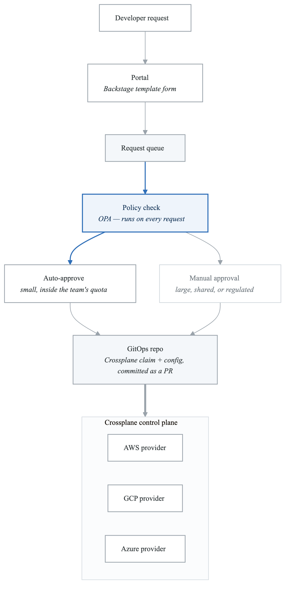
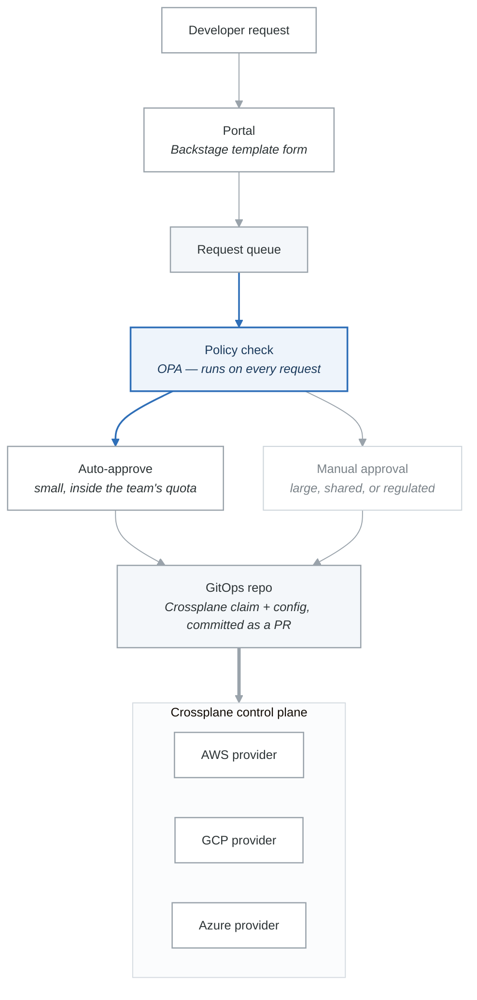

# Lab 7: Self-Service Infrastructure Workflows

## Lab Overview

| Attribute | Details |
|-----------|---------|
| **Duration** | 3-4 hours |
| **Level** | Advanced |
| **Prerequisites** | Crossplane, Backstage, GitOps fundamentals |
| **Environment** | Kubernetes, Crossplane, Backstage |
| **Learning Objectives** | Build self-service workflows, implement guardrails, create approval processes |

## Introduction

Self-service infrastructure empowers developers to provision resources without platform team involvement, while maintaining governance and cost controls. This lab covers building comprehensive self-service workflows with proper guardrails, approval processes, and cost visibility.

## Part 1: Self-Service Architecture

### Architecture Overview

<!-- figure: generated from the Mermaid below by _shared/diagrams/embed-figures.py — do not edit the image -->


<details>
<summary>Diagram source (Mermaid)</summary>



</details>

### Exercise 1.1: Resource Catalog Definition

```yaml
# platform/resource-catalog.yaml
apiVersion: v1
kind: ConfigMap
metadata:
  name: resource-catalog
  namespace: platform-system
data:
  catalog.yaml: |
    resources:
      # Databases
      - name: postgresql
        displayName: PostgreSQL Database
        description: Managed PostgreSQL database
        category: database
        tiers:
          - name: small
            displayName: Small (Development)
            specs:
              instanceClass: db.t3.micro
              storage: 20
              iops: 1000
            estimatedCost: $15/month
            autoApprove: true
          - name: medium
            displayName: Medium (Production)
            specs:
              instanceClass: db.t3.medium
              storage: 100
              iops: 3000
              multiAZ: true
            estimatedCost: $85/month
            autoApprove: true
          - name: large
            displayName: Large (Enterprise)
            specs:
              instanceClass: db.r5.large
              storage: 500
              iops: 10000
              multiAZ: true
              readReplicas: 2
            estimatedCost: $450/month
            autoApprove: false
            requiredApprovers:
              - platform-team
              - finance-team

      # Caching
      - name: redis
        displayName: Redis Cache
        description: Managed Redis cache cluster
        category: cache
        tiers:
          - name: small
            displayName: Small
            specs:
              nodeType: cache.t3.micro
              numNodes: 1
            estimatedCost: $12/month
            autoApprove: true
          - name: medium
            displayName: Medium (Clustered)
            specs:
              nodeType: cache.t3.medium
              numNodes: 3
              clusterMode: true
            estimatedCost: $75/month
            autoApprove: true

      # Storage
      - name: s3-bucket
        displayName: Object Storage (S3)
        description: S3 bucket with versioning and encryption
        category: storage
        tiers:
          - name: standard
            displayName: Standard
            specs:
              versioning: true
              encryption: AES256
              lifecycleRules: true
            estimatedCost: $0.023/GB/month
            autoApprove: true
          - name: compliance
            displayName: Compliance (Immutable)
            specs:
              versioning: true
              encryption: KMS
              objectLock: true
              replication: true
            estimatedCost: $0.046/GB/month
            autoApprove: false

      # Messaging
      - name: kafka-topic
        displayName: Kafka Topic
        description: Kafka topic on shared cluster
        category: messaging
        tiers:
          - name: standard
            displayName: Standard
            specs:
              partitions: 3
              replicationFactor: 3
              retentionMs: 604800000  # 7 days
            estimatedCost: Included in platform
            autoApprove: true
          - name: high-throughput
            displayName: High Throughput
            specs:
              partitions: 12
              replicationFactor: 3
              retentionMs: 2592000000  # 30 days
            estimatedCost: $50/month
            autoApprove: false
```

### Exercise 1.2: Backstage Self-Service Plugin

```typescript
// plugins/self-service/src/components/ResourceRequestForm.tsx
import React, { useState, useEffect } from 'react';
import {
  InfoCard,
  Select,
  SelectItem,
  TextField,
  Button,
  Progress,
} from '@backstage/core-components';
import { useApi, alertApiRef } from '@backstage/core-plugin-api';
import { selfServiceApiRef, ResourceTier, ResourceRequest } from '../api';

interface ResourceRequestFormProps {
  resourceType: string;
}

export const ResourceRequestForm: React.FC<ResourceRequestFormProps> = ({
  resourceType,
}) => {
  const selfServiceApi = useApi(selfServiceApiRef);
  const alertApi = useApi(alertApiRef);

  const [tiers, setTiers] = useState<ResourceTier[]>([]);
  const [selectedTier, setSelectedTier] = useState<string>('');
  const [resourceName, setResourceName] = useState<string>('');
  const [environment, setEnvironment] = useState<string>('development');
  const [loading, setLoading] = useState(false);
  const [costEstimate, setCostEstimate] = useState<string>('');

  useEffect(() => {
    const loadTiers = async () => {
      const catalog = await selfServiceApi.getResourceCatalog();
      const resource = catalog.resources.find(r => r.name === resourceType);
      if (resource) {
        setTiers(resource.tiers);
      }
    };
    loadTiers();
  }, [resourceType, selfServiceApi]);

  useEffect(() => {
    if (selectedTier) {
      const tier = tiers.find(t => t.name === selectedTier);
      if (tier) {
        setCostEstimate(tier.estimatedCost);
      }
    }
  }, [selectedTier, tiers]);

  const handleSubmit = async () => {
    if (!resourceName || !selectedTier) {
      alertApi.post({
        message: 'Please fill in all required fields',
        severity: 'error',
      });
      return;
    }

    setLoading(true);
    try {
      const request: ResourceRequest = {
        resourceType,
        tier: selectedTier,
        name: resourceName,
        environment,
        metadata: {
          requestedBy: 'current-user', // Would come from auth context
          team: 'current-team',
        },
      };

      const result = await selfServiceApi.createResourceRequest(request);

      if (result.autoApproved) {
        alertApi.post({
          message: `Resource "${resourceName}" is being provisioned`,
          severity: 'success',
        });
      } else {
        alertApi.post({
          message: `Request submitted for approval. Request ID: ${result.requestId}`,
          severity: 'info',
        });
      }
    } catch (error) {
      alertApi.post({
        message: `Failed to submit request: ${error.message}`,
        severity: 'error',
      });
    } finally {
      setLoading(false);
    }
  };

  return (
    <InfoCard title={`Request ${resourceType}`}>
      {loading && <Progress />}

      <TextField
        label="Resource Name"
        required
        value={resourceName}
        onChange={e => setResourceName(e.target.value)}
        helperText="Lowercase letters, numbers, and hyphens only"
        disabled={loading}
      />

      <Select
        label="Environment"
        selected={environment}
        onChange={e => setEnvironment(e as string)}
        disabled={loading}
      >
        <SelectItem value="development">Development</SelectItem>
        <SelectItem value="staging">Staging</SelectItem>
        <SelectItem value="production">Production</SelectItem>
      </Select>

      <Select
        label="Tier"
        selected={selectedTier}
        onChange={e => setSelectedTier(e as string)}
        disabled={loading}
      >
        {tiers.map(tier => (
          <SelectItem key={tier.name} value={tier.name}>
            {tier.displayName} - {tier.estimatedCost}
          </SelectItem>
        ))}
      </Select>

      {selectedTier && (
        <InfoCard title="Configuration Details" variant="gridItem">
          <TierDetails tier={tiers.find(t => t.name === selectedTier)} />
        </InfoCard>
      )}

      {costEstimate && (
        <CostEstimateCard
          estimate={costEstimate}
          environment={environment}
        />
      )}

      <Button
        variant="contained"
        color="primary"
        onClick={handleSubmit}
        disabled={loading || !resourceName || !selectedTier}
      >
        Submit Request
      </Button>
    </InfoCard>
  );
};

const TierDetails: React.FC<{ tier?: ResourceTier }> = ({ tier }) => {
  if (!tier) return null;

  return (
    <table>
      <tbody>
        {Object.entries(tier.specs).map(([key, value]) => (
          <tr key={key}>
            <td><strong>{key}</strong></td>
            <td>{String(value)}</td>
          </tr>
        ))}
      </tbody>
    </table>
  );
};

const CostEstimateCard: React.FC<{ estimate: string; environment: string }> = ({
  estimate,
  environment,
}) => {
  const multiplier = environment === 'production' ? 1 : 0.5;

  return (
    <InfoCard title="Cost Estimate" variant="gridItem">
      <p><strong>Monthly Cost:</strong> {estimate}</p>
      {environment !== 'production' && (
        <p><em>Development/staging environments receive 50% discount</em></p>
      )}
    </InfoCard>
  );
};
```

## Part 2: Request Processing Pipeline

### Exercise 2.1: Request Processing Service

```go
// cmd/request-processor/main.go
package main

import (
	"context"
	"encoding/json"
	"fmt"
	"time"

	"github.com/google/uuid"
	"go.uber.org/zap"
	corev1 "k8s.io/api/core/v1"
	metav1 "k8s.io/apimachinery/pkg/apis/meta/v1"
	"k8s.io/apimachinery/pkg/apis/meta/v1/unstructured"
	"k8s.io/apimachinery/pkg/runtime/schema"
	"k8s.io/client-go/dynamic"
	"sigs.k8s.io/controller-runtime/pkg/client"
)

// ResourceRequest represents a self-service request
type ResourceRequest struct {
	ID           string            `json:"id"`
	ResourceType string            `json:"resourceType"`
	Tier         string            `json:"tier"`
	Name         string            `json:"name"`
	Environment  string            `json:"environment"`
	Namespace    string            `json:"namespace"`
	Requester    string            `json:"requester"`
	Team         string            `json:"team"`
	Status       RequestStatus     `json:"status"`
	CreatedAt    time.Time         `json:"createdAt"`
	UpdatedAt    time.Time         `json:"updatedAt"`
	ApprovedBy   string            `json:"approvedBy,omitempty"`
	ApprovedAt   *time.Time        `json:"approvedAt,omitempty"`
	ErrorMessage string            `json:"errorMessage,omitempty"`
	Metadata     map[string]string `json:"metadata"`
}

type RequestStatus string

const (
	StatusPending      RequestStatus = "pending"
	StatusApproved     RequestStatus = "approved"
	StatusRejected     RequestStatus = "rejected"
	StatusProvisioning RequestStatus = "provisioning"
	StatusReady        RequestStatus = "ready"
	StatusFailed       RequestStatus = "failed"
)

// RequestProcessor handles resource requests
type RequestProcessor struct {
	logger       *zap.Logger
	k8sClient    client.Client
	dynamicClient dynamic.Interface
	catalog      *ResourceCatalog
	approvalSvc  ApprovalService
	gitOps       GitOpsService
}

func NewRequestProcessor(
	logger *zap.Logger,
	k8sClient client.Client,
	dynamicClient dynamic.Interface,
	catalog *ResourceCatalog,
	approvalSvc ApprovalService,
	gitOps GitOpsService,
) *RequestProcessor {
	return &RequestProcessor{
		logger:       logger,
		k8sClient:    k8sClient,
		dynamicClient: dynamicClient,
		catalog:      catalog,
		approvalSvc:  approvalSvc,
		gitOps:       gitOps,
	}
}

// ProcessRequest handles a new resource request
func (p *RequestProcessor) ProcessRequest(ctx context.Context, req *ResourceRequest) error {
	p.logger.Info("processing request",
		zap.String("id", req.ID),
		zap.String("type", req.ResourceType),
		zap.String("tier", req.Tier),
	)

	// Validate request
	if err := p.validateRequest(req); err != nil {
		return fmt.Errorf("validation failed: %w", err)
	}

	// Check quota
	if err := p.checkQuota(ctx, req); err != nil {
		return fmt.Errorf("quota check failed: %w", err)
	}

	// Determine if auto-approval is allowed
	tier, err := p.catalog.GetTier(req.ResourceType, req.Tier)
	if err != nil {
		return fmt.Errorf("tier not found: %w", err)
	}

	if tier.AutoApprove {
		p.logger.Info("auto-approving request", zap.String("id", req.ID))
		return p.provisionResource(ctx, req)
	}

	// Request manual approval
	req.Status = StatusPending
	if err := p.approvalSvc.RequestApproval(ctx, req, tier.RequiredApprovers); err != nil {
		return fmt.Errorf("failed to request approval: %w", err)
	}

	return nil
}

// validateRequest validates the resource request
func (p *RequestProcessor) validateRequest(req *ResourceRequest) error {
	// Validate resource name
	if !isValidResourceName(req.Name) {
		return fmt.Errorf("invalid resource name: must be lowercase alphanumeric with hyphens")
	}

	// Validate environment
	validEnvs := map[string]bool{"development": true, "staging": true, "production": true}
	if !validEnvs[req.Environment] {
		return fmt.Errorf("invalid environment: %s", req.Environment)
	}

	// Check resource type exists
	if _, err := p.catalog.GetResource(req.ResourceType); err != nil {
		return fmt.Errorf("unknown resource type: %s", req.ResourceType)
	}

	// Check tier exists
	if _, err := p.catalog.GetTier(req.ResourceType, req.Tier); err != nil {
		return fmt.Errorf("unknown tier: %s", req.Tier)
	}

	return nil
}

// checkQuota verifies the team hasn't exceeded their quota
func (p *RequestProcessor) checkQuota(ctx context.Context, req *ResourceRequest) error {
	// Get team quotas
	quota, err := p.getTeamQuota(ctx, req.Team)
	if err != nil {
		return err
	}

	// Get current usage
	usage, err := p.getTeamUsage(ctx, req.Team)
	if err != nil {
		return err
	}

	// Calculate new resource cost
	tier, _ := p.catalog.GetTier(req.ResourceType, req.Tier)
	newCost := tier.EstimatedMonthlyCost

	// Check if within quota
	if usage.TotalMonthlyCost+newCost > quota.MaxMonthlyCost {
		return fmt.Errorf("request would exceed monthly cost quota (%.2f + %.2f > %.2f)",
			usage.TotalMonthlyCost, newCost, quota.MaxMonthlyCost)
	}

	// Check resource count limits
	resourceCount := usage.ResourceCounts[req.ResourceType]
	if resourceCount >= quota.MaxResourceCount[req.ResourceType] {
		return fmt.Errorf("maximum %s resources reached (%d)", req.ResourceType, resourceCount)
	}

	return nil
}

// provisionResource creates the resource via GitOps
func (p *RequestProcessor) provisionResource(ctx context.Context, req *ResourceRequest) error {
	req.Status = StatusProvisioning

	// Generate Crossplane claim
	claim, err := p.generateClaim(req)
	if err != nil {
		return fmt.Errorf("failed to generate claim: %w", err)
	}

	// Generate Kubernetes namespace if needed
	namespace := p.generateNamespace(req)

	// Commit to GitOps repository
	files := map[string]string{
		fmt.Sprintf("resources/%s/%s/namespace.yaml", req.Team, req.Name): namespace,
		fmt.Sprintf("resources/%s/%s/claim.yaml", req.Team, req.Name):     claim,
	}

	commitMsg := fmt.Sprintf("Provision %s %s for team %s\n\nRequested by: %s\nRequest ID: %s",
		req.ResourceType, req.Name, req.Team, req.Requester, req.ID)

	if err := p.gitOps.CommitFiles(ctx, files, commitMsg); err != nil {
		return fmt.Errorf("failed to commit to GitOps: %w", err)
	}

	p.logger.Info("resource provisioning initiated",
		zap.String("id", req.ID),
		zap.String("name", req.Name),
	)

	return nil
}

// generateClaim creates the Crossplane claim YAML
func (p *RequestProcessor) generateClaim(req *ResourceRequest) (string, error) {
	tier, _ := p.catalog.GetTier(req.ResourceType, req.Tier)

	claim := map[string]interface{}{
		"apiVersion": p.getClaimAPIVersion(req.ResourceType),
		"kind":       p.getClaimKind(req.ResourceType),
		"metadata": map[string]interface{}{
			"name":      req.Name,
			"namespace": fmt.Sprintf("%s-%s", req.Team, req.Environment),
			"labels": map[string]string{
				"team":          req.Team,
				"environment":   req.Environment,
				"tier":          req.Tier,
				"request-id":    req.ID,
				"managed-by":    "self-service",
				"cost-center":   req.Metadata["costCenter"],
			},
			"annotations": map[string]string{
				"self-service.platform.io/requester":   req.Requester,
				"self-service.platform.io/requested-at": req.CreatedAt.Format(time.RFC3339),
			},
		},
		"spec": tier.Specs,
	}

	data, err := json.MarshalIndent(claim, "", "  ")
	if err != nil {
		return "", err
	}

	return string(data), nil
}

// generateNamespace creates namespace YAML if needed
func (p *RequestProcessor) generateNamespace(req *ResourceRequest) string {
	ns := corev1.Namespace{
		TypeMeta: metav1.TypeMeta{
			APIVersion: "v1",
			Kind:       "Namespace",
		},
		ObjectMeta: metav1.ObjectMeta{
			Name: fmt.Sprintf("%s-%s", req.Team, req.Environment),
			Labels: map[string]string{
				"team":        req.Team,
				"environment": req.Environment,
				"managed-by":  "self-service",
			},
		},
	}

	data, _ := json.MarshalIndent(ns, "", "  ")
	return string(data)
}

func (p *RequestProcessor) getClaimAPIVersion(resourceType string) string {
	versions := map[string]string{
		"postgresql": "database.platform.io/v1alpha1",
		"redis":      "cache.platform.io/v1alpha1",
		"s3-bucket":  "storage.platform.io/v1alpha1",
		"kafka-topic": "messaging.platform.io/v1alpha1",
	}
	return versions[resourceType]
}

func (p *RequestProcessor) getClaimKind(resourceType string) string {
	kinds := map[string]string{
		"postgresql": "PostgreSQLInstance",
		"redis":      "RedisCluster",
		"s3-bucket":  "Bucket",
		"kafka-topic": "KafkaTopic",
	}
	return kinds[resourceType]
}
```

### Exercise 2.2: Approval Workflow

```go
// internal/approval/service.go
package approval

import (
	"context"
	"fmt"
	"time"

	"github.com/slack-go/slack"
	"go.uber.org/zap"
)

type ApprovalRequest struct {
	ID            string    `json:"id"`
	ResourceReqID string    `json:"resourceRequestId"`
	Approvers     []string  `json:"approvers"`
	ApprovedBy    []string  `json:"approvedBy"`
	RejectedBy    string    `json:"rejectedBy,omitempty"`
	Status        string    `json:"status"` // pending, approved, rejected, expired
	CreatedAt     time.Time `json:"createdAt"`
	ExpiresAt     time.Time `json:"expiresAt"`
	SlackTS       string    `json:"slackTs,omitempty"`
}

type ApprovalService struct {
	logger      *zap.Logger
	store       ApprovalStore
	slackClient *slack.Client
	slackChannel string
	callbackURL  string
}

func NewApprovalService(
	logger *zap.Logger,
	store ApprovalStore,
	slackClient *slack.Client,
	slackChannel string,
	callbackURL string,
) *ApprovalService {
	return &ApprovalService{
		logger:       logger,
		store:        store,
		slackClient:  slackClient,
		slackChannel: slackChannel,
		callbackURL:  callbackURL,
	}
}

// RequestApproval creates an approval request and notifies approvers
func (s *ApprovalService) RequestApproval(
	ctx context.Context,
	req *ResourceRequest,
	approvers []string,
) error {
	approval := &ApprovalRequest{
		ID:            generateID(),
		ResourceReqID: req.ID,
		Approvers:     approvers,
		Status:        "pending",
		CreatedAt:     time.Now(),
		ExpiresAt:     time.Now().Add(72 * time.Hour), // 3 days to approve
	}

	// Store approval request
	if err := s.store.Create(ctx, approval); err != nil {
		return err
	}

	// Send Slack notification
	if err := s.sendSlackNotification(ctx, approval, req); err != nil {
		s.logger.Error("failed to send Slack notification", zap.Error(err))
		// Don't fail the request, just log
	}

	return nil
}

func (s *ApprovalService) sendSlackNotification(
	ctx context.Context,
	approval *ApprovalRequest,
	req *ResourceRequest,
) error {
	// Build approval message
	blocks := []slack.Block{
		slack.NewHeaderBlock(
			slack.NewTextBlockObject("plain_text", "🔔 Resource Approval Request", false, false),
		),
		slack.NewSectionBlock(
			slack.NewTextBlockObject("mrkdwn", fmt.Sprintf(
				"*%s* is requesting a *%s* (%s tier)\n\n"+
					"• *Name:* %s\n"+
					"• *Environment:* %s\n"+
					"• *Team:* %s\n"+
					"• *Estimated Cost:* %s/month\n"+
					"• *Request ID:* `%s`",
				req.Requester,
				req.ResourceType,
				req.Tier,
				req.Name,
				req.Environment,
				req.Team,
				req.EstimatedCost,
				req.ID,
			), false, false),
			nil, nil,
		),
		slack.NewDividerBlock(),
		slack.NewSectionBlock(
			slack.NewTextBlockObject("mrkdwn",
				fmt.Sprintf("*Required Approvers:* %s", formatApprovers(approval.Approvers)),
				false, false),
			nil, nil,
		),
		slack.NewActionBlock(
			"approval_actions",
			slack.NewButtonBlockElement(
				"approve",
				fmt.Sprintf("%s|%s", approval.ID, req.ID),
				slack.NewTextBlockObject("plain_text", "✅ Approve", false, false),
			).WithStyle(slack.StylePrimary),
			slack.NewButtonBlockElement(
				"reject",
				fmt.Sprintf("%s|%s", approval.ID, req.ID),
				slack.NewTextBlockObject("plain_text", "❌ Reject", false, false),
			).WithStyle(slack.StyleDanger),
			slack.NewButtonBlockElement(
				"view_details",
				req.ID,
				slack.NewTextBlockObject("plain_text", "📋 View Details", false, false),
			),
		),
		slack.NewContextBlock(
			"context",
			slack.NewTextBlockObject("mrkdwn",
				fmt.Sprintf("Expires: %s", approval.ExpiresAt.Format("Jan 2, 2006 3:04 PM")),
				false, false),
		),
	}

	// Post message
	_, ts, err := s.slackClient.PostMessageContext(
		ctx,
		s.slackChannel,
		slack.MsgOptionBlocks(blocks...),
	)
	if err != nil {
		return err
	}

	// Store Slack message timestamp for updates
	approval.SlackTS = ts
	return s.store.Update(ctx, approval)
}

// HandleApprovalAction processes approval/rejection from Slack
func (s *ApprovalService) HandleApprovalAction(
	ctx context.Context,
	action string, // "approve" or "reject"
	approvalID string,
	user string,
) error {
	approval, err := s.store.Get(ctx, approvalID)
	if err != nil {
		return err
	}

	if approval.Status != "pending" {
		return fmt.Errorf("approval request is no longer pending")
	}

	// Verify user is an authorized approver
	if !isAuthorizedApprover(user, approval.Approvers) {
		return fmt.Errorf("user %s is not authorized to approve", user)
	}

	switch action {
	case "approve":
		approval.ApprovedBy = append(approval.ApprovedBy, user)

		// Check if all required approvers have approved
		if len(approval.ApprovedBy) >= len(approval.Approvers) {
			approval.Status = "approved"

			// Trigger provisioning
			if err := s.triggerProvisioning(ctx, approval.ResourceReqID); err != nil {
				return err
			}
		}

	case "reject":
		approval.Status = "rejected"
		approval.RejectedBy = user
	}

	// Update approval record
	if err := s.store.Update(ctx, approval); err != nil {
		return err
	}

	// Update Slack message
	return s.updateSlackMessage(ctx, approval)
}

func (s *ApprovalService) updateSlackMessage(ctx context.Context, approval *ApprovalRequest) error {
	var statusEmoji, statusText string
	switch approval.Status {
	case "approved":
		statusEmoji = "✅"
		statusText = "Approved"
	case "rejected":
		statusEmoji = "❌"
		statusText = fmt.Sprintf("Rejected by %s", approval.RejectedBy)
	default:
		statusEmoji = "⏳"
		statusText = fmt.Sprintf("Pending (%d/%d approvals)", len(approval.ApprovedBy), len(approval.Approvers))
	}

	blocks := []slack.Block{
		slack.NewSectionBlock(
			slack.NewTextBlockObject("mrkdwn",
				fmt.Sprintf("%s *Status:* %s", statusEmoji, statusText),
				false, false),
			nil, nil,
		),
	}

	_, _, _, err := s.slackClient.UpdateMessageContext(
		ctx,
		s.slackChannel,
		approval.SlackTS,
		slack.MsgOptionBlocks(blocks...),
	)
	return err
}

// ExpireStaleApprovals checks for and expires old approval requests
func (s *ApprovalService) ExpireStaleApprovals(ctx context.Context) error {
	stale, err := s.store.GetExpired(ctx)
	if err != nil {
		return err
	}

	for _, approval := range stale {
		approval.Status = "expired"
		if err := s.store.Update(ctx, approval); err != nil {
			s.logger.Error("failed to expire approval", zap.String("id", approval.ID), zap.Error(err))
			continue
		}

		// Update Slack message
		s.updateSlackMessage(ctx, approval)
	}

	return nil
}
```

## Part 3: Resource Lifecycle Management

### Exercise 3.1: Resource Status Tracking

```yaml
# crds/resourcerequest-crd.yaml
apiVersion: apiextensions.k8s.io/v1
kind: CustomResourceDefinition
metadata:
  name: resourcerequests.selfservice.platform.io
spec:
  group: selfservice.platform.io
  versions:
    - name: v1alpha1
      served: true
      storage: true
      schema:
        openAPIV3Schema:
          type: object
          properties:
            spec:
              type: object
              required:
                - resourceType
                - tier
                - name
                - environment
                - team
              properties:
                resourceType:
                  type: string
                tier:
                  type: string
                name:
                  type: string
                environment:
                  type: string
                  enum: [development, staging, production]
                team:
                  type: string
                requester:
                  type: string
                costCenter:
                  type: string
            status:
              type: object
              properties:
                phase:
                  type: string
                  enum:
                    - Pending
                    - Approved
                    - Rejected
                    - Provisioning
                    - Ready
                    - Failed
                    - Deleting
                conditions:
                  type: array
                  items:
                    type: object
                    properties:
                      type:
                        type: string
                      status:
                        type: string
                      reason:
                        type: string
                      message:
                        type: string
                      lastTransitionTime:
                        type: string
                        format: date-time
                resourceRef:
                  type: object
                  properties:
                    apiVersion:
                      type: string
                    kind:
                      type: string
                    name:
                      type: string
                    namespace:
                      type: string
                connectionSecret:
                  type: string
                approvalDetails:
                  type: object
                  properties:
                    approvedBy:
                      type: string
                    approvedAt:
                      type: string
                      format: date-time
                estimatedMonthlyCost:
                  type: string
      subresources:
        status: {}
      additionalPrinterColumns:
        - name: Type
          type: string
          jsonPath: .spec.resourceType
        - name: Tier
          type: string
          jsonPath: .spec.tier
        - name: Phase
          type: string
          jsonPath: .status.phase
        - name: Team
          type: string
          jsonPath: .spec.team
        - name: Age
          type: date
          jsonPath: .metadata.creationTimestamp
  scope: Namespaced
  names:
    plural: resourcerequests
    singular: resourcerequest
    kind: ResourceRequest
    shortNames:
      - rr
      - resreq
```

### Exercise 3.2: Resource Cleanup Controller

```go
// controllers/cleanup_controller.go
package controllers

import (
	"context"
	"fmt"
	"time"

	"github.com/go-logr/logr"
	corev1 "k8s.io/api/core/v1"
	"k8s.io/apimachinery/pkg/runtime"
	ctrl "sigs.k8s.io/controller-runtime"
	"sigs.k8s.io/controller-runtime/pkg/client"

	selfservicev1alpha1 "platform/api/v1alpha1"
)

// ResourceCleanupReconciler handles resource cleanup
type ResourceCleanupReconciler struct {
	client.Client
	Log    logr.Logger
	Scheme *runtime.Scheme
}

// Resource retention policies
var retentionPolicies = map[string]time.Duration{
	"development": 7 * 24 * time.Hour,   // 7 days
	"staging":     30 * 24 * time.Hour,  // 30 days
	"production":  0,                     // Never auto-delete
}

func (r *ResourceCleanupReconciler) Reconcile(ctx context.Context, req ctrl.Request) (ctrl.Result, error) {
	log := r.Log.WithValues("resourcerequest", req.NamespacedName)

	// Fetch the ResourceRequest
	var resourceReq selfservicev1alpha1.ResourceRequest
	if err := r.Get(ctx, req.NamespacedName, &resourceReq); err != nil {
		return ctrl.Result{}, client.IgnoreNotFound(err)
	}

	// Skip if not ready or already deleting
	if resourceReq.Status.Phase != "Ready" {
		return ctrl.Result{}, nil
	}

	// Check retention policy
	retention := retentionPolicies[resourceReq.Spec.Environment]
	if retention == 0 {
		// No auto-deletion for production
		return ctrl.Result{}, nil
	}

	// Check if resource has expired
	age := time.Since(resourceReq.CreationTimestamp.Time)
	if age < retention {
		// Requeue to check again when retention expires
		return ctrl.Result{RequeueAfter: retention - age}, nil
	}

	// Check for activity (prevent deletion of active resources)
	if r.hasRecentActivity(ctx, &resourceReq) {
		log.Info("resource has recent activity, extending retention",
			"name", resourceReq.Name)
		// Extend retention by activity-based period
		return ctrl.Result{RequeueAfter: 24 * time.Hour}, nil
	}

	// Notify owner before deletion
	if !r.hasBeenWarned(&resourceReq) {
		log.Info("sending deletion warning", "name", resourceReq.Name)
		if err := r.sendDeletionWarning(ctx, &resourceReq); err != nil {
			log.Error(err, "failed to send deletion warning")
		}
		// Set warning annotation and requeue for actual deletion
		if err := r.markAsWarned(ctx, &resourceReq); err != nil {
			return ctrl.Result{}, err
		}
		return ctrl.Result{RequeueAfter: 72 * time.Hour}, nil // 3 days warning
	}

	// Proceed with deletion
	log.Info("initiating resource cleanup", "name", resourceReq.Name)
	if err := r.deleteResource(ctx, &resourceReq); err != nil {
		log.Error(err, "failed to delete resource")
		return ctrl.Result{}, err
	}

	return ctrl.Result{}, nil
}

func (r *ResourceCleanupReconciler) hasRecentActivity(
	ctx context.Context,
	req *selfservicev1alpha1.ResourceRequest,
) bool {
	// Check metrics for activity (connections, requests, etc.)
	// This would query Prometheus or similar
	return false
}

func (r *ResourceCleanupReconciler) hasBeenWarned(req *selfservicev1alpha1.ResourceRequest) bool {
	_, exists := req.Annotations["cleanup.platform.io/warned-at"]
	return exists
}

func (r *ResourceCleanupReconciler) markAsWarned(
	ctx context.Context,
	req *selfservicev1alpha1.ResourceRequest,
) error {
	if req.Annotations == nil {
		req.Annotations = make(map[string]string)
	}
	req.Annotations["cleanup.platform.io/warned-at"] = time.Now().Format(time.RFC3339)
	return r.Update(ctx, req)
}

func (r *ResourceCleanupReconciler) sendDeletionWarning(
	ctx context.Context,
	req *selfservicev1alpha1.ResourceRequest,
) error {
	// Send Slack notification to owner
	// Send email notification
	return nil
}

func (r *ResourceCleanupReconciler) deleteResource(
	ctx context.Context,
	req *selfservicev1alpha1.ResourceRequest,
) error {
	// Update status to Deleting
	req.Status.Phase = "Deleting"
	if err := r.Status().Update(ctx, req); err != nil {
		return err
	}

	// Delete the underlying Crossplane claim
	if req.Status.ResourceRef != nil {
		// Delete the referenced resource
		// The Crossplane provider will handle cloud resource deletion
	}

	// Delete the ResourceRequest itself
	return r.Delete(ctx, req)
}

func (r *ResourceCleanupReconciler) SetupWithManager(mgr ctrl.Manager) error {
	return ctrl.NewControllerManagedBy(mgr).
		For(&selfservicev1alpha1.ResourceRequest{}).
		Complete(r)
}
```

## Part 4: Cost Visibility and Chargeback

### Exercise 4.1: Cost Tracking Integration

```go
// internal/cost/tracker.go
package cost

import (
	"context"
	"time"

	"github.com/prometheus/client_golang/prometheus"
)

var (
	resourceCost = prometheus.NewGaugeVec(
		prometheus.GaugeOpts{
			Name: "selfservice_resource_cost_monthly",
			Help: "Estimated monthly cost of self-service resources",
		},
		[]string{"team", "environment", "resource_type", "resource_name"},
	)

	resourceUsageHours = prometheus.NewCounterVec(
		prometheus.CounterOpts{
			Name: "selfservice_resource_usage_hours",
			Help: "Cumulative usage hours for resources",
		},
		[]string{"team", "environment", "resource_type", "resource_name"},
	)

	teamTotalCost = prometheus.NewGaugeVec(
		prometheus.GaugeOpts{
			Name: "selfservice_team_cost_monthly",
			Help: "Total estimated monthly cost per team",
		},
		[]string{"team"},
	)
)

func init() {
	prometheus.MustRegister(resourceCost, resourceUsageHours, teamTotalCost)
}

// CostTracker tracks resource costs
type CostTracker struct {
	catalog *ResourceCatalog
	store   CostStore
}

// ResourceCostEntry represents a cost entry
type ResourceCostEntry struct {
	Team         string    `json:"team"`
	Environment  string    `json:"environment"`
	ResourceType string    `json:"resourceType"`
	ResourceName string    `json:"resourceName"`
	Tier         string    `json:"tier"`
	HourlyCost   float64   `json:"hourlyCost"`
	MonthlyCost  float64   `json:"monthlyCost"`
	StartTime    time.Time `json:"startTime"`
	EndTime      *time.Time `json:"endTime,omitempty"`
}

// TrackResource starts tracking cost for a resource
func (t *CostTracker) TrackResource(ctx context.Context, entry *ResourceCostEntry) error {
	// Get tier pricing
	tier, err := t.catalog.GetTier(entry.ResourceType, entry.Tier)
	if err != nil {
		return err
	}

	entry.HourlyCost = tier.EstimatedMonthlyCost / 720 // Approximate hours per month
	entry.MonthlyCost = tier.EstimatedMonthlyCost
	entry.StartTime = time.Now()

	// Store entry
	if err := t.store.Save(ctx, entry); err != nil {
		return err
	}

	// Update metrics
	resourceCost.WithLabelValues(
		entry.Team,
		entry.Environment,
		entry.ResourceType,
		entry.ResourceName,
	).Set(entry.MonthlyCost)

	return nil
}

// StopTracking marks a resource as deleted
func (t *CostTracker) StopTracking(ctx context.Context, resourceName, team string) error {
	entry, err := t.store.Get(ctx, resourceName, team)
	if err != nil {
		return err
	}

	now := time.Now()
	entry.EndTime = &now

	if err := t.store.Save(ctx, entry); err != nil {
		return err
	}

	// Remove from current cost metrics
	resourceCost.DeleteLabelValues(
		entry.Team,
		entry.Environment,
		entry.ResourceType,
		entry.ResourceName,
	)

	return nil
}

// GenerateChargebackReport generates a chargeback report for a period
func (t *CostTracker) GenerateChargebackReport(
	ctx context.Context,
	team string,
	start, end time.Time,
) (*ChargebackReport, error) {
	entries, err := t.store.GetByTeam(ctx, team, start, end)
	if err != nil {
		return nil, err
	}

	report := &ChargebackReport{
		Team:      team,
		StartDate: start,
		EndDate:   end,
		LineItems: make([]ChargebackLineItem, 0),
	}

	var totalCost float64

	for _, entry := range entries {
		// Calculate usage hours within the period
		usageStart := maxTime(entry.StartTime, start)
		usageEnd := end
		if entry.EndTime != nil && entry.EndTime.Before(end) {
			usageEnd = *entry.EndTime
		}

		usageHours := usageEnd.Sub(usageStart).Hours()
		cost := usageHours * entry.HourlyCost

		item := ChargebackLineItem{
			ResourceType: entry.ResourceType,
			ResourceName: entry.ResourceName,
			Environment:  entry.Environment,
			Tier:         entry.Tier,
			UsageHours:   usageHours,
			HourlyCost:   entry.HourlyCost,
			TotalCost:    cost,
		}

		report.LineItems = append(report.LineItems, item)
		totalCost += cost
	}

	report.TotalCost = totalCost

	return report, nil
}

type ChargebackReport struct {
	Team      string               `json:"team"`
	StartDate time.Time            `json:"startDate"`
	EndDate   time.Time            `json:"endDate"`
	LineItems []ChargebackLineItem `json:"lineItems"`
	TotalCost float64              `json:"totalCost"`
}

type ChargebackLineItem struct {
	ResourceType string  `json:"resourceType"`
	ResourceName string  `json:"resourceName"`
	Environment  string  `json:"environment"`
	Tier         string  `json:"tier"`
	UsageHours   float64 `json:"usageHours"`
	HourlyCost   float64 `json:"hourlyCost"`
	TotalCost    float64 `json:"totalCost"`
}

func maxTime(a, b time.Time) time.Time {
	if a.After(b) {
		return a
	}
	return b
}
```

### Exercise 4.2: Cost Dashboard

```yaml
# grafana/dashboards/self-service-costs.yaml
apiVersion: v1
kind: ConfigMap
metadata:
  name: self-service-cost-dashboard
  namespace: monitoring
data:
  costs.json: |
    {
      "title": "Self-Service Costs",
      "panels": [
        {
          "title": "Total Platform Cost (Monthly)",
          "type": "stat",
          "gridPos": {"x": 0, "y": 0, "w": 8, "h": 4},
          "targets": [
            {
              "expr": "sum(selfservice_resource_cost_monthly)",
              "legendFormat": "Total"
            }
          ],
          "fieldConfig": {
            "defaults": {
              "unit": "currencyUSD"
            }
          }
        },
        {
          "title": "Cost by Team",
          "type": "piechart",
          "gridPos": {"x": 8, "y": 0, "w": 8, "h": 8},
          "targets": [
            {
              "expr": "sum by (team) (selfservice_resource_cost_monthly)",
              "legendFormat": "{{team}}"
            }
          ]
        },
        {
          "title": "Cost by Resource Type",
          "type": "piechart",
          "gridPos": {"x": 16, "y": 0, "w": 8, "h": 8},
          "targets": [
            {
              "expr": "sum by (resource_type) (selfservice_resource_cost_monthly)",
              "legendFormat": "{{resource_type}}"
            }
          ]
        },
        {
          "title": "Cost Trend by Team",
          "type": "timeseries",
          "gridPos": {"x": 0, "y": 8, "w": 12, "h": 8},
          "targets": [
            {
              "expr": "sum by (team) (selfservice_resource_cost_monthly)",
              "legendFormat": "{{team}}"
            }
          ]
        },
        {
          "title": "Environment Cost Distribution",
          "type": "barchart",
          "gridPos": {"x": 12, "y": 8, "w": 12, "h": 8},
          "targets": [
            {
              "expr": "sum by (environment) (selfservice_resource_cost_monthly)",
              "legendFormat": "{{environment}}"
            }
          ]
        },
        {
          "title": "Top 10 Most Expensive Resources",
          "type": "table",
          "gridPos": {"x": 0, "y": 16, "w": 24, "h": 8},
          "targets": [
            {
              "expr": "topk(10, selfservice_resource_cost_monthly)",
              "format": "table",
              "instant": true
            }
          ],
          "transformations": [
            {
              "id": "organize",
              "options": {
                "excludeByName": {"Time": true},
                "renameByName": {
                  "team": "Team",
                  "environment": "Environment",
                  "resource_type": "Type",
                  "resource_name": "Name",
                  "Value": "Monthly Cost ($)"
                }
              }
            }
          ]
        }
      ]
    }
```

## Verification Checklist

After completing this lab, verify:

- [ ] Resource catalog is defined with tiers and pricing
- [ ] Self-service portal allows resource requests
- [ ] Auto-approval works for eligible resources
- [ ] Manual approval workflow sends notifications
- [ ] Resources are provisioned via GitOps
- [ ] Resource status is tracked and visible
- [ ] Cleanup controller handles expired resources
- [ ] Cost tracking provides accurate chargeback data
- [ ] Dashboards show resource usage and costs

## Troubleshooting

### Request Stuck in Pending

1. Check approval service logs
2. Verify Slack integration is working
3. Check approver list configuration
4. Verify request hasn't expired

### Provisioning Failures

1. Check GitOps commit status
2. Verify Crossplane provider credentials
3. Review claim syntax
4. Check cloud provider quotas

### Cost Discrepancies

1. Verify tier pricing in catalog
2. Check usage tracking intervals
3. Review resource start/end times
4. Validate cloud provider billing data

## Summary

In this lab, you learned to:

- Design self-service infrastructure workflows
- Implement resource catalogs with tiered options
- Create approval processes with Slack integration
- Track resource lifecycle and cleanup
- Implement cost visibility and chargeback
- Build dashboards for resource management

Self-service infrastructure reduces platform team toil while maintaining governance. The key is balancing developer autonomy with appropriate guardrails and cost controls.

<!-- feynman-check -->

---

## Feynman check

Close the file. Blank page, no notes. Explain each of these to a competent engineer who has never
used this tool — **under five minutes, no jargon you can't define on the spot:**

- Self-Service Architecture
- Request Processing Pipeline
- Resource Lifecycle Management
- Cost Visibility and Chargeback

**The gap is not what you forgot. It is where you used a word instead of a mechanism.**

| | |
|---|---|
| ✗ | *"The platform makes developers more productive."* |
| ✓ | *"A golden path is a template that produces a repository with CI, manifests, dashboards and alerts already wired, so the product team owns none of them. It reduces cognitive load by removing decisions, not by adding features — and without a documented escape hatch it is a cage."* |

**Trace it:** A developer commits `service.yaml` → a running service with a dashboard and a paging rule. Name every system that acts, and which team owns each one.

Stop at the first component you cannot name. Reopen this file and read **only** that.

**Go deeper — only once the gap has a name:** [Team Topologies — cognitive load](https://teamtopologies.com/key-concepts) and the [CNCF Platforms White Paper](https://tag-app-delivery.cncf.io/whitepapers/platforms/) — why golden paths exist at all.
Full list per domain: [`SOURCES.md`](../SOURCES.md#platform-engineering)

→ Protocol, the three levels of knowing, and worked examples: [`MASTERY.md`](../MASTERY.md)

<!-- /feynman-check -->
