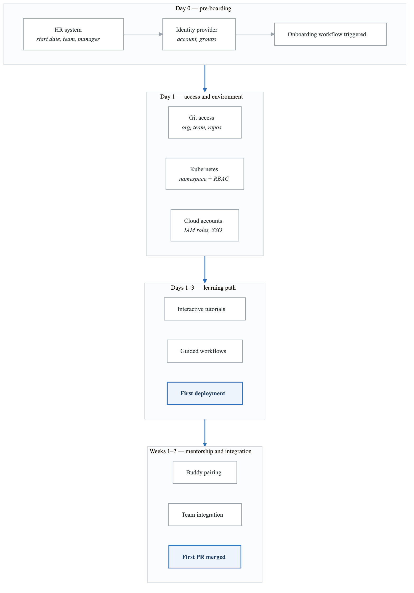
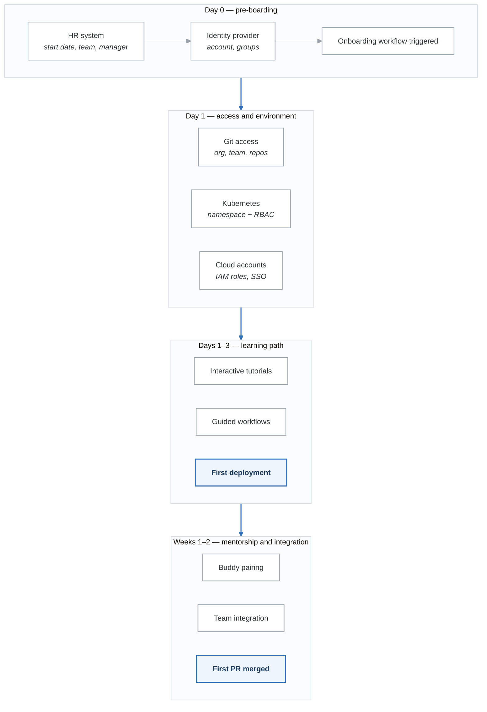

# Lab 8: Developer Onboarding Automation

## Lab Overview

| Attribute | Details |
|-----------|---------|
| **Duration** | 3-4 hours |
| **Level** | Intermediate |
| **Prerequisites** | Backstage, GitOps, Identity provider basics |
| **Environment** | Kubernetes, Backstage, GitHub/GitLab |
| **Learning Objectives** | Automate developer onboarding, create self-service team setup, implement access provisioning |

## Introduction

Effective developer onboarding reduces time-to-productivity and improves developer experience. This lab covers building automated onboarding workflows that provision access, set up development environments, and guide new developers through your platform.

## Part 1: Onboarding Architecture

### Onboarding Flow Overview

<!-- figure: generated from the Mermaid below by _shared/diagrams/embed-figures.py — do not edit the image -->


<details>
<summary>Diagram source (Mermaid)</summary>



</details>

### Exercise 1.1: Onboarding Controller

```go
// controllers/onboarding_controller.go
package controllers

import (
	"context"
	"fmt"
	"time"

	"github.com/go-logr/logr"
	corev1 "k8s.io/api/core/v1"
	rbacv1 "k8s.io/api/rbac/v1"
	metav1 "k8s.io/apimachinery/pkg/apis/meta/v1"
	"k8s.io/apimachinery/pkg/runtime"
	ctrl "sigs.k8s.io/controller-runtime"
	"sigs.k8s.io/controller-runtime/pkg/client"

	onboardingv1 "platform/api/v1"
)

// DeveloperOnboardingReconciler reconciles DeveloperOnboarding objects
type DeveloperOnboardingReconciler struct {
	client.Client
	Log           logr.Logger
	Scheme        *runtime.Scheme
	GitHubClient  GitHubClient
	SlackClient   SlackClient
	IdentityCoClient    IdentityCoClient
	CloudProvider CloudProvider
}

func (r *DeveloperOnboardingReconciler) Reconcile(ctx context.Context, req ctrl.Request) (ctrl.Result, error) {
	log := r.Log.WithValues("onboarding", req.NamespacedName)

	// Fetch the DeveloperOnboarding resource
	var onboarding onboardingv1.DeveloperOnboarding
	if err := r.Get(ctx, req.NamespacedName, &onboarding); err != nil {
		return ctrl.Result{}, client.IgnoreNotFound(err)
	}

	// Process each onboarding step
	steps := []struct {
		name    string
		handler func(context.Context, *onboardingv1.DeveloperOnboarding) error
	}{
		{"validate", r.validateOnboarding},
		{"create-identity", r.createIdentity},
		{"provision-github", r.provisionGitHub},
		{"provision-kubernetes", r.provisionKubernetes},
		{"provision-cloud", r.provisionCloud},
		{"setup-dev-environment", r.setupDevEnvironment},
		{"send-welcome", r.sendWelcome},
		{"assign-buddy", r.assignBuddy},
		{"create-learning-path", r.createLearningPath},
	}

	for _, step := range steps {
		if onboarding.Status.CompletedSteps[step.name] {
			continue
		}

		log.Info("executing onboarding step", "step", step.name)
		if err := step.handler(ctx, &onboarding); err != nil {
			onboarding.Status.Phase = "Failed"
			onboarding.Status.Message = fmt.Sprintf("Step %s failed: %v", step.name, err)
			r.Status().Update(ctx, &onboarding)
			return ctrl.Result{RequeueAfter: 5 * time.Minute}, nil
		}

		// Mark step completed
		if onboarding.Status.CompletedSteps == nil {
			onboarding.Status.CompletedSteps = make(map[string]bool)
		}
		onboarding.Status.CompletedSteps[step.name] = true
		r.Status().Update(ctx, &onboarding)
	}

	// All steps completed
	onboarding.Status.Phase = "Completed"
	onboarding.Status.CompletedAt = &metav1.Time{Time: time.Now()}
	r.Status().Update(ctx, &onboarding)

	log.Info("onboarding completed", "developer", onboarding.Spec.Email)
	return ctrl.Result{}, nil
}

func (r *DeveloperOnboardingReconciler) validateOnboarding(
	ctx context.Context,
	onboarding *onboardingv1.DeveloperOnboarding,
) error {
	// Validate email format
	if onboarding.Spec.Email == "" {
		return fmt.Errorf("email is required")
	}

	// Validate team exists
	team := &onboardingv1.Team{}
	if err := r.Get(ctx, client.ObjectKey{
		Name:      onboarding.Spec.Team,
		Namespace: "platform-system",
	}, team); err != nil {
		return fmt.Errorf("team not found: %s", onboarding.Spec.Team)
	}

	// Validate role is valid
	validRoles := map[string]bool{
		"developer":     true,
		"senior-dev":    true,
		"tech-lead":     true,
		"staff-engineer": true,
	}
	if !validRoles[onboarding.Spec.Role] {
		return fmt.Errorf("invalid role: %s", onboarding.Spec.Role)
	}

	return nil
}

func (r *DeveloperOnboardingReconciler) createIdentity(
	ctx context.Context,
	onboarding *onboardingv1.DeveloperOnboarding,
) error {
	// Create user in identity provider (IdentityCo, Azure AD, etc.)
	user := IdentityCoUser{
		Email:     onboarding.Spec.Email,
		FirstName: onboarding.Spec.FirstName,
		LastName:  onboarding.Spec.LastName,
		Groups:    []string{onboarding.Spec.Team, onboarding.Spec.Role},
	}

	identitycoUser, err := r.IdentityCoClient.CreateUser(ctx, user)
	if err != nil {
		return err
	}

	onboarding.Status.IdentityCoUserID = identitycoUser.ID
	return nil
}

func (r *DeveloperOnboardingReconciler) provisionGitHub(
	ctx context.Context,
	onboarding *onboardingv1.DeveloperOnboarding,
) error {
	// Add user to GitHub organization
	if err := r.GitHubClient.AddOrgMember(ctx, onboarding.Spec.GitHubUsername); err != nil {
		return err
	}

	// Add to team
	if err := r.GitHubClient.AddTeamMember(ctx, onboarding.Spec.Team, onboarding.Spec.GitHubUsername); err != nil {
		return err
	}

	// Set permissions based on role
	permission := "push"
	if onboarding.Spec.Role == "tech-lead" || onboarding.Spec.Role == "staff-engineer" {
		permission = "maintain"
	}

	// Grant access to team repositories
	repos, _ := r.GitHubClient.GetTeamRepos(ctx, onboarding.Spec.Team)
	for _, repo := range repos {
		r.GitHubClient.AddCollaborator(ctx, repo, onboarding.Spec.GitHubUsername, permission)
	}

	return nil
}

func (r *DeveloperOnboardingReconciler) provisionKubernetes(
	ctx context.Context,
	onboarding *onboardingv1.DeveloperOnboarding,
) error {
	// Get team namespace
	namespace := fmt.Sprintf("%s-dev", onboarding.Spec.Team)

	// Create RoleBinding for developer
	roleBinding := &rbacv1.RoleBinding{
		ObjectMeta: metav1.ObjectMeta{
			Name:      fmt.Sprintf("%s-developer", onboarding.Spec.GitHubUsername),
			Namespace: namespace,
			Labels: map[string]string{
				"onboarding.platform.io/developer": onboarding.Spec.GitHubUsername,
				"onboarding.platform.io/team":      onboarding.Spec.Team,
			},
		},
		Subjects: []rbacv1.Subject{
			{
				Kind: "User",
				Name: onboarding.Spec.Email,
			},
		},
		RoleRef: rbacv1.RoleRef{
			APIGroup: "rbac.authorization.k8s.io",
			Kind:     "ClusterRole",
			Name:     r.getRoleForDeveloper(onboarding.Spec.Role),
		},
	}

	if err := r.Create(ctx, roleBinding); err != nil {
		return err
	}

	// Create personal dev namespace if needed
	personalNS := &corev1.Namespace{
		ObjectMeta: metav1.ObjectMeta{
			Name: fmt.Sprintf("dev-%s", onboarding.Spec.GitHubUsername),
			Labels: map[string]string{
				"type":  "personal-dev",
				"owner": onboarding.Spec.GitHubUsername,
				"team":  onboarding.Spec.Team,
			},
		},
	}

	return r.Create(ctx, personalNS)
}

func (r *DeveloperOnboardingReconciler) provisionCloud(
	ctx context.Context,
	onboarding *onboardingv1.DeveloperOnboarding,
) error {
	// Create cloud IAM roles
	iamPolicy := r.getCloudPolicyForRole(onboarding.Spec.Role)

	return r.CloudProvider.CreateIAMBinding(ctx,
		onboarding.Spec.Email,
		iamPolicy,
		onboarding.Spec.Team,
	)
}

func (r *DeveloperOnboardingReconciler) setupDevEnvironment(
	ctx context.Context,
	onboarding *onboardingv1.DeveloperOnboarding,
) error {
	// Create Gitpod/Codespaces workspace configuration
	workspaceConfig := DevWorkspaceConfig{
		Name:  fmt.Sprintf("%s-workspace", onboarding.Spec.GitHubUsername),
		Owner: onboarding.Spec.GitHubUsername,
		Team:  onboarding.Spec.Team,
		IDE:   onboarding.Spec.PreferredIDE,
		Repos: r.getDefaultRepos(onboarding.Spec.Team),
		Extensions: r.getRecommendedExtensions(onboarding.Spec.Role),
	}

	return r.createDevWorkspace(ctx, workspaceConfig)
}

func (r *DeveloperOnboardingReconciler) sendWelcome(
	ctx context.Context,
	onboarding *onboardingv1.DeveloperOnboarding,
) error {
	// Send Slack welcome message
	welcomeMsg := fmt.Sprintf(`
:wave: Welcome to the team, %s!

Here's what's been set up for you:
• GitHub access to team repositories
• Kubernetes access to development namespaces
• Personal dev namespace: dev-%s
• Cloud access for %s resources

*Quick Links:*
• <https://backstage.company.com|Developer Portal>
• <https://docs.company.com/onboarding|Onboarding Guide>
• <https://github.com/orgs/company/teams/%s|Your Team on GitHub>

Your onboarding buddy will reach out shortly to help you get started!
`,
		onboarding.Spec.FirstName,
		onboarding.Spec.GitHubUsername,
		onboarding.Spec.Team,
		onboarding.Spec.Team,
	)

	return r.SlackClient.SendDM(ctx, onboarding.Spec.Email, welcomeMsg)
}

func (r *DeveloperOnboardingReconciler) assignBuddy(
	ctx context.Context,
	onboarding *onboardingv1.DeveloperOnboarding,
) error {
	// Get available buddies from team
	buddies, err := r.getAvailableBuddies(ctx, onboarding.Spec.Team)
	if err != nil || len(buddies) == 0 {
		return fmt.Errorf("no available buddies for team: %s", onboarding.Spec.Team)
	}

	// Select buddy (round-robin or least recent)
	buddy := r.selectBuddy(buddies)

	// Record assignment
	onboarding.Status.AssignedBuddy = buddy.Name

	// Notify buddy
	buddyMsg := fmt.Sprintf(`
:star: You've been assigned as the onboarding buddy for *%s %s*!

Please reach out to welcome them and schedule your first pairing session.

*Their details:*
• Email: %s
• Role: %s
• GitHub: @%s

<https://docs.company.com/buddy-guide|Buddy Guide>
`,
		onboarding.Spec.FirstName,
		onboarding.Spec.LastName,
		onboarding.Spec.Email,
		onboarding.Spec.Role,
		onboarding.Spec.GitHubUsername,
	)

	return r.SlackClient.SendDM(ctx, buddy.Email, buddyMsg)
}

func (r *DeveloperOnboardingReconciler) createLearningPath(
	ctx context.Context,
	onboarding *onboardingv1.DeveloperOnboarding,
) error {
	// Create personalized learning path based on role and team
	learningPath := &onboardingv1.LearningPath{
		ObjectMeta: metav1.ObjectMeta{
			Name:      fmt.Sprintf("%s-onboarding", onboarding.Spec.GitHubUsername),
			Namespace: "platform-system",
		},
		Spec: onboardingv1.LearningPathSpec{
			Developer: onboarding.Spec.GitHubUsername,
			Modules:   r.getModulesForRole(onboarding.Spec.Role, onboarding.Spec.Team),
			DueDate:   metav1.NewTime(time.Now().Add(14 * 24 * time.Hour)),
		},
	}

	return r.Create(ctx, learningPath)
}

func (r *DeveloperOnboardingReconciler) getRoleForDeveloper(role string) string {
	roles := map[string]string{
		"developer":      "developer-role",
		"senior-dev":     "senior-developer-role",
		"tech-lead":      "tech-lead-role",
		"staff-engineer": "staff-engineer-role",
	}
	return roles[role]
}

func (r *DeveloperOnboardingReconciler) SetupWithManager(mgr ctrl.Manager) error {
	return ctrl.NewControllerManagedBy(mgr).
		For(&onboardingv1.DeveloperOnboarding{}).
		Complete(r)
}
```

### Exercise 1.2: Onboarding CRD

```yaml
# api/v1/developeronboarding_types.yaml
apiVersion: apiextensions.k8s.io/v1
kind: CustomResourceDefinition
metadata:
  name: developeronboardings.onboarding.platform.io
spec:
  group: onboarding.platform.io
  versions:
    - name: v1
      served: true
      storage: true
      schema:
        openAPIV3Schema:
          type: object
          required:
            - spec
          properties:
            spec:
              type: object
              required:
                - email
                - firstName
                - lastName
                - team
                - role
                - gitHubUsername
              properties:
                email:
                  type: string
                  format: email
                firstName:
                  type: string
                lastName:
                  type: string
                team:
                  type: string
                role:
                  type: string
                  enum:
                    - developer
                    - senior-dev
                    - tech-lead
                    - staff-engineer
                gitHubUsername:
                  type: string
                startDate:
                  type: string
                  format: date
                preferredIDE:
                  type: string
                  enum:
                    - vscode
                    - intellij
                    - vim
                  default: vscode
                manager:
                  type: string
            status:
              type: object
              properties:
                phase:
                  type: string
                  enum:
                    - Pending
                    - InProgress
                    - Completed
                    - Failed
                message:
                  type: string
                completedSteps:
                  type: object
                  additionalProperties:
                    type: boolean
                assignedBuddy:
                  type: string
                identitycoUserID:
                  type: string
                startedAt:
                  type: string
                  format: date-time
                completedAt:
                  type: string
                  format: date-time
      subresources:
        status: {}
      additionalPrinterColumns:
        - name: Email
          type: string
          jsonPath: .spec.email
        - name: Team
          type: string
          jsonPath: .spec.team
        - name: Role
          type: string
          jsonPath: .spec.role
        - name: Phase
          type: string
          jsonPath: .status.phase
        - name: Age
          type: date
          jsonPath: .metadata.creationTimestamp
  scope: Namespaced
  names:
    plural: developeronboardings
    singular: developeronboarding
    kind: DeveloperOnboarding
    shortNames:
      - devonboard
      - onboard
```

## Part 2: Team Self-Service Setup

### Exercise 2.1: Team Provisioning Template

```yaml
# templates/team-setup/template.yaml
apiVersion: scaffolder.backstage.io/v1beta3
kind: Template
metadata:
  name: team-setup
  title: New Team Setup
  description: Complete team provisioning with all resources
  tags:
    - team
    - onboarding
spec:
  owner: platform-team
  type: team

  parameters:
    - title: Team Information
      required:
        - teamName
        - teamSlug
        - techLead
        - productOwner
      properties:
        teamName:
          title: Team Name
          type: string
          description: Human-readable team name
        teamSlug:
          title: Team Identifier
          type: string
          pattern: '^[a-z][a-z0-9-]*$'
          description: Lowercase identifier for resources
        description:
          title: Description
          type: string
        techLead:
          title: Tech Lead
          type: string
          ui:field: UserPicker
        productOwner:
          title: Product Owner
          type: string
          ui:field: UserPicker
        costCenter:
          title: Cost Center
          type: string
          pattern: '^[A-Z]{2}[0-9]{4}$'

    - title: Team Size and Resources
      properties:
        expectedSize:
          title: Expected Team Size
          type: integer
          minimum: 1
          maximum: 50
          default: 5
        environments:
          title: Environments
          type: array
          items:
            type: string
            enum:
              - development
              - staging
              - production
          default:
            - development
            - staging

    - title: Integrations
      properties:
        slackChannel:
          title: Slack Channel Name
          type: string
          description: Will be created if doesn't exist
        pagerDutySchedule:
          title: Create PagerDuty Schedule
          type: boolean
          default: true
        jiraProject:
          title: JIRA Project Key
          type: string
          pattern: '^[A-Z]+$'

  steps:
    # Create GitHub team
    - id: create-github-team
      name: Create GitHub Team
      action: github:team:create
      input:
        name: ${{ parameters.teamSlug }}
        description: ${{ parameters.teamName }}
        maintainers:
          - ${{ parameters.techLead }}

    # Create team namespace
    - id: create-namespaces
      name: Create Kubernetes Namespaces
      action: kubernetes:apply
      each: ${{ parameters.environments }}
      input:
        manifest:
          apiVersion: v1
          kind: Namespace
          metadata:
            name: ${{ parameters.teamSlug }}-${{ each.value }}
            labels:
              team: ${{ parameters.teamSlug }}
              environment: ${{ each.value }}
              cost-center: ${{ parameters.costCenter }}

    # Create RBAC
    - id: create-rbac
      name: Create RBAC Resources
      action: fetch:template
      input:
        url: ./rbac-templates
        targetPath: ./rbac
        values:
          team: ${{ parameters.teamSlug }}
          environments: ${{ parameters.environments }}

    - id: apply-rbac
      name: Apply RBAC
      action: kubernetes:apply
      input:
        manifestPath: ./rbac

    # Create Slack channel
    - id: create-slack-channel
      name: Create Slack Channel
      action: slack:channel:create
      input:
        name: ${{ parameters.slackChannel || parameters.teamSlug }}
        purpose: Team channel for ${{ parameters.teamName }}
        members:
          - ${{ parameters.techLead }}
          - ${{ parameters.productOwner }}

    # Create PagerDuty resources
    - id: create-pagerduty
      name: Create PagerDuty Resources
      if: ${{ parameters.pagerDutySchedule }}
      action: pagerduty:create-schedule
      input:
        name: ${{ parameters.teamSlug }}-oncall
        description: On-call schedule for ${{ parameters.teamName }}

    # Create team resource quotas
    - id: create-quotas
      name: Create Resource Quotas
      action: kubernetes:apply
      each: ${{ parameters.environments }}
      input:
        manifest:
          apiVersion: v1
          kind: ResourceQuota
          metadata:
            name: team-quota
            namespace: ${{ parameters.teamSlug }}-${{ each.value }}
          spec:
            hard:
              requests.cpu: ${{ each.value == 'production' && '100' || '20' }}
              requests.memory: ${{ each.value == 'production' && '200Gi' || '40Gi' }}
              limits.cpu: ${{ each.value == 'production' && '200' || '40' }}
              limits.memory: ${{ each.value == 'production' && '400Gi' || '80Gi' }}
              pods: ${{ each.value == 'production' && '200' || '50' }}

    # Register team in catalog
    - id: register-team
      name: Register Team in Catalog
      action: catalog:register
      input:
        catalogInfoUrl: ${{ steps['create-github-team'].output.repoUrl }}/catalog-info.yaml

  output:
    links:
      - title: GitHub Team
        url: https://github.com/orgs/company/teams/${{ parameters.teamSlug }}
      - title: Team in Catalog
        icon: catalog
        entityRef: group:default/${{ parameters.teamSlug }}
      - title: Slack Channel
        url: ${{ steps['create-slack-channel'].output.channelUrl }}
```

### Exercise 2.2: Member Addition Workflow

```typescript
// plugins/team-management/src/components/AddTeamMember.tsx
import React, { useState } from 'react';
import {
  Dialog,
  DialogTitle,
  DialogContent,
  DialogActions,
  Button,
  TextField,
  Select,
  MenuItem,
  FormControl,
  InputLabel,
  Stepper,
  Step,
  StepLabel,
  Typography,
  CircularProgress,
} from '@material-ui/core';
import { useApi, alertApiRef } from '@backstage/core-plugin-api';
import { teamManagementApiRef } from '../api';

interface AddTeamMemberProps {
  open: boolean;
  onClose: () => void;
  teamId: string;
}

const steps = [
  'Basic Information',
  'Role & Access',
  'Review & Submit',
];

export const AddTeamMember: React.FC<AddTeamMemberProps> = ({
  open,
  onClose,
  teamId,
}) => {
  const teamApi = useApi(teamManagementApiRef);
  const alertApi = useApi(alertApiRef);

  const [activeStep, setActiveStep] = useState(0);
  const [loading, setLoading] = useState(false);
  const [formData, setFormData] = useState({
    email: '',
    firstName: '',
    lastName: '',
    gitHubUsername: '',
    role: 'developer',
    startDate: new Date().toISOString().split('T')[0],
    accessLevel: 'standard',
    assignBuddy: true,
  });

  const handleNext = () => {
    setActiveStep(prev => prev + 1);
  };

  const handleBack = () => {
    setActiveStep(prev => prev - 1);
  };

  const handleSubmit = async () => {
    setLoading(true);
    try {
      await teamApi.addTeamMember(teamId, {
        ...formData,
        team: teamId,
      });

      alertApi.post({
        message: `Successfully initiated onboarding for ${formData.firstName} ${formData.lastName}`,
        severity: 'success',
      });

      onClose();
    } catch (error) {
      alertApi.post({
        message: `Failed to add team member: ${error.message}`,
        severity: 'error',
      });
    } finally {
      setLoading(false);
    }
  };

  const renderStepContent = (step: number) => {
    switch (step) {
      case 0:
        return (
          <>
            <TextField
              label="Email"
              value={formData.email}
              onChange={e => setFormData({ ...formData, email: e.target.value })}
              fullWidth
              margin="normal"
              required
            />
            <TextField
              label="First Name"
              value={formData.firstName}
              onChange={e => setFormData({ ...formData, firstName: e.target.value })}
              fullWidth
              margin="normal"
              required
            />
            <TextField
              label="Last Name"
              value={formData.lastName}
              onChange={e => setFormData({ ...formData, lastName: e.target.value })}
              fullWidth
              margin="normal"
              required
            />
            <TextField
              label="GitHub Username"
              value={formData.gitHubUsername}
              onChange={e => setFormData({ ...formData, gitHubUsername: e.target.value })}
              fullWidth
              margin="normal"
              required
            />
            <TextField
              label="Start Date"
              type="date"
              value={formData.startDate}
              onChange={e => setFormData({ ...formData, startDate: e.target.value })}
              fullWidth
              margin="normal"
              InputLabelProps={{ shrink: true }}
            />
          </>
        );
      case 1:
        return (
          <>
            <FormControl fullWidth margin="normal">
              <InputLabel>Role</InputLabel>
              <Select
                value={formData.role}
                onChange={e => setFormData({ ...formData, role: e.target.value as string })}
              >
                <MenuItem value="developer">Developer</MenuItem>
                <MenuItem value="senior-dev">Senior Developer</MenuItem>
                <MenuItem value="tech-lead">Tech Lead</MenuItem>
                <MenuItem value="staff-engineer">Staff Engineer</MenuItem>
              </Select>
            </FormControl>
            <FormControl fullWidth margin="normal">
              <InputLabel>Access Level</InputLabel>
              <Select
                value={formData.accessLevel}
                onChange={e => setFormData({ ...formData, accessLevel: e.target.value as string })}
              >
                <MenuItem value="readonly">Read Only</MenuItem>
                <MenuItem value="standard">Standard</MenuItem>
                <MenuItem value="elevated">Elevated</MenuItem>
              </Select>
            </FormControl>
          </>
        );
      case 2:
        return (
          <>
            <Typography variant="h6" gutterBottom>
              Review Onboarding Details
            </Typography>
            <Typography>
              <strong>Name:</strong> {formData.firstName} {formData.lastName}
            </Typography>
            <Typography>
              <strong>Email:</strong> {formData.email}
            </Typography>
            <Typography>
              <strong>GitHub:</strong> @{formData.gitHubUsername}
            </Typography>
            <Typography>
              <strong>Role:</strong> {formData.role}
            </Typography>
            <Typography>
              <strong>Start Date:</strong> {formData.startDate}
            </Typography>
            <Typography variant="body2" color="textSecondary" style={{ marginTop: 16 }}>
              The following will be provisioned automatically:
              <ul>
                <li>GitHub organization and team access</li>
                <li>Kubernetes RBAC for team namespaces</li>
                <li>Cloud IAM roles</li>
                <li>Slack channel invitation</li>
                <li>Learning path assignment</li>
                <li>Buddy assignment</li>
              </ul>
            </Typography>
          </>
        );
      default:
        return null;
    }
  };

  return (
    <Dialog open={open} onClose={onClose} maxWidth="sm" fullWidth>
      <DialogTitle>Add Team Member</DialogTitle>
      <DialogContent>
        <Stepper activeStep={activeStep}>
          {steps.map(label => (
            <Step key={label}>
              <StepLabel>{label}</StepLabel>
            </Step>
          ))}
        </Stepper>
        <div style={{ marginTop: 24 }}>
          {renderStepContent(activeStep)}
        </div>
      </DialogContent>
      <DialogActions>
        <Button onClick={onClose}>Cancel</Button>
        {activeStep > 0 && (
          <Button onClick={handleBack}>Back</Button>
        )}
        {activeStep < steps.length - 1 ? (
          <Button variant="contained" color="primary" onClick={handleNext}>
            Next
          </Button>
        ) : (
          <Button
            variant="contained"
            color="primary"
            onClick={handleSubmit}
            disabled={loading}
          >
            {loading ? <CircularProgress size={24} /> : 'Start Onboarding'}
          </Button>
        )}
      </DialogActions>
    </Dialog>
  );
};
```

## Part 3: Interactive Learning Paths

### Exercise 3.1: Learning Path System

```yaml
# api/v1/learningpath_types.yaml
apiVersion: apiextensions.k8s.io/v1
kind: CustomResourceDefinition
metadata:
  name: learningpaths.onboarding.platform.io
spec:
  group: onboarding.platform.io
  versions:
    - name: v1
      served: true
      storage: true
      schema:
        openAPIV3Schema:
          type: object
          properties:
            spec:
              type: object
              required:
                - developer
                - modules
              properties:
                developer:
                  type: string
                dueDate:
                  type: string
                  format: date-time
                modules:
                  type: array
                  items:
                    type: object
                    properties:
                      name:
                        type: string
                      title:
                        type: string
                      description:
                        type: string
                      type:
                        type: string
                        enum:
                          - documentation
                          - tutorial
                          - hands-on
                          - quiz
                          - mentoring
                      url:
                        type: string
                      duration:
                        type: string
                      required:
                        type: boolean
                      verificationMethod:
                        type: string
                        enum:
                          - self-reported
                          - quiz-score
                          - pr-merged
                          - deployment-completed
                          - mentor-verified
            status:
              type: object
              properties:
                phase:
                  type: string
                  enum:
                    - NotStarted
                    - InProgress
                    - Completed
                progress:
                  type: integer
                  minimum: 0
                  maximum: 100
                completedModules:
                  type: array
                  items:
                    type: object
                    properties:
                      name:
                        type: string
                      completedAt:
                        type: string
                        format: date-time
                      score:
                        type: integer
                currentModule:
                  type: string
  scope: Namespaced
  names:
    plural: learningpaths
    singular: learningpath
    kind: LearningPath
    shortNames:
      - lp
---
# Default learning paths
apiVersion: v1
kind: ConfigMap
metadata:
  name: learning-path-templates
  namespace: platform-system
data:
  developer.yaml: |
    modules:
      - name: platform-overview
        title: Platform Overview
        description: Introduction to our platform architecture
        type: documentation
        url: https://docs.company.com/platform-overview
        duration: 30m
        required: true
        verificationMethod: self-reported

      - name: git-workflow
        title: Git Workflow
        description: Learn our branching and PR process
        type: tutorial
        url: https://docs.company.com/git-workflow
        duration: 45m
        required: true
        verificationMethod: self-reported

      - name: local-dev-setup
        title: Local Development Setup
        description: Set up your local development environment
        type: hands-on
        url: https://docs.company.com/local-dev
        duration: 1h
        required: true
        verificationMethod: self-reported

      - name: first-deployment
        title: First Deployment
        description: Deploy your first service to development
        type: hands-on
        url: https://docs.company.com/first-deployment
        duration: 2h
        required: true
        verificationMethod: deployment-completed

      - name: observability-basics
        title: Observability Basics
        description: Learn to use logs, metrics, and traces
        type: tutorial
        url: https://docs.company.com/observability
        duration: 1h
        required: true
        verificationMethod: self-reported

      - name: security-basics
        title: Security Fundamentals
        description: Security best practices and policies
        type: documentation
        url: https://docs.company.com/security
        duration: 45m
        required: true
        verificationMethod: quiz-score

      - name: first-pr
        title: First Pull Request
        description: Submit your first code contribution
        type: hands-on
        url: ""
        duration: 2h
        required: true
        verificationMethod: pr-merged

      - name: buddy-session
        title: Buddy Pairing Session
        description: Complete a pairing session with your buddy
        type: mentoring
        url: ""
        duration: 2h
        required: true
        verificationMethod: mentor-verified
```

### Exercise 3.2: Learning Progress Tracker

```typescript
// plugins/onboarding/src/components/LearningDashboard.tsx
import React, { useEffect, useState } from 'react';
import {
  Content,
  Header,
  Page,
  Progress,
  StatusOK,
  StatusPending,
  StatusRunning,
} from '@backstage/core-components';
import {
  Card,
  CardContent,
  CardActions,
  Button,
  Typography,
  LinearProgress,
  Chip,
  Grid,
  List,
  ListItem,
  ListItemIcon,
  ListItemText,
  ListItemSecondaryAction,
} from '@material-ui/core';
import {
  CheckCircle,
  RadioButtonUnchecked,
  PlayCircle,
  Book,
  Code,
  Help,
  People,
} from '@material-ui/icons';
import { useApi } from '@backstage/core-plugin-api';
import { onboardingApiRef, LearningPath, Module } from '../api';

export const LearningDashboard: React.FC = () => {
  const onboardingApi = useApi(onboardingApiRef);
  const [learningPath, setLearningPath] = useState<LearningPath | null>(null);
  const [loading, setLoading] = useState(true);

  useEffect(() => {
    const loadLearningPath = async () => {
      const path = await onboardingApi.getMyLearningPath();
      setLearningPath(path);
      setLoading(false);
    };
    loadLearningPath();
  }, [onboardingApi]);

  if (loading) {
    return <Progress />;
  }

  if (!learningPath) {
    return (
      <Page themeId="home">
        <Content>
          <Typography>No learning path assigned</Typography>
        </Content>
      </Page>
    );
  }

  const completedCount = learningPath.status.completedModules?.length || 0;
  const totalCount = learningPath.spec.modules.length;
  const progress = Math.round((completedCount / totalCount) * 100);

  return (
    <Page themeId="home">
      <Header
        title="My Onboarding Journey"
        subtitle={`${completedCount} of ${totalCount} modules completed`}
      />
      <Content>
        <Grid container spacing={3}>
          {/* Progress Overview */}
          <Grid item xs={12}>
            <Card>
              <CardContent>
                <Typography variant="h6" gutterBottom>
                  Overall Progress
                </Typography>
                <LinearProgress
                  variant="determinate"
                  value={progress}
                  style={{ height: 10, borderRadius: 5 }}
                />
                <Typography variant="body2" style={{ marginTop: 8 }}>
                  {progress}% complete
                </Typography>
              </CardContent>
            </Card>
          </Grid>

          {/* Modules List */}
          <Grid item xs={12} md={8}>
            <Card>
              <CardContent>
                <Typography variant="h6" gutterBottom>
                  Learning Modules
                </Typography>
                <List>
                  {learningPath.spec.modules.map((module, index) => {
                    const isCompleted = learningPath.status.completedModules?.some(
                      c => c.name === module.name
                    );
                    const isCurrent = learningPath.status.currentModule === module.name;

                    return (
                      <ListItem
                        key={module.name}
                        style={{
                          backgroundColor: isCurrent ? '#f0f7ff' : undefined,
                          borderRadius: 8,
                        }}
                      >
                        <ListItemIcon>
                          {isCompleted ? (
                            <CheckCircle style={{ color: 'green' }} />
                          ) : isCurrent ? (
                            <PlayCircle style={{ color: 'blue' }} />
                          ) : (
                            <RadioButtonUnchecked style={{ color: 'gray' }} />
                          )}
                        </ListItemIcon>
                        <ListItemText
                          primary={module.title}
                          secondary={
                            <>
                              {module.description}
                              <br />
                              <Chip
                                size="small"
                                icon={getModuleTypeIcon(module.type)}
                                label={module.type}
                                style={{ marginTop: 4, marginRight: 4 }}
                              />
                              <Chip
                                size="small"
                                label={module.duration}
                                variant="outlined"
                                style={{ marginTop: 4 }}
                              />
                            </>
                          }
                        />
                        <ListItemSecondaryAction>
                          {!isCompleted && (
                            <Button
                              variant={isCurrent ? 'contained' : 'outlined'}
                              color="primary"
                              size="small"
                              href={module.url}
                              target="_blank"
                              disabled={!module.url && module.type !== 'mentoring'}
                            >
                              {isCurrent ? 'Continue' : 'Start'}
                            </Button>
                          )}
                          {isCompleted && (
                            <StatusOK>Completed</StatusOK>
                          )}
                        </ListItemSecondaryAction>
                      </ListItem>
                    );
                  })}
                </List>
              </CardContent>
            </Card>
          </Grid>

          {/* Quick Links & Help */}
          <Grid item xs={12} md={4}>
            <Card>
              <CardContent>
                <Typography variant="h6" gutterBottom>
                  Need Help?
                </Typography>
                <Typography variant="body2" paragraph>
                  Your onboarding buddy:{' '}
                  <strong>{learningPath.status.assignedBuddy || 'Not assigned'}</strong>
                </Typography>
                <Button
                  variant="outlined"
                  fullWidth
                  style={{ marginBottom: 8 }}
                  href="slack://channel?team=T123&id=C456"
                >
                  Message Your Buddy
                </Button>
                <Button
                  variant="outlined"
                  fullWidth
                  style={{ marginBottom: 8 }}
                  href="slack://channel?team=T123&id=C789"
                >
                  #platform-help
                </Button>
                <Button
                  variant="outlined"
                  fullWidth
                  href="https://docs.company.com"
                >
                  Documentation
                </Button>
              </CardContent>
            </Card>

            <Card style={{ marginTop: 16 }}>
              <CardContent>
                <Typography variant="h6" gutterBottom>
                  Achievements
                </Typography>
                <div style={{ display: 'flex', flexWrap: 'wrap', gap: 8 }}>
                  {completedCount >= 1 && (
                    <Chip label="🎯 First Module" color="primary" />
                  )}
                  {learningPath.status.completedModules?.some(
                    c => c.name === 'first-deployment'
                  ) && (
                    <Chip label="🚀 First Deploy" color="primary" />
                  )}
                  {learningPath.status.completedModules?.some(
                    c => c.name === 'first-pr'
                  ) && (
                    <Chip label="💻 First PR" color="primary" />
                  )}
                  {progress === 100 && (
                    <Chip label="🏆 Onboarding Complete" color="secondary" />
                  )}
                </div>
              </CardContent>
            </Card>
          </Grid>
        </Grid>
      </Content>
    </Page>
  );
};

function getModuleTypeIcon(type: string) {
  switch (type) {
    case 'documentation':
      return <Book />;
    case 'hands-on':
    case 'tutorial':
      return <Code />;
    case 'quiz':
      return <Help />;
    case 'mentoring':
      return <People />;
    default:
      return <Book />;
  }
}
```

## Part 4: Offboarding Automation

### Exercise 4.1: Offboarding Controller

```go
// controllers/offboarding_controller.go
package controllers

import (
	"context"
	"fmt"
	"time"

	"github.com/go-logr/logr"
	metav1 "k8s.io/apimachinery/pkg/apis/meta/v1"
	"k8s.io/apimachinery/pkg/runtime"
	ctrl "sigs.k8s.io/controller-runtime"
	"sigs.k8s.io/controller-runtime/pkg/client"

	onboardingv1 "platform/api/v1"
)

type DeveloperOffboardingReconciler struct {
	client.Client
	Log          logr.Logger
	Scheme       *runtime.Scheme
	GitHubClient GitHubClient
	SlackClient  SlackClient
	IdentityCoClient   IdentityCoClient
	AWSClient    AWSClient
}

func (r *DeveloperOffboardingReconciler) Reconcile(ctx context.Context, req ctrl.Request) (ctrl.Result, error) {
	log := r.Log.WithValues("offboarding", req.NamespacedName)

	var offboarding onboardingv1.DeveloperOffboarding
	if err := r.Get(ctx, req.NamespacedName, &offboarding); err != nil {
		return ctrl.Result{}, client.IgnoreNotFound(err)
	}

	// Skip if already completed
	if offboarding.Status.Phase == "Completed" {
		return ctrl.Result{}, nil
	}

	// Wait until effective date
	if time.Now().Before(offboarding.Spec.EffectiveDate.Time) {
		return ctrl.Result{RequeueAfter: time.Until(offboarding.Spec.EffectiveDate.Time)}, nil
	}

	// Perform offboarding steps
	steps := []struct {
		name    string
		handler func(context.Context, *onboardingv1.DeveloperOffboarding) error
	}{
		{"backup-user-data", r.backupUserData},
		{"transfer-ownership", r.transferOwnership},
		{"revoke-github", r.revokeGitHub},
		{"revoke-kubernetes", r.revokeKubernetes},
		{"revoke-cloud", r.revokeCloud},
		{"disable-identity", r.disableIdentity},
		{"cleanup-resources", r.cleanupResources},
		{"archive-audit-log", r.archiveAuditLog},
	}

	for _, step := range steps {
		if offboarding.Status.CompletedSteps[step.name] {
			continue
		}

		log.Info("executing offboarding step", "step", step.name)
		if err := step.handler(ctx, &offboarding); err != nil {
			offboarding.Status.Phase = "Failed"
			offboarding.Status.Message = fmt.Sprintf("Step %s failed: %v", step.name, err)
			r.Status().Update(ctx, &offboarding)
			return ctrl.Result{RequeueAfter: 5 * time.Minute}, nil
		}

		if offboarding.Status.CompletedSteps == nil {
			offboarding.Status.CompletedSteps = make(map[string]bool)
		}
		offboarding.Status.CompletedSteps[step.name] = true
		r.Status().Update(ctx, &offboarding)
	}

	offboarding.Status.Phase = "Completed"
	offboarding.Status.CompletedAt = &metav1.Time{Time: time.Now()}
	r.Status().Update(ctx, &offboarding)

	log.Info("offboarding completed", "developer", offboarding.Spec.Email)
	return ctrl.Result{}, nil
}

func (r *DeveloperOffboardingReconciler) backupUserData(
	ctx context.Context,
	offboarding *onboardingv1.DeveloperOffboarding,
) error {
	// Backup user's personal namespace
	namespace := fmt.Sprintf("dev-%s", offboarding.Spec.GitHubUsername)

	// Export all resources to S3
	return r.exportNamespaceToS3(ctx, namespace, fmt.Sprintf(
		"offboarding/%s/%s",
		offboarding.Spec.Email,
		time.Now().Format("2006-01-02"),
	))
}

func (r *DeveloperOffboardingReconciler) transferOwnership(
	ctx context.Context,
	offboarding *onboardingv1.DeveloperOffboarding,
) error {
	// Find resources owned by this developer
	resources, err := r.findOwnedResources(ctx, offboarding.Spec.Email)
	if err != nil {
		return err
	}

	// Transfer each to manager or team lead
	newOwner := offboarding.Spec.TransferTo
	if newOwner == "" {
		newOwner = offboarding.Spec.Manager
	}

	for _, res := range resources {
		if err := r.transferResource(ctx, res, newOwner); err != nil {
			return err
		}
	}

	return nil
}

func (r *DeveloperOffboardingReconciler) revokeGitHub(
	ctx context.Context,
	offboarding *onboardingv1.DeveloperOffboarding,
) error {
	// Remove from organization
	return r.GitHubClient.RemoveOrgMember(ctx, offboarding.Spec.GitHubUsername)
}

func (r *DeveloperOffboardingReconciler) revokeKubernetes(
	ctx context.Context,
	offboarding *onboardingv1.DeveloperOffboarding,
) error {
	// Delete all RoleBindings for this user
	return r.deleteUserRoleBindings(ctx, offboarding.Spec.Email)
}

func (r *DeveloperOffboardingReconciler) revokeCloud(
	ctx context.Context,
	offboarding *onboardingv1.DeveloperOffboarding,
) error {
	// Remove IAM bindings
	return r.AWSClient.RemoveIAMUser(ctx, offboarding.Spec.Email)
}

func (r *DeveloperOffboardingReconciler) disableIdentity(
	ctx context.Context,
	offboarding *onboardingv1.DeveloperOffboarding,
) error {
	// Deactivate user in IdentityCo/Azure AD
	return r.IdentityCoClient.DeactivateUser(ctx, offboarding.Spec.Email)
}

func (r *DeveloperOffboardingReconciler) cleanupResources(
	ctx context.Context,
	offboarding *onboardingv1.DeveloperOffboarding,
) error {
	// Delete personal dev namespace
	namespace := fmt.Sprintf("dev-%s", offboarding.Spec.GitHubUsername)
	return r.deleteNamespace(ctx, namespace)
}

func (r *DeveloperOffboardingReconciler) archiveAuditLog(
	ctx context.Context,
	offboarding *onboardingv1.DeveloperOffboarding,
) error {
	// Archive user activity logs for compliance
	return r.archiveUserLogs(ctx, offboarding.Spec.Email, offboarding.Spec.RetentionDays)
}
```

## Verification Checklist

After completing this lab, verify:

- [ ] Onboarding controller processes new developer requests
- [ ] GitHub access is automatically provisioned
- [ ] Kubernetes RBAC is created for team namespaces
- [ ] Slack notifications are sent to new developers
- [ ] Buddy assignment works correctly
- [ ] Learning paths are created and trackable
- [ ] Team setup workflow creates all resources
- [ ] Offboarding revokes all access appropriately
- [ ] Audit logs capture all provisioning actions

## Troubleshooting

### Onboarding Stuck

1. Check controller logs for errors
2. Verify identity provider connectivity
3. Check GitHub API rate limits
4. Verify team exists in system

### Access Not Working

1. Verify RBAC bindings exist
2. Check identity provider sync
3. Validate group memberships
4. Review Kubernetes audit logs

### Learning Path Issues

1. Verify learning path template exists
2. Check module URL accessibility
3. Validate verification methods
4. Review progress tracking

## Summary

In this lab, you learned to:

- Build automated developer onboarding workflows
- Create self-service team provisioning
- Implement interactive learning paths
- Track onboarding progress and milestones
- Automate offboarding with proper cleanup
- Ensure compliance with audit logging

Effective onboarding reduces time-to-productivity and improves developer satisfaction. Automation ensures consistency while freeing up team leads to focus on mentorship rather than access provisioning.

<!-- feynman-check -->

---

## Feynman check

Close the file. Blank page, no notes. Explain each of these to a competent engineer who has never
used this tool — **under five minutes, no jargon you can't define on the spot:**

- Onboarding Architecture
- Team Self-Service Setup
- Interactive Learning Paths
- Offboarding Automation

**The gap is not what you forgot. It is where you used a word instead of a mechanism.**

| | |
|---|---|
| ✗ | *"The platform makes developers more productive."* |
| ✓ | *"A golden path is a template that produces a repository with CI, manifests, dashboards and alerts already wired, so the product team owns none of them. It reduces cognitive load by removing decisions, not by adding features — and without a documented escape hatch it is a cage."* |

**Trace it:** A developer commits `service.yaml` → a running service with a dashboard and a paging rule. Name every system that acts, and which team owns each one.

Stop at the first component you cannot name. Reopen this file and read **only** that.

**Go deeper — only once the gap has a name:** [Team Topologies — cognitive load](https://teamtopologies.com/key-concepts) and the [CNCF Platforms White Paper](https://tag-app-delivery.cncf.io/whitepapers/platforms/) — why golden paths exist at all.
Full list per domain: [`SOURCES.md`](../SOURCES.md#platform-engineering)

→ Protocol, the three levels of knowing, and worked examples: [`MASTERY.md`](../MASTERY.md)

<!-- /feynman-check -->
