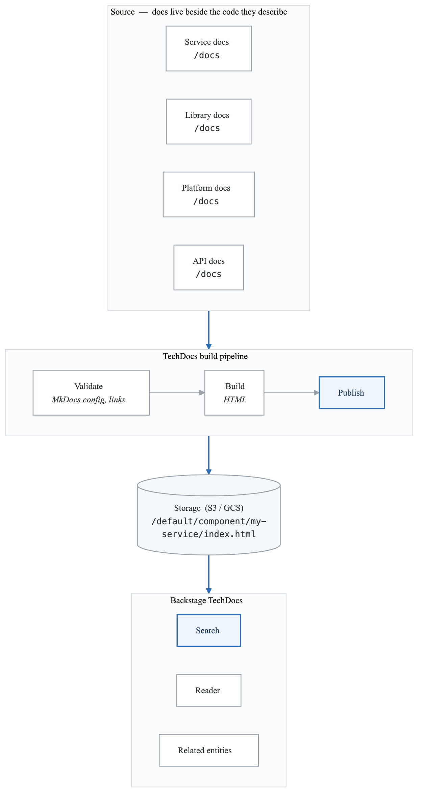
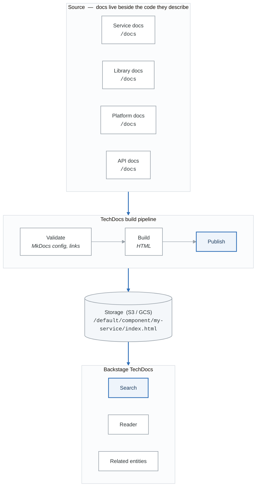
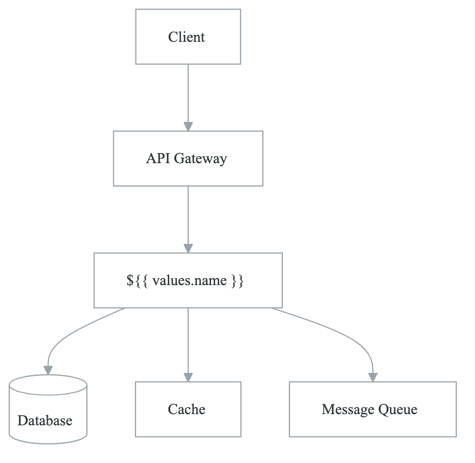
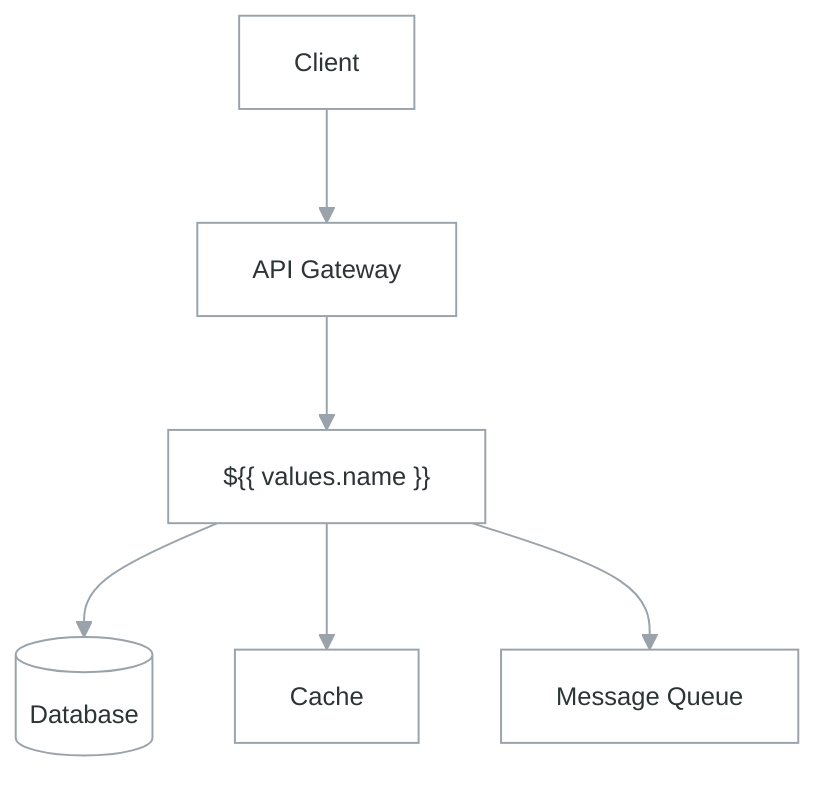

# Lab 9: Platform Documentation and TechDocs

## Lab Overview

| Attribute | Details |
|-----------|---------|
| **Duration** | 3 hours |
| **Level** | Intermediate |
| **Prerequisites** | Backstage, Markdown, Git |
| **Environment** | Backstage with TechDocs, S3/GCS |
| **Learning Objectives** | Implement docs-as-code, set up TechDocs, create documentation templates |

## Introduction

Great platforms are well-documented. This lab covers implementing a comprehensive documentation system using Backstage TechDocs, enabling docs-as-code workflows, and creating templates that make documentation easy to maintain alongside code.

## Part 1: TechDocs Architecture

### Documentation System Overview

<!-- figure: generated from the Mermaid below by _shared/diagrams/embed-figures.py — do not edit the image -->


<details>
<summary>Diagram source (Mermaid)</summary>



</details>

### Exercise 1.1: Configure TechDocs Backend

```yaml
# backstage/app-config.yaml
techdocs:
  builder: 'external'  # Use CI/CD to build, not Backstage
  generator:
    runIn: 'local'  # For local development
  publisher:
    type: 'awsS3'
    awsS3:
      bucketName: ${TECHDOCS_BUCKET_NAME}
      region: ${AWS_REGION}
      credentials:
        roleArn: ${TECHDOCS_ROLE_ARN}

# For local development
# techdocs:
#   builder: 'local'
#   generator:
#     runIn: 'docker'
#   publisher:
#     type: 'local'
```

```yaml
# kubernetes/techdocs-storage.yaml
apiVersion: v1
kind: ConfigMap
metadata:
  name: techdocs-config
  namespace: backstage
data:
  TECHDOCS_BUCKET_NAME: "company-techdocs"
  AWS_REGION: "us-west-2"
---
apiVersion: v1
kind: Secret
metadata:
  name: techdocs-secrets
  namespace: backstage
type: Opaque
stringData:
  TECHDOCS_ROLE_ARN: "arn:aws:iam::123456789:role/TechDocsPublisher"
```

### Exercise 1.2: TechDocs Build Pipeline

```yaml
# .github/workflows/techdocs.yaml
name: TechDocs Build and Publish

on:
  push:
    branches: [main]
    paths:
      - 'docs/**'
      - 'mkdocs.yml'
      - 'catalog-info.yaml'
  pull_request:
    paths:
      - 'docs/**'
      - 'mkdocs.yml'

env:
  TECHDOCS_BUCKET: company-techdocs
  ENTITY_NAMESPACE: default
  ENTITY_KIND: Component

jobs:
  validate:
    name: Validate Documentation
    runs-on: ubuntu-latest
    steps:
      - uses: actions/checkout@v4

      - name: Setup Python
        uses: actions/setup-python@v5
        with:
          python-version: '3.11'

      - name: Install dependencies
        run: |
          pip install mkdocs-techdocs-core
          pip install mkdocs-material
          pip install mkdocs-mermaid2-plugin
          pip install mkdocs-awesome-pages-plugin

      - name: Validate MkDocs config
        run: |
          mkdocs build --strict

      - name: Check for broken links
        run: |
          pip install linkchecker
          mkdocs build
          linkchecker site/

      - name: Spell check
        uses: rojopolis/spellcheck-github-actions@v0
        with:
          config_path: .spellcheck.yml
          source_files: docs/**/*.md

  build-publish:
    name: Build and Publish
    runs-on: ubuntu-latest
    needs: validate
    if: github.ref == 'refs/heads/main'
    steps:
      - uses: actions/checkout@v4

      - name: Setup Node.js
        uses: actions/setup-node@v4
        with:
          node-version: '18'

      - name: Install TechDocs CLI
        run: npm install -g @techdocs/cli

      - name: Get Entity Name
        id: entity
        run: |
          ENTITY_NAME=$(yq eval '.metadata.name' catalog-info.yaml)
          echo "name=$ENTITY_NAME" >> $GITHUB_OUTPUT

      - name: Generate TechDocs
        run: |
          techdocs-cli generate --no-docker

      - name: Configure AWS credentials
        uses: aws-actions/configure-aws-credentials@v4
        with:
          role-to-assume: ${{ secrets.TECHDOCS_ROLE_ARN }}
          aws-region: us-west-2

      - name: Publish TechDocs
        run: |
          techdocs-cli publish \
            --publisher-type awsS3 \
            --storage-name ${{ env.TECHDOCS_BUCKET }} \
            --entity ${{ env.ENTITY_NAMESPACE }}/${{ env.ENTITY_KIND }}/${{ steps.entity.outputs.name }}

      - name: Notify on success
        if: success()
        uses: slackapi/slack-github-action@v1
        with:
          channel-id: ${{ secrets.DOCS_CHANNEL_ID }}
          slack-message: "📚 Documentation updated for ${{ steps.entity.outputs.name }}"

  preview:
    name: Preview (PR)
    runs-on: ubuntu-latest
    needs: validate
    if: github.event_name == 'pull_request'
    steps:
      - uses: actions/checkout@v4

      - name: Setup Python
        uses: actions/setup-python@v5
        with:
          python-version: '3.11'

      - name: Install dependencies
        run: pip install mkdocs-techdocs-core mkdocs-material

      - name: Build docs
        run: mkdocs build

      - name: Deploy to preview
        uses: peaceiris/actions-gh-pages@v3
        with:
          github_token: ${{ secrets.GITHUB_TOKEN }}
          publish_dir: ./site
          destination_dir: pr-${{ github.event.pull_request.number }}

      - name: Comment preview link
        uses: actions/github-script@v7
        with:
          script: |
            github.rest.issues.createComment({
              issue_number: context.issue.number,
              owner: context.repo.owner,
              repo: context.repo.repo,
              body: `📖 Documentation preview: https://${context.repo.owner}.github.io/${context.repo.repo}/pr-${context.issue.number}/`
            })
```

## Part 2: Documentation Templates

### Exercise 2.1: Service Documentation Template

```yaml
# templates/service-docs/mkdocs.yml
site_name: ${{ values.name }}
site_description: Documentation for ${{ values.name }}

nav:
  - Home: index.md
  - Getting Started:
      - Quick Start: getting-started/quick-start.md
      - Installation: getting-started/installation.md
      - Configuration: getting-started/configuration.md
  - Architecture:
      - Overview: architecture/overview.md
      - Data Flow: architecture/data-flow.md
      - Dependencies: architecture/dependencies.md
  - API Reference:
      - REST API: api/rest.md
      - Events: api/events.md
  - Operations:
      - Deployment: operations/deployment.md
      - Monitoring: operations/monitoring.md
      - Runbooks: operations/runbooks.md
  - Development:
      - Local Setup: development/local-setup.md
      - Testing: development/testing.md
      - Contributing: development/contributing.md

plugins:
  - techdocs-core
  - search
  - mermaid2
  - awesome-pages

markdown_extensions:
  - admonition
  - codehilite
  - pymdownx.superfences:
      custom_fences:
        - name: mermaid
          class: mermaid
          format: !!python/name:mermaid2.fence_mermaid
  - pymdownx.tabbed:
      alternate_style: true
  - pymdownx.details
  - pymdownx.emoji:
      emoji_index: !!python/name:materialx.emoji.twemoji
      emoji_generator: !!python/name:materialx.emoji.to_svg
  - toc:
      permalink: true

theme:
  name: material
  palette:
    primary: indigo
    accent: indigo
  features:
    - navigation.tabs
    - navigation.sections
    - search.suggest
    - content.code.copy
```

````markdown
<!-- templates/service-docs/docs/index.md -->
# ${{ values.name }}

${{ values.description }}

## Quick Links

| Resource | Link |
|----------|------|
| Repository | [${{ values.repoUrl }}](${{ values.repoUrl }}) |
| API Docs | [OpenAPI Spec](./api/rest.md) |
| Dashboard | [Grafana](https://grafana.company.com/d/${{ values.name }}) |
| Alerts | [PagerDuty](https://company.pagerduty.com/services/${{ values.name }}) |

## Service Overview

### What it does

${{ values.name }} is responsible for...

### Key Features

- Feature 1
- Feature 2
- Feature 3

### Architecture Diagram

<!-- figure: generated from the Mermaid below by _shared/diagrams/embed-figures.py — do not edit the image -->


<details>
<summary>Diagram source (Mermaid)</summary>



</details>

## Team

| Role | Name |
|------|------|
| Tech Lead | @${{ values.techLead }} |
| Product Owner | @${{ values.productOwner }} |
| On-Call | [Schedule](https://pagerduty.com/schedules/${{ values.team }}) |

## Getting Help

- **Slack**: #${{ values.team }}
- **Email**: ${{ values.team }}@company.com
- **On-Call**: [PagerDuty](https://company.pagerduty.com/services/${{ values.name }})
````

````markdown
<!-- templates/service-docs/docs/operations/runbooks.md -->
# Runbooks

This page contains operational runbooks for ${{ values.name }}.

## Alert Runbooks

### High Error Rate

**Alert**: `${{ values.name }}_error_rate_high`

**Description**: Error rate exceeds 5% over 5 minutes.

**Impact**: Users may experience failed requests.

**Investigation Steps**:

1. Check the error logs:
   ```bash
   kubectl logs -n ${{ values.namespace }} -l app=${{ values.name }} --tail=100 | grep ERROR
   ```

2. Check recent deployments:
   ```bash
   kubectl rollout history deployment/${{ values.name }} -n ${{ values.namespace }}
   ```

3. Check downstream dependencies:
   ```bash
   # Check database connectivity
   kubectl exec -n ${{ values.namespace }} deploy/${{ values.name }} -- curl -s localhost:8080/health/db

   # Check cache connectivity
   kubectl exec -n ${{ values.namespace }} deploy/${{ values.name }} -- curl -s localhost:8080/health/redis
   ```

**Resolution**:

=== "Recent Deployment Issue"
    ```bash
    # Rollback to previous version
    kubectl rollout undo deployment/${{ values.name }} -n ${{ values.namespace }}
    ```

=== "Database Issue"
    1. Check database status in AWS console
    2. Contact DBA on-call if needed
    3. Consider enabling read replica failover

=== "Scaling Issue"
    ```bash
    # Scale up replicas
    kubectl scale deployment/${{ values.name }} -n ${{ values.namespace }} --replicas=10
    ```

---

### High Latency

**Alert**: `${{ values.name }}_latency_p99_high`

**Description**: P99 latency exceeds 500ms.

**Impact**: Degraded user experience, potential timeouts.

**Investigation Steps**:

1. Check current latency metrics:
   ```bash
   # View Grafana dashboard
   open "https://grafana.company.com/d/${{ values.name }}/latency"
   ```

2. Check for resource constraints:
   ```bash
   kubectl top pods -n ${{ values.namespace }} -l app=${{ values.name }}
   ```

3. Check for slow queries:
   ```bash
   kubectl logs -n ${{ values.namespace }} -l app=${{ values.name }} | grep "slow_query"
   ```

**Resolution**:

!!! warning "Before Scaling"
    Verify the issue isn't caused by a single slow endpoint or query.

```bash
# Scale up if resource constrained
kubectl scale deployment/${{ values.name }} -n ${{ values.namespace }} --replicas=10

# Or increase resource limits
kubectl patch deployment ${{ values.name }} -n ${{ values.namespace }} \
  -p '{"spec":{"template":{"spec":{"containers":[{"name":"app","resources":{"limits":{"cpu":"2","memory":"4Gi"}}}]}}}}'
```

---

## Maintenance Procedures

### Database Migration

**When**: After schema changes in a new release.

**Prerequisites**:
- [ ] Migration script tested in staging
- [ ] Backup completed
- [ ] Maintenance window scheduled

**Steps**:

1. Enable maintenance mode:
   ```bash
   kubectl set env deployment/${{ values.name }} -n ${{ values.namespace }} MAINTENANCE_MODE=true
   ```

2. Wait for in-flight requests to complete:
   ```bash
   kubectl exec -n ${{ values.namespace }} deploy/${{ values.name }} -- curl localhost:8080/admin/drain
   sleep 30
   ```

3. Run migration:
   ```bash
   kubectl create job --from=cronjob/${{ values.name }}-migrate migrate-$(date +%s)
   kubectl wait --for=condition=complete job/migrate-*
   ```

4. Verify migration:
   ```bash
   kubectl logs job/migrate-*
   ```

5. Disable maintenance mode:
   ```bash
   kubectl set env deployment/${{ values.name }} -n ${{ values.namespace }} MAINTENANCE_MODE=false
   ```

---

### Cache Flush

**When**: After data model changes or cache corruption.

**Steps**:

```bash
# Flush specific cache keys
kubectl exec -n ${{ values.namespace }} deploy/${{ values.name }} -- \
  curl -X POST localhost:8080/admin/cache/flush -d '{"pattern": "user:*"}'

# Flush all caches (use with caution)
kubectl exec -n ${{ values.namespace }} deploy/${{ values.name }} -- \
  curl -X POST localhost:8080/admin/cache/flush-all
```

!!! danger "Impact"
    Flushing all caches will cause a temporary spike in database load.
````

### Exercise 2.2: API Documentation Template

````markdown
<!-- templates/service-docs/docs/api/rest.md -->
# REST API Reference

## Base URL

| Environment | URL |
|-------------|-----|
| Production | `https://api.company.com/${{ values.name }}/v1` |
| Staging | `https://api.staging.company.com/${{ values.name }}/v1` |
| Development | `https://api.dev.company.com/${{ values.name }}/v1` |

## Authentication

All API requests require authentication using a Bearer token.

```bash
curl -H "Authorization: Bearer ${TOKEN}" \
  https://api.company.com/${{ values.name }}/v1/resource
```

!!! info "Getting a Token"
    See the [Authentication Guide](../getting-started/authentication.md) for details on obtaining tokens.

## Rate Limits

| Plan | Requests/Minute | Burst |
|------|-----------------|-------|
| Standard | 100 | 150 |
| Premium | 1000 | 1500 |
| Enterprise | Unlimited | - |

Rate limit headers are included in every response:

```http
X-RateLimit-Limit: 100
X-RateLimit-Remaining: 95
X-RateLimit-Reset: 1634567890
```

## Endpoints

### Resources

#### List Resources

```http
GET /resources
```

**Query Parameters**:

| Parameter | Type | Required | Description |
|-----------|------|----------|-------------|
| `page` | integer | No | Page number (default: 1) |
| `per_page` | integer | No | Items per page (default: 20, max: 100) |
| `sort` | string | No | Sort field (e.g., `created_at`, `-name`) |
| `filter` | string | No | Filter expression |

**Response**:

=== "200 OK"
    ```json
    {
      "data": [
        {
          "id": "res_123",
          "name": "Example Resource",
          "status": "active",
          "created_at": "2024-01-15T10:30:00Z",
          "updated_at": "2024-01-15T10:30:00Z"
        }
      ],
      "meta": {
        "page": 1,
        "per_page": 20,
        "total": 150,
        "total_pages": 8
      }
    }
    ```

=== "400 Bad Request"
    ```json
    {
      "error": {
        "code": "invalid_parameter",
        "message": "Invalid sort field: unknown_field",
        "details": {
          "field": "sort",
          "allowed": ["created_at", "updated_at", "name"]
        }
      }
    }
    ```

**Example**:

```bash
curl -H "Authorization: Bearer ${TOKEN}" \
  "https://api.company.com/${{ values.name }}/v1/resources?page=1&per_page=50&sort=-created_at"
```

---

#### Create Resource

```http
POST /resources
```

**Request Body**:

```json
{
  "name": "New Resource",
  "description": "Optional description",
  "config": {
    "setting1": "value1"
  }
}
```

**Response**:

=== "201 Created"
    ```json
    {
      "data": {
        "id": "res_456",
        "name": "New Resource",
        "description": "Optional description",
        "status": "pending",
        "config": {
          "setting1": "value1"
        },
        "created_at": "2024-01-15T11:00:00Z"
      }
    }
    ```

=== "422 Unprocessable Entity"
    ```json
    {
      "error": {
        "code": "validation_failed",
        "message": "Validation failed",
        "details": [
          {
            "field": "name",
            "message": "is required"
          }
        ]
      }
    }
    ```

---

## Webhooks

### Event Types

| Event | Description |
|-------|-------------|
| `resource.created` | Fired when a new resource is created |
| `resource.updated` | Fired when a resource is updated |
| `resource.deleted` | Fired when a resource is deleted |

### Payload Format

```json
{
  "id": "evt_789",
  "type": "resource.created",
  "created_at": "2024-01-15T11:00:00Z",
  "data": {
    "resource": {
      "id": "res_456",
      "name": "New Resource"
    }
  }
}
```

### Webhook Security

All webhook payloads are signed using HMAC-SHA256. Verify the signature using the `X-Signature-256` header:

```python
import hmac
import hashlib

def verify_signature(payload: bytes, signature: str, secret: str) -> bool:
    expected = hmac.new(
        secret.encode(),
        payload,
        hashlib.sha256
    ).hexdigest()
    return hmac.compare_digest(f"sha256={expected}", signature)
```
````

## Part 3: Documentation Automation

### Exercise 3.1: Auto-Generated API Docs

```yaml
# .github/workflows/api-docs.yaml
name: Generate API Documentation

on:
  push:
    branches: [main]
    paths:
      - 'api/**/*.yaml'
      - 'api/**/*.json'
      - 'proto/**/*.proto'

jobs:
  generate-openapi-docs:
    name: Generate OpenAPI Docs
    runs-on: ubuntu-latest
    steps:
      - uses: actions/checkout@v4

      - name: Generate HTML from OpenAPI
        uses: openapi-generators/openapitools-github-action@v0
        with:
          generator: html2
          openapi-file: api/openapi.yaml
          output-path: docs/api/generated

      - name: Generate Markdown from OpenAPI
        run: |
          npx @redocly/cli build-docs api/openapi.yaml \
            --output docs/api/redoc.html

      - name: Commit generated docs
        uses: stefanzweifel/git-auto-commit-action@v5
        with:
          commit_message: "docs: auto-generate API documentation"
          file_pattern: docs/api/*

  generate-grpc-docs:
    name: Generate gRPC Docs
    runs-on: ubuntu-latest
    if: hashFiles('proto/**/*.proto') != ''
    steps:
      - uses: actions/checkout@v4

      - name: Install protoc-gen-doc
        run: |
          go install github.com/pseudomuto/protoc-gen-doc/cmd/protoc-gen-doc@latest

      - name: Generate docs
        run: |
          protoc --doc_out=docs/api --doc_opt=markdown,grpc.md \
            proto/**/*.proto

      - name: Commit generated docs
        uses: stefanzweifel/git-auto-commit-action@v5
        with:
          commit_message: "docs: auto-generate gRPC documentation"
          file_pattern: docs/api/*
```

### Exercise 3.2: Documentation Quality Checks

```yaml
# .github/workflows/docs-quality.yaml
name: Documentation Quality

on:
  pull_request:
    paths:
      - 'docs/**'
      - '*.md'

jobs:
  quality-checks:
    name: Quality Checks
    runs-on: ubuntu-latest
    steps:
      - uses: actions/checkout@v4

      - name: Check Markdown formatting
        uses: DavidAnson/markdownlint-cli2-action@v14
        with:
          globs: |
            docs/**/*.md
            *.md

      - name: Check for broken links
        uses: lycheeverse/lychee-action@v1
        with:
          args: --verbose docs/
          fail: true

      - name: Check spelling
        uses: rojopolis/spellcheck-github-actions@v0
        with:
          config_path: .spellcheck.yml

      - name: Check inclusive language
        uses: get-alex/alex@v1
        with:
          glob: 'docs/**/*.md'

      - name: Validate code examples
        run: |
          # Extract and validate bash examples
          for file in docs/**/*.md; do
            grep -Pzo '```bash\n\K[^`]+' "$file" | while read -r code; do
              echo "$code" | bash -n 2>&1 || echo "Invalid bash in $file"
            done
          done

  coverage-check:
    name: Documentation Coverage
    runs-on: ubuntu-latest
    steps:
      - uses: actions/checkout@v4

      - name: Check required documentation
        run: |
          required_files=(
            "docs/index.md"
            "docs/getting-started/quick-start.md"
            "docs/architecture/overview.md"
            "docs/operations/runbooks.md"
          )

          missing=()
          for file in "${required_files[@]}"; do
            if [ ! -f "$file" ]; then
              missing+=("$file")
            fi
          done

          if [ ${#missing[@]} -gt 0 ]; then
            echo "Missing required documentation:"
            printf '%s\n' "${missing[@]}"
            exit 1
          fi

      - name: Check documentation freshness
        run: |
          # Warn about docs not updated in 180 days
          find docs -name "*.md" -mtime +180 -exec echo "Stale: {}" \;

      - name: Generate coverage report
        run: |
          echo "## Documentation Coverage Report" >> $GITHUB_STEP_SUMMARY
          echo "" >> $GITHUB_STEP_SUMMARY

          total=$(find docs -name "*.md" | wc -l)
          with_examples=$(grep -rl '```' docs --include="*.md" | wc -l)
          with_diagrams=$(grep -rl 'mermaid' docs --include="*.md" | wc -l)

          echo "| Metric | Count |" >> $GITHUB_STEP_SUMMARY
          echo "|--------|-------|" >> $GITHUB_STEP_SUMMARY
          echo "| Total Pages | $total |" >> $GITHUB_STEP_SUMMARY
          echo "| Pages with Examples | $with_examples |" >> $GITHUB_STEP_SUMMARY
          echo "| Pages with Diagrams | $with_diagrams |" >> $GITHUB_STEP_SUMMARY
```

## Part 4: Documentation Search and Discovery

### Exercise 4.1: Search Configuration

```typescript
// packages/backend/src/plugins/techdocs.ts
import {
  createRouter,
  Preparers,
  Generators,
  Publisher,
} from '@backstage/plugin-techdocs-backend';
import { PluginEnvironment } from '../types';
import { DockerContainerRunner } from '@backstage/backend-common';
import { AwsS3Client } from '@backstage/techdocs-common';

export default async function createPlugin(
  env: PluginEnvironment,
): Promise<Router> {
  // Configure preparers
  const preparers = await Preparers.fromConfig(env.config, {
    logger: env.logger,
    reader: env.reader,
  });

  // Configure generators
  const dockerClient = new DockerContainerRunner({ logger: env.logger });
  const generators = await Generators.fromConfig(env.config, {
    logger: env.logger,
    containerRunner: dockerClient,
  });

  // Configure publisher
  const publisher = await Publisher.fromConfig(env.config, {
    logger: env.logger,
    discovery: env.discovery,
  });

  // Configure search
  const searchClient = new TechDocsSearch({
    baseUrl: env.config.getString('backend.baseUrl'),
    logger: env.logger,
  });

  return await createRouter({
    preparers,
    generators,
    publisher,
    logger: env.logger,
    config: env.config,
    discovery: env.discovery,
    cache: env.cache,
    search: searchClient,
  });
}
```

```yaml
# backstage/app-config.yaml - Search configuration
search:
  collators:
    techdocs:
      schedule:
        frequency: { minutes: 10 }
        timeout: { minutes: 15 }
        initialDelay: { seconds: 30 }
```

### Exercise 4.2: Documentation Analytics

```typescript
// plugins/techdocs-analytics/src/components/DocsAnalytics.tsx
import React, { useEffect, useState } from 'react';
import { InfoCard, Table, TableColumn } from '@backstage/core-components';
import { useApi } from '@backstage/core-plugin-api';
import { analyticsApiRef } from '../api';

interface PageView {
  path: string;
  title: string;
  views: number;
  uniqueUsers: number;
  avgTimeOnPage: number;
}

interface SearchTerm {
  term: string;
  count: number;
  clickThrough: number;
}

export const DocsAnalytics: React.FC = () => {
  const analyticsApi = useApi(analyticsApiRef);
  const [topPages, setTopPages] = useState<PageView[]>([]);
  const [topSearches, setTopSearches] = useState<SearchTerm[]>([]);
  const [noResults, setNoResults] = useState<string[]>([]);

  useEffect(() => {
    const loadAnalytics = async () => {
      const [pages, searches, misses] = await Promise.all([
        analyticsApi.getTopPages({ limit: 10, period: '30d' }),
        analyticsApi.getTopSearchTerms({ limit: 10, period: '30d' }),
        analyticsApi.getNoResultSearches({ limit: 10, period: '30d' }),
      ]);
      setTopPages(pages);
      setTopSearches(searches);
      setNoResults(misses);
    };
    loadAnalytics();
  }, [analyticsApi]);

  const pageColumns: TableColumn<PageView>[] = [
    { title: 'Page', field: 'title' },
    { title: 'Views', field: 'views', type: 'numeric' },
    { title: 'Unique Users', field: 'uniqueUsers', type: 'numeric' },
    {
      title: 'Avg. Time',
      field: 'avgTimeOnPage',
      render: (row) => `${Math.round(row.avgTimeOnPage / 60)}m`,
    },
  ];

  const searchColumns: TableColumn<SearchTerm>[] = [
    { title: 'Search Term', field: 'term' },
    { title: 'Searches', field: 'count', type: 'numeric' },
    {
      title: 'Click-through',
      field: 'clickThrough',
      render: (row) => `${Math.round((row.clickThrough / row.count) * 100)}%`,
    },
  ];

  return (
    <>
      <InfoCard title="Top Documentation Pages">
        <Table
          columns={pageColumns}
          data={topPages}
          options={{ pageSize: 10, search: false }}
        />
      </InfoCard>

      <InfoCard title="Popular Search Terms" style={{ marginTop: 16 }}>
        <Table
          columns={searchColumns}
          data={topSearches}
          options={{ pageSize: 10, search: false }}
        />
      </InfoCard>

      <InfoCard title="Searches With No Results" style={{ marginTop: 16 }}>
        <Typography variant="body2" color="textSecondary" paragraph>
          These searches returned no results. Consider creating documentation for these topics.
        </Typography>
        <ul>
          {noResults.map((term) => (
            <li key={term}>{term}</li>
          ))}
        </ul>
      </InfoCard>
    </>
  );
};
```

## Verification Checklist

After completing this lab, verify:

- [ ] TechDocs pipeline builds and publishes docs
- [ ] Documentation appears in Backstage
- [ ] Search indexes documentation content
- [ ] Broken links are detected in CI
- [ ] Spell check runs on PRs
- [ ] API documentation auto-generates
- [ ] Documentation templates are complete
- [ ] Analytics track documentation usage

## Troubleshooting

### TechDocs Not Building

1. Verify mkdocs.yml syntax
2. Check for missing plugins
3. Review build logs
4. Validate catalog-info.yaml techdocs ref

### Docs Not Appearing in Backstage

1. Check S3/GCS bucket permissions
2. Verify entity annotation
3. Review Backstage logs
4. Check publisher configuration

### Search Not Working

1. Verify collator schedule
2. Check search index status
3. Review search backend logs
4. Validate document metadata

## Summary

In this lab, you learned to:

- Set up TechDocs for docs-as-code workflow
- Create comprehensive documentation templates
- Implement automated documentation builds
- Add quality checks for documentation
- Enable search and discovery
- Track documentation analytics

Good documentation is essential for platform adoption. By treating docs as code and automating quality checks, you ensure documentation stays current and useful.

<!-- feynman-check -->

---

## Feynman check

Close the file. Blank page, no notes. Explain each of these to a competent engineer who has never
used this tool — **under five minutes, no jargon you can't define on the spot:**

- TechDocs Architecture
- Documentation Templates
- Quick Links
- Service Overview

**The gap is not what you forgot. It is where you used a word instead of a mechanism.**

| | |
|---|---|
| ✗ | *"The platform makes developers more productive."* |
| ✓ | *"A golden path is a template that produces a repository with CI, manifests, dashboards and alerts already wired, so the product team owns none of them. It reduces cognitive load by removing decisions, not by adding features — and without a documented escape hatch it is a cage."* |

**Trace it:** A developer commits `service.yaml` → a running service with a dashboard and a paging rule. Name every system that acts, and which team owns each one.

Stop at the first component you cannot name. Reopen this file and read **only** that.

**Go deeper — only once the gap has a name:** [Team Topologies — cognitive load](https://teamtopologies.com/key-concepts) and the [CNCF Platforms White Paper](https://tag-app-delivery.cncf.io/whitepapers/platforms/) — why golden paths exist at all.
Full list per domain: [`SOURCES.md`](../SOURCES.md#platform-engineering)

→ Protocol, the three levels of knowing, and worked examples: [`MASTERY.md`](../MASTERY.md)

<!-- /feynman-check -->
