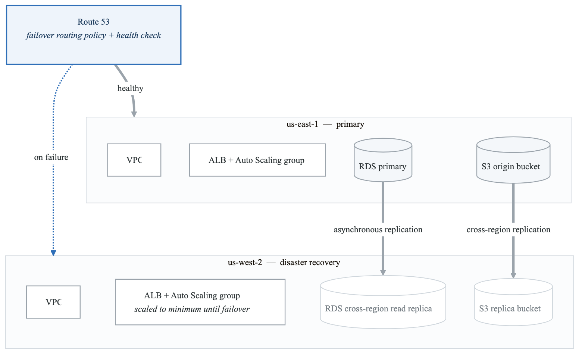
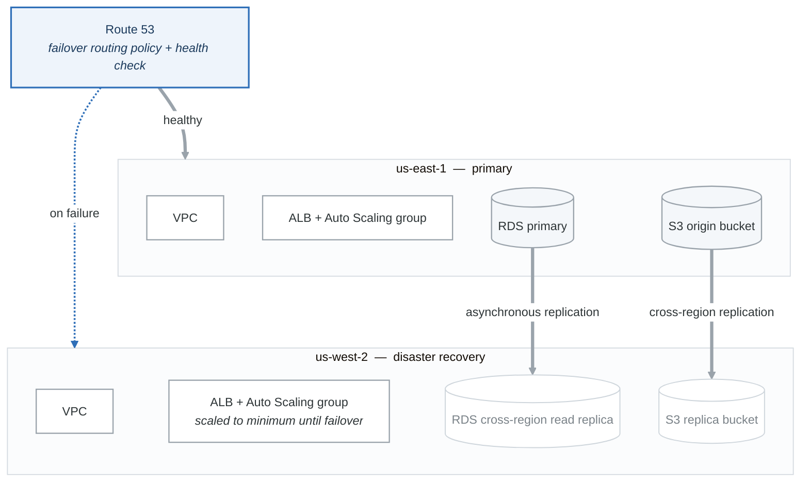

# Elite Challenge 1: Multi-Region Disaster Recovery

## Objective

Design and implement a complete disaster recovery solution with active-passive failover across AWS regions.

## Architecture Requirements

<!-- figure: generated from the Mermaid below by _shared/diagrams/embed-figures.py — do not edit the image -->

Diagram source (Mermaid)

## Requirements

### Infrastructure
1. **Networking**
   - VPCs in us-east-1 (primary) and us-west-2 (DR)
   - VPC peering or Transit Gateway for private connectivity
   - Identical subnet layouts in both regions

2. **Compute**
   - Auto Scaling Groups in both regions
   - DR region at minimum capacity during normal operations
   - Automated scaling during failover

3. **Database**
   - RDS Multi-AZ in primary region
   - Cross-region read replica in DR region
   - Automated promotion during failover

4. **Storage**
   - S3 cross-region replication
   - Versioning enabled on all buckets

5. **DNS**
   - Route 53 health checks on primary
   - Failover routing policy
   - Configurable TTL for fast failover

### Automation
- Lambda function for automated failover
- SNS notifications for failover events
- CloudWatch alarms for health monitoring
- Runbook documentation

### Testing
- Terraform tests for infrastructure
- Chaos engineering scenarios
- RTO/RPO validation

## Deliverables

1. **Terraform Modules**
   - `modules/network` - VPC, subnets, routing
   - `modules/compute` - ASG, launch templates
   - `modules/database` - RDS, replicas
   - `modules/dns` - Route 53 configuration
   - `modules/monitoring` - CloudWatch, SNS

2. **Configuration Files**
   - `environments/primary/` - Primary region config
   - `environments/dr/` - DR region config
   - `global/` - Global resources (Route 53)

3. **Documentation**
   - Architecture diagram
   - Failover procedures
   - Recovery time objectives

## Acceptance Criteria

- [ ] Primary region fully functional
- [ ] DR region in warm standby
- [ ] Automatic failover on primary failure
- [ ] RTO < 15 minutes
- [ ] RPO < 5 minutes
- [ ] All infrastructure managed by Terraform
- [ ] Tests pass for all modules
- [ ] CI/CD pipeline for deployment

## Bonus Challenges

- Implement blue-green deployment
- Add DynamoDB global tables
- Implement multi-region API Gateway
- Add cost optimization for DR region

## Resources

- [AWS Disaster Recovery Whitepaper](https://docs.aws.amazon.com/whitepapers/latest/disaster-recovery-workloads-on-aws/disaster-recovery-workloads-on-aws.html)
- [Terraform AWS Provider](https://registry.terraform.io/providers/hashicorp/aws/latest/docs)

## Estimated Time: 8-10 hours

<!-- feynman-check -->

---

## Feynman check

Close the file. Blank page, no notes. Explain each of these to a competent engineer who has never
used this tool — **under five minutes, no jargon you can't define on the spot:**

- Architecture Requirements
- Estimated Time: 8-10 hours
- Infrastructure
- Automation

**The gap is not what you forgot. It is where you used a word instead of a mechanism.**

| | |
|---|---|
| ✗ | *"Terraform manages your infrastructure."* |
| ✓ | *"`plan` is a three-way comparison: the configuration (desired), the state file (what Terraform believes it created), and a refresh against the real API (what exists). Almost every confusing result is one of those three drifting from the other two."* |

**Trace it:** `terraform apply` on one resource: config → plan → API call → state write. Then say what happens if the process dies between the API call and the state write.

Stop at the first component you cannot name. Reopen this file and read **only** that.

**Go deeper — only once the gap has a name:** [the purpose of Terraform state](https://developer.hashicorp.com/terraform/language/state/purpose) — almost every confusing result is a three-way disagreement, spelled out there.
Full list per domain: [`SOURCES.md`](../../SOURCES.md#terraform)

→ Protocol, the three levels of knowing, and worked examples: [`MASTERY.md`](../../MASTERY.md)

<!-- /feynman-check -->
