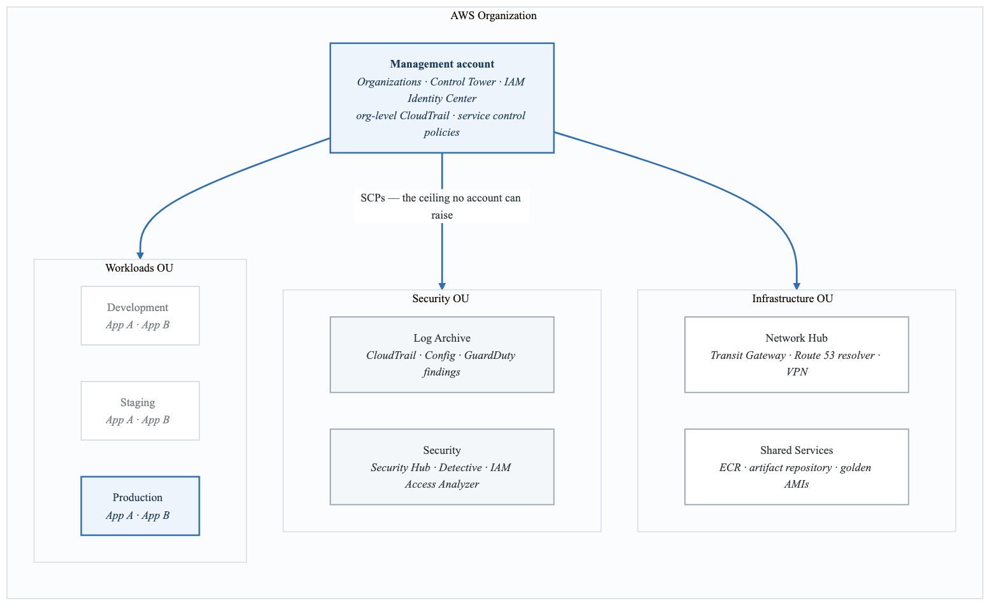
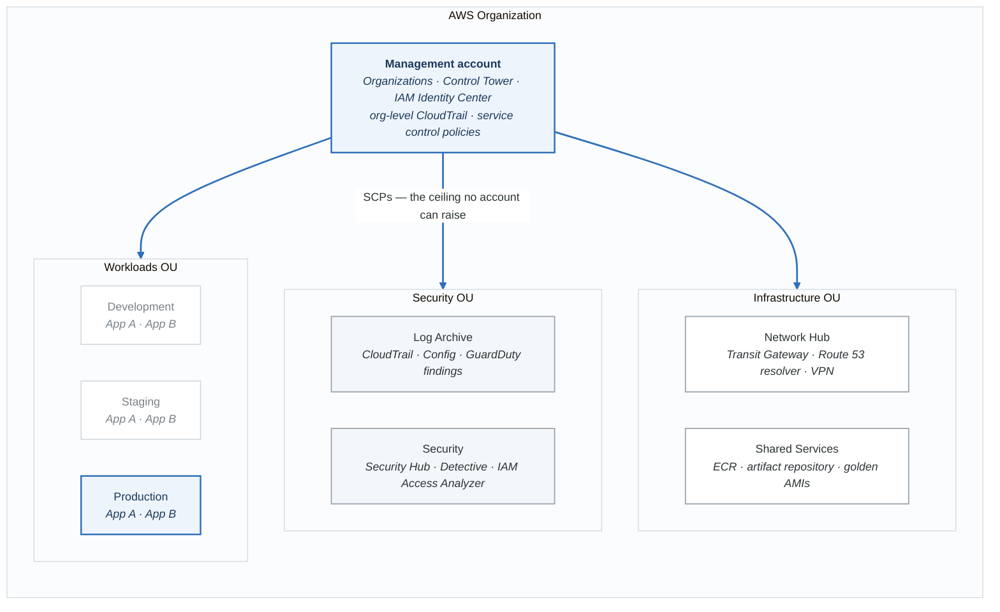

# Elite Challenge 2: Enterprise Landing Zone

## Objective

Build a complete AWS Landing Zone with multi-account architecture, centralized governance, and security controls.

## Architecture

<!-- figure: generated from the Mermaid below by _shared/diagrams/embed-figures.py — do not edit the image -->

Diagram source (Mermaid)

## Requirements

### Account Structure
1. **Management Account**
   - AWS Organizations
   - Service Control Policies (SCPs)
   - AWS SSO/Identity Center
   - Centralized billing

2. **Log Archive Account**
   - Centralized CloudTrail
   - AWS Config aggregator
   - S3 buckets for logs
   - Retention policies

3. **Security Account**
   - Security Hub aggregation
   - GuardDuty master
   - IAM Access Analyzer
   - Macie

4. **Network Hub Account**
   - Transit Gateway
   - Centralized DNS (Route 53)
   - VPN connections
   - Direct Connect

5. **Shared Services Account**
   - ECR repositories
   - CodeArtifact
   - Shared AMIs

6. **Workload Accounts**
   - Development, Staging, Production
   - Isolated VPCs
   - Connected via Transit Gateway

### Security Controls
- SCPs for guardrails
- IAM permission boundaries
- Encryption requirements
- Network isolation

### Networking
- Hub-and-spoke with Transit Gateway
- Centralized egress
- Private DNS resolution
- VPC Flow Logs

### Compliance
- AWS Config rules
- Custom Config rules
- Automated remediation
- Compliance reporting

## Deliverables

### Terraform Structure
**`landing-zone/`**

- `organization/`
  - `main.tf`
  - `scp.tf`
  - `accounts.tf`
- `modules/`
  - `account-baseline/`
  - `networking/`
  - `security-baseline/`
  - `logging/`
- `accounts/`
  - `log-archive/`
  - `security/`
  - `network-hub/`
  - `shared-services/`
- `workloads/`
  - `dev/`
  - `staging/`
  - `prod/`

### Required Modules
1. **Account Baseline**
   - IAM roles
   - CloudTrail
   - Config
   - GuardDuty enrollment

2. **VPC Module**
   - Standardized VPC
   - Transit Gateway attachment
   - Flow logs
   - DNS configuration

3. **Security Baseline**
   - Security Hub
   - Config rules
   - IAM policies
   - Encryption settings

## Acceptance Criteria

- [ ] All accounts created and organized
- [ ] SCPs enforced across organization
- [ ] SSO configured for all accounts
- [ ] Centralized logging operational
- [ ] Security Hub aggregating findings
- [ ] Transit Gateway connecting all VPCs
- [ ] Config rules evaluating compliance
- [ ] All infrastructure as code
- [ ] Documentation complete

## Bonus Challenges

- Implement account vending machine
- Add Terraform Cloud workspaces per account
- Implement cost allocation tags
- Add custom Config rules with Lambda

## Estimated Time: 10-15 hours

<!-- feynman-check -->

---

## Feynman check

Close the file. Blank page, no notes. Explain each of these to a competent engineer who has never
used this tool — **under five minutes, no jargon you can't define on the spot:**

- Estimated Time: 10-15 hours
- Account Structure
- Security Controls
- Networking

**The gap is not what you forgot. It is where you used a word instead of a mechanism.**

| | |
|---|---|
| ✗ | *"Terraform manages your infrastructure."* |
| ✓ | *"`plan` is a three-way comparison: the configuration (desired), the state file (what Terraform believes it created), and a refresh against the real API (what exists). Almost every confusing result is one of those three drifting from the other two."* |

**Trace it:** `terraform apply` on one resource: config → plan → API call → state write. Then say what happens if the process dies between the API call and the state write.

Stop at the first component you cannot name. Reopen this file and read **only** that.

**Go deeper — only once the gap has a name:** [the purpose of Terraform state](https://developer.hashicorp.com/terraform/language/state/purpose) — almost every confusing result is a three-way disagreement, spelled out there.
Full list per domain: [`SOURCES.md`](../../SOURCES.md#terraform)

→ Protocol, the three levels of knowing, and worked examples: [`MASTERY.md`](../../MASTERY.md)

<!-- /feynman-check -->
