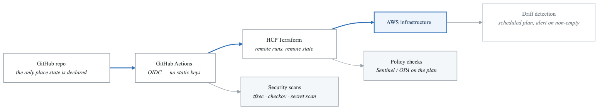
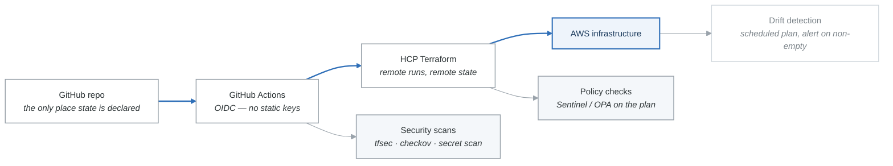
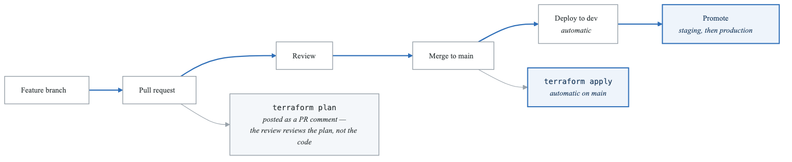
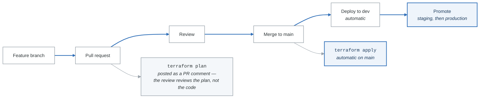

# Elite Challenge 3: Complete GitOps Pipeline

## Objective

Implement a production-grade GitOps workflow for infrastructure management with complete automation.

## Architecture

<!-- figure: generated from the Mermaid below by _shared/diagrams/embed-figures.py — do not edit the image -->


<details>
<summary>Diagram source (Mermaid)</summary>



</details>

**The development flow those stages sit on**

<!-- figure: generated from the Mermaid below by _shared/diagrams/embed-figures.py — do not edit the image -->


<details>
<summary>Diagram source (Mermaid)</summary>



</details>

The detail that makes this GitOps rather than "CI that runs Terraform": the plan is attached to the
pull request, so the artifact a human approves is the **set of changes AWS will actually receive** —
not a diff of HCL that someone has to simulate in their head.

## Requirements

### Repository Structure
**`infrastructure/`**

- `.github/`
  - `workflows/`
    - `terraform-plan.yml`
    - `terraform-apply.yml`
    - `drift-detection.yml`
    - `security-scan.yml`
- `environments/`
  - `dev/`
  - `staging/`
  - `prod/`
- `modules/`
- `policies/`
  - `sentinel/`
  - `opa/`
- `tests/`


### Pipeline Features

1. **PR Workflow**
   - Automatic format check
   - Validation
   - Security scanning (tfsec, checkov)
   - Cost estimation (Infracost)
   - Plan output as PR comment
   - Required approvals

2. **Apply Workflow**
   - Triggered on merge to main
   - Environment-specific apply
   - Approval gates for prod
   - Slack/Teams notifications
   - State backup

3. **Drift Detection**
   - Scheduled runs (every 6 hours)
   - Alert on drift
   - Auto-create PR for remediation
   - Dashboard reporting

4. **Security Integration**
   - SAST scanning
   - Secret detection
   - Compliance checks
   - SBOM generation

### Terraform Cloud Integration
- Workspaces per environment
- VCS-driven workflow
- Policy sets (Sentinel)
- Cost estimation
- Private registry

### Monitoring & Observability
- Pipeline metrics
- Deployment tracking
- Rollback capabilities
- Audit logging

## Deliverables

### GitHub Actions Workflows

```yaml
# Example: terraform-plan.yml
name: Terraform Plan
on:
  pull_request:
    branches: [main]
    paths: ['environments/**', 'modules/**']

jobs:
  plan:
    strategy:
      matrix:
        environment: [dev, staging, prod]
    # ... implementation
```

### Required Components
1. Complete CI/CD workflows
2. Security scanning integration
3. Cost estimation
4. Drift detection
5. Notification system
6. Documentation

## Acceptance Criteria

- [ ] All workflows automated
- [ ] Security scans passing
- [ ] Cost estimation on PRs
- [ ] Drift detection operational
- [ ] Notifications configured
- [ ] Multi-environment support
- [ ] Rollback capability
- [ ] Complete documentation

## Bonus Challenges

- Add DORA metrics tracking
- Implement feature flags for infra
- Add chaos engineering tests
- Implement progressive rollouts

## Estimated Time: 6-8 hours

<!-- feynman-check -->

---

## Feynman check

Close the file. Blank page, no notes. Explain each of these to a competent engineer who has never
used this tool — **under five minutes, no jargon you can't define on the spot:**

- Estimated Time: 6-8 hours
- Repository Structure
- Pipeline Features
- Terraform Cloud Integration

**The gap is not what you forgot. It is where you used a word instead of a mechanism.**

| | |
|---|---|
| ✗ | *"Terraform manages your infrastructure."* |
| ✓ | *"`plan` is a three-way comparison: the configuration (desired), the state file (what Terraform believes it created), and a refresh against the real API (what exists). Almost every confusing result is one of those three drifting from the other two."* |

**Trace it:** `terraform apply` on one resource: config → plan → API call → state write. Then say what happens if the process dies between the API call and the state write.

Stop at the first component you cannot name. Reopen this file and read **only** that.

**Go deeper — only once the gap has a name:** [the purpose of Terraform state](https://developer.hashicorp.com/terraform/language/state/purpose) — almost every confusing result is a three-way disagreement, spelled out there.
Full list per domain: [`SOURCES.md`](../../SOURCES.md#terraform)

→ Protocol, the three levels of knowing, and worked examples: [`MASTERY.md`](../../MASTERY.md)

<!-- /feynman-check -->
