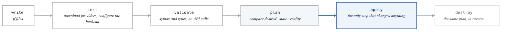

# Lab 1.3: Core Workflow Mastery

## Objective

Master the Terraform workflow commands and understand what happens at each stage.

## Duration: 60 minutes

---

## The Core Workflow

```mermaid
%%{init: {'theme':'base','themeVariables':{'fontFamily':'Helvetica, Arial, sans-serif','fontSize':'13px','primaryColor':'#ffffff','primaryTextColor':'#2d3436','primaryBorderColor':'#9aa3ab','lineColor':'#9aa3ab','textColor':'#2d3436','clusterBkg':'#fbfcfd','clusterBorder':'#d4dae0','edgeLabelBackground':'#ffffff','tertiaryColor':'#eef4fb'},'flowchart':{'curve':'basis','padding':14,'nodeSpacing':42,'rankSpacing':58}}}%%
flowchart LR
  classDef default fill:#ffffff,stroke:#9aa3ab,stroke-width:1.3px,color:#2d3436
  classDef n    fill:#ffffff,stroke:#9aa3ab,stroke-width:1.3px,color:#2d3436
  classDef crit fill:#eef4fb,stroke:#2f6fb8,stroke-width:1.8px,color:#1b3a5c
  classDef data fill:#f4f7fa,stroke:#9aa3ab,stroke-width:1.3px,color:#2d3436
  classDef mut  fill:#ffffff,stroke:#cfd6dc,stroke-width:1.1px,color:#7a8288
  classDef warn fill:#fdf0ec,stroke:#c0522d,stroke-width:1.6px,color:#8a3a1e
  W["<code>write</code><br/><i>.tf files</i>"]
  I["<code>init</code><br/><i>download providers, configure the backend</i>"]
  V["<code>validate</code><br/><i>syntax and types, no API calls</i>"]
  P["<code>plan</code><br/><i>compare desired · state · reality</i>"]
  A["<code>apply</code><br/><i>the only step that changes anything</i>"]
  D["<code>destroy</code><br/><i>the same plan, in reverse</i>"]
  W --> I --> V --> P ==> A --> D
  class W,I,V n
  class P data
  class A crit
  class D mut
  linkStyle 3 stroke:#2f6fb8,stroke-width:2px
```

<!-- figure: generated from the Mermaid below by _shared/diagrams/embed-figures.py — do not edit the image -->


<details>
<summary>Diagram source (Mermaid)</summary>



</details>

---

## Part 1: terraform init

### What It Does

- Downloads and installs provider plugins
- Initializes backend (local or remote)
- Downloads modules from sources
- Creates `.terraform` directory and lock file

### Create Working Directory

```bash
mkdir -p ~/terraform-learning/labs/workflow-lab
cd ~/terraform-learning/labs/workflow-lab
```

### Create Configuration

```hcl
# versions.tf
terraform {
  required_version = ">= 1.0"

  required_providers {
    aws = {
      source  = "hashicorp/aws"
      version = "~> 5.0"
    }
    random = {
      source  = "hashicorp/random"
      version = "~> 3.0"
    }
  }
}
```

```hcl
# main.tf
provider "aws" {
  region = "us-east-1"
}

resource "random_pet" "name" {
  length = 2
}

resource "aws_s3_bucket" "example" {
  bucket = "terraform-lab-${random_pet.name.id}"

  tags = {
    Name        = "Workflow Lab Bucket"
    Environment = "learning"
  }
}
```

### Run Init

```bash
terraform init
```

### Expected Output

```
Initializing the backend...

Initializing provider plugins...
- Finding hashicorp/aws versions matching "~> 5.0"...
- Finding hashicorp/random versions matching "~> 3.0"...
- Installing hashicorp/aws v5.x.x...
- Installing hashicorp/random v3.x.x...

Terraform has created a lock file .terraform.lock.hcl to record the provider
selections it made above. Include this file in your version control repository
so that Terraform can guarantee to make the same selections by default when
you run "terraform init" in the future.

Terraform has been successfully initialized!
```

### Explore What Was Created

```bash
# View directory structure
tree -a .terraform/

# View lock file
cat .terraform.lock.hcl
```

### Init Options

```bash
# Upgrade providers to latest compatible version
terraform init -upgrade

# Reconfigure backend
terraform init -reconfigure

# Migrate state between backends
terraform init -migrate-state

# Skip backend initialization (useful for validation)
terraform init -backend=false
```

---

## Part 2: terraform validate

### What It Does

- Checks configuration syntax
- Validates internal consistency
- Does NOT check cloud credentials or state
- Fast, offline check

### Valid Configuration Check

```bash
terraform validate
```

Expected output:
```
Success! The configuration is valid.
```

### Create Invalid Configuration

```hcl
# broken.tf (add this file)
resource "aws_instance" "bad" {
  ami = var.undefined_variable  # Variable doesn't exist
}
```

```bash
terraform validate
```

Output:
```text
│ Error: Reference to undeclared input variable
│
│   on broken.tf line 2, in resource "aws_instance" "bad":
│    2:   ami = var.undefined_variable
│
│ An input variable with the name "undefined_variable" has not been declared.
```

```bash
# Clean up
rm broken.tf
```

---

## Part 3: terraform fmt

### What It Does

- Formats configuration to consistent style
- Aligns arguments
- Ensures consistent indentation

### Create Messy Configuration

```hcl
# messy.tf
resource "aws_instance" "ugly" {
ami="ami-12345"
instance_type="t2.micro"
tags={
Name="ugly"
    Environment="test"
}
}
```

### Format It

```bash
# Show what would change
terraform fmt -diff messy.tf

# Apply formatting
terraform fmt

# Check all files recursively
terraform fmt -recursive

# Check without changing (for CI)
terraform fmt -check
```

```bash
# View formatted result
cat messy.tf

# Clean up
rm messy.tf
```

---

## Part 4: terraform plan

### What It Does

- Reads current state
- Compares desired state (configuration) with current state
- Shows what changes would be made
- Does NOT make any changes

### Run Plan

```bash
terraform plan
```

### Understanding Plan Output

```
Terraform will perform the following actions:

  # random_pet.name will be created
  + resource "random_pet" "name" {
      + id        = (known after apply)
      + length    = 2
      + separator = "-"
    }

  # aws_s3_bucket.example will be created
  + resource "aws_s3_bucket" "example" {
      + arn                         = (known after apply)
      + bucket                      = (known after apply)
      + bucket_domain_name          = (known after apply)
      + force_destroy               = false
      + id                          = (known after apply)
      + region                      = (known after apply)
      + tags                        = {
          + "Environment" = "learning"
          + "Name"        = "Workflow Lab Bucket"
        }
      + tags_all                    = {
          + "Environment" = "learning"
          + "Name"        = "Workflow Lab Bucket"
        }
    }

Plan: 2 to add, 0 to change, 0 to destroy.
```

### Plan Symbols

| Symbol | Meaning |
|--------|---------|
| `+` | Create (add new resource) |
| `-` | Destroy (remove resource) |
| `~` | Update in-place |
| `-/+` | Replace (destroy and recreate) |
| `<=` | Read (data source) |

### Plan Options

```bash
# Save plan to file
terraform plan -out=tfplan

# Show only resources to destroy
terraform plan -destroy

# Detailed exit codes (useful for CI)
# 0 = no changes, 1 = error, 2 = changes pending
terraform plan -detailed-exitcode

# Target specific resources
terraform plan -target=aws_s3_bucket.example

# Set variables
terraform plan -var="environment=production"
terraform plan -var-file="production.tfvars"

# Refresh-only mode (update state without changes)
terraform plan -refresh-only
```

---

## Part 5: terraform apply

### What It Does

- Executes the planned changes
- Creates, updates, or deletes resources
- Updates state file

### Apply Options

```bash
# Interactive apply (prompts for confirmation)
terraform apply

# Auto-approve (skip confirmation)
terraform apply -auto-approve

# Apply saved plan
terraform plan -out=tfplan
terraform apply tfplan

# Apply with variables
terraform apply -var="environment=production"

# Target specific resources
terraform apply -target=aws_s3_bucket.example

# Replace specific resource
terraform apply -replace=aws_s3_bucket.example
```

### Run Apply

```bash
terraform apply
```

When prompted, type `yes` to confirm.

### Expected Output

```
random_pet.name: Creating...
random_pet.name: Creation complete after 0s [id=divine-mule]
aws_s3_bucket.example: Creating...
aws_s3_bucket.example: Creation complete after 2s [id=terraform-lab-divine-mule]

Apply complete! Resources: 2 added, 0 changed, 0 destroyed.
```

---

## Part 6: terraform show

### What It Does

- Displays current state or saved plan
- Shows resource attributes

```bash
# Show current state
terraform show

# Show in JSON format
terraform show -json

# Show saved plan
terraform show tfplan
```

---

## Part 7: terraform output

### Add Outputs

```hcl
# outputs.tf
output "bucket_name" {
  description = "The name of the S3 bucket"
  value       = aws_s3_bucket.example.id
}

output "bucket_arn" {
  description = "The ARN of the S3 bucket"
  value       = aws_s3_bucket.example.arn
}

output "bucket_region" {
  description = "The region of the S3 bucket"
  value       = aws_s3_bucket.example.region
}

output "random_name" {
  description = "The generated random name"
  value       = random_pet.name.id
}
```

### Apply and View Outputs

```bash
terraform apply -auto-approve

# Show all outputs
terraform output

# Show specific output
terraform output bucket_name

# Output as JSON
terraform output -json

# Raw value (no quotes for strings)
terraform output -raw bucket_name
```

---

## Part 8: terraform state

### What It Does

- Manages Terraform state file
- List, show, move, remove resources from state

### State Commands

```bash
# List all resources in state
terraform state list

# Show specific resource
terraform state show aws_s3_bucket.example

# Pull state (show raw state)
terraform state pull

# Move resource (rename)
terraform state mv aws_s3_bucket.example aws_s3_bucket.renamed

# Remove from state (without destroying)
terraform state rm aws_s3_bucket.renamed

# Note: We just removed from state, re-import or re-add it
```

---

## Part 9: terraform destroy

### What It Does

- Removes all managed infrastructure
- Opposite of apply

### Destroy Options

```bash
# Interactive destroy
terraform destroy

# Auto-approve destroy
terraform destroy -auto-approve

# Target specific resources
terraform destroy -target=aws_s3_bucket.example

# Show what would be destroyed
terraform plan -destroy
```

### Run Destroy

```bash
terraform destroy
```

Type `yes` when prompted.

---

## Part 10: terraform graph

### What It Does

- Generates dependency graph
- Useful for understanding resource relationships

```bash
# Generate DOT format graph
terraform graph

# Save to file and convert to image (requires graphviz)
terraform graph > graph.dot
dot -Tpng graph.dot -o graph.png

# Or view online at https://dreampuf.github.io/GraphvizOnline/
```

---

## Exercise: Complete Workflow

### Task

Create, modify, and destroy an AWS infrastructure:

1. **Create initial infrastructure:**
   - S3 bucket
   - DynamoDB table

2. **Modify infrastructure:**
   - Add tags to S3 bucket
   - Add GSI to DynamoDB table

3. **Replace resource:**
   - Force recreate S3 bucket

4. **Clean up:**
   - Destroy all resources

### Configuration

```hcl
# main.tf
terraform {
  required_version = ">= 1.0"

  required_providers {
    aws = {
      source  = "hashicorp/aws"
      version = "~> 5.0"
    }
    random = {
      source  = "hashicorp/random"
      version = "~> 3.0"
    }
  }
}

provider "aws" {
  region = "us-east-1"
}

resource "random_id" "suffix" {
  byte_length = 4
}

resource "aws_s3_bucket" "data" {
  bucket = "workflow-exercise-${random_id.suffix.hex}"

  tags = {
    Name        = "Workflow Exercise"
    Environment = "learning"
  }
}

resource "aws_dynamodb_table" "locks" {
  name         = "workflow-exercise-locks"
  billing_mode = "PAY_PER_REQUEST"
  hash_key     = "LockID"

  attribute {
    name = "LockID"
    type = "S"
  }

  tags = {
    Name        = "Workflow Exercise Locks"
    Environment = "learning"
  }
}

output "bucket_name" {
  value = aws_s3_bucket.data.id
}

output "table_name" {
  value = aws_dynamodb_table.locks.name
}
```

### Workflow Steps

```bash
# Step 1: Initialize
terraform init

# Step 2: Validate
terraform validate

# Step 3: Format
terraform fmt

# Step 4: Plan
terraform plan -out=tfplan

# Step 5: Apply
terraform apply tfplan

# Step 6: View state
terraform state list
terraform output

# Step 7: Modify (add a tag)
# Edit main.tf to add a new tag

# Step 8: Plan changes
terraform plan

# Step 9: Apply changes
terraform apply -auto-approve

# Step 10: Destroy
terraform destroy -auto-approve
```

---

## Checkpoint

Before moving to Lab 1.4, verify you can:

- [ ] Initialize a Terraform project
- [ ] Validate configuration syntax
- [ ] Format code properly
- [ ] Create and read execution plans
- [ ] Apply changes to infrastructure
- [ ] View and manage state
- [ ] Destroy infrastructure

---

## Next: Lab 1.4 - Your First Infrastructure

<!-- feynman-check -->

---

## Feynman check

Close the file. Blank page, no notes. Explain each of these to a competent engineer who has never
used this tool — **under five minutes, no jargon you can't define on the spot:**

- The Core Workflow
- terraform init
- terraform validate
- terraform fmt

**The gap is not what you forgot. It is where you used a word instead of a mechanism.**

| | |
|---|---|
| ✗ | *"Terraform manages your infrastructure."* |
| ✓ | *"`plan` is a three-way comparison: the configuration (desired), the state file (what Terraform believes it created), and a refresh against the real API (what exists). Almost every confusing result is one of those three drifting from the other two."* |

**Trace it:** `terraform apply` on one resource: config → plan → API call → state write. Then say what happens if the process dies between the API call and the state write.

Stop at the first component you cannot name. Reopen this file and read **only** that.

**Go deeper — only once the gap has a name:** [the purpose of Terraform state](https://developer.hashicorp.com/terraform/language/state/purpose) — almost every confusing result is a three-way disagreement, spelled out there.
Full list per domain: [`SOURCES.md`](../../SOURCES.md#terraform)

→ Protocol, the three levels of knowing, and worked examples: [`MASTERY.md`](../../MASTERY.md)

<!-- /feynman-check -->
