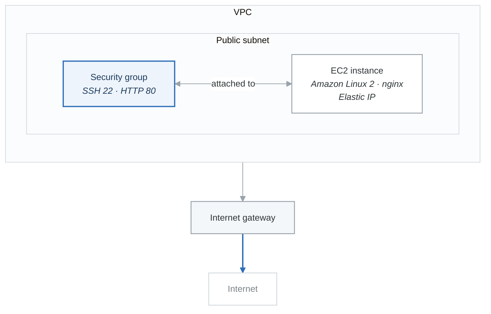

# Lab 1.4: Your First Complete Infrastructure

## Objective

Deploy a complete, functional web server infrastructure on AWS using Terraform.

## Duration: 90 minutes

## What You'll Build

<!-- figure: generated from the Mermaid below by _shared/diagrams/embed-figures.py — do not edit the image -->


<details>
<summary>Diagram source (Mermaid)</summary>



</details>

---

## Part 1: Project Setup

```bash
mkdir -p ~/terraform-learning/labs/first-infrastructure
cd ~/terraform-learning/labs/first-infrastructure
```

---

## Part 2: Provider Configuration

```hcl
# versions.tf
terraform {
  required_version = ">= 1.0"

  required_providers {
    aws = {
      source  = "hashicorp/aws"
      version = "~> 5.0"
    }
  }
}

provider "aws" {
  region = var.aws_region

  default_tags {
    tags = {
      Project     = "terraform-first-infrastructure"
      Environment = var.environment
      ManagedBy   = "Terraform"
    }
  }
}
```

---

## Part 3: Variables

```hcl
# variables.tf
variable "aws_region" {
  description = "AWS region for resources"
  type        = string
  default     = "us-east-1"
}

variable "environment" {
  description = "Environment name"
  type        = string
  default     = "learning"
}

variable "project_name" {
  description = "Name prefix for all resources"
  type        = string
  default     = "first-infra"
}

variable "vpc_cidr" {
  description = "CIDR block for VPC"
  type        = string
  default     = "10.0.0.0/16"
}

variable "public_subnet_cidr" {
  description = "CIDR block for public subnet"
  type        = string
  default     = "10.0.1.0/24"
}

variable "instance_type" {
  description = "EC2 instance type"
  type        = string
  default     = "t2.micro"
}

variable "allowed_ssh_cidr" {
  description = "CIDR block allowed to SSH"
  type        = string
  default     = "0.0.0.0/0" # Restrict in production!
}
```

---

## Part 4: Data Sources

```hcl
# data.tf
# Get the latest Amazon Linux 2 AMI
data "aws_ami" "amazon_linux" {
  most_recent = true
  owners      = ["amazon"]

  filter {
    name   = "name"
    values = ["amzn2-ami-hvm-*-x86_64-gp2"]
  }

  filter {
    name   = "virtualization-type"
    values = ["hvm"]
  }
}

# Get available AZs
data "aws_availability_zones" "available" {
  state = "available"
}

# Get current AWS account ID
data "aws_caller_identity" "current" {}

# Get current AWS region
data "aws_region" "current" {}
```

---

## Part 5: Networking

```hcl
# network.tf

# VPC
resource "aws_vpc" "main" {
  cidr_block           = var.vpc_cidr
  enable_dns_hostnames = true
  enable_dns_support   = true

  tags = {
    Name = "${var.project_name}-vpc"
  }
}

# Internet Gateway
resource "aws_internet_gateway" "main" {
  vpc_id = aws_vpc.main.id

  tags = {
    Name = "${var.project_name}-igw"
  }
}

# Public Subnet
resource "aws_subnet" "public" {
  vpc_id                  = aws_vpc.main.id
  cidr_block              = var.public_subnet_cidr
  availability_zone       = data.aws_availability_zones.available.names[0]
  map_public_ip_on_launch = true

  tags = {
    Name = "${var.project_name}-public-subnet"
    Type = "public"
  }
}

# Route Table
resource "aws_route_table" "public" {
  vpc_id = aws_vpc.main.id

  route {
    cidr_block = "0.0.0.0/0"
    gateway_id = aws_internet_gateway.main.id
  }

  tags = {
    Name = "${var.project_name}-public-rt"
  }
}

# Route Table Association
resource "aws_route_table_association" "public" {
  subnet_id      = aws_subnet.public.id
  route_table_id = aws_route_table.public.id
}
```

---

## Part 6: Security

```hcl
# security.tf

# Security Group for Web Server
resource "aws_security_group" "web" {
  name        = "${var.project_name}-web-sg"
  description = "Security group for web server"
  vpc_id      = aws_vpc.main.id

  # SSH access
  ingress {
    description = "SSH from allowed CIDR"
    from_port   = 22
    to_port     = 22
    protocol    = "tcp"
    cidr_blocks = [var.allowed_ssh_cidr]
  }

  # HTTP access
  ingress {
    description = "HTTP from anywhere"
    from_port   = 80
    to_port     = 80
    protocol    = "tcp"
    cidr_blocks = ["0.0.0.0/0"]
  }

  # HTTPS access
  ingress {
    description = "HTTPS from anywhere"
    from_port   = 443
    to_port     = 443
    protocol    = "tcp"
    cidr_blocks = ["0.0.0.0/0"]
  }

  # All outbound traffic
  egress {
    description = "All outbound traffic"
    from_port   = 0
    to_port     = 0
    protocol    = "-1"
    cidr_blocks = ["0.0.0.0/0"]
  }

  tags = {
    Name = "${var.project_name}-web-sg"
  }

  lifecycle {
    create_before_destroy = true
  }
}
```

---

## Part 7: Compute

```hcl
# compute.tf

# EC2 Instance
resource "aws_instance" "web" {
  ami                    = data.aws_ami.amazon_linux.id
  instance_type          = var.instance_type
  subnet_id              = aws_subnet.public.id
  vpc_security_group_ids = [aws_security_group.web.id]

  # User data script to install and start Nginx
  user_data = <<-EOF
    #!/bin/bash
    yum update -y
    amazon-linux-extras install nginx1 -y
    systemctl start nginx
    systemctl enable nginx

    # Create custom index page
    cat > /usr/share/nginx/html/index.html <<'HTMLEOF'
    <!DOCTYPE html>
    <html>
    <head>
        <title>Terraform First Infrastructure</title>
        <style>
            body {
                font-family: Arial, sans-serif;
                display: flex;
                justify-content: center;
                align-items: center;
                height: 100vh;
                margin: 0;
                background: linear-gradient(135deg, #667eea 0%, #764ba2 100%);
                color: white;
            }
            .container {
                text-align: center;
                padding: 40px;
                background: rgba(255,255,255,0.1);
                border-radius: 10px;
                backdrop-filter: blur(10px);
            }
            h1 { font-size: 2.5em; margin-bottom: 10px; }
            p { font-size: 1.2em; opacity: 0.9; }
            .success { color: #90EE90; font-size: 3em; }
        </style>
    </head>
    <body>
        <div class="container">
            <div class="success">✓</div>
            <h1>Hello from Terraform!</h1>
            <p>Your first infrastructure is running successfully.</p>
            <p><small>Instance ID: $(curl -s http://169.254.169.254/latest/meta-data/instance-id)</small></p>
            <p><small>Availability Zone: $(curl -s http://169.254.169.254/latest/meta-data/placement/availability-zone)</small></p>
        </div>
    </body>
    </html>
    HTMLEOF
  EOF

  user_data_replace_on_change = true

  root_block_device {
    volume_size           = 8
    volume_type           = "gp3"
    encrypted             = true
    delete_on_termination = true

    tags = {
      Name = "${var.project_name}-root-volume"
    }
  }

  tags = {
    Name = "${var.project_name}-web-server"
  }
}

# Elastic IP for consistent public address
resource "aws_eip" "web" {
  instance = aws_instance.web.id
  domain   = "vpc"

  tags = {
    Name = "${var.project_name}-web-eip"
  }

  depends_on = [aws_internet_gateway.main]
}
```

---

## Part 8: Outputs

```hcl
# outputs.tf

output "vpc_id" {
  description = "ID of the VPC"
  value       = aws_vpc.main.id
}

output "vpc_cidr" {
  description = "CIDR block of the VPC"
  value       = aws_vpc.main.cidr_block
}

output "public_subnet_id" {
  description = "ID of the public subnet"
  value       = aws_subnet.public.id
}

output "security_group_id" {
  description = "ID of the web security group"
  value       = aws_security_group.web.id
}

output "instance_id" {
  description = "ID of the EC2 instance"
  value       = aws_instance.web.id
}

output "instance_private_ip" {
  description = "Private IP of the EC2 instance"
  value       = aws_instance.web.private_ip
}

output "instance_public_ip" {
  description = "Elastic IP address"
  value       = aws_eip.web.public_ip
}

output "web_url" {
  description = "URL to access the web server"
  value       = "http://${aws_eip.web.public_ip}"
}

output "ssh_command" {
  description = "SSH command to connect (requires key pair)"
  value       = "ssh -i <your-key.pem> ec2-user@${aws_eip.web.public_ip}"
}

output "aws_account_id" {
  description = "AWS Account ID"
  value       = data.aws_caller_identity.current.account_id
}

output "aws_region" {
  description = "AWS Region"
  value       = data.aws_region.current.name
}

output "ami_id" {
  description = "AMI ID used for the instance"
  value       = data.aws_ami.amazon_linux.id
}

output "ami_name" {
  description = "AMI name used for the instance"
  value       = data.aws_ami.amazon_linux.name
}
```

---

## Part 9: Local Values

```hcl
# locals.tf

locals {
  # Computed values
  full_name = "${var.project_name}-${var.environment}"

  # Resource naming
  resource_prefix = local.full_name

  # Common tags (in addition to default_tags)
  common_tags = {
    Owner     = "terraform-learning"
    CreatedAt = timestamp()
  }

  # Network calculations
  vpc_cidr_parts = split("/", var.vpc_cidr)
  vpc_network    = local.vpc_cidr_parts[0]
  vpc_mask       = local.vpc_cidr_parts[1]
}
```

---

## Part 10: Deploy!

### Step 1: Initialize

```bash
terraform init
```

### Step 2: Validate

```bash
terraform validate
```

### Step 3: Format

```bash
terraform fmt
```

### Step 4: Plan

```bash
terraform plan -out=tfplan
```

Review the plan carefully. You should see:
- 1 VPC
- 1 Internet Gateway
- 1 Subnet
- 1 Route Table
- 1 Route Table Association
- 1 Security Group
- 1 EC2 Instance
- 1 Elastic IP

### Step 5: Apply

```bash
terraform apply tfplan
```

### Step 6: Verify

```bash
# Get the web URL
terraform output web_url

# Test the web server (wait 2-3 minutes for instance to boot)
curl $(terraform output -raw web_url)

# Or open in browser
open $(terraform output -raw web_url)  # macOS
xdg-open $(terraform output -raw web_url)  # Linux
```

---

## Part 11: Explore Your Infrastructure

### View Resources

```bash
# List all resources
terraform state list

# Show specific resource details
terraform state show aws_instance.web
terraform state show aws_vpc.main

# Show all outputs
terraform output

# Get specific output
terraform output instance_public_ip
```

### View in AWS Console

1. Go to EC2 Dashboard → Instances
2. Find your instance by name tag
3. Check VPC Dashboard for networking resources

---

## Part 12: Make Changes

### Add a Tag

Edit `compute.tf` to add a new tag:

```hcl
resource "aws_instance" "web" {
  # ... existing configuration ...

  tags = {
    Name    = "${var.project_name}-web-server"
    Version = "1.0"  # Add this line
  }
}
```

```bash
terraform plan
# Notice the "~" indicating in-place update
terraform apply -auto-approve
```

### Modify Security Group

Add ICMP (ping) access to `security.tf`:

```hcl
# Add this ingress block to aws_security_group.web
ingress {
  description = "ICMP ping"
  from_port   = -1
  to_port     = -1
  protocol    = "icmp"
  cidr_blocks = ["0.0.0.0/0"]
}
```

```bash
terraform plan
terraform apply -auto-approve

# Test ping
ping $(terraform output -raw instance_public_ip)
```

---

## Part 13: Clean Up

```bash
# Plan destruction
terraform plan -destroy

# Destroy all resources
terraform destroy
```

Type `yes` to confirm.

---

## Exercises

### Exercise 1: Add a Second Subnet

Create a private subnet in the VPC:

- CIDR: 10.0.2.0/24
- Different AZ than public subnet
- No public IP mapping

### Exercise 2: Create a Key Pair

1. Generate SSH key pair
2. Create `aws_key_pair` resource
3. Associate with EC2 instance
4. SSH into the instance

### Exercise 3: Add CloudWatch Alarm

Create a CloudWatch alarm for high CPU:

- Metric: CPUUtilization
- Threshold: 80%
- Period: 5 minutes

---

## Solutions

<details>
<summary>Exercise 1 Solution</summary>

```hcl
# Add to network.tf
resource "aws_subnet" "private" {
  vpc_id                  = aws_vpc.main.id
  cidr_block              = "10.0.2.0/24"
  availability_zone       = data.aws_availability_zones.available.names[1]
  map_public_ip_on_launch = false

  tags = {
    Name = "${var.project_name}-private-subnet"
    Type = "private"
  }
}

# Add output
output "private_subnet_id" {
  description = "ID of the private subnet"
  value       = aws_subnet.private.id
}
```

</details>

<details>
<summary>Exercise 2 Solution</summary>

```bash
# Generate key pair locally
ssh-keygen -t rsa -b 4096 -f ~/.ssh/terraform-key -N ""
```

```hcl
# Add to compute.tf
resource "aws_key_pair" "main" {
  key_name   = "${var.project_name}-key"
  public_key = file("~/.ssh/terraform-key.pub")
}

# Modify aws_instance.web
resource "aws_instance" "web" {
  # ... existing configuration ...
  key_name = aws_key_pair.main.key_name
  # ...
}
```

```bash
# SSH command
ssh -i ~/.ssh/terraform-key ec2-user@$(terraform output -raw instance_public_ip)
```

</details>

<details>
<summary>Exercise 3 Solution</summary>

```hcl
# Add to compute.tf or create monitoring.tf
resource "aws_cloudwatch_metric_alarm" "high_cpu" {
  alarm_name          = "${var.project_name}-high-cpu"
  comparison_operator = "GreaterThanThreshold"
  evaluation_periods  = 2
  metric_name         = "CPUUtilization"
  namespace           = "AWS/EC2"
  period              = 300
  statistic           = "Average"
  threshold           = 80
  alarm_description   = "This alarm monitors EC2 CPU utilization"

  dimensions = {
    InstanceId = aws_instance.web.id
  }

  tags = {
    Name = "${var.project_name}-high-cpu-alarm"
  }
}
```

</details>

---

## Checkpoint

You have completed Phase 1! You should now be able to:

- [ ] Set up a complete Terraform development environment
- [ ] Write valid HCL configuration
- [ ] Use all core Terraform commands
- [ ] Deploy real AWS infrastructure
- [ ] Modify and destroy infrastructure
- [ ] Read outputs and state

---

## Next: Phase 2 - Core Competencies

Continue to [Phase 2: Core Competencies](../phase-2-core/README.md)

<!-- feynman-check -->

---

## Feynman check

Close the file. Blank page, no notes. Explain each of these to a competent engineer who has never
used this tool — **under five minutes, no jargon you can't define on the spot:**

- Project Setup
- Provider Configuration
- Variables
- Data Sources

**The gap is not what you forgot. It is where you used a word instead of a mechanism.**

| | |
|---|---|
| ✗ | *"Terraform manages your infrastructure."* |
| ✓ | *"`plan` is a three-way comparison: the configuration (desired), the state file (what Terraform believes it created), and a refresh against the real API (what exists). Almost every confusing result is one of those three drifting from the other two."* |

**Trace it:** `terraform apply` on one resource: config → plan → API call → state write. Then say what happens if the process dies between the API call and the state write.

Stop at the first component you cannot name. Reopen this file and read **only** that.

**Go deeper — only once the gap has a name:** [the purpose of Terraform state](https://developer.hashicorp.com/terraform/language/state/purpose) — almost every confusing result is a three-way disagreement, spelled out there.
Full list per domain: [`SOURCES.md`](../../SOURCES.md#terraform)

→ Protocol, the three levels of knowing, and worked examples: [`MASTERY.md`](../../MASTERY.md)

<!-- /feynman-check -->
