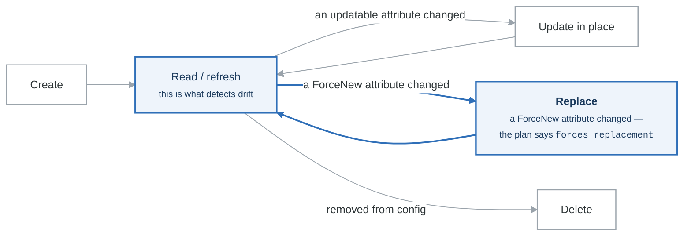

# Lab 2.2: Resources & Meta-Arguments

## Objective

Master resource configuration and all meta-arguments for advanced resource management.

## Duration: 90 minutes

---

## Part 1: Resource Behavior

### Resource Lifecycle

<!-- figure: generated from the Mermaid below by _shared/diagrams/embed-figures.py — do not edit the image -->


<details>
<summary>Diagram source (Mermaid)</summary>



</details>

### Setup

```bash
mkdir -p ~/terraform-learning/labs/meta-arguments-lab
cd ~/terraform-learning/labs/meta-arguments-lab
```

```hcl
# versions.tf
terraform {
  required_version = ">= 1.0"

  required_providers {
    aws = {
      source  = "hashicorp/aws"
      version = "~> 5.0"
    }
  }
}

provider "aws" {
  region = "us-east-1"
}
```

---

## Part 2: depends_on (Explicit Dependencies)

Terraform automatically determines dependencies through references. Use `depends_on` when there's a hidden dependency.

### When to Use depends_on

```hcl
# data.tf
data "aws_caller_identity" "current" {}

# iam.tf
resource "aws_iam_role" "app" {
  name = "app-role"

  assume_role_policy = jsonencode({
    Version = "2012-10-17"
    Statement = [{
      Action = "sts:AssumeRole"
      Effect = "Allow"
      Principal = {
        Service = "ec2.amazonaws.com"
      }
    }]
  })
}

resource "aws_iam_role_policy" "app" {
  name = "app-policy"
  role = aws_iam_role.app.id

  policy = jsonencode({
    Version = "2012-10-17"
    Statement = [{
      Effect = "Allow"
      Action = [
        "s3:GetObject",
        "s3:PutObject"
      ]
      Resource = "${aws_s3_bucket.app.arn}/*"
    }]
  })
}

resource "aws_iam_instance_profile" "app" {
  name = "app-profile"
  role = aws_iam_role.app.name
}

resource "aws_s3_bucket" "app" {
  bucket = "app-data-${data.aws_caller_identity.current.account_id}"
}

# EC2 instance that needs IAM role to be fully ready
resource "aws_instance" "app" {
  ami                  = data.aws_ami.amazon_linux.id
  instance_type        = "t2.micro"
  iam_instance_profile = aws_iam_instance_profile.app.name

  # Hidden dependency: instance needs policy attached before starting
  depends_on = [aws_iam_role_policy.app]

  tags = {
    Name = "app-server"
  }
}

data "aws_ami" "amazon_linux" {
  most_recent = true
  owners      = ["amazon"]

  filter {
    name   = "name"
    values = ["amzn2-ami-hvm-*-x86_64-gp2"]
  }
}
```

### Module depends_on

```hcl
module "app" {
  source = "./modules/app"

  # Ensure VPC is fully created before app module
  depends_on = [module.vpc]
}
```

---

## Part 3: count (Multiple Resources)

### Basic count

```hcl
variable "server_count" {
  type    = number
  default = 3
}

resource "aws_instance" "server" {
  count = var.server_count

  ami           = data.aws_ami.amazon_linux.id
  instance_type = "t2.micro"

  tags = {
    Name = "server-${count.index + 1}"
  }
}

# Accessing count resources
output "server_ids" {
  value = aws_instance.server[*].id
}

output "first_server_ip" {
  value = aws_instance.server[0].private_ip
}

output "all_private_ips" {
  value = aws_instance.server[*].private_ip
}
```

### Conditional Resource with count

```hcl
variable "create_eip" {
  type    = bool
  default = true
}

resource "aws_eip" "server" {
  count = var.create_eip ? var.server_count : 0

  instance = aws_instance.server[count.index].id
  domain   = "vpc"

  tags = {
    Name = "server-${count.index + 1}-eip"
  }
}
```

### count with Lists

```hcl
variable "subnet_cidrs" {
  type    = list(string)
  default = ["10.0.1.0/24", "10.0.2.0/24", "10.0.3.0/24"]
}

data "aws_availability_zones" "available" {
  state = "available"
}

resource "aws_subnet" "public" {
  count = length(var.subnet_cidrs)

  vpc_id            = aws_vpc.main.id
  cidr_block        = var.subnet_cidrs[count.index]
  availability_zone = data.aws_availability_zones.available.names[count.index % length(data.aws_availability_zones.available.names)]

  tags = {
    Name = "public-subnet-${count.index + 1}"
    AZ   = data.aws_availability_zones.available.names[count.index % length(data.aws_availability_zones.available.names)]
  }
}

resource "aws_vpc" "main" {
  cidr_block = "10.0.0.0/16"
}
```

### count Limitations

```hcl
# PROBLEM: Removing an item from the middle shifts all indexes
variable "servers" {
  type    = list(string)
  default = ["web", "api", "db"]  # If "api" is removed, "db" becomes index 1
}

# This causes "db" to be destroyed and recreated
resource "aws_instance" "servers" {
  count = length(var.servers)

  ami           = data.aws_ami.amazon_linux.id
  instance_type = "t2.micro"

  tags = {
    Name = var.servers[count.index]
  }
}
```

---

## Part 4: for_each (Map/Set Iteration)

### for_each with Set

```hcl
variable "server_names" {
  type    = set(string)
  default = ["web", "api", "db"]
}

resource "aws_instance" "servers" {
  for_each = var.server_names

  ami           = data.aws_ami.amazon_linux.id
  instance_type = "t2.micro"

  tags = {
    Name = each.value  # or each.key (same for sets)
  }
}

# Accessing for_each resources
output "server_ids" {
  value = { for k, v in aws_instance.servers : k => v.id }
}

output "web_server_ip" {
  value = aws_instance.servers["web"].private_ip
}
```

### for_each with Map

```hcl
variable "instances" {
  type = map(object({
    instance_type = string
    volume_size   = number
  }))
  default = {
    web = {
      instance_type = "t2.micro"
      volume_size   = 20
    }
    api = {
      instance_type = "t2.small"
      volume_size   = 30
    }
    db = {
      instance_type = "t2.medium"
      volume_size   = 100
    }
  }
}

resource "aws_instance" "app" {
  for_each = var.instances

  ami           = data.aws_ami.amazon_linux.id
  instance_type = each.value.instance_type

  root_block_device {
    volume_size = each.value.volume_size
    volume_type = "gp3"
  }

  tags = {
    Name = each.key
    Type = each.key
  }
}

output "instance_details" {
  value = {
    for name, instance in aws_instance.app : name => {
      id          = instance.id
      private_ip  = instance.private_ip
      instance_type = instance.instance_type
    }
  }
}
```

### Converting List to Set for for_each

```hcl
variable "bucket_names" {
  type    = list(string)
  default = ["logs", "data", "backups"]
}

resource "aws_s3_bucket" "buckets" {
  for_each = toset(var.bucket_names)

  bucket = "${each.value}-${data.aws_caller_identity.current.account_id}"

  tags = {
    Name = each.value
  }
}

data "aws_caller_identity" "current" {}
```

### Complex for_each with Local Values

```hcl
variable "environments" {
  type = map(object({
    instance_count = number
    instance_type  = string
  }))
  default = {
    dev = {
      instance_count = 1
      instance_type  = "t2.micro"
    }
    staging = {
      instance_count = 2
      instance_type  = "t2.small"
    }
    prod = {
      instance_count = 3
      instance_type  = "t2.medium"
    }
  }
}

locals {
  # Flatten environments into individual instance definitions
  instances = merge([
    for env, config in var.environments : {
      for i in range(config.instance_count) :
      "${env}-${i + 1}" => {
        environment   = env
        instance_type = config.instance_type
        index         = i + 1
      }
    }
  ]...)
}

resource "aws_instance" "all" {
  for_each = local.instances

  ami           = data.aws_ami.amazon_linux.id
  instance_type = each.value.instance_type

  tags = {
    Name        = each.key
    Environment = each.value.environment
    Index       = each.value.index
  }
}

output "instance_map" {
  value = local.instances
}
```

---

## Part 5: provider (Multiple Provider Instances)

```hcl
provider "aws" {
  region = "us-east-1"
  alias  = "east"
}

provider "aws" {
  region = "us-west-2"
  alias  = "west"
}

resource "aws_instance" "east_server" {
  provider = aws.east

  ami           = "ami-0c55b159cbfafe1f0"  # us-east-1 AMI
  instance_type = "t2.micro"

  tags = {
    Name   = "east-server"
    Region = "us-east-1"
  }
}

resource "aws_instance" "west_server" {
  provider = aws.west

  ami           = "ami-0d6621c01e8c2de2c"  # us-west-2 AMI
  instance_type = "t2.micro"

  tags = {
    Name   = "west-server"
    Region = "us-west-2"
  }
}

# Combined with for_each
variable "regions" {
  type = map(object({
    ami    = string
    region = string
  }))
  default = {
    east = {
      ami    = "ami-0c55b159cbfafe1f0"
      region = "us-east-1"
    }
    west = {
      ami    = "ami-0d6621c01e8c2de2c"
      region = "us-west-2"
    }
  }
}
```

---

## Part 6: lifecycle (Resource Behavior)

### create_before_destroy

```hcl
resource "aws_instance" "web" {
  ami           = data.aws_ami.amazon_linux.id
  instance_type = "t2.micro"

  lifecycle {
    # Create new instance before destroying old one
    # Useful for zero-downtime deployments
    create_before_destroy = true
  }

  tags = {
    Name = "web-server"
  }
}

# Often used with security groups
resource "aws_security_group" "web" {
  name        = "web-sg"
  description = "Web security group"
  vpc_id      = aws_vpc.main.id

  lifecycle {
    create_before_destroy = true
  }

  ingress {
    from_port   = 80
    to_port     = 80
    protocol    = "tcp"
    cidr_blocks = ["0.0.0.0/0"]
  }
}
```

### prevent_destroy

```hcl
resource "aws_db_instance" "production" {
  identifier        = "prod-database"
  engine            = "postgres"
  engine_version    = "15"
  instance_class    = "db.t3.micro"
  allocated_storage = 20
  username          = "admin"
  password          = var.db_password

  lifecycle {
    # Prevent accidental deletion
    prevent_destroy = true
  }

  tags = {
    Name        = "production-db"
    Environment = "production"
  }
}

# Also useful for S3 buckets with important data
resource "aws_s3_bucket" "critical_data" {
  bucket = "critical-data-${data.aws_caller_identity.current.account_id}"

  lifecycle {
    prevent_destroy = true
  }
}
```

### ignore_changes

```hcl
resource "aws_instance" "managed" {
  ami           = data.aws_ami.amazon_linux.id
  instance_type = "t2.micro"

  lifecycle {
    # Ignore changes to these attributes
    # Useful when external processes modify resources
    ignore_changes = [
      tags,
      user_data,
    ]
  }

  tags = {
    Name = "managed-server"
  }
}

# Ignore all changes (fully managed externally)
resource "aws_instance" "external" {
  ami           = data.aws_ami.amazon_linux.id
  instance_type = "t2.micro"

  lifecycle {
    ignore_changes = all
  }
}

# Common use case: Auto Scaling Group desired capacity
resource "aws_autoscaling_group" "app" {
  name                = "app-asg"
  vpc_zone_identifier = [aws_subnet.public[0].id]
  min_size            = 1
  max_size            = 10
  desired_capacity    = 2

  launch_template {
    id      = aws_launch_template.app.id
    version = "$Latest"
  }

  lifecycle {
    # Ignore desired_capacity changes from scaling events
    ignore_changes = [desired_capacity]
  }
}
```

### replace_triggered_by

```hcl
resource "aws_instance" "web" {
  ami           = data.aws_ami.amazon_linux.id
  instance_type = "t2.micro"

  lifecycle {
    # Replace this instance when security group changes
    replace_triggered_by = [
      aws_security_group.web.id
    ]
  }

  vpc_security_group_ids = [aws_security_group.web.id]

  tags = {
    Name = "web-server"
  }
}

resource "aws_security_group" "web" {
  name   = "web-sg"
  vpc_id = aws_vpc.main.id

  ingress {
    from_port   = 80
    to_port     = 80
    protocol    = "tcp"
    cidr_blocks = ["0.0.0.0/0"]
  }
}
```

### precondition and postcondition

```hcl
variable "instance_type" {
  type = string
}

data "aws_ec2_instance_type" "selected" {
  instance_type = var.instance_type
}

resource "aws_instance" "app" {
  ami           = data.aws_ami.amazon_linux.id
  instance_type = var.instance_type

  lifecycle {
    # Validate before creation
    precondition {
      condition     = data.aws_ec2_instance_type.selected.current_generation
      error_message = "Instance type must be current generation."
    }

    precondition {
      condition     = data.aws_ec2_instance_type.selected.memory_size >= 1024
      error_message = "Instance must have at least 1GB memory."
    }

    # Validate after creation
    postcondition {
      condition     = self.public_ip != null
      error_message = "Instance must have a public IP address."
    }
  }

  associate_public_ip_address = true
  subnet_id                   = aws_subnet.public.id

  tags = {
    Name = "app-server"
  }
}
```

---

## Part 7: Combining Meta-Arguments

### Complete Example

```hcl
variable "environments" {
  type = map(object({
    instance_count = number
    instance_type  = string
    create_eip     = bool
  }))
  default = {
    dev = {
      instance_count = 1
      instance_type  = "t2.micro"
      create_eip     = false
    }
    prod = {
      instance_count = 2
      instance_type  = "t2.small"
      create_eip     = true
    }
  }
}

locals {
  instances = merge([
    for env, config in var.environments : {
      for i in range(config.instance_count) :
      "${env}-${i + 1}" => merge(config, {
        name = "${env}-server-${i + 1}"
        env  = env
      })
    }
  ]...)
}

resource "aws_instance" "servers" {
  for_each = local.instances

  ami           = data.aws_ami.amazon_linux.id
  instance_type = each.value.instance_type
  subnet_id     = aws_subnet.public.id

  vpc_security_group_ids = [aws_security_group.web.id]

  lifecycle {
    create_before_destroy = true

    precondition {
      condition     = contains(["t2.micro", "t2.small", "t2.medium"], each.value.instance_type)
      error_message = "Instance type must be t2.micro, t2.small, or t2.medium."
    }
  }

  # Explicit dependency
  depends_on = [aws_internet_gateway.main]

  tags = {
    Name        = each.value.name
    Environment = each.value.env
  }
}

resource "aws_eip" "servers" {
  for_each = { for k, v in local.instances : k => v if v.create_eip }

  instance = aws_instance.servers[each.key].id
  domain   = "vpc"

  lifecycle {
    create_before_destroy = true
  }

  tags = {
    Name = "${each.key}-eip"
  }

  depends_on = [aws_internet_gateway.main]
}
```

---

## Exercise: Build a Scalable Web Tier

### Requirements

Create a web tier with:

1. Multiple environments (dev, staging, prod)
2. Different instance counts per environment
3. Conditional load balancer (only for prod)
4. Lifecycle rules to prevent production destruction

### Expected Outputs

- Instance IDs grouped by environment
- Load balancer DNS (if created)
- Total instance count

---

## Checkpoint

Before moving to Lab 2.3, verify you can:

- [ ] Use depends_on for hidden dependencies
- [ ] Create multiple resources with count
- [ ] Iterate with for_each over maps and sets
- [ ] Configure provider meta-argument for multi-region
- [ ] Apply lifecycle rules appropriately
- [ ] Use precondition/postcondition for validation

---

## Next: Lab 2.3 - Variables & Validation

<!-- feynman-check -->

---

## Feynman check

Close the file. Blank page, no notes. Explain each of these to a competent engineer who has never
used this tool — **under five minutes, no jargon you can't define on the spot:**

- Resource Behavior
- dependson (Explicit Dependencies)
- count (Multiple Resources)
- foreach (Map/Set Iteration)

**The gap is not what you forgot. It is where you used a word instead of a mechanism.**

| | |
|---|---|
| ✗ | *"Terraform manages your infrastructure."* |
| ✓ | *"`plan` is a three-way comparison: the configuration (desired), the state file (what Terraform believes it created), and a refresh against the real API (what exists). Almost every confusing result is one of those three drifting from the other two."* |

**Trace it:** `terraform apply` on one resource: config → plan → API call → state write. Then say what happens if the process dies between the API call and the state write.

Stop at the first component you cannot name. Reopen this file and read **only** that.

**Go deeper — only once the gap has a name:** [the purpose of Terraform state](https://developer.hashicorp.com/terraform/language/state/purpose) — almost every confusing result is a three-way disagreement, spelled out there.
Full list per domain: [`SOURCES.md`](../../SOURCES.md#terraform)

→ Protocol, the three levels of knowing, and worked examples: [`MASTERY.md`](../../MASTERY.md)

<!-- /feynman-check -->
