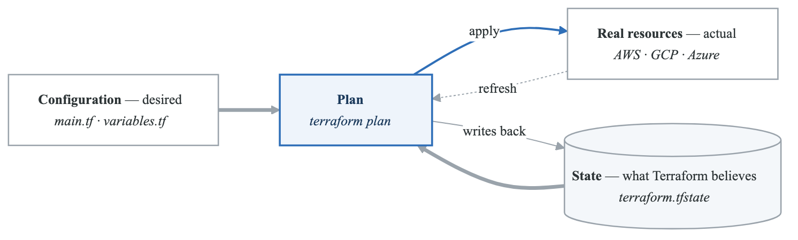
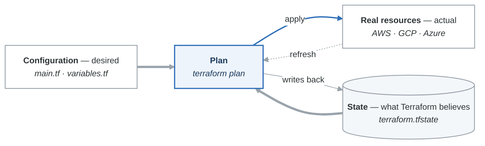
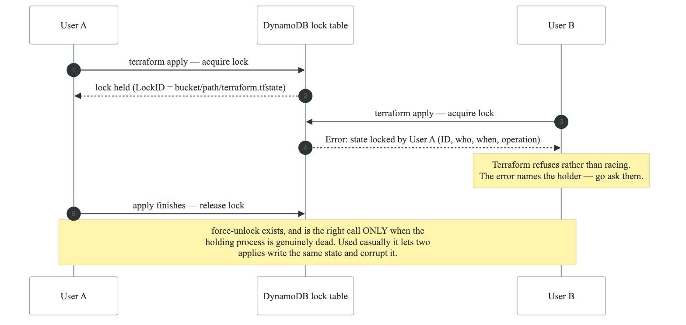
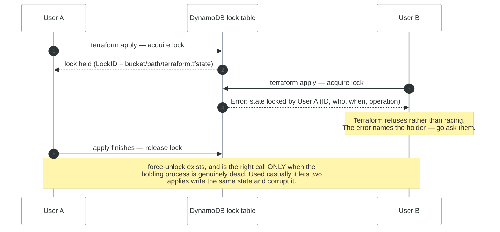

# Lab 2.4: State Management Mastery

## Objective

Master Terraform state including remote backends, state operations, import, and drift detection.

## Duration: 120 minutes

---

## Part 1: Understanding State

### What is Terraform State?

<!-- figure: generated from the Mermaid below by _shared/diagrams/embed-figures.py — do not edit the image -->


<details>
<summary>Diagram source (Mermaid)</summary>



</details>

### State File Structure

```json
{
  "version": 4,
  "terraform_version": "1.6.0",
  "serial": 5,
  "lineage": "abc123...",
  "outputs": {
    "vpc_id": {
      "value": "vpc-12345678",
      "type": "string"
    }
  },
  "resources": [
    {
      "mode": "managed",
      "type": "aws_vpc",
      "name": "main",
      "provider": "provider[\"registry.terraform.io/hashicorp/aws\"]",
      "instances": [
        {
          "attributes": {
            "id": "vpc-12345678",
            "cidr_block": "10.0.0.0/16",
            "tags": {"Name": "main-vpc"}
          }
        }
      ]
    }
  ]
}
```

### Setup

```bash
mkdir -p ~/terraform-learning/labs/state-lab
cd ~/terraform-learning/labs/state-lab
```

---

## Part 2: Local State

### Basic Configuration

```hcl
# versions.tf
terraform {
  required_version = ">= 1.0"

  required_providers {
    aws = {
      source  = "hashicorp/aws"
      version = "~> 5.0"
    }
  }
}

provider "aws" {
  region = "us-east-1"
}

# main.tf
resource "aws_vpc" "main" {
  cidr_block = "10.0.0.0/16"

  tags = {
    Name = "state-lab-vpc"
  }
}

resource "aws_subnet" "public" {
  vpc_id     = aws_vpc.main.id
  cidr_block = "10.0.1.0/24"

  tags = {
    Name = "state-lab-subnet"
  }
}
```

```bash
# Initialize and apply
terraform init
terraform apply -auto-approve

# View state file
cat terraform.tfstate

# List resources in state
terraform state list

# Show specific resource
terraform state show aws_vpc.main
```

### State File Location

```bash
# Default: terraform.tfstate in current directory
ls -la terraform.tfstate

# View state contents (formatted)
terraform show -json | jq .
```

---

## Part 3: Remote State with S3

### Create Backend Infrastructure

First, create the S3 bucket and DynamoDB table for state storage:

```hcl
# backend-setup/main.tf
provider "aws" {
  region = "us-east-1"
}

resource "aws_s3_bucket" "terraform_state" {
  bucket = "terraform-state-${data.aws_caller_identity.current.account_id}"

  lifecycle {
    prevent_destroy = true
  }

  tags = {
    Name    = "Terraform State"
    Purpose = "State Storage"
  }
}

resource "aws_s3_bucket_versioning" "terraform_state" {
  bucket = aws_s3_bucket.terraform_state.id

  versioning_configuration {
    status = "Enabled"
  }
}

resource "aws_s3_bucket_server_side_encryption_configuration" "terraform_state" {
  bucket = aws_s3_bucket.terraform_state.id

  rule {
    apply_server_side_encryption_by_default {
      sse_algorithm = "AES256"
    }
  }
}

resource "aws_s3_bucket_public_access_block" "terraform_state" {
  bucket = aws_s3_bucket.terraform_state.id

  block_public_acls       = true
  block_public_policy     = true
  ignore_public_acls      = true
  restrict_public_buckets = true
}

resource "aws_dynamodb_table" "terraform_locks" {
  name         = "terraform-state-locks"
  billing_mode = "PAY_PER_REQUEST"
  hash_key     = "LockID"

  attribute {
    name = "LockID"
    type = "S"
  }

  tags = {
    Name    = "Terraform State Locks"
    Purpose = "State Locking"
  }
}

data "aws_caller_identity" "current" {}

output "state_bucket" {
  value = aws_s3_bucket.terraform_state.id
}

output "lock_table" {
  value = aws_dynamodb_table.terraform_locks.name
}
```

### Configure Remote Backend

```hcl
# versions.tf
terraform {
  required_version = ">= 1.0"

  # Remote backend configuration
  backend "s3" {
    bucket         = "terraform-state-123456789012"  # Your bucket name
    key            = "state-lab/terraform.tfstate"
    region         = "us-east-1"
    encrypt        = true
    dynamodb_table = "terraform-state-locks"
  }

  required_providers {
    aws = {
      source  = "hashicorp/aws"
      version = "~> 5.0"
    }
  }
}
```

### Migrate Local to Remote

```bash
# Initialize with new backend
terraform init -migrate-state

# Verify state is remote
terraform state list

# Local state file should be empty now
cat terraform.tfstate
```

---

## Part 4: State Operations

### terraform state list

```bash
# List all resources
terraform state list

# Output:
# aws_vpc.main
# aws_subnet.public
```

### terraform state show

```bash
# Show resource details
terraform state show aws_vpc.main

# Output:
# resource "aws_vpc" "main" {
#     arn                              = "arn:aws:ec2:us-east-1:123456789012:vpc/vpc-12345678"
#     cidr_block                       = "10.0.0.0/16"
#     id                               = "vpc-12345678"
#     ...
# }
```

### terraform state mv (Rename)

```bash
# Rename resource in state
terraform state mv aws_vpc.main aws_vpc.primary

# Update your configuration to match!
# Change: resource "aws_vpc" "main" → resource "aws_vpc" "primary"
```

### terraform state rm (Remove from State)

```bash
# Remove resource from state (doesn't destroy actual resource)
terraform state rm aws_subnet.public

# Resource still exists in AWS but Terraform no longer manages it
# Use terraform import to re-add if needed
```

### terraform state pull/push

```bash
# Pull remote state to local
terraform state pull > state.json

# View state
cat state.json | jq .

# Push state (dangerous - use carefully!)
# terraform state push state.json
```

### terraform state replace-provider

```bash
# If provider source changes
terraform state replace-provider \
  "registry.terraform.io/-/aws" \
  "registry.terraform.io/hashicorp/aws"
```

---

## Part 5: Importing Existing Resources

### Manual Import

```bash
# Create a VPC manually in AWS Console first
# Get the VPC ID: vpc-0abc123...

# Add resource block to configuration
cat >> main.tf << 'EOF'
resource "aws_vpc" "imported" {
  cidr_block = "172.16.0.0/16"

  tags = {
    Name = "imported-vpc"
  }
}
EOF

# Import the resource
terraform import aws_vpc.imported vpc-0abc123def456

# Verify import
terraform state show aws_vpc.imported

# Plan should show no changes if config matches
terraform plan
```

### Import Block (Terraform 1.5+)

```hcl
# import.tf
import {
  to = aws_vpc.imported
  id = "vpc-0abc123def456"
}

# Generate configuration
terraform plan -generate-config-out=generated.tf

# Review generated.tf and move to main.tf
# Remove import block after successful import
```

### Bulk Import with for_each

```hcl
# import.tf
locals {
  existing_vpcs = {
    "vpc1" = "vpc-111111111"
    "vpc2" = "vpc-222222222"
    "vpc3" = "vpc-333333333"
  }
}

import {
  for_each = local.existing_vpcs
  to       = aws_vpc.existing[each.key]
  id       = each.value
}

# main.tf
resource "aws_vpc" "existing" {
  for_each = local.existing_vpcs

  # Configuration will be generated
  cidr_block = "10.0.0.0/16"  # Update after generation
}
```

---

## Part 6: State Locking

### How Locking Works

<!-- figure: generated from the Mermaid below by _shared/diagrams/embed-figures.py — do not edit the image -->


<details>
<summary>Diagram source (Mermaid)</summary>



</details>

### Force Unlock (Emergency Only)

```bash
# If lock is stuck (process crashed)
terraform force-unlock LOCK_ID

# Get lock ID from error message:
# "Lock Info:
#   ID:        abc123-def456-..."

terraform force-unlock abc123-def456-...
```

---

## Part 7: State Inspection & Drift Detection

### Detect Drift

```bash
# Refresh state without applying
terraform plan -refresh-only

# Shows differences between state and reality
# Example output:
# Note: Objects have changed outside of Terraform
#
# aws_vpc.main:
#   ~ tags = {
#       + "NewTag" = "AddedManually"
#     }
```

### Apply Refresh

```bash
# Update state to match reality
terraform apply -refresh-only
```

### Detailed State Analysis

```bash
# Export state as JSON
terraform show -json > state.json

# Analyze with jq
# List all resource types
cat state.json | jq -r '.values.root_module.resources[].type' | sort | uniq

# Find specific resources
cat state.json | jq '.values.root_module.resources[] | select(.type == "aws_vpc")'

# Count resources by type
cat state.json | jq -r '.values.root_module.resources[].type' | sort | uniq -c
```

---

## Part 8: Workspaces

### Create and Switch Workspaces

```bash
# List workspaces
terraform workspace list

# Create new workspace
terraform workspace new dev
terraform workspace new staging
terraform workspace new prod

# Switch workspace
terraform workspace select dev

# Show current workspace
terraform workspace show
```

### Using Workspace in Configuration

```hcl
# main.tf
locals {
  environment = terraform.workspace

  instance_types = {
    default = "t2.micro"
    dev     = "t2.micro"
    staging = "t2.small"
    prod    = "t2.medium"
  }

  instance_type = lookup(local.instance_types, terraform.workspace, local.instance_types.default)
}

resource "aws_instance" "app" {
  ami           = data.aws_ami.amazon_linux.id
  instance_type = local.instance_type

  tags = {
    Name        = "app-${local.environment}"
    Environment = local.environment
  }
}

# Different S3 state paths per workspace
# With backend key: env:/${terraform.workspace}/terraform.tfstate
```

### Backend with Workspaces

```hcl
terraform {
  backend "s3" {
    bucket         = "terraform-state-123456789012"
    key            = "app/terraform.tfstate"
    region         = "us-east-1"
    encrypt        = true
    dynamodb_table = "terraform-state-locks"

    # State files will be at:
    # env:/dev/app/terraform.tfstate
    # env:/staging/app/terraform.tfstate
    # env:/prod/app/terraform.tfstate
  }
}
```

---

## Part 9: State File Security

### Encryption at Rest

```hcl
# S3 backend with encryption
backend "s3" {
  bucket         = "terraform-state-bucket"
  key            = "terraform.tfstate"
  region         = "us-east-1"
  encrypt        = true  # Server-side encryption

  # Optional: KMS key for encryption
  kms_key_id     = "arn:aws:kms:us-east-1:123456789012:key/abc123..."
}
```

### Access Control

```hcl
# IAM policy for state access
resource "aws_iam_policy" "terraform_state" {
  name = "TerraformStateAccess"

  policy = jsonencode({
    Version = "2012-10-17"
    Statement = [
      {
        Effect = "Allow"
        Action = [
          "s3:GetObject",
          "s3:PutObject",
          "s3:DeleteObject"
        ]
        Resource = "arn:aws:s3:::${var.state_bucket}/*"
      },
      {
        Effect = "Allow"
        Action = [
          "s3:ListBucket"
        ]
        Resource = "arn:aws:s3:::${var.state_bucket}"
      },
      {
        Effect = "Allow"
        Action = [
          "dynamodb:GetItem",
          "dynamodb:PutItem",
          "dynamodb:DeleteItem"
        ]
        Resource = "arn:aws:dynamodb:*:*:table/${var.lock_table}"
      }
    ]
  })
}
```

### State File Backup

```hcl
# S3 versioning for state backup
resource "aws_s3_bucket_versioning" "state" {
  bucket = aws_s3_bucket.terraform_state.id

  versioning_configuration {
    status = "Enabled"
  }
}

# Lifecycle rule for old versions
resource "aws_s3_bucket_lifecycle_configuration" "state" {
  bucket = aws_s3_bucket.terraform_state.id

  rule {
    id     = "state-versions"
    status = "Enabled"

    noncurrent_version_transition {
      noncurrent_days = 30
      storage_class   = "STANDARD_IA"
    }

    noncurrent_version_expiration {
      noncurrent_days = 90
    }
  }
}
```

---

## Part 10: Advanced Patterns

### Partial Configuration (Dynamic Backend)

```hcl
# versions.tf
terraform {
  backend "s3" {
    # Partial configuration - rest from -backend-config
  }
}
```

```bash
# backend-dev.hcl
bucket         = "terraform-state-dev"
key            = "app/terraform.tfstate"
region         = "us-east-1"
encrypt        = true
dynamodb_table = "terraform-locks-dev"
```

```bash
# Initialize with specific backend
terraform init -backend-config=backend-dev.hcl
```

### Remote State Data Source

```hcl
# Read state from another configuration
data "terraform_remote_state" "vpc" {
  backend = "s3"

  config = {
    bucket = "terraform-state-123456789012"
    key    = "vpc/terraform.tfstate"
    region = "us-east-1"
  }
}

# Use outputs from remote state
resource "aws_instance" "app" {
  ami           = data.aws_ami.amazon_linux.id
  instance_type = "t2.micro"
  subnet_id     = data.terraform_remote_state.vpc.outputs.private_subnet_ids[0]

  vpc_security_group_ids = [
    data.terraform_remote_state.vpc.outputs.app_security_group_id
  ]
}
```

---

## Exercise: Production State Setup

### Requirements

1. Create S3 bucket with:
   - Versioning enabled
   - Encryption enabled
   - Public access blocked
   - Lifecycle rules

2. Create DynamoDB table for locking

3. Configure backend for multiple environments

4. Practice state operations:
   - Import existing resource
   - Rename resource
   - Move between workspaces

### Verification

```bash
# List all resources across workspaces
for ws in dev staging prod; do
  echo "=== $ws ==="
  terraform workspace select $ws
  terraform state list
done
```

---

## Checkpoint

Before moving to Phase 3, verify you can:

- [ ] Configure S3 remote backend with locking
- [ ] Perform all state operations safely
- [ ] Import existing resources
- [ ] Detect and handle drift
- [ ] Use workspaces effectively
- [ ] Secure state files properly

---

## Next: Phase 3 - Intermediate Skills

Continue to [Phase 3: Intermediate Skills](../phase-3-intermediate/README.md)

<!-- feynman-check -->

---

## Feynman check

Close the file. Blank page, no notes. Explain each of these to a competent engineer who has never
used this tool — **under five minutes, no jargon you can't define on the spot:**

- Understanding State
- Local State
- Remote State with S3
- State Operations

**The gap is not what you forgot. It is where you used a word instead of a mechanism.**

| | |
|---|---|
| ✗ | *"Terraform manages your infrastructure."* |
| ✓ | *"`plan` is a three-way comparison: the configuration (desired), the state file (what Terraform believes it created), and a refresh against the real API (what exists). Almost every confusing result is one of those three drifting from the other two."* |

**Trace it:** `terraform apply` on one resource: config → plan → API call → state write. Then say what happens if the process dies between the API call and the state write.

Stop at the first component you cannot name. Reopen this file and read **only** that.

**Go deeper — only once the gap has a name:** [the purpose of Terraform state](https://developer.hashicorp.com/terraform/language/state/purpose) — almost every confusing result is a three-way disagreement, spelled out there.
Full list per domain: [`SOURCES.md`](../../SOURCES.md#terraform)

→ Protocol, the three levels of knowing, and worked examples: [`MASTERY.md`](../../MASTERY.md)

<!-- /feynman-check -->
