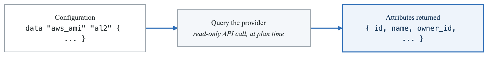

# Lab 3.1: Data Sources & Queries

## Objective

Master data sources to query existing infrastructure and external data.

## Duration: 60 minutes

---

## Part 1: Understanding Data Sources

Data sources allow Terraform to query information from providers or external sources without managing those resources.

```mermaid
%%{init: {'theme':'base','themeVariables':{'fontFamily':'Helvetica, Arial, sans-serif','fontSize':'13px','primaryColor':'#ffffff','primaryTextColor':'#2d3436','primaryBorderColor':'#9aa3ab','lineColor':'#9aa3ab','textColor':'#2d3436','clusterBkg':'#fbfcfd','clusterBorder':'#d4dae0','edgeLabelBackground':'#ffffff','tertiaryColor':'#eef4fb'},'flowchart':{'curve':'basis','padding':14,'nodeSpacing':42,'rankSpacing':58}}}%%
flowchart LR
  classDef default fill:#ffffff,stroke:#9aa3ab,stroke-width:1.3px,color:#2d3436
  classDef n    fill:#ffffff,stroke:#9aa3ab,stroke-width:1.3px,color:#2d3436
  classDef crit fill:#eef4fb,stroke:#2f6fb8,stroke-width:1.8px,color:#1b3a5c
  classDef data fill:#f4f7fa,stroke:#9aa3ab,stroke-width:1.3px,color:#2d3436
  classDef mut  fill:#ffffff,stroke:#cfd6dc,stroke-width:1.1px,color:#7a8288
  classDef warn fill:#fdf0ec,stroke:#c0522d,stroke-width:1.6px,color:#8a3a1e
  C["Configuration<br/><code>data &quot;aws_ami&quot; &quot;al2&quot; { ... }</code>"]
  Q["Query the provider<br/><i>read-only API call, at plan time</i>"]
  A["Attributes returned<br/><code>{ id, name, owner_id, ... }</code>"]
  C ==> Q ==> A
  class C n
  class Q data
  class A crit
  linkStyle 0,1 stroke:#2f6fb8,stroke-width:2px

%% A data source reads; it never creates and never appears in state as
%% something to destroy. The trap: it is evaluated on every plan, so a data
%% source that resolves "the newest AMI" makes your plan non-deterministic --
%% a new AMI release becomes a pending instance replacement you did not ask for.
```

<!-- figure: generated from the Mermaid below by _shared/diagrams/embed-figures.py — do not edit the image -->


<details>
<summary>Diagram source (Mermaid)</summary>



</details>

---

## Part 2: AWS Data Sources

### Query AMI

```hcl
# Find latest Amazon Linux 2 AMI
data "aws_ami" "amazon_linux" {
  most_recent = true
  owners      = ["amazon"]

  filter {
    name   = "name"
    values = ["amzn2-ami-hvm-*-x86_64-gp2"]
  }

  filter {
    name   = "virtualization-type"
    values = ["hvm"]
  }

  filter {
    name   = "root-device-type"
    values = ["ebs"]
  }
}

# Find Ubuntu AMI
data "aws_ami" "ubuntu" {
  most_recent = true
  owners      = ["099720109477"]  # Canonical

  filter {
    name   = "name"
    values = ["ubuntu/images/hvm-ssd/ubuntu-jammy-22.04-amd64-server-*"]
  }
}

output "ami_details" {
  value = {
    amazon_linux = {
      id   = data.aws_ami.amazon_linux.id
      name = data.aws_ami.amazon_linux.name
    }
    ubuntu = {
      id   = data.aws_ami.ubuntu.id
      name = data.aws_ami.ubuntu.name
    }
  }
}
```

### Query Availability Zones

```hcl
data "aws_availability_zones" "available" {
  state = "available"

  filter {
    name   = "opt-in-status"
    values = ["opt-in-not-required"]
  }
}

data "aws_availability_zone" "first" {
  name = data.aws_availability_zones.available.names[0]
}

output "az_info" {
  value = {
    all_azs     = data.aws_availability_zones.available.names
    first_az    = data.aws_availability_zone.first.name
    zone_id     = data.aws_availability_zone.first.zone_id
    region      = data.aws_availability_zone.first.region
  }
}
```

### Query VPC & Subnets

```hcl
# Find default VPC
data "aws_vpc" "default" {
  default = true
}

# Find VPC by tag
data "aws_vpc" "production" {
  tags = {
    Environment = "production"
  }
}

# Find subnets in VPC
data "aws_subnets" "public" {
  filter {
    name   = "vpc-id"
    values = [data.aws_vpc.production.id]
  }

  tags = {
    Type = "public"
  }
}

# Get subnet details
data "aws_subnet" "public" {
  for_each = toset(data.aws_subnets.public.ids)
  id       = each.value
}

output "subnet_details" {
  value = {
    for id, subnet in data.aws_subnet.public : id => {
      cidr_block        = subnet.cidr_block
      availability_zone = subnet.availability_zone
    }
  }
}
```

### Query Security Groups

```hcl
data "aws_security_group" "web" {
  vpc_id = data.aws_vpc.production.id

  tags = {
    Name = "web-sg"
  }
}

data "aws_security_groups" "all_web" {
  filter {
    name   = "vpc-id"
    values = [data.aws_vpc.production.id]
  }

  filter {
    name   = "group-name"
    values = ["*web*"]
  }
}
```

### Query IAM

```hcl
# Current caller identity
data "aws_caller_identity" "current" {}

# Current region
data "aws_region" "current" {}

# Current partition (aws, aws-cn, aws-us-gov)
data "aws_partition" "current" {}

# IAM policy document
data "aws_iam_policy_document" "assume_role" {
  statement {
    effect = "Allow"

    principals {
      type        = "Service"
      identifiers = ["ec2.amazonaws.com"]
    }

    actions = ["sts:AssumeRole"]
  }
}

# Existing IAM role
data "aws_iam_role" "existing" {
  name = "AWSServiceRoleForAutoScaling"
}

output "account_info" {
  value = {
    account_id = data.aws_caller_identity.current.account_id
    region     = data.aws_region.current.name
    partition  = data.aws_partition.current.partition
  }
}
```

---

## Part 3: External Data Sources

### HTTP Data Source

```hcl
# Fetch external data
data "http" "my_ip" {
  url = "https://api.ipify.org?format=json"

  request_headers = {
    Accept = "application/json"
  }
}

locals {
  my_ip = jsondecode(data.http.my_ip.response_body).ip
}

# Use in security group
resource "aws_security_group" "admin" {
  name   = "admin-access"
  vpc_id = aws_vpc.main.id

  ingress {
    from_port   = 22
    to_port     = 22
    protocol    = "tcp"
    cidr_blocks = ["${local.my_ip}/32"]
    description = "SSH from my IP"
  }
}
```

### External Program Data Source

```hcl
# Run external script
data "external" "git_info" {
  program = ["bash", "-c", <<-EOF
    echo '{"branch":"'$(git rev-parse --abbrev-ref HEAD)'","commit":"'$(git rev-parse --short HEAD)'"}'
  EOF
  ]
}

locals {
  git_branch = data.external.git_info.result.branch
  git_commit = data.external.git_info.result.commit
}

resource "aws_instance" "app" {
  ami           = data.aws_ami.amazon_linux.id
  instance_type = "t2.micro"

  tags = {
    GitBranch = local.git_branch
    GitCommit = local.git_commit
  }
}
```

### Local File Data Source

```hcl
# Read file contents
data "local_file" "config" {
  filename = "${path.module}/config.json"
}

locals {
  config = jsondecode(data.local_file.config.content)
}

# Read multiple files
data "local_file" "user_data_scripts" {
  for_each = fileset("${path.module}/scripts", "*.sh")
  filename = "${path.module}/scripts/${each.value}"
}
```

### Template File

```hcl
# templates/user_data.tftpl
#!/bin/bash
echo "Environment: ${environment}"
echo "Region: ${region}"
echo "Instance Role: ${role}"

# Install packages
yum update -y
yum install -y ${join(" ", packages)}

# Start services
%{ for service in services ~}
systemctl enable ${service}
systemctl start ${service}
%{ endfor ~}
```

```hcl
# main.tf
data "aws_region" "current" {}

resource "aws_instance" "app" {
  ami           = data.aws_ami.amazon_linux.id
  instance_type = "t2.micro"

  user_data = templatefile("${path.module}/templates/user_data.tftpl", {
    environment = var.environment
    region      = data.aws_region.current.name
    role        = "application"
    packages    = ["nginx", "htop", "vim"]
    services    = ["nginx"]
  })

  tags = {
    Name = "app-server"
  }
}
```

---

## Part 4: Data Source Dependencies

### Chaining Data Sources

```hcl
# Step 1: Find VPC
data "aws_vpc" "selected" {
  tags = {
    Name = var.vpc_name
  }
}

# Step 2: Find subnets in that VPC
data "aws_subnets" "private" {
  filter {
    name   = "vpc-id"
    values = [data.aws_vpc.selected.id]
  }

  tags = {
    Type = "private"
  }
}

# Step 3: Get route table for first subnet
data "aws_route_table" "private" {
  subnet_id = data.aws_subnets.private.ids[0]
}

# Step 4: Use in resource
resource "aws_instance" "app" {
  ami           = data.aws_ami.amazon_linux.id
  instance_type = "t2.micro"
  subnet_id     = data.aws_subnets.private.ids[0]
}
```

### Conditional Data Source Lookup

```hcl
variable "use_existing_vpc" {
  type    = bool
  default = false
}

variable "existing_vpc_id" {
  type    = string
  default = ""
}

# Lookup existing VPC if specified
data "aws_vpc" "existing" {
  count = var.use_existing_vpc ? 1 : 0
  id    = var.existing_vpc_id
}

# Create new VPC if not using existing
resource "aws_vpc" "new" {
  count      = var.use_existing_vpc ? 0 : 1
  cidr_block = "10.0.0.0/16"
}

locals {
  vpc_id = var.use_existing_vpc ? data.aws_vpc.existing[0].id : aws_vpc.new[0].id
}
```

---

## Part 5: Complex Data Queries

### Multi-Filter Queries

```hcl
# Find instances with specific criteria
data "aws_instances" "web_servers" {
  filter {
    name   = "instance-state-name"
    values = ["running"]
  }

  filter {
    name   = "tag:Role"
    values = ["web"]
  }

  filter {
    name   = "tag:Environment"
    values = [var.environment]
  }
}

# Get details for each instance
data "aws_instance" "web_details" {
  for_each    = toset(data.aws_instances.web_servers.ids)
  instance_id = each.value
}

output "web_server_ips" {
  value = [for inst in data.aws_instance.web_details : inst.private_ip]
}
```

### Query with Dynamic Filters

```hcl
variable "ami_filters" {
  type = list(object({
    name   = string
    values = list(string)
  }))
  default = [
    { name = "virtualization-type", values = ["hvm"] },
    { name = "root-device-type", values = ["ebs"] }
  ]
}

data "aws_ami" "selected" {
  most_recent = true
  owners      = ["amazon"]

  dynamic "filter" {
    for_each = var.ami_filters
    content {
      name   = filter.value.name
      values = filter.value.values
    }
  }

  filter {
    name   = "name"
    values = ["amzn2-ami-hvm-*-x86_64-gp2"]
  }
}
```

---

## Exercise: Infrastructure Discovery

### Task

Create a configuration that discovers and documents existing infrastructure:

1. Find all VPCs with specific tags
2. For each VPC, find all subnets
3. For each subnet, identify type (public/private)
4. Find all running EC2 instances
5. Output comprehensive infrastructure map

### Expected Output

```hcl
output "infrastructure_map" {
  value = {
    vpcs = {
      "vpc-123" = {
        name   = "production"
        cidr   = "10.0.0.0/16"
        subnets = {
          public  = ["subnet-a", "subnet-b"]
          private = ["subnet-c", "subnet-d"]
        }
        instances = ["i-123", "i-456"]
      }
    }
  }
}
```

---

## Checkpoint

Before moving to Lab 3.2, verify you can:

- [ ] Query AMIs with filters
- [ ] Find VPCs, subnets, and security groups
- [ ] Use external and HTTP data sources
- [ ] Chain data source dependencies
- [ ] Create dynamic data queries

---

## Next: Lab 3.2 - Functions & Expressions

<!-- feynman-check -->

---

## Feynman check

Close the file. Blank page, no notes. Explain each of these to a competent engineer who has never
used this tool — **under five minutes, no jargon you can't define on the spot:**

- Understanding Data Sources
- AWS Data Sources
- External Data Sources
- Data Source Dependencies

**The gap is not what you forgot. It is where you used a word instead of a mechanism.**

| | |
|---|---|
| ✗ | *"Terraform manages your infrastructure."* |
| ✓ | *"`plan` is a three-way comparison: the configuration (desired), the state file (what Terraform believes it created), and a refresh against the real API (what exists). Almost every confusing result is one of those three drifting from the other two."* |

**Trace it:** `terraform apply` on one resource: config → plan → API call → state write. Then say what happens if the process dies between the API call and the state write.

Stop at the first component you cannot name. Reopen this file and read **only** that.

**Go deeper — only once the gap has a name:** [the purpose of Terraform state](https://developer.hashicorp.com/terraform/language/state/purpose) — almost every confusing result is a three-way disagreement, spelled out there.
Full list per domain: [`SOURCES.md`](../../SOURCES.md#terraform)

→ Protocol, the three levels of knowing, and worked examples: [`MASTERY.md`](../../MASTERY.md)

<!-- /feynman-check -->
