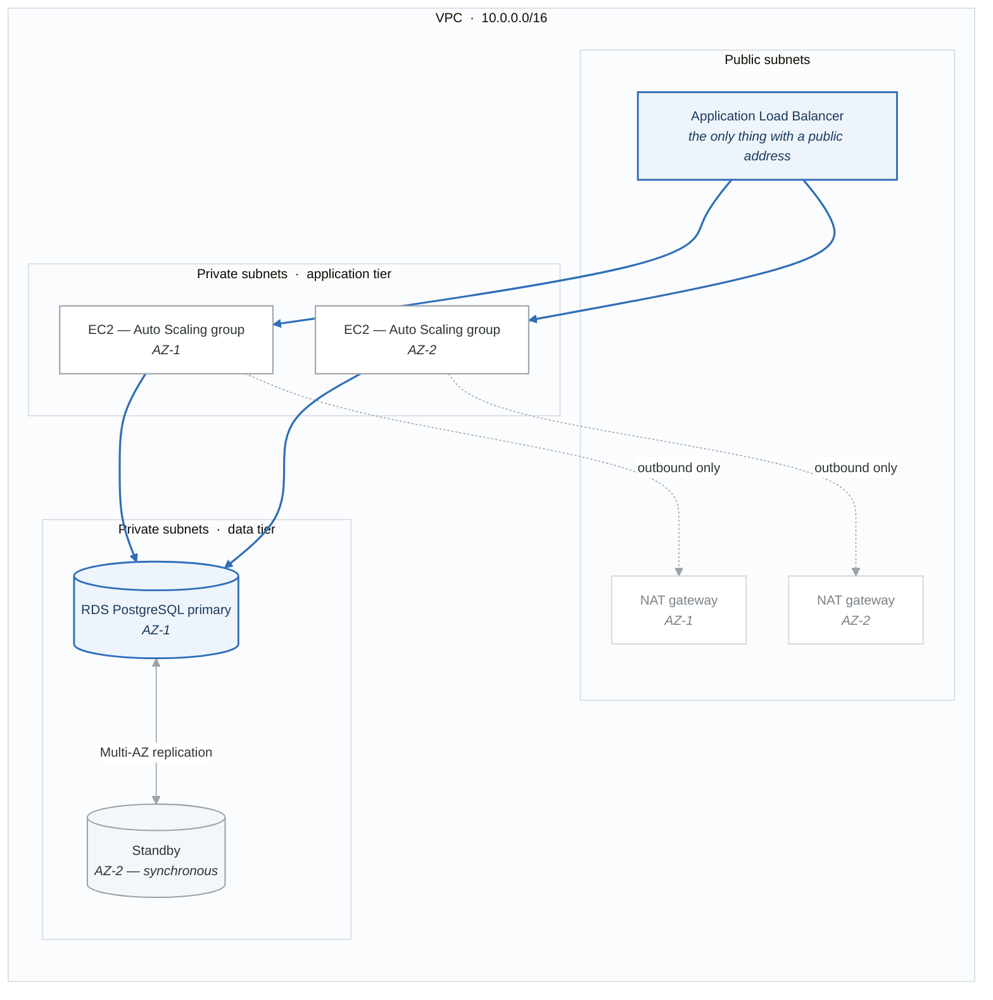

# Project 3: Three-Tier Web Application

Deploy a production-ready three-tier architecture with ALB, Auto Scaling, and RDS.

## Architecture

<!-- figure: generated from the Mermaid below by _shared/diagrams/embed-figures.py — do not edit the image -->

Diagram source (Mermaid)

## Features

- VPC with public/private subnets across 2 AZs
- Application Load Balancer with HTTPS
- Auto Scaling Group with launch template
- RDS PostgreSQL with Multi-AZ
- Security groups with least privilege
- Secrets Manager for database credentials
- CloudWatch alarms and dashboards
- S3 bucket for logs

## Modules Used

- `modules/vpc` - Network infrastructure
- `modules/alb` - Load balancer
- `modules/asg` - Auto scaling group
- `modules/rds` - Database
- `modules/security` - Security groups

## Difficulty: Advanced
## Estimated Time: 6-8 hours

<!-- feynman-check -->

---

## Feynman check

Close the file. Blank page, no notes. Explain each of these to a competent engineer who has never
used this tool — **under five minutes, no jargon you can't define on the spot:**

- Modules Used
- Difficulty: Advanced
- Estimated Time: 6-8 hours

**The gap is not what you forgot. It is where you used a word instead of a mechanism.**

| | |
|---|---|
| ✗ | *"Terraform manages your infrastructure."* |
| ✓ | *"`plan` is a three-way comparison: the configuration (desired), the state file (what Terraform believes it created), and a refresh against the real API (what exists). Almost every confusing result is one of those three drifting from the other two."* |

**Trace it:** `terraform apply` on one resource: config → plan → API call → state write. Then say what happens if the process dies between the API call and the state write.

Stop at the first component you cannot name. Reopen this file and read **only** that.

**Go deeper — only once the gap has a name:** [the purpose of Terraform state](https://developer.hashicorp.com/terraform/language/state/purpose) — almost every confusing result is a three-way disagreement, spelled out there.
Full list per domain: [`SOURCES.md`](../../SOURCES.md#terraform)

→ Protocol, the three levels of knowing, and worked examples: [`MASTERY.md`](../../MASTERY.md)

<!-- /feynman-check -->
