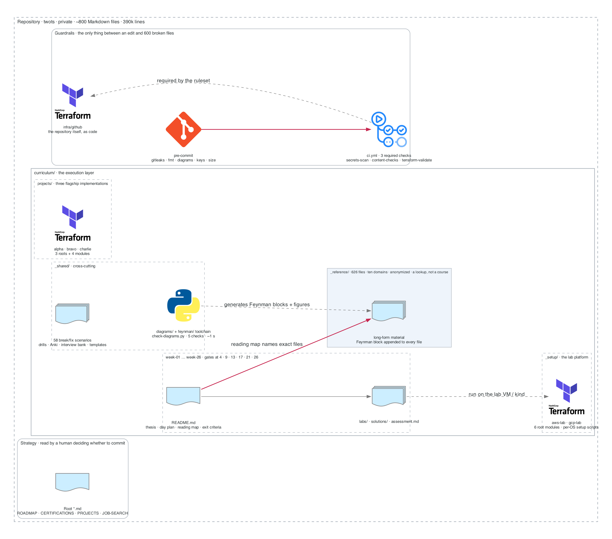
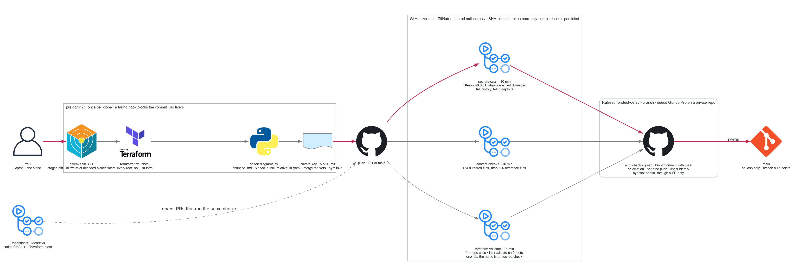
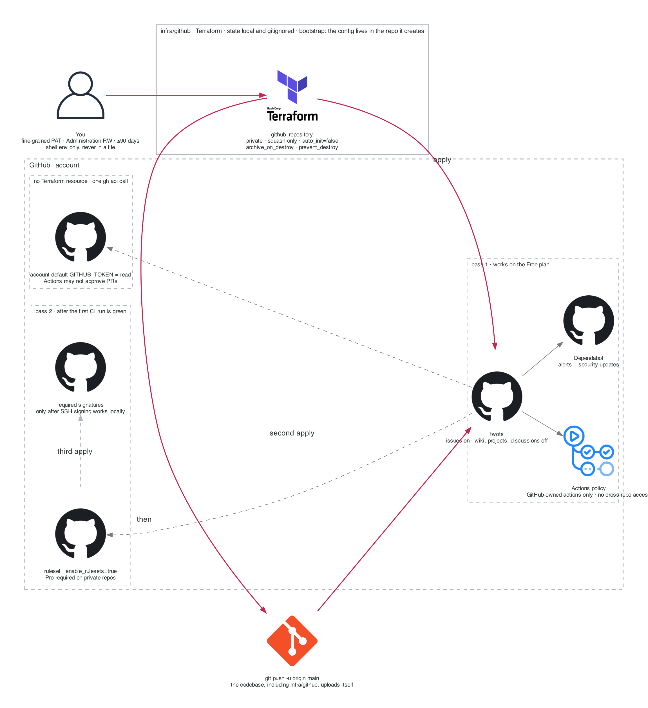
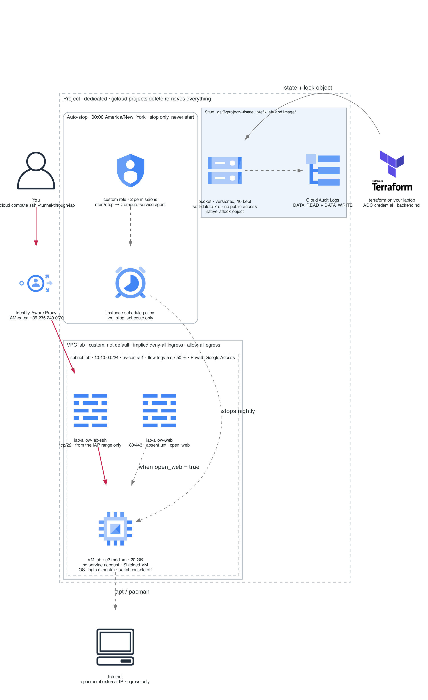
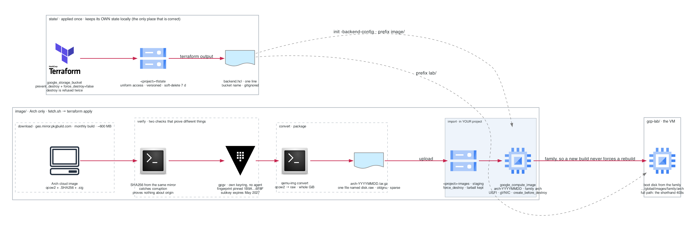
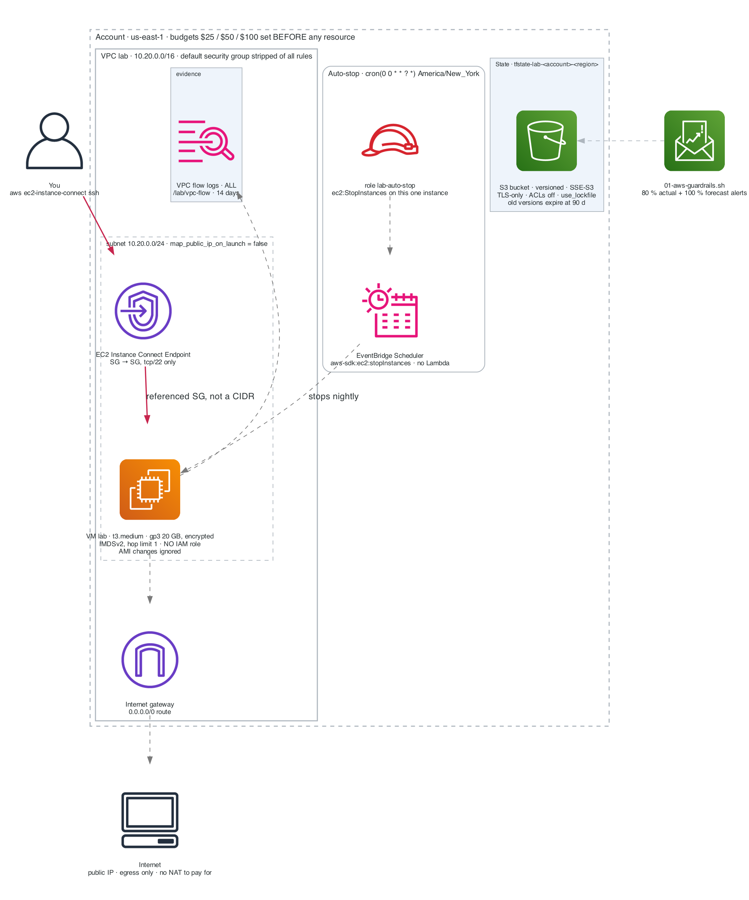
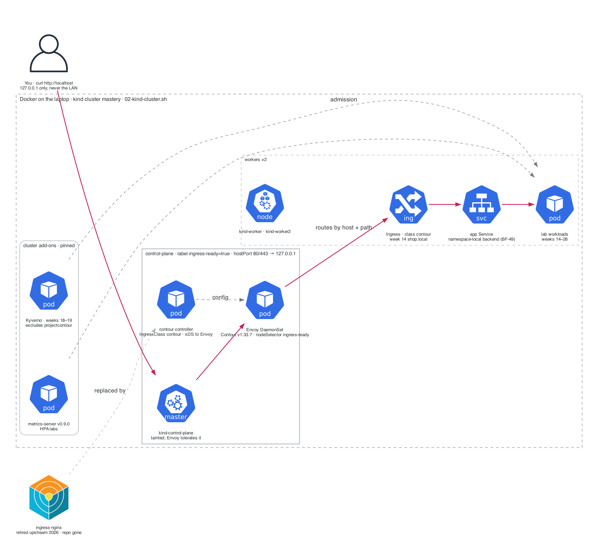
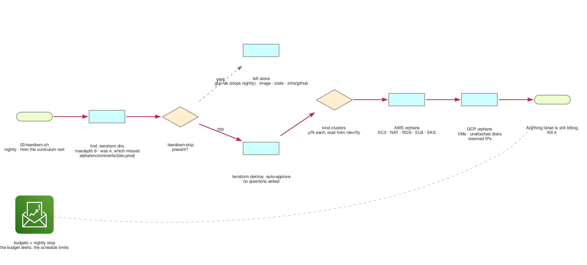
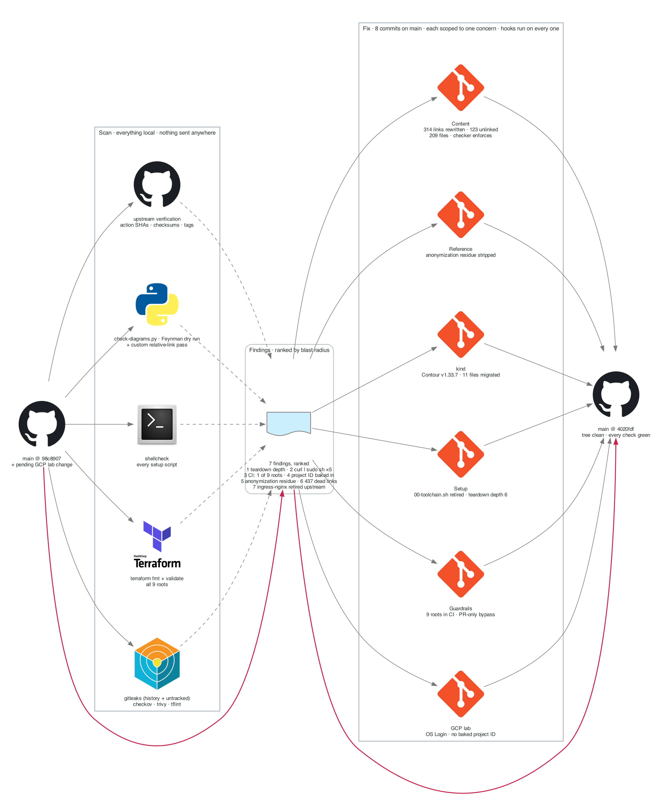
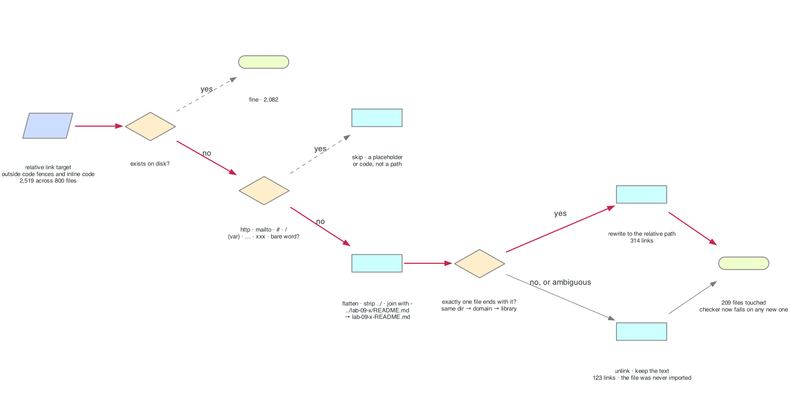

# The lab platform and its guardrails, in figures

> Ten figures, one visual language: gray is structure, **crimson is the path to follow first**,
> dashed gray is context, every boundary label carries a fact. Each figure has the numbers that
> matter, the mechanism behind the design, and the question a senior interviewer would ask about
> it. Regenerate with `python3 ../_shared/diagrams/generate-setup-figures.py`
> (needs `pip install diagrams` and Graphviz).

| # | Figure | What it answers |
|---|---|---|
| 1 | [The repository as a system](#figure-1--the-repository-as-a-system) | What is in here, and what depends on what |
| 2 | [Commit to merge](#figure-2--commit-to-merge) | What has to be true before a change lands on `main` |
| 3 | [The repository as code](#figure-3--the-repository-as-code) | How the GitHub side is built, in what order, and why it bootstraps itself |
| 4 | [GCP lab topology](#figure-4--gcp-lab-topology) | How you reach the VM, and why nothing else can |
| 5 | [GCP state and image supply chain](#figure-5--gcp-state-and-image-supply-chain) | Where state lives, and how an Arch image is proven before it boots |
| 6 | [AWS lab topology](#figure-6--aws-lab-topology) | The same design on AWS, and what is different |
| 7 | [The kind cluster](#figure-7--the-kind-cluster) | How `localhost` reaches a pod, and what replaced ingress-nginx |
| 8 | [Nightly teardown](#figure-8--nightly-teardown) | What the cost guardrail actually does each night |
| 9 | [The review](#figure-9--the-review) | What the 2026-10-17 review scanned, found, and changed |
| 10 | [The link resolver](#figure-10--the-link-resolver) | How 437 dead links were resolved mechanically and safely |

---

## Figure 1 — The repository as a system

**What it shows.** Four content layers with different readers, plus the toolchain that generates
parts of the content and the guardrails that protect all of it. The crimson edge is the one
coupling that breaks silently: a week README's reading map names `_reference/` files by exact path.

| Number | Meaning |
|---|---|
| ~800 / 390k | Markdown files / lines under git |
| 626 | files in `_reference/`, each with a machine-written Feynman block at the bottom |
| 58 | break/fix scenarios in `_shared/breakfix/` |
| 6 | gate weeks: 4, 9, 13, 17, 21, 26 |
| 9 | Terraform root modules: 6 under `_setup/`, 3 under `projects/alpha-cloud-foundation/` |
| 5 | checks `check-diagrams.py` runs on every file, in about one second |

**Why it is built this way.** The reference library is a lookup, not a course, so it is only
useful if the week files can point into it precisely. Renaming anything in `_reference/` is
therefore the most dangerous edit in the repo, and the relative-link check exists to make that
edit loud instead of silent.

**Teach it.** *"Where is the single point of failure in a content repo?"* The answer is the
cross-reference graph, not the content. Show the crimson edge.

---

## Figure 2 — Commit to merge

**What it shows.** The three places a bad change can be stopped, in cost order: on the laptop
before the commit exists, in CI after the push, and at the ruleset before the merge. Each layer
re-checks the layer before it, because a hook can be skipped and a laptop can be wrong.

| Number | Meaning |
|---|---|
| 2 | places the gitleaks version is pinned (`ci.yml` env and `.pre-commit-config.yaml` rev). Bump both or neither |
| 1 | sha256 the CI download must match before gitleaks runs |
| 0 | third-party actions allowed. Only `actions/*` and `github/*`, each pinned to a commit SHA |
| 3 | required status checks, named exactly as the jobs. A matrix would rename them |
| 174 + 626 | files the content check scans, authored layers first, then the reference library |
| 9 | Terraform roots validated, in one job so the check name stays stable |

**Why it is built this way.** Pre-commit has no fixers on purpose: a formatter's first run would
rewrite a thousand content files and bury every real diff. CI scans *full history*, not the diff,
because a secret deleted in a later commit is still a leak. The ruleset's admin bypass is
`pull_request`, not `always`: an admin can still merge over a red check, but only by leaving a PR
and an audit-log entry behind, so a hijacked session cannot push to `main` silently.

**Teach it.** *"Why is the token read-only if the workflow never writes anything?"* Because the
workflow is not the threat model; a compromised action is. Least privilege is set where it costs
nothing so it is already in place when it matters.

---

## Figure 3 — The repository as code

**What it shows.** The bootstrap pattern: Terraform in `infra/github/` creates the empty private
repository, then the first push uploads the codebase *including that Terraform*. From then on the
config lives inside the thing it manages.

| Number | Meaning |
|---|---|
| ≤90 days | PAT expiry. Fine-grained, Administration read-write, shell env only |
| 3 | applies: pass 1 on the Free plan, pass 2 for the ruleset (needs Pro), pass 3 for required signatures (needs SSH signing) |
| 1 | setting with no Terraform resource: the account-level default token permission, set with one `gh api` call |
| 0 | ways to delete the repo from Terraform: destroy archives, and `prevent_destroy` refuses even that |

**Why it is built this way.** `auto_init = false` matters: if GitHub seeded `main` with its own
README, day one would need a merge or a force-push. State is local and gitignored because it holds
only repository metadata; if the laptop dies, `terraform import` re-adopts the repo in one command.

**Teach it.** *"What happens if someone runs `terraform destroy` here?"* The repository is archived,
not deleted, and the plan is refused before that. Walk through both guards.

---

## Figure 4 — GCP lab topology

**What it shows.** There is exactly one way in. SSH is tunnelled through Identity-Aware Proxy, the
firewall admits port 22 only from IAP's published source range, and the VM has no service account,
so nothing running on it can call a GCP API no matter what a break/fix lab leaves behind.

| Number | Meaning |
|---|---|
| 10.10.0.0/24 | the lab subnet, one region, flow logs every 5 s at 50 % sampling |
| 35.235.240.0/20 | Google's IAP TCP-forwarding range: the only source allowed on tcp/22 |
| 0 | firewall rules for 80/443 until `open_web = true` (Week 3) |
| 2 | permissions in the auto-stop custom role: `instances.start` and `instances.stop`. The predefined role would also allow create, delete and reconfigure |
| 00:00 | nightly stop in `America/New_York`. It never starts the VM; you do |
| 10 / 7 d | state bucket: noncurrent versions kept / soft-delete window |

**Why it is built this way.** A custom VPC starts from implied deny-all ingress, so every open port
is a rule you can read. The default network ships with SSH open to the world, which is why it is
not used. OS Login is on for Ubuntu, turning SSH access into an IAM grant with a username derived
from your Google identity; Arch keeps metadata keys because its image lacks the guest agent that
implements OS Login.

**Teach it.** *"The VM has a public IP. Isn't that the thing you are supposed to avoid?"* Inbound is
default-deny; the IP exists for outbound package installs because Cloud NAT would cost more than
the VM. Say the trade-off out loud, with the numbers.

### The kubeadm nodes (weeks 27 to 30)

The same VPC grows two or three nodes for the CKA module (`kubeadm_nodes` in
[`gcp-lab/kubeadm.tf`](gcp-lab/kubeadm.tf)), because kind cannot offer a kubelet to stop, an etcd
to restore, or a `kubeadm upgrade` to run. Every guardrail above applies to them unchanged.

| Number | Meaning |
|---|---|
| 0 | nodes until week 27; `kubeadm_nodes` is 1 (control plane), 2 or 3 (workers) |
| 10.10.0.0/24 → 10.10.0.0/24 | the one rule that opens every port: node to node, inside the subnet only |
| 6443 | the API server, reachable from IAP's range alone; a laptop reaches it through `start-iap-tunnel` |
| 1 minor below | `kubernetes_minor` is set one below the exam's version so the upgrade lab has somewhere to go |
| 0 | `kubeadm init` and `join` run by the platform; the startup script stops at a prepared node |
| 00:00 | the same nightly stop as the lab VM |

**Teach it.** *"Why not just use kind for the CKA labs?"* Name the three things kind cannot do, and
why a cluster whose control plane is a container cannot teach you to recover one.

---

## Figure 5 — GCP state and image supply chain

**What it shows.** Two independent chains. Top: the state bucket is built once by a configuration
that must keep its own state locally, because a bucket cannot hold the state that creates it.
Bottom: the Arch image is downloaded, proven, converted, staged, and imported into *your* project
under an image family, so the lab references it exactly as it would a vendor image.

| Number | Meaning |
|---|---|
| ~600 MB | the monthly Arch cloud image |
| 2 | checks that prove different things: SHA256 proves the download is intact; the PGP signature proves who made it |
| 1B9A…6F8F | the pinned *primary* fingerprint. Signing subkeys rotate; the primary does not |
| May 2027 | when the current signing subkey expires and `arch-boxes.asc` must be refreshed |
| ~1 ¢/month | cost of leaving the tarball in the staging bucket, which avoids a 570 MB re-upload on every plan |
| 2022 | the build date of the only community Arch image on GCE, which is why this pipeline exists |

**Why it is built this way.** `gpgv` with a dearmored copy of one shipped key, not your keyring:
nothing you happen to trust can sway the result, and no agent starts. The image name contains the
family name on purpose; the provider suppresses a needless VM rebuild only when it does.

**Teach it.** *"A checksum matched. Is the image safe?"* No. The checksum came from the same server
as the file. Explain which link in the chain the signature protects and which it does not.

The runbook for this chain is [`gcp-lab/image/README.md`](gcp-lab/image/README.md).

---

## Figure 6 — AWS lab topology

**What it shows.** The same design as Figure 4 with AWS primitives: an EC2 Instance Connect
Endpoint instead of IAP, security-group references instead of a CIDR, EventBridge Scheduler
calling the EC2 API directly instead of a Lambda, and budgets created before the first resource.

| Number | Meaning |
|---|---|
| 10.20.0.0/16 → /24 | VPC and the single subnet |
| 1 | IMDSv2 hop limit, so a container on the VM cannot reach the metadata service |
| 0 | IAM roles on the instance |
| 14 d | flow-log retention: enough to review a week of lab traffic |
| $25 / $50 / $100 | budget tiers, alerting at 80 % actual and 100 % forecast |
| 90 d | after which old state versions expire from S3 |

**Why it is built this way.** `use_lockfile = true` gives S3-native locking, so there is no
DynamoDB table to manage. The VPC's default security group is stripped of its rules so nothing
can join it by accident. `ignore_changes = [ami]` keeps Canonical's frequent AMI republishes from
replacing your VM.

**Teach it.** *"Compare IAP and EC2 Instance Connect Endpoint."* Both remove the public SSH port;
the difference is where identity is checked and how the session is logged. Have the answer ready
for both clouds.

---

## Figure 7 — The kind cluster

**What it shows.** How `curl http://localhost` reaches a pod: the control-plane node maps host
ports 80/443 to 127.0.0.1 only, Contour's Envoy DaemonSet binds those ports on that node, and the
Ingress with class `contour` routes by host and path to a namespace-local Service.

| Number | Meaning |
|---|---|
| v1.33.7 | Contour, pinned. CNCF graduated |
| v0.9.0 | metrics-server, pinned, for the HPA labs |
| 3 | nodes: one control-plane, two workers |
| 127.0.0.1 | the only listen address, so the cluster is never exposed on the LAN |
| 11 | curriculum files migrated from the nginx class, annotation, or namespace |
| 2026 | the year ingress-nginx was retired upstream and its repository disappeared |

**Why it is built this way.** The script used to apply ingress-nginx from the `main` branch and
metrics-server from `latest`, so the cluster was a different cluster every week. Then the
repository vanished and the script could not build a cluster at all. Pinning is not pedantry; it
is what made the failure a one-line fix instead of a surprise on lab day.

**Teach it.** *"Why does the Envoy DaemonSet need a toleration?"* kind taints the control-plane,
and that is the only node with the host-port mapping. Say it in one sentence.

---

## Figure 8 — Nightly teardown

**What it shows.** The cost guardrail as a decision flow. Everything with a `.terraform` directory
is destroyed without asking unless a `.teardown-skip` file says otherwise; then the orphan checks
list what Terraform never knew about.

| Number | Meaning |
|---|---|
| 6 | search depth. It was 4, which from the curriculum root missed `projects/alpha-cloud-foundation/environments/{dev,prod}`, the roots with a database in them |
| 4 | directories that opt out: the GCP lab (it stops nightly instead), its image, its state bucket, and `infra/github` |
| 5 + 3 | AWS resource types and GCP resource types listed as potential orphans |

**Why it is built this way.** A budget only alerts; the nightly stop is what limits the bill. The
script is deliberately loud about failures: a destroy that fails prints `FAILED`, and the final
line says that anything listed is still billing.

**Teach it.** *"Why does the script run from the curriculum root only?"* Because `find` is relative
to the working directory, and the depth was tuned for that root. The depth bug is a good story
about how relative paths fail quietly.

---

## Figure 9 — The review

**What it shows.** What the 2026-10-17 review did: five local scan passes fanning into one ranked
findings list, and six fix commits fanning out from it, each scoped to one concern so the diff is
reviewable and each passing every hook.

| Number | Meaning |
|---|---|
| 7 | findings, ranked by blast radius |
| 8 | commits on `main`, including the baseline and the CLAUDE.md status update |
| 0 | secrets found, in history or in untracked files |
| 465 → 437 | raw relative-link hits → real breaks after excluding code and placeholders |
| 1 of 9 | Terraform roots CI validated before the review |

**Why it is built this way.** Scanners come first because they are cheap and do not anchor on a
hypothesis. Upstream verification came last and changed the shape of one finding: the plan was to
pin the ingress-nginx manifest, and the check showed there was nothing left to pin.

**Teach it.** *"How do you review a repo you did not write?"* Run every tool that has an opinion,
rank what survives by what it would cost if left alone, fix in commits a stranger can read.

---

## Figure 10 — The link resolver

**What it shows.** The algorithm that repaired the reference library's links after it was
flattened from directory trees into one file per topic. It only rewrites when exactly one file
matches the flattened path; otherwise it turns the link into plain text rather than guess.

| Number | Meaning |
|---|---|
| 2,519 | relative links across 800 files |
| 437 | that pointed nowhere |
| 314 | rewritten to the flattened filename, same directory preferred, then same domain |
| 123 | unlinked: the target was never imported into the corpus |
| 209 | files touched. Nothing inside a code fence or inline code was changed |

**Why it is built this way.** A resolver that guesses is worse than one that gives up: a wrong
link looks right until a reader follows it. Ambiguity and absence both produce plain text, and the
checker now refuses any new broken link, so the repair cannot regress.

**Teach it.** *"Why not fix links by hand?"* Four hundred edits by hand produce a different kind
of error. The mechanism is the deliverable: a rule you can state, a dry run you can read, and a
check that holds the line afterwards.

---

## Open items

- The Contour install, OS Login on Ubuntu, and the Windows setup script have not yet been exercised
  on a live cluster, VM, or Windows machine.
- `infra/github` state is local until the AWS state bucket exists (Week 5); the S3 backend block is
  documented in `infra/github/versions.tf`.
- The ruleset needs GitHub Pro on a private repository; until then the required checks run but
  nothing enforces them at merge.
