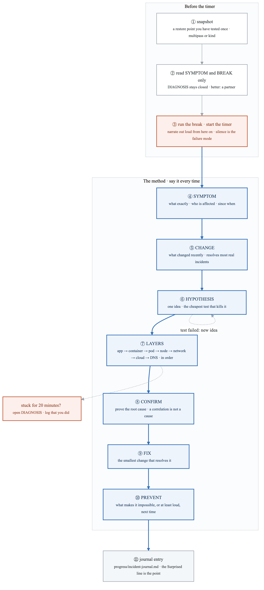
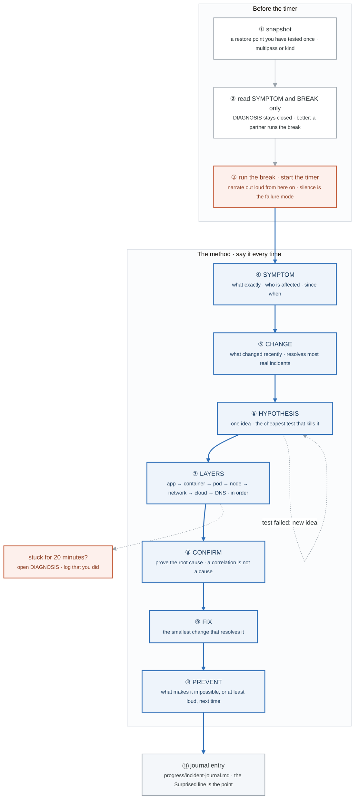

# Figure BF.0 — The diagnostic loop

> Every Break/Fix Friday, weeks 1 to 21 · badges ① to ⑪ · about two and a half minutes. This is the one
> figure every Friday lab shares; the week's own `labs/FIGURES.md` draws the specific failures.

<!-- figure: generated from the Mermaid below by _shared/diagrams/embed-figures.py — do not edit the image -->


<details>
<summary>Diagram source (Mermaid)</summary>



</details>

## Say it, badge by badge

- **Open.** "Interviewers reject more candidates for freezing on 'how would you troubleshoot this' than for any gap in knowledge. This loop is the thing they are measuring, and it is trained by repetition under a timer, fifty-eight times."
- **① snapshot.** "A restore point you have already restored from once. A break you cannot undo is a lab you stop doing."
- **② read SYMPTOM and BREAK only.** "The diagnosis section stays closed. With a partner, you do not even know which scenario ran. That is on-call."
- **③ run the break, start the timer.** "From here you narrate. 'I don't know, but here is how I would find out' passes. Silence does not."
- **④ SYMPTOM.** "What exactly is broken, who is affected, since when. Three questions, before touching anything. Most wrong fixes come from skipping this one."
- **⑤ CHANGE.** "What changed recently. In real incidents this resolves most of them, and in the lab it is the question that catches the break command you just ran."
- **⑥ HYPOTHESIS.** "One idea, and the cheapest test that would kill it. If the test fails, loop back with a new idea. The test is cheap on purpose; an expensive test is a fix in disguise."
- **⑦ LAYERS.** "App, container, pod, node, network, cloud, DNS. Walk them in order. The exciting layer is usually not the broken one, and the order is what stops you from guessing."
- **⑧ CONFIRM.** "Prove the root cause. A correlation that fits is not a cause; the proof is a command whose output could only look like this if your hypothesis is true."
- **⑨ FIX.** "The smallest change that resolves it. Not the refactor, not the rewrite."
- **⑩ PREVENT.** "What makes this impossible next time, or at least loud. This is the line that separates an operator from an engineer in the write-up."
- **⑪ journal entry.** "Symptom, hypothesis, confirmed, root cause, fix, prevent, and Surprised. The Surprised line marks the edge of your mental model, and by week 26 those lines are your interview stories."
- **Close.** "Seven steps, spoken, every Friday, under a timer. By week 17 any Gate 4 scenario takes under fifteen minutes, and by week 26 the question 'how would you debug this' has a shape instead of a silence."

## Numbers to own

| Number | Where it comes from | Why it matters |
|---|---|---|
| 7 steps | the method | symptom · change · hypothesis · layers · confirm · fix · prevent, in that order |
| 7 layers | step ⑦ | app → container → pod → node → network → cloud → DNS; walked in order, never skipped to |
| 20 minutes | the solo rule | stuck that long, open DIAGNOSIS and log that you did; the loop is practice, not a test of pride |
| 58 scenarios | BF-01 to BF-58 | the library, cumulative; week 20's Friday re-runs two old ones plus two new |
| 15 minutes | week 15's Gate 4 set | the target per scenario by week 17 |

## Prove it

```bash
multipass snapshot mastery --name pre-bf        # ① before any break on the Linux VM
date +%s > /tmp/bf-start                        # ③ the timer, honestly
cat progress/incident-journal.md | grep -c '^## BF-'   # ⑪ how many loops you have actually run
```

## The question a senior interviewer asks

*"Production is down and you have no idea why. What do you do in the first five minutes?"*
Badges ④ ⑤ ⑥, out loud. Symptom and blast radius, what changed, one hypothesis with a cheap test. Naming the loop is the answer; naming a tool is not.
