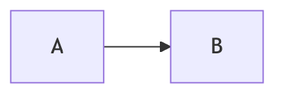

# Diagrams

| File | What it is |
|---|---|
| [STYLE.md](STYLE.md) | **The design system.** Palette, line semantics, container conventions, when a diagram earns its place. Read before drawing anything. |
| [theme.mmd](theme.mmd) | The standard header. Paste it above every flowchart. |
| [check-diagrams.py](check-diagrams.py) | **Fast static check** for the five bugs that break a diagram silently. One second, no browser. |
| [render.sh](render.sh) | Extracts every ```` ```mermaid ```` block, renders it, reports failures. Needs a browser; installs one into `.tools/` on first run. |
| [embed-figures.py](embed-figures.py) | Renders every block to a PNG and embeds it above the source. Run it after editing any diagram. |
| [deascii.py](deascii.py) | Converts the *mechanical* ASCII blocks — tables and framed prose — to real markdown. Never touches a flow diagram. |
| [generate-figures.py](generate-figures.py) | Graphviz generator for the three flagship project architecture figures — the ones that get vendor icons. |

## Validate before committing

```bash
./check-diagrams.py                     # one second, no browser -- run this every time
./render.sh --all                       # parse-check all 455 diagrams in a browser
JOBS=8 ./embed-figures.py --apply --all  # re-render the PNGs that changed
```

### The bugs `check-diagrams.py` catches

**1. A `linkStyle` index past the last edge.** Mermaid numbers edges in **declaration order**,
counting edges declared inside subgraphs, so the index you want is rarely the one you guess. At
render time it fails with:

```
TypeError: Cannot set properties of undefined (setting 'style')
```

which names neither the file, nor the line, nor the index. This bit the curriculum **four times**
while it was being written. The checker tells you the valid range.

**2. `classDef` in a diagram type that has no classes.** `flowchart`, `graph`, `classDiagram` and
`stateDiagram` accept `classDef`. `sequenceDiagram`, `gantt`, `journey`, `pie` and `erDiagram` do
not — the line is a parse error and the *whole* diagram dies. This happens the moment someone pastes
a flowchart header above a sequence diagram, which is how five diagrams here broke at once. Keep the
`%%{init}%%` header, drop the `classDef` lines.

**3. A code fence that swallows the rest of the file.** This one does not look like a fence problem
at all — it looks like a broken diagram. CommonMark lets a *closing* fence be indented up to three
spaces, and a block closes on the first bare fence of equal-or-greater length. So this:

````text
```markdown
# Example doc
```bash
kubectl get pods
```
```
````

ends at the `bash` block's closing fence, not at the last line. Every fence after it is off by one:
a ```` ```mermaid ```` block downstream is read as prose, and the tail of the document renders as one
grey slab. The fix is a four-backtick outer fence. Eleven files in this repo had it, and one of them
was hiding a Mermaid diagram — the checker reconstructs the intended nesting and names the line.

**4. A semicolon in a sequence diagram's text.** `;` is a *statement separator* in a
`sequenceDiagram`, so a semicolon inside a message or a `Note` ends the statement there and the rest
of your sentence is parsed as syntax. It fails only at render time, with an error that points at the
line after the one you wrote.

**5. Box-drawing characters outside any fence.** The signature of a block that was replaced only in
part, or of a nested fence that closed its parent early. It renders as a wall of broken characters.

**A diagram that does not render is worse than no diagram** — GitHub shows a red error box exactly
where your architecture should be, on the repo a hiring manager is reading.

## Every diagram is also a PNG

A ```` ```mermaid ```` block renders *client-side*, so it can fail for reasons that have nothing to do
with the diagram: GitHub pins its own Mermaid version and gives up past a complexity ceiling, and a
PDF export, a Notion paste or a plain markdown preview may not render Mermaid at all. So every
diagram in this repo is **also a pre-rendered PNG**, embedded above its source:

````markdown
<!-- figure: generated from the Mermaid below by _shared/diagrams/embed-figures.py -->


<details>
<summary>Diagram source (Mermaid)</summary>

  <!-- figure: generated from the Mermaid below by _shared/diagrams/embed-figures.py — do not edit the image -->


<details>
<summary>Diagram source (Mermaid)</summary>

```mermaid
  flowchart LR
    A --> B
  ```

</details>

</details>
````

The image always shows. The Mermaid stays in the file, collapsed — so it still diffs in a pull
request, it is still greppable, and `check-diagrams.py` and `render.sh` can still see it.

```bash
./embed-figures.py                 # report what would be embedded
./embed-figures.py --apply --all    # render everything and embed it
JOBS=8 ./embed-figures.py --apply --all
./embed-figures.py --revert --all   # strip the images, keep the Mermaid
```

**Edit the Mermaid, then re-run `--apply --all`.** The image filename contains a hash of the diagram
source, so an unchanged diagram is never re-rendered and a changed one always is. The full library is
455 diagrams and about 12 minutes of wall clock at `JOBS=8`; a single edit re-renders one file.

**PNG, not SVG — and this is the part that catches people.** Mermaid puts node labels inside
`<foreignObject>` when HTML labels are on, and a browser does **not** render `foreignObject` when the
SVG is loaded through an `` tag, which is exactly what a markdown image is. You get the boxes,
the arrows, and no text. You can avoid it with `htmlLabels: false`, but then `<b>`, `<i>` and
`<code>` in labels print literally. PNG at 2× has no such ambiguity.

The cost is about 33 MB of PNGs in `_figures/`. That is the price of diagrams that render
everywhere, and it is a price worth paying for a repository whose whole purpose is to be read.

## The two-track approach, and why

**Mermaid for everything in-repo.** It renders natively on GitHub, it is plain text so it diffs in a
pull request, and it needs no toolchain. Every diagram in the 26 weeks is Mermaid.

**Graphviz with vendor icons for the three flagship project figures.** Those are portfolio artifacts
that a hiring manager actually looks at, and Mermaid cannot draw an AWS service icon. That is the one
place the extra build step returns something. `generate-figures.py` produces them in the same visual
language — same palette, same container conventions, same crimson-for-the-critical-path rule.

## Checking links

```bash
python3 check-diagrams.py --links ../../_reference
```

Curls every markdown link target outside a code fence, with two workers' worth of politeness and one
retry (a transient `000` is a false report, and a checker that cries wolf stops being run). Skips
loopback and `example.com` placeholders, tolerates hosts that block scripted requests wholesale
(`gnu.org`, `iso.org`, `hhs.gov`), and honours a `.linkcheck-ignore` file at the root of the scan.

**A 200 does not mean current.** Nothing can detect a link that resolves but points at a superseded
spec — that is how a SLSA v1.0 link survived here while v1.2 was current. The convention: use the
vendor's floating URL (`.../latest/...`) and pin a version only when the version *is* the content.
