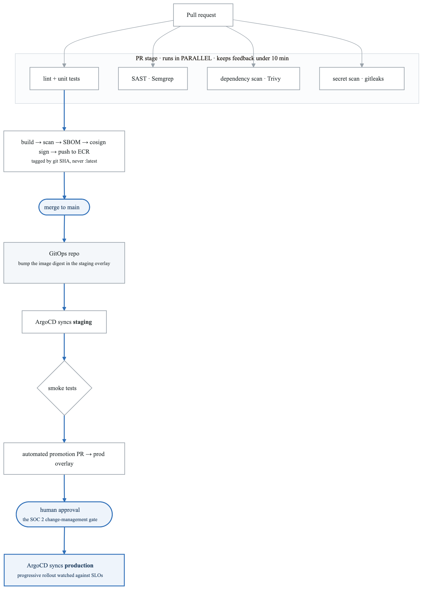
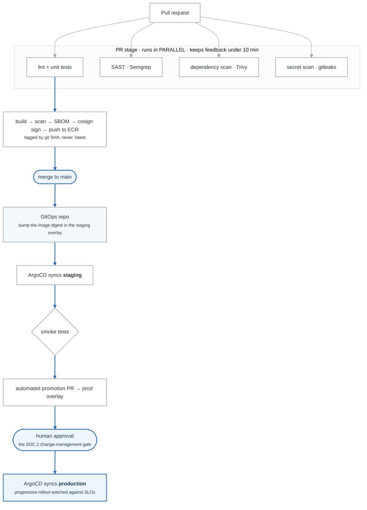
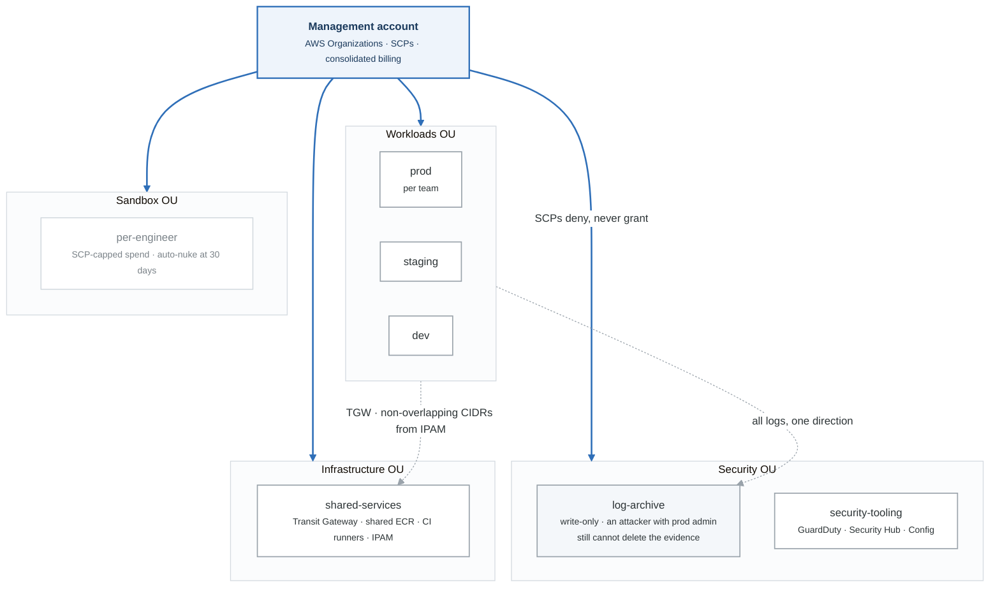
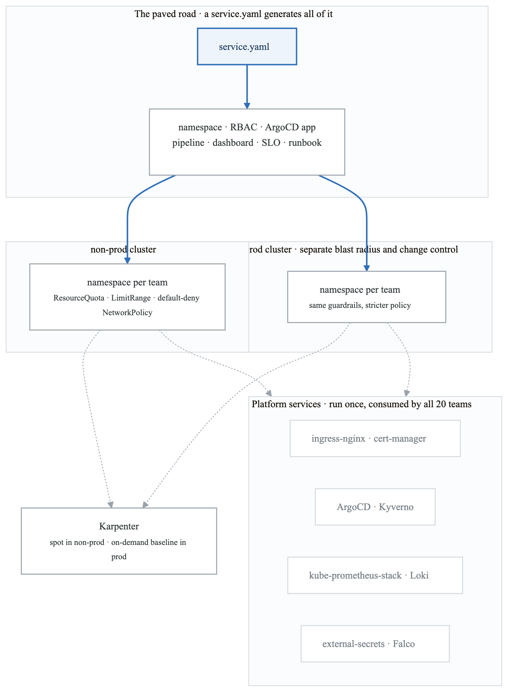
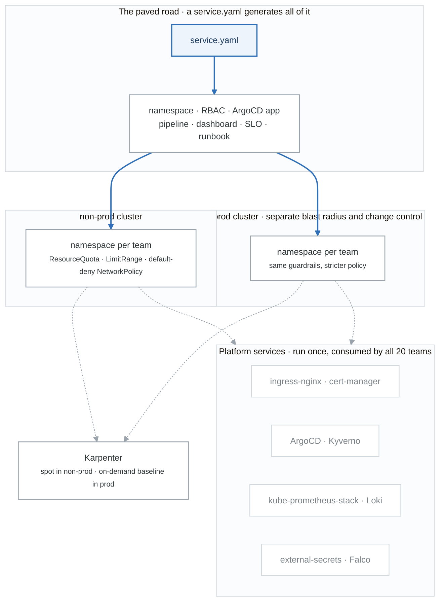

# Interview Bank: System Design

> At junior level you will not be asked to design a distributed database. You **will** be asked to
> design a pipeline, a landing zone, or a platform — and they are measuring **structure**, not
> brilliance.

## The method (use it every time)

```
1. CLARIFY   (3 min)  Scale? Users? Constraints? Compliance? What does "done" mean?
                      NEVER start drawing before this. Jumping straight to a diagram is the
                      most common failure in a design round.
2. REQUIREMENTS (2)   Functional (what it does) + non-functional (availability, latency,
                      security, cost). Write them where they can see.
3. HIGH LEVEL   (10)  Boxes and arrows. Happy path first, end to end.
4. DEEP DIVE    (15)  Let them pick, or pick the riskiest part yourself.
5. FAILURE      (5)   "What happens when X dies?" Ask it about your own design before they do.
6. TRADE-OFFS   (5)   What you chose, what you gave up, what you'd revisit at 10x scale.
```

**Narrate constantly.** Silence reads as being stuck. "I'm going to start with the request path and
come back to the data layer" is worth saying out loud.

---

## Design 1 — A CI/CD platform for 50 engineers

### Clarify first
How many services and repos? Monorepo or polyrepo? What languages? Deploy targets — Kubernetes,
serverless, VMs? Current deploy frequency and what they want. Compliance requirements — does someone
need to approve production? Existing tooling to keep?

**Assume for the answer:** 40 services, polyrepo, Python and Go, deploying to EKS, want to go from
weekly to daily, SOC 2 so production changes need an approval trail.

### Requirements
| Functional | Non-functional |
|---|---|
| Build, test, scan, deploy | PR feedback < 10 min (or people stop reading it) |
| Multi-environment promotion | Deploy < 15 min |
| Rollback | No long-lived cloud credentials |
| Audit trail for production | Audit trail for SOC 2 |

### High level
<!-- figure: generated from the Mermaid below by _shared/diagrams/embed-figures.py — do not edit the image -->


<details>
<summary>Diagram source (Mermaid)</summary>



</details>

### The decisions to defend```

### The decisions to defend
| Decision | Why | What you gave up |
|---|---|---|
| **Reusable workflows, not 40 copies** | One change updates every service's pipeline | Central team becomes a bottleneck for pipeline changes |
| **GitOps (pull) not push** | Git is the audit trail SOC 2 wants; cluster credentials never leave the cluster | Extra indirection; a second repo to reason about |
| **Tag by git SHA, never `latest`** | Immutable, traceable, rollback is a digest change | Slightly more verbose manifests |
| **OIDC for cloud auth** | No static keys to leak or rotate | Trust policies need care (see BF-37) |
| **Parallel checks in the PR stage** | Sub-10-minute feedback is the difference between a pipeline people use and one they route around | More concurrent runner minutes |

### Failure questions to raise yourself
- *Registry is down?* Deploys stop; running workloads are unaffected. Mitigate with pull-through cache.
- *ArgoCD is down?* Nothing new deploys, everything running keeps running — this is a real advantage
  of pull-based delivery over a push pipeline that's mid-deploy when it dies.
- *A bad image reaches production?* `kubectl rollout undo`, or revert the GitOps commit. Rollback
  should be one action, and you should have practiced it.
- *Someone needs an emergency deploy at 2am?* Break-glass path that skips approval but is **loud** —
  it pages and files a ticket automatically.

### Scale it
At 500 engineers: self-hosted runners for cost and speed, build caching, a monorepo-aware build
graph so you only build what changed, and merge queues to stop main breaking.

---

## Design 2 — A multi-account AWS landing zone

### Clarify
How many teams and environments? Compliance regime? Existing accounts to absorb? Network
connectivity to on-prem? Central or federated identity?

### High level
<!-- figure: generated from the Mermaid below by _shared/diagrams/embed-figures.py — do not edit the image -->


<details>
<summary>Diagram source (Mermaid)</summary>



</details>

### The decisions to defend```

### The decisions to defend
| Decision | Why |
|---|---|
| **Account per environment per team** | The account is the real blast radius boundary in AWS. IAM is not. |
| **SCPs deny, never grant** | Guardrails that even an account admin can't override — deny leaving the org, deny disabling CloudTrail, deny unapproved regions |
| **Centralized logging to a locked log-archive account** | An attacker with prod admin still can't delete the evidence |
| **Transit Gateway over full-mesh peering** | Peering is non-transitive; at n accounts you need n² connections |
| **Identity Center (SSO) with permission sets** | No IAM users anywhere, no access keys, short-lived credentials by construction |
| **Non-overlapping CIDRs allocated centrally from an IPAM** | Overlapping CIDRs make peering and TGW impossible later — and re-CIDRing a live VPC is brutal |

**The CIDR point is the one that shows experience.** Everyone gets it wrong once and only once.

### Failure questions
- *Root credentials compromised in a workload account?* SCPs still constrain it; the security account
  detects it; the log archive is in a different account they can't reach.
- *Someone deletes the shared-services VPC?* `prevent_destroy`, plus the fact that infrastructure
  changes go through a pipeline with approval.

---

## Design 3 — A Kubernetes platform for 20 teams

### Clarify
Are teams trusted or is this hostile multi-tenancy? Compliance? Stateful workloads? Do teams have
Kubernetes expertise, or is the point to hide Kubernetes from them?

**The answer to that last one determines the whole design** — a platform for K8s-fluent teams and a
platform for application developers who shouldn't need to learn it are different products.

### High level
<!-- figure: generated from the Mermaid below by _shared/diagrams/embed-figures.py — do not edit the image -->


<details>
<summary>Diagram source (Mermaid)</summary>



</details>

### The decisions to defend```

### The decisions to defend
| Decision | Why | Trade-off |
|---|---|---|
| **Namespace-per-team, not cluster-per-team** | Cluster sprawl is an operational tax paid forever; 20 clusters is 20 upgrade cycles | Weaker isolation; a noisy neighbor can still hurt via the node |
| **Separate prod cluster** | Different change control, different blast radius | Two of everything |
| **Quotas mandatory from day one** | Retrofitting quotas onto teams already running is politically impossible | Teams complain early — which is better than an outage later |
| **Observability generated, not opt-in** | A service with no dashboard is a liability | Platform team owns more surface |
| **Golden path, not a mandate** | Adoption you earn survives; adoption you mandate gets routed around | Must genuinely be the easiest path or nobody uses it |

### The question they'll actually ask
*"How do you stop one team taking down another?"*
> ResourceQuota caps aggregate consumption per namespace, LimitRange sets per-pod defaults so nobody
> ships an unbounded pod, NetworkPolicy default-deny means they can't even reach each other,
> PodDisruptionBudgets stop drains cascading, and priority classes make sure platform components
> survive eviction pressure. What none of that prevents is a node-level noisy neighbor — for genuinely
> hostile tenancy you need separate node pools or separate clusters, and that's a cost decision.

---

## Two rules for every design round

**Say the trade-off out loud.** "I'm choosing X, which costs more but gives us Y — if budget were the
binding constraint I'd go the other way." Interviewers are listening for whether you know there *is*
a trade-off. A design presented as having no downsides reads as inexperience.

**Ask the failure question before they do.** "What happens if the registry is unavailable?" asked by
you is worth far more than the same question asked by them.
