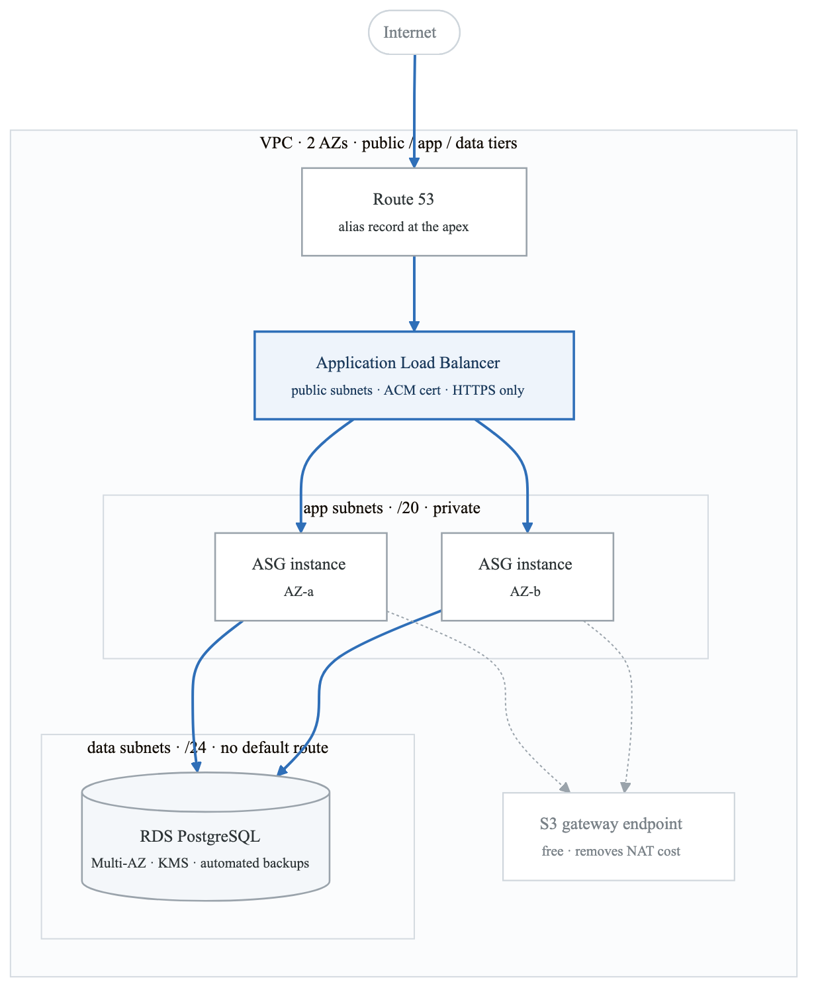
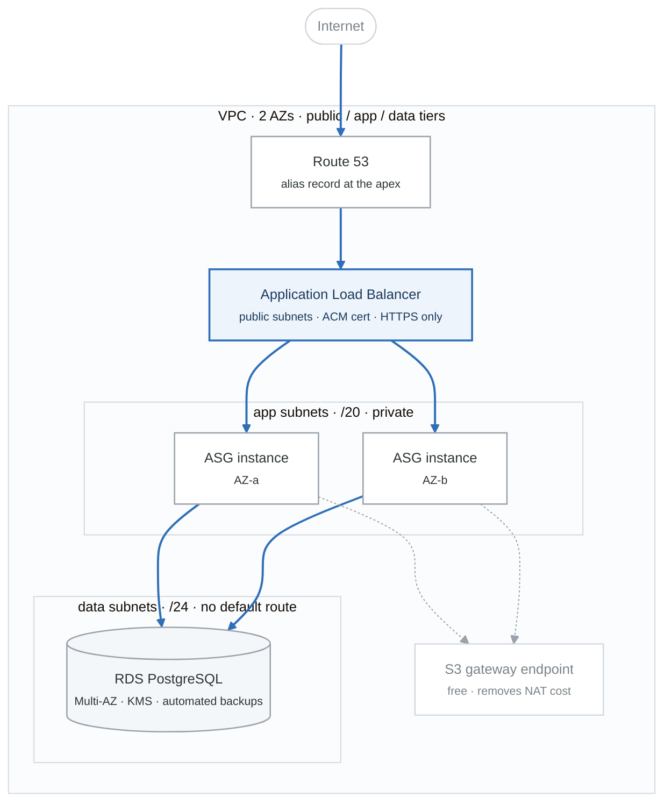

# Project ALPHA — Cloud Foundation (reference implementation)

> Production-shaped AWS infrastructure, entirely in Terraform, deployed by a pipeline with
> **zero long-lived AWS credentials**.

This is the **reference solution** for weeks 10–13. Build your own first; read this after.
Spec and acceptance criteria: [`../../PROJECTS.md`](../../../PROJECTS.md) §2.

## Architecture

<!-- figure: generated from the Mermaid below by _shared/diagrams/embed-figures.py — do not edit the image -->


<details>
<summary>Diagram source (Mermaid)</summary>



</details>

> The figure above is the quick read, and it renders anywhere. The **portfolio version** with AWS
> service icons is [`docs/architecture.png`](docs/architecture.png) (and `.svg`), regenerated with
> `_shared/diagrams/generate-figures.py`. Put that one in your README and your demo video.

## Quick start```

## Quick start

```bash
make bootstrap                      # create the state bucket, once
# copy the bucket name into environments/*/backend.tf
cp environments/dev/terraform.tfvars.example environments/dev/terraform.tfvars
make init ENV=dev
make plan ENV=dev
make apply ENV=dev
make verify ENV=dev                 # proves the acceptance criteria
make destroy ENV=dev                # leaves nothing billable
```

## What this demonstrates

- **Zero static AWS credentials.** CI authenticates via GitHub OIDC federation, exchanging a
  short-lived token for an STS role. `make verify` greps the repo and history to prove it.
- **The same modules build dev and prod.** Only the inputs differ — single NAT vs per-AZ,
  `t3.micro` vs `t3.small`, Multi-AZ off vs on, 1 vs 14 days of backups.
- **Database password never enters Terraform.** `manage_master_user_password = true` has RDS
  generate it and place it in Secrets Manager, so it never lands in plaintext state.
- **Symptom-based alerting.** Alarms fire on 5xx, p99 latency, and zero healthy hosts — things
  users feel — not on CPU.
- **Policy gates in CI.** `fmt` → `validate` → `tflint` → `checkov` → `plan` posted as a PR comment
  → approval → `apply` on merge.

## Key decisions

| Decision | Chose | Rejected | Why |
|---|---|---|---|
| CI auth | GitHub OIDC → STS | Static access keys in secrets | Nothing to leak or rotate; the trust policy pins the repo and environment |
| Environments | Separate directories | Terraform workspaces | Separate state and backends; prod can genuinely differ from dev |
| Subnet iteration | `for_each` keyed by AZ | `count` | Removing an AZ destroys one subnet, not three (BF-34) |
| Public subnet size | `/24` | `/20` like the others | They hold only NAT and ALB ENIs; uniform sizing wastes thousands of IPs |
| App subnet size | `/20` | `/24` | The VPC CNI assigns one IP per pod; re-CIDRing a live VPC is brutal |
| Data tier routing | **No default route at all** | Private subnet + NAT | A database should never initiate outbound; deny by routing, not firewall |
| DB password | `manage_master_user_password` | `random_password` | Terraform never sees it, so it never lands in state (BF-36) |
| SG source | The ALB's **security group ID** | A CIDR block | Follows instances through replacement; the fix for `Target.Timeout` (BF-28) |
| Health check type | `ELB` + 300s grace | `EC2` | `EC2` calls a crashed app healthy; short grace causes a launch/terminate loop (BF-29) |
| Shell access | SSM Session Manager | A bastion host | No open port 22, no keys, CloudTrail audit, no instance to patch |
| S3 access from private | Gateway endpoint | NAT gateway | Free vs ~$32/mo/AZ + $0.045/GB; traffic never leaves AWS |

Full ADRs in [`docs/adr/`](docs/adr/).

## Measured results

Fill these in from your own deployment — they belong in your README and your interview answers.

| Metric | dev | prod |
|---|---|---|
| `terraform apply` from clean account | | |
| PR opened → plan comment | | |
| Merge → deployed | | |
| Instance terminated → healthy target | | |
| RDS failover downtime | n/a | |
| Monthly cost | | |

## What broke and how I fixed it

> Replace these with your own. **This is the highest-signal section in the repo** — it proves the
> project was built rather than copied, and it hands the interviewer a question you're ready for.

### 1. ALB returned 503 for every request
**Saw:** healthy-looking instances, ALB returning 503.
**Was:** the app security group allowed the VPC CIDR, not the ALB's security group. Targets showed
`Target.Timeout` in `describe-target-health`.
**Found it:** `aws elbv2 describe-target-health` and reading the `Reason` field rather than guessing.
**Prevention:** always reference the source security group ID, never a CIDR.

### 2. ASG cycled instances forever
**Saw:** instances launching and terminating every few minutes; the bill climbing.
**Was:** `health_check_grace_period` of 60s with `health_check_type = "ELB"`, while the AMI took
~150s to install nginx and start.
**Found it:** `describe-scaling-activities` — the `Cause` field said "an instance was taken out of
service in response to an ELB system health check failure."
**Prevention:** grace period well above worst-case boot, measured rather than guessed.

### 3. `terraform plan` wanted to destroy three subnets
**Saw:** removing one AZ produced a plan with 3 destroys and 3 creates.
**Was:** `count` with positional indexes. Removing the middle element shifted everything after it.
**Fix:** `for_each` over a map keyed by AZ name.
**Prevention:** `for_each` unless I genuinely want N identical things.

## Cost

| | dev | prod |
|---|---|---|
| NAT gateway | ~$32 (single) | ~$96 (one per AZ) |
| ALB | ~$16 | ~$16 |
| EC2 | ~$8 (1× t3.micro) | ~$30 (2× t3.small) |
| RDS | ~$12 (t4g.micro) | ~$50 (Multi-AZ) |
| **Total** | **~$70/mo** | **~$195/mo** |

**Destroy it when you're not demoing it.** `make destroy ENV=dev`. The S3 gateway endpoint is free
and already removes S3 traffic from the NAT bill.

## Repo layout

```
bootstrap/           state bucket (local state, applied once)
modules/
  network/           VPC, subnets, IGW, NAT, route tables, endpoints, flow logs
  compute/           ALB, target group, launch template, ASG, IAM, security groups
  database/          RDS, KMS, subnet group, parameter group
  observability/     symptom-based alarms, SNS, dashboard
environments/
  dev/               single NAT, no Multi-AZ, small instances
  prod/              per-AZ NAT, Multi-AZ, 3 AZs
.github/workflows/
  terraform.yml      fmt→validate→tflint→checkov→plan-on-PR→apply-on-merge
  drift.yml          nightly refresh-only plan, opens an issue on drift
docs/adr/            architecture decision records
```

## Teardown

```bash
make destroy ENV=dev
make destroy ENV=prod
bash ../../_setup/03-teardown.sh    # finds orphaned NAT gateways, EIPs, volumes
```
