# Project BRAVO — Secure Kubernetes Delivery (starter + reference)

> A delivery pipeline that makes it **structurally difficult** to ship something insecure —
> and shows you the pipeline refusing to.

**Weeks 17–21.** Spec and acceptance criteria: [`../../../PROJECTS.md`](../../../PROJECTS.md) §3.
Design it yourself in week 17; use this as a reference, not a template to copy.

## The architecture

```mermaid
%%{init: {'theme':'base','themeVariables':{'fontFamily':'Helvetica, Arial, sans-serif','fontSize':'13px','primaryColor':'#ffffff','primaryTextColor':'#2d3436','primaryBorderColor':'#9aa3ab','lineColor':'#9aa3ab','textColor':'#2d3436','clusterBkg':'#fbfcfd','clusterBorder':'#d4dae0','edgeLabelBackground':'#ffffff','tertiaryColor':'#eef4fb'},'flowchart':{'curve':'basis','padding':14,'nodeSpacing':42,'rankSpacing':58}}}%%
flowchart LR
  classDef default fill:#ffffff,stroke:#9aa3ab,stroke-width:1.3px,color:#2d3436
  classDef n    fill:#ffffff,stroke:#9aa3ab,stroke-width:1.3px,color:#2d3436
  classDef crit fill:#eef4fb,stroke:#2f6fb8,stroke-width:1.8px,color:#1b3a5c
  classDef data fill:#f4f7fa,stroke:#9aa3ab,stroke-width:1.3px,color:#2d3436
  classDef mut  fill:#ffffff,stroke:#cfd6dc,stroke-width:1.1px,color:#7a8288
  classDef warn fill:#fdf0ec,stroke:#c0522d,stroke-width:1.6px,color:#8a3a1e

  DEV["commit"]:::mut

  subgraph CI["CI · every gate hard-fails · cheapest checks first"]
    direction TB
    G1["gitleaks<br/><small>secrets · full history</small>"]:::n
    G2["Semgrep<br/><small>SAST</small>"]:::n
    G3["Trivy fs<br/><small>dependencies</small>"]:::n
    G4["build<br/><small>distroless · non-root</small>"]:::n
    G5["Trivy image<br/><small>container CVEs</small>"]:::crit
    G6["syft<br/><small>SBOM</small>"]:::n
    G7["cosign sign<br/><small>signs the DIGEST</small>"]:::crit
    G1 --> G2 --> G3 --> G4 --> G5 --> G6 --> G7
  end

  subgraph REG["Registry"]
    IMG["image + signature + SBOM attestation"]:::data
  end

  ARGO["ArgoCD<br/><small>pull-based · selfHeal</small>"]:::n

  subgraph K8S["Cluster · admission and runtime"]
    direction TB
    KY["Kyverno<br/><small>signed images only · non-root · limits · no :latest</small>"]:::crit
    PSS["Pod Security Standards<br/><small>restricted</small>"]:::n
    NP["NetworkPolicy<br/><small>default-deny + DNS</small>"]:::n
    FAL["Falco<br/><small>runtime detection</small>"]:::n
    KY --> PSS --> NP --> FAL
  end

  DEV --> G1
  G7 --> IMG --> ARGO --> KY

  linkStyle 9,10,11,12 stroke:#2f6fb8,stroke-width:2px
```

<!-- figure: generated from the Mermaid below by _shared/diagrams/embed-figures.py — do not edit the image -->


<details>
<summary>Diagram source (Mermaid)</summary>



</details>

> The figure above is the quick read, and it renders anywhere. The **portfolio version** with AWS
> service icons is [`docs/architecture.png`](docs/architecture.png) (and `.svg`), regenerated with
> `_shared/diagrams/generate-figures.py`. Put that one in your README and your demo video.

## The two things that ARE the project```

## The two things that ARE the project

Everything else is presentation. These are the deliverable:

```bash
# 1. A critical CVE blocks the pipeline
echo "requests==2.19.1" >> app/requirements.txt && git commit -am "test: CVE" && git push
#    -> CI fails at the Trivy step, naming CVE-2018-18074
#    -> evidence/cve-blocked-build.png

# 2. An unsigned image is refused by admission control
kubectl -n shop run test --image=$REGISTRY/bravo-app:unsigned
#    -> admission webhook denies: "no matching signatures"
#    -> evidence/unsigned-image-rejected.png
```

**Almost every portfolio claims "integrated security scanning." Almost none show the pipeline
refusing to ship something.** The screenshots convert a claim into a demonstration.

## Layout

```
app/                       the application + hardened Dockerfile
.github/workflows/
  ci.yml                   ← week-18 solutions/pipeline/ci.yml
  verify-gates.yml         proves the gates block (runs on PRs)
infra/                     EKS via Terraform -- REUSE Alpha's network module
gitops/
  apps/                    ArgoCD Applications (app-of-apps)
  manifests/               Kustomize base + overlays
policies/
  kyverno/                 ← week-19 solutions/policies/kyverno-baseline.yaml
                             + week-18 kyverno-verify-images.yaml
  conftest/                ← week-19 solutions/policies/conftest-terraform.rego
docs/
  threat-model.md          STRIDE, per component (week 17)
  control-narrative.md     threat -> control -> EVIDENCE (the key artifact)
  compliance-mapping.md    control -> CIS / NIST / SOC 2
  adr/                     decisions
  runbooks/                one per alert
evidence/                  screenshots proving each gate blocks
```

## Where the pieces already exist

| Component | Source |
|---|---|
| The CI pipeline | [`../../week-18/solutions/pipeline/ci.yml`](../../week-18/solutions/pipeline/ci.yml) |
| Image signing enforcement | [`../../week-18/solutions/pipeline/kyverno-verify-images.yaml`](../../week-18/solutions/pipeline/kyverno-verify-images.yaml) |
| CVE exception format | [`../../week-18/solutions/pipeline/.trivyignore.yaml`](../../week-18/solutions/pipeline/.trivyignore.yaml) |
| Kyverno baseline policies | [`../../week-19/solutions/policies/kyverno-baseline.yaml`](../../week-19/solutions/policies/kyverno-baseline.yaml) |
| NetworkPolicies | [`../../week-19/solutions/policies/networkpolicies.yaml`](../../week-19/solutions/policies/networkpolicies.yaml) |
| Terraform policy gates | [`../../week-19/solutions/policies/conftest-terraform.rego`](../../week-19/solutions/policies/conftest-terraform.rego) |
| SLO rules and alerts | [`../../week-20/solutions/observability/slo-rules.yaml`](../../week-20/solutions/observability/slo-rules.yaml) |
| Kubernetes manifests | [`../../week-14/solutions/k8s-stack/`](../../week-14/solutions/k8s-stack/) |
| The network module | [`../alpha-cloud-foundation/modules/network/`](../alpha-cloud-foundation/modules/network/) |

**Reusing Alpha's network module is itself a signal** — and it's why the EKS subnet tags are already
correct (week 16's most common failure).

## Measured results

| Metric | Before | After |
|---|---|---|
| Image size | | |
| HIGH+CRITICAL CVEs | | |
| Time: commit → deployed | | |
| Time: Git change → cluster synced | | |
| Policy violations blocked in the last 30 days | | |

## What broke and how I fixed it

Three genuine entries. Strong candidates:
- **BF-52** — locked yourself out of the cluster with an enforcing Kyverno policy
- **BF-54** — default-deny NetworkPolicy broke DNS
- **BF-53** — signature verification failed after moving registries
- **BF-51** — an unfixable transitive CVE and how you triaged it

## Teardown

```bash
kubectl delete ingress,svc --all -A --field-selector spec.type=LoadBalancer
sleep 60                        # let the ALB controller release them
terraform -chdir=infra destroy
bash ../../_setup/03-teardown.sh
```
**Delete the Kubernetes objects that own cloud resources before destroying the cluster** — otherwise
the load balancers are orphaned and keep billing (week 16).
