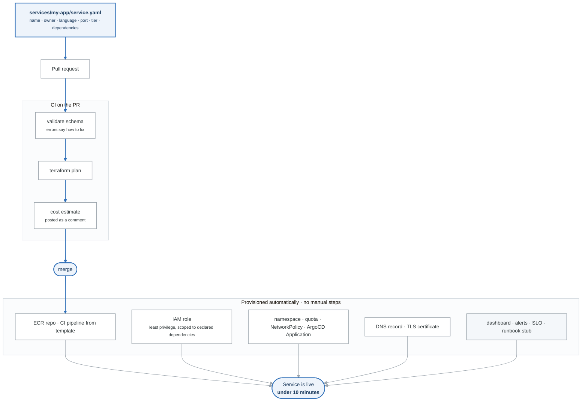

# Project CHARLIE — Internal Developer Platform (starter + reference)

> A developer adds one YAML file, opens a pull request, and gets a running service — with a
> pipeline, a dashboard, alerts, an SLO, and a runbook. **Under 10 minutes. Zero tickets.**

**Weeks 22–24.** Spec: [`../../../PROJECTS.md`](../../../PROJECTS.md) §4.
Design it yourself in week 22 — the product brief comes before the code.

## What a developer does

```yaml
# services/payments-api/service.yaml
apiVersion: platform.internal/v1
kind: Service
metadata:
  name: payments-api
  owner: team-payments
spec:
  language: python
  port: 8080
  tier: critical
  dependencies:
    - { type: postgres, version: "16", size: small }
    - { type: s3, access: readwrite }
```

Open a PR. A bot comments with **what will be created and what it costs per month**. Merge. Eight
minutes later you get the URLs.

<!-- figure: generated from the Mermaid below by _shared/diagrams/embed-figures.py — do not edit the image -->


<details>
<summary>Diagram source (Mermaid)</summary>



</details>

> The figure above is the quick read, and it renders anywhere. The **portfolio version** with AWS
> service icons is [`docs/architecture.png`](docs/architecture.png) (and `.svg`), regenerated with
> `_shared/diagrams/generate-figures.py`. Put that one in your README and your demo video.

## What the platform generates

| From | Generated |
|---|---|
| `metadata.name` | Namespace, ResourceQuota, LimitRange, ECR repo, DNS record, ArgoCD Application |
| `metadata.owner` | Cost-center tags, alert routing, RBAC |
| `spec.language` | The golden-path CI pipeline, and a scaffolded repo from the template |
| `spec.tier` | Replicas, PDB, SLO, alert severity, paging, Multi-AZ, backup retention |
| `spec.dependencies` | RDS/S3/SQS **plus a least-privilege IAM policy scoped to exactly those** |
| *(always)* | Dashboard, alerts, SLO recording rules, runbook stub, NetworkPolicy |

**Note the last row.** Observability is generated, never opt-in — a service with no observability is
not a service, it's a liability, and "we'll add monitoring later" is how that happens.

## The tier abstraction — the key design move

```yaml
tier: critical    # ONE decision a product engineer is qualified to make
```
instead of twelve technical ones (replicas, PDB minAvailable, topology spread, SLO target, alert
severity, paging policy, Multi-AZ, backup retention…).

| Tier | Replicas | PDB | SLO | Alerts | Multi-AZ | Backups |
|---|---|---|---|---|---|---|
| `critical` | 3 across AZs | minAvailable 2 | 99.9% | page 24/7 | yes | 14d |
| `standard` | 2 | minAvailable 1 | 99.5% | ticket, business hours | no | 7d |
| `experimental` | 1 | — | none | none | no | 1d, **auto-expires at 30 days** |

Three things this buys: the developer makes a decision they're qualified to make; the platform can
**change what `critical` means in one place**; and tiers become the language of a conversation a
product manager can join.

`auto_expire_days` on `experimental` prevents the worst category — "production without an SLO."

## Layout

```
platform/
policies/contract/    the business rules in Rego, their tests; run after the schema check
  schemas/service.schema.json    the contract, as JSON Schema -- also the field reference
  teams/teams.yaml               valid owners and their cost centers
  modules/                       versioned Terraform: runtime, pipeline, database,
                                 storage, observability
services/
  hello-api/service.yaml         example 1: minimal
  orders-api/service.yaml        example 2: postgres + s3, tier=critical
template-service/                the repo scaffold -- ships HARDENED by default
cli/platform                     `platform new-service --name X --language python`
.github/workflows/
  validate.yml                   schema + business rules, on PR
  plan.yml                       terraform plan + infracost, comments on the PR
  provision.yml                  on merge: apply, scaffold, register, report
  deprovision.yml                on file deletion, with guardrails
docs/
  getting-started.md             the five-minute path
  tiers.md                       readable by a product manager
  escape-hatches.md              going off the path is SUPPORTED
  adr/
```

## Where the pieces already exist

| Component | Source |
|---|---|
| The contract shape | [`../../_shared/templates/service.yaml`](../../_shared/templates/service.yaml) |
| Terraform module patterns | [`../alpha-cloud-foundation/modules/`](../alpha-cloud-foundation/modules/) |
| The CI pipeline to template | [`../../week-18/solutions/pipeline/ci.yml`](../../week-18/solutions/pipeline/ci.yml) |
| Generated policies | [`../../week-19/solutions/policies/`](../../week-19/solutions/policies/) |
| Generated SLO rules | [`../../week-20/solutions/observability/slo-rules.yaml`](../../week-20/solutions/observability/slo-rules.yaml) |
| Generated manifests | [`../../week-14/solutions/k8s-stack/`](../../week-14/solutions/k8s-stack/) |
| Runbook template | [`../../_shared/templates/RUNBOOK-template.md`](../../_shared/templates/RUNBOOK-template.md) |

**Charlie introduces almost no new technology.** It is everything from months 1–5 composed behind one
contract — which is exactly the point, and worth saying in an interview.

## The contract's business rules

The schema says what `service.yaml` may contain. It cannot say what a valid file means: that the
owner is a real team, that a critical service can survive a node drain, that an experimental service
is never public, that a name is not already taken. Those are rules, and rules live in
`policies/contract/`, in Rego, run by Conftest with `platform/teams/teams.yaml` loaded as data:

```bash
conftest verify --policy policies/contract --data platform/teams                      # the rules' own tests
conftest test   --policy policies/contract --data platform/teams services/*/service.yaml
conftest test   --policy policies/contract --data platform/teams --combine services/*/service.yaml   # uniqueness across files
./cli/validate.py services/orders-api/service.yaml      # shape first, then the rules, when conftest is installed
```

Every message keeps the validator's discipline: where, what, the valid options with their meaning,
and what to do next. Week 23's Go deeper lab is where the rules are written.

## ★ GATE 6

> **A person who has never seen this repo follows the README and deploys a service via pull request
> in under 10 minutes, unaided.**

Everything else about this project is a claim. This is the demonstration. See
[`../../week-24/assessment.md`](../../week-24/assessment.md).

## Measured results

| Metric | Value |
|---|---|
| PR merged → service running | |
| `platform new-service` → PR open | |
| Manual steps required | **0** |
| Services with a dashboard and alerts | **100%** |
| Stranger's time to first deploy | |
| Monthly cost, per tier | |

## What broke and how I fixed it

Three genuine entries. Strong candidates: the validation error that said what was wrong but not what
to do · orphaned load balancers on deprovision · a non-idempotent apply · whatever the stranger test
surfaced.
