# Week 1 — Linux I, Git, and the Environment

> **Thesis:** Every DevOps concept you will meet for the rest of your career is a Linux concept, a
> networking concept, or a Git concept wearing a cloud costume. A container is namespaces and
> cgroups. A Kubernetes Service is iptables. A VPC is routing and subnetting.
> **Skipping this week is why people plateau at "I can follow a tutorial."**

| | |
|---|---|
| **Hours** | 30–45 |
| **Deliverable** | `sysreport.sh` in a public GitHub repo with a real README |
| **Break/Fix** | BF-01 – BF-04 |
| **Exit check** | Navigate, inspect, and modify a Linux system without googling basic commands |

---

## The week in one figure

**Figure 1.1 — A process on a Linux system, from the shell to the commit.** Everything the week teaches is one of four mechanisms: how a command becomes a process, how the kernel decides what it may touch, how text flows between processes, and how Git records the result. Badges are numbered in the order to walk them; the blue path is the one to follow first.

```mermaid
%%{init: {'theme':'base','themeVariables':{'fontFamily':'Helvetica, Arial, sans-serif','fontSize':'13px','primaryColor':'#ffffff','primaryTextColor':'#2d3436','primaryBorderColor':'#9aa3ab','lineColor':'#9aa3ab','textColor':'#2d3436','clusterBkg':'#fbfcfd','clusterBorder':'#d4dae0','edgeLabelBackground':'#ffffff','tertiaryColor':'#eef4fb'},'flowchart':{'curve':'basis','padding':14,'nodeSpacing':42,'rankSpacing':58}}}%%
flowchart LR
  classDef default fill:#ffffff,stroke:#9aa3ab,stroke-width:1.3px,color:#2d3436
  classDef n    fill:#ffffff,stroke:#9aa3ab,stroke-width:1.3px,color:#2d3436
  classDef crit fill:#eef4fb,stroke:#2f6fb8,stroke-width:1.8px,color:#1b3a5c
  classDef data fill:#f4f7fa,stroke:#9aa3ab,stroke-width:1.3px,color:#2d3436
  classDef mut  fill:#ffffff,stroke:#cfd6dc,stroke-width:1.1px,color:#7a8288
  classDef warn fill:#fdf0ec,stroke:#c0522d,stroke-width:1.6px,color:#8a3a1e

  subgraph HOST["The VM · one user, one shell, one kernel"]
    direction LR
    A1["① bash<br/><small>PATH lookup · fork then exec</small>"]:::crit
    A2["② the process<br/><small>PID · /proc/PID · ps and top</small>"]:::crit
    A3["③ permission check<br/><small>uid, gid · rwx bits · 644 vs 755</small>"]:::crit
    A4["④ the filesystem<br/><small>/etc config · /var state · /proc the kernel talking</small>"]:::data
    A5["⑤ the pipeline<br/><small>grep then awk then sort then uniq -c</small>"]:::n
    A6["⑥ the script<br/><small>set -euo pipefail · traps · argparse by hand</small>"]:::n
    A7["⑦ special bits<br/><small>setuid passwd · sticky /tmp · umask 022</small>"]:::warn
  end
  subgraph GIT["Git · the record"]
    direction LR
    G1["⑧ working tree to index to commit<br/><small>a commit is a snapshot plus a parent SHA</small>"]:::data
    G2["⑨ remote<br/><small>push · branch · PR · public repo</small>"]:::n
  end
  BF["⑩ Break/Fix BF-01 to BF-04<br/><small>disk full · wrong perms · zombie · PATH</small>"]:::warn
  A1 ==> A2 ==> A3 ==> A4
  A4 --> A5 --> A6
  A3 -.-> A7
  A6 --> G1 --> G2
  A2 -.-> BF
  linkStyle 0,1,2 stroke:#2f6fb8,stroke-width:2px
```



**What to say, badge by badge** · about three minutes at a normal pace. Point at each badge as you say its line.

- **Open.** “This is one week of Linux in one picture: a command becomes a process, the kernel checks what it may touch, text flows through a pipeline, and Git records what you built. Follow the blue path first.”
- **① bash.** “Every command starts here. The shell searches PATH, forks itself, and the child execs the program. That is why a typo in PATH breaks everything at once, and why `which` is the first debugging command.”
- **② the process.** “The result is a process with a PID. /proc/PID is not a file on disk; it is the kernel describing that process. `ps` and `top` read it. When a lab says inspect a process, this is the directory to open.”
- **③ permission check.** “Before any read or write, the kernel compares the file's owner, group, and mode bits to the process's uid and gid. 644 means owner writes, everyone reads. On a directory, execute means enter, which is why 755 matters there.”
- **④ the filesystem.** “The hierarchy is a convention worth memorizing: /etc is configuration, /var is state that grows, /proc and /sys are the kernel. Where a file lives tells you who owns the problem.”
- **⑤ the pipeline.** “Text processing is processes connected by pipes. grep selects lines, awk picks fields and counts into an associative array, sort and uniq -c aggregate. A 100,000-line log becomes a top-10 report with four processes.”
- **⑥ the script.** “A real script starts with `set -euo pipefail`: exit on error, error on an unset variable, fail the pipeline if any stage fails. Traps clean up. Arguments are parsed by hand. This is `sysreport.sh`.”
- **⑦ special bits.** “Three bits that are classic interview and escalation material. setuid lets `passwd` edit /etc/shadow as root. The sticky bit lets everyone write /tmp but delete only their own files. umask 022 is why new files are 644, not 666.”
- **⑧ working tree to index to commit.** “A commit is not a diff. It is a snapshot plus the SHA of its parent, which is why history is a chain and why rewriting one commit changes every SHA after it. The index is the staging step in between.”
- **⑨ remote.** “push sends the chain. A branch is a pointer, a pull request is a conversation about a pointer. The deliverable is public, which means the README has to work for a stranger.”
- **⑩ Break/Fix.** “Four scenarios, forty minutes, narrated out loud: disk full, wrong permissions, a zombie, a broken PATH. Each one is logged in the incident journal. That journal is the interview story bank.”
- **Close.** “So: shell to process to permission check to filesystem, text through pipes, a script that fails loudly, and Git recording it. Nothing in the next 25 weeks is not one of these in a costume.”

---

## Day plan

| Day | Focus | Lab |
|---|---|---|
| Mon | Environment + filesystem + navigation | Lab 1 |
| Tue | Permissions, users, processes | Lab 2 |
| Wed | Text processing: grep, sed, awk, jq | Lab 3 |
| Thu | Bash scripting proper | Lab 4 |
| Fri | **Break/Fix** BF-01–04, then ship the deliverable | Lab 5 |
| Sat | Git fundamentals + push everything | Lab 6 |
| Sun | Review, write notes, plan week 2 | — |

---

## Reading map

**Primary (read once, then build):**
- `_reference/linux-networking/01-linux-fundamentals.md`
- `_reference/linux-networking/02-filesystem-deep-dive.md`
- `_reference/linux-networking/03-users-permissions.md`
- `_reference/linux-networking/04-process-management.md`
- `_reference/linux-networking/05-shell-scripting-basics.md`
- `_reference/linux-networking/06-advanced-shell-scripting.md`

**Alternate explanation if something doesn't click:**
- `_reference/linux-networking/alt/01-linux-introduction.md` … `alt/07-shell-scripting.md`

**Free primary sources worth using instead of a course:**
- The `man` pages. Seriously — `man 7 signal`, `man 5 crontab`, `man 1 find`.
- Linux Journey (linuxjourney.com) — free, short, well-sequenced
- `explainshell.com` — paste any command, get every flag explained
- ShellCheck (shellcheck.net) — run every script through it

> **The 70/30 rule starts today.** Read a section once, then build the lab from a blank file with
> only `man` and the docs. If you can't start from blank, you haven't learned it.

---

## Labs

| # | Lab | Time |
|---|---|---|
| 1 | [Environment setup and filesystem tour](labs/lab-01-environment.md) | 3h |
| 2 | [Permissions, users, and processes](labs/lab-02-permissions-processes.md) | 3h |
| 3 | [Text processing — the log analysis lab](labs/lab-03-text-processing.md) | 3h |
| 4 | [Bash scripting: build `sysreport.sh`](labs/lab-04-bash-sysreport.md) | 4h |
| 5 | [Break/Fix Friday](labs/lab-05-breakfix.md) | 2h |
| 6 | [Git fundamentals and your first repo](labs/lab-06-git.md) | 3h |

Solutions in [`solutions/`](solutions/). **Open them only after a genuine attempt** — reading a
solution feels like learning and isn't.

---

## Daily drills (Block 4, 45 min)

- `_shared/drills/bash-oneliners.md` — Text processing + Files sections
- Anki: import `_shared/anki/linux-networking.tsv`, review daily from today
- **Write 5 of your own cards** from anything that surprised you

---

## Exit criteria

Tick every box before moving to week 2.

- [ ] Navigate a Linux filesystem and find any file without looking up `find` syntax
- [ ] Explain the difference between `644` and `755`, and what those bits mean **on a directory**
- [ ] Read `ps`/`top` output and identify the top CPU and memory consumers
- [ ] Write a Bash script from blank with `set -euo pipefail`, argument parsing, and error handling
- [ ] Extract a top-10 report from a 100k-line log using only `grep`/`awk`/`sort`/`uniq`
- [ ] `git init`, branch, commit, push, and open a PR without a reference
- [ ] `sysreport.sh` is public on GitHub with a README someone else could follow
- [ ] 4 break/fix entries in `progress/incident-journal.md`

---

## Setup checklist (do this first, Monday morning)

```bash
bash ../_setup/macos-setup.sh      # install everything (linux-setup.sh on Linux/WSL)
bash ../_setup/verify.sh           # confirm

mkdir -p ~/mastery/progress
cd ~/mastery
git init
cp ../_shared/templates/PROJECT-README-template.md README.md
```

Create `progress/progress.md` and `progress/incident-journal.md` now. You will fill them every week
for 26 weeks, and they become your interview story bank.
